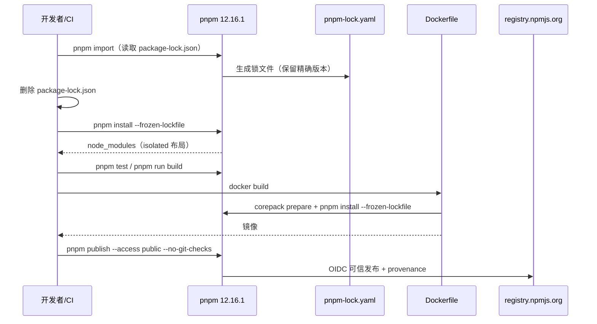

# 全仓 npm 包管理迁移 pnpm - 技术提案

**功能名称**: 全仓 npm 包管理迁移 pnpm（含 Dockerfile、GitHub Actions、Aspire 编排、agent-controller 发布）
**关联 PRD**: 无（工程效能/基础设施改造，需求来源为本次任务描述）
**技术提案版本**: v1.0
**创建日期**: 2026-11-02
**作者**: ZeroAsh Agent
**feat-branch**: `feat/pnpm-migration`

## 1. 概述

### 1.1 背景

当前仓库是"多项目共仓"，但没有根 `package.json` / workspace，每个 Node 项目独立安装、独立锁文件：

| 类别 | 项目 | 现状 |
|---|---|---|
| 前端 | `apps/admin-web`、`apps/agent-web` | `package-lock.json`（lockfileVersion 3），npm 安装 |
| 后端 | `servers/admin-api`、`servers/agent-api`、`servers/controller-api`、`servers/cloud-controller` | 同上 |
| CLI/发布包 | `packages/agent-controller`（包名 `agent-gear`） | 同上，发布到 npmjs.org |
| 测试 | `tests/api`、`tests/e2e` | 同上 |
| 构建 | 5 个项目 Dockerfile | `npm ci` / `npm run build` / `npm ci --omit=dev`，缓存挂载 `/root/.npm` |
| CI | 7 个 workflow | `actions/setup-node` + `cache: npm` + `npm ci` / `npx vitest` |
| 编排 | `aspire/AgentGear.AppHost/AppHost.cs` | `AddNodeApp` / `AddViteApp`，默认包管理器为 npm |
| 发布 | `.github/workflows/publish-agent-gear.yml` | npm 11 + OIDC 可信发布到 `registry.npmjs.org` |

需求：把这些项目的 npm 包管理全部换为 pnpm；Dockerfile 同步；agent-controller 的 GitHub workflow 发布流程要同步支持发布到 npmjs.org；Aspire 编排改用 pnpm 专用 API。

### 1.2 目标

1. **包管理统一**：9 个 Node 项目全部使用 pnpm，提交 `pnpm-lock.yaml`，不再提交 `package-lock.json`。
2. **版本固定**：所有 `package.json` 增加 `packageManager: "pnpm@12.16.1"`，本地、CI、Docker、Aspire 使用同一 pnpm 版本。
3. **依赖版本不漂移**：用 `pnpm import` 从现有 `package-lock.json` 生成锁文件，保持当前已安装的精确版本，再删除 `package-lock.json`。
4. **Dockerfile 可复现**：5 个项目 Dockerfile 改为 corepack 启用 pnpm + `pnpm install --frozen-lockfile` + pnpm store BuildKit 缓存；运行时只装生产依赖。
5. **CI 统一**：6 个镜像/部署 workflow 改为 `pnpm/action-setup` + `pnpm install --frozen-lockfile` + `pnpm test` / `pnpm run build`。
6. **npmjs.org 发布不回归**：agent-controller 发布 workflow 改用 `pnpm publish`，继续走 GitHub OIDC 可信发布（无需长期 token），并显式锁定 `registry.npmjs.org`、加版本幂等保护。
7. **Aspire 使用 pnpm API**：`AppHost.cs` 的 5 个 Node 资源与 2 个 Vite 资源统一追加 `.WithPnpm()`。
8. **文档同步**：README、各项目 AGENTS.md、admin-web README 的安装/启动命令改为 pnpm。

### 1.3 范围

**做**：

- 9 个项目的 `package.json`、`pnpm-lock.yaml`、`pnpm-workspace.yaml`（仅用于 pnpm 12 的 `allowBuilds` 配置）；
- `packages/agent-controller/package.json` 增加 `publishConfig`（npmjs registry + public）；
- 5 个 Dockerfile：`apps/admin-web`、`servers/admin-api`、`servers/agent-api`、`servers/cloud-controller`、`servers/controller-api`；
- 7 个 workflow：5 个 `build-*-image.yml`、`deploy-agent-web.yml`、`publish-agent-gear.yml`；
- `aspire/AgentGear.AppHost/AppHost.cs`：`WithPnpm()`；
- 上述项目的开发文档命令。

**不做**：

- **不建立根 pnpm workspace**（原因见 §6.1 D1）。每个项目仍是独立安装单元，保留现有独立 Docker build context 与独立 workflow 路径过滤。
- **不改 `deploy/images/worker/Dockerfile` / `entrypoint.sh` 的 npm 全局安装**：它们是 worker 镜像的 CLI 引导链（`npm install -g agent-gear`），不是仓库项目的依赖安装；且已由 `20261029-feat-pnpm-workload-and-harness-optional` 明确保留 npm 作为 pnpm/agent-gear 自举通道。
- **不改面向用户的安装提示**（`apps/agent-web/src/lib/command-template.ts` 的 `npm install -g agent-gear`）：npm 仍是消费者合法安装方式，且该提示不属于仓库包管理。
- **不改 Node 版本**：`node:22-alpine` / `node:24-alpine` 保持不变；不升级运行时大版本。
- **不改业务代码、GraphQL/OpenAPI 契约、数据库 schema**。
- **不 bump `agent-gear` 版本**：本次只换包管理器，发布内容与版本号无关。

## 2. 技术架构

### 2.1 系统架构图

```mermaid
graph TD
    subgraph 本地开发
        DEV[开发者] --> CP[corepack / pnpm 12.16.1]
        ASPIRE[Aspire AppHost<br/>WithPnpm] --> CP
        CP --> PROJ[9 个独立项目<br/>pnpm-lock.yaml + pnpm-workspace.yaml]
    end

    subgraph CI
        GHA[GitHub Actions] --> PSA[pnpm/action-setup@v6.1.0]
        PSA --> INST[pnpm install --frozen-lockfile]
        INST --> TEST[pnpm test / pnpm run build]
        TEST --> IMG[5 个 Docker 镜像]
        TEST --> NPM[pnpm publish agent-gear]
    end

    subgraph Docker
        DF[5 个项目 Dockerfile] --> CORE[corepack prepare pnpm]
        CORE --> STORE[(/pnpm/store 缓存)]
        CORE --> DINST[pnpm install --frozen-lockfile / --prod]
    end

    NPM --> REG[(registry.npmjs.org)]
```

### 2.2 技术栈

| 层级 | 技术选型 | 说明 |
|---|---|---|
| 包管理器 | pnpm `12.16.1` | 所有项目 `packageManager` 固定；pnpm 12 锁文件格式 v9 |
| 锁文件迁移 | `pnpm import` | 从现有 `package-lock.json` 生成 `pnpm-lock.yaml`，保留精确版本 |
| 构建脚本策略 | `pnpm-workspace.yaml` 的 `allowBuilds` | pnpm 11+ 默认拦截依赖构建脚本；按项目显式 allow/deny |
| Docker | `corepack` + BuildKit cache mount | `corepack prepare pnpm@12.16.1 --activate`；store 挂载 `/pnpm/store` |
| CI | `pnpm/action-setup@v6.1.0` + `actions/setup-node@v4` | action-setup 必须先于 setup-node（`cache: pnpm` 依赖 pnpm 可用） |
| 发布 | `pnpm publish` + GitHub OIDC | pnpm 12 原生 publish 流程，支持 npm trusted publishing |
| 编排 | `Aspire.Hosting.JavaScript` 的 `WithPnpm()` | 5 个 `AddNodeApp` + 2 个 `AddViteApp` |

### 2.3 模块划分

| 模块 | 职责 | 关键技术点 |
|---|---|---|
| 项目元数据 | 固定 pnpm 版本、构建脚本白名单、npmjs 发布配置 | `packageManager`、`pnpm-workspace.yaml`、`publishConfig` |
| 锁文件 | 每个项目一份 `pnpm-lock.yaml` | `pnpm import` 保版本；`--frozen-lockfile` 校验 |
| Dockerfile | 镜像内安装依赖 | corepack、store 缓存、`--prod` |
| GitHub Actions | 安装/测试/构建/发布 | action-setup、pnpm 缓存、OIDC |
| Aspire AppHost | 本地编排 | `WithPnpm()` 自动安装并运行脚本 |
| 文档 | 开发命令 | pnpm 安装/启动口径 |

## 3. 接口设计

### 3.1 对外契约

**无 GraphQL / OpenAPI / WebSocket 契约变更**。本次只改变依赖安装与发布通道，服务运行时行为不变。

包管理契约：

| 契约项 | 约定 |
|---|---|
| pnpm 版本 | `packageManager: "pnpm@12.16.1"`，所有项目一致 |
| 锁文件 | 每项目 `pnpm-lock.yaml`；禁止同时提交 `package-lock.json` |
| 安装命令 | 开发/CI：`pnpm install --frozen-lockfile`；运行时镜像：`pnpm install --prod --frozen-lockfile` |
| 脚本命令 | 保持 `package.json` 现有 scripts 不变，调用方式由 `npm run x` 改为 `pnpm run x` / `pnpm x` |
| 发布包 | `agent-gear`，registry 固定 `https://registry.npmjs.org/`，access `public` |

### 3.2 内部接口

- `pnpm-workspace.yaml`（每项目一个，`packages` 字段省略，仅作为 pnpm 项目配置根）：

```yaml
# servers/admin-api 示例
allowBuilds:
  esbuild: true
  protobufjs: true
  fsevents: true
  mongodb-memory-server: false
```

- `packages/agent-controller/package.json`：

```json
{
  "packageManager": "pnpm@12.16.1",
  "publishConfig": {
    "access": "public",
    "registry": "https://registry.npmjs.org/"
  }
}
```

- Dockerfile 统一片段：

```dockerfile
ARG PNPM_VERSION=12.16.1
RUN corepack enable && corepack prepare pnpm@${PNPM_VERSION} --activate
COPY package.json pnpm-lock.yaml pnpm-workspace.yaml ./
RUN --mount=type=cache,id=pnpm-store,target=/pnpm/store \
    pnpm install --frozen-lockfile --store-dir=/pnpm/store
```

## 4. 数据模型

无数据库/缓存变更。文件层面替换：

| 项目 | 删除 | 新增 |
|---|---|---|
| `apps/admin-web` | `package-lock.json` | `pnpm-lock.yaml`、`pnpm-workspace.yaml` |
| `apps/agent-web` | `package-lock.json` | `pnpm-lock.yaml`、`pnpm-workspace.yaml` |
| `servers/admin-api` | `package-lock.json` | `pnpm-lock.yaml`、`pnpm-workspace.yaml` |
| `servers/agent-api` | `package-lock.json` | `pnpm-lock.yaml`、`pnpm-workspace.yaml` |
| `servers/controller-api` | `package-lock.json` | `pnpm-lock.yaml`、`pnpm-workspace.yaml` |
| `servers/cloud-controller` | `package-lock.json` | `pnpm-lock.yaml`、`pnpm-workspace.yaml` |
| `packages/agent-controller` | `package-lock.json` | `pnpm-lock.yaml`、`pnpm-workspace.yaml` |
| `tests/api` | `package-lock.json` | `pnpm-lock.yaml`、`pnpm-workspace.yaml` |
| `tests/e2e` | `package-lock.json` | `pnpm-lock.yaml`、`pnpm-workspace.yaml` |

## 5. 技术实现方案

### 5.1 核心流程



### 5.2 关键实现点

#### 实现点 1：每项目独立 pnpm（不建根 workspace）

- **描述**：每个项目保留独立 `package.json`、`pnpm-lock.yaml`，各自成为一个 pnpm 项目根。
- **原因**：现有 Docker build context 是子目录、workflow 按子目录 path filter、Aspire 按子目录 `AddNodeApp`。引入根 workspace 会强制所有 Dockerfile 改用仓库根 context、复制全仓 manifest，并让独立发布 workflow 与 workspace 锁文件耦合，收益（单锁文件）不抵风险。
- **注意**：pnpm 12 的构建脚本白名单必须写在项目根的 `pnpm-workspace.yaml`；省略 `packages` 时该文件只代表当前项目，不会把子目录变成 workspace。

#### 实现点 2：`package.json` 元数据

每个项目增加：

```json
"packageManager": "pnpm@12.16.1"
```

`agent-controller` 额外增加 `publishConfig`（见 §3.2），确保即使仓库根 `.npmrc` 指向镜像源，发布仍落到 npmjs.org。

#### 实现点 3：锁文件迁移（保版本）

执行顺序（逐项目）：

```bash
cd <project>

# 1) pnpm 12 的构建脚本白名单（按项目实际依赖填写）
#    mongodb-memory-server 明确禁止构建，统一由 CI 显式下载 mongod
$EDITOR pnpm-workspace.yaml

# 2) 从 package-lock.json 导入精确版本
pnpm import

# 3) 删除 npm 锁文件
rm package-lock.json

# 4) 校验锁文件可复现安装
pnpm install --frozen-lockfile

# 5) 跑该项目测试/构建
pnpm test
pnpm run build   # 如有
```

`pnpm import` 保留 `package-lock.json` 中已解析的精确版本，避免重新解析 `^` 范围导致依赖漂移。

#### 实现点 4：`allowBuilds` 策略

pnpm 11+ 默认拦截依赖的 install/postinstall 脚本，未显式允许会直接 `ERR_PNPM_IGNORED_BUILDS`。按当前锁文件盘点：

| 项目 | 需要允许 | 明确禁止 |
|---|---|---|
| `apps/admin-web`、`apps/agent-web` | `fsevents`（macOS 可选） | — |
| `packages/agent-controller` | `esbuild`、`fsevents` | — |
| `servers/admin-api`、`servers/agent-api`、`servers/cloud-controller` | `esbuild`、`protobufjs`、`fsevents` | `mongodb-memory-server` |
| `servers/controller-api` | `esbuild`、`protobufjs`、`fsevents` | — |
| `tests/api`、`tests/e2e` | `fsevents` | — |

**`mongodb-memory-server` 明确设置 `false`，不执行其 postinstall**。CI 中继续用现有显式步骤下载 mongod：

```bash
node node_modules/mongodb-memory-server/postinstall.js
```

这保证：pnpm 安装阶段不触发隐式下载；需要 mongod 的测试仍由 CI 显式准备，缓存键改为 `pnpm-lock.yaml`。

#### 实现点 5：Dockerfile（6 个）

统一模式（以 `servers/admin-api` 为例）：

```dockerfile
# syntax=docker/dockerfile:1
FROM node:24-alpine AS build

ARG PNPM_VERSION=12.16.1
WORKDIR /app
RUN corepack enable && corepack prepare pnpm@${PNPM_VERSION} --activate
COPY package.json pnpm-lock.yaml pnpm-workspace.yaml ./
RUN --mount=type=cache,id=pnpm-store,target=/pnpm/store \
    pnpm install --frozen-lockfile --store-dir=/pnpm/store
COPY . .
RUN pnpm run build

FROM node:24-alpine AS runtime

ARG PNPM_VERSION=12.16.1
WORKDIR /app
ENV NODE_ENV=production
RUN corepack enable && corepack prepare pnpm@${PNPM_VERSION} --activate
COPY package.json pnpm-lock.yaml pnpm-workspace.yaml ./
RUN --mount=type=cache,id=pnpm-store,target=/pnpm/store \
    pnpm install --prod --frozen-lockfile --store-dir=/pnpm/store
COPY --from=build /app/dist ./dist

USER node
EXPOSE 4002
ENTRYPOINT ["node", "dist/index.js"]
```

各文件差异：

| 文件 | 变更 |
|---|---|
| `apps/admin-web/Dockerfile` | 构建阶段 pnpm；补 `# syntax`（新增 cache mount）；`pnpm run build`；runtime nginx 不变 |
| `servers/admin-api/Dockerfile` | build/runtime 双阶段 pnpm；runtime `--prod` |
| `servers/cloud-controller/Dockerfile` | 同上 |
| `servers/agent-api/Dockerfile` | build 阶段 pnpm；runtime 仍 `COPY --from=build /app /app`（现有 `node src/index.ts` 方式不变） |
| `servers/controller-api/Dockerfile` | 同上 |
| `deploy/images/worker/Dockerfile` | **不改**（见 §1.3） |

#### 实现点 6：CI workflow（6 个构建/部署）

统一模式：

```yaml
- uses: pnpm/action-setup@v6.1.0
  with:
    version: 12.16.1

- uses: actions/setup-node@v4
  with:
    node-version: '24'
    cache: pnpm
    cache-dependency-path: servers/admin-api/pnpm-lock.yaml

- name: Install and test
  working-directory: servers/admin-api
  run: pnpm install --frozen-lockfile && pnpm test
```

涉及：

- `build-admin-api-image.yml`：`MONGOMS` 缓存键改 `pnpm-lock.yaml`；注释与 mongod 预下载步骤保留；`npm test` → `pnpm test`。
- `build-admin-web-image.yml`：`pnpm install --frozen-lockfile && pnpm run lint && pnpm exec vitest run`。
- `build-agent-api-image.yml`、`build-cloud-controller-image.yml`、`build-controller-api-image.yml`：同上。
- `deploy-agent-web.yml`：`pnpm install --frozen-lockfile` + `pnpm run build`。

#### 实现点 7：agent-controller 发布 workflow（npmjs.org）

现有 workflow 已通过 `actions/setup-node` 的 `registry-url` + `id-token: write` 走 OIDC 可信发布。迁移到 pnpm 后：

```yaml
name: Publish agent-gear to npm

on:
  workflow_dispatch:
  push:
    branches: [release, 'release/**']
    paths: ['packages/agent-controller/**']

env:
  NPM_CONFIG_REGISTRY: https://registry.npmjs.org/

jobs:
  publish:
    runs-on: ubuntu-latest
    permissions:
      contents: read
      id-token: write
    steps:
      - uses: actions/checkout@v4

      - uses: pnpm/action-setup@v6.1.0
        with:
          version: 12.16.1

      - uses: actions/setup-node@v4
        with:
          node-version: 24
          cache: pnpm
          cache-dependency-path: packages/agent-controller/pnpm-lock.yaml

      - name: Install
        working-directory: packages/agent-controller
        run: pnpm install --frozen-lockfile

      - name: Build
        working-directory: packages/agent-controller
        run: pnpm run build

      - name: Test
        working-directory: packages/agent-controller
        run: pnpm test

      - name: Check published version
        id: version
        working-directory: packages/agent-controller
        run: |
          VERSION=$(node -p "require('./package.json').version")
          if npm view "agent-gear@$VERSION" version >/dev/null 2>&1; then
            echo "published=true" >> "$GITHUB_OUTPUT"
          else
            echo "published=false" >> "$GITHUB_OUTPUT"
          fi

      - name: Publish
        if: steps.version.outputs.published == 'false'
        working-directory: packages/agent-controller
        run: pnpm publish --access public --no-git-checks
```

关键点：

1. **不再依赖 `NPM_TOKEN`**：保留 `id-token: write`，pnpm 12 在 GitHub Actions 中识别 OIDC 并换取短期发布令牌；npmjs 上需配置 Trusted Publisher（仓库 `Deliay/z-agent-gear`、workflow 文件名 `publish-agent-gear.yml`、允许 `npm publish`）。
2. **显式 registry**：`publishConfig.registry` + `NPM_CONFIG_REGISTRY` 双保险，避免仓库根 `.npmrc`（`registry.npmmirror.com`）影响发布。
3. **`--no-git-checks`**：CI 是 detached HEAD，pnpm publish 默认的 git 分支/clean 检查会失败。
4. **版本幂等**：push 到 release 时若该版本已存在，跳过 publish，不再产生失败构建；需要发新版时先 bump `packages/agent-controller/package.json`。
5. **provenance**：OIDC 可信发布由 npm 自动生成 provenance（公开仓库 + 公开包），无需 `--provenance`。

#### 实现点 8：Aspire AppHost 使用 `WithPnpm()`

`Aspire.Hosting.JavaScript` 13.6.3 提供 `WithPnpm(install: true, installArgs?)`：读取 `package.json` 的 `packageManager` 固定版本，开发时自动执行 `pnpm install`，发布时生成/使用 pnpm 安装命令。

修改 `aspire/AgentGear.AppHost/AppHost.cs`：

```csharp
var controllerApi = builder.AddNodeApp("controller-api", "../../servers/controller-api", "src/index.ts")
    .WithPnpm()
    // ... existing WithEnvironment/WithReference

var agentApi = builder.AddNodeApp("agent-api", "../../servers/agent-api", "src/index.ts")
    .WithPnpm()
    // ...

var cloudController = builder.AddNodeApp("cloud-controller", "../../servers/cloud-controller", "src/index.ts")
    .WithPnpm()
    // ...

var agentController = builder.AddNodeApp("agent-controller", "../../packages/agent-controller", "src/index.ts")
    .WithPnpm()
    // ...

var adminApi = builder.AddNodeApp("admin-api", "../../servers/admin-api", "src/index.ts")
    .WithPnpm()
    // ...

var agentWeb = builder.AddViteApp("agent-web", "../../apps/agent-web")
    .WithPnpm()
    // ...

var adminWeb = builder.AddViteApp("admin-web", "../../apps/admin-web")
    .WithPnpm()
    // ...
```

说明：

- `AddNodeApp` / `AddViteApp` 在检测到 `package.json` 时仍会先挂默认 npm annotation；`WithPnpm()` 覆盖为 pnpm，二者不冲突。
- `WithPnpm()` 的 `install` 默认 `true`，与现有 npm 行为一致（每次 `aspire start` 前安装依赖）。
- 若后续 Aspire 升级到 Node 25 基础镜像，corepack 可能被移除；届时改用 `npm install -g pnpm@12.16.1` 作为 Docker/Aspire 的引导方式。

#### 实现点 9：文档同步

| 文件 | 修改 |
|---|---|
| `README.md` | "手动启动" 的 `npm install` / `npm run dev` → `pnpm install` / `pnpm run dev`；补 pnpm 前置说明（corepack / pnpm 12.16.1） |
| `apps/admin-web/README.md` | 安装/构建命令与 Docker 说明改 pnpm |
| `apps/admin-web/AGENTS.md`、`apps/agent-web/AGENTS.md` | Dev Commands 改 pnpm |
| `servers/{admin-api,agent-api,controller-api,cloud-controller}/AGENTS.md` | Dev Commands 改 pnpm |
| `packages/agent-controller/AGENTS.md` | Dev Commands、发布说明改 pnpm；注明 npmjs OIDC 流程 |
| `tests/api/AGENTS.md`、`tests/e2e/AGENTS.md` | 测试命令改 pnpm |

### 5.3 分阶段实施计划

| 阶段 | 内容 | 依赖 | 验证 |
|---|---|---|---|
| P0 | 从 `main` 切 `feat/pnpm-migration`；本提案 PR 合入 feat 分支 | — | 评审通过 |
| P1 | 9 个项目加 `packageManager` / `pnpm-workspace.yaml`；`pnpm import` 生成锁文件；删除 `package-lock.json` | P0 | 每项目 `pnpm install --frozen-lockfile` + `pnpm test` |
| P2 | 5 个 Dockerfile 改 pnpm/corepack/store 缓存 | P1 | 本地或 CI 构建 5 个镜像；admin-api/cloud-controller 冒烟 `/health` |
| P3 | 6 个构建/部署 workflow 改 pnpm | P1 | workflow lint；push 到临时分支触发或 `act`/人工 review |
| P4 | `publish-agent-gear.yml` 改 pnpm publish + 版本幂等 | P1 | `pnpm pack --dry-run`；npmjs Trusted Publisher 配置核对；可在 fork/测试包上 dry-run |
| P5 | `AppHost.cs` 追加 `WithPnpm()` | P1 | `dotnet build`；`aspire start` 观察 install 资源使用 pnpm，7 个资源可启动 |
| P6 | 文档同步 | P1–P5 | 文档命令逐条执行通过 |
| P7 | 总体验收 | P1–P6 | §10 checklist 全绿 |

## 6. 技术决策

### 6.1 决策列表

| 决策 | 选项 A | 选项 B | 最终选择 | 原因 |
|---|---|---|---|---|
| D1 项目组织 | 根 pnpm workspace（单锁文件） | 每项目独立 pnpm（9 锁文件） | **B** | 保持现有独立 Docker context、workflow path filter、Aspire 子目录资源；避免 Dockerfile 复制全仓 manifest 与发布包被 workspace 耦合 |
| D2 pnpm 版本 | 10.x LTS | 12.16.1（本机/当前稳定） | **12.16.1** | 与本地验证版本一致；`pnpm/action-setup@v6.1.0` 明确支持 pnpm 12；Node 22/24 均满足 |
| D3 Docker 引导 | `npm install -g pnpm` | `corepack prepare pnpm@...` | **corepack** | Node 22/24 官方镜像自带 corepack；与 `packageManager` 字段联动；不额外依赖 npm 安装步骤 |
| D4 构建脚本 | 允许全部（`dangerouslyAllowAllBuilds`） | 显式 allowlist + `mongodb-memory-server: false` | **B** | 最小权限；mongodb-memory-server 下载由 CI 显式控制，避免安装阶段隐式联网/失败 |
| D5 锁文件生成 | `pnpm install` 重新解析 | `pnpm import` 从 npm 锁导入 | **B** | 保持现有精确版本，降低迁移当天依赖漂移风险 |
| D6 发布认证 | `NPM_TOKEN` 长期 token | GitHub OIDC trusted publishing | **B** | 现有 workflow 已采用 OIDC；pnpm 12 原生支持；无长期密钥 |
| D7 发布触发 | 改为 tag 触发 | 保留 release 分支 + 版本幂等检查 | **B** | 不改变现有发布习惯；用版本检查消除重复发布失败 |
| D8 Node 版本 | 统一升到 24 | 保持 22/24 现状 | **B** | 迁移只换包管理器，避免混入运行时升级风险 |
| D9 worker 镜像 | 同步改 pnpm | 保持 npm 自举 | **B** | 见 §1.3；与既有 pnpm workload 提案口径一致 |

### 6.2 依赖与约束

| 类型 | 内容 | 说明 |
|---|---|---|
| 依赖 | Node.js 22.12+ / 24 | pnpm 12 与现有依赖要求；Docker 基础镜像已满足 |
| 依赖 | corepack（Node 22/24 自带） | Docker/本地固定 pnpm 版本 |
| 依赖 | `pnpm/action-setup@v6.1.0` | CI 安装 pnpm 12 |
| 约束 | npmjs Trusted Publisher 已配置 | 仓库 `Deliay/z-agent-gear`，workflow `publish-agent-gear.yml`，允许 publish |
| 约束 | `agent-gear` 版本号单调递增 | 发布前 bump；workflow 对已发布版本跳过 |
| 约束 | `mongodb-memory-server` 不执行 postinstall | CI 必须保留显式 mongod 预下载步骤 |

## 7. 项目结构

```text
z-agent-gear/
├── README.md                                   # 改 pnpm 命令
├── apps/
│   ├── admin-web/
│   │   ├── package.json                        # + packageManager
│   │   ├── pnpm-lock.yaml                      # 新增
│   │   ├── pnpm-workspace.yaml                 # 新增（allowBuilds）
│   │   ├── package-lock.json                   # 删除
│   │   └── Dockerfile                          # 改 pnpm
│   └── agent-web/
│       ├── package.json / pnpm-lock.yaml / pnpm-workspace.yaml
│       └── package-lock.json                   # 删除
├── packages/agent-controller/
│   ├── package.json                            # + packageManager + publishConfig
│   ├── pnpm-lock.yaml / pnpm-workspace.yaml
│   └── package-lock.json                       # 删除
├── servers/
│   ├── admin-api/                              # 同上 + Dockerfile
│   ├── agent-api/                              # 同上 + Dockerfile
│   ├── controller-api/                         # 同上 + Dockerfile
│   └── cloud-controller/                       # 同上 + Dockerfile
├── tests/
│   ├── api/                                    # pnpm 锁文件与配置
│   └── e2e/                                    # pnpm 锁文件与配置
├── aspire/AgentGear.AppHost/AppHost.cs         # + WithPnpm()
└── .github/workflows/
    ├── build-admin-api-image.yml
    ├── build-admin-web-image.yml
    ├── build-agent-api-image.yml
    ├── build-cloud-controller-image.yml
    ├── build-controller-api-image.yml
    ├── deploy-agent-web.yml
    └── publish-agent-gear.yml                  # pnpm publish + OIDC
```

## 8. 测试策略

### 8.1 测试覆盖

- 单元测试：沿用各项目现有 `pnpm test`（vitest），不降低现有覆盖率。
- 构建：9 个项目逐一 `pnpm run build`（无 build 脚本的测试项目除外）。
- Lint：`apps/admin-web`、`apps/agent-web` 的 `pnpm run lint`。
- Docker：5 个镜像构建 + 现有冒烟步骤（`/health`、`config.js`）。
- 发布：`pnpm pack --dry-run` / `npm pack --dry-run` 对比 tarball；`pnpm publish --dry-run --no-git-checks`。
- 编排：`dotnet build aspire/AgentGear.AppHost`；`aspire start` 后确认 install 资源使用 pnpm，服务健康。

### 8.2 测试类型

| 类型 | 工具 | 覆盖范围 |
|---|---|---|
| 依赖安装 | pnpm `--frozen-lockfile` | 9 个项目干净安装 |
| 单元测试 | vitest | 各服务/前端/CLI/测试项目 |
| 构建 | tsc / vite / tsc -b | 7 个可构建项目 |
| 镜像构建 | docker buildx | 5 个 Dockerfile |
| 冒烟 | curl / docker run | admin-api、cloud-controller、admin-web |
| 发布包 | `pnpm pack` / `npm pack` | `agent-gear` tarball 内容与 bin |
| 编排 | Aspire | 7 个 Node/Vite 资源 |

### 8.3 关键验证命令

```bash
# 逐项目
cd servers/admin-api
pnpm install --frozen-lockfile
pnpm test
pnpm run build

# 前端
cd apps/admin-web
pnpm install --frozen-lockfile
pnpm run lint
pnpm test
pnpm run build

# 发布包
cd packages/agent-controller
pnpm install --frozen-lockfile
pnpm run build
pnpm test
pnpm pack --dry-run
pnpm publish --dry-run --no-git-checks --access public

# Aspire
dotnet build aspire/AgentGear.AppHost/AgentGear.AppHost.csproj
aspire start
```

## 9. 部署方案

### 9.1 环境规划

| 环境 | 用途 | 部署方式 |
|---|---|---|
| 本地 | 开发/测试 | `corepack enable` + `pnpm install`；Aspire `WithPnpm()` |
| CI | 镜像构建 | GitHub Actions + pnpm/action-setup + Docker buildx |
| npmjs | `agent-gear` 发布 | GitHub Actions OIDC trusted publishing |
| worker 镜像 | 运行时 CLI | 不变：`npm install -g agent-gear@2.13.x`（镜像构建） |

### 9.2 配置管理

| 配置 | 位置 | 说明 |
|---|---|---|
| pnpm 版本 | 各 `package.json#packageManager` | 12.16.1 |
| 构建脚本白名单 | 各 `pnpm-workspace.yaml#allowBuilds` | 见 §5.2 实现点 4 |
| 发布 registry | `packages/agent-controller/package.json#publishConfig` | `https://registry.npmjs.org/` |
| CI registry | workflow `env.NPM_CONFIG_REGISTRY` | 仅发布 workflow 显式设置 |
| npm 镜像源 | 仓库根 `.npmrc` | 保持不变；仅作用于根目录命令 |

## 10. 验收标准

- [ ] 9 个项目均无 `package-lock.json`，均有 `pnpm-lock.yaml` 与 `pnpm-workspace.yaml`
- [ ] 9 个项目 `pnpm install --frozen-lockfile` 全部通过（干净 clone）
- [ ] 9 个项目测试通过；前端 lint 通过；7 个可构建项目 build 通过
- [ ] 5 个 Dockerfile 构建通过；admin-api / cloud-controller `/health` 冒烟通过；admin-web `config.js` 冒烟通过
- [ ] 7 个 workflow 均使用 pnpm/action-setup，无残留 `npm ci` / `cache: npm`
- [ ] `publish-agent-gear.yml` 使用 `pnpm publish`，显式 npmjs registry，OIDC 权限保留，重复版本跳过
- [ ] `pnpm pack` 产物包含 `dist/index.js` 且 `bin.agent-gear` 可用
- [ ] Aspire `AppHost.cs` 7 个 Node/Vite 资源均 `.WithPnpm()`；`aspire start` 正常
- [ ] README / AGENTS / admin-web README 无残留 npm 安装/运行命令（worker 与用户安装提示除外）
- [ ] 无业务代码、契约、数据库变更

## 11. 风险与回滚

| 风险 | 影响 | 缓解 |
|---|---|---|
| pnpm 默认拦截构建脚本 | `pnpm install` 失败 | `allowBuilds` 显式 allowlist；`mongodb-memory-server` 由 CI 显式下载 |
| pnpm isolated node_modules 与个别工具不兼容 | 构建/测试失败 | 先全量验证；必要时在对应 `pnpm-workspace.yaml` 设 `nodeLinker: hoisted`（仅局部兜底） |
| `pnpm import` 与 npm 解析差异 | 依赖版本/peer 变化 | `pnpm import` 保精确版本；逐项目跑测试与构建；对比 `pnpm why` |
| corepack 在 Node 25 被移除 | 未来 Docker 构建失败 | 当前固定 node:22/24；升级 Node 25 时改用 `npm install -g pnpm` 引导 |
| pnpm 12 `minimumReleaseAge` 默认策略 | 极新依赖安装被拒 | 锁文件版本已稳定；如遇新发布依赖，等待或按需调整策略 |
| 仓库根 `.npmrc` 指向镜像源 | 发布到错误 registry | `publishConfig.registry` + `NPM_CONFIG_REGISTRY` 双保险 |
| OIDC 可信发布配置不匹配 | publish 401/404 | 核对 npmjs Trusted Publisher：仓库、workflow 文件名、允许 publish；必要时临时用 `NPM_TOKEN` 回退 |
| CI detached HEAD 导致 pnpm publish 拒绝 | 发布失败 | `--no-git-checks` |
| 重复版本 push | 发布失败 | 版本检查步骤跳过已存在版本 |

**回滚**：本次改动不涉及数据与运行时协议。回滚只需 revert 合并提交，恢复 `package-lock.json` 与 npm 命令即可；无数据迁移、无不可逆状态。

## 12. 相关文档

- [[../plan/20261102-feat-pnpm-migration.md|实现计划]]
- [[../common-rules.md|开发规范]]
- [[../../.agents/skills/z-coding/SKILL.md|z-coding]]
- 既有 pnpm 工作负载提案：[[20261029-feat-pnpm-workload-and-harness-optional.md|云电脑组件安装切换 pnpm]]
- npm Trusted Publishing：<https://docs.npmjs.com/trusted-publishers/>
- Aspire `WithPnpm`：<https://aspire.dev/reference/api/typescript/aspire.hosting.javascript/withpnpm/>
