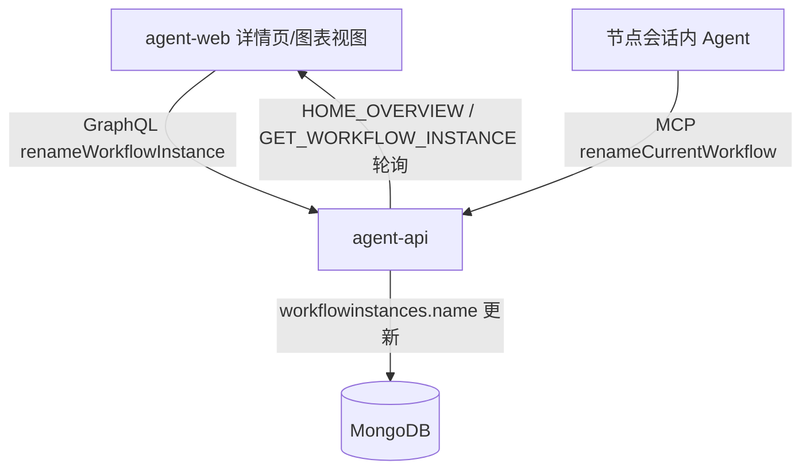
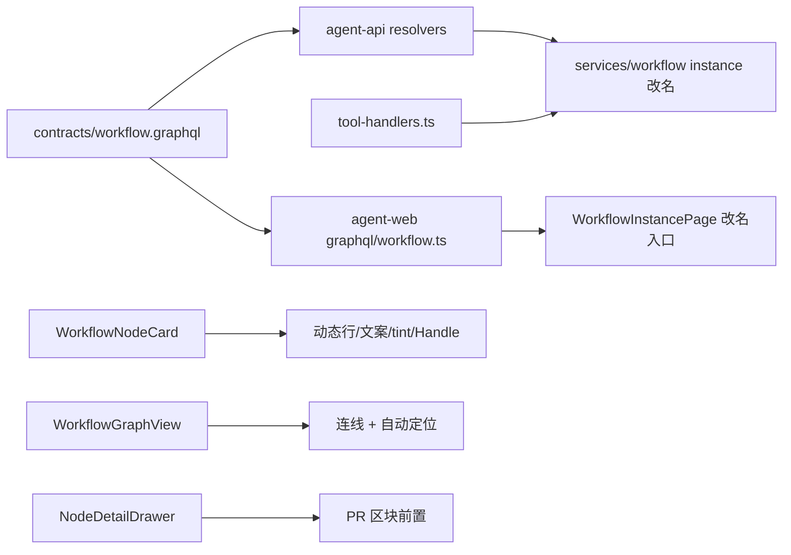
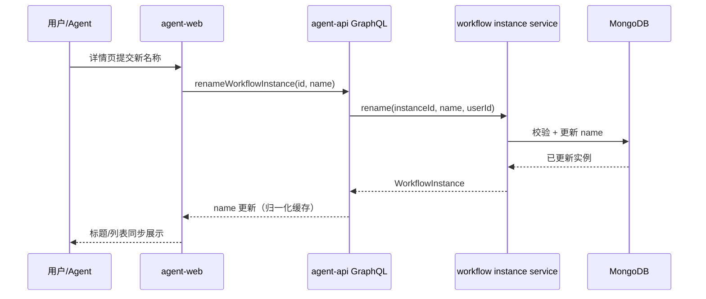
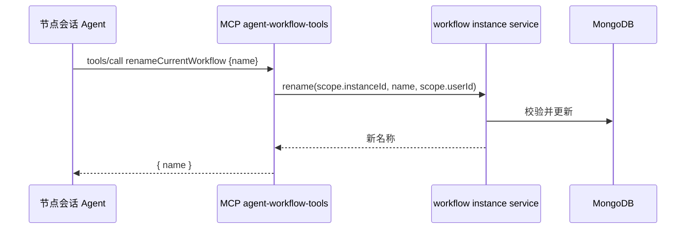

# 工作流迭代 - 技术提案

**功能名称**: 工作流迭代（实例改名 / 节点卡片与图表视图展示修复）
**关联 PRD**: `docs/product/draft/20261103-workflow-iteration.md`（v1.0）
**技术提案版本**: v1.0
**创建日期**: 2026-11-03
**作者**: z-agent-bot
**feat-branch**: `feat/workflow-iteration`
**需求来源**: GitHub Issue [Deliay/z-agent-gear#414](https://github.com/Deliay/z-agent-gear/issues/414)

## 1. 概述

### 1.1 背景

Issue #414 汇总了工作流的 7 项迭代诉求：实例可改名（含 Agent 经 MCP 工具改名）、节点卡片不再滚动显示 thinking/output（只显示「正在思考」指示）、依赖连线不可见需修复、节点详情 PR 优先于黑板产物、token 文案「消耗 {} tokens」改「{} tokens」、卡片不透明、图表视图默认居中执行中卡片且视野容纳前后各 2 个卡片。其中第 1 项涉及契约与后端，其余 6 项为 agent-web 纯前端展示层改动。

### 1.2 目标

- 契约新增 `renameWorkflowInstance` mutation，agent-api 实现实例改名，`agent-workflow-tools` 平台 MCP 服务新增 `renameCurrentWorkflow` 工具供节点会话内 Agent 改名。
- agent-web 完成 6 项展示修复与视图自动定位，全部走既有语义配色与组件体系，零新增依赖。

### 1.3 范围

- **做**：`contracts/workflow.graphql` 扩展；agent-api 实例改名（resolver + service + MCP 工具）；agent-web 详情页改名入口、`WorkflowNodeCard` 动态行/文案/不透明、`NodeDetailDrawer` 区块排序、`WorkflowGraphView` 连线修复与自动定位。
- **不做**：工作流节点状态机与执行语义调整；token 采集口径调整；列表视图（`WorkflowNodeTree`）结构改动；黑板/PR 数据模型改动。

## 2. 技术架构

### 2.1 系统架构图



### 2.2 技术栈

| 层级 | 技术选型 | 说明 |
|------|---------|------|
| 前端 | React 19 + @xyflow/react + Tailwind CSS v4 | apps/agent-web，沿用既有组件与语义色 |
| 后端 | Node.js + GraphQL-Yoga + Mongoose | servers/agent-api |
| 数据库 | MongoDB | `workflowinstances.name` 既有字段，仅更新 |
| 其他 | MCP（平台服务 agent-workflow-tools） | `services/workflow/tool-handlers.ts` 扩展 |

### 2.3 模块划分



| 模块 | 职责 | 关键技术点 |
|------|------|-----------|
| 契约 | `renameWorkflowInstance` mutation 定义 | `contracts/workflow.graphql` |
| agent-api | 改名 resolver/service + MCP 工具 | 校验、软删除门禁、登记 resolvers/index |
| agent-web | 6 项展示修复 + 改名入口 + 自动定位 | 纯前端，TDD |

## 3. API 设计

### 3.1 API 契约

`contracts/workflow.graphql` 的 `type Mutation` 新增：

```graphql
type Mutation {
  # 修改工作流实例名称（trim 后 1~64 字符；已删除实例拒绝）
  renameWorkflowInstance(id: ID!, name: String!): WorkflowInstance!
}
```

- **请求**：`renameWorkflowInstance(id: "<instanceId>", name: "新名称")`
- **响应**：更新后的 `WorkflowInstance`（`name` 为新值）。
- **错误**（沿用既有白名单风格，原样透传）：
  - 未登录：`Not authenticated`
  - 实例不存在/非本人：`Workflow instance not found`
  - 已删除：`Workflow instance is deleted`
  - 名称非法：`invalid workflow name`（trim 后为空或 >64 字符）

### 3.2 内部接口

`agent-workflow-tools`（平台 MCP，`transport/source=platform`）`TOOL_DEFINITIONS` 新增：

```json
{
  "name": "renameCurrentWorkflow",
  "description": "修改当前工作流实例的名称。当你完成了一个阶段的标志性产物、或人类在对话中要求更新工作流名称时调用；新名称会同步展示在工作流列表与详情页。",
  "inputSchema": {
    "type": "object",
    "properties": { "name": { "type": "string", "description": "新名称（trim 后 1~64 字符）" } },
    "required": ["name"]
  }
}
```

`callWorkflowTool` 的 switch 新增 `renameCurrentWorkflow` 分支：由 `WorkflowToolScope.instanceId` 定位实例，复用同一改名 service；成功返回 `{ name: <新名称> }`，校验失败抛 `WorkflowToolError('INVALID_PARAMS', ...)`。

## 4. 数据模型

### 4.1 数据库设计

无 schema 变更：`WorkflowInstance.name`（String，既有字段）直接更新；`updatedAt` 随 save 刷新。无迁移、无索引调整。

### 4.2 缓存设计

无新增缓存。前端 Apollo 在 mutation 返回后按 `id` 归一化自动更新；`HOME_OVERVIEW` 聚合查询 15s 轮询兜底同步侧边栏名称。

## 5. 技术实现方案

### 5.1 核心流程





### 5.2 关键实现点

#### 实现点 1: 实例改名（契约 + agent-api）

- **描述**: resolver `renameWorkflowInstance` 调 `services/workflow/instance.ts` 新增 `rename(instanceId, rawName, userId)`：trim 名称、校验 1~64 字符、实例归属与 `deletedAt` 门禁（与 `archiveWorkflowInstance` 同口径），更新后返回。resolver 必须在 `graphql/resolvers/index.ts` 登记（backend-rules 陷阱）。
- **技术细节**: MCP 侧 `tool-handlers.ts` 增加 `renameCurrentWorkflow` 定义与 switch 分支，复用同一 service；两种入口共用同一份名称校验函数。
- **风险点**: 名称长度口径与云电脑命名（1~64）保持一致，避免多处规则漂移。

#### 实现点 2: agent-web 详情页改名入口

- **描述**: `WorkflowInstancePage.tsx` 标题区实例名称旁增加「重命名」入口（编辑图标按钮），弹出对话框输入新名称（trim 非空校验），提交 `RENAME_WORKFLOW_INSTANCE` mutation（`graphql/workflow.ts` 新增），成功后 toast 提示；错误文案原样展示。
- **技术细节**: 沿用 `Dialog`/`Button`/`Input` 组件体系；Apollo 归一化自动刷新标题与侧边栏。
- **风险点**: 无。

#### 实现点 3: 节点卡片动态行收敛

- **描述**: `WorkflowNodeCard.tsx` 的 `activityText` 不再拼接 thinking/text 尾部内容，执行中动态行固定渲染 spinner + 「正在思考」；`useNodeSessionActivity` 保留（`tokenUsage` 仍用于完成态），卡片忽略 `activity.text`。
- **技术细节**: 卡片仅按 `isAiRunning` 渲染静态指示；`summarizeSessionUpdates` 的 activity 归一逻辑保留（供测试与未来复用），卡片层不再消费文本。
- **风险点**: 同步更新 `WorkflowNodeCard.test.tsx`、`useNodeSessionActivity.test.tsx` 相关断言。

#### 实现点 4: 依赖连线修复（根因：自定义节点缺 Handle）

- **描述**: 连线不可见的根因是自定义节点 `WorkflowNodeCard` 未渲染 React Flow `<Handle>` 组件，边无法解析连接点坐标而不渲染。修复：卡片顶部/底部渲染 `Handle`（`type="target" position={Position.Top}` 与 `type="source" position={Position.Bottom}`，视觉透明），与 dagre `rankdir:'TB'` 方向一致。
- **技术细节**: `import { Handle, Position } from '@xyflow/react'`；`buildEdges` 逻辑不变；补组件测试断言节点渲染后存在 source/target handle，e2e 断言 edge 元素数量与可见性。
- **风险点**: Handle 需避免拦截卡片点击（默认样式缩小或视觉隐藏但保留几何尺寸）。

#### 实现点 5: 详情抽屉 PR 区块前置

- **描述**: `NodeDetailDrawer.tsx` 的 `NodeDetail` 中，将「关联 Pull Request」区块移到「产物」区块之前，其余结构不变。
- **技术细节**: 纯 JSX 顺序调整；`NodeDetailDrawer.test.tsx` 增加两区块先后顺序断言。

#### 实现点 6: token 文案修正

- **描述**: `WorkflowNodeCard.tsx` 完成态文案 `已完成 · 消耗 ${tokenUsage} tokens` 改为 `已完成 · ${tokenUsage} tokens`，并加 `title` 提示「该数值为会话当前上下文长度」。
- **技术细节**: 同步更新组件测试断言。
- **风险点**: 无（采集口径不变）。

#### 实现点 7: 卡片不透明

- **描述**: `NODE_STATUS_VISUAL.tint` 的半透明类（`bg-info/10`、`bg-muted/20` 等）统一改为不透明的 `bg-card`，状态语义仍由 `spine`/`badge` 表达；`NODE_STATUS_COLOR_VAR` 不动。
- **技术细节**: `WorkflowNodeTreeConstants.ts` 为配色单一来源，单点修改全图生效；列表/图表/抽屉一致。
- **风险点**: 深色主题下核对对比度（bg-card 为语义变量，双主题均有定义）。

#### 实现点 8: 图表视图自动定位执行中节点

- **描述**: `WorkflowGraphView` 在视图模型就绪后，若存在执行中（RUNNING/REWORK）节点，则以首个执行中节点为中心做局部 `fitView`：取按布局纵序（y 坐标）排列的「前 2 个 + 自身 + 后 2 个」节点 id 集合作为 fit 窗口；无执行中节点保持整图 `fitView`。
- **技术细节**: 新增纯函数 `pickFocusWindow(nodes, activeIds, before=2, after=2): string[]`（`graph-layout.ts`，可单测）；`onInit` 保存 `reactFlowInstance`，`useEffect` 监听「执行中节点 id 集合」变化时调用 `fitView({ nodes: ids.map(id => ({ id })), duration: 300, padding: 0.2 })`；集合不变时不重新定位，避免打断用户手动平移缩放。首屏在节点渲染完成后触发一次。
- **风险点**: 轮询（5s）每轮重建视图模型，定位 effect 必须以「执行中 id 集合」为依赖而非整个 instance，防止反复 fitView 抖动。

## 6. 技术决策

### 6.1 决策列表

| 决策 | 选项 A | 选项 B | 最终选择 | 原因 |
|------|--------|--------|---------|------|
| 改名入口 | 仅前端 mutation | 前端 + MCP 工具 | 前端 + MCP 工具 | Issue 明确要求「工作流实例的 mcp 工具也提供改名工具」 |
| 动态行收敛粒度 | 保留 kind 区分文案 | 统一「正在思考」指示 | 统一「正在思考」 | Issue 要求「只显示正在 thinking」；去掉滚动文本 |
| 不透明实现 | 新增不透明浅语义色 | tint 统一 `bg-card` | `bg-card` | 零新增色板；状态语义已由 spine/badge 承载 |
| 连线修复方式 | 调整边样式/zIndex | 自定义节点补 `<Handle>` | 补 `<Handle>` | 缺 Handle 是边不渲染的根因 |
| 自动定位窗口 | setCenter + 固定 zoom | 前后各 2 节点 fitView | fitView 窗口 | 「正好容纳前后 2 个卡片」天然对应 fitView 子集 |
| 定位触发时机 | 每次轮询 | 执行中集合变化时 | 集合变化时 | 避免打断用户手动浏览、避免抖动 |

### 6.2 依赖与约束

| 类型 | 内容 | 说明 |
|------|------|------|
| 依赖 | @xyflow/react 既有版本 | 不新增依赖 |
| 约束 | 节点状态机/执行语义零改动 | 仅名称维护 + 展示层 |
| 约束 | 语义配色单一来源 | 不新增固定 hex 色值 |

## 7. 项目结构

```
contracts/
└── workflow.graphql                       # +renameWorkflowInstance
servers/agent-api/src/
├── graphql/resolvers/                     # +renameWorkflowInstance resolver（登记 index.ts）
└── services/workflow/
    ├── instance.ts                        # +rename()（归属/软删除/名称校验）
    └── tool-handlers.ts                   # +renameCurrentWorkflow 工具定义与分支
apps/agent-web/src/
├── graphql/workflow.ts                    # +RENAME_WORKFLOW_INSTANCE
├── pages/WorkflowInstancePage.tsx         # 标题区改名对话框
├── hooks/useNodeSessionActivity.ts        # 保留（tokenUsage 继续消费）
└── components/workflow/
    ├── NodeDetailDrawer.tsx               # PR 区块前置于产物
    ├── WorkflowNodeTreeConstants.ts       # tint → bg-card（不透明）
    ├── WorkflowGraphView.tsx              # onInit + 执行中集合变化时窗口 fitView
    └── graph/
        ├── WorkflowNodeCard.tsx           # 动态行静态化、token 文案、补 Handle
        └── graph-layout.ts                # +pickFocusWindow 纯函数
```

## 8. 测试策略

### 8.1 测试覆盖要求

- 遵循 TDD 红-绿-重构：先写失败测试，再实现。
- agent-api：改名 service 与 MCP 工具分支单测覆盖成功/非法名称/已删除/未命中。
- agent-web：受影响组件测试全量更新并通过。

### 8.2 测试类型

| 类型 | 工具 | 覆盖范围 |
|------|------|---------|
| 单元/组件 | Vitest + RTL | 卡片文案/动态行/tint、Handle 存在性、`pickFocusWindow`、抽屉区块顺序、改名对话框、tool-handlers 与 resolver |
| E2E | Playwright（tests/e2e） | `workflow-graph.spec.ts` 增补：连线可见（edge 数量与 stroke）、执行中节点居中窗口、卡片背景不透明 |

## 9. 部署方案

### 9.1 环境规划

| 环境 | 用途 | 部署方式 |
|------|------|---------|
| 本地 | 开发验证 | `aspire start` |
| 线上 | 正式发布 | 随主干合并常规发布，无新增配置 |

### 9.2 配置管理

无新增配置项与环境变量。

## 10. 验收标准

- [ ] 技术方案评审通过
- [ ] Contract（`renameWorkflowInstance`）评审通过
- [ ] 代码实现完成（7 个功能点全部落地）
- [ ] agent-api / agent-web 单测与组件测试通过
- [ ] E2E（workflow-graph）通过
- [ ] 产品验收：对照 PRD 3.2 各功能点验收标准逐项确认

## 11. 相关文档

- 关联 PRD：`docs/product/draft/20261103-workflow-iteration.md`
- 关联 Contract：`contracts/workflow.graphql`
- 开发规范：`docs/engineering/common-rules.md`、`docs/engineering/frontend-rules.md`、`docs/engineering/backend-rules.md`
- 需求来源：[Deliay/z-agent-gear#414](https://github.com/Deliay/z-agent-gear/issues/414)
