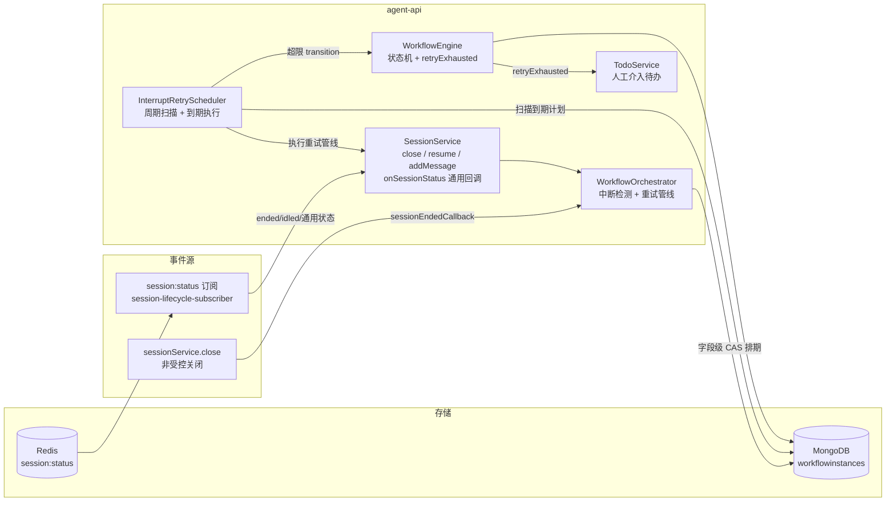
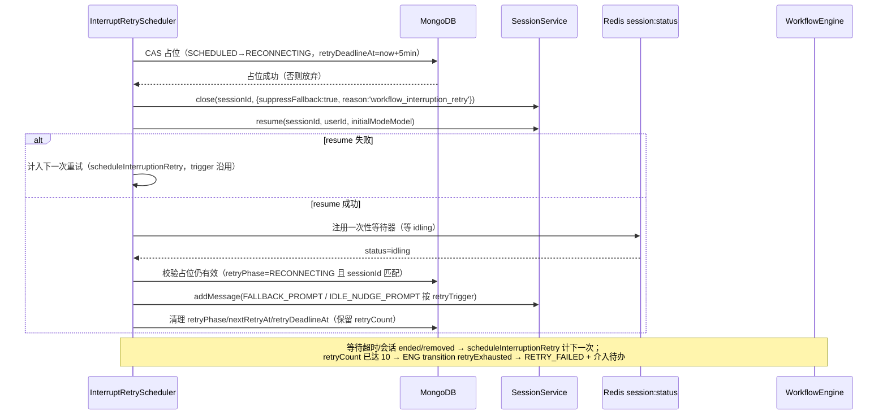

# 工作流节点中断处理迭代 - 技术提案

**功能名称**: 工作流节点中断处理迭代
**关联 PRD**: [20261103-workflow-node-interrupt-retry.md](../../product/draft/20261103-workflow-node-interrupt-retry.md)
**技术提案版本**: v1.0
**创建日期**: 2026-11-03
**作者**: ZeroAsh Agent（需求来源：[Deliay/z-agent-gear#407](https://github.com/Deliay/z-agent-gear/issues/407)）
**feat-branch**: `feat/workflow-node-interrupt-retry`

## 1. 概述

### 1.1 背景

工作流 AI 节点的「中断兜底」现状（`services/workflow/orchestrator.ts` + `engine.ts`）：

- 三个中断检测入口：
  - `handleSessionEnded`：会话 ended 但节点仍 `RUNNING`（仅 RUNNING）；
  - `handleSessionIdled`：会话 turn 结束（`promptCompleted→idling`）但节点仍 `RUNNING/REWORK`；
  - `handleSessionRemoved`：会话启动失败/被移除（立即 `fail`，`SESSION_START_FAILED`）。
- 恢复动作：节点字段 `fallbackSent: boolean` —— 首次中断置位并补发提示词（ended 场景 `resume` + `FALLBACK_PROMPT`；idled 场景直接 `IDLE_NUDGE_PROMPT`），再次中断即 `transition('fail')` → `FAILED` + `createWorkflowInterventionTodo`。**即「最多重试 1 次」**。
- `fallbackSent` 仅在 `restart` 转移时复位。

Issue #407 要求迭代该行为：① 最多重试 10 次 + 指数退避（首次立即、单次间隔封顶 30 分钟）；② 新增节点状态「重试失败」承接超限场景；③ 重试动作改为「关闭会话 → 继续会话 → 等待空闲 → 发送提示词」。

### 1.2 目标

1. 中断自动重试预算 1 → 10 次，退避序列确定且持久化，进程重启不丢重试计划。
2. 重试管线统一为 `close → resume → 等待 idling → addMessage`，等待空闲带超时保护。
3. 新增节点状态 `RETRY_FAILED`：重试超限后由 `RUNNING/REWORK` 转入，阻断流程、不再自动重试，人工可经 `restart` / `resumeFailed` 恢复。
4. 契约、前端状态体系、GitHub Check Runs 映射、MCP 工具文案同步；存量数据平滑迁移。

### 1.3 范围

**做**（全部位于 `servers/agent-api` + `apps/agent-web` + `contracts`）：

- `models/workflow-instance.ts`：节点状态集合 + `RETRY_FAILED`；`fallbackSent` → `retryCount/nextRetryAt/retryPhase/retryDeadlineAt/retryTrigger`；扫描用部分索引。
- `services/workflow/engine.ts`：新事件 `retryExhausted`（`RUNNING/REWORK→RETRY_FAILED`）；`restart`/`resumeFailed` 的 `from` 扩展 `RETRY_FAILED`；节点推进/人工操作时重试状态复位。
- `services/workflow/orchestrator.ts`：`handleSessionEnded/handleSessionIdled` 重写为「排期重试」；新增重试管线（close→resume→awaitIdle→send）；超限转 `retryExhausted` + 介入待办。
- 新增 `services/workflow/interrupt-retry-scheduler.ts`：周期扫描持久化重试计划并执行；服务启动时挂载（`src/index.ts`）。
- `services/session.ts` + `services/session-lifecycle-subscriber.ts`：新增通用会话状态回调（现有 ended/removed/idled 三回调口径不变），供「等待空闲」使用。
- 契约 `contracts/workflow.graphql`：`WorkflowNodeStatus + RETRY_FAILED`；`WorkflowNode` 透出 `retryCount/nextRetryAt`；`WorkflowNodeFailInfo.source` 注释补 `RETRY_EXHAUSTED`；`restartNode` 注释口径更新。
- `services/workflow/tool-handlers.ts`：`resumeFailedNode` 描述口径（FAILED/RETRY_FAILED→RUNNING）。
- `services/workflow/pr-check-run-sync.ts`：`mapNodeStatusToCheckRun` 增加 `RETRY_FAILED` 映射。
- `apps/agent-web`：`WorkflowNodeStatus` 类型、`NODE_STATUS_LABELS/VISUAL/COLOR_VAR`、节点详情重试进度展示、`RETRY_FAILED` 开放「重启节点」入口。
- 迁移 `021-workflow-interrupt-retry`：`fallbackSent:true → retryCount:1` 并 `$unset fallbackSent`；建部分索引。
- 测试：agent-api 单测（引擎/编排器/调度器/subscriber）、agent-web 单测、`tests/api`、`tests/e2e`。

**不做**：

- 不改变 `LLM_REPORTED` 失败语义：`failCurrentNode` 仍 → `FAILED`。
- `handleSessionRemoved`（会话启动失败/被移除）维持立即 `FAILED`：会话文档已删除，`close→resume` 管线无对象可执行，不属于「中断重试」场景（见决策 D6）。
- 不引入跨进程分布式调度：agent-api 单实例部署口径与 `KeyedMutex` 一致；持久化仅保证单进程重启后恢复。
- 人类/FLAG 节点不涉及；实例删除/归档/打回等既有流转不变。

## 2. 技术架构

### 2.1 系统架构图



### 2.2 技术栈

无变更：Node.js 24 + TypeScript（strict, ESM）、Express v5 + GraphQL-Yoga、Mongoose 9、ioredis、Vitest；前端 React 19 + Apollo Client。

### 2.3 模块划分

| 模块 | 职责 | 关键技术点 |
|------|------|-----------|
| `services/workflow/engine.ts` | 状态机：新状态/事件、重试状态复位 | `retryExhausted` 事件；`restart`/`resumeFailed` from 扩展；转移时清理 `retryCount/nextRetryAt/retryPhase/retryDeadlineAt/retryTrigger` |
| `services/workflow/orchestrator.ts` | 中断检测入口重写 + 重试管线执行 | 字段级 CAS 排期；`close(suppressFallback) → resume(initial) → awaitIdle → addMessage`；提示词按 `retryTrigger` 选择 |
| `services/workflow/interrupt-retry-scheduler.ts`（新增） | 持久化重试计划的周期扫描与到期执行 | `setInterval` 30s；两类到期扫描（SCHEDULED 到点 / RECONNECTING 超时）；启动即扫一轮 |
| `services/session.ts` / `session-lifecycle-subscriber.ts` | 通用会话状态回调 | 新增 `onSessionStatus(cb)`；subscriber 对全部 `session:status` 事件触发（现有三回调过滤口径不变） |
| `models/workflow-instance.ts` | 节点重试字段与状态枚举 | `retryCount/nextRetryAt/retryPhase/retryDeadlineAt/retryTrigger`；`nodes.nextRetryAt` 部分索引 |
| `services/workflow/pr-check-run-sync.ts` | 新状态 → Check Run 投影 | `RETRY_FAILED → completed/action_required` |
| `apps/agent-web` 状态体系 | 新状态展示与操作入口 | 语义色单一来源扩展；详情抽屉重试进度；`RETRY_FAILED` 开放重启 |

## 3. API 设计

### 3.1 API 契约（`contracts/workflow.graphql`）

```graphql
enum WorkflowNodeStatus {
  INITIALIZING
  READY
  RUNNING
  DONE
  REJECT
  REWORK
  # 失败：阻断流程，需人工介入（MCP resumeFailedNode 恢复 RUNNING）
  FAILED
  # 重试失败：中断自动重试 10 次用尽，阻断流程、不再自动重试；
  # 人工处理：restartNode 重启，或会话内给出指示后由 MCP resumeFailedNode 恢复
  RETRY_FAILED
}

type WorkflowNodeFailInfo {
  reason: String!
  # 失败来源：SESSION_STUCK（提醒后仍会停止）/ LLM_REPORTED（LLM 调用 failCurrentNode）/
  # SESSION_START_FAILED（节点会话启动失败或被移除）/ RETRY_EXHAUSTED（中断自动重试 10 次用尽，节点状态为 RETRY_FAILED）
  source: String!
  at: String!
}

type WorkflowNode {
  # ……既有字段不变，新增：
  # 当前中断 episode 已用自动重试次数（0=未发生；节点推进/人工操作时复位）
  retryCount: Int!
  # 下一次自动重试计划时间（ISO 字符串；无排期为 null）
  nextRetryAt: String
}

# 重启节点（RUNNING/REWORK/FAILED/RETRY_FAILED 会话失败、卡住或重试用尽时人工触发，关闭旧会话拉起全新会话）
restartNode(instanceId: ID!, nodeId: ID!, agentConfig: AgentNodeConfigInput): WorkflowNode!
```

- 无新增 Query/Mutation；`resumeFailedNode` 为 MCP 工具（不进 GraphQL）。
- `engine` 层 `resumeFailed` 事件描述同步：`FAILED/RETRY_FAILED → RUNNING`。

### 3.2 内部接口

#### `session.ts` 新增通用状态回调

```ts
/** 会话状态变化通用回调（全部 session:status 事件；供工作流等待空闲等一次性订阅） */
onSessionStatus(callback: (sessionId: string, status: string) => void | Promise<void>): void;
notifySessionStatus(sessionId: string, status: string): Promise<void>;
```

- `session-lifecycle-subscriber.ts`：现有过滤（`removed` / `idling+promptCompleted`）逻辑与既有三回调**完全不变**；在解析出合法 `sessionId+status` 后追加调用 `notifySessionStatus`（含裸 `idling`、`running`、`connecting` 等全部状态）。
- 现有 `onSessionEnded/onSessionRemoved/onSessionIdled` 注册点与语义零改动，避免回归（orchestrator.test.ts 既有用例兜底）。

#### 编排器等待空闲（一次性等待器）

```ts
/** 等待指定会话进入 idling；超时/会话 ended/removed 返回 false */
awaitSessionIdle(sessionId: string, timeoutMs: number): Promise<boolean>
```

- 实现：进程内 `Map<sessionId, waiter>` 注册一次性等待器，挂到 `onSessionStatus`；`status==='idling'` 即兑现；`ended/removed` 或超时即拒绝并注销。
- 等待器为内存态，进程重启由调度器的 `RECONNECTING` 超时扫描兜底（见 5.2），语义不丢失。

## 4. 数据模型

### 4.1 `workflowinstances` 节点子文档（`models/workflow-instance.ts`）

| 字段 | 类型 | 说明 |
|------|------|------|
| `status` | String enum | 枚举增加 `RETRY_FAILED` |
| ~~`fallbackSent`~~ | Boolean | **移除**（迁移 021 转换后 `$unset`） |
| `retryCount` | Number, default 0 | 当前中断 episode 已排期的自动重试次数（第 N 次重试 = N）；节点推进/人工操作时复位 0 |
| `nextRetryAt` | Date, default null | 下一次自动重试计划时间；`null` = 无排期 |
| `retryPhase` | String enum `['SCHEDULED','RECONNECTING']`, default null | `SCHEDULED`=已排期待执行；`RECONNECTING`=已发起 close→resume、等待空闲中 |
| `retryDeadlineAt` | Date, default null | `RECONNECTING` 阶段的等待空闲截止时间（发起时间 + 5 分钟） |
| `retryTrigger` | String enum `['ENDED','IDLED']`, default null | 触发本次重试的中断类型（决定提示词文案） |

索引：`{ 'nodes.nextRetryAt': 1 }` 部分索引（`partialFilterExpression: { 'nodes.nextRetryAt': { $exists: true } }`），供调度器到期扫描。数组多键索引基数小（仅重试排期中节点有值），开销可忽略。

### 4.2 迁移 `021-workflow-interrupt-retry`

- `fallbackSent: true` 的节点 → `retryCount: 1`；`fallbackSent` 全部 `$unset`。
- 创建 `nodes.nextRetryAt` 部分索引。
- 幂等可重入；编号 021（020 已被 cloud-storage 占用）。

### 4.3 缓存设计

无新增缓存；重试计划以 Mongo 为唯一事实源（内存 `setTimeout` 仅作首次立即执行的快速路，不作事实源）。

## 5. 技术实现方案

### 5.1 核心流程

#### 5.1.1 中断检测与排期（orchestrator 重写）

`handleSessionEnded` / `handleSessionIdled` 统一收敛为 `scheduleInterruptionRetry(instance, node, trigger)`：

1. 前置过滤不变：实例 `deletedAt: null`；节点仍绑定该 sessionId 且状态 `RUNNING`（ended）/ `RUNNING|REWORK`（idled）。
2. 读取节点 `retryCount`：**若 ≥ 10 → 转 `retryExhausted`**（经既有 `transitionOrDefer` 处理 re-entrant 锁）：节点 → `RETRY_FAILED`，写 `failInfo { source: 'RETRY_EXHAUSTED', reason }`，清理重试字段，创建人工介入待办（沿用 `createWorkflowInterventionTodo`），返回。
3. 否则字段级条件更新排期（`$elemMatch` 锁定 nodeId+sessionId+status，`retryPhase: null` 防重）：
   - `retryCount += 1`；
   - `nextRetryAt = now + delay(retryCount)`（新值，即「即将执行的第 N 次重试」）；
   - `retryPhase = 'SCHEDULED'`；`retryTrigger = 'ENDED' | 'IDLED'`；`retryDeadlineAt = null`。
4. CAS 未命中（已排期/已转移/并发重复事件）→ 直接返回，幂等。
5. `delay(1) = 0` 时立即经 `runOutsideTransitionLock` 触发一次执行（不依赖扫描周期），同时落库的 `nextRetryAt` 保证进程崩溃后扫描器仍会拾起。

#### 5.1.2 退避序列

| 重试次数 N（1-based） | 距上一次中断/失败的延迟 |
|---|---|
| 1 | 0（立即） |
| 2 | 1 分钟 |
| 3 | 2 分钟 |
| 4 | 4 分钟 |
| 5 | 8 分钟 |
| 6 | 16 分钟 |
| 7–10 | 30 分钟（封顶） |

`delay(N) = N === 1 ? 0 : min(2 ** (N - 2), 30) 分钟`。10 次重试总窗口约 121 分钟。

#### 5.1.3 重试管线（调度器执行）



要点：

- `close` 必须 `suppressFallback: true`（受控关闭），否则触发 `sessionEndedCallback` 造成自我递归；`reason: 'workflow_interruption_retry'` 便于日志检索。
- 会话已 ended 时 `close` 幂等（`findOneAndUpdate` 无匹配返回 null，直接继续 `resume`）。
- `resume` 带内下发节点初始 mode/model（沿用 `initialModeModel(loadNodeConfig)`，配置读取失败不阻断，口径与现兜底一致）。
- **发送前双校验**：占位字段仍有效 + 节点仍 `RUNNING/REWORK` + `sessionId` 未变——防止重试期间人工 restart/打回后向新会话误发提示词。
- 提示词文案沿用现有 `FALLBACK_PROMPT`（ENDED）/ `IDLE_NUDGE_PROMPT`（IDLED），不变更内容。

#### 5.1.4 调度器（`interrupt-retry-scheduler.ts`）

- 启动：`src/index.ts` 在 `workflowOrchestrator.register()` 之后 `interruptRetryScheduler.start()`；`stop()` 随服务关闭。
- 周期：`setInterval` 30s + 启动即扫一轮。
- 扫描 A（执行到期重试）：`{ deletedAt: null, nodes: { $elemMatch: { status: { $in: ['RUNNING','REWORK'] }, retryPhase: 'SCHEDULED', nextRetryAt: { $lte: now } } } }` → 逐节点走 5.1.3 管线。
- 扫描 B（等待空闲超时兜底）：`{ ... retryPhase: 'RECONNECTING', retryDeadlineAt: { $lte: now } }` → 视为本次重试失败，走 `scheduleInterruptionRetry` 计下一次（或超限转 `RETRY_FAILED`）。进程在等待空闲期间重启时，内存等待器丢失，由本扫描兜底，语义不丢。
- 单实例部署假设（与 `KeyedMutex` 注释同口径）；扫描执行与排期 CAS 天然幂等，多扫不重复执行。

#### 5.1.5 状态机变更（`engine.ts`）

```ts
const TRANSITIONS = {
  // ……既有不变……
  retryExhausted: { from: ['RUNNING', 'REWORK'], to: 'RETRY_FAILED' },
  fail:         { from: ['RUNNING'], to: 'FAILED' },                        // 不变（LLM_REPORTED / SESSION_START_FAILED）
  resumeFailed: { from: ['FAILED', 'RETRY_FAILED'], to: 'RUNNING' },        // from + RETRY_FAILED
  restart:      { from: ['RUNNING', 'REWORK', 'FAILED', 'RETRY_FAILED'], to: 'RUNNING' }, // from + RETRY_FAILED
};
```

- `retryExhausted`：写 `failInfo { reason, source: 'RETRY_EXHAUSTED', at }`；不触发会话 hook（同 `fail`）。
- **重试状态复位**：`apply` 内对使节点离开 `RUNNING/REWORK` 或被人工操作的转移（`complete/completeRework/reject/rework/resume/resumeFailed/restart`）统一清理 `retryCount=0、nextRetryAt=null、retryPhase=null、retryDeadlineAt=null、retryTrigger=null`（`restart` 原有 `fallbackSent=false` 同步替换）；`retryExhausted`/`fail` 保留 `retryCount` 供展示。
- `refreshCurrentNodeNames` 不变（仅 RUNNING）→ `RETRY_FAILED` 天然阻断下游激活（非 DONE）。
- `WorkflowNodeFailInfo.source` 注释补 `RETRY_EXHAUSTED`。

#### 5.1.6 前端（`apps/agent-web`）

- `graphql/workflow.ts`（及 `graphql/types.ts`）：`WorkflowNodeStatus` 增加 `RETRY_FAILED`；`WorkflowNode` 增加 `retryCount/nextRetryAt` 查询字段。
- `WorkflowNodeTreeConstants.ts`：`NODE_STATUS_LABELS['RETRY_FAILED']='重试失败'`；`NODE_STATUS_VISUAL` 沿用 `destructive` 语义色（与 `FAILED` 同色族、文案区分）；`NODE_STATUS_COLOR_VAR` 同步。
- 节点详情（`NodeDetailDrawer`）/ 节点卡片：`retryPhase` 有值时展示「自动重试 N/10，下次 HH:mm」；`RETRY_FAILED` 节点开放「重启节点」入口（复用现有 restartNode mutation 与可配置重启面板）。
- `instanceStatusText` 无需改动（经 `NODE_STATUS_LABELS` 映射自动生效）。

#### 5.1.7 Check Runs 映射（`pr-check-run-sync.ts`）

```ts
case 'RETRY_FAILED':
  return { status: 'completed', conclusion: 'action_required', label: '重试失败，待人工处理' };
```

（与 `REJECT` 同 conclusion：`action_required` 语义为「需要人工动作」，区别于 `FAILED` 的 `failure`「执行失败」。）

#### 5.1.8 MCP 工具文案（`tool-handlers.ts`）

- `resumeFailedNode` 描述更新为「操作当前节点『恢复运行』（FAILED/RETRY_FAILED→RUNNING）。仅在人类已在对话中给出明确处理指示后调用」。
- `failCurrentNode` 描述不变。

### 5.2 关键实现点

#### 实现点 1：排期/占位的并发安全

- **描述**：中断事件（Redis 订阅、close 回调）与调度器到期扫描可能并发触发同一节点。
- **技术细节**：排期与占位均为字段级条件更新（`updateOne` + `$elemMatch`，条件含 `retryPhase` 预期值与 `status` 白名单），Mongo 保证单赢家；输家静默返回。禁止整文档 `save()`（沿用 N-1④ 口径，避免覆盖并发转移）。
- **风险点**：`$elemMatch` 条件与 `retryPhase` 状态机必须完整覆盖（`null → SCHEDULED → RECONNECTING → null`），测试矩阵锁定。

#### 实现点 2：等待空闲的信号通道

- **描述**：resume 后首条提示前的「裸 idling」**不触发**现有 `notifySessionIdled`（其过滤条件为 `idling && promptCompleted===true`，见 `session-lifecycle-subscriber.ts:39`）。
- **技术细节**：subscriber 在解析出合法事件后追加 `notifySessionStatus(sessionId, status)` 通用分发；编排器 `awaitSessionIdle` 以一次性等待器消费；`ended/removed` 立即失败。`close()` 本地直接触发的 `sessionEndedCallback` 路径不受影响的口径不变。
- **风险点**：通用回调为高频通道——按观测性契约高频豁免口径，仅结构化日志、不逐条开 span（与 `pr-check-run-subscriber` 同口径）。

#### 实现点 3：进程重启恢复

- **描述**：退避间隔最长 30 分钟，内存定时器不可靠。
- **技术细节**：重试计划全量落库（`nextRetryAt/retryPhase/retryDeadlineAt`）；调度器 30s 周期扫描为唯一事实驱动；`delay(1)=0` 的内存快速路仅是优化。等待空闲中的进程重启由「扫描 B：`RECONNECTING` + `retryDeadlineAt` 到期」兜底计失败重排。
- **风险点**：扫描周期 30s 决定计时精度为分钟级内（PRD 4.1 已声明）；多实例部署会重复执行（当前单实例，决策 D3 声明）。

#### 实现点 4：重试计数口径（防无限循环）

- **描述**：单次重试「成功让会话恢复运转」**不复位** `retryCount`——否则「AI 收到提示词仍不推进 → 再次中断 → 计数复位」会无限循环（正是 `fallbackSent` 防死循环的设计初衷）。
- **技术细节**：`retryCount` 仅在节点推进或人工操作（complete/completeRework/reject/rework/resume/resumeFailed/restart）时复位；`retryExhausted` 时保留供展示。
- **风险点**：长耗时节点多次合法停滞（如反复权限审批超时）会累计消耗 10 次预算——接受该取舍（现状 1 次即失败，10 次已大幅改善），人工可 restart/resume 复位，PRD 3.5 已声明。

#### 实现点 5：`handleSessionRemoved` 维持原语义

- **描述**：会话启动失败/被移除时文档已删除，`close→resume` 无对象。
- **技术细节**：保持立即 `fail`（`SESSION_START_FAILED`）→ `FAILED`，不进重试管线；既有 `transitionOrDefer` + re-entrant 处理复用。
- **风险点**：无（行为不变，既有测试锁定）。

### 5.3 与既有兜底机制的关系

- `deferSessionFallback`（`FALLBACK_RETRY_MAX=3`，100/200/400ms）是**锁内 re-entrant 的延迟转移机制**，与本次的「中断重试」是正交两层：本次替换的是其上层业务语义（`fallbackSent` 单次 → `retryCount` 十次 + 管线化）；`transitionOrDefer`/`deferSessionFallback`/`notifyFallbackExhausted` 原样保留，`retryExhausted` 转移同样复用。
- `FALLBACK_PROMPT`/`IDLE_NUDGE_PROMPT` 文案不变；`WORKFLOW_SYSTEM_PROMPT` 不变。

## 6. 技术决策

### 6.1 决策列表

| 决策 | 选项 A | 选项 B | 最终选择 | 原因 |
|------|--------|--------|---------|------|
| D1 重试计数口径 | 单次恢复成功即复位 | 节点推进/人工操作才复位 | B | 防「提示词无效→再中断」无限循环，与 fallbackSent 防死循环初衷一致 |
| D2 退避序列 | 0,30s,1m,2m,… | 0,1m,2m,4m,8m,16m,30m×4 | B | 首次立即与 2^0=1m 自然衔接；序列简洁可评审；总窗口约 2h 符合 PRD |
| D3 重试调度 | 纯内存 setTimeout 链 | Mongo 持久化 + 周期扫描 | B | 30 分钟级延迟必须抗进程重启；扫描器同时兜底等待空闲超时 |
| D4 超限状态 | 复用 FAILED | 新增 RETRY_FAILED | B | Issue 明确要求；语义区分「自动恢复用尽」与「LLM 主动报告失败」，人工入口相同但展示可区分 |
| D5 等空闲通道 | 轮询会话状态 | 订阅通用状态回调 | B | 裸 idling 不触发现有 idled 回调；订阅实时且省 DB 轮询；subscriber 追加分发零回归 |
| D6 removed 会话处理 | 一并进重试 | 维持立即 FAILED | B | 会话文档已删除，close→resume 无对象；行为不变零回归 |
| D7 RETRY_FAILED 的 Check Run | failure | action_required | B | 语义为「需人工动作」，与 REJECT 同族；failure 留给 LLM 报告失败 |
| D8 重试进度透出 | 不透出 | `retryCount/nextRetryAt` 上 GraphQL | B | PRD 功能点 4 可见性要求；只读字段成本极低 |
| D9 等待空闲超时 | 1 分钟 | 5 分钟 | B | resume 含 ACP 进程拉起+历史回放，1 分钟过紧；5 分钟与 setup 步骤超时口径同量级 |

### 6.2 依赖与约束

| 类型 | 内容 | 说明 |
|------|------|------|
| 依赖 | `session:status` Redis 频道（controller-api 发布） | 通用状态回调依赖其持续发布全部状态（现状已发布，subscriber 仅过滤消费） |
| 依赖 | `sessionService.close/resume/addMessage` 既有语义 | 管线直接复用，不改其内部逻辑 |
| 约束 | agent-api 单实例部署 | 调度器与 KeyedMutex 同口径；多实例需另立提案 |
| 约束 | 迁移编号 021 | 020 已被 cloud-storage 占用 |
| 约束 | 高频通道不开 span | `onSessionStatus` 分发按观测性契约高频豁免口径 |

## 7. 项目结构

```
servers/agent-api/
├── src/
│   ├── index.ts                                   # 挂载 interruptRetryScheduler.start()
│   ├── migrations/
│   │   └── 021-workflow-interrupt-retry.ts        # 新增：fallbackSent→retryCount、部分索引
│   ├── models/
│   │   └── workflow-instance.ts                   # +RETRY_FAILED、重试字段、索引
│   ├── services/
│   │   ├── session.ts                             # +onSessionStatus/notifySessionStatus
│   │   ├── session-lifecycle-subscriber.ts        # +通用状态分发
│   │   └── workflow/
│   │       ├── engine.ts                          # +retryExhausted、from 扩展、重试状态复位
│   │       ├── orchestrator.ts                    # 中断入口重写为排期 + 重试管线 + awaitSessionIdle
│   │       ├── interrupt-retry-scheduler.ts       # 新增：周期扫描与到期执行
│   │       ├── pr-check-run-sync.ts               # +RETRY_FAILED 映射
│   │       └── tool-handlers.ts                   # resumeFailedNode 文案
│   └── graphql/
│       ├── schemas/workflow.ts                    # 枚举与字段同步契约
│       └── resolvers/workflow.ts                  # retryCount/nextRetryAt 透出
contracts/
└── workflow.graphql                               # RETRY_FAILED / retryCount / nextRetryAt / source 注释
apps/agent-web/src/
├── graphql/workflow.ts、graphql/types.ts          # 状态枚举与字段
└── components/workflow/
    ├── WorkflowNodeTreeConstants.ts               # 标签/语义色
    ├── NodeDetailDrawer.tsx                       # 重试进度展示 + RETRY_FAILED 重启入口
    └── graph/WorkflowNodeCard.tsx                 # 状态徽标（经常量自动生效）
docs/
├── product/draft/20261103-workflow-node-interrupt-retry.md          # 本需求 PRD
└── engineering/proposals/20261103-feat-workflow-node-interrupt-retry.md
```

## 8. 测试策略

### 8.1 测试覆盖要求

- 新增/变更逻辑行覆盖 ≥ 80%（backend-rules 口径）；状态机与调度器分支全覆盖。
- API 测试覆盖：`workflowInstance` 查询透出 `retryCount/nextRetryAt`；`restartNode` 接受 `RETRY_FAILED`。
- E2E：注入中断事件 → 排期 → 管线执行 → 提示词落会话消息；超限 → `RETRY_FAILED`。

### 8.2 测试类型

| 类型 | 工具 | 覆盖范围 |
|------|------|---------|
| 单元（引擎） | Vitest | T-ENG1~6：`retryExhausted` 转移与 failInfo；`restart`/`resumeFailed` from RETRY_FAILED；各转移的重试字段复位；非法转移拒绝 |
| 单元（编排器） | Vitest | T-ORC1~10：ended/idled 首次排期（立即）、二次中断排期递增、CAS 幂等防重、retryCount≥10 转 retryExhausted+待办、管线 close→resume→awaitIdle→send 顺序与双校验、提示词按 trigger 选择、人工 restart 期间放弃发送 |
| 单元（调度器） | Vitest | T-SCH1~8：扫描 A 到期执行、占位 CAS 单赢家、resume 失败计下一次、等待超时扫描 B 兜底、超限转 RETRY_FAILED、启动即扫、stop 清理、实例已删除跳过 |
| 单元（session/subscriber） | Vitest | T-SES1~3：通用回调注册/分发、裸 idling 触发 notifySessionStatus 但不触发 notifySessionIdled、removed 口径不变 |
| 单元（迁移） | Vitest（真库） | T-MIG1~3：fallbackSent→retryCount 转换、$unset、部分索引存在且幂等 |
| 前端 | Vitest + RTL | T-FE1~4：状态常量/标签映射、详情抽屉重试进度渲染、RETRY_FAILED 重启入口可见可用 |
| API | tests/api | 契约字段透出与 restartNode 新来源状态 |
| E2E | tests/e2e | 中断→自动恢复全链路；超限→重试失败→人工重启恢复 |

## 9. 验收标准

- [ ] 技术方案评审通过
- [ ] Contract 评审通过（`WorkflowNodeStatus.RETRY_FAILED`、节点重试字段、source 注释）
- [ ] 代码实现完成（引擎/编排器/调度器/迁移/前端/check-run/工具文案）
- [ ] 单元测试覆盖达标（8.1）
- [ ] API 测试通过
- [ ] E2E 测试通过
- [ ] 回归通过：既有 `orchestrator.test.ts` 中断兜底用例按新语义改写后全绿；`session-lifecycle-subscriber.test.ts` 既有三回调口径用例不变全绿

## 10. 相关文档

- 关联 PRD：[20261103-workflow-node-interrupt-retry.md](../../product/draft/20261103-workflow-node-interrupt-retry.md)
- 需求来源：[Deliay/z-agent-gear#407](https://github.com/Deliay/z-agent-gear/issues/407)
- 关联提案：[[20260808-feat-agent-workflow.md]] — Agent 工作流（状态机与兜底基线）
- 关联提案：[[20260818-fix-workflow-idle-stall-intervention.md]] — 空闲停滞介入（`handleSessionIdled` 来源）
- 关联提案：[[20260818-fix-node-session-stuck-idling.md]] — 节点会话卡住修复
- 关联提案：[[20261025-feat-workflow-check-runs-sync.md]] — Check Runs 同步（新状态映射落点）
- 关联契约：`contracts/workflow.graphql`、`contracts/agent-session-websocket.md`
