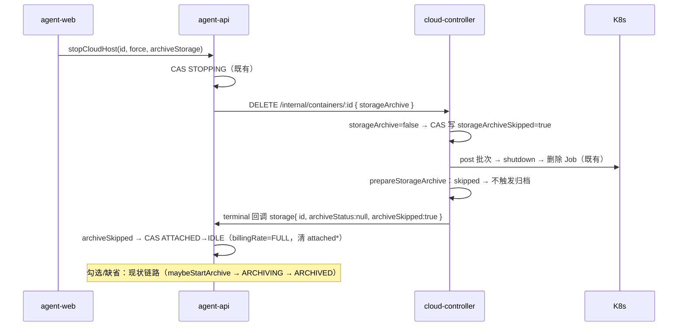
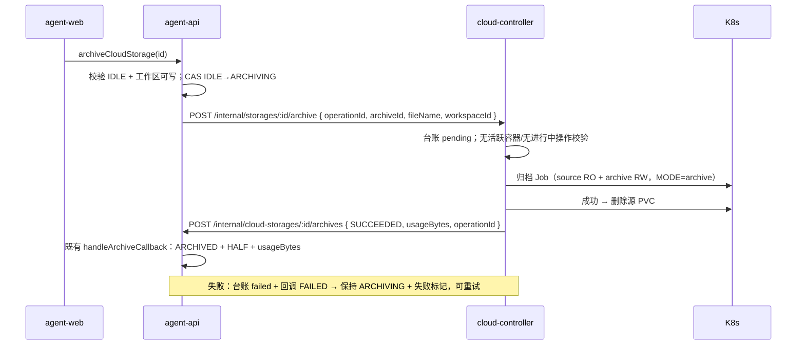
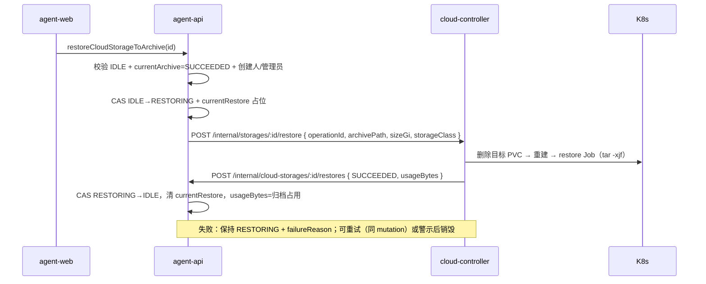
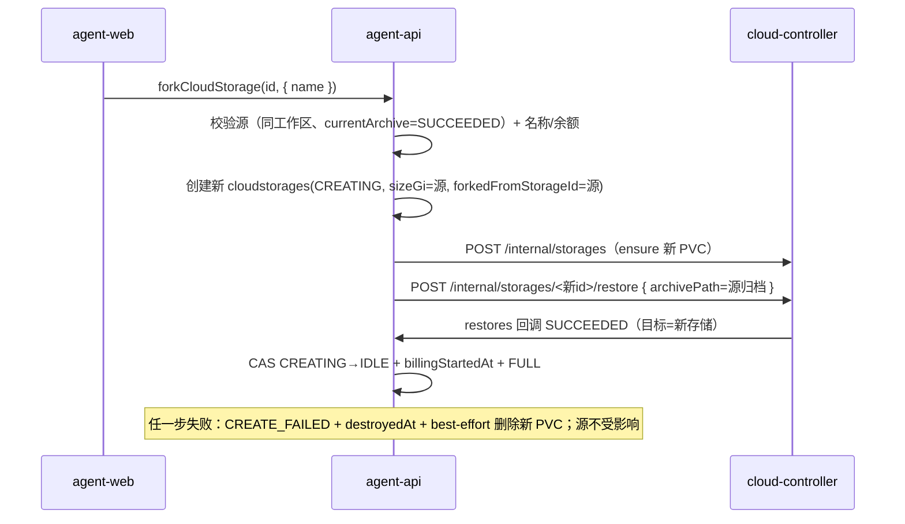
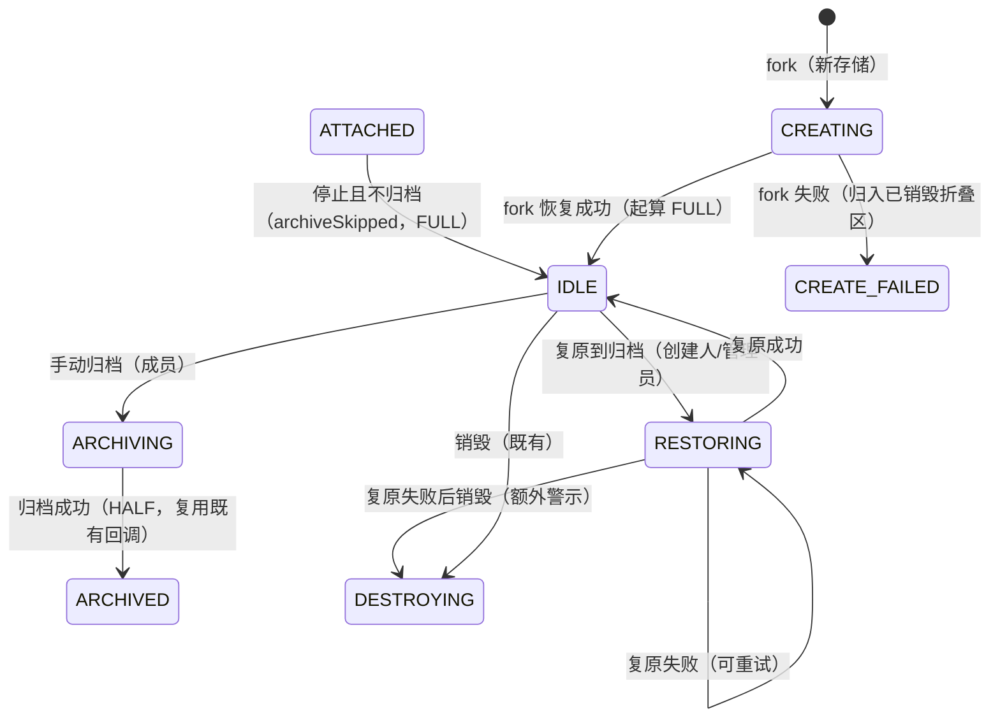

# 云存储归档优化 - 技术提案

**功能名称**: 云存储归档优化（停止归档可选 + 归档/复原到归档/fork）
**关联 PRD**: `docs/product/draft/20261104-cloud-storage-archive-optimization.md`（v1.0）
**技术提案版本**: v1.0
**创建日期**: 2026-11-04
**作者**: z-agent-bot
**feat-branch**: `feat/cloud-storage-archive-optimization`
**需求来源**: GitHub Issue [Deliay/z-agent-gear#434](https://github.com/Deliay/z-agent-gear/issues/434)

## 1. 概述

### 1.1 背景

云存储（[[20261102-feat-cloud-storage]]，Issue #405）已实现：工作区级 PVC 挂载为云电脑主目录 `/home/worker`、销毁云电脑时独立 archiver Job 压缩为 `.tar.gz2` 原子替换写入工作区 100Gi 归档 PVC、状态机 `CREATING/IDLE/ATTACHING/ATTACHED/ARCHIVING/ARCHIVED/DESTROYING/DESTROYED/CREATE_FAILED`、已归档半价计费。

Issue #434 提出三点增强：

1. **销毁（停止）云电脑时归档作为可选项**：不勾选 → 云电脑删除后存储直接置为「待挂载」（IDLE）且继续计费；勾选 → 与既有归档逻辑一致；
2. **云存储设置界面新增三个操作**：「复原到归档」（删除当前 PVC，从归档压缩卷重建）、「归档」（与销毁时勾选归档同逻辑）、「fork」（从某个归档复制一块新云存储，规格不可调整）。

现状代码的关键事实（本提案的落点依据）：

- **归档触发收敛在 cloud-controller 终态链路**：`ContainerService.prepareStorageArchive`（`container-service.ts:711`）在 destroy/markExited/markFailed/巡检收口时调用 `storageService.maybeStartArchive`（`storage-service.ts:400`），条件 `storageId != null && connectedAt != null && storageArchiveStatus ∈ {null, failed}`；不归档的跳过快照必须在**终态转移前**落到 `cloudcontainers`，否则归档会被自动触发。
- **归档/恢复/清理 Job 均为现成能力**：archiver 镜像（`deploy/images/archiver/`）入口已支持 `MODE=archive|restore|usage|cleanup`；归档 Job 与恢复 initContainer 的卷挂载/脚本均已产品化（`buildArchiveScript()`，`storage-service.ts:1336`）。缺的是「**无容器**的存储级归档/恢复」触发点与状态台账。
- **agent-api 状态机已具备回调闭环**：`handleArchiveCallback`（`cloud-storage-service.ts:705`）按 archiveId 幂等、终态单调，SUCCEEDED 从 `ATTACHED|ARCHIVING → ARCHIVED` + `billingRate=HALF` + 清 attached*；terminal 回调（`cloud-host-service.ts:947-979`）在 `archiveStatus` 为空时走 `releaseStorage` 回滚到 `attachFromStatus`——**该路径对「主动不归档」语义错误**（会错误回滚到 ARCHIVED 或误判为启动失败），需要新增 `ATTACHED → IDLE` 分支。
- **计费无需结构变更**：`billingRate` 只有 `FULL/HALF` 两档，`IDLE/ATTACHING/ATTACHED/ARCHIVING = FULL`、`ARCHIVED = HALF`；「待挂载继续全价」与「复原中全价」天然落在既有口径。

### 1.2 目标

- **停止归档可选且向后兼容**：`stopCloudHost` 新增可选 `archiveStorage`（缺省视为归档，旧客户端/非主动销毁行为不变）；不归档时存储 `ATTACHED → IDLE`、`billingRate` 保持 `FULL`、PVC 与数据保留。
- **存储级归档/恢复收归 cloud-controller**：新增存储级 archive/restore 端点与 `cloudstorageoperations` 操作台账（幂等触发、状态持久化、巡检收口、回调 agent-api），复用 archiver 镜像与 per-workspace 串行互斥。
- **agent-api 状态机扩展**：新增 `RESTORING` 瞬态与 `IDLE → ARCHIVING`（手动归档）、`IDLE → RESTORING → IDLE`（复原到归档）、fork 的 `CREATING → IDLE`（经归档恢复）三条路径；全部 CAS。
- **前端三入口**：停止对话框归档勾选（默认勾选 + 费用说明）、云存储列表/详情按状态提供「归档 / 复原到归档 / fork」。
- **零回归**：未挂载存储的云电脑停止、既有归档/恢复/计费、旧版客户端报文形状全部不变。

### 1.3 范围

**做**：

- contracts：`cloud-host.graphql`（`stopCloudHost.archiveStorage`、`CloudHostStopImpact.storage`）；`cloud-storage.graphql`（`RESTORING` 状态、`archiveCloudStorage` / `restoreCloudStorageToArchive` / `forkCloudStorage` 三个 mutation、`CloudStorage.forkedFromStorageId` 与 `currentRestore`）；`cloud-controller-websocket.md` 附录 A（destroy 请求 `storageArchive`、存储级 archive/restore 端点、restores 回调、terminal 回调 `archiveSkipped`）。
- agent-api：`cloud-host-service.stop` 透传归档选择；terminal 回调新增 `archiveSkipped` 分支（`ATTACHED → IDLE`）；`cloud-storage-service` 新增 `archive` / `restoreToArchive` / `fork` / `handleRestoreCallback`；内部回调路由新增 restores 端点；迁移 022（`forkedFromStorageId` 索引）。
- cloud-controller：`DELETE /internal/containers/:id` 接受 `storageArchive:false`（落 `cloudcontainers.storageArchiveSkipped`，`maybeStartArchive` 与巡检尊重跳过标记）；`storage-service` 新增存储级 `startStorageArchive` / `startStorageRestore` 与 `cloudstorageoperations` 台账；`internal-api` 新增两个端点与查询；迁移 003（台账集合索引）。
- agent-web：停止对话框归档勾选；云存储列表/详情三操作与确认对话框；fork 对话框；`RESTORING` 徽标文案「复原中」。
- 测试：单元/API/E2E 矩阵（§8）。

**不做**：

- 已挂载（ATTACHED）存储的在线归档/复原/fork（需先停止云电脑）；
- fork 时调整容量/规格（与需求一致：不可调整）；
- 归档多版本、归档下载/导出；
- admin-web 变更（账单分类与费率口径不变）；
- 非主动销毁（失败/欠费强拆）的归档可选项（保持自动归档兜底）。

## 2. 技术架构

### 2.1 系统架构图

```mermaid
graph TB
    subgraph 前台
        Web[agent-web<br/>停止对话框归档勾选<br/>云存储 归档/复原/fork]
    end
    subgraph 业务域
        AA[agent-api<br/>cloudstorages 状态机<br/>+RESTORING / fork / restores 回调]
    end
    subgraph 管控域
        CC[cloud-controller<br/>destroy 跳过快照<br/>存储级 archive/restore Job<br/>cloudstorageoperations 台账]
        K8S[(K8s API<br/>Job + PVC)]
    end
    subgraph 计费域
        AD[admin-api<br/>阶梯计费 全价/半价<br/>（零变更）]
    end

    Web -->|stopCloudHost(archiveStorage)<br/>archive/restoreToArchive/fork| AA
    AA -->|DELETE /internal/containers/:id<br/>body storageArchive| CC
    AA -->|POST /internal/storages/:id/archive<br/>POST /internal/storages/:id/restore| CC
    CC -->|归档/恢复/清理 Job| K8S
    CC -->|archives / restores / usage 回调| AA
    CC -->|terminal 回调 storage.archiveSkipped| AA
    AA -->|报价/出账（既有）| AD
```

### 2.2 技术栈

| 层级 | 技术选型 | 说明 |
|------|---------|------|
| 前端 | React 19 + TypeScript + Apollo Client + Tailwind | 复用既有对话框/列表组件与 `lib/cloud-storage.ts` 状态助手 |
| 业务后端 | Node.js 24 + Express 5 + GraphQL-Yoga + Mongoose 9 | agent-api 既有栈；状态机全部 CAS |
| 管控后端 | Node.js 24 + `@kubernetes/client-node` | cloud-controller 既有栈；复用 archiver Job 脚本与 per-workspace `KeyedMutex` |
| 归档/恢复执行 | archiver 镜像 `MODE=archive/restore`（既有） | 不新增镜像；恢复 Job 复用 initContainer 同款 `tar -xjf` |
| 计费 | admin-api 既有 storage 阶梯计费 | 零结构变更 |
| 测试 | Vitest（单测/真库/集成）+ Playwright E2E | TDD 红-绿-重构 |

### 2.3 模块划分

| 模块 | 新增/修改 | 职责 |
|------|-----------|------|
| `contracts/cloud-host.graphql` | 修改 | `stopCloudHost.archiveStorage`、`CloudHostStopImpact.storage` |
| `contracts/cloud-storage.graphql` | 修改 | `RESTORING`、三个 mutation、`forkedFromStorageId`/`currentRestore`、错误文案 |
| `contracts/cloud-controller-websocket.md` | 修改 | 附录 A：destroy `storageArchive`、存储级 archive/restore/操作查询端点、restores 回调、terminal `archiveSkipped` |
| `servers/agent-api/src/services/cloud-host-service.ts` | 修改 | `stop(..., archiveStorage)` 透传；terminal `archiveSkipped` → `ATTACHED→IDLE` |
| `servers/agent-api/src/services/cloud-storage-service.ts` | 修改 | `archive`/`restoreToArchive`/`fork`/`handleRestoreCallback`；状态机 + RESTORING |
| `servers/agent-api/src/models/cloud-storage.ts` | 修改 | status 枚举 + `RESTORING`、`forkedFromStorageId`、`currentRestore` 子文档 |
| `servers/agent-api/src/routes/internal-cloud-storage.ts` | 修改 | `POST /internal/cloud-storages/:id/restores` 回调 |
| `servers/agent-api/src/graphql/schemas|resolvers/cloud-storage.ts`、`cloud-host.ts` | 修改 | 契约落地（resolver 登记 `index.ts`） |
| `servers/agent-api/src/services/cloud-controller-client.ts` | 修改 | `destroyContainer(id, {storageArchive})`、`archiveStorageOp`、`restoreStorageOp` |
| `servers/agent-api/src/migrations/022-cloud-storage-fork.ts` | 新增 | `forkedFromStorageId` 索引（幂等） |
| `servers/cloud-controller/src/routes/internal-api.ts` | 修改 | destroy body `storageArchive`；`POST /internal/storages/:id/archive|restore`、`GET .../operations/:opId` |
| `servers/cloud-controller/src/services/container-service.ts` | 修改 | destroy 接受 `storageArchive:false` → 落 `storageArchiveSkipped`；归档触发尊重跳过标记 |
| `servers/cloud-controller/src/services/storage-service.ts` | 修改 | 存储级 `startStorageArchive`/`startStorageRestore`、操作台账读写、巡检收口 |
| `servers/cloud-controller/src/models/cloud-container.ts` | 修改 | `storageArchiveSkipped: Boolean|null` |
| `servers/cloud-controller/src/models/cloud-storage-operation.ts` | 新增 | `cloudstorageoperations` 台账模型 |
| `servers/cloud-controller/src/migrations/003-cloud-storage-operations.ts` | 新增 | 台账集合索引（幂等） |
| `apps/agent-web/src/components/cloud-host/StopCloudHostDialog.tsx` | 修改 | 归档勾选（默认勾选）+ 费用说明 |
| `apps/agent-web/src/components/settings/CloudStorageSection.tsx`、`CloudStorageDetailDialog.tsx` | 修改 | 三操作入口与确认对话框 |
| `apps/agent-web/src/components/settings/ForkCloudStorageDialog.tsx` | 新增 | fork 名称 + 固定容量 + 报价 |
| `apps/agent-web/src/lib/cloud-storage.ts`、`graphql/*` | 修改 | 状态助手（canArchive/canRestore/canFork）、徽标文案、mutation/queries/types |

## 3. API 设计

### 3.1 对外契约（GraphQL）

#### 3.1.1 `contracts/cloud-host.graphql`

```graphql
type CloudHostStopImpact {
  activeSessionCount: Int!
  sessionsWillBeLost: Boolean!
  sessions: [CloudHostStopImpactSession!]!
  # 当前挂载的云存储摘要；未挂载为 null（停止对话框据此展示归档勾选项）
  storage: CloudStorageSummary
}

extend type Mutation {
  # archiveStorage：仅挂载云存储时有意义；缺省/null = 归档（与现状一致，向后兼容）；
  # false = 停止后存储直接回到「待挂载」（IDLE），数据保留、继续全价计费。
  # 非主动销毁（失败/欠费强拆）不经过该入口，始终归档。
  stopCloudHost(id: ID!, force: Boolean, archiveStorage: Boolean): CloudHost!
}
```

#### 3.1.2 `contracts/cloud-storage.graphql`

```graphql
enum CloudStorageStatus {
  CREATING
  IDLE
  ATTACHING
  ATTACHED
  ARCHIVING
  ARCHIVED
  RESTORING       # 复原中（「复原到归档」执行期间；瞬态，含复原失败待重试）
  DESTROYING
  DESTROYED
  CREATE_FAILED
}

enum CloudStorageRestoreStatus {
  PENDING
  RUNNING
  SUCCEEDED
  FAILED
}

# 当前复原操作（仅 RESTORING 期间非空；进入 IDLE 后清空）
type CloudStorageRestore {
  id: ID!                 # operationId
  status: CloudStorageRestoreStatus!
  startedAt: String
  finishedAt: String
  failureReason: String
}

type CloudStorage {
  # ...既有字段
  currentRestore: CloudStorageRestore
  # fork 来源存储 id；非 fork 创建为 null
  forkedFromStorageId: ID
}

input ForkCloudStorageInput {
  # trim 后 1~64；同一工作区唯一（与 create 同规则）
  name: String!
}

extend type Mutation {
  # 手动归档：仅 IDLE；与「停止云电脑勾选归档」同逻辑（原子替换、释放数据卷、已归档半价）。
  # 权限：工作区可写成员（只读角色拒绝）。
  archiveCloudStorage(id: ID!): CloudStorage!
  # 复原到归档：仅 IDLE 且 currentArchive.status=SUCCEEDED；丢弃当前内容、删除当前 PVC
  # 并从归档重建；权限：创建人/工作区管理员（与销毁同级），二次确认由前端保证。
  restoreCloudStorageToArchive(id: ID!): CloudStorage!
  # fork：源存储须存在 SUCCEEDED 归档（IDLE/ARCHIVED）；新存储容量与源一致不可调整，
  # 内容从源当前归档恢复；成功后新存储 IDLE 并按全价起算。权限：工作区可写成员。
  forkCloudStorage(id: ID!, input: ForkCloudStorageInput!): CloudStorage!
}
```

状态机注释更新（契约头注释同步）：

```
#   IDLE → ARCHIVING → ARCHIVED（手动归档，与销毁归档同逻辑）
#   ATTACHED → IDLE（停止云电脑且选择不归档；保持 FULL 计费，数据保留）
#   IDLE → RESTORING → IDLE（复原到归档；失败保持 RESTORING 可重试/警示后销毁）
#   fork：新存储 CREATING → IDLE（经源归档恢复；失败 CREATE_FAILED 归入已销毁折叠区）
```

错误文案新增（服务端权威）：

| 场景 | 文案 |
|------|------|
| 手动归档时非 IDLE | `storage is not archivable` |
| 复原时无可用归档 | `storage has no archive` |
| 复原时非 IDLE/非 RESTORING 重试 | `storage is not restorable` |
| 复原进行中冲突 | `storage is restoring` |
| fork 源无归档/状态不允许 | `storage is not forkable` |
| 复原作者权限不足 | `not allowed to restore storage` |

既有错误文案与 `destroyCloudStorage` 状态规则扩展：`RESTORING` 进行中不可销毁；`RESTORING + currentRestore.status=FAILED` 允许销毁（前端额外警示，与 ARCHIVING 失败同口径）。

#### 3.1.3 计费契约

零变更。`RESTORING` 与 fork 新存储 `CREATING` 期间 `billingRate=FULL`（`CREATING` 未写 `billingStartedAt` 不计费，进入 `IDLE` 时起算），口径与既有一致。

### 3.2 内部接口（`contracts/cloud-controller-websocket.md` 附录 A）

**a) 销毁容器请求扩展（A.2.x 修订）**

```
DELETE /internal/containers/:id
Body: { "reason": "...", "storageArchive": false }
```

- `storageArchive` 缺省/`true` = 现状（终态自动归档）；`false` = 本次销毁**跳过归档**：
  cloud-controller 在终态转移前落 `cloudcontainers.storageArchiveSkipped=true`，
  `maybeStartArchive` 与巡检收口尊重该标记（幂等，不触发归档 Job）。
- 未挂载存储的容器忽略该字段；旧版 cloud-controller 忽略未知字段（退化为归档，见 §6.1 决策）。

**b) 存储级归档（新增）**

```
POST /internal/storages/:storageId/archive
Body: { "operationId": "<opId>", "archiveId": "<id>", "fileName": "<name>-<ts>.tar.gz2",
        "workspaceId": "<ws>", "tenantId": "<tenant>" }
Resp: { "accepted": true, "operationId": "<opId>" }
错误: 404 STORAGE_NOT_FOUND / 409 STORAGE_IN_USE（活跃容器引用）
      / 409 OPERATION_RUNNING（同存储已有进行中操作，幂等返回已有 operationId）
```

- 幂等：同 `operationId` 重投直接返回已受理；同存储已有 `pending/running` 操作 → 409。
- 归档 Job 与容器级归档同一脚本（`MODE=archive`：清 `.tmp` → 压缩 → `du` → 删旧 `.tar.gz2` → `mv` → 标记行），成功后删除源 PVC（与销毁归档一致），回调 `/internal/cloud-storages/:id/archives`（既有端点，报文追加 `operationId`）。

**c) 存储级复原（新增，复原到归档与 fork 共用）**

```
POST /internal/storages/:storageId/restore
Body: { "operationId": "<opId>", "workspaceId": "<ws>", "tenantId": "<tenant>",
        "archivePath": "/archive/<ws>/<srcStorageId>/<fileName>",
        "sizeGi": 20, "storageClass": "ceph-rbd" }
Resp: { "accepted": true, "operationId": "<opId>" }
错误: 404 STORAGE_NOT_FOUND（复原到归档）/ 409 STORAGE_IN_USE / 409 OPERATION_RUNNING / 400 INVALID_BODY
```

- 执行：`删除目标 PVC（等待真正消失）→ ensure 重建（sizeGi/storageClass）→ restore Job（archive RO + target RW，`tar -xjf`）`；fork 时 `:storageId` 为**新**存储（PVC 尚不存在时跳过删除直接重建）。
- `archivePath` 校验复用既有 `ARCHIVE_PATH_PATTERN`（`internal-api.ts:335`），拒绝 `..`。
- 回调 `POST /internal/cloud-storages/:id/restores`（见 d）。

**d) 操作查询与 restores 回调（新增）**

```
GET /internal/storages/:storageId/operations/:operationId
Resp: { "operationId": "...", "type": "archive|restore", "status": "pending|running|succeeded|failed",
        "usageBytes": 123, "startedAt": "...", "finishedAt": "...", "failureReason": null }

POST /internal/cloud-storages/:storageId/restores        # cloud-controller → agent-api
Body: { "operationId": "<opId>", "storageId": "<id>", "status": "RUNNING|SUCCEEDED|FAILED",
        "usageBytes": 5368709120, "startedAt": "...", "finishedAt": "...", "failureReason": null }
Resp: { "ok": true }
```

- 均 Bearer `INTERNAL_API_TOKEN`；按 `operationId` 幂等、终态单调；回调失败按 `0/250ms/1s/3s` 退避重试，agent-api 以操作查询端点兜底对账（与归档回调同模式）。

**e) terminal 回调扩展（A.2.10 修订）**

```jsonc
"storage": { "id": "<storageId>", "archiveStatus": null, "archiveSkipped": true }
```

- `archiveSkipped=true` 仅在本次销毁显式跳过归档时携带；agent-api 据此走 `ATTACHED → IDLE`（不归档、不回滚到 ARCHIVED）。
- 未触发归档且非跳过（如从未 ready）保持不携带 `archiveSkipped`，行为与现状一致（`releaseStorage` 回滚）。

## 4. 数据模型

### 4.1 `cloudstorages`（agent-api 写，admin-api 只读镜像）

新增/变更字段：

```ts
status: ... | 'RESTORING',             // 复原中（瞬态）
forkedFromStorageId: ObjectId|null,    // fork 来源（留痕/展示），非 fork 为 null
currentRestore: {                       // 仅 RESTORING 期间非空
  operationId: string,
  status: 'PENDING'|'RUNNING'|'SUCCEEDED'|'FAILED',
  startedAt: Date|null,
  finishedAt: Date|null,
  failureReason: string|null
} | null,
```

- `billingRate`：`RESTORING` 恒 `FULL`；fork 新存储 `CREATING` 不写 `billingStartedAt`，`IDLE` 时写入并 `FULL`。
- `attachedCloudHostId` 唯一索引不受影响（`ATTACHED → IDLE` 与复原/fork 路径均先清空 attached*）。
- 迁移 **022-cloud-storage-fork**：显式创建 `{ resourceWorkspaceId: 1, forkedFromStorageId: 1 }` 稀疏索引（幂等；不回填存量，历史行 `forkedFromStorageId/currentRestore` 容忍缺失）。编号说明：当前最新为 `021-workflow-interrupt-retry`，故 022。

### 4.2 `cloudcontainers`（cloud-controller 写，agent-api 只读镜像）

```ts
storageArchiveSkipped: boolean|null,   // 本次销毁显式跳过归档；终态转移前写入
```

- 历史行 null 容忍；`maybeStartArchive` / 巡检 `reconcileArchives` 增加前置条件 `storageArchiveSkipped !== true`。
- agent-api 只读镜像模型同步该字段（读取层透出给 terminal 链路兜底对账）。

### 4.3 `cloudstorageoperations`（cloud-controller 写，新增台账集合）

承载「无容器」的存储级归档/恢复操作，镜像容器级归档的幂等/巡检语义：

```ts
{
  _id: ObjectId,                        // operationId
  storageId: string,                    // 目标存储（fork 时为新存储）
  workspaceId: string,
  tenantId: string|null,
  type: 'archive'|'restore',
  status: 'pending'|'running'|'succeeded'|'failed',
  archiveId: string|null,               // type=archive：归档 id（随回调上报）
  fileName: string|null,                // type=archive：归档文件名
  archivePath: string|null,             // type=restore：源归档完整路径
  usageBytes: number|null,
  startedAt: Date, finishedAt: Date|null,
  failureReason: string|null,
  callbackDeliveredAt: Date|null,       // 巡检重投依据
  createdAt: Date, updatedAt: Date
}
```

索引（迁移 **003-cloud-storage-operations**，幂等显式创建）：

```ts
{ storageId: 1, status: 1 }
{ status: 1, updatedAt: 1 }             // 巡检扫描进行中/超时操作
```

### 4.4 计费与价目

零变更（3 档价目、`storagebillingcursors`、整点 tick 均不动）。`ATTACHED → IDLE`（不归档）时 `billingRate` 保持 `FULL`、`billingStartedAt` 不动，tick 按既有口径连续出账；手动归档成功回调走既有 `ARCHIVED + HALF` 分支。

## 5. 技术实现方案

### 5.1 核心流程

#### 5.1.1 停止云电脑（归档可选）



- agent-api `stop` 签名扩展 `archiveStorage?: boolean|null`；仅当 `host.storageId` 非空且 `archiveStorage === false` 时向 cloud-controller 传 `storageArchive:false`，其余情况报文与现状一致。
- terminal 处理（`cloud-host-service.ts` `syncStorageOnTerminal`）：新增第一分支 `input.storage?.archiveSkipped === true` → `storageService.detachToIdle(storageId, hostId)`；不命中时走既有 markArchiving / reconcile / releaseStorage 分支，行为不变。
- 幂等与兜底：`detachToIdle` 为 CAS（`{_id, status:'ATTACHED', attachedCloudHostId}` → `IDLE`）；terminal 重投/乱序不重复推进。cloud-controller 巡检对「终态且未归档」容器先查 `storageArchiveSkipped`，跳过不补归档。

#### 5.1.2 手动归档（IDLE → ARCHIVING → ARCHIVED）



- agent-api `archive(id, userId)`：CAS 前生成 `archiveId`/`fileName`（复用 `buildArchiveFileName`）与 `operationId`；调用失败回滚 `ARCHIVING → IDLE`。回调复用既有 `handleArchiveCallback`（SUCCEEDED 分支已接受 `ARCHIVING`，零改动）；报文新增 `operationId` 仅留痕。
- cloud-controller `startStorageArchive`：台账 CAS（同存储唯一进行中）→ 复用归档 Job 执行与标记行解析 → 成功后删源 PVC（与容器级一致，最多 3 次）→ 回调。per-workspace `archiveMutex` 与 `awaitCleanup` 串行口径不变。
- 重试：`retryCloudStorageArchive` 扩展支持「无容器来源」——`currentArchive.containerId` 为空时改走存储级归档端点（新 operationId/archiveId），有容器时保持现状。

#### 5.1.3 复原到归档（IDLE → RESTORING → IDLE）



- 重试同入口：`RESTORING + currentRestore.status=FAILED` 时 `restoreCloudStorageToArchive` 重新触发（新 operationId，PVC 删后重建，天然幂等）。
- 复原期间源归档只读，归档本体不动；与 fork/归档共用 per-workspace 串行互斥，不与本存储归档并发。

#### 5.1.4 fork（从归档复制新存储）



- fork 复用「复原」同一 restore 端点（目标存储不同）；`archivePath` 取自源 `currentArchive.path` 快照（触发时刻归档版本固定）。
- 源存储全程只读其归档文件，状态不变、可继续挂载/归档（互斥由 per-workspace 串行保证不发生读-写冲突）。

### 5.2 关键实现点

#### 实现点 1: 销毁跳过快照的时序安全

- `ContainerService.destroy(containerId, { reason, storageArchive })`：`storageArchive === false` 且容器 `storageId` 非空时，在 CAS `destroying` 的**同一次更新**写入 `storageArchiveSkipped=true`（无独立窗口）；`markExited`/`markFailed`/巡检收口路径保持原样——`prepareStorageArchive` 统一前置判断 `storageArchiveSkipped !== true`。
- 已落 `storageArchiveSkipped=true` 的容器即使后续被巡检重扫也不补归档；`startArchive`（手动重试端点）不受该标记影响（用户显式重试优先）。
- terminal 回调组装处读取容器快照追加 `archiveSkipped`（仅 `true` 时携带，旧版 agent-api 容忍未知字段）。

#### 实现点 2: agent-api `detachToIdle`（ATTACHED → IDLE）

```ts
// CAS：{_id, status:'ATTACHED', attachedCloudHostId: hostId} →
// { status:'IDLE', billingRate:'FULL', attached*:null, attachFromStatus:null }
```

- 不清 `lastContainerId`（留档）；`usageBytes` 保留上次已知值（挂载期间可经 `refreshCloudStorageUsage` 刷新，停止后以「更新于…」展示）。
- 与 `releaseStorage` 的区别：`releaseStorage` 回滚到 `attachFromStatus`（启动失败语义），`detachToIdle` 恒到 `IDLE`（主动不归档语义）；两者互斥于不同分支，不共存。

#### 实现点 3: 存储级操作台账与巡检

- `cloudstorageoperations` 写方仅 cloud-controller；触发端点幂等键 = `operationId`（重投返回既有状态）；同存储 `pending/running` 唯一（CAS `{storageId, status:{$in:[pending,running]}}` 不存在才插入）。
- `status-sync` 每轮 `reconcileStorageOperations`：`pending/running` 超 `ARCHIVE_TIMEOUT_MS` → `failed` + 回调；`succeeded/failed` 且 `callbackDeliveredAt=null` → 重投一次（agent-api 幂等）。与容器级归档巡检同模式、同互斥。
- agent-api 对账：`RESTORING`/`ARCHIVING`（存储级来源）超 10 分钟 → 按 `currentRestore.operationId` / `currentArchive.operationId` 调 `GET .../operations/:opId` 补齐（复用 `reconcileARCHIVING` 节奏，扩展 restore 分支）。

#### 实现点 4: 恢复 Job 与 PVC 重建

- 复原/fork 的 restore Job 复用 archiver 镜像 `MODE=restore`：`set -euo pipefail; tar -xjf "$RESTORE_FILE" -C /target; echo ZAG_RESTORE_DONE`；卷 `archive RO + target RW`。
- 目标 PVC 准备复用 `prepareForStart` 的「先删同名残留、轮询消失、按 sizeGi/storageClass ensure」三段（`storage-service.ts:316`），抽取为 `recreateStoragePvc(storageId, sizeGi, storageClass)` 共用。
- 失败语义：restore Job 失败/超时/标记行缺失 → 台账 `failed` + 回调 FAILED；目标 PVC 可能半恢复——重试时整体删除重建，无脏数据累积。

#### 实现点 5: 状态机与权限汇总



| 操作 | 状态门槛 | 权限 |
|------|---------|------|
| `stopCloudHost(archiveStorage:false)` | 挂载存储的活跃云电脑 | 云电脑所有者（既有口径） |
| `archiveCloudStorage` | `IDLE` | 工作区可写成员（只读拒绝） |
| `restoreCloudStorageToArchive` | `IDLE` 且 `currentArchive=SUCCEEDED`；`RESTORING+FAILED` 重试 | 创建人 / 工作区管理员 |
| `forkCloudStorage` | 源 `currentArchive=SUCCEEDED`（`IDLE`/`ARCHIVED`） | 工作区可写成员（只读拒绝） |
| `destroyCloudStorage` | 既有 + `RESTORING+FAILED` 允许（警示） | 创建人 / 工作区管理员（既有） |

#### 实现点 6: 前端

- `StopCloudHostDialog`：`cloudHostStopImpact` 返回 `storage` 非空时展示勾选项「停止时归档云存储（`<name>`）」（`aria-label="归档云存储"`，默认勾选）与说明「勾选：归档后按半价计费；不勾选：存储回到待挂载并继续全价计费，数据原样保留」；提交 `stopCloudHost(id, force, archiveStorage)`；无活动会话的自动停止路径同样携带勾选值；未挂载存储时不渲染勾选、报文不含 `archiveStorage`（旧形状）。
- `CloudStorageSection` 行操作与 `CloudStorageDetailDialog`：`IDLE` 展示「归档」+（有归档时）「复原到归档」「fork」；`ARCHIVED` 展示「fork」；`ARCHIVING/RESTORING/ATTACHED` 禁用并提示；`RESTORING` 徽标「复原中」。
- 确认对话框：归档（提示转半价）、复原（destructive + 「当前内容将被丢弃并回滚到归档版本，不可恢复」）、fork（`ForkCloudStorageDialog`：名称输入 + 容量只读展示「与源一致：x Gi」+ `cloudStorageBillingQuote(source.sizeGi)` 报价 + 「创建成功即开始计费」）。
- `lib/cloud-storage.ts`：`cloudStorageStatusLabel` + `RESTORING→复原中`、`canArchiveStorage/canRestoreStorage/canForkStorage` 纯函数；错误映射白名单新增 §3.1.2 文案。
- 移动端：操作按钮折行不溢出（沿用既有 `flex-wrap` 行布局）。

#### 实现点 7: 可观测性

- 新增 span：`storage.detach`（agent-api，不归档停止的存储释放）、`storage.op.archive` / `storage.op.restore`（cloud-controller 存储级操作，属性 `storage.id`/`operation.id`/`operation.type`）。
- 日志事件（`component: 'cloud-storage'`）：`archive_skipped`、`storage_detached_to_idle`、`storage_archive_requested`、`storage_restore_requested`、`storage_forked`、`restore_succeeded`、`restore_failed`、`operation_reconcile_*`；不打印归档内容/内部 token。

#### 实现点 8: 兼容与降级

- 旧前端（不传 `archiveStorage`）→ 服务端缺省归档，行为与现状一致。
- 新 agent-api + 旧 cloud-controller：`storageArchive` 字段被忽略 → 仍归档（退化为旧行为，不错误丢数据）；发布顺序保证 cloud-controller 先行（§9）。
- 旧 agent-api + 新 cloud-controller：从不下发 `storageArchive:false` 与新端点，行为不变。
- `CLOUD_STORAGE_ENABLED=false` 时三 mutation 与勾选入口全部隐藏/拒绝（既有开关口径）。

## 6. 技术决策

### 6.1 决策列表

| 决策 | 选项 A | 选项 B | 最终选择 | 原因 |
|------|--------|--------|---------|------|
| 不归档的落点 | 停止时仅前端记录，cloud-controller 不变 | destroy 请求携带 `storageArchive:false` 并落库跳过标记 | B | 归档触发在 cloud-controller 终态链路内部，只有跳过快照能可靠关闭自动归档（含巡检补归档） |
| 不归档后存储状态 | 回滚到 `attachFromStatus` | 恒 `ATTACHED → IDLE` | B | 数据在 PVC 中且可能新于归档；回 ARCHIVED 会错误表达「内容=归档且 PVC 已释放」 |
| 非主动销毁是否可选 | 同样可选 | 始终归档 | B | 失败/欠费强拆无交互入口；保留归档作为数据兜底 |
| `archiveStorage` 缺省值 | 缺省不归档 | 缺省归档 | B | 向后兼容：旧客户端/旧报文行为不变 |
| 手动归档触发面 | 复用容器级 `POST /internal/containers/:id/archive`（lastContainerId） | 新增存储级 `POST /internal/storages/:id/archive` | B | 从未挂载的 IDLE 存储无容器可用；存储级语义与「无容器」场景对齐 |
| 存储级操作状态承载 | 复用 `cloudcontainers` | 新集合 `cloudstorageoperations` | B | 无容器可挂；台账自带幂等/巡检/重投语义，写方单一 |
| fork 目标状态 | 恢复后 `ARCHIVED` | 恢复后 `IDLE`（待挂载） | B | 新存储已是可用实体（PVC 已建、内容已恢复），起算全价与 create 一致 |
| fork 恢复执行 | 新建专用镜像/脚本 | 复用 archiver `MODE=restore` 与存储级 restore 端点 | B | 能力已产品化；复原与 fork 同一实现，降低维护面 |
| 复原权限 | 工作区成员 | 创建人/管理员 | B | 复原丢弃当前数据，破坏性与销毁同级 |
| 复原失败处理 | 自动回 IDLE | 保持 RESTORING + 失败标记，可重试/警示后销毁 | B | PVC 可能半恢复，回 IDLE 会被直接挂载使用脏数据 |
| 并发互斥 | 新互斥域 | 复用 per-workspace `archiveMutex` + `awaitCleanup` | B | 归档 PVC 与工作区串行口径既有；防 fork 读归档时被同区归档替换 |

### 6.2 依赖与约束

| 类型 | 内容 | 说明 |
|------|------|------|
| 依赖 | archiver 镜像 `MODE=archive/restore`（既有） | 无新镜像；归档/恢复 Job 脚本复用 |
| 依赖 | per-workspace 归档串行互斥（既有） | 存储级操作加入同一互斥域 |
| 依赖 | admin-api 存储计费（既有） | 价目/tick/游标零变更 |
| 约束 | cloud-controller 单副本 | 台账与互斥为进程内语义，扩容需 Lease（既有约束延续） |
| 约束 | 发布顺序 | cloud-controller → agent-api → agent-web（见 §9）；倒挂时「不归档」退化为归档 |
| 约束 | 归档单份 | fork/复原读取的都是当前唯一归档；新归档原子替换后旧归档不可再取 |
| 约束 | `RESTORING` 不计入可挂载集 | `onlyAttachable` 仍只含 `IDLE + ARCHIVED` |

## 7. 项目结构

```text
contracts/
├── cloud-host.graphql                 # stopCloudHost.archiveStorage / CloudHostStopImpact.storage
├── cloud-storage.graphql              # RESTORING / 三 mutation / currentRestore / forkedFromStorageId
└── cloud-controller-websocket.md      # 附录 A：destroy.storageArchive、存储级 archive/restore/operations、restores 回调、terminal archiveSkipped

servers/agent-api/src/
├── models/cloud-storage.ts            # +RESTORING / forkedFromStorageId / currentRestore
├── models/cloud-container.ts          # 只读镜像 +storageArchiveSkipped
├── services/cloud-host-service.ts     # stop 透传 + terminal archiveSkipped 分支（detachToIdle）
├── services/cloud-storage-service.ts  # archive / restoreToArchive / fork / handleRestoreCallback
├── services/cloud-controller-client.ts# destroyContainer(id,{storageArchive}) / archiveStorageOp / restoreStorageOp / getStorageOperation
├── routes/internal-cloud-storage.ts   # +POST /internal/cloud-storages/:id/restores
├── graphql/schemas/cloud-storage.ts   # 契约落地
├── graphql/resolvers/cloud-storage.ts # 三 mutation（登记 index.ts）
├── graphql/resolvers/cloud-host.ts    # stopCloudHost.archiveStorage / stopImpact.storage
└── migrations/022-cloud-storage-fork.ts

servers/cloud-controller/src/
├── models/cloud-container.ts          # +storageArchiveSkipped
├── models/cloud-storage-operation.ts  # 新增台账模型
├── services/container-service.ts      # destroy 接受 storageArchive / 归档触发尊重跳过
├── services/storage-service.ts        # startStorageArchive / startStorageRestore / 台账巡检
├── routes/internal-api.ts             # destroy body 扩展 + /storages/:id/archive|restore|operations/:opId
└── migrations/003-cloud-storage-operations.ts

apps/agent-web/src/
├── components/cloud-host/StopCloudHostDialog.tsx     # 归档勾选 + 费用说明
├── components/settings/CloudStorageSection.tsx       # 行操作
├── components/settings/CloudStorageDetailDialog.tsx  # 操作与状态
├── components/settings/ForkCloudStorageDialog.tsx    # 新增
├── lib/cloud-storage.ts                              # 状态助手/文案
└── graphql/{mutations,queries,types}.ts

tests/api/src/agent-api/cloud-storage-archive-optimization.test.ts
tests/api/src/cloud-controller/cloud-storage-archive-optimization.test.ts
tests/e2e/src/cloud-storage-archive-optimization.spec.ts
```

## 8. 测试策略

### 8.1 测试覆盖要求

- 单元测试：agent-api 状态机三新路径与权限/回调幂等；cloud-controller 跳过标记、存储级端点与台账巡检；前端勾选与按状态按钮。新增代码行覆盖率 ≥ 90%。
- 真库测试（`mongodb-memory-server`）：`cloudstorages` 新字段/索引、`cloudstorageoperations` 唯一进行中约束。
- API/集成（`tests/api`，InMemory K8s）：不归档停止全链路、手动归档、复原、fork。
- E2E（Playwright）：停止对话框勾选、云存储三操作入口与确认。

### 8.2 测试类型

| 类型 | 工具 | 覆盖范围 |
|------|------|---------|
| 单元（agent-api） | Vitest + mock | 状态机 CAS、权限矩阵、回调幂等/乱序、回滚 |
| 单元（cloud-controller） | Vitest + InMemoryK8sClient | 跳过快照时序、台账幂等、Job manifest、巡检收口 |
| 单元（agent-web） | Vitest + RTL | 勾选默认/携带、按钮状态门槛、对话框确认 |
| API 集成 | Vitest | 四链路端到端（含失败与重试） |
| E2E | Playwright | 关键界面流 |
| 回归 | 既有测试 | 勾选归档停止/既有归档/恢复/计费零变化 |

### 8.3 计划用例（TDD 先红后绿）

| 编号 | 用例 |
|------|------|
| T-SKIP1 | `stopCloudHost(archiveStorage:false)` → destroy 请求携带 `storageArchive:false`；未挂载存储/缺省不携带 |
| T-SKIP2 | terminal `archiveSkipped:true` → 存储 `ATTACHED→IDLE`、`billingRate=FULL`、attached* 清空、归档不触发 |
| T-SKIP3 | 缺省/true 时行为与现状一致（归档链路回归） |
| T-SKIP4 | cloud-controller：`storageArchive:false` 在终态转移前落 `storageArchiveSkipped`；`maybeStartArchive` 与巡检跳过；手动 `startArchive` 不受限 |
| T-SKIP5 | 巡检不重投「已跳过」容器的归档；terminal 重投幂等（重复 detachToIdle 无副作用） |
| T-AR1 | `archiveCloudStorage`：仅 IDLE 可触发；CAS→ARCHIVING；非 IDLE/只读角色拒绝 |
| T-AR2 | 存储级归档成功回调 → ARCHIVED + HALF + usageBytes；旧归档原子替换语义（Job 脚本顺序回归） |
| T-AR3 | 归档失败 → 保持 ARCHIVING + 失败标记；`retryCloudStorageArchive` 无容器来源改走存储级端点 |
| T-AR4 | 触发幂等：同 operationId 重投返回既有；同存储进行中 → 409 |
| T-RS1 | `restoreCloudStorageToArchive`：IDLE + SUCCEEDED 归档 + 创建人/管理员才可通过；其余拒绝（含 `storage has no archive`） |
| T-RS2 | 复原成功回调 → RESTORING→IDLE、清 currentRestore、usageBytes=归档占用 |
| T-RS3 | 复原失败 → 保持 RESTORING + failureReason；同 mutation 重试成功；RESTORING+FAILED 可销毁（警示口径同归档失败） |
| T-RS4 | cloud-controller restore：先删目标 PVC 并等待消失 → 重建（sizeGi/storageClass 快照）→ Job（archive RO/target RW）→ 标记行；失败不删归档 |
| T-FORK1 | `forkCloudStorage`：源无归档/状态非法/重名/余额不足/只读 → 对应错误 |
| T-FORK2 | fork 成功：新存储 sizeGi=源、forkedFromStorageId=源、CREATING→IDLE + billingStartedAt + FULL；内容为源归档（restore 调用断言 archivePath=源 currentArchive.path） |
| T-FORK3 | fork 任一步失败 → CREATE_FAILED + destroyedAt + best-effort 删新 PVC；源存储与归档零影响 |
| T-FORK4 | 源在 fork 恢复读取期间被手动归档/销毁：per-workspace 串行兜底；读失败 → fork 失败可重试 |
| T-OP1 | 台账巡检：pending/running 超时 → failed + 回调；终态未送达重投一次（幂等） |
| T-OP2 | agent-api 对账：RESTORING/存储级 ARCHIVING 超 10 分钟按 operationId 查询补齐 |
| T-WEB1 | 停止对话框：挂载存储时勾选默认 true、费用说明、提交携带；未挂载不渲染且报文旧形状 |
| T-WEB2 | 列表/详情按钮状态门槛（IDLE/ARCHIVED/ATTACHED/ARCHIVING/RESTORING）与确认对话框文案 |
| T-WEB3 | fork 对话框：容量只读与源一致、名称校验、报价展示、创建成功自动刷新列表 |
| T-WEB4 | 错误文案映射：`storage is not archivable/not restorable/has no archive/not forkable/storage is restoring/not allowed to restore storage` |
| API-CSO1 | 不归档停止全链路（agent-api ↔ cloud-controller InMemory）：停止 → IDLE → 再挂载无需 restore |
| API-CSO2 | 手动归档 → 已归档半价；复原 → 回到 IDLE 内容=归档；fork → 新存储 IDLE |
| E2E-CSO1 | 停止对话框不勾选 → 存储待挂载；勾选 → 已归档 |
| E2E-CSO2 | 设置页三操作：归档/复原/fork 各一次成功路径 |

## 9. 部署方案

### 9.1 环境与配置

无新增环境变量；`CLOUD_STORAGE_ENABLED` 开关覆盖全部新入口。RBAC 无需变更（PVC/pods 权限已在云存储一期授予）。

### 9.2 发布顺序与回滚

1. **cloud-controller**：新端点 + 跳过标记 + 台账（旧 agent-api 不调用，行为不变）；
2. **agent-api**：契约/状态机/回调（`CLOUD_STORAGE_ENABLED=false` 可先发布后开）；
3. **agent-web**：勾选与三操作入口；
4. **回滚**：关闭开关隐藏前端入口与 mutation；已执行的不归档/归档/复原/fork 结果保持；cloud-controller 回滚前需先回滚 agent-api（避免 `storageArchive:false` 被忽略导致用户预期外归档——该退化不丢数据，仅行为回旧）。

### 9.3 运维与对账

- 台账巡检并入既有 `status-sync` 节奏；`cloudstorageoperations` 只增不改历史（终态留痕）。
- 计费对账无需新增口径：`ATTACHED→IDLE` 费率不变（FULL 连续）；手动归档成功转 HALF 走既有回调分支。

## 10. 验收标准

- [ ] 停止挂载云存储的云电脑时出现归档勾选（默认勾选）；不勾选停止后存储「待挂载」、数据原样保留、继续全价出账、再次挂载无需恢复
- [ ] 勾选停止与未挂载存储的停止流程与现状完全一致；非主动销毁仍自动归档
- [ ] 「待挂载」存储可手动归档：原子替换、释放数据卷、转半价；失败可重试且旧归档不丢
- [ ] 有归档的「待挂载」存储可「复原到归档」：二次确认后丢弃当前内容并从归档重建，回到「待挂载」；失败可重试/警示后销毁；仅创建人/管理员
- [ ] 有归档的存储可 fork：新存储名称自定、容量与源一致不可调整、内容为源归档、「待挂载」起算全价；源存储不受影响
- [ ] 已挂载/归档中/复原中状态无三操作入口；跨工作区不可见不可操作；只读角色全部拒绝
- [ ] 契约（cloud-host / cloud-storage / cloud-controller-websocket 附录 A）与实现一致；AGENTS.md 同步
- [ ] §8.3 用例矩阵全绿；未挂载存储的云电脑全链路零回归

## 11. 相关文档

- [关联 PRD](../../product/draft/20261104-cloud-storage-archive-optimization.md)
- [云存储技术提案（一期）](./20261102-feat-cloud-storage.md)
- [cloud-controller WebSocket/内部 API 契约](../../../contracts/cloud-controller-websocket.md)
- [前台云存储契约](../../../contracts/cloud-storage.graphql)
- [云电脑契约](../../../contracts/cloud-host.graphql)
- [cloud-controller AGENTS](../../../servers/cloud-controller/AGENTS.md)
- [agent-api AGENTS](../../../servers/agent-api/AGENTS.md)
- [agent-web AGENTS](../../../apps/agent-web/AGENTS.md)
- [需求来源：GitHub Issue #434](https://github.com/Deliay/z-agent-gear/issues/434)
