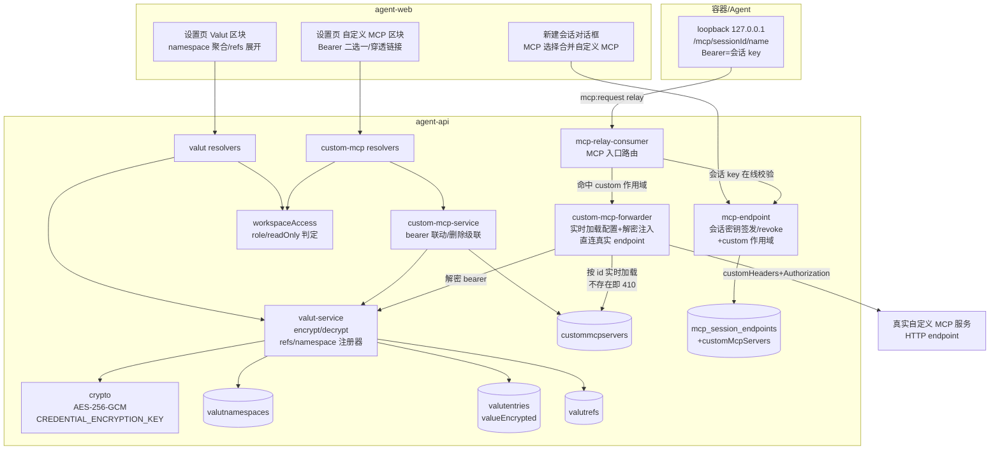
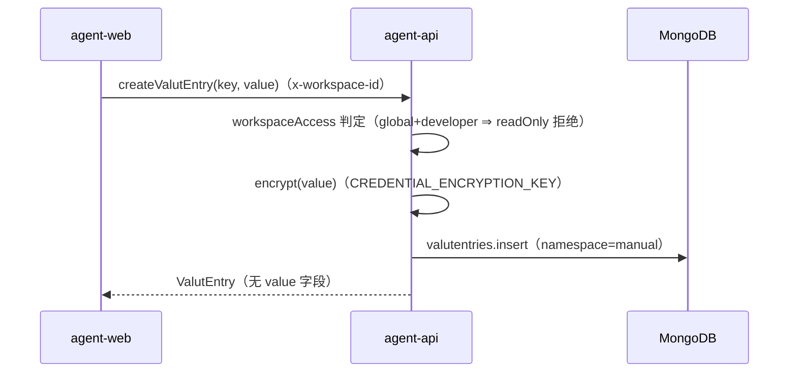
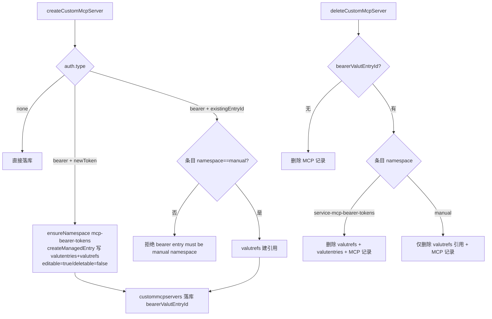
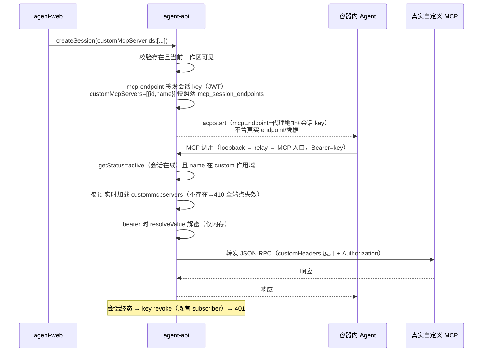
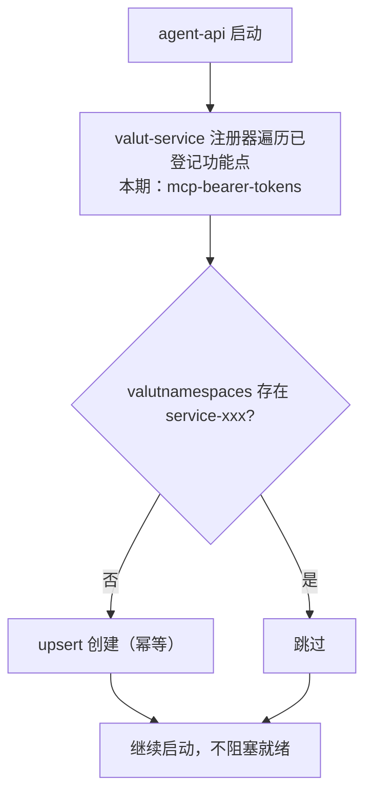

# MCP+Valut 功能迭代 - 技术提案

**功能名称**: MCP+Valut 功能迭代（Valut 工作区密钥管理 + 自定义 MCP）
**关联 PRD**: `docs/product/draft/20261104-mcp-valut-iteration.md`（v1.1）
**技术提案版本**: v1.1
**创建日期**: 2026-11-04
**作者**: z-agent-bot
**feat-branch**: `feat/mcp-valut-iteration`
**版本说明**:
- v1.0（2026-11-04）初版。
- v1.1（2026-11-04，评审返工）按评审意见「改为做 MCP 代理：由服务器和 MCP 服务通讯，暴露 CustomMCP 代理地址做转发，对外提供代理地址和访问密钥；key 随会话生命周期管理（在线可用、离线失效）；删除自定义 MCP 后所有端点同时失效」重写会话下发方案：自定义 MCP **不再**把真实 endpoint/凭据组装进 ACP `mcpServers` 直连下发，改为复用并扩展既有 `mcp-endpoint` 会话密钥机制（JWT + `mcp_session_endpoints` + Redis 状态 + 终态 revoke），Agent 侧拿到的始终是平台代理地址（容器内 loopback `/mcp/<sessionId>/<name>`）+ 会话 Bearer key；agent-api MCP 入口新增 `custom-mcp-forwarder` 在服务端完成真实 endpoint 的 HTTP 转发与凭据注入。同步修订 §1/§2/§3/§5/§6/§7/§8/§10。

## 1. 概述

### 1.1 背景

[Issue #448](https://github.com/Deliay/z-agent-gear/issues/448) 要求两件事：

1. **Valut**：工作区级 key-value secrets 存储。值加密入库（环境变量指定密钥）、明文不回显（前端/日志均不可见），只允许服务端内部解密使用；条目带 namespace（`manual` 展示名「自定义密钥」；服务托管为 `service-{功能点}`，namespace 全局跨租户唯一、功能点启动自检创建）；权限按工作区构造（全局工作区=租户全员可见可用、管理员可编辑；普通工作区=成员可见可用、全员可编辑）；其他服务写入时必须登记「功能点+数据标识」ref，ref 独立关联集合承载、可多条，界面按 refs 展示；对外选择已存在 secret 仅限 `manual`。
2. **MCP 迭代**：前端移除「MCP 代理」入口与相关请求；新增工作区级「自定义 MCP」（HTTP 协议，验证方式 none/bearer；bearer 可新建 token 写入 Valut `service-mcp-bearer-tokens`（ref=MCP 记录、禁止删除/允许编辑）或选择 `manual` 既有条目；删除 MCP 时自建 token 级联删除、引用 manual 仅解除 ref；编辑时自建 token 可更新、manual 引用给穿透链接）。

代码现状（方案的事实基础）：

- agent-api 已有 `services/crypto.ts`：AES-256-GCM（iv/ciphertext/tag），密钥来自环境变量 `CREDENTIAL_ENCRYPTION_KEY`（供应商凭据在用），与本期「指定一个环境变量作为密钥」完全同构，直接复用。
- 多租户二期已落地 `workspaces`/`tenantmembers.role`/`workspacemembers`、`middleware/auth.ts` 的 `context.workspaceAccess={id,tenantId,type,role,readOnly}`（global+developer ⇒ readOnly）与 `services/workspace-scope.ts` 插件——本期 Valut 的「工作区权限」即复用该体系：全局工作区写操作经 readOnly 拦截（developer 拒绝），普通工作区成员可写。
- `McpServer`（`mcpservers`）为**个人级**集合（`tenantId+userId`，二期明确不工作区化），承载代理注册/平台内置 MCP；会话注入走 `services/mcp-endpoint.ts`（`mcp_session_endpoints` 按会话签发 endpoint：JWT + bcrypt hash 落库 + Redis `mcp:endpoint:<sessionId>` 状态，会话终态经 `mcp-endpoint-subscriber` 兜底 revoke）。
- 既有 MCP 调用链（评审意见要求对齐的代理形态）：Agent → 容器内 loopback `http://127.0.0.1:<port>/mcp/<sessionId>/<serverName>`（`packages/agent-controller/src/mcp/local-server.ts`，Bearer=会话 token）→ socketio `mcp:request` → controller-api `mcp-relay.ts`（归属校验）→ Redis `mcp:relay:request` → agent-api `mcp-relay-consumer`（MCP 入口：token 状态校验 = 会话在线才可用）→ 按 serverName 路由转发。**真实凭据从不下发容器**。
- 前端 `SettingsPage` 含 `McpProxyKeySection`（MCP 代理密钥，`api/mcp-proxy.ts` 走 controller-api REST）与 `McpRegistrySection`（MCP 管理列表，空态文案提及代理密钥）；`tests/e2e/src/settings-mcp-proxy.spec.ts` 覆盖代理区块。

### 1.2 目标

- Valut 三集合建模：`valutnamespaces`（全局唯一，启动自检）、`valutentries`（工作区归属 + 加密值 + 编辑属性）、`valutrefs`（功能点+数据标识的独立关联，多对一）。
- 明文边界：value 仅 `valut-service` 可解密；GraphQL 契约不含 value 出参；日志脱敏名单覆盖；消费方（本期=MCP bearer 转发注入）在服务端内取明文。
- 「工作区」权限复用 `workspaceAccess`：全局工作区写=仅 admin（readOnly 拦截 developer），普通工作区写=成员。
- 自定义 MCP：`custommcpservers` 集合（工作区级），属性 = `{name, description?, authType: none|bearer, endpoint, customHeaders: Map<string,string[]>, bearerValutEntryId?}` + tenantId/workspaceId/createdBy/createdAt/updatedAt；bearer 与 Valut 联动（新建/引用/更新/删除级联）。
- **平台代理转发（v1.1 评审口径）**：自定义 MCP 由服务端与真实 MCP 服务通讯——agent-api MCP 入口新增 `custom-mcp-forwarder`：校验会话 key（在线才可用）→ 作用域含该 MCP → 按 id 实时加载配置（不存在即失效）→ 解密 bearer、合并 customHeaders → 直连真实 endpoint 转发 JSON-RPC。对会话只暴露**代理地址 + 访问密钥**：复用既有 `mcp-endpoint` 会话密钥机制（随会话签发、终态 revoke、离线不可用），`mcp_session_endpoints` 扩展 custom MCP 作用域；Agent 侧协议零新增（沿用 loopback `/mcp/<sessionId>/<name>` 形态）。
- **删除即全端点失效**：删除自定义 MCP 后，转发路径按 id 存在性实时校验失败（410），所有已签发会话入口同时失效。
- 前端：移除「MCP 代理」区块与请求封装；设置页新增 Valut 区块与自定义 MCP 区块（标题带「工作区」badge）；编辑 manual 引用给穿透链接。

### 1.3 范围

**做**：

- agent-api：`valutnamespaces`/`valutentries`/`valutrefs` 模型与迁移（播种 `manual`）；`services/valut-service.ts`（加解密、CRUD、refs、权限判定、启动 namespace 自检注册器）；`custommcpservers` 模型与 `services/custom-mcp-service.ts`（bearer 联动、删除级联、穿透链接数据）；`services/custom-mcp-forwarder.ts`（服务端直连真实 endpoint 的转发与凭据注入）；`mcp-endpoint.ts` 扩展 custom MCP 作用域签发；`mcp-relay-consumer` 路由扩展（serverName 命中 custom 作用域 → custom-mcp-forwarder）；GraphQL schemas/resolvers（valut、custom-mcp）；会话创建支持 `customMcpServerIds` 并入会话密钥签发。
- contracts：新增 `contracts/valut.graphql`、`contracts/custom-mcp.graphql`；`contracts/agent-session.graphql` 增补 `customMcpServerIds`；`contracts/mcp-forward-redis.md`/relay 通道增补 custom 路由口径注释。
- agent-web：设置页 Valut 区块（namespace 聚合表格、新增/编辑对话框、refs 展开、权限收敛）与自定义 MCP 区块（列表、新增/编辑对话框、Bearer 二选一、穿透链接）；移除 `McpProxyKeySection` 与 `api/mcp-proxy.ts` 及导航项；`McpRegistrySection` 空态文案清理；新建会话对话框 MCP 选择合并展示自定义 MCP。
- tests/api 与 tests/e2e 覆盖。

**不做**：

- 「MCP 代理」后端链路（controller-api `routes/mcp-proxy*.ts` 等）下线——仅前端入口移除（PRD 约束）；
- 自定义 MCP 真实 endpoint/凭据的**直连下发**（v1.0 方案，v1.1 已否决——改为平台代理转发）；
- 脱离会话生命周期的长期密钥/独立端点（评审口径：本期只有下发给云容器对话的场景，key 随会话管理）；
- Valut 跨工作区共享/继承、Valut 值向云电脑环境变量等通用终端注入通道（本期唯一直接消费者=自定义 MCP bearer 转发注入，其余「终端服务」消费场景后续期次）；
- 自定义 MCP 的非 HTTP 协议（stdio/SSE）与 OAuth 等其他验证方式；
- 既有个人级 `mcpservers` 的工作区化（维持二期口径不动）；
- agent-controller / ACP 协议变更（Agent 侧拿到的代理地址形态与既有链路一致）；
- admin 侧（admin-api/admin-web）Valut 管理面（本期不做后台透出）。

## 2. 技术架构

### 2.1 系统架构图



### 2.2 技术栈

| 层级 | 技术选型 | 说明 |
|------|---------|------|
| 后端 | Node.js 24 + TypeScript strict + Express 5 + graphql-yoga | agent-api 现状一致 |
| 数据库 | MongoDB（Mongoose） | 迁移走既有 `migrations/runner`（启动执行、幂等、带 `.test.ts`） |
| 加密 | `crypto` AES-256-GCM | 复用 `services/crypto.ts` 与 `CREDENTIAL_ENCRYPTION_KEY` |
| 前端 | React 19 + TypeScript + Vite + Apollo Client | 设置页既有 section 模式 |
| 测试 | Vitest + tests/api + tests/e2e | TDD 红-绿-重构 |

### 2.3 模块划分

| 模块 | 职责 | 关键技术点 |
|------|------|-----------|
| agent-api `models/valut-namespace.ts`（新增） | namespace 注册表（`valutnamespaces`） | `name` 全局唯一索引（跨租户）；`manual` 由迁移播种；服务命名空间 `service-{feature}` 启动自检创建 |
| agent-api `models/valut-entry.ts`（新增） | 加密条目（`valutentries`） | `workspaceId+tenantId`；`namespace`；`key`；`valueEncrypted{iv,ciphertext,tag}`；`editable/deletable`；`createdBy`；唯一索引 `{workspaceId,namespace,key}`；挂 `applyWorkspaceScope`（共享型读=本工作区∪全局？否——见 D3：独占型，仅当前工作区） |
| agent-api `models/valut-ref.ts`（新增） | 引用关联（`valutrefs`） | `{valutEntryId, feature, refId, refLabel}` + 冗余 `tenantId/workspaceId`；唯一索引 `{feature,refId}`（一条数据在同一功能点下至多引用一条 entry）；索引 `{valutEntryId}` |
| agent-api `services/valut-service.ts`（新增） | Valut 唯一读写口 | `createManualEntry/updateValue/deleteEntry/listGrouped/listManualOptions`；`ensureNamespace(feature)` 启动注册器；`createManagedEntry(feature, refId, refLabel, key, value, flags)` 供功能点调用（强制带 ref）；`resolveValue(entryId)` 服务端内解密；手动条目删除前 refs 计数拒绝 |
| agent-api `models/custom-mcp-server.ts` + `services/custom-mcp-service.ts`（新增） | 自定义 MCP CRUD 与 Valut 联动 | bearer 新建 → `createManagedEntry('mcp-bearer-tokens', mcpId, ...)`；bearer 引用 → 仅建 ref（校验 namespace=manual）；删除 → namespace 判定级联删 entry 或仅删 ref；编辑 → 自建 token 更新值 / manual 返回 `bearerEntryLink` |
| agent-api `services/mcp-endpoint.ts`（变更） | 会话密钥签发扩展 custom 作用域 | `createEndpoint(sessionId, userId, mcpServerIds, workflow?, customMcpServers?)`：`mcp_session_endpoints` 增 `customMcpServers:[{id,name}]` 快照；返回 `serverNames` 合并 custom 名；生命周期/revoke 机制不变（会话在线可用、终态失效） |
| agent-api `services/custom-mcp-forwarder.ts`（新增） | 服务端直连真实 endpoint 的转发器 | 入参 `{sessionId, name}` → 端点作用域快照命中 name → 按 id 实时加载 `custommcpservers`（**不存在/无权 → 410 失效**）→ bearer 时 `resolveValue` 解密 → 合并 customHeaders（同名多值展开）+ `Authorization: Bearer` → 直连真实 endpoint 转发 JSON-RPC → 回传响应；全程服务端内 |
| agent-api `services/mcp-relay-consumer.ts`（变更） | MCP 入口路由扩展 | token 状态校验（既有 getStatus=会话在线才可用）后按 serverName 路由：先 custom 作用域（→ custom-mcp-forwarder），未命中走既有 mcpservers 转发路径 |
| agent-api `services/session.ts`（变更） | 会话创建并入 custom 作用域 | `CreateSessionInput.customMcpServerIds`：校验存在且当前工作区可见 → 并入 `createEndpoint` 的 custom 快照；显式 `[]`=不注入；工作流节点会话同口径（reissue 保留快照） |
| agent-api `migrations/023-valut-foundations`（新增） | 播种与索引 | 播种 `manual` namespace；建三集合索引；幂等可重跑（编号以主分支占用顺延） |
| agent-web | Valut/自定义 MCP 区块与代理入口移除 | 设置页新增两 section（标题 + 「工作区」badge），删除 `McpProxyKeySection`/`api/mcp-proxy.ts` 及导航项；新建会话 MCP 选择合并 |

**权限矩阵**（服务端强制，前端仅展示收敛；与二期「（工作区）」口径一致）：

| 操作 | 租户管理员 | 开发（工作区成员） | 开发（非成员）/非租户成员 |
|------|-----------|------------------|--------------------------|
| 全局工作区 Valut/自定义 MCP 读 | ✔ | ✔ | ✘（`Not found`） |
| 全局工作区 Valut/自定义 MCP 写 | ✔ | ✘（`global workspace is read-only`） | ✘ |
| 普通工作区 Valut/自定义 MCP 读写 | ✔（任意工作区） | ✔（仅所在工作区） | ✘（`Not found`） |
| 读取 value 明文 | ✘（任何角色，契约无此出参） | ✘ | ✘ |

## 3. API 设计

### 3.1 API 契约

#### 契约 1: `contracts/valut.graphql`（新增）

```graphql
# Valut：工作区级加密 key-value secrets。
# 安全红线：契约不存在 value 明文出参；编辑=重写新值；解密仅服务端内部（valut-service.resolveValue）。
# namespace：manual（展示名「自定义密钥」）由系统播种；服务托管为 service-{功能点}，全局跨租户唯一，功能点启动自检创建。
# 权限（工作区）：全局工作区=租户全员可读、admin 可写；普通工作区=成员可读写。跨工作区一律 Not found。

type ValutNamespace {
  name: String!          # manual | service-{feature}
  displayName: String!   # manual => 「自定义密钥」
  managed: Boolean!      # true=服务托管（service-*），用户不可直接新增
}

type ValutRef {
  feature: String!       # 功能点，如 mcp-bearer-tokens
  refId: ID!             # 引入该条目的数据标识，如 customMcpServer id
  refLabel: String       # 展示用（如 MCP 名称）
  createdAt: String!
}

type ValutEntry {
  id: ID!
  namespace: String!
  namespaceDisplayName: String!
  key: String!
  editable: Boolean!
  deletable: Boolean!
  refs: [ValutRef!]!     # 哪些数据在用这条 secret
  createdBy: String!
  createdAt: String!
  updatedAt: String!
  # 注意：无 value 字段
}

type ValutNamespaceGroup {
  namespace: ValutNamespace!
  entries: [ValutEntry!]!
}

extend type Query {
  # 当前工作区的条目，按 namespace 聚合（全局工作区 developer 只读由 Workspace.readOnly 表达）
  valutEntries: [ValutNamespaceGroup!]!
  # 供功能点「选择已存在 secret」：仅 manual namespace、当前工作区可见集
  valutManualOptions: [ValutEntry!]!
}

extend type Mutation {
  # 手动条目：namespace 恒 manual
  createValutEntry(input: CreateValutEntryInput!): ValutEntry!
  # 仅允许重写 value（key 不可改）；editable=false 拒绝
  updateValutEntry(id: ID!, value: String!): ValutEntry!
  # deletable=false 拒绝；manual 条目存在 refs 时拒绝并提示
  deleteValutEntry(id: ID!): Boolean!
}

input CreateValutEntryInput {
  key: String!           # 单行，trim 后 1..128，不含空白与控制字符
  value: String!         # 多行，1..16384
}
```

错误口径：`valut entry not found`、`valut key already exists`、`invalid valut key`、`invalid valut value`、`valut entry is not editable`、`valut entry is not deletable`、`valut entry has refs`、`global workspace is read-only`（沿用二期）、`Not found`（跨工作区）。

#### 契约 2: `contracts/custom-mcp.graphql`（新增）

```graphql
# 自定义 MCP（工作区）：HTTP 协议；验证方式 none | bearer。
# bearer：新建 token（写入 Valut service-mcp-bearer-tokens，ref=本记录，deletable=false/editable=true）
#         或选择 manual namespace 既有条目（仅建 ref）。
# 删除：自建 token 级联删除 Valut 条目+ref；引用 manual 仅解除 ref。
# 编辑：自建 token 可就地更新值；manual 引用经 bearerEntryId 给穿透链接（前端跳转 Valut 区块）。

enum CustomMcpAuthType {
  none
  bearer
}

type CustomMcpHeader {
  key: String!
  values: [String!]!     # 同名 header 允许多值
}

type CustomMcpServer {
  id: ID!
  name: String!
  description: String
  endpoint: String!      # http(s) URL
  authType: CustomMcpAuthType!
  customHeaders: [CustomMcpHeader!]!
  bearerEntryId: ID      # bearer 时对应的 Valut 条目（自建或引用）
  bearerEntryManaged: Boolean  # true=自建（service-mcp-bearer-tokens，可就地更新）；false=引用 manual（穿透编辑）
  workspaceId: ID!
  createdBy: String!
  createdAt: String!
  updatedAt: String!
}

input CustomMcpHeaderInput {
  key: String!
  values: [String!]!
}

input CustomMcpAuthInput {
  type: CustomMcpAuthType!
  newToken: String        # type=bearer 且新建：token 明文（仅入参，永不回显）
  existingEntryId: ID     # type=bearer 且引用：仅 manual 条目
}

input CreateCustomMcpServerInput {
  name: String!
  description: String
  endpoint: String!
  auth: CustomMcpAuthInput!
  customHeaders: [CustomMcpHeaderInput!]
}

input UpdateCustomMcpServerInput {
  name: String
  description: String
  endpoint: String
  auth: CustomMcpAuthInput      # 省略=不动；bearer+newToken=更新自建值；bearer+existingEntryId=改挂 manual 引用
  customHeaders: [CustomMcpHeaderInput!]
}

extend type Query {
  customMcpServers: [CustomMcpServer!]!   # 当前工作区
  customMcpServer(id: ID!): CustomMcpServer
}

extend type Mutation {
  createCustomMcpServer(input: CreateCustomMcpServerInput!): CustomMcpServer!
  updateCustomMcpServer(id: ID!, input: UpdateCustomMcpServerInput!): CustomMcpServer!
  deleteCustomMcpServer(id: ID!): Boolean!
}
```

错误口径：`custom mcp server not found`、`invalid mcp name`、`invalid mcp endpoint`、`invalid custom headers`、`bearer token is required`、`bearer entry must be manual namespace`、`bearer entry not editable in place`（manual 引用尝试就地改值时）。

#### 契约 3: `contracts/agent-session.graphql`（变更）

- `CreateSessionInput` 新增 `customMcpServerIds: [ID!]`（可选，缺省=null 不注入；显式 `[]`=不注入；语义与 `mcpServerIds` 正交、可叠加）。
- 服务端解析（v1.1 代理转发口径）：校验条目存在且当前工作区可见（规则同 §2.3 权限矩阵）→ 并入既有 `mcp-endpoint` 会话密钥签发（`mcp_session_endpoints.customMcpServers=[{id,name}]` 快照，`serverNames` 合并 custom 名）。**对 Agent 暴露的只有既有代理地址形态**（容器内 loopback `/mcp/<sessionId>/<name>` + 会话 Bearer key）——真实 endpoint、customHeaders 与 bearer token 不出服务端；会话终态 key revoke（既有 subscriber 兜底），代理入口随之失效。
- `contracts/mcp-forward-redis.md` 增补注释：agent-api MCP 入口路由按 serverName 先匹配会话端点的 custom 作用域快照（命中 → `custom-mcp-forwarder` 服务端直连真实 endpoint），未命中走既有 `mcpservers` 转发；`mcp:relay:request` 报文结构不变。

### 3.2 内部接口

- `valut-service.ensureNamespace(feature, displayName?)`：功能点启动注册器（进程启动时逐个调用，幂等 upsert `service-{feature}`）；本期注册 `service-mcp-bearer-tokens`（展示名「MCP Bearer Tokens」）。
- `valut-service.createManagedEntry({feature, refId, refLabel, key, value, editable, deletable, workspaceId, tenantId, createdBy})`：托管写入唯一入口；内部同事务写 `valutentries`+`valutrefs`；缺 ref 参数直接抛错（编码期防漏）。
- `valut-service.resolveValue(entryId)`：返回明文；**仅服务端内部调用**（本期调用方：custom-mcp-forwarder 转发注入）；不暴露 GraphQL/REST。
- `custom-mcp-forwarder.forward({sessionId, name, body})`：转发唯一入口；返回 `{status, body}`；失败语义：`401`（会话 key 失效/离线）、`403`（name 不在该会话作用域）、`410`（自定义 MCP 已删除）、`502`（真实 endpoint 不可达/超时）。
- `valut-service.removeRef(feature, refId)` / `deleteEntryCascade(entryId)`：删除联动原语。

## 4. 数据模型

### 4.1 数据库设计

#### 集合: `valutnamespaces`（agent-api 写方）

| 字段 | 类型 | 说明 |
|------|------|------|
| `_id` | ObjectId | |
| `name` | String | `manual` \| `service-{feature}`；**全局唯一索引**（跨租户唯一，无 tenantId 维度） |
| `displayName` | String | manual=「自定义密钥」；service 由功能点注册时给定 |
| `managed` | Boolean | `name.startsWith('service-')` 冗余落库，便于查询 |
| `createdAt/updatedAt` | Date | timestamps |

#### 集合: `valutentries`（agent-api 写方）

| 字段 | 类型 | 说明 |
|------|------|------|
| `_id` | ObjectId | |
| `tenantId` | ObjectId(ref: Tenant) | 索引（与二期资源同构） |
| `workspaceId` | ObjectId(ref: Workspace) | 索引；挂 `applyWorkspaceScope` |
| `namespace` | String | 引用 `valutnamespaces.name`；索引 |
| `key` | String | trim，1..128，禁空白/控制字符 |
| `valueEncrypted` | `{iv,ciphertext,tag}` | AES-256-GCM（复用 `services/crypto.ts`） |
| `editable` | Boolean | 默认 true；`service-mcp-bearer-tokens` 条目=true |
| `deletable` | Boolean | 默认 true；`service-mcp-bearer-tokens` 条目=false |
| `createdBy` | ObjectId(ref: User) | |
| `createdAt/updatedAt` | Date | timestamps |

唯一索引 `{workspaceId,namespace,key}`。

#### 集合: `valutrefs`（agent-api 写方）

| 字段 | 类型 | 说明 |
|------|------|------|
| `_id` | ObjectId | |
| `valutEntryId` | ObjectId(ref: ValutEntry) | 索引；一条 entry 可挂多条 |
| `feature` | String | 功能点，如 `mcp-bearer-tokens` |
| `refId` | String | 数据标识（如 customMcpServer `_id`） |
| `refLabel` | String | 展示用冗余（如 MCP 名称，删除 MCP 后 ref 同步删除故不会悬挂） |
| `tenantId/workspaceId` | ObjectId | 冗余，便于按工作区清扫与一致性核对 |
| `createdAt/updatedAt` | Date | timestamps |

唯一索引 `{feature,refId}`（同一条数据在同一功能点下至多引用一条 entry；换绑=先删后建）。

#### 集合: `custommcpservers`（agent-api 写方）

| 字段 | 类型 | 说明 |
|------|------|------|
| `_id` | ObjectId | |
| `tenantId` / `workspaceId` | ObjectId | 索引；挂 `applyWorkspaceScope` |
| `name` | String | trim 后 1..64；唯一索引 `{workspaceId,name}` |
| `description` | String | 可选，≤512 |
| `endpoint` | String | 仅允许 `http://`/`https://`，≤1024 |
| `authType` | String | `none` \| `bearer` |
| `customHeaders` | Map<String, [String]> | 同名多值；key 禁空白/冒号，value ≤4096，header 总数 ≤32 |
| `bearerValutEntryId` | ObjectId(ref: ValutEntry) | bearer 时必填；自建或引用 manual |
| `createdBy` | ObjectId(ref: User) | |
| `createdAt/updatedAt` | Date | timestamps |

#### 集合: `mcp_session_endpoints`（既有，本期扩展）

新增字段 `customMcpServers: [{ id: String, name: String }]`（缺省 `[]`）：会话签发时该会话被授权的自定义 MCP 快照。name 用于 loopback 地址路由（`/mcp/<sessionId>/<name>`），id 用于转发路径实时存在性/配置加载。既有 `sessionId` 唯一索引、tokenHash、状态与 revoke 机制不变；`reissueEndpoint` 重签保留该快照。该集合在 controller-api 侧有只读镜像（共写集合口径同一期）。

### 4.2 缓存设计

- 无新增缓存。Valut 列表/选项按请求直查（设置页低频）；`resolveValue` 不缓存明文（安全口径，宁多一次解密）。
- namespace 注册表进程内只读快照（启动注册后基本不变，查询走内存 Map + 缺失回源 DB 一次）。

## 5. 技术实现方案

### 5.1 核心流程

手动新增 Valut 条目：



自定义 MCP 创建（Bearer 两条路径）与删除级联：



会话签发与代理转发（v1.1：明文不出服务端，对会话只暴露代理地址+会话密钥）：



启动 namespace 自检：



### 5.2 关键实现点

#### 实现点 1: 明文边界与加密复用

- **描述**：value 仅在 `valut-service` 内解密；GraphQL 类型不含 value；日志脱敏。
- **技术细节**：复用 `services/crypto.ts`（AES-256-GCM、`CREDENTIAL_ENCRYPTION_KEY`，未配置即抛错——与 PRD「不静默降级」一致）；契约入参字段名 `value`/`newToken` 加入 `REDACT_PATHS` 脱敏名单；`resolveValue` 返回值不进入任何结构化日志字段；明文唯一消费点=custom-mcp-forwarder 转发注入（仅内存组装请求头，不落库、不写日志、不进转发响应）。
- **风险点**：脱敏名单遗漏导致 token 入访问日志——以「契约字段名登记 + 单测断言日志脱敏」兜底；转发器不得把真实 endpoint 的响应头/错误体中的凭据回声写日志（统一 sanitize）。

#### 实现点 2: 工作区权限落地

- **描述**：复用二期 `workspaceAccess` 与 `applyWorkspaceScope`。
- **技术细节**：`valutentries`/`custommcpservers` 挂 `applyWorkspaceScope`（独占型：读过滤=当前工作区，写=当前工作区且 `!readOnly`）；全局工作区 developer 写被插件统一拦截 `global workspace is read-only`；跨工作区访问 `Not found`。`valutrefs` 不挂插件（始终经 entry 间接访问），服务层按 entry 的 workspaceId 校验。
- **风险点**：`valutManualOptions` 给「选择 token」用，必须与条目列表同口径过滤，防止跨工作区 id 猜测——服务层强制 `workspaceId=当前工作区` 条件。

#### 实现点 3: bearer 联动与删除级联的原子性

- **描述**：MCP 与 Valut 条目/ref 的写需成对出现。
- **技术细节**：`createManagedEntry` 内部先写 entry 再写 ref，失败即清理（同事务或补偿删除，Mongo 单库多文档写按既有服务惯例用顺序写+失败回滚）；`deleteCustomMcpServer` 顺序：读 MCP → 判 namespace → （自建）删 ref+删 entry → 删 MCP；引用场景只删 ref。并发删除同一 MCP：以 `_id` 删除结果 `deletedCount=1` 为「执行级联」凭证，防双重级联。
- **风险点**：级联中途失败留下孤儿 entry——可接受最终一致（orphan 仅占用存储、不可见），自检告警兜底。

#### 实现点 4: 编辑穿透链接

- **描述**：manual 引用的 token 编辑跳转 Valut 区块。
- **技术细节**：`CustomMcpServer.bearerEntryManaged=false` 时前端展示「前往 Valut 编辑」链接（`/settings?section=valut&entry=<bearerEntryId>`），Valut 区块按 query 定位并展开对应条目编辑对话框；自建（`bearerEntryManaged=true`）在 MCP 编辑对话框就地重填 token（调用 `updateValutEntry` 等价内部路径，不回显旧值）。

#### 实现点 5: 前端移除 MCP 代理入口

- **描述**：删除 `McpProxyKeySection`（设置页 section 与 NAV 项）与 `api/mcp-proxy.ts`；`McpRegistrySection` 空态文案「使用 MCP 代理密钥注册」改为中性文案。
- **技术细节**：同步删除 `tests/e2e/src/settings-mcp-proxy.spec.ts` 与组件测试中对代理区块的引用；controller-api 代理路由保留（PRD 约束：仅前端移除）。

#### 实现点 6: 会话密钥生命周期与自定义 MCP 转发（v1.1 评审口径）

- **描述**：自定义 MCP 经平台代理转发：会话 key 随会话签发/失效；转发器在服务端直连真实 endpoint；删除 MCP 即全端点失效。
- **技术细节**：
  - **签发**：`session.create` 校验 `customMcpServerIds`（存在 + 当前工作区可见）后并入 `mcpEndpointService.createEndpoint`——`mcp_session_endpoints.customMcpServers=[{id,name}]` 快照随 tokenHash 落库，`serverNames` 返回合并 custom 名（Agent 侧 loopback 地址形态与既有完全一致，`acp:start` 协议零变更）；`reissueEndpoint` 沿用快照重签。key 生命周期=既有机制：TTL + `session:status` 终态 revoke subscriber——会话离线/关闭即不可用。
  - **路由**：`mcp-relay-consumer` 在 token 校验（getStatus=active，即会话在线）通过后，按 serverName 先查会话端点 custom 快照（命中 → custom-mcp-forwarder），未命中走既有 `mcpservers` 转发。
  - **转发**：custom-mcp-forwarder 按快照 id **每次请求实时** `CustomMcpServer.findById`（挂 workspace-scope 的服务端内部查询用显式条件绕过 ALS）：不存在 → `410`（**删除即全端点失效**，无需逐会话回收 key）；存在则组装请求——customHeaders 同名多值展开 +（`authType=bearer` 时）`Authorization: Bearer <resolveValue(bearerEntryId)>`，POST 真实 endpoint，回传状态码与响应体；超时 30s → `502`。
  - **失效优先级**：key 失效（401）> 作用域外（403）> MCP 已删除（410）> 对端故障（502），语义清晰可诊断。
- **风险点**：快照 name 与 MCP 改名不一致——改名不影响路由（快照 name + id 加载，配置实时生效）；真实 endpoint 慢响应占用 relay 并发——以 30s 超时 + 既有 relay 请求超时（60s）双层兜底；自建 bearer 条目被级联删除后转发即时失败（id 加载不到 entry → 410 同口径）。

## 6. 技术决策

### 6.1 决策列表

| 决策 | 选项 A | 选项 B | 最终选择 | 原因 |
|------|--------|--------|---------|------|
| D1 加密实现 | 新增 Valut 专用加密模块与独立密钥 env | 复用 `services/crypto.ts` + `CREDENTIAL_ENCRYPTION_KEY` | B | 需求明确「用一个加密 key、指定一个环境变量」；agent-api 既有实现与供应商凭据同口径，减少密钥管理面 |
| D2 refs 建模 | ref 嵌在 valutentries 数组 | 独立 `valutrefs` 集合 | B | 需求明确「ref 不记录到 valut 数据实体上，另有关联关系」；多条引用、按 entry 反查走索引 |
| D3 Valut 可见集 | 共享型（本工作区∪全局） | 独占型（仅当前工作区） | B | 需求未提跨工作区复用 valut；「全局工作区=全员可见」已由 global 工作区语义承担（切到全局上下文即可见），避免普通工作区直接看到全局 secret 列表扩大暴露面 |
| D4 namespace 存储 | 条目内联字符串，无注册表 | 独立 `valutnamespaces` + 启动注册器 | B | 需求要求「启动时检查、没有则创建」「全局跨租户唯一」——注册表+唯一索引是最直接承载；界面展示名也有处安放 |
| D5 自定义 MCP 是否并入 mcpservers | `mcpservers` 加 workspaceId 扩展 | 独立 `custommcpservers` 集合 | B | 二期明确 `mcpservers` 维持个人级不工作区化；新集合避免搅动存量代理/平台内置链路与唯一索引 |
| D6 自定义 MCP 下发方式（v1.1 返工） | 服务端组装真实 endpoint+凭据直发 ACP mcpServers（v1.0 方案） | 平台代理转发：复用既有 mcp-endpoint 会话密钥，服务端直连真实 endpoint | B | **评审意见**：「改为做 MCP 代理，由服务器和 MCP 服务通讯，暴露 CustomMCP 代理地址做转发，对外提供代理地址和访问密钥；key 随会话生命周期管理；删除自定义 MCP 后所有端点同时失效」——真实凭据不出服务端、泄露面最小；既有 relay/loopback 链路零改动 |
| D7 编辑时 key 可改 | 允许改 key | key 不可改、仅重写 value | B | key 是识别与唯一性锚点；改 key=删旧建新，语义更清晰 |
| D8 manual 条目删除 | 允许级联断 ref | 有 refs 时拒绝删除 | B | 防误删导致 MCP 运行期失凭据；界面先展示 refs 再引导解除 |
| D9 删除即全端点失效实现（v1.1 新增） | 删除时遍历回收所有引用会话的 key | 转发路径按 id 实时存在性校验（不存在→410） | B | 一次删除即生效、无遗漏窗口；避免大规模会话 key 回收写放大；key 本身仍随会话生命周期独立失效 |
| D10 会话作用域快照形态（v1.1 新增） | 仅存 customMcpServerIds | 存 `[{id,name}]` 快照 | B | name 供 loopback 地址路由（与既有 serverNames 口径一致），id 供实时配置加载；改名不影响存量会话路由，编辑配置实时生效 |

### 6.2 依赖与约束

| 类型 | 内容 | 说明 |
|------|------|------|
| 依赖 | 多租户二期（workspaceAccess/workspace-scope） | 权限判定与拦截复用，零新机制 |
| 依赖 | `services/crypto.ts`（CREDENTIAL_ENCRYPTION_KEY） | 部署环境必须已配置该 env（供应商凭据已在用，满足） |
| 依赖 | 既有 mcp-endpoint 会话密钥机制与 relay 链路（agent-controller loopback → controller-api mcp-relay → agent-api mcp-relay-consumer） | 自定义 MCP 代理地址/密钥完全复用，Agent 侧与 ACP 协议零变更（Agent 需支持 http MCP 的既有口径不变） |
| 约束 | 明文不出服务端 | 契约无 value 出参；日志脱敏；resolveValue 仅转发器内部调用 |
| 约束 | 访问密钥随会话生命周期 | 会话在线可用、终态 revoke；本期无脱离会话的长期密钥 |
| 约束 | namespace 全局跨租户唯一 | 注册表唯一索引；功能点命名冲突在编码期评审拦截 |
| 约束 | 「MCP 代理」仅前端移除 | controller-api 代理路由与模型本期不动 |
| 约束 | 单环境变量密钥 | 不支持 per-tenant 密钥（需求明确一个 key） |

## 7. 项目结构

```
contracts/
├── valut.graphql                          # 新增
├── custom-mcp.graphql                     # 新增
├── agent-session.graphql                  # CreateSessionInput +customMcpServerIds
└── mcp-forward-redis.md                   # 增补 custom 路由口径注释
servers/agent-api/src/
├── models/valut-namespace.ts              # 新增（全局唯一 name）
├── models/valut-entry.ts                  # 新增（applyWorkspaceScope）
├── models/valut-ref.ts                    # 新增
├── models/custom-mcp-server.ts            # 新增（applyWorkspaceScope）
├── models/mcp-session-endpoint.ts         # +customMcpServers 快照
├── services/valut-service.ts(+test)       # 加解密/CRUD/refs/namespace 注册器
├── services/custom-mcp-service.ts(+test)  # bearer 联动/删除级联
├── services/custom-mcp-forwarder.ts(+test) # 服务端直连真实 endpoint（存在性实时校验/凭据注入/410 失效）
├── services/mcp-endpoint.ts(+test)        # createEndpoint/reissue 扩展 custom 作用域
├── services/mcp-relay-consumer.ts(+test)  # serverName 路由扩展（custom 快照优先）
├── services/session.ts                    # customMcpServerIds 并入会话密钥签发
├── graphql/schemas/valut.ts, custom-mcp.ts      # 新增（登记 index）
├── graphql/resolvers/valut.ts, custom-mcp.ts    # 新增（登记 resolvers/index.ts）
└── migrations/023-valut-foundations.ts(+test)   # 播种 manual + 索引（编号随主分支顺延）
servers/controller-api/src/
└── models/mcp-session-endpoint.ts         # 只读镜像 +customMcpServers（共写集合口径）
apps/agent-web/src/
├── components/settings/ValutSection.tsx(+test)        # 新增
├── components/settings/CustomMcpSection.tsx(+test)    # 新增
├── components/settings/McpProxyKeySection.tsx         # 删除
├── api/mcp-proxy.ts                                   # 删除
├── pages/SettingsPage.tsx                             # NAV/区块增删
└── components/session/NewSessionDialog.tsx            # MCP 选择合并自定义 MCP
tests/api/src/agent-api/valut.test.ts, custom-mcp.test.ts   # 新增
tests/e2e/src/settings-valut.spec.ts, settings-custom-mcp.spec.ts  # 新增
tests/e2e/src/settings-mcp-proxy.spec.ts                          # 删除
```

## 8. 测试策略

### 8.1 测试覆盖要求

- 迁移 023：manual 播种幂等；索引建立；重复执行无副作用。
- valut-service 单测：加密往返；`ensureNamespace` 幂等；`createManagedEntry` 缺 ref 抛错；手动条目删除 refs 计数拒绝；`deletable=false` 拒绝。
- 工作区权限矩阵（对照 T-WS 模式新增 T-VAL/T-CMCP）：全局工作区 developer 读通写拒（`global workspace is read-only`）、admin 写通；普通工作区成员读写通、非成员 `Not found`；跨租户不可达。
- 契约安全：GraphQL 响应体任意路径不含 value 明文（含错误信息）；`valutManualOptions` 仅 manual 且仅当前工作区。
- custom-mcp-service 单测：bearer 新建写 entry+ref（editable/deletable 正确）；bearer 引用非 manual 拒绝；删除自建级联删 entry+ref；删除引用仅删 ref；并发删除只级联一次；更新自建 token 改值不回显。
- 会话密钥与转发（T-CF 系列）：`customMcpServerIds` 不可见 id 拒绝；端点快照落库且 `serverNames` 合并 custom 名；`reissueEndpoint` 保留快照；会话终态 revoke 后转发 401；name 不在作用域 403；MCP 删除后转发 410（全端点同时失效）；bearer 解密注入 Authorization 且 customHeaders 同名多值展开；真实 endpoint 不可达/超时 502；转发报文与日志无凭据明文（含 sessions 文档、relay 载荷、访问日志断言）。
- E2E：设置页新增/编辑/删除 Valut 条目（值全程不可见）；新增 Bearer 自定义 MCP（两条路径）；删除联动（删除后会话内该 MCP 调用失败）；「MCP 代理」区块不存在。

### 8.2 测试类型

| 类型 | 工具 | 覆盖范围 |
|------|------|---------|
| 单元测试 | Vitest | valut-service、custom-mcp-service、custom-mcp-forwarder、mcp-endpoint 扩展、mcp-relay-consumer 路由、迁移、权限插件两档 |
| API 测试 | tests/api（Vitest + 编排环境） | valut/custom-mcp 契约用例与权限矩阵、会话创建携带 customMcpServerIds、转发鉴权/失效矩阵（mock 真实 endpoint） |
| E2E 测试 | tests/e2e（Playwright） | 设置页两区块全流程、代理入口移除、穿透链接跳转、删除后调用失效 |

## 9. 部署方案

### 9.1 环境规划

| 环境 | 用途 | 部署方式 |
|------|------|---------|
| 本地编排 | 开发与 TDD | `aspire start` 全量服务 |
| 生产 | 发布 | agent-api（迁移 023 随启动执行）→ 前端；controller-api 无变更 |

### 9.2 配置管理

- 复用既有 `CREDENTIAL_ENCRYPTION_KEY`（agent-api 已配置）；无新增环境变量。
- 发布前无需数据快照（全新集合，无存量改写）。

## 10. 验收标准

- [ ] 技术方案评审通过
- [ ] Contract（valut / custom-mcp / agent-session 增补 / mcp-forward-redis 注释）评审通过
- [ ] Valut 三集合与迁移 023 落地：manual 播种、namespace 全局唯一、`service-mcp-bearer-tokens` 启动自检创建
- [ ] 值加密存储、任何接口/页面/日志无明文；编辑=重写不回显
- [ ] 工作区权限矩阵通过（全局=全员读/admin 写；普通=成员读写；跨工作区 Not found）
- [ ] refs 独立成集合、可多条、界面可展示；托管写入强制带 ref；manual 删除有 refs 拒绝
- [ ] 对外选择已存在 secret 仅限 manual
- [ ] 自定义 MCP CRUD 与 bearer 两条路径、删除级联、编辑穿透链接全部按 PRD 通过
- [ ] 前端「MCP 代理」入口与请求移除，其余 MCP 区块无回归
- [ ] 自定义 MCP 经平台代理转发：会话仅获得代理地址+会话密钥，真实 endpoint/凭据不出服务端；会话 key 在线可用、终态失效；删除自定义 MCP 后所有会话入口同时失效（410）
- [ ] API 测试通过、E2E 测试通过

## 11. 相关文档

- 关联 PRD：[[../../product/draft/20261104-mcp-valut-iteration.md]]
- 需求来源：[GitHub Issue #448 — MCP+Valut功能迭代](https://github.com/Deliay/z-agent-gear/issues/448)
- 前置提案：[[20261028-feat-multi-tenant-phase2.md]]（workspaceAccess 与 workspace-scope 权限基础）
- 关联文档：[[20260530-feat-mcp-proxy-config.md]]（MCP 代理，本期前端入口移除对象）
- 开发规范：[[../common-rules.md]]、[[../backend-rules.md]]、[[../frontend-rules.md]]
