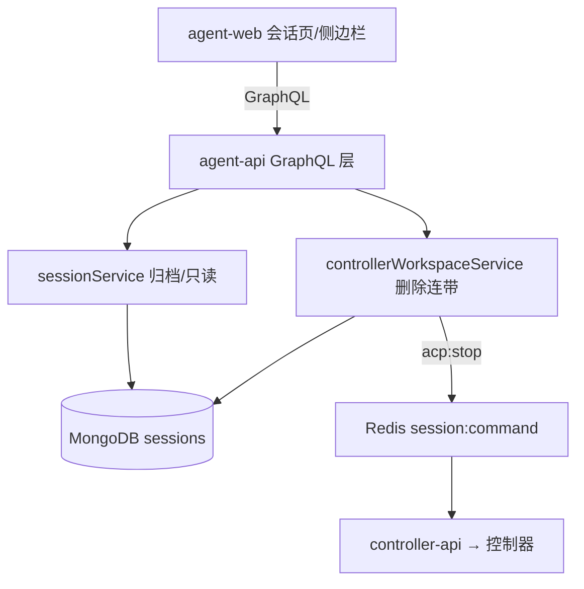
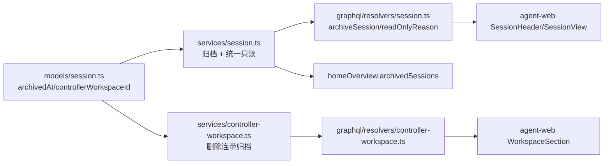
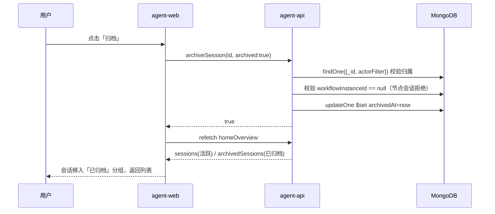
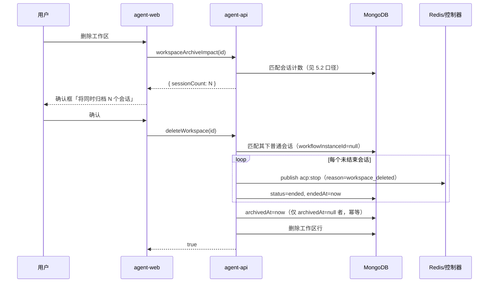
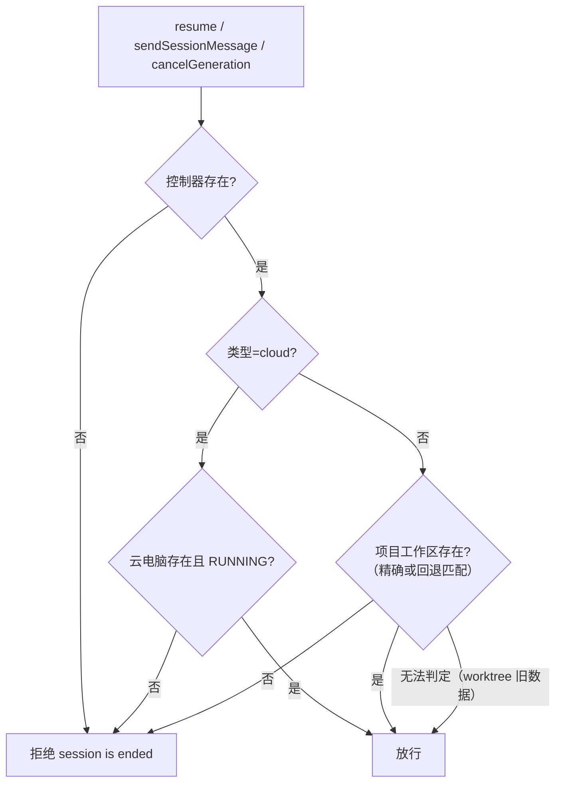

# 会话管理优化 - 技术提案

**功能名称**: 会话管理优化（会话归档 / 删除工作区连带归档 / 缺失运行环境只读）
**关联 PRD**: `docs/product/draft/20261104-session-management-optimization.md`（v1.0）
**技术提案版本**: v1.0
**创建日期**: 2026-11-04
**作者**: z-agent-bot
**feat-branch**: `feat/session-management-optimization`
**需求来源**: GitHub Issue [Deliay/z-agent-gear#447](https://github.com/Deliay/z-agent-gear/issues/447)

## 1. 概述

### 1.1 背景

Issue #447 提出三项会话管理诉求：

1. 会话需要支持归档（工作流实例已支持，会话页右上角按钮组补齐同款入口）；
2. 工作区被删除时，其下会话由「连带消失」（组织视图失去入口）改为「自动归档」；
3. 所属工作区/控制器/云电脑不存在的会话只允许查看、不允许继续——云电脑场景已部分实现（`session is ended`），工作区/控制器缺失场景需要调研后补全。

调研结论（现状）：

- **归档**：`WorkflowInstance.archivedAt` + `workflowInstanceService.setArchived` + `archiveWorkflowInstance` mutation + 前端实例页归档按钮 + 侧边栏「已归档（N）」自折叠分组 + `homeOverview.archivedWorkflowInstances`，语义为「仅分组展示差异，不影响运转」。`Session` 模型当前**没有**归档字段。
- **工作区删除**：`controllerWorkspaceService.delete/clear` 仅删除工作区行，不处理会话；会话经 `controllerId + cwd 前缀` 与 `worktreePath` 推导弱关联到工作区（**会话文档不存项目工作区 id**），删除后侧边栏「主机→工作区→会话」树失去归属，聚合分区显示「未知工作区」。
- **只读**：`assertSessionWritable/assertControllerWritable` 仅覆盖云电脑（host 缺失/软删除/非 RUNNING → `session is ended`），接入点为 `sendSessionMessage`（resolver）与 `cancelGeneration`；`resume` 自带一份重复的云电脑判定。控制器不存在（unbind 删除）与项目工作区不存在两条路径**不拦截**，`acp:resume`/`acp:message` 会发向不存在的运行环境。前端 `SessionView.readOnlyCloudHost` 仅覆盖云电脑维度。

### 1.2 目标

- 会话与工作流实例对齐的归档能力：`Session.archivedAt`、`archiveSession` mutation、列表/首页聚合的归档分组、会话页归档按钮。
- 删除/清空工作区时，其下普通会话「先结束（终止进程）后归档」，记录完整保留。
- 统一只读判定：控制器缺失 / 项目工作区缺失 / 云电脑终态三场景在服务端写路径（resume、sendSessionMessage、cancelGeneration）一致拒绝，前端按统一原因展示只读。

### 1.3 范围

- **做**：`contracts/agent-session.graphql`、`contracts/home.graphql`、`contracts/controller-workspace.graphql` 契约扩展；agent-api（模型/迁移/服务/resolver）；agent-web（会话页按钮、侧边栏分组、只读提示、工作区删除确认）；API/E2E 测试。
- **不做**：工作流节点会话的手动归档（生命周期由实例管理）；worktree 删除（`deleteWorktree`）连带语义变更（维持现状真删除）；云电脑自身生命周期改动；消息模型改动。

## 2. 技术架构

### 2.1 系统架构图



### 2.2 技术栈

| 层级 | 技术选型 | 说明 |
|------|---------|------|
| 前端 | React 19 + Apollo Client + Tailwind | 会话页按钮、侧边栏分组、只读提示条 |
| 后端 | Node.js 24 + Express v5 + GraphQL-Yoga | agent-api 服务与 resolver |
| 数据库 | MongoDB（Mongoose） | sessions 集合扩展 2 字段 + 迁移 022 |
| 缓存/消息 | Redis Pub/Sub | 结束会话的 acp:stop 命令通道（复用） |
| 其他 | Aspire 编排、Vitest、Playwright | 本地编排与测试 |

### 2.3 模块划分



| 模块 | 职责 | 关键技术点 |
|------|------|-----------|
| `models/session.ts` | 会话持久化 | 新增 `archivedAt`、`controllerWorkspaceId`；索引见 §4.1 |
| `services/session.ts` | 归档服务 + 统一只读判定 | `setArchived`；`assertSessionWritable` 扩展三场景 |
| `services/controller-workspace.ts` | 工作区删除连带归档 | `archiveSessionsForWorkspace` 匹配 + 先结束后归档 |
| `graphql/resolvers/*` | 契约透出 | `archiveSession`、`Session.archived/readOnlyReason`、列表 archived 参数 |
| `resolvers/home.ts` | 首页聚合 | 新增 `archivedSessions` 分支（degrade 兜底 []） |
| `apps/agent-web` | 前端交互 | 归档按钮、已归档分组、只读提示、删除确认 |

## 3. API 设计

### 3.1 API 契约

契约先行：以下变更先落到 `contracts/`，再双写 `graphql/schemas/*`（手写 schema 串，漏改即运行时 `Cannot query field`）。

#### `contracts/agent-session.graphql`

```graphql
# Session 新增字段
type Session {
  # ... 既有字段 ...
  # 归档状态（true=已归档，收纳进「已归档」分组；不影响会话数据与进程）
  archived: Boolean!
  # 只读原因：null=可写；取值见 SessionReadOnlyReason。工作区/控制器缺失、云电脑终态三场景统一
  readOnlyReason: SessionReadOnlyReason
}

enum SessionReadOnlyReason {
  WORKSPACE_MISSING      # 项目工作区已删除
  CONTROLLER_MISSING     # 控制器已解绑（不存在）
  CLOUD_HOST_DESTROYED   # 云电脑已停止/销毁/删除
}

type Query {
  # archived 缺省/false 返回活跃（未归档）；true 返回已归档。与 includeWorkflowSessions 正交
  sessions(controllerId: ID, includeWorkflowSessions: Boolean, archived: Boolean): [Session!]!
}

type Mutation {
  # 归档/取消归档会话（仅分组展示差异；工作流节点会话拒绝 ARCHIVE_WORKFLOW_SESSION_UNSUPPORTED）
  archiveSession(id: ID!, archived: Boolean!): Boolean!
  # 删除工作区影响预查询：将连带归档的普通会话数（用于删除确认提示）
  workspaceArchiveImpact(id: ID!): WorkspaceArchiveImpact!
}

type WorkspaceArchiveImpact {
  # 该工作区下将连带归档的普通会话数（不含工作流节点会话与已归档会话）
  sessionCount: Int!
}
```

#### `contracts/home.graphql`

```graphql
type HomeOverview {
  # ... 既有字段 ...
  # 已归档会话（侧边栏「已归档」折叠分组；与 sessions 的活跃口径互补）
  archivedSessions: [Session!]!
}
```

#### `contracts/controller-workspace.graphql`

- `deleteWorkspace(id: ID!): Boolean!` 与 `clearWorkspaces(controllerId: ID!): Boolean!` **形状不变**，契约注释更新行为：删除/清空前将其下普通会话（`workflowInstanceId == null`）先结束后归档（幂等）。

### 3.2 内部接口

| 接口 | 说明 |
|------|------|
| `sessionService.setArchived(userId, id, archived)` | 归档/取消归档；归属口径 `actorFilter`（与既有查询一致）；工作流节点会话拒绝 |
| `sessionService.assertSessionWritable(sessionId, userId)` | 统一只读判定（扩展，详见 §5.2） |
| `sessionService.archiveByWorkspace(userId, workspace)` | 删除连带：匹配 → 结束活跃 → 归档（幂等），返回归档数量 |
| `controllerWorkspaceService.delete/clear` | 删除前调用 `archiveByWorkspace`；失败策略见 §6.1 |
| `sessionService.findAllByUser(userId, { archived })` | 列表归档过滤（默认活跃） |

## 4. 数据模型

### 4.1 数据库设计

#### 集合： `sessions`

| 字段 | 类型 | 说明 |
|------|------|------|
| `archivedAt` | Date \| null | 归档时间；`null`=未归档（新增，default null） |
| `controllerWorkspaceId` | ObjectId \| null | 项目工作区（ControllerWorkspace）归属，创建/导入时落库；旧数据为 null（新增，default null，index） |

新增索引（迁移 **022**，「先建后用」，autoIndex 关闭环境显式创建）：

| 索引 | 用途 |
|------|------|
| `{ userId: 1, archivedAt: 1, createdAt: -1 }` | 活跃/归档列表 |
| `{ controllerId: 1, controllerWorkspaceId: 1 }` | 删除工作区连带匹配（精确路径） |

- 存量数据：`archivedAt` 缺省即未归档，**无需回填**；`controllerWorkspaceId` 不回填，旧会话走 §5.2 的回退匹配口径。
- `tenantId`/`workspaceId`（租户工作区）维度不受影响；两新字段沿用 `applyTenantScope`/`applyWorkspaceScope` 既有插件（归档更新经 `_id + actorFilter` 显式条件，不受注入影响）。

### 4.2 缓存设计

- 不新增缓存键。`homeOverview` 为实时聚合（前端 15s 轮询），归档变化随下次轮询/归档后 refetch 生效。
- 会话状态 Redis 键 `session:{id}:status` 不受归档影响。

## 5. 技术实现方案

### 5.1 核心流程

#### 流程一：归档/取消归档



#### 流程二：删除工作区连带归档



#### 流程三：只读判定（写路径拦截）



### 5.2 关键实现点

#### 实现点 1：会话归档（对齐工作流模式）

- **描述**：`Session.archivedAt` + `setArchived` + `archiveSession` + 列表/聚合归档过滤 + 前端按钮与分组。
- **技术细节**：
  - `findAllByUser` 增加 `archived` 选项：`archivedAt: archived ? { $ne: null } : null`，与 `workflowInstanceId` 排除口径正交组合；`mapSession` 输出 `archived: Boolean(archivedAt)`。
  - `setArchived`：归属校验后 `$set archivedAt`；**工作流节点会话（`workflowInstanceId != null`）拒绝**，错误文案 `ARCHIVE_WORKFLOW_SESSION_UNSUPPORTED`（不在白名单新增语义文案，resolver 透传）。
  - 归档不触发任何 acp 命令、不撤销 MCP endpoint、不影响 `session:status` 通道。
- **风险点**：`homeOverview` 新增分支必须走 `degrade` 兜底，避免单分支失败拖垮整次查询；`resolvers/index.ts` 无需新增 Session 键（`archived/readOnlyReason` 直接随 `mapSession`/字段 resolver 透出——`readOnlyReason` 为字段级 resolver，**必须登记 `resolvers/index.ts` 的 `Session` 键**，backend-rules 陷阱）。

#### 实现点 2：工作区删除连带归档

- **描述**：`controllerWorkspaceService.delete/clear` 删除前，将会话「先结束后归档」。
- **技术细节**：
  - **匹配口径**（`archiveByWorkspace`）：
    1. 精确：`{ controllerId: ws.controllerId, controllerWorkspaceId: ws._id }`（新数据主口径）；
    2. 回退（`controllerWorkspaceId == null` 的旧数据）：`cwd == ws.path` 或 `cwd` 以 `ws.path + '/'` 为前缀（根目录会话）；worktree 会话按其 worktree scope 前缀匹配（复用 `resolveEffectiveWorktreeDir`/`worktreeScopePrefix`/`normalizeForCompare`，与 `worktreeService.list` 归组口径一致）；
    3. 两类匹配均排除 `workflowInstanceId != null`（节点会话由工作流生命周期管理）。
  - **先结束**：匹配到的非 `ended` 会话逐个 `sessionService.close(id, userId, { suppressFallback: true, reason: 'workspace_deleted' })`（受控关闭：发 acp:stop、置 ended、不触发工作流兜底；普通会话无 endpoint 撤销差异——`close` 对非工作流会话会撤销 MCP endpoint，符合预期）。
  - **后归档**：`updateMany({ _id: { $in: matchedIds }, archivedAt: null }, { $set: { archivedAt: now } })` 幂等。
  - **失败策略**：单个会话 close 失败只记录日志不阻断（对齐 `deleteInstance` 的会话清理口径）；归档失败则**中止删除**并抛错（避免「工作区没了、会话没归档」的中间态）。
  - `clear`（清空）对每个待删工作区执行同一逻辑。
  - `workspaceArchiveImpact` 与连带共用同一匹配函数，保证提示数量 = 实际归档数量。
- **风险点**：删除与「用户正在使用会话」存在 TOCTOU 窗口（接受：close 后 resume 会被新只读拦截）；worktree 旧数据按 scope 前缀匹配存在理论重名误伤（scope 含工作区名清洗结果）——与侧边栏既有归组口径同源，视为可接受并记录。

#### 实现点 3：统一只读判定

- **描述**：`assertControllerWritable` 扩展为三场景统一判定（重命名为环境判定，保留原函数名兼容调用点），并收敛 `resume` 的重复云电脑判定。
- **技术细节**：
  - **控制器缺失**：`Controller.findOne` 为空 → 抛 `session is ended`。
  - **云电脑**：维持既有口径（host 缺失/软删除/STOPPING/STOPPED/FAILED → 拒绝）。
  - **本地/GitHub 控制器**：项目工作区缺失判定——
    - `session.controllerWorkspaceId` 非空：查 `ControllerWorkspace.exists({ _id })`，不存在 → 拒绝；
    - 为空（旧数据）回退：根目录会话按 `cwd` 前缀匹配该控制器任一工作区，匹配不到 → 拒绝；worktree 会话（`worktreePath != null`）无法可靠判定时**放行**（避免误伤；worktree 删除已有真删除语义）。
  - **接入点**：`resume`（收敛为调用统一判定，删除重复代码）、`sendSessionMessage`（已接入）、`cancelGeneration`（已接入）。`close` 不拦截（结束语义对只读会话仍合法）。
  - **错误文案**：服务端统一 `session is ended`（与云电脑既有口径一致，前端已有映射）；只读**原因展示**不依赖错误文案，由 `Session.readOnlyReason` 字段级 resolver 实时计算（同一判定函数的只读版，返回枚举或 null）。
  - **`Session.readOnlyReason` resolver**：控制器缺失 → `CONTROLLER_MISSING`；cloud 且 host 终态/缺失/软删 → `CLOUD_HOST_DESTROYED`；本地且工作区缺失 → `WORKSPACE_MISSING`；其余 → null。**必须在 `graphql/resolvers/index.ts` 的 `Session` 键登记。**
- **风险点**：`assertSessionWritable` 在每条 `sendSessionMessage` 热路径上新增至多 2 次点查（controller + workspace），均为 `_id` 主键查询，开销可忽略；不引入缓存以免「删除后仍可写」窗口。

#### 实现点 4：前端交互

- **描述**：会话页归档按钮、侧边栏已归档分组、只读提示、工作区删除确认。
- **技术细节**：
  - `SessionHeader` 按钮组新增「归档/取消归档」：`Archive`/`ArchiveRestore` 图标按钮（lucide，与实例页同款），位置紧随「导出对话」之后；已归档会话显示「已归档」状态徽标。
  - `SessionView`：`ARCHIVE_SESSION` mutation；归档成功后 toast 并 `onDeleted` 式返回列表（对齐实例页归档后 `navigate('/sessions')`）；取消归档就地生效。
  - `Sidebar` 会话分区：新增 `ArchivedSessionGroup`（复刻 `ArchivedWorkflowGroup` 自折叠交互），数据源 `homeOverview.archivedSessions`；活跃列表改读 `sessions`（服务端已按未归档过滤）。
  - 只读：`readOnlyReason != null` 时隐藏 `InputBox`、SessionHeader 隐藏「继续」，提示条按原因分文案（工作区已不存在 / 控制器已不存在 / 云电脑已销毁，对齐既有 `cloud-host-readonly-notice` 形态）；既有 `readOnlyCloudHost` 逻辑收敛为以 `readOnlyReason` 为准（`GET_SESSION` 查询补 `readOnlyReason` 字段，保留 `controllerType/cloudHost` 查询兼容）。
  - `WorkspaceSection` 删除/清空前：先 `workspaceArchiveImpact(id)` 取数，确认框文案含「将同时归档其下 N 个会话」；N=0 时保持现状不弹额外确认（清空沿用既有确认框，追加会话数量）。
- **风险点**：`HOME_OVERVIEW` 查询体新增字段后，所有使用 `sessions` 的消费点（Sidebar/HomePage/MainLayout）口径自动变为「未归档」，需检查是否有依赖「全量会话」的旧逻辑（如 `sessionTotalCount`——口径同步改为未归档计数并在契约注释说明）。

### 5.3 测试策略

#### 单元测试（agent-api）

| 编号 | 用例 |
|------|------|
| T-ARCH1~3 | `setArchived`：正常归档/取消归档（`archivedAt` 往返）；他人会话拒绝；工作流节点会话拒绝 |
| T-ARCH4 | `findAllByUser(archived)` 过滤口径（默认活跃、archived=true 仅已归档、与 includeWorkflowSessions 正交） |
| T-WSARC1~4 | `archiveByWorkspace`：精确匹配（新字段）/cwd 前缀回退/worktree scope 回退；排除节点会话；活跃会话先 close（acp:stop、ended）后归档；幂等（重复执行零增量） |
| T-WSARC5 | `clear` 清空连带；`delete` 归档失败中止删除 |
| T-RO1~6 | 统一只读：控制器缺失拒绝；云电脑三终态+软删拒绝（回归）；工作区缺失拒绝（新字段精确与 cwd 回退）；工作区存在放行；worktree 旧数据放行不误伤；`readOnlyReason` 四态映射 |
| T-RO7 | `resume` 收敛后行为不变（ended/disconnected 门禁、云电脑拒绝文案 `session is ended`） |
| T-MIG22 | 迁移 022 索引创建幂等（先建后存在不报错） |

#### API 测试（tests/api，`agent-api/session-archive.test.ts` / 扩充 `session-readonly.test.ts`）

| 编号 | 用例 |
|------|------|
| T-ARCH-API1~3 | `archiveSession` 未认证/正常归档取消/节点会话拒绝；`sessions(archived)` 列表口径 |
| T-ARCH-API4 | `homeOverview.archivedSessions` 与活跃 `sessions` 互补 |
| T-WSARC-API1~2 | `deleteWorkspace` 连带归档（DB 断言 `archivedAt` 非空、活跃会话 ended；工作区行删除）；`workspaceArchiveImpact` 数量一致 |
| T-RO-API1~3 | 控制器删除后 `resume`/`sendSessionMessage` 拒绝 `session is ended`；工作区删除后同口径；`session.readOnlyReason` 透出 |

#### E2E（tests/e2e）

| 编号 | 用例 |
|------|------|
| E2E-SARCH1 | 会话页归档 → 侧边栏活跃列表消失、「已归档（1）」出现；打开可查看；取消归档恢复 |
| E2E-SARCH2 | 删除工作区确认文案含会话数量 → 确认后该工作区会话出现在「已归档」分组 |
| E2E-SRO1 | 云电脑销毁会话只读（回归）；构造工作区删除会话只读提示条与「继续」隐藏 |

## 6. 技术决策

### 6.1 决策列表

| 决策 | 选项 A | 选项 B | 最终选择 | 原因 |
|------|--------|--------|---------|------|
| 归档存储 | 新增 `status='archived'` 状态 | `archivedAt` 时间字段 | B | 对齐工作流既有模式；不侵入状态机；归档会话运行状态仍需如实展示 |
| 工作区↔会话关联 | 仅按 cwd 前缀运行时匹配 | 新增 `controllerWorkspaceId` 落库 + 回退匹配 | B | 精确匹配可靠（重名/改路径不误伤）；旧数据回退保证兼容，无需强制迁移 |
| 删除工作区时活跃会话处理 | 仅归档不结束 | 先结束后归档 | B | 工作区删除后进程失去 cwd 语义，残留进程无法管理；`close` 是受控终止且保留记录 |
| 连带失败策略 | 归档失败仍删除工作区 | 归档失败中止删除 | B | 避免「工作区没了、会话未归档」的中间态；close 单会话失败仅记录（对齐 deleteInstance） |
| 只读错误文案 | 按场景新增多条文案 | 统一 `session is ended` | B | 与云电脑既有口径一致；原因展示由 `readOnlyReason` 字段承担，错误文案保持单一 |
| 只读原因透出 | 前端自行推断 | 服务端字段 resolver 统一计算 | B | 三场景判定规则集中后端，前端零规则重复（对齐 D-1「不依赖 controllers 列表命中」原则） |
| 删除确认数量来源 | 前端按 cwd 自行匹配 | 新增 `workspaceArchiveImpact` 查询 | B | 匹配口径唯一来源在后端，提示数量与实际归档数量一致 |

### 6.2 依赖与约束

| 类型 | 内容 | 说明 |
|------|------|------|
| 依赖 | `worktree-utils` scope 计算 | worktree 会话回退匹配复用，避免口径分叉 |
| 依赖 | `actorFilter`/workspace-scope/tenant-scope | 归属与隔离口径不变，新字段不破坏既有插件行为 |
| 约束 | `resolvers/index.ts` Session 键登记 | `readOnlyReason` 字段 resolver 漏登记则线上恒 null（backend-rules 陷阱） |
| 约束 | 手写 schema 双写 | `schemas/session.ts`、`schemas/home.ts` 与契约必须同步 |
| 约束 | 单实例部署 | 删除连带为请求内同步执行，无跨进程协调问题 |

## 7. 项目结构

```
servers/agent-api/src/
├── models/session.ts                        # +archivedAt / +controllerWorkspaceId / +索引声明
├── migrations/022-session-archive-indexes.ts # 新增：两索引「先建后用」
├── services/session.ts                      # +setArchived / +archiveByWorkspace / 统一只读扩展
├── services/controller-workspace.ts         # delete/clear 接入连带归档
├── graphql/schemas/session.ts               # archived/readOnlyReason/archiveSession/workspaceArchiveImpact
├── graphql/schemas/home.ts                  # archivedSessions
├── graphql/resolvers/session.ts             # 新 mutation/字段 resolver（登记 index.ts）
├── graphql/resolvers/home.ts                # archivedSessions 分支
apps/agent-web/src/
├── components/session/SessionHeader.tsx      # 归档/取消归档按钮
├── components/session/SessionView.tsx        # ARCHIVE_SESSION + 只读收敛（readOnlyReason）
├── components/Sidebar.tsx                    # ArchivedSessionGroup
├── components/settings/WorkspaceSection.tsx  # 删除/清空确认含会话数量
├── graphql/queries.ts / mutations.ts / home.ts / types.ts
contracts/
├── agent-session.graphql                    # Session 字段 + mutation + impact 查询
├── home.graphql                             # archivedSessions
├── controller-workspace.graphql             # 行为注释更新（形状不变）
```

## 8. 测试策略

### 8.1 测试覆盖要求

- 单元测试覆盖：`setArchived` / `archiveByWorkspace` / 统一只读判定 / `readOnlyReason` 映射 / 迁移 022。
- API 测试覆盖端点：`archiveSession`、`sessions(archived)`、`homeOverview.archivedSessions`、`workspaceArchiveImpact`、`deleteWorkspace`（连带）、`resume`/`sendSessionMessage` 只读拒绝。

### 8.2 测试类型

| 类型 | 工具 | 覆盖范围 |
|------|------|---------|
| 单元测试 | Vitest（servers/agent-api） | 服务层归档/连带/只读、迁移 |
| API 测试 | Vitest + fetch（tests/api） | GraphQL 契约行为与 DB 断言（需 MONGODB_URI 用例按既有 skipIf 口径） |
| E2E | Playwright（tests/e2e） | 归档交互、删除确认、只读提示 |

## 9. 部署方案

### 9.1 环境规划

| 环境 | 用途 | 部署方式 |
|------|------|---------|
| 本地开发 | 实现与自验 | `aspire start` 全量编排 |
| 生产 | 发布 | 常规镜像发布；迁移 022 随 agent-api 启动 runner 执行 |

### 9.2 配置管理

- 无新增配置项；无 feature flag（行为直接上线，旧数据兼容见 §4.1）。

## 10. 验收标准

- [ ] 技术方案评审通过
- [ ] Contract 评审通过（agent-session / home / controller-workspace 三契约）
- [ ] 代码实现完成（agent-api + agent-web）
- [ ] 单元测试覆盖达标（T-ARCH / T-WSARC / T-RO / T-MIG22 全绿）
- [ ] API 测试通过（session-archive / session-readonly 套件）
- [ ] E2E 测试通过（E2E-SARCH / E2E-SRO）
- [ ] PRD §1.3 成功标准逐条验收

## 11. 相关文档

- 关联 PRD：`docs/product/draft/20261104-session-management-optimization.md`
- 关联 Contract：`contracts/agent-session.graphql`、`contracts/home.graphql`、`contracts/controller-workspace.graphql`
- 开发规范：`docs/engineering/common-rules.md`、`docs/engineering/backend-rules.md`、`docs/engineering/frontend-rules.md`
- 需求来源：GitHub Issue [Deliay/z-agent-gear#447](https://github.com/Deliay/z-agent-gear/issues/447)
