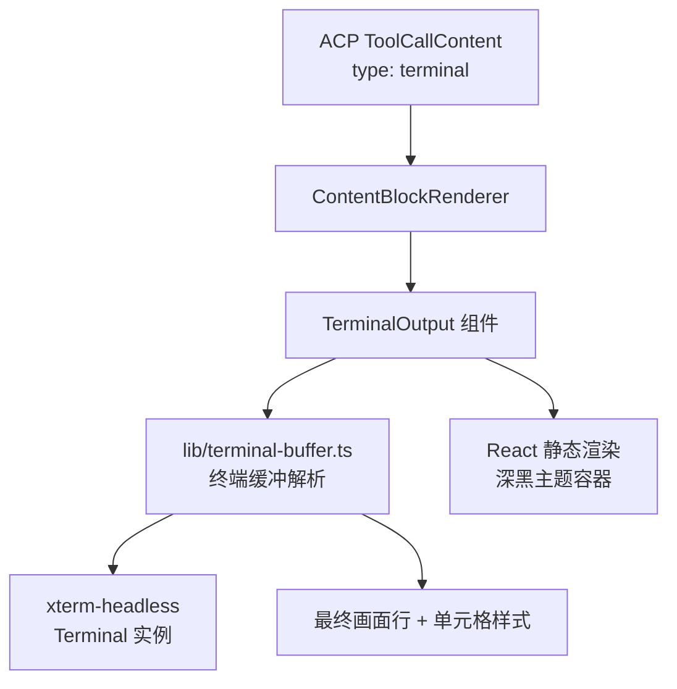
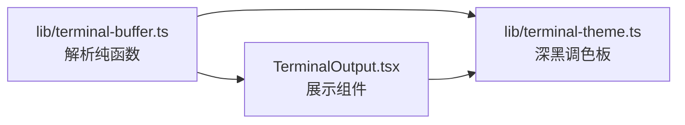
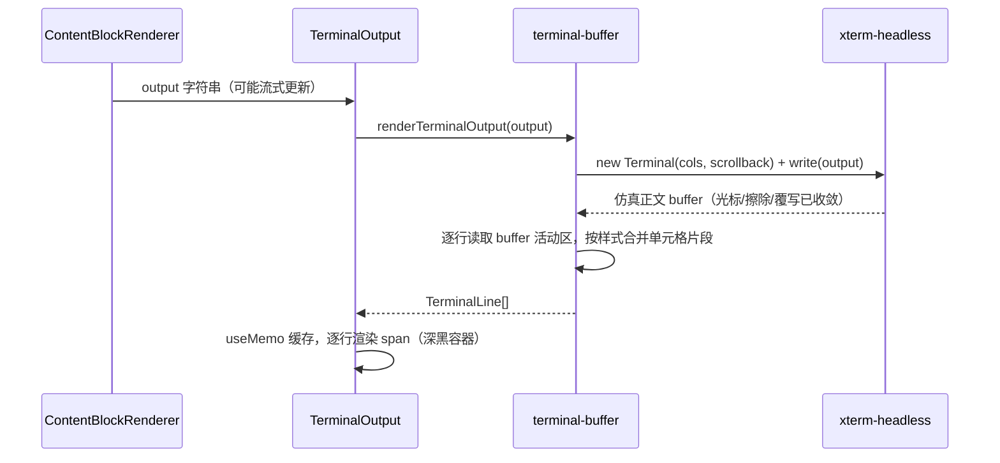

# 会话窗口中工具调用展示优化 - 技术提案

**功能名称**: 工具调用终端输出渲染优化
**关联 PRD**: `docs/product/draft/20261104-tool-call-terminal-rendering.md`
**关联 Issue**: https://github.com/Deliay/z-agent-gear/issues/420
**技术提案版本**: v1.0
**创建日期**: 2026-11-04
**作者**: Agent Gear Workflow
**feat-branch**: `feat/tool-call-terminal-rendering`

## 1. 概述

### 1.1 背景

会话窗口中工具调用的终端输出（`ContentBlockRenderer` → `TerminalOutput`）目前经 `lib/ansi.ts` 处理：基于 `ansi-to-html` 仅保留 SGR 颜色序列，其余 CSI（光标移动、清屏、行擦除）、OSC、DCS 等序列一律剥离，并仅以「行内最后一个 `\r`」近似覆写语义。该方案对真实终端语义覆盖不足：

- **光标寻址/行擦除语义丢失**：进度条、动态刷新、多行重绘（如构建工具的实时面板）依赖 `CUU/CUD/EL/ED` 等序列，剥离后同一逻辑行被重复拼接、旧内容残留，表现为「控制台字符没有被正确渲染」。
- **`\r` 近似不完整**：仅处理单行最后一个回车，无法表达跨行光标移动后的覆写。
- **8 色/256 色/真彩色映射固定**：`ansi-to-html` 内置调色板不可控，无法保证深黑主题下的对比度。

PRD 要求：调研并引入一个控制台渲染 package，正确渲染 terminal 输出，并采用深黑色主题配色。本提案完成调研选型与实现方案设计。

### 1.2 目标

- 工具调用终端输出按真实终端最终画面渲染：SGR 样式、光标移动、行/屏擦除、回车覆写、进度条收敛等语义正确，无裸露控制序列乱码。
- 终端渲染区域采用深黑色主题配色（背景与 16 色调色板统一设计），浅色/深色界面模式下保持一致。
- 渲染管线可测试：解析逻辑在无 DOM 环境可单测，组件层保留 jsdom 测试。

### 1.3 范围

- **做**：`apps/agent-web` 纯前端渲染层改造——终端输出解析与 `TerminalOutput` 组件重写、深黑主题、单元/组件/E2E 测试。
- **不做**：交互式终端（stdin/PTY）、会话实时终端流、ACP 协议与后端契约变更、非终端类内容块（diff/markdown 等）的渲染调整。

## 2. 技术架构

### 2.1 系统架构图



### 2.2 技术栈

| 层级 | 技术选型 | 说明 |
|------|---------|------|
| 前端 | React 19 + TypeScript + Vite | 现状沿用 |
| 终端解析 | `xterm-headless`（xterm.js 无头版） | 完整终端仿真：CSI/OSC/SGR/光标/擦除语义，Node/jsdom 可测 |
| 样式 | Tailwind CSS v4 + 内联单元格颜色 | 深黑主题调色板统一来源 |
| 测试 | Vitest + React Testing Library | 解析层无 DOM 单测 |

### 2.3 模块划分



| 模块 | 职责 | 关键技术点 |
|------|------|-----------|
| `lib/terminal-buffer.ts` | 将原始终端输出解析为「最终画面行序列 + 单元格前景/背景/粗体等样式」 | `xterm-headless` Terminal 写入 → 读取 buffer 活动区；`\r\n`/超长输入裁剪；异常输入兜底 |
| `lib/terminal-theme.ts` | 深黑色主题调色板单一来源 | 背景/前景 + 16 色 ANSI 调色板，深浅界面模式恒定 |
| `TerminalOutput.tsx` | 消费解析结果做 React 静态渲染 | 移除 `dangerouslySetInnerHTML`，逐行渲染 `<span>`；maxHeight 内部滚动 |

## 3. API 设计

### 3.1 API 契约

无对外 API 变更（纯前端渲染层，`contracts/` 零改动）。

### 3.2 内部接口

```ts
// lib/terminal-buffer.ts
interface TerminalCellStyle {
  fg?: string;        // 解析后的 CSS 颜色（调色板或 RGB）
  bg?: string;
  bold?: boolean;
  italic?: boolean;
  underline?: boolean;
  dim?: boolean;
}
interface TerminalLine {
  cells: Array<{ text: string; style: TerminalCellStyle }>; // 按样式合并的连续片段
}
/** 解析原始终端输出为最终画面行；输入超限先裁剪，永不抛异常 */
function renderTerminalOutput(raw: string): TerminalLine[];

// lib/terminal-theme.ts
const TERMINAL_THEME: { background: string; foreground: string; palette: string[16] };
```

`TerminalOutput` props 保持 `{ output: string; maxHeight?: string }` 不变，调用方（`ContentBlockRenderer`）零改动。

## 4. 数据模型

无数据库与缓存变更。渲染为纯函数计算，输入为 ACP `terminal` 内容块的 `output` 字符串，输出为内存中的行序列。

## 5. 技术实现方案

### 5.1 核心流程



- **流式更新**：`output` 变化时丢弃旧 headless 实例重新解析（工具输出体量千行级，重建成本可忽略；`useMemo` 依赖 `output`）。
- **尺寸策略**：headless Terminal 固定 `cols`（默认 80，随容器测量后续可调）；行数取 buffer 实际使用行，容器 `maxHeight` 内滚动，与现状一致。

### 5.2 关键实现点

#### 实现点 1: 终端缓冲解析（`lib/terminal-buffer.ts`）

- **描述**: 以 `xterm-headless` 的 `Terminal` 承载原始输出，读取 `buffer.active` 得到光标/擦除/覆写收敛后的最终画面。
- **技术细节**:
  - 逐行 `buffer.getLine(i)`，按单元格 `getCell()` 读取字符与属性（fg/bg 模式：默认/调色板/RGB，bold/italic/underline/dim），将连续同样式单元格合并为片段，剔除行尾纯空白单元格。
  - 调色板颜色经 `lib/terminal-theme.ts` 映射为深黑主题 16 色；RGB 色直出 `rgb(r,g,b)`。
  - 输入裁剪：超过上限（如 2MB 或 5 万行）先截断并追加提示行，与 `lib/diff.ts` 既有超限策略同口径。
  - 永不抛异常：解析异常时回退为「剥离控制字符后的纯文本行」，保证不空白、不崩页面。
- **风险点**: `xterm-headless` 体积（gzip ≈ 90KB）进入主包——用动态 `import()` 懒加载，首屏不受影响；Vite 分包即可。

#### 实现点 2: 深黑色主题（`lib/terminal-theme.ts` + `TerminalOutput`）

- **描述**: 终端区域固定深黑背景与配套调色板，不随界面浅色/深色模式变化。
- **技术细节**:
  - 容器背景 `#050505`（深黑）、默认前景 `#E8E8E8`；16 色调色板在深黑底上保证对比度（参考 VS Code Dark+ / Campbell 调优）。
  - 移除现状 `bg-gray-950 text-green-400` 的固定绿色前景，默认色与调色板由主题模块统一供给。
  - 组件改为逐行 `<span style>` 渲染，不再使用 `dangerouslySetInnerHTML`，XSS 面收敛（输出即 React 文本节点）。

#### 实现点 3: 替换与清理

- **描述**: `lib/ansi.ts`（`ansi-to-html` 管线）由 `lib/terminal-buffer.ts` 替换，`ansi-to-html` 依赖移除。
- **技术细节**: 先确认 `ansiToHtml` 无其他消费方（现状仅 `TerminalOutput`）；移除依赖并更新 `apps/agent-web/AGENTS.md` 渲染层章节口径；`export-thread.ts` 等导出逻辑不受影响（纯文本导出）。
- **风险点**: 旧测试（T-TO 系列）按新渲染口径改写，覆盖语义不缩水。

## 6. 技术决策

### 6.1 决策列表

| 决策 | 选项 A | 选项 B | 最终选择 | 原因 |
|------|--------|--------|---------|------|
| 终端渲染 package | `ansi-to-html`/`anser`/`ansi_up`（仅 SGR 文本→HTML） | `xterm-headless`（xterm.js 完整终端仿真，无 DOM 依赖） | **B** | A 类无光标/擦除语义，正是本 Issue 根因；xterm 为 VS Code 同款终端仿真，语义最完整且 headless 版可在 Node 单测 |
| 渲染形态 | 内嵌 `@xterm/xterm` 只读终端实例（Canvas/DOM 渲染器） | headless 解析 + React 静态渲染 | **B（React 静态渲染）** | 消息流中终端块为静态快照：内嵌终端实例会带来滚动/焦点捕获、jsdom 测试困难与额外生命周期管理；静态渲染更轻、可测、主题完全自控 |
| 深黑主题 | 沿用 `bg-gray-950` + 固定绿字 | 主题模块统一深黑背景 + 16 色调色板 | **B** | 满足 PRD「深黑色主题配色」，调色板可控保证对比度 |
| 注入方式 | 继续 `dangerouslySetInnerHTML` | React 文本节点渲染 | **B** | 消除 HTML 注入面，无需再维护转义/占位符防伪造逻辑 |

### 6.2 依赖与约束

| 类型 | 内容 | 说明 |
|------|------|------|
| 依赖 | `xterm-headless`（新增） | 仅 `apps/agent-web`；动态导入懒加载 |
| 依赖 | 移除 `ansi-to-html` | 无其他消费方后删除 |
| 约束 | 零契约变更 | 不动 `contracts/`、后端与 ACP 协议 |
| 约束 | 遵循 `frontend-rules.md` / `common-rules.md` | TDD 红-绿-重构；logger 唯一 console 出口 |

## 7. 项目结构

```
apps/agent-web/src/
├── lib/
│   ├── ansi.ts                 # 移除（由 terminal-buffer 替代）
│   ├── terminal-buffer.ts      # 新增：xterm-headless 解析 → 最终画面行
│   ├── terminal-theme.ts       # 新增：深黑主题调色板单一来源
│   └── __tests__/
│       ├── ansi.test.ts        # 移除
│       ├── terminal-buffer.test.ts  # 新增：光标/擦除/覆写/颜色/截断/兜底
│       └── terminal-theme.test.ts   # 新增：调色板映射
└── components/session/
    ├── TerminalOutput.tsx           # 重写：React 静态渲染 + 深黑容器
    └── __tests__/TerminalOutput.test.tsx  # 按新口径改写
tests/e2e/src/session-rendering.spec.ts    # 增补终端渲染 E2E 用例
```

## 8. 测试策略

### 8.1 测试覆盖要求

- `lib/terminal-buffer.ts` / `lib/terminal-theme.ts` 行覆盖率 100%（解析为纯函数，Node 环境直测）。
- 组件层保留 T-TO 系列语义（颜色/加粗/控制序列不泄漏/XSS/空行/maxHeight）并新增光标语义用例。

### 8.2 测试类型

| 类型 | 工具 | 覆盖范围 |
|------|------|---------|
| 单元测试 | Vitest（Node，xterm-headless 无需 DOM） | T-TB 系列：SGR 颜色/256 色/真彩色、进度条 `\r` 收敛、`CUU`+`EL` 多行重绘收敛、`ED` 清屏、截断输入兜底、超限裁剪 |
| 组件测试 | Vitest + RTL（jsdom） | T-TO 系列改写：渲染结果文本正确、无裸露 ESC、深黑容器 class、无 `dangerouslySetInnerHTML` 注入 |
| E2E | Playwright（`tests/e2e/src/session-rendering.spec.ts`） | 会话中工具终端输出按最终画面展示、深黑主题生效 |

## 9. 部署方案

纯前端变更，随 `agent-web` 常规构建发布（Aspire 编排 / Docker 镜像），无新增配置项与环境差异。

## 10. 验收标准

- [ ] 技术方案评审通过
- [ ] 终端输出按真实终端最终画面渲染（进度条/覆写/清屏收敛，无乱码）
- [ ] 深黑色主题配色生效且与界面模式解耦
- [ ] 单元测试覆盖达标、组件测试通过
- [ ] E2E 会话渲染用例通过
- [ ] `ansi-to-html` 依赖与旧管线移除

## 11. 相关文档

- 关联 PRD: `docs/product/draft/20261104-tool-call-terminal-rendering.md`
- 关联 Issue: https://github.com/Deliay/z-agent-gear/issues/420
- 渲染层现状: `apps/agent-web/AGENTS.md`「会话渲染层（对话渲染重构一期）」
- 前序提案: `docs/engineering/proposals/20261028-refactor-conversation-rendering.md`（ansi-to-html 现状来源）
- 开发规范: `docs/engineering/common-rules.md`、`docs/engineering/frontend-rules.md`
