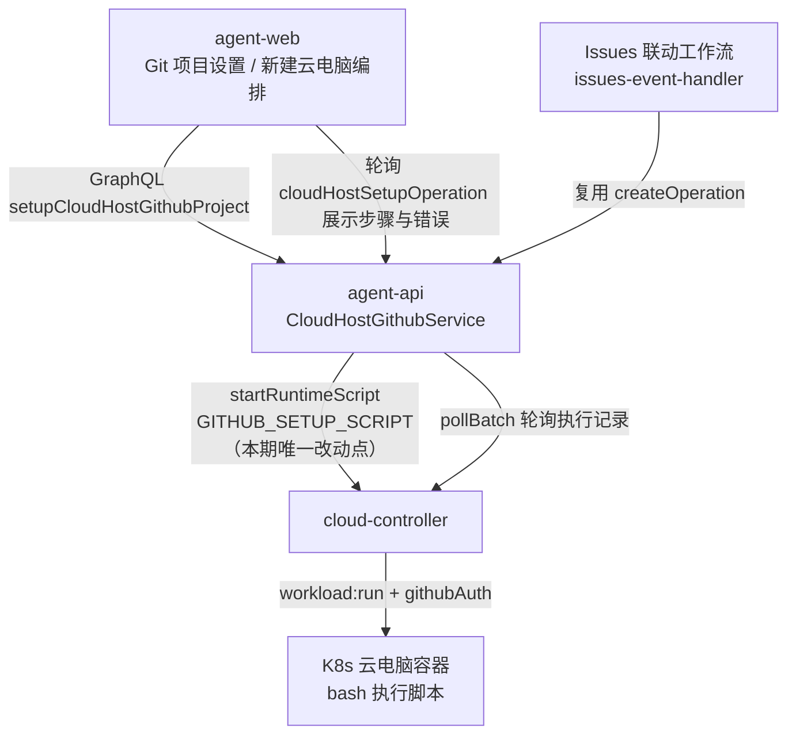
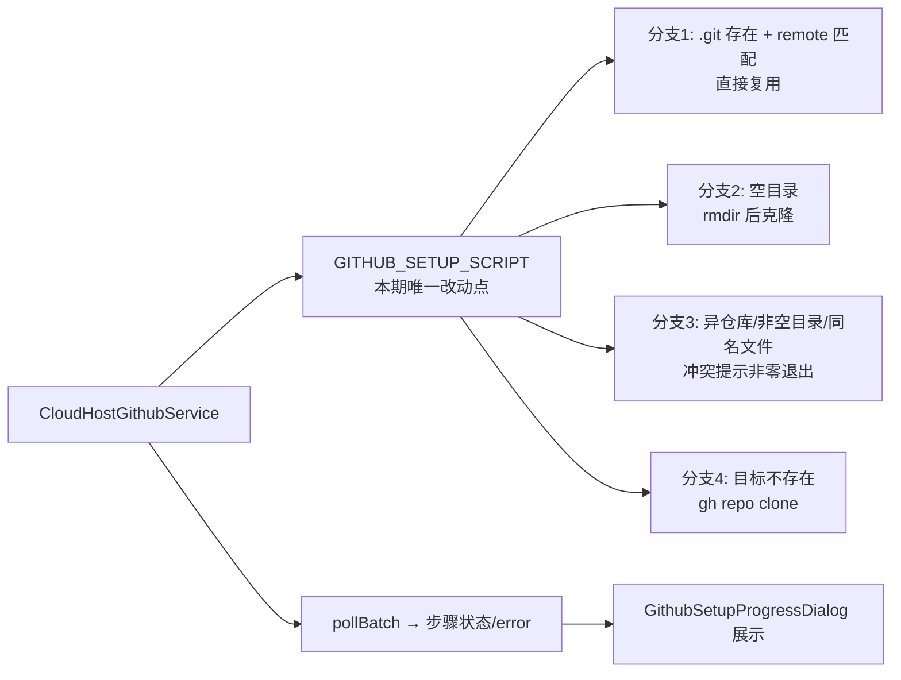
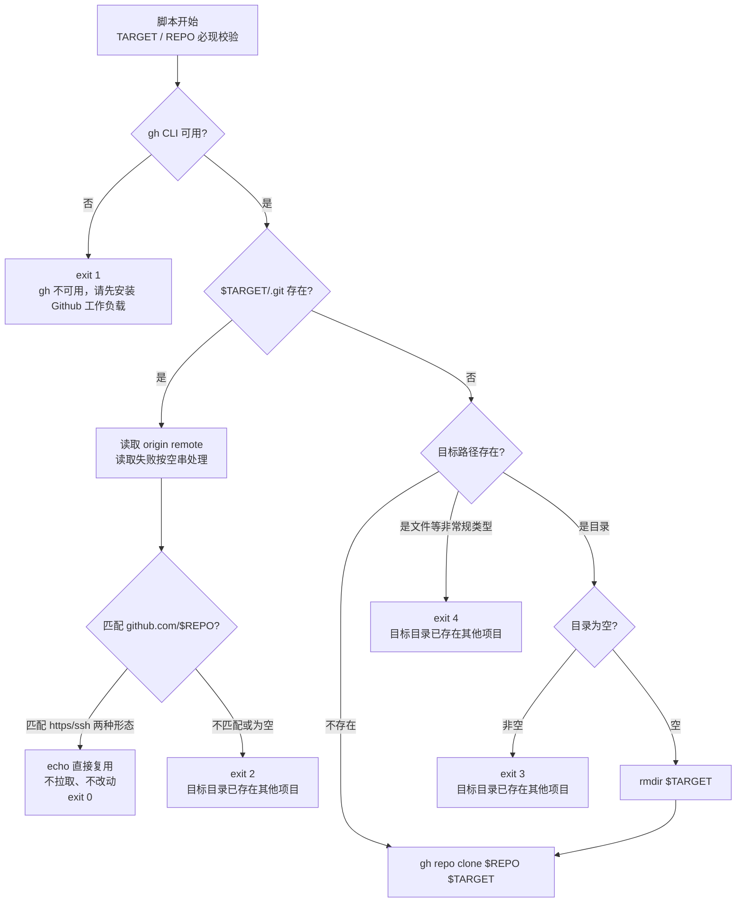

# Github 项目设置优化 - 技术提案

**功能名称**: Github 项目设置优化
**关联 PRD**: [[../../product/draft/20261104-github-project-setup-optimization.md]]
**技术提案版本**: v1.0
**创建日期**: 2026-11-04
**作者**: z-agent-bot
**feat-branch**: `fix/github-project-setup-optimization`

## 1. 概述

### 1.1 背景

来源 Issue：[Deliay/z-agent-gear#435 GIthub项目设置优化](https://github.com/Deliay/z-agent-gear/issues/435)。

现状：Git 项目设置的克隆由 `CloudHostGithubService.GITHUB_SETUP_SCRIPT`（`servers/agent-api/src/services/cloud-host-github-service.ts:40-56`）以 runtime 脚本形式下发到云电脑容器内执行，目标目录已存在时的处理为：

```bash
if [ -d "$TARGET/.git" ]; then
  ORIGIN="$(git -C "$TARGET" remote get-url origin 2>/dev/null || true)"
  case "$ORIGIN" in
    *"github.com/$REPO"|*"github.com:$REPO") git -C "$TARGET" pull --ff-only ;;
    *) echo "目标目录已存在其他 Git 仓库，请修改 clone 路径"; exit 2 ;;
  esac
else
  if [ -d "$TARGET" ] && [ -n "$(ls -A "$TARGET" 2>/dev/null)" ]; then
    echo "目标目录非空且不是 Git 仓库，请修改 clone 路径"; exit 3
  fi
  gh repo clone "$REPO" "$TARGET"
fi
```

对照 Issue 的差距：

1. **remote 匹配时执行 `git pull --ff-only`，是「git 会报错退出」的直接根因**。以下存续状态都会使 pull 非零退出、整个设置失败：
   - 目录内存在未推送的本地提交（diverged/ahead）：`Not possible to fast-forward, aborting.`——用户/Agent 已在项目里开展工作后重试或再次设置时必然命中；
   - 本地无上游跟踪分支（远端默认分支改名、新建仓库、手工切换过分支）：`There is no tracking information for the current branch.`；
   - 空仓库（远端无提交）、浅克隆、detached HEAD；
   - fetch 网络抖动或凭据临界过期。
   Issue 口径为「匹配则直接使用这个目录作为仓库」——不应再发起拉取。
2. **空目录依赖隐式行为**：当前依赖「git clone 允许空目标目录」的实现细节；Issue 口径要求显式删除空目录后再克隆。
3. **冲突文案不统一**：现状两条文案（「目标目录已存在其他 Git 仓库」「目标目录非空且不是 Git 仓库」），Issue 口径统一为「目标目录已存在其他项目」。
4. **边界未覆盖**：目标位置是普通文件（非目录）时落入 `gh repo clone` 报底层错误；`.git` 存在但 remote 读取失败（上次克隆中断留下的残骸）被误报为「其他 Git 仓库」。

影响链路：除手动「Git 项目设置」（`GithubProjectSetupDialog` / 新建云电脑编排 `useCloudHostProvisioning`）外，**Github Issues 联动工作流的工作区准备复用同一编排**（`services/workflow/issues-event-handler.ts:337` 经 `cloudHostGithubService.createOperation` 执行同一脚本）——目标目录已有工作内容时自动准备失败会直接阻断工作流启动，是本期最主要的受损场景。

### 1.2 目标

按 Issue 口径重写 `GITHUB_SETUP_SCRIPT` 的「目标目录已存在」处理分支：

1. 同一仓库（remote 匹配）→ 直接复用该目录（零改动，不拉取），脚本成功退出；
2. 空目录 → `rmdir` 移除后继续 `gh repo clone`；
3. 其他仓库 / 非空普通目录 / 同名文件 → 统一提示「目标目录已存在其他项目，请修改前缀地址」并非零退出；
4. `.git` 存在但 remote 读取失败 → 归入冲突提示（保守策略，不删除任何内容）。

### 1.3 范围

**做**：

- agent-api：`GITHUB_SETUP_SCRIPT` 重写（`servers/agent-api/src/services/cloud-host-github-service.ts`）。
- agent-api 测试：`T-CHG8` 字符串断言重写 + 新增脚本行为级测试矩阵（真跑 bash）。
- 契约：`contracts/cloud-host.graphql` 的 `setupCloudHostGithubProject` 注释增补幂等口径（无字段增删、无行为不兼容变更）。

**不做**：

- 前端零改动（脚本输出经 `pollBatch` → `sanitizeOperationError` → `operation.error`/步骤 detail 原样展示，`GithubSetupProgressDialog` 已具备展示与重试能力）。
- 不自动修复或删除损坏的 `.git` 残骸（保守策略，提示用户处理）。
- 不改变设置编排三步结构（workload / gitSetup / session）、工作区初始化（`ensureWorkspace` + CAS 回写）与会话创建逻辑。
- 不调整 Github 预制工作负载（其 init 脚本仅安装 gh CLI，不涉及克隆）。

## 2. 技术架构

### 2.1 系统架构图



### 2.2 技术栈

| 层级 | 技术选型 | 说明 |
|------|---------|------|
| 后端 | Node.js + Express + GraphQL-Yoga + Mongoose | agent-api，脚本常量与编排 |
| 容器内执行 | bash（`set -euo pipefail`）+ gh CLI + git | 云电脑容器，`workload-executor` 以 `bash -c` 执行 |
| 测试 | Vitest（含 `node:child_process` 真跑 bash） | agent-api 单元/行为测试 |

### 2.3 模块划分



| 模块 | 职责 | 关键技术点 |
|------|------|-----------|
| `GITHUB_SETUP_SCRIPT` | 目标目录已存在时的四类分支处理 | 仅 echo 复用 / `rmdir` 空目录 / 统一冲突文案 |
| `CloudHostGithubService.runGitSetupStep` | 绑定 upsert + 脚本下发 + 轮询 | 不变 |
| `cloud-host-workload-service.pollBatch/fail` | 脚本非零退出 → 步骤 FAILED + error 落库 | 不变，错误文案即脚本输出（脱敏不影响中文文案） |

## 3. API 设计

### 3.1 API 契约

无契约结构变更。`contracts/cloud-host.graphql` 的 `setupCloudHostGithubProject` mutation 注释增补幂等口径：

```graphql
extend type Mutation {
  # Git 项目设置幂等口径：目标目录已是同一仓库（remote 匹配）时直接复用、不拉取不改动；
  # 目标目录为空目录时自动移除后继续克隆；
  # 目标目录被其他项目占用（其他仓库 / 非空普通目录 / 同名文件）时失败并提示
  # 「目标目录已存在其他项目，请修改前缀地址」，被占用内容不被改动。
  setupCloudHostGithubProject(input: SetupCloudHostGithubProjectInput!): CloudHostSetupOperation!
}
```

### 3.2 内部接口

无新增内部接口。脚本非零退出 → 执行记录 failed → `pollBatch` 抛出含脚本输出的错误 → `workloadService.fail` 落库 `operation.error` 与步骤 detail——展示链路沿用既有能力。

## 4. 数据模型

### 4.1 数据库设计

无 schema 变更。`cloud_host_setup_operations.steps.gitSetup` 的状态机不变（PENDING/RUNNING/SUCCEEDED/FAILED/SKIPPED）。

### 4.2 缓存设计

无缓存变更。

## 5. 技术实现方案

### 5.1 核心流程



### 5.2 关键实现点

#### 实现点 1: `GITHUB_SETUP_SCRIPT` 重写

新脚本文本（`servers/agent-api/src/services/cloud-host-github-service.ts`，保持导出常量名与参数注入方式不变）：

```bash
set -euo pipefail
TARGET="${WORKLOAD_PARAM_TARGETPATH:?missing targetPath}"
REPO="${WORKLOAD_PARAM_REPOFULLNAME:?missing repoFullName}"
command -v gh >/dev/null || { echo "gh 不可用，请先安装 Github 工作负载"; exit 1; }
if [ -d "$TARGET/.git" ]; then
  ORIGIN="$(git -C "$TARGET" remote get-url origin 2>/dev/null || true)"
  case "$ORIGIN" in
    *"github.com/$REPO"|*"github.com:$REPO")
      echo "目标目录已是 $REPO 的 Git 仓库，直接复用该目录"
      ;;
    *)
      echo "目标目录已存在其他项目，请修改前缀地址"
      exit 2
      ;;
  esac
else
  if [ -d "$TARGET" ]; then
    if [ -n "$(ls -A "$TARGET" 2>/dev/null)" ]; then
      echo "目标目录已存在其他项目，请修改前缀地址"
      exit 3
    fi
    rmdir "$TARGET"
  elif [ -e "$TARGET" ]; then
    echo "目标目录已存在其他项目，请修改前缀地址"
    exit 4
  fi
  gh repo clone "$REPO" "$TARGET"
fi
```

逐分支说明：

- **同仓库复用（匹配）**：仅 `echo` 后正常退出（exit 0）。不再 `git pull --ff-only`——目录可能含用户/Agent 的本地提交或正处于任意分支状态，按 Issue 口径「直接使用这个目录作为仓库」，目录内容零改动。remote 匹配沿用现状的 https/ssh 双形态子串匹配（`github.com/$REPO` / `github.com:$REPO`），行为不变。
- **remote 读取失败（ORIGIN 为空）**：如上次克隆中断留下的 `.git` 残骸，落入 `*` 分支按冲突处理（exit 2）。保守策略：残骸识别不可靠，不自动删除任何内容，由用户按提示处理。
- **空目录**：`ls -A` 为空 → `rmdir "$TARGET"` 后克隆。`rmdir` 仅对空目录成功，构成二次防护；极端情况（如符号链接指向空目录）下 `rmdir` 失败即脚本非零退出，安全不删除。
- **同名文件等非常规类型**：`-d` 不命中但 `-e` 命中 → exit 4 冲突提示，覆盖 Issue 第 3 条「非 git 仓库」的文件形态（现状会落入 `gh repo clone` 报底层错误）。
- **冲突文案统一**：exit 2/3/4 均为「目标目录已存在其他项目，请修改前缀地址」，经 `pollBatch` → `sanitizeOperationError` → `operation.error` 原样展示于进度对话框（脱敏正则只处理 token/Bearer，不影响中文文案）。

#### 实现点 2: 测试更新（TDD）

- **T-CHG8 重写**（`servers/agent-api/src/services/cloud-host-github-service.test.ts`）：断言脚本不含 token、含 `gh repo clone "$REPO" "$TARGET"`、含 `目标目录已存在其他项目`、含 `rmdir "$TARGET"`、**不再含** `pull --ff-only`（防止回退）。
- **新增 T-CHG9 脚本行为测试**（新文件 `servers/agent-api/src/services/github-setup-script.behavior.test.ts`）：以 `node:child_process` 在临时目录真跑 bash 脚本，PATH 前置注入 `gh` 桩脚本（记录调用并按参数创建目标目录模拟 clone 成功），覆盖分支矩阵：

| 用例 | 前置状态 | 预期 |
|------|---------|------|
| T-CHG9a | 目标不存在 | 调用 `gh repo clone`，exit 0 |
| T-CHG9b | 目标为同仓库（https origin） | 不调用 gh clone，exit 0，目录内容不变 |
| T-CHG9c | 目标为同仓库（ssh origin `git@github.com:owner/repo.git`） | 同上 |
| T-CHG9d | 目标为同仓库且含本地提交（ahead 1） | 不拉取，exit 0，本地提交保留 |
| T-CHG9e | 目标为异仓库 origin | exit 2 + 冲突文案，目录内容不变 |
| T-CHG9f | 目标为空目录 | `rmdir` 后调用 gh clone，exit 0 |
| T-CHG9g | 目标为非空普通目录 | exit 3 + 冲突文案，目录内容不变 |
| T-CHG9h | 目标为同名普通文件 | exit 4 + 冲突文案，文件内容不变 |
| T-CHG9i | `.git` 存在但无 origin（残骸） | exit 2 + 冲突文案，不删除 |
| T-CHG9j | `gh` 不在 PATH | exit 1 + gh 不可用文案 |

- 环境约束：依赖 bash / git（CI 与开发容器均为 git 检出环境，必然具备）；`gh` 使用桩脚本，不触网、不依赖真实凭据。
- **回归**：`tests/api` / `tests/e2e` 既有 setup 用例无需改动（脚本在容器内执行，API 层断言不可见），全量跑通防回归。

#### 实现点 3: 契约注释增补

按 §3.1 增补 `setupCloudHostGithubProject` 注释；schema 手写串（`graphql/schemas/cloud-host.ts`）如同位置有内联注释则同步，无双写遗漏。

## 6. 技术决策

### 6.1 决策列表

| 决策 | 选项 A | 选项 B | 最终选择 | 原因 |
|------|--------|--------|---------|------|
| 同仓库复用时是否拉取 | 直接复用不拉取 | 保留 `git pull --ff-only` | 选项 A | Issue 明确口径；本地有提交/无上游/空仓库等存续状态下 pull 必然失败；复用对目录零风险 |
| 空目录处理 | 显式 `rmdir` 后克隆 | 依赖 git clone 允许空目录 | 选项 A | Issue 明确口径；`rmdir` 仅对空目录成功构成二次防护；消除对 git/gh 版本行为的隐式依赖 |
| `.git` 残骸（无 remote） | 归冲突提示 | 自动删除残骸重新克隆 | 选项 A | 残骸识别不可靠，自动删除可能误伤用户数据；保守提示由用户处理 |
| 冲突文案 | 统一「目标目录已存在其他项目，请修改前缀地址」 | 保留两条原文案 | 选项 A | Issue 口径；一处文案便于理解，前端原样展示无需映射 |
| 脚本测试形态 | 真跑 bash + gh 桩（行为级） | 仅字符串断言 | 选项 A | 分支矩阵无法靠字符串断言防回归；bash/git 在 CI 可得，gh 桩不触网 |

### 6.2 依赖与约束

| 类型 | 内容 | 说明 |
|------|------|------|
| 依赖 | 容器内 bash / git / gh CLI | gh 由 Github 预制工作负载安装（workload 步骤先行） |
| 依赖 | `workload-executor` 参数注入 | `WORKLOAD_PARAM_TARGETPATH` / `WORKLOAD_PARAM_REPOFULLNAME` 既有约定不变 |
| 约束 | 禁止 rebase/squash，仅 merge | z-git 规范 |
| 约束 | TDD 红-绿-重构 | 先写失败测试（T-CHG8 重写 + T-CHG9 矩阵）再改脚本 |
| 约束 | 单实例部署 | 编排侧 `KeyedMutex` 与现状一致，无变化 |

## 7. 项目结构

```
servers/agent-api/src/
├── services/cloud-host-github-service.ts                # GITHUB_SETUP_SCRIPT 重写（唯一代码改动）
├── services/cloud-host-github-service.test.ts           # T-CHG8 断言重写
└── services/github-setup-script.behavior.test.ts        # 新增 T-CHG9 脚本行为矩阵
contracts/cloud-host.graphql                             # setupCloudHostGithubProject 注释增补（无结构变更）
```

## 8. 测试策略

### 8.1 测试覆盖要求

- 单元测试覆盖率：脚本分支矩阵全覆盖（T-CHG9a~j）；T-CHG8 字符串断言防回退。
- API 测试覆盖的端点：`setupCloudHostGithubProject`、`retryCloudHostSetupOperation`（既有用例防回归，无需新增）。

### 8.2 测试类型

| 类型 | 工具 | 覆盖范围 |
|------|------|---------|
| 单元/行为测试 | Vitest + node:child_process | agent-api：T-CHG8 重写、T-CHG9 分支矩阵（真跑 bash + gh 桩） |
| API 集成测试 | tests/api（Vitest + 真实 MongoDB） | 既有 setup/retry 用例零回归 |
| E2E 测试 | tests/e2e（Playwright） | 既有 github-workload / cloud-host 用例零回归 |

## 9. 部署方案

### 9.1 环境规划

| 环境 | 用途 | 部署方式 |
|------|------|---------|
| 本地 | 开发/测试 | `aspire start` 全量编排 |
| 线上 | 生产 | 随主干发布，无新增配置项 |

### 9.2 配置管理

无新增配置项。脚本为 agent-api 代码常量、每次设置实时下发，容器内无脚本版本残留问题；存量云电脑下次发起设置即自动使用新脚本，无需迁移。

## 10. 验收标准

- [ ] 技术方案评审通过
- [ ] Contract 评审通过（注释增补）
- [ ] 代码实现完成（脚本重写）
- [ ] T-CHG8 重写断言与 T-CHG9 分支矩阵全部通过
- [ ] tests/api、tests/e2e 既有用例零回归
- [ ] 同仓库重复设置成功且目录内容不变（Issue #435 场景 1）
- [ ] 空目录自动清理后克隆成功（Issue #435 场景 2）
- [ ] 异仓库 / 非空目录 / 同名文件三类占用均提示「目标目录已存在其他项目」且内容不被改动（Issue #435 场景 3）

## 11. 相关文档

- 关联 PRD：[[../../product/draft/20261104-github-project-setup-optimization.md]]
- 关联 Contract：`contracts/cloud-host.graphql`
- 上游 Issue：https://github.com/Deliay/z-agent-gear/issues/435
- 相关提案：[[20261021-feat-github-workload.md]]（Git 项目设置编排）、[[20261026-fix-default-workspace-optimization.md]]（默认工作区优化）、[[20261025-feat-github-issues-workflow.md]]（Issues 联动复用同一设置编排）
- 开发规范：[[../common-rules.md]]、[[../backend-rules.md]]
