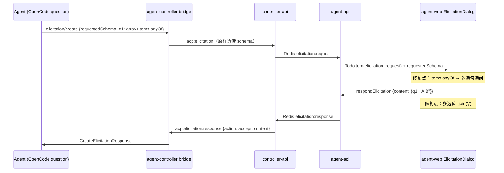
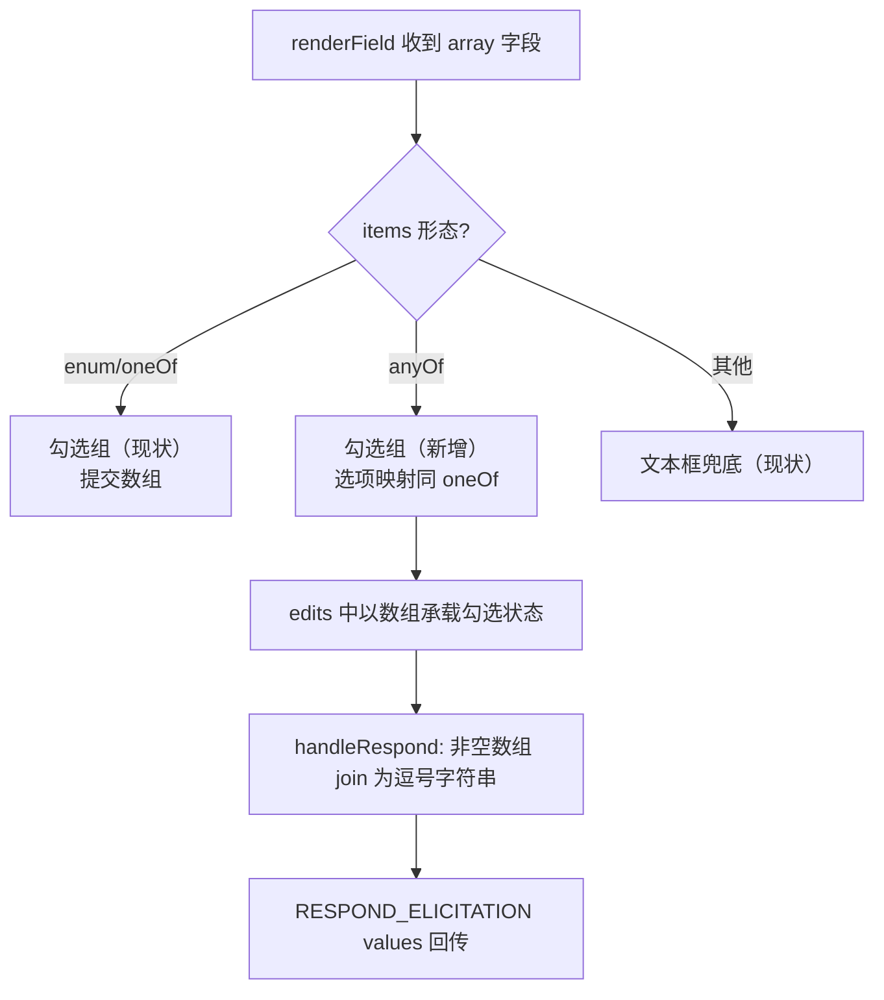

# question 工具多选题呈现修复 - 技术提案

**功能名称**: ACP 问询（question 工具）多选题呈现与作答修复
**关联 PRD**: [[../../product/draft/20261104-question-tool-multi-select.md]]
**技术提案版本**: v1.0
**创建日期**: 2026-11-04
**作者**: ZeroAsh
**feat-branch**: `fix/question-tool-multi-select`（需求总分支：`prd/question-tool-multi-select`）

## 1. 概述

### 1.1 背景

GitHub Issue [Deliay/z-agent-gear#445](https://github.com/Deliay/z-agent-gear/issues/445)：ACP 过来的 question 工具多选题在前端呈现为「文本输入框」，需要正确呈现多选框，并以 `.join(',')` 提交回 ACP 协议。

根因已在 [[../acceptance/20261028-agent-question-dismissed-bug-investigation-report.md]] §4.5（修复项 F4）定位：OpenCode 对 question 工具 `multiple: true` 的字段生成的 JSON Schema 是 `type: 'array'` + `items.anyOf`：

```json
"q1": { "type": "array", "items": { "anyOf": [ { "const": "自动跑测试", "title": "自动跑测试" } ] } }
```

而前端只识别 `items.enum` / `items.oneOf` 两种多选形态：

- `apps/agent-web/src/components/ElicitationDialog.tsx:265`：`if (prop.type === 'array' && (prop.items?.enum || prop.items?.oneOf))`
- `apps/agent-web/src/graphql/types.ts:868-871`：`ElicitationSchemaProperty.items` 仅声明 `enum` / `oneOf`，无 `anyOf`

`items.anyOf` 字段因此落到 `renderField` 末尾的「其他 string：文本框」分支（`ElicitationDialog.tsx:292-311`），用户只能手打字符串。

### 1.2 目标

- `type: 'array'` 且 `items.anyOf` 的字段渲染为多选勾选组（与 `items.enum` / `items.oneOf` 同控件）。
- 提交时，question 工具多选字段（`items.anyOf` 形态）的所选值以 `.join(',')` 拼接为字符串回传 ACP（Issue #445 明确要求）。
- 既有 `items.enum` / `items.oneOf` 数组字段的提交形态（数组）保持不变。

### 1.3 范围

- `apps/agent-web`：类型补全 + `ElicitationDialog` 渲染与提交 + 组件单测。
- `contracts/agent-session-websocket.md`：§2.31 补一句值形态注记（无结构变更）。
- `tests/e2e/src/elicitation.spec.ts`：补真实 question schema（含 `items.anyOf`）端到端用例。
- **不做**：后端（controller-api / agent-api / agent-controller）任何改动——`requestedSchema` 全链路原样透传，本修复为纯前端呈现层；调查报告中的其他修复项（F0~F3、F5、F6）不在本需求范围。

## 2. 技术架构

### 2.1 系统架构图

问询全链路（本次仅修改最后一环的渲染与提交值形态）：



### 2.2 技术栈

既有栈（React 19 + TypeScript + Vitest），无新增依赖。

### 2.3 模块划分

| 模块 | 变更 |
|------|------|
| `apps/agent-web/src/graphql/types.ts` | `ElicitationSchemaProperty.items` 增加 `anyOf?: ElicitationSchemaOneOfOption[]` |
| `apps/agent-web/src/components/ElicitationDialog.tsx` | `renderField` 数组分支识别 `items.anyOf` 并渲染勾选组；`handleRespond` 对 anyOf 多选字段提交前 `.join(',')` |
| `apps/agent-web/src/components/ElicitationDialog.test.tsx` | 新增 anyOf 渲染/多选/提交形态/回归用例 |
| `contracts/agent-session-websocket.md` | §2.31 值形态注记（一句话） |
| `tests/e2e/src/elicitation.spec.ts` | 真实 question schema 弹窗作答用例 |

## 3. API 设计

### 3.1 API 契约

无结构变更。`contracts/agent-session-websocket.md` §2.31 的 `content` 字段说明（「键值符合 `requestedSchema`」）补一句注记：

> `type: 'array'` 且 `items.anyOf` 的字段（ACP question 工具多选题）由客户端将所选值以逗号拼接为字符串回传（如 `"A,B"`）；其余 array 字段仍按数组回传。

### 3.2 内部接口

`ElicitationDialog` 提交载荷构造（`handleRespond`，`ElicitationDialog.tsx:147-168`）：

```ts
// anyOf 多选字段集合：type==='array' 且 items.anyOf 且非 enum/oneOf 形态
const joinFields = Object.entries(properties)
  .filter(([, p]) => p.type === 'array' && p.items?.anyOf && !p.items?.enum && !p.items?.oneOf)
  .map(([name]) => name);
// 提交前覆写：非空数组 → join(',')；空数组保持原样（按未作答处理）
const payload = { ...values };
for (const name of joinFields) {
  const v = payload[name];
  if (Array.isArray(v) && v.length > 0) payload[name] = v.join(',');
}
```

`RESPOND_ELICITATION` mutation 变量不变（`requestId` / `action` / `values`）。

## 4. 数据模型

无。`requestedSchema` 在 controller-api（≤64 KiB 校验后原样落 Mongo Mixed）与 agent-api（TodoItem `elicitationData`）全链路透传，本修复不触碰持久化与传输结构。

## 5. 技术实现方案

### 5.1 核心流程



### 5.2 关键实现点

1. **类型补全**（`types.ts:868-871`）：`items` 增加 `anyOf?: ElicitationSchemaOneOfOption[]`（复用现有 `ElicitationSchemaOneOfOption { const, title?, description? }`，与 oneOf 同构）。
2. **渲染**（`ElicitationDialog.tsx:264-290`）：数组分支条件扩展为 `prop.items?.enum || prop.items?.oneOf || prop.items?.anyOf`；选项来源按 `oneOf ?? anyOf` 顺序映射（`o.const` 为值、`o.title || optionLabel(o.const)` 为标签），勾选交互复用现有 `toggleArrayValue`，edits 中仍以数组承载（草稿缓存、`isEmptyValue` 必填校验、终态守卫均无需改动）。
3. **提交值形态**（`handleRespond`）：按 §3.2 构造 `payload`——仅 anyOf 多选字段的非空数组被 `.join(',')` 覆写；空数组保持 `[]`（非必答题按未作答，必答题已被 `missingRequired` 拦截）；`items.enum`/`items.oneOf` 数组字段不进 `joinFields`，维持数组提交。
4. **行为不变量**：单选（`string` + `enum`/`oneOf`）、数字、布尔、自由文本（含 question 的 `q*_custom` 伴随字段）、url 模式、终态展示与草稿恢复全部保持现状。

## 6. 技术决策

### 6.1 决策列表

| # | 决策 | 理由 |
|---|------|------|
| D1 | anyOf 多选提交 `.join(',')` 字符串 | Issue #445 明确要求；且该形态已被验证可被 Agent 消费——当前文本框兜底本就提交字符串，OpenCode 直接将其作为答案（调查报告 §4.5「提交后 OpenCode 用 [用户输入] 作为答案」）。注意这与调查报告 §8 回归建议「提交值为数组」不同：以 Issue（需求方最新决定）为准 |
| D2 | 仅 `items.anyOf` 形态 join，enum/oneOf 数组保持数组提交 | 后两者服务通用 MCP elicitation 场景，既有消费方按数组取值；join 作用域收窄到 question 工具形态，回归风险最小 |
| D3 | 契约只补值形态注记、不改结构 | `content` 为自由键值，拼接属客户端与 Agent 的取值约定；结构零变更避免三端联动 |
| D4 | 纯前端修复，无版本门禁/发布链路动作 | schema 透传链路无需感知，worker/agent-gear 不受影响 |

### 6.2 依赖与约束

- 依赖 `ElicitationSchemaOneOfOption` 现有结构（`const`/`title`/`description`），OpenCode 实际报文与之一致（调查报告 §4.5 样本）。
- 选项值含逗号时按原样拼接不转义（与 Issue 要求及 PRD 边界口径一致）。

## 7. 项目结构

见 §2.3，无新增文件（仅测试用例追加到既有文件）。

## 8. 测试策略

按 TDD 红-绿-重构推进：

- **组件单测**（`apps/agent-web/src/components/ElicitationDialog.test.tsx`，先红后绿）：
  - T-QM1：`type:array + items.anyOf` 渲染为多选勾选组（不出现文本输入框），选项标签取 `title`；
  - T-QM2：勾选/取消多个选项后提交，`values` 中该字段为逗号拼接字符串（如 `"A,B"`，顺序同勾选顺序）；
  - T-QM3：必答 anyOf 字段空选时提交按钮禁用并提示；
  - T-QM4（回归）：`items.enum`/`items.oneOf` 数组字段提交值仍为数组；
  - T-QM5（回归）：`string + oneOf` 单选、`q*_custom` 自由文本行为不变。
- **E2E**（`tests/e2e/src/elicitation.spec.ts` 扩展）：以真实 question schema（`q0` 单选 `oneOf` + `q1` 多选 `items.anyOf` + 各自 `*_custom`）注入 `acp:elicitation`，弹窗勾选两个选项提交，断言 `acp:elicitation:response` 的 `content.q1` 为逗号拼接字符串、`content.q0` 为单选值。
- **回归**：`apps/agent-web` 既有 ElicitationDialog/todo 相关单测全绿。

## 9. 验收标准

- question 工具多选题在弹窗中呈现为勾选组，可完成多选提交；Agent 收到逗号拼接答案并继续执行（真实 OpenCode 会话可复现验证）。
- 单选题、自由填写等其他题型零回归；`apps/agent-web` `pnpm run build` + 单测、E2E elicitation 用例全绿。

## 10. 相关文档

- [[../../product/draft/20261104-question-tool-multi-select.md]] — 关联 PRD
- [[../acceptance/20261028-agent-question-dismissed-bug-investigation-report.md]] — 多选渲染缺陷根因（§4.5，修复项 F4）
- [[20261021-feat-acp-protocol-enhancement-opencode-support.md]] — OpenCode elicitation 请求形态（§11）
- [GitHub Issue #445](https://github.com/Deliay/z-agent-gear/issues/445)
