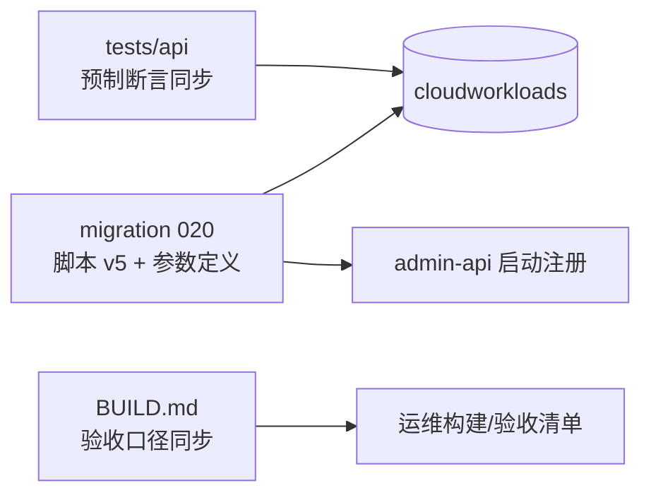
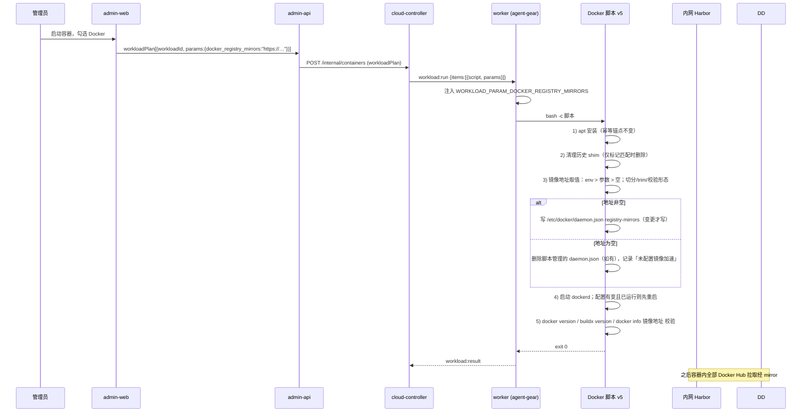
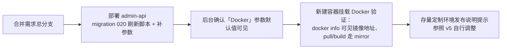

# 「Docker」工作负载取消镜像引用规范化脚本改用 registry-mirrors - 技术提案

**功能名称**: 「Docker」工作负载镜像加速改用 Docker 原生镜像仓库镜像（registry mirror）配置
**关联 PRD**: `docs/product/draft/20261105-docker-registry-mirrors.md`
**技术提案版本**: v1.0
**创建日期**: 2026-11-05
**作者**: ZeroAsh
**feat-branch**: `prd/docker-registry-mirrors`（需求总分支；实现分支按 `impl/docker-registry-mirrors` 另行切出）

## 1. 概述

### 1.1 背景

「Docker」预制工作负载自四期（`20261018-feat-workload-phase4.md`）起内嵌一段「镜像引用规范化 shim」：脚本把 shim 写到 `/usr/local/bin/docker`，拦截 `docker pull|run|create` 并把镜像引用改写到内网 Harbor 代理（`core.harbor.internal.fffdan.com` 的 `docker-hub-proxy` / `ghcr` 项目）。当前库内标准脚本为 v4（`012-worker-user-scripts.ts` 由 v3 派生的 sudo 形态，含 `dockerd -G worker`）。

该方案的问题（Issue Deliay/z-agent-gear#463）：

1. **自定义改写规则需持续维护**：`normalize_image` 的 case 分支要跟随仓库形态变化演进；
2. **覆盖不全**：shim 只拦截 `pull|run|create` 三个子命令的第一个非旗标参数；`docker build` 的 base image、`docker compose`、`docker pull --all-tags` 之外的形态、以及任何直接调用 `/usr/bin/docker` 的脚本都绕过改写，行为与 Docker 原生机制不一致；
3. **与原生能力重复**：dockerd 原生支持 `registry-mirrors`（`/etc/docker/daemon.json`），在守护进程层面对所有拉取入口统一生效。

本期去掉 shim，改为在启动 dockerd 前写入 `registry-mirrors` 配置，并把镜像地址做成「Docker」工作负载的可见参数。

### 1.2 目标

- Docker 预制脚本升级 v4 → **v5**：删除 shim 装配步骤；新增「清理历史 shim → 写入 `/etc/docker/daemon.json` 的 `registry-mirrors` → 启动/重启 dockerd → 校验」链路；安装、`dockerd -G worker` 启动与 `docker version` / `docker buildx version` 校验口径不变。
- 新增工作负载参数 `docker_registry_mirrors`（默认值 = 内网 Harbor 代理地址），脚本 v5 直接消费；保留环境变量 `DOCKER_REGISTRY_MIRRORS` 最高优先级覆盖（沿用 `DOCKER_APT_URL` 口径）。
- 一次性迁移 `020-docker-registry-mirrors`：未定制的 Docker 预制工作负载刷新为 v5 并补齐参数；定制过的不覆盖、只告警；幂等。
- 镜像地址为空 = 不配置镜像加速（合法配置，不快速失败），执行记录可见说明。

### 1.3 范围

**做**：

- `servers/admin-api/src/migrations/020-docker-registry-mirrors.ts`（Docker 脚本 v5、`docker_registry_mirrors` 参数定义、迁移逻辑）及其单测；
- `servers/admin-api/src/index.ts` 注册 020 迁移；
- `deploy/images/worker/BUILD.md` 验收口径同步（shim 拉取断言 → `docker info` registry mirrors 断言）；
- `tests/api` 预制工作负载断言同步（Docker 参数与脚本内容口径）。

**不做**：

- 不改 worker 镜像（`Dockerfile` / `entrypoint.sh`）——脚本是库内数据，无需重建镜像；entrypoint 自四期起已不装配 shim；
- 不改 `contracts/cloud-controller-websocket.md`（参数注入约定 §2.9 既有）与 GraphQL schema（`paramSchema` 既有类型直接承载新参数）；
- 不改其他预制工作负载、「必须」失败语义、版本门禁与依赖展开逻辑；
- 不在脚本内对镜像地址做可达性校验（配置在拉取时生效，与 Docker 原生口径一致；见 §6.1 决策 6）。

## 2. 技术架构

### 2.1 系统架构图

```mermaid
graph TD
    A[admin-web] -->|工作负载 CRUD / 启动容器参数表单| B[admin-api]
    B -->|migration 020 刷新脚本 v5 + 补参数| M[(MongoDB<br/>cloudworkloads / admin_migrations)]
    B --> C[cloud-controller]
    C -->|workload:run 下发脚本 + params| W[worker 容器<br/>agent-gear]
    W -->|WORKLOAD_PARAM_DOCKER_REGISTRY_MIRRORS| E[bash -c Docker 脚本 v5]
    E -->|清理历史 shim| S[/usr/local/bin/docker]
    E -->|写 registry-mirrors| D[/etc/docker/daemon.json]
    E -->|启动/重启| DD[dockerd]
    DD -->|Docker Hub 拉取走 mirror| H[(内网 Harbor<br/>core.harbor.internal.fffdan.com)]
    E -->|curl gpg / deb 源| N[(内网 Nexus<br/>docker-ce-apt 代理)]
```

### 2.2 技术栈

| 层级 | 技术选型 | 说明 |
|------|---------|------|
| 工作负载脚本 | Bash | 经 `workload:run` 下发，`bash -c` 执行 |
| 镜像加速配置 | dockerd `registry-mirrors`（`/etc/docker/daemon.json`） | 守护进程级，对全部拉取入口生效 |
| 参数注入 | agent-gear `WORKLOAD_PARAM_<KEY_UPPER>` | 契约 §2.9，无需新增字段 |
| 一次性迁移 | admin-api migrations（`admin_migrations` 账本） | 新增 020 批次，沿用 runner 语义 |
| 单元测试 | vitest + mock `CloudWorkload` | 沿用 003 迁移测试模式 |

### 2.3 模块划分



| 模块 | 职责 | 关键技术点 |
|------|------|-----------|
| `migrations/020-docker-registry-mirrors.ts` | 刷新 Docker 预制脚本为 v5、补齐 `docker_registry_mirrors` 参数 | 未定制判定（V1~V4 常量比对）、幂等、不覆盖定制 |
| Docker 脚本 v5 | 安装、清理历史 shim、写 daemon.json、启动/重启 dockerd、校验 | 镜像地址取值优先级、daemon.json 归属判定、变更重启 |
| `migrations/index.ts` 注册处 | 随启动执行、失败不阻断 | `runMigrations([...])` 顺序在 019 之后 |
| `deploy/images/worker/BUILD.md` | 验收口径同步 | `docker info` 镜像地址断言替代 shim 拉取断言 |

## 3. API 设计

### 3.1 API 契约

**无契约变更**：

- `contracts/cloud-controller-websocket.md` §2.9 `workload:run.items[].params` → `WORKLOAD_PARAM_<KEY_UPPER>` 注入约定已完整支持本方案（`docker_registry_mirrors` → `WORKLOAD_PARAM_DOCKER_REGISTRY_MIRRORS`）；
- GraphQL `CloudWorkload.paramSchema` 既有字段类型（`key/label/type/options/defaultValue`）即可承载新参数，`key` 满足 `^[a-z][a-z0-9_]{0,31}$`、TEXT 值 ≤1024。

### 3.2 内部接口

- `migrations/runner.ts` 的 `Migration` 接口（`name` + `run`）不变；`servers/admin-api/src/index.ts` 注册处在 `runMigrations([...])` 末尾追加 `migration020DockerRegistryMirrors`。
- 020 复用既有导出常量做「未定制」比对：`001.DOCKER_SCRIPT_V1`、`002.DOCKER_SCRIPT_V2`、`003.DOCKER_SCRIPT_V3`、`012.DOCKER_SCRIPT_V4`；001/002/003/012/019 的写库行为完全不变。
- 020 新增导出 `DOCKER_SCRIPT_V5`、`DOCKER_REGISTRY_MIRRORS_PARAM`（参数定义常量）、`DOCKER_REGISTRY_MIRRORS_DEFAULT`（默认值唯一来源），供单测与后续迁移比对。

## 4. 数据模型

### 4.1 数据库设计

无 schema 变更，仅数据刷新：

- `cloudworkloads`（`presetKey='docker'` 文档）：
  - `initScript` 刷新为 v5（仅未定制时）；
  - `paramSchema` 追加一项（仅缺失时）：

  ```json
  {
    "key": "docker_registry_mirrors",
    "label": "镜像仓库镜像地址",
    "type": "text",
    "options": [],
    "defaultValue": "https://core.harbor.internal.fffdan.com"
  }
  ```

  > 多个地址以英文逗号分隔（脚本切分为 JSON 数组写入 `registry-mirrors`）；默认单地址，不带尾部斜杠。
- `admin_migrations`：新增账本记录 `{ name: '020-docker-registry-mirrors', executedAt }`，沿用「已执行跳过、失败下轮重试」语义。

### 4.2 缓存设计

无缓存相关内容。

## 5. 技术实现方案

### 5.1 核心流程



### 5.2 关键实现点

**实现点 1：脚本 v5 相对 v4 的变化清单（其余逐字不变）**

1. **删除 shim 装配段**：移除 `SHIM_PATH` 变量与整段 `tee "$SHIM_PATH" <<'SHIM' …`；`ZAG_DOCKER_SHIM_PATH` 环境变量随之退役（脚本不再读取）。
2. **新增历史 shim 清理**（幂等，收敛旧版本初始化过的环境）：

   ```bash
   # 历史版本写入的 shim 含 normalize_image/HARBOR_PROXY 标记；仅标记匹配才删除，不误删环境内其他内容
   LEGACY_SHIM="/usr/local/bin/docker"
   if [ -f "$LEGACY_SHIM" ] && grep -q 'normalize_image' "$LEGACY_SHIM" 2>/dev/null; then
     ${SUDO} rm -f "$LEGACY_SHIM"
     echo "已清理历史镜像引用规范化 shim：$LEGACY_SHIM"
   elif [ -e "$LEGACY_SHIM" ]; then
     echo "警告：$LEGACY_SHIM 存在但非本平台 shim，保留不动" >&2
   fi
   ```

3. **新增镜像地址取值与 daemon.json 写入**（在启动 dockerd 之前）：

   ```bash
   # 取值优先级：环境变量 DOCKER_REGISTRY_MIRRORS（最高）> 工作负载参数 WORKLOAD_PARAM_DOCKER_REGISTRY_MIRRORS > 空（不配置镜像加速）
   DOCKER_REGISTRY_MIRRORS="${DOCKER_REGISTRY_MIRRORS:-${WORKLOAD_PARAM_DOCKER_REGISTRY_MIRRORS:-}}"
   ```

   - 逗号切分、逐项 trim、空段丢弃；逐项校验 `^https?://` 形态，非法项即快速失败（`exit 2`）并打印指引；
   - 目标内容确定化生成：`{"registry-mirrors":["<m1>","<m2>"]}`；
   - **daemon.json 归属判定**：「脚本草图」= 去空白后匹配 `^\{"registry-mirrors":\[[^]]*\]\}$`（即仅含本脚本写入的键）；
     - 文件不存在 → 写入；
     - 存在且与目标一致 → 跳过（幂等）；
     - 存在、符合脚本草图但不一致 → 覆写（本脚本历史输出，收敛旧值）；
     - 存在且不符合脚本草图（含其他键，视为环境自管）→ 备份为 `/etc/docker/daemon.json.pre-zag-<timestamp>` 后覆写，并打印醒目告警；
   - **地址为空**：脚本管理的 daemon.json 存在则删除（回退为 Docker 默认直连），非脚本草图则不动并告警；打印「未配置镜像加速，Docker Hub 将默认直连」。

4. **dockerd 启动/重启**：沿用 `docker info` 就绪判定与 `nohup dockerd -G worker` 启动；新增——**daemon.json 有变更且 dockerd 已运行时先重启再就绪等待**（重启会中断容器内正在运行的 docker 容器，执行记录打印明确日志；初始化阶段无用户容器，影响可忽略）。
5. **校验段追加镜像地址硬校验**（019「锚点 + 结尾硬校验」标准）：

   ```bash
   docker info --format '{{json .RegistryConfig.Mirrors}}'   # 地址非空时断言逐项出现；为空时断言脚本管理的 daemon.json 已移除
   ```

**实现点 2：迁移 020 的判定矩阵（幂等、不覆盖定制；同 003 口径）**

| `initScript` 状态 | `paramSchema` 含 `docker_registry_mirrors` | 动作 |
|---|---|---|
| 等于 V1 / V2 / V3 / V4 | 否 | 刷新为 V5（已是 V5 则不动脚本）+ 追加参数 → `save` |
| 等于 V1 / V2 / V3 / V4 | 是 | 刷新为 V5（已是 V5 且参数在 → 幂等跳过，不 `save`） |
| 其他（管理员定制） | 任意 | **不覆盖、不补参数**，`log.warn` 提示参照 v5 自行调整 |
| `presetKey='docker'` 不存在，同名 `Docker` 存在 | — | `log.warn` 跳过，不创建重名项（沿用 002/003 防御路径） |
| 两者都不存在 | — | 以 V5 + `[DOCKER_APT_PARAM, DOCKER_REGISTRY_MIRRORS_PARAM]` 防御创建（`isPreset: true`） |

**实现点 3：注册与执行语义**

- 020 排在既有迁移之后执行：全新环境链路为 001 → … → 012（V4）→ 019（幂等锚点核查）→ 020（V5 + 参数）；存量环境按上表收敛；
- 沿用 runner 语义：`admin_migrations` 记账、已执行跳过、失败不阻断启动且下轮重试；
- 001/002/003/012/019 源码不动（历史版本常量供比对链路使用）。

## 6. 技术决策

### 6.1 决策列表

1. **用 dockerd 原生 `registry-mirrors`（daemon.json），而非保留 shim 或改用 CLI flag**。daemon.json 是 Docker 标准持久配置，`docker info` 可见、排障路径标准；CLI flag（`dockerd --registry-mirror`）与 daemon.json 同名指令冲突会导致 dockerd 拒绝启动，且不利于「配置落盘可查」。shim 方案整体废弃。
2. **镜像地址用工作负载参数承载**（默认值 = `https://core.harbor.internal.fffdan.com`，已实测 `/v2/` 返回 401 鉴权挑战 = registry API 在线）。沿用 `docker_apt_url` 的决策：参数默认值即「已填写」，天然获得启动时可改、后台可维护、随执行计划落档可查三项能力；脚本内不内置默认地址（单一事实来源是参数默认值），`DOCKER_REGISTRY_MIRRORS` 环境变量保留最高优先级覆盖。
3. **registry-mirrors 只覆盖 Docker Hub 是 Docker 原生限制**，本期接受该行为变化：ghcr.io / lscr.io 等非 Docker Hub 仓库不再自动改写，按原生行为直连；需要代理时显式书写 Harbor 代理项目前缀（如 `core.harbor.internal.fffdan.com/ghcr/<owner>/<image>`），该写法 shim 时代即支持、行为不变。PRD §3.5 已列为周知项。
4. **地址为空 = 合法配置**（不配置镜像加速），不做快速失败。与 `docker_apt_url` 不同：软件源缺失时安装无法进行，而 mirror 缺失时 dockerd 可正常工作（直连语义），因此不引入新的失败模式；执行记录打印说明，避免「以为有代理实际没有」的静默偏差。
5. **历史 shim 标记匹配清理**。`/usr/local/bin/docker` 在 PATH 上先于 `/usr/bin/docker`，旧版本装过的 shim 不删会持续拦截；只按 `normalize_image` 标记删除，非本平台内容保留并告警，不误删。
6. **不做镜像地址可达性校验**。daemon.json 在拉取时才消费；dockerd 对不可达 mirror 的原生行为是尝试后报错/回退，与 Docker 官方口径一致。可达性保障属运维职责（同 `docker-ce-apt` 代理），发布前置核对见 §9.3。
7. **新增迁移 020，不改 001/002/003/012/019**。既有迁移已在存量环境记账执行，改动它们会让全新环境的版本比对链路失效（沿用 003 决策 4 的口径）。
8. **不提高 `MIN_WORKER_VERSION`**：参数注入需 agent-gear ≥2.3.0（现网镜像远高于此）；极老 worker 上参数不注入时 v5 行为 = 不配置镜像加速（空值语义），不引入新失败。

### 6.2 依赖与约束

| 类型 | 内容 | 说明 |
|------|------|------|
| 依赖 | 内网 Harbor 代理以 registry mirror 形态可用 | `/v2/` 已实测在线（401 挑战）；「Docker Hub 官方镜像经 mirror 实际拉通」列入 §9.3 发布前置核对 |
| 依赖 | worker 内 agent-gear ≥2.3.0 | 参数注入（现网镜像已满足） |
| 约束 | 不改契约、不改镜像、不改其他预制工作负载与「必须」语义 | 见 §1.3 |
| 约束 | TEXT 参数值上限 1024 字符、键名正则等既有校验口径不变 | `docker_registry_mirrors` 满足 `^[a-z][a-z0-9_]{0,31}$` |
| 约束 | bash 可用的文本处理 | 镜像内无 jq/python3 保证，daemon.json 生成与归属判定用纯 bash + grep 实现 |

## 7. 项目结构

```text
servers/admin-api/src/
├── index.ts                                     # [修改] 注册 migration 020
└── migrations/
    ├── 001-preset-workloads.ts                  # [不变] 导出 DOCKER_SCRIPT_V1 供比对
    ├── 002-refresh-docker-preset-script.ts      # [不变] 导出 DOCKER_SCRIPT_V2 供比对
    ├── 003-docker-apt-source.ts                 # [不变] 导出 DOCKER_SCRIPT_V3 / DOCKER_APT_PARAM
    ├── 012-worker-user-scripts.ts               # [不变] 导出 DOCKER_SCRIPT_V4 供比对
    ├── 019-workload-idempotent-anchors.ts       # [不变] 幂等标准已执行批次
    ├── 020-docker-registry-mirrors.ts           # [新增] 脚本 v5 + docker_registry_mirrors 参数 + 迁移逻辑
    └── 020-docker-registry-mirrors.test.ts      # [新增] 迁移判定矩阵与脚本不变量测试
deploy/images/worker/
└── BUILD.md                                     # [修改] shim 拉取断言 → docker info registry mirrors 断言
tests/api/src/admin-api/
└── cloud-workload.test.ts                       # [修改] Docker 预制项参数/脚本口径断言
```

## 8. 测试策略

采用 TDD（红-绿-重构）：先写迁移/脚本行为测试，再实现 020 与脚本 v5。工具沿用 vitest + mock `CloudWorkload`（模式同 `003-docker-apt-source.test.ts`）。

| 类型 | 用例 | 覆盖内容 |
|------|------|---------|
| 单元测试 | `T-MIG-RM1` | 迁移名暴露为 `020-docker-registry-mirrors` |
| 单元测试 | `T-MIG-RM2` | v4 脚本 → 刷新为 v5 且追加 `docker_registry_mirrors` 参数（默认值为内网 Harbor 地址） |
| 单元测试 | `T-MIG-RM3` | v1/v2/v3 脚本同样刷新为 v5 + 补参数 |
| 单元测试 | `T-MIG-RM4` | 已 v5 且参数已存在 → 幂等跳过（不 `save`、不 `create`） |
| 单元测试 | `T-MIG-RM5` | 已 v5 但参数缺失 → 只补参数，不动脚本 |
| 单元测试 | `T-MIG-RM6` | 管理员定制脚本 → 不覆盖、不补参数、告警 |
| 单元测试 | `T-MIG-RM7` | `presetKey` 缺失但同名 `Docker` 存在 → 告警跳过；两者都不存在 → 防御创建 v5 + 双参数 |
| 脚本不变量 | `T-MIG-RM8` | v5 含 daemon.json 写入、shim 清理、取值优先级、`docker info` 硬校验；**不含** `normalize_image` / `HARBOR_PROXY` / `SHIM_PATH` / `<<'SHIM'`；`bash -n` 通过 |
| 脚本行为 | `T-MIG-RM9` | 抽取 v5 地址解析段在 `bash -c` 下执行：env 覆盖参数、逗号切分/trim/空段丢弃、非 http(s) 项快速失败、双空得空 |
| 回归 | — | 001/002/003/012/019 既有迁移测试、`runner` 测试全绿；`no-console` 扫描全绿；覆盖率 ≥80% |
| API 测试 | `T-IA`（更新） | 预制「Docker」`paramSchema` 含 `docker_apt_url` + `docker_registry_mirrors`（默认内网地址）；`initScript` 含 `registry-mirrors`、不含 `HARBOR_PROXY`；预制项计数不变（10） |
| 集群验收 | 手工（内网） | 默认参数初始化成功；`docker info` 可见镜像地址；`docker pull ubuntu:24.04` 走 mirror；`docker build` base image 同样走 mirror；清空地址回退直连；历史 shim 环境重跑后 shim 消失；定制脚本不被覆盖 |

## 9. 部署方案

### 9.1 环境规划

| 环境 | 用途 | 部署方式 |
|------|------|---------|
| 内网 K8s | admin-api / cloud-controller / worker 容器 | 既有 manifest，仅更新 admin-api 镜像 |

### 9.2 配置管理

- 默认镜像地址固化为「Docker」工作负载参数默认值 `https://core.harbor.internal.fffdan.com`（迁移写入，管理员可在后台调整；多地址逗号分隔）；
- `DOCKER_REGISTRY_MIRRORS` 保留为可选的环境级覆盖（优先级最高），无需在 Job/镜像层配置；
- `ZAG_DOCKER_SHIM_PATH` 随 shim 退役，脚本不再读取（文档残留一并清理）。

### 9.3 发布顺序



- **发布前置核对**：运维确认内网 Harbor 以 mirror 形态可拉通 Docker Hub 官方镜像（`docker pull ubuntu:24.04` 经 mirror 成功）；
- **无需重建 worker 镜像**：脚本与参数均在库内，部署 admin-api 即生效；
- 运行中的旧容器不受影响，重建后才使用新配置；旧容器重跑初始化时历史 shim 被自动清理；
- 若 020 日志出现「modified by admin, skipping」，在发布说明中提示对应管理员。

## 10. 验收标准

- [ ] 技术方案评审通过
- [ ] `T-MIG-RM1`~`T-MIG-RM9` 全部通过，既有迁移与 runner 测试全绿，覆盖率 ≥80%
- [ ] 全新环境首次启动：`cloudworkloads` 中「Docker」为脚本 v5 且含 `docker_registry_mirrors` 参数（默认值为内网 Harbor 地址）
- [ ] 存量未定制环境升级后与上条一致；定制脚本不被覆盖且有告警日志
- [ ] 按默认参数启动容器并挂载「Docker」：初始化成功；`docker info` 可见镜像地址；`docker pull ubuntu:24.04` 与 `docker build`（base image）均经 mirror 完成；`/usr/local/bin/docker` 不存在
- [ ] 启动时修改镜像地址：`docker info` 反映新地址
- [ ] 清空地址启动：初始化成功、`docker info` 无 mirror、执行记录含「未配置镜像加速」说明
- [ ] 重复执行迁移不产生重复变更；重复执行脚本幂等（配置无变化不重启 dockerd）
- [ ] `deploy/images/worker/BUILD.md` 验收口径与实现一致

## 11. 相关文档

- [[../../../product/draft/20261105-docker-registry-mirrors.md]] — 本期 PRD
- [[20261018-feat-workload-phase4.md]] — 工作负载四期技术提案（shim 下沉到工作负载脚本，本期直接前因）
- [[20261018-fix-docker-ce-apt-source.md]] — Docker CE 软件源地址补齐技术提案（参数化与迁移口径先例）
- `contracts/cloud-controller-websocket.md` §2.9 / A.2.2 — 参数注入与 `workloadPlan` 约定（本期无变更）
- `deploy/images/worker/BUILD.md` — 镜像构建与自验清单
- 需求来源：GitHub Issue [Deliay/z-agent-gear#463](https://github.com/Deliay/z-agent-gear/issues/463)
