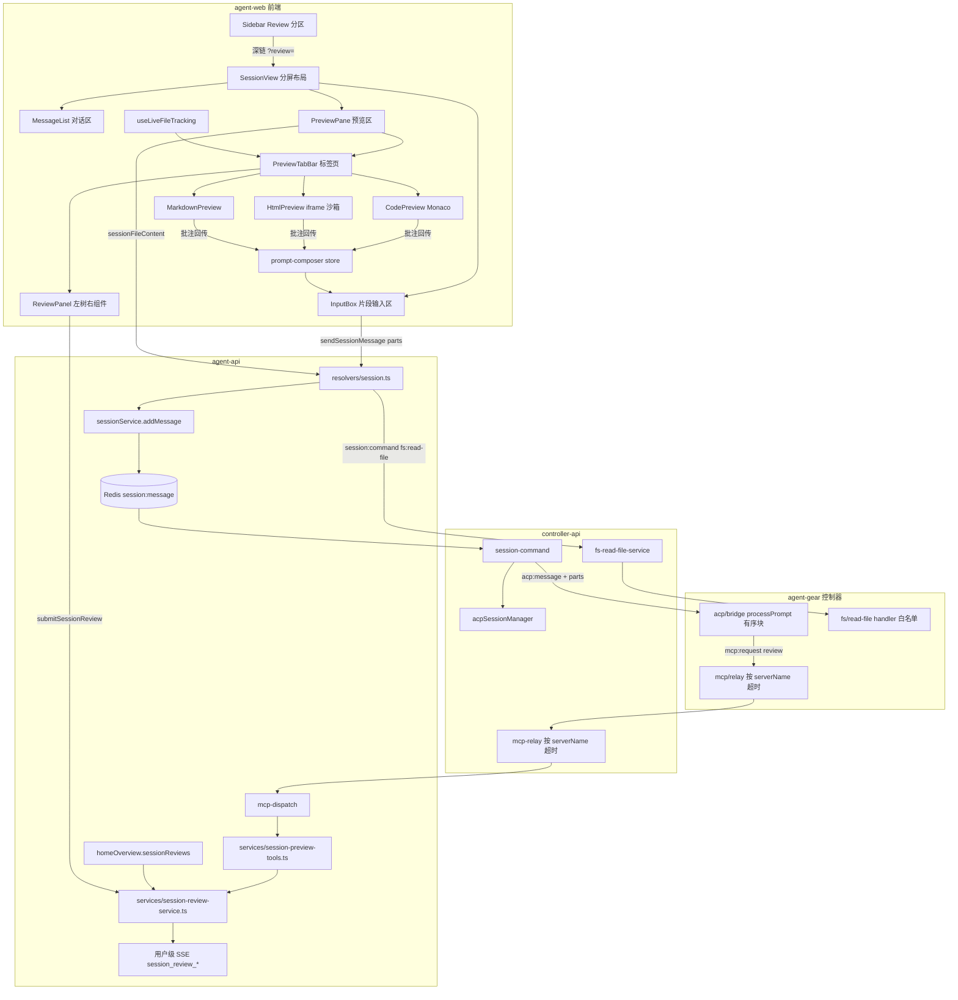
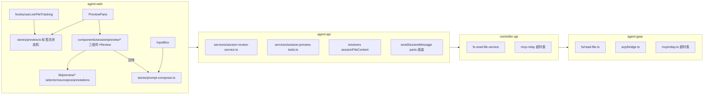
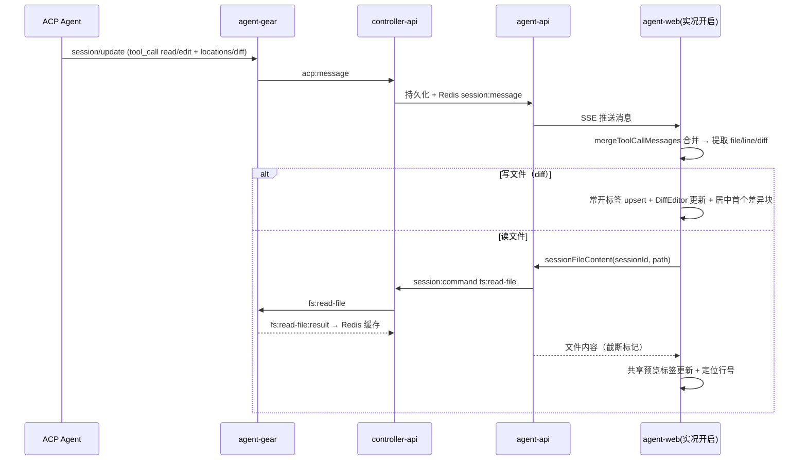
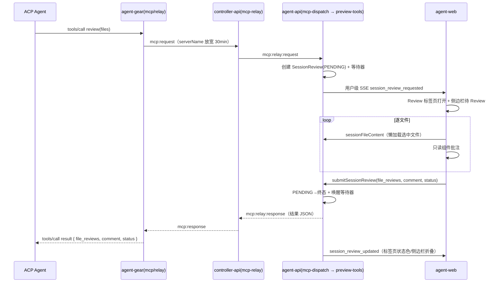
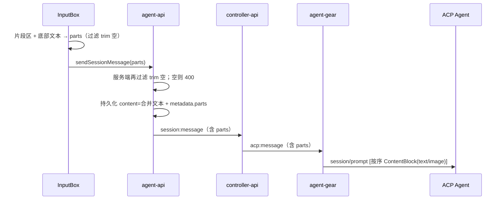

# 新版会话交互与内容预览 - 技术提案

**功能名称**: 新版会话交互与内容预览
**关联 PRD**: [docs/product/draft/20261105-session-interaction-content-preview.md](../../product/draft/20261105-session-interaction-content-preview.md)
**技术提案版本**: v1.0
**创建日期**: 2026-11-05
**作者**: z-agent-gear 工作流
**feat-branch**: `prd/session-interaction-content-preview`（需求总分支；实现分支 `impl/session-interaction-content-preview`，参考 z-git skill 与仓库 `prd/<slug>` + `impl/<slug>` 惯例）

## 1. 概述

### 1.1 背景

GitHub Issue [Deliay/z-agent-gear#461](https://github.com/Deliay/z-agent-gear/issues/461) 要求四块能力：①内容组件（代码组件 + HTML/Markdown 组件，均支持预览/批注模式与结构化回传）；②会话代码分屏（仅会话/左右/上下三模式）与「实况」自动跟随工具调用读写；③会话内建「预览模式 MCP」——Review 工具（Agent 发起、用户逐文件批注、通过/驳回/仅评论结论结构化回传）；④会话输入框重构为附件式提示词片段。

现状调研结论（代码事实）：

| 领域 | 现状 | 对本提案的意义 |
|------|------|----------------|
| 会话页布局 | `apps/agent-web/src/pages/SessionPage.tsx` + `components/session/SessionView.tsx` 单栏（对话 + `InputBox`） | 分屏改造点在 SessionView 布局层 |
| 输入框 | `InputBox.tsx` 单文本，`localStorage['session_input_{sessionId}']` 草稿，`onSend(content: string)` | 重构为 parts 结构，草稿键保留并新增 parts 草稿 |
| 消息发送链 | resolver `sendSessionMessage` 仅透传 `content/type`（`servers/agent-api/src/graphql/resolvers/session.ts:283`，**契约中的 `attachments` 实参被丢弃**）→ `sessionService.addMessage` 持久化为 `{sessionUpdate:'user_message_chunk', content:{type:'text',text}}`（`services/session.ts:1011`）→ Redis `session:message` → controller-api `session-command.handleInputMessage` → `acp:message` → agent-gear `bridge.processPrompt` 组装 `[...attachments, {type:'text',text}]`（`packages/agent-controller/src/acp/bridge.ts:714-760`） | 多片段链路在「resolver 透传 + addMessage 持久化 + bridge 有序块」三点扩展，桥层已有 attachments 形态可借鉴 |
| 平台 MCP 机制 | `McpServer` `transport/source=platform`；`ensureCloudHostToolsServer` 幂等 upsert（`services/cloud-host-tools.ts:43`）；云会话创建时自动并入（`services/session.ts:369-373`）；「全部已启用」候选排除 `name: {$ne: 'agent-cloud-host-tools'}`（`session.ts:355`、`controller.ts:135`）；`mcp-dispatch.ts:104-137` 按 serverName 本地分发，handler 可长等待（`workload_install` 内联 `waitForCompletion`） | Review 工具复用同一机制新增第四个平台服务 |
| MCP 转发超时 | agent-gear `src/mcp/relay.ts` `REQUEST_TIMEOUT_MS=60_000`；controller-api `services/mcp-relay.ts` `REQUEST_TIMEOUT_MS=60_000` | Review 需人类操作，远超 60s，须按 serverName 放宽（见 §6.1 决策 5） |
| 文件能力 | 仅有 `fs:browse`（列目录）/`fs:home` 等 relay：`session:command` 白名单 → controller-api service → Socket.IO → 结果写 Redis 缓存，agent-api 轮询（`services/session.ts` `getAcpCapabilities` 同型）；**无文件读取事件** | 新增 `fs:read-file` 同型 relay |
| 实况数据源 | 渲染层已有 `group-messages.ts` 分组 + `tool-call-state.ts` `mergeToolCallMessages`（MergedToolCall 含 `locations[{path,line}]`、`content[type=diff]{path,oldText,newText}`） | 实况跟随直接复用该合并口径，零协议改动 |
| 用户级 SSE | harness 登录引导经用户级 SSE 推送（`services/session-sse.ts`） | Review 请求/更新复用同通道 |
| 工作流节点会话 | `services/workflow/orchestrator.ts:455` 幂等 upsert 平台工作流工具并经 `session.create` 建节点会话 | 在 `sessionService.create` 统一装配预览工具即可覆盖普通 + 节点会话 |

### 1.2 目标

1. agent-web 新增内容预览子系统：`CodePreview`（Monaco）/ `HtmlPreview` / `MarkdownPreview` 三类组件（预览 + 批注模式、结构化回传）、分屏布局、多标签页预览区、实况跟随、Review 界面与侧边栏 Review 分区。
2. 新增会话文件读取链路：`fs:read-file` 契约 + agent-gear handler + controller-api relay + agent-api `sessionFileContent` 查询。
3. 新增平台 MCP `agent-session-preview-tools`（`review` 工具）与 SessionReview 领域（模型 / 服务 / 契约 / SSE），全会话默认装配。
4. 输入链路多片段化：契约 `sendSessionMessage.parts`，agent-api 组装过滤，bridge 有序 ContentBlock；历史消息可回看。
5. 全部新能力 TDD 覆盖，API / E2E 收口。

### 1.3 范围

**做**：

- `apps/agent-web`：预览子系统（三类内容组件、批注层、标签页、分屏、实况、Review 界面、侧边栏分区）、输入框重构。
- `servers/agent-api`：`sessionFileContent` 查询、SessionReview 领域（模型 / 迁移 / 服务 / resolver / SSE）、平台 MCP `agent-session-preview-tools` 与全会话装配、`sendSessionMessage.parts` 组装过滤。
- `servers/controller-api`：`fs:read-file` relay（`session:command` 白名单 + Socket.IO + Redis 缓存）、`acp:message` 透传 `parts`、`mcp-relay` 按 serverName 超时放宽。
- `packages/agent-controller`（agent-gear）：`fs:read-file` handler、`bridge.processPrompt` 有序 ContentBlock、`mcp/relay` 按 serverName 超时放宽。
- `contracts/`：`agent-session.graphql`、`agent-session-websocket.md`、`home.graphql` 三处契约先行。

**不做**：

- 代码组件的语言服务（LSP）接入、Monaco 各语言 worker（本期仅 editor core + 基础补全）。
- 音频 / 视频输入片段（类型预留）。
- Review 跨工作区 / 跨会话评审、Review 结果落 GitHub PR。
- 会话消息存储结构变更（沿用 `user_message_chunk` 形态 + `metadata` 扩展）。
- MCP 转发链路默认 60s 超时的整体治理（仅对本平台服务按名放宽）。

## 2. 技术架构

### 2.1 系统架构图



### 2.2 技术栈

| 层级 | 技术选型 | 说明 |
|------|---------|------|
| 前端 | React 19 + TS strict / Vite / Tailwind v4 / Zustand / Apollo | 现有 |
| 代码组件 | `monaco-editor`（精确锁版本，本地打包 + Vite `?worker`，仅 editor core） | 新增依赖；动态 import 懒加载（对齐 MermaidBlock 先例） |
| HTML 预览 | iframe `sandbox="allow-scripts"` + srcDoc 注入选择脚本 + postMessage | 无新依赖 |
| Markdown 预览 | react-markdown + remark-gfm（现有管线）+ hast `position` sourcepos 映射 | 现有依赖 |
| 后端 | Node 24 / Express v5 / GraphQL-Yoga / Mongoose / Redis | 现有 |
| 控制器 | agent-gear（socket.io-client） | 版本提升至 2.17.0 |
| 测试 | Vitest + RTL（前端/后端）、tests/api、tests/e2e | 现有 |

### 2.3 模块划分



| 模块 | 职责 | 关键技术点 |
|------|------|-----------|
| `lib/preview/*` | selector 计算、sourcepos 映射、批注→文本片段组装 | 纯函数，100% 单测 |
| `stores/preview.ts` | 标签页状态机（常开 / 共享预览 / Review）、实况开关 | zustand，按 sessionId 隔离 |
| `CodePreview` | 代码查看 / 差异 / 行定位 / 批注模式 | Monaco editor core、DiffEditor、行装饰 + overlay 批注编辑器 |
| `HtmlPreview` | HTML 沙箱渲染 + 元素多选批注 | iframe sandbox、postMessage 带令牌 |
| `MarkdownPreview` | Markdown 渲染 + 文本选择批注 | hast position → 原文区间 |
| `useLiveFileTracking` | 工具调用 → 标签页自动定位 | 复用 `mergeToolCallMessages` |
| `session-review-service` | Review 状态机、等待器、自动取消 | 进程内 waiter + 30min 截止 |
| `session-preview-tools` | 平台 MCP `review` 工具 | 同 cloud-host-tools 形态 |
| `fs/read-file.ts` | 控制器端文件读取 | 白名单（对齐 fs:remove-dir）、二进制检测、截断 |
| `bridge.processPrompt` | 有序 ContentBlock 组装 | parts 有序映射，旧报文兼容 |

## 3. API 设计

### 3.1 API 契约

#### 3.1.1 `contracts/agent-session.graphql`（扩展）

**多片段输入**：

```graphql
enum PromptPartType {
  text
  image
}

# 提示词片段：文本或图片（本期）；音频/视频类型预留不开放
input PromptPartInput {
  type: PromptPartType!
  # type=text 必填；trim 为空将被服务端过滤
  text: String
  # type=image 必填：base64（不含 data: 前缀）
  data: String
  # type=image 必填：如 image/png
  mimeType: String
  # 可选展示名（如截图文件名）
  name: String
}

# sendSessionMessage 扩展（content 保留兼容；parts 非空时以 parts 为准组装提示词）
sendSessionMessage(sessionId: ID!, content: String!, type: AcpMessageType = text, attachments: [MessageAttachmentInput!], parts: [PromptPartInput!]): AcpMessage!
```

**Review 领域**：

```graphql
# Review 状态：PENDING 待评审；APPROVED 通过；REJECTED 驳回；COMMENTED 仅评论；CANCELLED 已取消（超时/会话结束）
enum SessionReviewStatus {
  PENDING
  APPROVED
  REJECTED
  COMMENTED
  CANCELLED
}

# 提交动作（对齐 GitHub PR Review 语义）
enum SessionReviewAction {
  approve
  reject
  comment
}

type SessionReview {
  id: ID!
  sessionId: ID!
  # 待评审文件（相对会话工作区的展示路径）
  files: [String!]!
  status: SessionReviewStatus!
  # 按文件聚合的批注：{ [file: string]: ReviewComment[] }；PENDING/CANCELLED 为 null
  fileReviews: JSON
  # 总体评审意见
  comment: String
  # 取消原因（status=CANCELLED 时）：timeout | session_closed
  cancelReason: String
  createdAt: String!
  resolvedAt: String
}

# 文件内容（经 fs:read-file relay；仅会话工作区内路径）
type SessionFileContent {
  path: String!
  content: String!
  truncated: Boolean!
  sizeBytes: Int!
}

extend type Query {
  sessionReview(id: ID!): SessionReview
  # status 过滤；sessionId 过滤；缺省返回当前用户全部（PENDING 在前）
  sessionReviews(status: SessionReviewStatus, sessionId: ID): [SessionReview!]!
  sessionFileContent(sessionId: ID!, path: String!): SessionFileContent!
}

input SubmitSessionReviewInput {
  fileReviews: JSON!
  comment: String
  status: SessionReviewAction!
}

extend type Mutation {
  submitSessionReview(id: ID!, input: SubmitSessionReviewInput!): SessionReview!
}
```

**用户级 SSE**（与 `harness_login_required` 同通道，契约 `agent-session.openapi.yaml` 增补）：

| 事件 | 数据 | 说明 |
|------|------|------|
| `session_review_requested` | `{ review: SessionReview }` | Review 创建（MCP 调用到达） |
| `session_review_updated` | `{ review: SessionReview }` | 提交 / 取消后的终态 |

#### 3.1.2 `contracts/agent-session-websocket.md`（扩展）

- **§2.6 `acp:message`（Server → Controller）**：`AcpMessage` 增加可选 `parts: AcpPromptPart[]`——有序提示词块，元素为 `{type:'text', text}` 或 `{type:'image', data, mimeType}`；`content` 保留（合并文本，兼容旧消费者）。Controller 在 parts 非空时按序组装 `session/prompt` 的 ContentBlock，否则沿用旧形态。
- **§2.12.1 `mcp:request`**：增补注记——平台内建长时工具服务 `agent-session-preview-tools` 的请求超时时限在 controller-api 与 Controller 双侧按 serverName 放宽至 30 分钟（`MCP_REVIEW_TIMEOUT_MS` 可调），其余 server 保持 60s；旧版本 Controller 不放宽（60s 后 504，优雅降级）。
- **§3 新增事件**：

| 方向 | 事件名 | 说明 |
|------|--------|------|
| Server → Controller | `fs:read-file` | 请求读取文件内容（文本，限量截断） |
| Controller → Server | `fs:read-file:result` | 返回文件内容 |

`fs:read-file` Payload：`{ requestId, controllerId, path, maxBytes? }`。`fs:read-file:result` Payload：`{ requestId, success, content?, truncated?, sizeBytes?, error? }`。约束：

- 路径白名单与 `fs:remove-dir`（§3.18）同口径：仅允许该 Controller 已注册/活跃会话持有的工作区（cwd / worktree）范围内路径及其子路径，拒绝越界（`..` 逃逸、绝对路径出域）。
- `maxBytes` 缺省 512 KiB、硬上限 2 MiB；超限截断并 `truncated: true`。
- 前 8 KiB 内检出 NUL 字节判为二进制：`success: false, error: 'binary file'`。
- 结果经 Redis `fs:read-file:{requestId}` 缓存（TTL 60s），agent-api 轮询消费（与 `fs:browse` 同型）。

#### 3.1.3 `contracts/home.graphql`（扩展）

```graphql
# 首页聚合新增（PENDING 在前，其后按 resolvedAt 倒序的最近终态；总量上限 20；单分支失败降级 []）
extend type HomeOverview {
  sessionReviews: [SessionReview!]!
}
```

### 3.2 内部接口

**前端批注数据模型（`lib/preview/types.ts`）**：

```ts
export type ReviewAnchor =
  | { kind: 'code'; filePath: string; startLine: number; endLine: number }
  | { kind: 'html'; selector: string; innerHtml: string }
  | { kind: 'markdown'; text: string; startOffset: number; endOffset: number };

export interface ReviewComment {
  id: string;
  anchor: ReviewAnchor;
  body: string;
  createdAt: string;
}

// 组件「确认回传」产物；会话层负责转为文本片段（lib/preview/annotations-to-part.ts）
export interface AnnotationBatch {
  target: { filePath?: string; source: 'code' | 'html' | 'markdown' | 'review' };
  comments: ReviewComment[];
  summary?: string; // 总体意见（代码组件）
}
```

**标签页状态机（`stores/preview.ts`）**：

```ts
export type PreviewTab =
  | { id: string; kind: 'file'; filePath: string; pinned: boolean; focusLine?: number; diff?: { oldText: string | null; newText: string } }
  | { id: string; kind: 'review'; reviewId: string };

export interface PreviewState {
  tabs: PreviewTab[];            // 同一时刻最多一个 pinned=false 的 file tab（VSCode 预览语义）
  activeTabId: string | null;
  live: boolean;                 // 实况开关
  openFile(input: { filePath: string; pinned: boolean; focusLine?: number; diff?: ...; activate?: boolean }): void;
  openReview(reviewId: string): void;
  closeTab(id: string): void;
  setLive(live: boolean): void;
}
```

**Review MCP 工具（`agent-session-preview-tools`）**：

```ts
// tools/list 唯一工具
{
  name: 'review',
  description: '请求用户评审一个或多个文件：创建评审界面，等待用户逐文件批注并给出通过/驳回/仅评论的总体结论后返回结构化结果',
  inputSchema: {
    type: 'object',
    properties: {
      files: { type: 'array', items: { type: 'string' }, minItems: 1, maxItems: 50, description: '相对会话工作目录的文件路径（或工作区内绝对路径）' },
      summary: { type: 'string', description: '评审背景说明（展示给用户）' },
    },
    required: ['files'],
  },
}

// tools/call 成功返回（200，isError=false）：
{ content: [{ type: 'text', text: JSON.stringify({
    file_reviews: { [file: string]: ReviewComment[] },
    comment: string,
    status: 'Approve' | 'Reject' | 'Comment',
}) }] }
// 取消（超时/会话结束）返回（200，isError=false，便于 Agent 继续）：
{ content: [{ type: 'text', text: JSON.stringify({ cancelled: true, reason: 'timeout' | 'session_closed' }) }] }
```

**Review 等待器（`services/session-review-service.ts`）**：

```ts
waitForResolution(reviewId: string, timeoutMs: number): Promise<ResolvedReview | CancelledReview>;
submit(userId: string, id: string, input: SubmitInput): Promise<SessionReviewDoc>; // 终态守卫 PENDING→终态
cancelBySession(sessionId: string, reason: 'session_closed'): Promise<number>;      // 会话关闭/结束收敛
```

**多片段持久化形态**：`AcpMessage.content` 维持 `{sessionUpdate:'user_message_chunk', content:{type:'text', text: <合并文本>}}`（合并文本 = 过滤后的文本片段以 `\n\n` 连接），全部片段（含图片 data URI）写入既有 `AcpMessage.metadata`（String，JSON `{parts: PromptPart[]}`），历史渲染由 `metadata.parts` 还原。

## 4. 数据模型

### 4.1 数据库设计

#### 集合: `sessionreviews`（`servers/agent-api/src/models/session-review.ts`）

| 字段 | 类型 | 说明 |
|------|------|------|
| `userId` | ObjectId ref User | 归属用户（与 sessions 同口径） |
| `tenantId` | ObjectId | 租户（`applyTenantScope` 双写，遵循多租户一期规则） |
| `sessionId` | ObjectId ref Session | 所属会话 |
| `controllerId` | ObjectId | 所属控制器（冗余便于排查） |
| `files` | `[{ path: string, absPath: string }]` | 评审文件（展示相对路径 + 解析后绝对路径） |
| `summary` | string | Agent 提供的评审背景（可空） |
| `status` | string | `PENDING / APPROVED / REJECTED / COMMENTED / CANCELLED` |
| `fileReviews` | Mixed | `{ [file: string]: ReviewComment[] }`，提交时写入 |
| `comment` | string | 总体意见 |
| `cancelReason` | string | `timeout / session_closed`（CANCELLED 时） |
| `createdAt` / `resolvedAt` | Date | 创建 / 终态时间 |

索引：`{ userId: 1, status: 1, createdAt: -1 }`、`{ sessionId: 1, status: 1 }`。迁移 `023-session-reviews` 幂等建索引（编号接续迁移 022；实现期若与并行需求冲突按惯例顺延并在实现计划中裁决）。

### 4.2 缓存设计

| 缓存 | Key | TTL | 说明 |
|------|-----|-----|------|
| 文件读取结果 | `fs:read-file:{requestId}` | 60s | controller-api 写入，agent-api 轮询（同 `fs:browse` 模式） |
| Review 等待器 | 进程内 `Map<reviewId, {resolve, timer}>` | 30min 截止 | 进程内即可（agent-api 单实例约束，与工作流重试调度器同前提）；不落 Redis |

## 5. 技术实现方案

### 5.1 核心流程

#### 流程 A：实况跟随



#### 流程 B：Review MCP 闭环



#### 流程 C：多片段发送



### 5.2 关键实现点

#### 实现点 1：CodePreview（Monaco 代码组件）

- **描述**：新增 `components/session/preview/CodePreview.tsx`。monaco-editor 本地打包（**禁用 CDN loader**）：仅引入 `editor.worker`（`monaco-editor/esm/vs/editor/editor.worker?worker`）与 `editor.api` core + `basic-languages` 语法高亮；不引入 ts/css/html/json 语言 worker（无 LSP）。基础补全 = `wordBasedSuggestions: 'currentDocument'` + `quickSuggestions`。组件能力：
  - 行定位：`revealLineInCenter(line)` + 目标行高亮装饰（`createDecorationsCollection`，3s 后自动淡出保留常驻标记）。
  - 差异展示：`monaco.editor.createDiffEditor`（original=oldText，modified=newText；`oldText=null` 时按新建文件仅 modified）；聚焦首个差异块：`getLineChanges()` 首条的 `modifiedStartLineNumber` → `revealLineInCenter`。
  - 批注模式：开关切换后监听行号区/内容区点击选择行（Shift 选连续行），弹出内联批注编辑器（以 Monaco 行坐标渲染 React overlay，不侵入 model）；已存批注以 glyph margin 图标 + 行底色标记；批注列表面板（可删除单条）；「总体意见」输入 + 「确认回传」输出 `AnnotationBatch{source:'code'}`。
  - 只读支持（Review / 实况场景 `readOnly: true`，批注模式仍可用）。
- **技术细节**：
  - 动态 `import()` 加载（对齐 `MermaidBlock` 先例），避免会话页首屏成本；Vite `build.rollupOptions.output.manualChunks` 单列 `monaco` chunk；主题跟随（`vs` / `vs-dark`）。
  - 大文件防护：`sessionFileContent.truncated=true` 时顶部展示截断提示条；model 按 `filePath` 复用（`getOrCreateModel` 以 uri 为键），切 tab 保留 viewState。
  - 遵循 frontend-rules 三件套：容器 `min-w-0`，diff 视图内部滚动。
- **风险点**：monaco 体积（gzip ~900KB core）——动态导入隔离；jsdom 无法承载 monaco，组件测试以 seam 层（`lib/preview/monaco-loader.ts`）mock monaco API surface 验证交互逻辑，真实渲染走 E2E。

#### 实现点 2：HtmlPreview（沙箱预览 + 元素选择批注）

- **描述**：新增 `components/session/preview/HtmlPreview.tsx`。`<iframe sandbox="allow-scripts">`（**不含** `allow-same-origin` → 不透明源，脚本可运行但无法访问主应用 cookie/storage/DOM）；`srcDoc` = 原始 HTML + `</body>` 前注入选择脚本（带每次挂载随机令牌）。批注模式下脚本：hover 高亮（outline）、click 阻止默认并采集 `{selector, innerHtml}` 经 `postMessage({token, type:'select', payload})` 回传；父级校验 `event.source === iframe.contentWindow && data.token`。
- **技术细节**：
  - selector 计算（`lib/preview/html-selector.ts`，与注入脚本同源生成、单测用 jsdom 验证）：优先 `#id` → `[data-testid]` → `tag:nth-of-type(n)` 链至 body；产物在宿主页面可用于 `querySelector` 复现。
  - `innerHtml` 上限 4000 字符（超长截断并标注）。
  - 多选：再次点击已选元素取消；选择集合在组件 state；点击「批注」弹出 `AnnotationPopup` 输入 → 进入批注列表；「确认回传」输出 `AnnotationBatch{source:'html'}`。
  - 脚本注入位置：若存在 `</body>` 则前置插入，否则尾部追加；`srcDoc` 变更（新内容）时重建 iframe 并重发模式同步消息。
- **风险点**：页面内脚本可能死循环/弹窗——`sandbox` 已禁 modal 表单与顶层导航；死循环风险与 VSCode 内置预览同级，接受。

#### 实现点 3：MarkdownPreview（预览 + 文本选择批注）

- **描述**：新增 `components/session/preview/MarkdownPreview.tsx`，渲染复用现有 `MarkdownContent` 管线（react-markdown + remark-gfm + CodeBlock/MermaidBlock）。批注模式：
  - 自定义 components 包装为块级/行内元素注入 `data-sourcepos="startLine:startCol-endLine:endCol"`（取自 hast `node.position`，mdast 默认携带）。
  - 容器 `onMouseUp` 取 `window.getSelection()`：anchor/focus 节点各自向上找最近 `[data-sourcepos]`，换算为源文 offset（`lineToOffset` 表按行累加），取并集切片原 Markdown 源文 → 选择高亮覆盖层 + `AnnotationPopup`。
  - 返回内容**为原文**（含标记符号）；「确认回传」输出 `AnnotationBatch{source:'markdown'}`。
- **技术细节**：
  - 跨块选择：以并集区间原文为准；选择落在代码块/表格/图片等无法可靠映射（无 sourcepos 或跨越 Mermaid 图形）时 toast「该选择无法映射到原文」，不产生批注。
  - sourcepos 注入仅在批注模式开启时启用（预览模式零开销）。
- **风险点**：react-markdown v10 `components` 的 `node` prop 可用性已在现有管线验证（ToolCallRawSection 等使用同版本）；position 字段依赖 remark 默认配置，不做 `mdast-util` 深度定制。

#### 实现点 4：批注数据模型与回传组装

- **描述**：`lib/preview/types.ts`（§3.2）+ `lib/preview/annotations-to-part.ts` 纯函数：将 `AnnotationBatch` 转为**文本片段**（Markdown 形态）：

```text
[内容批注] 共 2 条（src/app.ts）
1. L12-L14：这里应该用 readonly 数组
2. L40：这个判断在空列表时会误报
总体意见：整体 OK，修完这两点即可
```

  HTML 条目带 `selector` 与 innerHtml 节选（≤200 字符）；Markdown 条目带原文引用块。
- **技术细节**：结构化数据（`AnnotationBatch`）先在 `stores/prompt-composer.ts` 暂存为「来源可查」的片段（part 上携带 `origin?: AnnotationBatch` 供 UI 展示徽标与后续展开）；发送时仅以文本形态进入 `parts`（契约不含结构化批注字段——上游转换口径，与 Issue 一致）。
- **风险点**：无。

#### 实现点 5：分屏布局与偏好

- **描述**：改造 `SessionView`（或 `SessionPage`，实现期以挂载点最小 diff 为准）：根容器按模式切 CSS Grid——`chat` 单列现状；`horizontal` `grid-cols-[4fr_6fr]`；`vertical` `grid-rows-[3fr_7fr]`（上会话下预览）。`SessionHeader` 按钮组新增布局切换（lucide：`MessageSquare` / `Columns2` / `Rows2`）与「实况」开关（`Activity`，仅非 chat 模式渲染）。
- **技术细节**：
  - `lib/split-prefs.ts`：`getSplitMode(sessionId)` / `setSplitMode`，key `session-split-mode:{sessionId}`，取值 `chat|horizontal|vertical`，非法值回退 `chat`。
  - 宽度门控：`useMediaQuery('(min-width: 1024px)')`；不足时隐藏「左右分栏」入口；若偏好为 `horizontal` 而宽度不足则**渲染 vertical、不改写偏好**（拉宽后自动恢复）。
  - Review 深链（`?review=<id>`）到达且当前为 `chat` 时，临时按宽度切到 horizontal/vertical（**不写偏好**），关闭最后一个 Review 标签后回退 chat。
- **风险点**：与既有移动端布局（`SessionHeader.mobile.test.tsx`）回归——移动端仅 chat/vertical。

#### 实现点 6：预览标签页状态机（`stores/preview.ts`）

- **描述**：zustand store，按 sessionId 隔离（`usePreviewStore(sessionId)` 工厂 + `SessionView` 卸载清理）。语义：
  - 写文件 → `openFile({pinned:true, diff, focusLine})`：同 filePath 的 pinned tab 已存在则**就地更新** diff/内容并激活（不新开）。
  - 读文件 → `openFile({pinned:false})`：至多一个 preview tab；已存在则替换其 filePath/内容并激活。
  - Review → `openReview(reviewId)`：幂等（同 id 已存在仅激活）。
  - 手动打开（Review 树内切换文件）不改变 pinned 语义。
- **技术细节**：状态迁移全部收敛为纯函数 `reduceTabs(state, action)` 导出，单测覆盖 VSCode 预览语义矩阵（读→替换、写→常开、读后写→并存、关闭激活回退）。
- **风险点**：无。

#### 实现点 7：实况跟随（`hooks/useLiveFileTracking.ts`）

- **描述**：消费 `SessionView` 已有的消息流（与 `MessageList` 同一数据源，经 `group-messages` + `mergeToolCallMessages` 复用合并口径——**禁止另写一套解析**），在 `live=true` 时对新到达/更新的 MergedToolCall 做标签页驱动：
  - `kind === 'edit'`（或 `content` 含 `type:'diff'`）→ 取 `content[type=diff]` 的 `{path, oldText, newText}` → `openFile(pinned, diff)`；`focusLine` = `computeDiff(oldText ?? '', newText)` 首个 `added` 行的 `newLineNumber`（复用 `lib/diff.ts`）。
  - `kind === 'read'` 且 `locations[0]` → `sessionFileContent` 拉取 → `openFile(preview tab)`，`focusLine = locations[0].line`。
  - 仅跟踪开启实况**之后**到达的调用（进入页面不回放历史）；关闭实况停止一切副作用。
- **技术细节**：以「已消费 toolCallId + 内容指纹」去重（同一调用的稀疏更新不重复驱动；diff 内容变化才更新 tab）；会话切换/卸载清理。
- **风险点**：harness Agent 的 edit 内容形态差异（有的只给 locations 不给 diff）——无 diff 时退化为文件内容拉取 + `focusLine`。

#### 实现点 8：文件读取链路（`fs:read-file`）

- **契约**：见 §3.1.2。
- **agent-gear**（新增 `src/fs/read-file.ts`，注册进 `socketio-client` 事件表）：
  - 白名单：复用 `fs:remove-dir` 的路径白名单助手（仅会话 cwd / worktree 注册路径及其子路径），`path.resolve` 后做前缀校验；符号链接 `realpath` 后再校验。
  - 读取：`createReadStream` 限量读（`maxBytes`，默认 512KiB、硬上限 2MiB），首 8KiB NUL 检测判二进制；产出 `{success, content(utf8), truncated, sizeBytes}` 或 `{success:false, error}`（`file too large`/`binary file`/`not found`/`permission denied` 白名单文案）。
- **controller-api**：新增 `services/fs-read-file-service.ts`（对齐 `fs-mkdir-service`）：`session:command` 白名单分发 → `emitToController('fs:read-file')` → 等 `fs:read-file:result` → 写 Redis `fs:read-file:{requestId}`（TTL 60s）。
- **agent-api**：`resolvers/session.ts` 新增 `sessionFileContent`：
  - 鉴权 + 会话归属（`actorFilter`）+ 只读会话**允许**（预览场景只读会话仍可看文件）。
  - 路径解析：`path` 相对 → 基于 `session.worktreePath ?? session.cwd` resolve；`normalize` 后必须以会话根为前缀，否则 `BAD_USER_INPUT`（与 controller 侧白名单双保险）。
  - 发布 `session:command {type:'fs:read-file', requestId, controllerId, path}` → 轮询 Redis（500ms × 30，约 15s）→ 超时 `Controller offline or file read timeout`。
  - 云电脑终态 / 控制器离线：映射「控制器不在线，无法读取文件」。

#### 实现点 9：平台 MCP `agent-session-preview-tools`

- **描述**：新增 `services/session-preview-tools.ts`，形态对齐 `cloud-host-tools.ts`：`ensureSessionPreviewToolsServer(userId)`（幂等 upsert，`transport/source=platform`，工具清单仅 `review`）；`handleSessionPreviewToolRequest({userId, sessionId}, request)` 实现 `initialize / notifications/* / ping / tools/list / tools/call`。
- **装配**：
  - `services/session.ts create`：参考 `session.ts:369-373` 云工具并入点，**所有类型会话**（本地 / 云 / 工作流节点会话——节点会话同样走 `sessionService.create`）追加 `ensureSessionPreviewToolsServer` 并入去重。
  - 排除口径同步：`session.ts:355` 与 `controller.ts:135-150` 的「全部已启用」候选与默认 MCP 校验，由 `$ne: CLOUD_HOST_TOOLS_SERVER_NAME` 改为 `$nin: [CLOUD_HOST_TOOLS_SERVER_NAME, SESSION_PREVIEW_TOOLS_SERVER_NAME]`（`MCP_SERVER_NOT_SELECTABLE` 分支同改）。
- **分发**：`mcp-dispatch.ts` 增加 `SESSION_PREVIEW_TOOLS_SERVER_NAME` 分支（platform 直发，不经 Redis 转发）。
- **review handler**：归属校验（`Session.findOne({_id: sessionId, ...actorFilter(userId)}`)，非本会话拒绝 `UNAVAILABLE`）→ 文件解析（相对→`session.worktreePath ?? cwd` 下 resolve，越界剔除并在结果标注 `skipped`；去重；≤50）→ `sessionReviewService.createForMcp` → 发布用户级 SSE → `waitForResolution(reviewId, REVIEW_TIMEOUT_MS)` → 按终态组装 §3.2 结果 JSON。
- **风险点**：工作流节点会话中无人值守时 Review 会挂到超时——属预期（30min 后 `cancelled/timeout` 回传，Agent 可据此继续或降级），超时值 `MCP_REVIEW_TIMEOUT_MS` 可调。

#### 实现点 10：SessionReview 领域与等待器

- **模型 / 迁移**：见 §4.1；遵循多租户规则（`tenantId` 声明 + `applyTenantScope`；唯一索引保留 userId 维度——本集合无唯一索引）。
- **服务**（`services/session-review-service.ts`）：
  - `createForMcp({userId, tenantId, session, files, summary})` → PENDING 文档 + `session_review_requested` SSE（经既有用户 SSE 发布点）。
  - `listByUser(userId, {status, sessionId})`：PENDING 优先、终态按 `resolvedAt` 倒序，上限 20（HomeOverview 分支复用，`degrade` 兜底 `[]`）。
  - `submit(userId, id, input)`：`actorFilter` 归属 + `status:'PENDING'` CAS（防重复提交 / 与取消竞争）→ 写终态（`approve→APPROVED` / `reject→REJECTED` / `comment→COMMENTED`）→ 唤醒等待器 → `session_review_updated` SSE。CAS 未命中抛 `Review not found or already resolved`（与待办同口径）。
  - `cancelBySession(sessionId, reason)`：`{sessionId, status:'PENDING'}` 批量 CAS → CANCELLED（唤醒等待器）；接入点：`sessionService.close` 与「会话 ended」路径（经 `sessionService.onSessionStatus` 通用通道注册，对齐工作流中断重试的接法）。
  - 等待器：进程内 `Map<reviewId, {resolve, timer}>`；`timer.unref()`；30min 到点自行 CAS 取消并按 `cancelled/timeout` 唤醒。单实例前提写入服务注释（同 `KeyedMutex` 注释口径）。
- **resolver**：`sessionReview` / `sessionReviews` / `submitSessionReview`（`wrap()` 透传文案），`homeOverview.sessionReviews` 薄聚合分支；**必须登记 `graphql/resolvers/index.ts`**（backend-rules 陷阱）。

#### 实现点 11：Review 前端

- **ReviewPanel**（`components/session/preview/ReviewPanel.tsx`）：`sessionReview(id)` 取数（`cache-and-network`）；布局左侧文件树（按目录分组的扁平树，当前文件高亮，带每文件批注计数徽标）、右侧内容组件——按扩展名分流（`.md/.markdown`→MarkdownPreview、`.html/.htm`→HtmlPreview、其余→CodePreview），**只读 + 批注模式**；文件内容经 `sessionFileContent` 懒加载（切文件时拉取，loading 骨架屏）。
- **批注聚合**：组件 state `Record<file, ReviewComment[]>`；底部「总体意见」textarea + 三个提交按钮（通过=green / 驳回=red / 仅评论=gray）→ `submitSessionReview`；成功后只读化（展示结论徽标），失败 toast 保持可重试。
- **标签页状态色**：`PreviewTabBar` 的 Review tab 图标按 review.status 着色（PENDING 黄 / APPROVED 绿 / REJECTED 红 / COMMENTED 灰；CANCELLED 灰+斜体），数据经 `session_review_updated` SSE 即时刷新 + `GET_SESSION_REVIEW` 轮询兜底（15s）。
- **侧边栏 Review 分区**（`components/sidebar/ReviewSection.tsx`）：复刻 `ArchivedWorkflowGroup` 折叠交互——默认展开「待 Review」（PENDING 列表，含会话标题与文件数），「已 Review」（终态）默认折叠；数据源 `HOME_OVERVIEW.sessionReviews` + `session_review_*` SSE 触发 `refetch`；点击 `navigate('/sessions/{sessionId}?review={id}')`。空分区整体不渲染。
- **深链**：`SessionView` 读 `searchParams.review` → `openReview(id)` + 临时分屏（实现点 5）；消费后清参（`setSearchParams` 防重复打开）。

#### 实现点 12：输入框重构与多片段链路

- **InputBox 重构**（`components/session/InputBox.tsx`）：
  - 新 state `parts: PromptPart[]`（`{id, type:'text'|'image', text?, data?, mimeType?, name?, origin?}`），渲染于 textarea 上方的按行片段区：文本片段显示首行摘要（≤80 字符截断）+ 来源徽标（批注回传）；图片片段显示缩略图与名称；每行删除按钮。
  - 图片添加：粘贴（`onPaste` 取 `clipboardData.files`）与文件选择（`accept="image/*"`）；单文件 ≤5MB 且片段合计 ≤10MB，超限 toast 阻止；FileReader → base64（去 `data:` 前缀）。
  - 发送组装：`[...parts, ...(trim(input) ? [textPart(input)] : [])]`；空数组禁用发送；成功后清空（含草稿）。
  - 草稿：文本沿用 `session_input_{id}`；片段新增 `session_input_parts_{id}`（localStorage JSON，含图片 data URI——合计超 2MB 不持久化仅内存，刷新丢失可接受并在 PRD 边界外）。
  - 既有模式/模型切换、命令建议（`/`）、`Cmd/Ctrl+Enter` 行为零回归。
- **prompt-composer store**（`stores/prompt-composer.ts`）：预览组件「确认回传」→ `appendPart(origin 标注的 text part)`；InputBox 消费同一 store（同 sessionId）。来源徽标悬停可预览原始批注。
- **发送链**：
  - 契约 / resolver：`sendSessionMessage` 新增 `parts`（§3.1.1）；resolver 透传并调用 `sessionService.addMessage` 扩展签名 `{parts}`。
  - `addMessage`：服务端**再过滤** trim 空文本片段；过滤后无任何片段 → `GraphQLError('BAD_USER_INPUT', 'empty prompt')`；合并文本写 `content`（兼容旧渲染与首条消息标题提取逻辑——标题取自合并文本），`metadata = JSON.stringify({parts})`；Redis 发布载荷带 `parts`。
  - controller-api `session-command.handleInputMessage`：透传 `parts`（载荷白名单加 `parts`）；`acpSessionManager.forwardToController` 携带。
  - agent-gear `bridge.sendInput/processPrompt`：`message.parts` 非空 → `prompt = parts.map(p => p.type==='text' ? {type:'text',text:p.text} : {type:'image',data:p.data,mimeType:p.mimeType})`（**保序**）；为空 → 旧形态 `[...attachments, {type:'text', text: content}]`（零回归）。
  - 历史渲染：`MessageItem` 用户消息读 `content.text`（现状不变），`metadata.parts` 存在时追加渲染图片缩略（点击放大）与片段分隔样式；`group-messages` 不受影响。
- **能力门控**：`session.promptCapabilities.image === false` 的 Agent 会话，InputBox 隐藏图片添加入口并对既有图片片段在发送前降级为占位文本 `[图片 name]`（防协议报错；判定沿用 `useAgentCapabilities` 放行语义）。

## 6. 技术决策

### 6.1 决策列表

| 决策 | 选项 A | 选项 B | 最终选择 | 原因 |
|------|--------|--------|---------|------|
| Monaco 引入形态 | `monaco-editor` 本地打包 + Vite worker | `@monaco-editor/react`（默认 CDN loader） | A | 产品面向内网/离线环境，CDN 不可用；本地打包可控（仅 editor core），动态 import 隔离体积 |
| 代码差异展示 | Monaco DiffEditor | 复用 `lib/diff.ts` + DiffView 自绘 | A（组件内） | 组件需可滚动编辑态与行内批注共存，DiffEditor 原生满足；`lib/diff` 仍用于「首个差异行」计算与实况聚焦 |
| HTML 隔离 | iframe `sandbox="allow-scripts"`（不透明源） | DOMPurify 净化后内联渲染 | A | 保真渲染（脚本可运行）且零主应用访问面；净化会破坏页面行为且 selector 口径仍须另建 |
| Markdown 原文映射 | hast `position` → data-sourcepos → 源文切片 | DOM 文本反推（textContent 拼接） | A | 「实际内容为原文」要求保留标记符号，DOM 反推丢失标记与转义 |
| Review 等待（MCP 长调用） | 按 serverName 放宽两侧 relay 超时（30min），wire 形态不变 | 工具立即返回「已受理」、结果以新输入消息推送给 Agent | A | Issue 明确要求 `tools/call` 同步返回 `{file_reviews,comment,status}`；按名放宽零契约变更（serverName 两侧本就可见），旧 worker 60s 504 优雅降级 |
| 文件读取通道 | 新增 `fs:read-file` relay（对齐 `fs:browse`） | 经 MCP 平台工具读文件后推送给前端 | A | 前端拉取语义（按需、分页友好），不占用 MCP 通道；relay 模式成熟可复用 |
| 多片段契约 | 新增 `parts` 参数（`content` 保留兼容） | 复用既有 `attachments`（扩展 text 类型） | A | `attachments` 实参当前在 resolver 被丢弃、语义为 ACP 非文本附件；`parts` 显式表达「有序片段序列」，过滤与持久化口径清晰，旧调用零影响 |
| 标签页「预览」语义 | 单共享预览 tab（VSCode 式） | 每个 read 一个 tab | A | Issue 明确「预览的共享一个 Tab」 |
| Review 文件树数据 | 评审记录存 `{path, absPath}`，前端懒加载内容 | 创建时快照全部文件内容入库 | A | 避免大文件写爆文档与快照过期；文件未变时看到的就是真实磁盘内容 |
| 分屏偏好存储 | localStorage 按 sessionId | 服务端用户设置 | A | Issue 明确「本地记录会话id的设置偏好」 |
| 实况数据源 | 复用渲染层合并流（group-messages + mergeToolCallMessages） | 后端解析后单独推送文件事件 | A | 零协议改动、口径与对话渲染一致；后端推送属重复建设 |

### 6.2 依赖与约束

| 类型 | 内容 | 说明 |
|------|------|------|
| 依赖 | `monaco-editor`（新增，精确锁版本） | agent-web 运行时依赖；仅 editor core + editor.worker |
| 依赖 | 既有 `mergeToolCallMessages` / `lib/diff.ts` / MarkdownContent 管线 | 实况与预览复用，禁止复制口径 |
| 依赖 | 平台 MCP / relay / SSE / `fs:*` relay 既有机制 | 本提案全部为其上扩展 |
| 约束 | MCP 转发默认 60s 不变；仅 `agent-session-preview-tools` 按名放宽 | 两侧超时表常量一致（`MCP_REVIEW_TIMEOUT_MS`，默认 1_800_000） |
| 约束 | agent-api 单实例（等待器进程内） | 与 `KeyedMutex` / 中断重试调度器同前提，注释固化 |
| 约束 | frontend-rules 溢出三件套 / Apollo 轮询陷阱 / `loading && !data` | 全部新组件遵循；E2E 溢出断言 |
| 约束 | 多租户：`sessionreviews` 声明 `tenantId` + `applyTenantScope` | models/tenant-isolation.test.ts 注册矩阵 |
| 约束 | 旧版本 agent-gear（<2.17.0）忽略 `parts` 与不放宽超时 | 优雅降级：多片段退化为合并文本、Review 60s 后 504；云 harness 门禁不强制提升（功能降级可用） |

## 7. 项目结构

```
apps/agent-web/src/
├── components/session/
│   ├── InputBox.tsx                    # 重构：parts 片段区
│   ├── SessionHeader.tsx               # 增强：布局切换 + 实况开关
│   ├── SessionView.tsx                 # 增强：分屏 grid + PreviewPane 挂载 + Review 深链
│   ├── MessageItem.tsx                 # 增强：metadata.parts 图片/片段渲染
│   └── preview/
│       ├── PreviewPane.tsx             # 新增：标签栏 + 内容区容器
│       ├── PreviewTabBar.tsx           # 新增：标签页（常开/预览/Review 状态色）
│       ├── CodePreview.tsx             # 新增：Monaco 代码组件
│       ├── HtmlPreview.tsx             # 新增：iframe 沙箱 + 元素选择
│       ├── MarkdownPreview.tsx         # 新增：Markdown 预览 + 文本选择
│       ├── AnnotationPopup.tsx         # 新增：批注输入弹层
│       ├── AnnotationList.tsx          # 新增：批注列表
│       ├── ReviewPanel.tsx             # 新增：Review 标签页（左树右组件 + 提交区）
│       └── __tests__/
├── components/sidebar/
│   └── ReviewSection.tsx               # 新增：侧边栏 Review 折叠分区
├── stores/
│   ├── preview.ts                      # 新增：标签页状态机（按 sessionId）
│   └── prompt-composer.ts              # 新增：片段组装 store
├── hooks/
│   └── useLiveFileTracking.ts          # 新增：实况跟随
├── lib/
│   ├── split-prefs.ts                  # 新增：分屏偏好
│   └── preview/
│       ├── types.ts                    # 新增：ReviewAnchor/ReviewComment/AnnotationBatch
│       ├── html-selector.ts            # 新增：selector 计算（与注入脚本同源）
│       ├── html-inject.ts              # 新增：srcDoc 注入模板
│       ├── markdown-sourcepos.ts       # 新增：sourcepos → offset 映射
│       ├── annotations-to-part.ts      # 新增：批注 → 文本片段
│       ├── prompt-parts.ts             # 新增：parts 组装/过滤/草稿序列化
│       ├── monaco-loader.ts            # 新增：monaco 动态加载 seam（测试可 mock）
│       └── __tests__/
└── graphql/                            # 扩展：queries/mutations/types（review/fileContent/parts）

servers/agent-api/src/
├── models/session-review.ts            # 新增
├── migrations/023-session-reviews.ts   # 新增（编号冲突时顺延）
├── services/
│   ├── session.ts                      # 增强：preview tools 装配 + 排除口径 + addMessage parts
│   ├── session-preview-tools.ts        # 新增：平台 MCP review 工具
│   ├── session-review-service.ts       # 新增：状态机 + 等待器 + 自动取消
│   ├── controller.ts                   # 增强：默认 MCP 校验 $nin
│   └── mcp-dispatch.ts                 # 增强：新平台服务路由
└── graphql/
    ├── schemas/session.ts              # 扩展：PromptPart/SessionReview/SessionFileContent
    ├── schemas/home.ts                 # 扩展：sessionReviews
    └── resolvers/                      # 扩展：session.ts（三新接口）、home.ts、index.ts 登记

servers/controller-api/src/services/
├── session-command.ts                  # 增强：fs:read-file 白名单 + parts 透传
├── fs-read-file-service.ts             # 新增：relay + Redis 缓存
└── mcp-relay.ts                        # 增强：SERVER_TIMEOUT_OVERRIDES

packages/agent-controller/src/
├── fs/read-file.ts                     # 新增：白名单文件读取 handler
├── socketio-client.ts                  # 增强：fs:read-file 注册
├── acp/bridge.ts                       # 增强：processPrompt 有序 parts
└── mcp/relay.ts                        # 增强：SERVER_TIMEOUT_OVERRIDES

contracts/
├── agent-session.graphql               # 扩展：§3.1.1
├── agent-session-websocket.md          # 扩展：§2.6 parts、§2.12.1 注记、§3 fs:read-file
├── agent-session.openapi.yaml          # 扩展：session_review_* SSE 事件
└── home.graphql                        # 扩展：HomeOverview.sessionReviews
```

## 8. 测试策略

### 8.1 测试覆盖要求

- `lib/preview/*`、`lib/split-prefs.ts`、`stores/preview.ts`、`stores/prompt-composer.ts` 纯函数单元测试覆盖率 100%（分支全覆盖）。
- 后端：`session-review-service` 状态机 / 等待器 / 自动取消、`session-preview-tools` handler、`sessionFileContent` 路径守卫、`addMessage` parts 组装过滤、controller-api 白名单与缓存、agent-gear read-file 白名单/二进制/截断与 bridge 有序块，全部先红后绿。
- 契约双写（`agent-session.graphql` ↔ `schemas/session.ts`、`home.graphql` ↔ `schemas/home.ts`）保持一致。

### 8.2 测试类型

| 类型 | 工具 | 覆盖范围 |
|------|------|---------|
| 单元测试（FE） | Vitest | `reduceTabs` 预览语义矩阵（读替换/写常开/读后写/关闭回退）；split-prefs 读写与非法值；`html-selector`（id/data-testid/nth-of-type/深层链）；`markdown-sourcepos`（行内/跨块/不可映射）；`annotations-to-part`（三来源 + 总体意见 + 截断）；`prompt-parts`（组装/trim 过滤/图片大小上限/草稿序列化）；live tracking 提取器（edit→diff 首行、read→location、去重指纹） |
| 组件测试（FE） | Vitest + RTL | CodePreview 批注交互（monaco seam mock：选行/新增/删除/回传）；HtmlPreview postMessage 令牌校验与多选；MarkdownPreview 选择映射与高亮；ReviewPanel 提交三态与只读化；PreviewTabBar 四态色；InputBox 片段增删/粘贴图片/发送组装/草稿；SessionHeader 宽度门控；ReviewSection 折叠与深链跳转 |
| 单元测试（BE） | Vitest | agent-api：`session-review-service`（创建/PENDING CAS/重复提交/取消竞争/超时/close 收敛/SSE 载荷）、`session-preview-tools`（initialize/tools/list/review 归属与越界剔除/终态与取消两种回包）、`resolveInitialMcp` 排除口径、addMessage parts（过滤/空 400/合并文本/metadata/标题）、`sessionFileContent`（resolve/越界/只读允许/超时映射）；controller-api：`fs:read-file` 白名单分发与缓存、parts 透传、mcp-relay 按名超时；agent-gear：`read-file`（白名单/ NUL 二进制/截断/maxBytes 钳制）、bridge parts 保序与旧形态回归、relay 超时表 |
| API 测试 | tests/api（z-test） | `sendSessionMessage` parts 全链（持久化形态 + 过滤 + 空拒绝）；`sessionFileContent` 契约（含越界 400）；Review 生命周期（MCP tools/call 直调创建 → query 可见 → submit → 结果 JSON 含 file_reviews/comment/status；close 会话 → CANCELLED）；`homeOverview.sessionReviews` 聚合 |
| E2E | tests/e2e（z-test） | 分屏三模式切换与刷新恢复、窄视口无左右入口且无横向溢出；实况：fake 工具调用（写 → 常开 tab + diff 聚焦；读 → 预览 tab 替换）；批注回传 → 输入片段出现 → 发送 → 历史消息片段渲染；Review 端到端（注入 PENDING → UI 批注提交 → tab 变绿/侧边栏折叠 → API 侧断言终态与结果） |

## 9. 部署方案

### 9.1 环境规划

| 环境 | 用途 | 部署方式 |
|------|------|---------|
| 本地 | 开发调试 | `aspire start` 编排（现有） |
| 主干 | 合并即发布 | 现有流水线；发布顺序：contracts → agent-api/controller-api → agent-web → agent-gear（npm 2.17.0）→ worker 镜像（跟随常规发布节奏，不强制提升云 harness 版本门禁） |

### 9.2 配置管理

| 配置 | 位置 | 默认 | 说明 |
|------|------|------|------|
| `MCP_REVIEW_TIMEOUT_MS` | controller-api / agent-gear env | 1800000（30min） | Review MCP 长等待上限（两侧按 serverName 生效） |
| 迁移 `023-session-reviews` | agent-api 启动 runner | 幂等 | 建 `sessionreviews` 索引（生产 autoIndex=false 兜底） |

无其余新增配置；Monaco 分包由 Vite `manualChunks` 与动态 import 生成，无需手工配置。

## 10. 验收标准

- [ ] 技术方案评审通过
- [ ] 契约评审通过（`agent-session.graphql` / `agent-session-websocket.md` / `home.graphql` / `agent-session.openapi.yaml` 双写一致）
- [ ] 代码实现完成（12 个实现点）
- [ ] lib 纯函数与后端服务单元测试覆盖达标（先红后绿记录）
- [ ] API 测试通过（parts / fileContent / Review 生命周期 / home 聚合）
- [ ] E2E 测试通过（分屏 / 实况 / 批注回传 / Review 闭环 / 溢出断言）
- [ ] PRD 功能点验收标准逐项核对通过

## 11. 相关文档

- 关联 PRD：[[../../product/draft/20261105-session-interaction-content-preview.md]]
- 需求来源：[GitHub Issue #461](https://github.com/Deliay/z-agent-gear/issues/461)
- 对话渲染基线：[[20261028-refactor-conversation-rendering.md]]（mergeToolCallMessages / lib/diff / Markdown 管线复用来源）
- 平台 MCP 先例：[[20261021-feat-github-workload.md]]（agent-cloud-host-tools）、[[20261023-feat-workflow-github-pr-callback.md]]（agent-workflow-tools）
- 契约：[[../../../contracts/agent-session.graphql]]、[[../../../contracts/agent-session-websocket.md]]、[[../../../contracts/home.graphql]]
- 开发规范：[[../common-rules.md]]、[[../frontend-rules.md]]、[[../backend-rules.md]]
