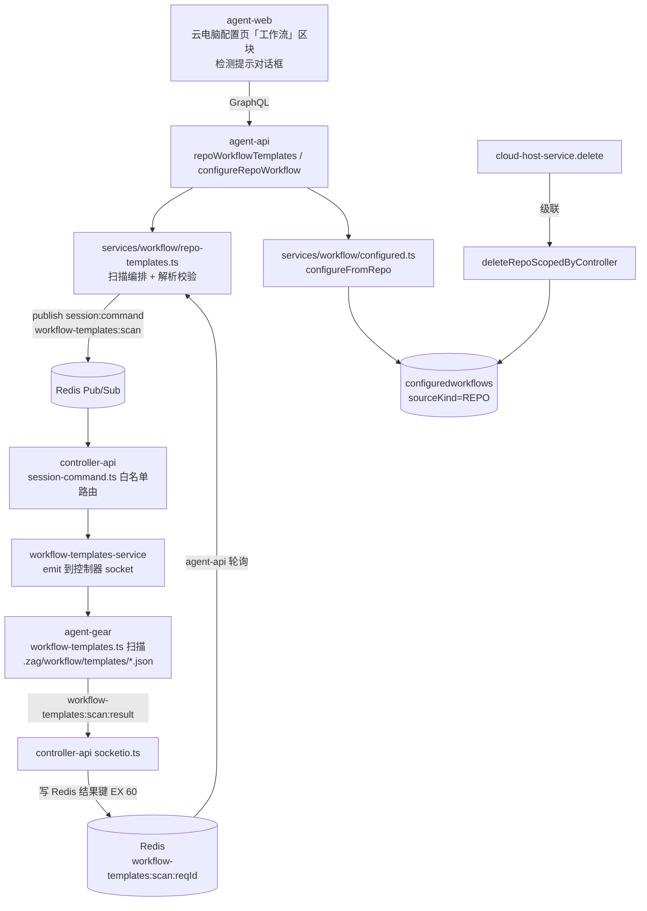
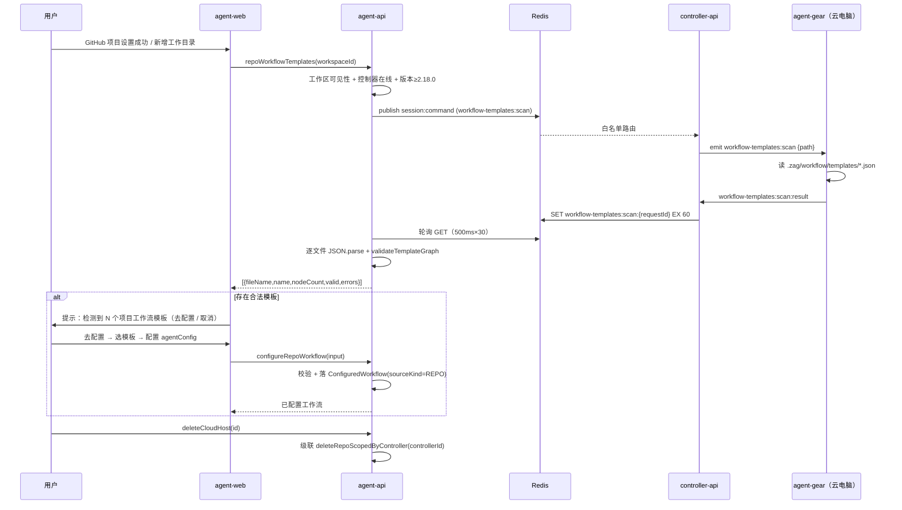

# 工作流模板项目持久化 - 技术提案

**功能名称**: 工作流模板项目持久化（项目内工作流模板）
**关联 PRD**: `docs/product/draft/20261107-workflow-template-project-persistence.md`（v1.0）
**技术提案版本**: v1.0
**创建日期**: 2026-11-07
**作者**: ZeroAsh Agent
**feat-branch**: `feat/workflow-template-project-persistence`

## 1. 概述

### 1.1 背景

PRD 要求把工作流模板下沉到项目代码仓库（`.zag/workflow/templates/`，一个 JSON 文件一个模板），新增工作目录（或设置 GitHub 项目）后自动检测并提示配置；为云电脑临时配置的工作流生命周期跟随云电脑（销毁时一并销毁）。平台现有可复用基础：

1. **工作流三级结构**（`models/workflow-template.ts` / `models/configured-workflow.ts`）：`WorkflowTemplate`（平台模板，含内置）→ `ConfiguredWorkflow`（按 `controllerId` 归属的快照副本，含 `agentConfig`）→ 实例化。图校验唯一来源 `services/workflow/template.ts#validateTemplateGraph`（nodeKey 唯一 / dependsOn 存在 / DAG 无环 / 首节点唯一且 HUMAN / AI 节点 prompts 非空 / 仅 HUMAN 可 linkUpstreamPullRequest），agentConfig 校验 `services/workflow/configured.ts#validateAgentConfigs`。
2. **控制器文件事件族**（`contracts/agent-session-websocket.md` §3）：agent-api `publish('session:command', {type, requestId, controllerId, ...})` → controller-api `session-command.ts` 白名单路由 → socket emit → agent-gear 处理 → `{event}:result` → controller-api 写 Redis `{type}:{requestId}`（EX 30/60）→ agent-api 轮询消费。`fs:browse`/`fs:read-file`/`git:check`/`fs:mkdir` 均为该形态（agent-api 轮询范式见 `resolvers/session.ts#fetchSessionFileContent`）。
3. **云电脑删除级联先例**（`services/cloud-host-service.ts#delete`）：删除云电脑时级联 `cloudHostIssuesLinkageService.deleteByController(controllerId)`（Issues 联动配置随主机失效）。
4. **工作区建立的两个入口**（本期检测触发点）：
   - GitHub 项目设置：`cloud-host-github-service.ts` 三步编排，`gitSetup` 收尾 `initializeWorkspace` 幂等 `ensureWorkspace` 并 CAS 回写 `CloudHost.workspaceId`；
   - 手工新增工作目录：`controllerWorkspaceService.create(controllerId, userId, path)`（云电脑配置页「工作区」页签 / 设置页工作区区块）。
5. **前端配置链路**：`ConfigureWorkflowDialog`（模板/已配置工作流 → EditableNode[] → `toConfiguredNodeInput`）与 `InstantiateWorkflowDialog`（`configuredWorkflows(controllerId)` 已按控制器过滤）。
6. **版本门禁口径**：`Controller.version` 由 agent-gear register 上报（`package.json` 单一来源）；云电脑 worker 基线 `CLOUD_HOST_AGENT_GEAR_MIN_VERSION='2.12.0'`。

### 1.2 目标

- 仓库内模板发现：agent-gear 新增 `workflow-templates:scan` 事件，读取 `<workspace>/.zag/workflow/templates/*.json`（不递归），agent-api 解析校验后经 GraphQL `repoWorkflowTemplates(workspaceId)` 透出（含逐文件合法性）。
- 检测提示：GitHub 项目设置成功、云电脑手工新增工作目录后，前端自动检测一次；存在合法模板时弹「配置提示」对话框（去配置 / 取消）。
- 项目来源配置：新增 `configureRepoWorkflow` 变更，复用全量图校验 + agentConfig 校验，落 `ConfiguredWorkflow` 并标记 `sourceKind='REPO'` 与来源路径；实例化/列表链路零改动复用。
- 生命周期级联：`cloudHostService.delete` 追加级联删除该控制器 `sourceKind='REPO'` 的已配置工作流。
- 优雅降级：控制器版本不足（无扫描事件）/ 离线 / 目录不存在时，检测返回「不可用/空」，前端不打扰。

### 1.3 范围

**做**：

- 契约：`contracts/agent-session-websocket.md` §3 新增 `workflow-templates:scan` / `workflow-templates:scan:result` 与 Redis 中继口径；`contracts/workflow.graphql` 新增 `RepoWorkflowTemplate` 类型、`repoWorkflowTemplates` 查询、`configureRepoWorkflow` 变更与 `ConfiguredWorkflow` 来源字段；`contracts/cloud-host.graphql` 注释增补删除级联口径。
- agent-gear（`packages/agent-controller`）：`workflow-templates.ts` 扫描模块 + socketio-client 事件注册；版本 `2.18.0`。
- controller-api：`session:command` 白名单路由 + `workflow-templates-service`（emit）+ `socketio.ts` 结果回写 Redis（`workflow-templates:scan:{requestId}`，EX 60）。
- agent-api：`services/workflow/repo-templates.ts`（扫描编排 + 解析校验）、`configured.ts#configureFromRepo` / `deleteRepoScopedByController`、`ConfiguredWorkflow` 模型来源字段、GraphQL schema/resolver（登记 `index.ts`）、`cloud-host-service.delete` 级联。
- agent-web：云电脑配置页「工作流」区块（模板列表 + 重新检测 + 配置 + 项目来源已配置工作流列表）、检测提示对话框、GitHub 设置成功与手工新增工作目录后的触发接线、`ConfigureWorkflowDialog` 复用扩展。
- 单元测试 / API 测试 / E2E 测试。

**不做**：

- 本地控制器（非云电脑）的项目模板检测与配置入口（扫描事件本身不区分控制器类型，后续放开仅需前端入口与权限口径评审）。
- 仓库模板文件与已配置工作流的自动同步 / 版本漂移检测（快照语义，PRD 明确）。
- 平台 `WorkflowTemplate` 与仓库模板的双向导入导出。
- 递归子目录、非 `.json` 扩展名、模板文件的平台侧编辑（仓库为唯一编辑入口）。
- 云电脑「停止」（STOPPED 未删除）时的级联清理（仅删除/销毁时级联）。

## 2. 技术架构

### 2.1 系统架构图



### 2.2 技术栈

| 层级 | 技术选型 | 说明 |
|------|---------|------|
| 前端 | React 19 + TypeScript + Apollo Client + Tailwind v4 | 与 `apps/agent-web` 现状一致 |
| 后端 | Node.js 24 + TypeScript（strict/ESM）+ Express v5 + GraphQL-Yoga | agent-api / controller-api 现状一致 |
| 控制器 | Node.js 24 + TypeScript + socket.io-client | agent-gear（`packages/agent-controller`） |
| 数据库 | MongoDB（Mongoose） | `configuredworkflows` 扩展三个字段，无新集合 |
| 中继 | Redis Pub/Sub + 结果键轮询 | 与 `fs:read-file` 同型 |
| 测试 | Vitest（单测）+ Aspire 真实服务（API/E2E） | TDD 红-绿-重构 |

### 2.3 模块划分

| 模块 | 职责 | 关键技术点 |
|------|------|-----------|
| `packages/agent-controller/src/workflow-templates.ts`（新增） | 扫描 `<path>/.zag/workflow/templates/` | 仅直读约定子目录（不递归）、仅 `.json`、单文件 ≤128KiB、最多 20 个文件、总量 ≤1MiB；目录不存在返回空列表 |
| `packages/agent-controller/src/socketio-client.ts`（改） | 注册 `workflow-templates:scan` → 回 `workflow-templates:scan:result` | 与 `fs:read-file` 同形态；扫描失败回 `{success:false,error}` 白名单文案 |
| `servers/controller-api/src/services/workflow-templates-service.ts`（新增） | 白名单分发与结果写 Redis | 对齐 `fs-read-file-service.ts` 形态：Controller → socketId → emit；结果 `EX 60` |
| `servers/controller-api/src/services/session-command.ts` / `socketio.ts`（改） | 路由 `workflow-templates:scan`、监听 `:result` | 缺 `requestId/controllerId/path` 忽略不分发 |
| `servers/agent-api/src/services/workflow/repo-templates.ts`（新增） | 扫描编排 + JSON 解析 + 图校验 | 工作区归属/控制器在线门禁；复用 `validateTemplateGraph` 逐文件校验；错误逐文件收敛不互染 |
| `servers/agent-api/src/services/workflow/configured.ts`（改） | `configureFromRepo` / `deleteRepoScopedByController` | 复用 `normalizeConfiguredNodes` + `validateTemplateGraph` + `validateAgentConfigs`；`sourceKind='REPO'` 标记 |
| `servers/agent-api/src/models/configured-workflow.ts`（改） | 新增 `sourceKind` / `sourceRepoPath` / `sourceWorkspaceId` | `sourceKind` 默认 `PLATFORM`（缺省即平台来源，存量零迁移） |
| `servers/agent-api/src/graphql/schemas/workflow.ts` + `resolvers/workflow.ts`（改） | 新类型/查询/变更 | 手写 schema 双写契约；登记 `resolvers/index.ts` |
| `servers/agent-api/src/services/cloud-host-service.ts`（改） | `delete` 级联删除 REPO 来源配置 | 对齐 issues linkage 级联（best-effort，失败仅告警） |
| `apps/agent-web`（改） | 云电脑「工作流」区块 + 检测提示 + 配置弹窗 | 复用 `ConfigureWorkflowDialog` 节点编辑器与 `template-validation.ts` |

## 3. API 设计

### 3.1 API 契约

契约变更：

- `contracts/agent-session-websocket.md` §3 新增 `workflow-templates:scan` / `workflow-templates:scan:result` 事件表项与章节，Redis 中继口径（结果键 `workflow-templates:scan:{requestId}`，EX 60）写入附录；
- `contracts/workflow.graphql` 新增下述类型与操作；
- `contracts/cloud-host.graphql` `deleteCloudHost` 注释增补：级联删除该控制器项目来源（REPO）的已配置工作流。

#### 接口 1: 扫描项目工作流模板（新增查询）

```graphql
# 项目（仓库）内工作流模板：.zag/workflow/templates/ 下的 JSON 文件
type RepoWorkflowTemplate {
  # 来源文件名（如 dev-flow.json）
  fileName: String!
  # 模板名（解析失败/不合法时为 null）
  name: String
  description: String
  # 节点数量（不合法时为 null）
  nodeCount: Int
  # 是否为合法可配置模板
  valid: Boolean!
  # 不合法原因列表（合法时为空数组；首个错误即返回）
  errors: [String!]!
}

extend type Query {
  # 扫描指定项目工作区（ControllerWorkspace）的项目工作流模板。
  # 控制器离线/版本不足/目录不存在时返回空列表（前端按云电脑状态另行提示）。
  repoWorkflowTemplates(workspaceId: ID!): [RepoWorkflowTemplate!]!
}
```

- 工作区须对当前用户可见（复用 `controllerWorkspaceService` 可见性口径：工作区上下文存在时跟随控制器可见集，无上下文回退 `{userId}`），否则 `Workspace not found`。
- 控制器 `status !== 'online'` → 返回 `[]`（查询语义不抛错；前端据 `Controller.status`/`CloudHost.status` 展示提示）。
- 控制器 `version` 低于 `2.18.0`（无扫描事件）→ 返回 `[]`（优雅降级，前端提示「升级云电脑工作组件后可检测项目模板」）。版本比较复用 `compareVersions` 口径（`cloud-host-service.ts` 内部函数，抽取到公共 util 或复制最小实现，计划期定）。
- 扫描结果不做平台侧持久化；同一工作区高频调用由前端「打开区块/手动刷新」节奏控制（单次扫描 ≤ 数百 ms，无额外缓存）。

#### 接口 2: 从项目模板配置工作流（新增变更）

```graphql
# 已配置工作流来源：PLATFORM（平台模板/空白创建，默认）/ REPO（项目仓库模板）
enum ConfiguredWorkflowSourceKind {
  PLATFORM
  REPO
}

input ConfigureRepoWorkflowInput {
  # 项目工作区（ControllerWorkspace）id：服务端推导 controllerId 与来源路径
  workspaceId: ID!
  # 来源模板文件名（.zag/workflow/templates/ 下的文件名，纯展示与追溯）
  fileName: String!
  name: String!
  # 全量节点图（以项目模板为基础，含每个 AI 节点的 agentConfig）；完整图校验
  nodes: [ConfiguredWorkflowNodeInput!]!
}

extend type Mutation {
  configureRepoWorkflow(input: ConfigureRepoWorkflowInput!): ConfiguredWorkflow!
}
```

- `ConfiguredWorkflow` 类型扩展只读字段：

```graphql
extend type ConfiguredWorkflow {
  # 来源（缺省 PLATFORM；存量行无字段视为 PLATFORM）
  sourceKind: ConfiguredWorkflowSourceKind!
  # REPO 来源：模板文件相对仓库根的路径（如 .zag/workflow/templates/dev-flow.json）
  sourceRepoPath: String
  # REPO 来源：模板所在项目工作区 id
  sourceWorkspaceId: ID
}
```

- 服务端行为：
  1. 工作区可见性校验（同查询口径），不存在 → `Workspace not found`；
  2. `controllerId` 取工作区的 `controllerId`；**仅允许 `type=cloud` 控制器**（本期云电脑场景约束），否则 `repo workflow only supports cloud host`；
  3. `fileName` 归一校验：trim 后非空、必须以 `.json` 结尾、不得含 `/`/`\\`/`..`/NUL（纯文件名，防路径穿越），否则 `invalid template file name`；来源路径落库为 `.zag/workflow/templates/<fileName>`；
  4. `name` trim 后 1~64（复用 `normalizeWorkflowName` 同款归一，非法 `invalid workflow name`）；
  5. `nodes` 经 `normalizeConfiguredNodes` 归一 → `validateTemplateGraph` + `validateAgentConfigs`（可用 acpServerType 取 `getAvailableServerTypes(controllerId, userId)`，与 `configureFromContent` 完全一致）；
  6. 落库 `ConfiguredWorkflow{ userId, tenantId/resourceWorkspaceId 复用 currentWorkspaceFields(), controllerId, name, nodes, sourceKind:'REPO', sourceRepoPath, sourceWorkspaceId: workspaceId }`。
- 错误文案白名单（`wrap()` 逐字透传）：`Workspace not found` / `repo workflow only supports cloud host` / `invalid template file name` / `invalid workflow name` + 图校验与 agentConfig 校验的既有中文文案。
- 配置时刻快照：服务端**不**回读仓库文件二次校验（模板文件随后修改/删除不影响本次配置与已生成快照；与「模板后续更新不影响本副本」的既有口径一致）。

#### 接口 3: 控制器扫描事件（`agent-session-websocket.md` §3 新增）

| 方向 | 事件 | 说明 |
|------|------|------|
| Server → Controller | `workflow-templates:scan` | 请求扫描项目工作流模板目录 |
| Controller → Server | `workflow-templates:scan:result` | 返回模板文件列表与内容 |

**`workflow-templates:scan` Payload**：

| 字段 | 类型 | 必填 | 说明 |
|------|------|------|------|
| `requestId` | `string` | 是 | 请求 ID |
| `controllerId` | `string` | 是 | 目标控制器（Redis 中继路由用，socket 载荷不携带） |
| `path` | `string` | 是 | 项目工作区绝对路径；扫描固定子目录 `<path>/.zag/workflow/templates/` |

**agent-gear 行为**：

1. `resolve(path, '.zag/workflow/templates')` 后读取目录（不递归；目录不存在 → 返回空列表）；
2. 仅收集**文件名以 `.json` 结尾**的常规文件，按文件名排序，最多 20 个（超出忽略并附 `truncated:true`）；
3. 逐文件读取 UTF-8 文本：单文件 ≤128KiB（超出该文件标记 `error:'file too large'`）、总量 ≤1MiB（超出停止读取并附 `truncated:true`）；
4. 回包 `workflow-templates:scan:result`。

**`workflow-templates:scan:result` Payload**：

| 字段 | 类型 | 说明 |
|------|------|------|
| `requestId` | `string` | 对应请求 ID |
| `success` | `boolean` | 目录读取整体是否成功（权限等失败为 false） |
| `templates` | `Array<{ fileName: string; content?: string; error?: string }>` | 逐文件结果；`error` 白名单：`file too large` / `not found` / `permission denied`（与 `fs:read-file` 同口径） |
| `truncated` | `boolean` | 是否因数量/总量上限截断 |
| `error` | `string?` | 整体失败原因（白名单文案同上） |

- Redis 中继：`session:command` 白名单新增 `workflow-templates:scan`（`requestId && controllerId && path` 齐备才分发）；controller-api `workflow-templates-service` emit 到控制器 socket（离线/查不到仅记 error，不写 Redis）；结果写 `workflow-templates:scan:{requestId}`（EX 60），agent-api 轮询（500ms × 30 ≈ 15s 上限，与 `fs:read-file` 同参数）。
- **安全口径**：扫描路径由服务端按已登记工作区下发，agent-gear 仅直读其下约定子目录的 `.json` 文件（白名单子目录 + 扩展名双约束），不回写、不执行；与 `fs:browse`（无白名单任意浏览）相比收敛更严。模板 JSON 作为纯数据经 `JSON.parse` 与图校验处理，不产生任何执行。

### 3.2 内部接口

| 接口 | 签名 | 说明 |
|------|------|------|
| 模板扫描 | `repoTemplateService.scan(userId, workspaceId): Promise<RepoTemplateScanResult>` | 可见性/在线/版本门禁 → 中继扫描 → 逐文件 `JSON.parse` + 形状预检 + `validateTemplateGraph` → `{ fileName, name, description, nodeCount, valid, errors }[]` |
| 文件解析校验 | `parseRepoTemplate(fileName, content): { name, description, nodes } \| { errors }` | 纯函数：JSON 语法 → 顶层形状（`name` 非空字符串、`nodes` 非空数组）→ 节点字段类型归一 → `validateTemplateGraph`（错误文案原样透传） |
| 项目来源配置 | `configuredWorkflowService.configureFromRepo(userId, input): Promise<ConfiguredWorkflow>` | 见接口 2 服务端行为 |
| 级联删除 | `configuredWorkflowService.deleteRepoScopedByController(controllerId): Promise<number>` | `ConfiguredWorkflow.deleteMany({ controllerId, sourceKind: 'REPO' })`；返回删除数（日志用）；供 `cloud-host-service.delete` 与 Issues 级联同位调用（best-effort） |
| 版本判定 | `isRepoTemplateScanSupported(version: string): boolean` | `compareVersions(version, '2.18.0') >= 0`；版本缺失/非法视为不支持 |

## 4. 数据模型

### 4.1 数据库设计

#### 集合: `configuredworkflows`（扩展，无新集合）

| 字段 | 类型 | 说明 |
|------|------|------|
| `sourceKind` | String | `PLATFORM`（默认）/ `REPO`；**缺省即 PLATFORM**，存量行零迁移（读取侧 `?? 'PLATFORM'` 归一） |
| `sourceRepoPath` | String? | REPO 来源：模板文件相对路径 `.zag/workflow/templates/<fileName>`；PLATFORM 恒 null |
| `sourceWorkspaceId` | ObjectId(ref ControllerWorkspace)? | REPO 来源：模板所在项目工作区；PLATFORM 恒 null |

- 不新增索引：级联删除按 `{controllerId, sourceKind}` 走既有 `{userId, controllerId}` / `controllerId` 查询规模（每控制器配置量级小），计划期如评审要求可补 `{controllerId:1, sourceKind:1}`。
- 无迁移：新增字段全部可空/有默认归一；`models/tenant-isolation.test.ts` 与 `workspace-isolation.test.ts` 集合矩阵无需变更（字段级扩展）。
- 级联语义：仅 `cloudHostService.delete`（删除云电脑）触发 `deleteRepoScopedByController`；`stop`（STOPPED 未删除）不清理；**PLATFORM 来源配置不级联**（决策 6.1-D3）。

### 4.2 缓存设计

| 缓存 | Key | TTL | 说明 |
|------|-----|-----|------|
| 扫描结果键 | `workflow-templates:scan:{requestId}` | 60s | 一次性消费（读后即删），与 `fs:read-file:{requestId}` 同型 |

- 不引入模板内容平台侧缓存：扫描实时进行（仓库为唯一事实源），避免一致性负担。

## 5. 技术实现方案

### 5.1 核心流程



### 5.2 关键实现点

#### 实现点 1: agent-gear 扫描模块（`workflow-templates.ts`）

- **描述**：纯函数 `scanWorkflowTemplates(workspacePath)` —— `resolve(workspacePath, '.zag/workflow/templates')`；`readdir(withFileTypes)` 失败（ENOENT → 空列表成功；EACCES → `{success:false,error:'permission denied'}`）；过滤 `isFile() && name.endsWith('.json')`，`localeCompare` 排序；上限：20 文件 / 单文件 128KiB / 总量 1MiB（超出部分逐文件 `error:'file too large'` 或整体 `truncated:true`）。
- **技术细节**：不递归子目录；符号链接文件按 `stat` 为常规文件才读取（`realpath` 不要求落在工作区内——模板目录本身是仓库内容，但拒绝读取指向目录/设备的条目）；读取用 `readFile({encoding:'utf8'})`，非法 UTF-8 由 agent-api `JSON.parse` 阶段报错（逐文件收敛）。
- **风险点**：大仓库模板目录文件极多 —— 20 个上限 + 排序确定性保证可预期；读取失败的单文件不拖垮整体。
- **事件注册**（`socketio-client.ts`，与 `fs:read-file` 同形态）：`socket.on('workflow-templates:scan', ...)` → 调模块 → `emit('workflow-templates:scan:result', {requestId, ...result})`；日志 `workflow_templates_scan`（不含文件内容）。
- **版本**：`packages/agent-controller/package.json` → `2.18.0`（MINOR）；云电脑门禁基线**不提升**（旧 worker 无该事件 → 扫描超时 → agent-api 按版本预检直接返回 `[]`，实际不会发事件；版本判断为双保险中的主判定）。

#### 实现点 2: controller-api 中继

- **描述**：`session-command.ts` 白名单新增分支 `workflow-templates:scan`（`requestId && controllerId && path` 齐备才分发）→ `workflow-templates-service.handleScan(requestId, controllerId, path)`（Controller → socketId → `socket.emit('workflow-templates:scan', withTraceMeta({requestId, path}))`）；`socketio.ts` 监听 `workflow-templates:scan:result` → `handleScanResult` 写 Redis `workflow-templates:scan:{requestId}`（EX 60）。
- **技术细节**：完全对齐 `fs-read-file-service.ts` / `fs:browse` 结果回写形态；结果体积上限（20 文件 × 128KiB ≈ 1MiB JSON）在 Redis 单值可承受范围；`payload.templates` 数组形态运行时校验（非数组按 `{success:false}` 兜底落键，防 agent-gear 异常报文撑爆轮询端解析）。
- **风险点**：离线/无 socket 仅记 error 不写键 → agent-api 轮询超时 → 返回 `[]`（前端无感知降级），符合预期。

#### 实现点 3: agent-api 扫描编排与解析校验（`repo-templates.ts`）

- **描述**：`scan(userId, workspaceId)` ——
  1. `ControllerWorkspace` 可见性（复用 `controllerWorkspaceService.findById` 口径；不可见 → `Workspace not found`）；
  2. `Controller.findOne({_id: workspace.controllerId, ...actorFilter})`；`status !== 'online'` 或 `version` 不支持 → 返回 `[]`；
  3. publish + 轮询（参数同 `fetchSessionFileContent`：`FILE_CONTENT_POLL_INTERVAL_MS=500` × 30）；
  4. 结果：`success=false` → 返回 `[]`（降级，不抛错）；逐文件：`error` 透传为 `errors:[error]`；否则 `parseRepoTemplate`：
     - `JSON.parse` 失败 → `['不是合法的 JSON 文件']`；
     - 顶层形状：`name`（非空 string）、`description`（可选 string）、`nodes`（非空数组）逐项校验，节点字段类型归一（`prompts/artifactTitles/dependsOn` 须为字符串数组等）→ 形状错误汇总为一条中文文案；
     - 形状过后 `validateTemplateGraph(nodes)`，Error.message 原样进 `errors`；
  5. 返回 `[{ fileName, name, description, nodeCount, valid, errors }]`（按 fileName 排序稳定输出）。
- **技术细节**：`parseRepoTemplate` 为纯函数（无 IO），单测覆盖全矩阵；校验错误文案与平台模板编辑器前端校验（`template-validation.ts`）保持同源语义（后端 `validateTemplateGraph` 为权威）。
- **风险点**：轮询 15s 上限内云电脑高负载未及时回包 → 返回 `[]` 并在前端展示「检测超时，可重新检测」（前端据空结果 + 主机运行态区分提示语，计划期定稿文案）。

#### 实现点 4: `configureFromRepo` 与来源标记

- **描述**：`configured.ts` 新增 `configureFromRepo(userId, input)`（内部接口表）；节点归一/图校验/agentConfig 校验 100% 复用 `configureFromContent` 链路；落库追加 `sourceKind:'REPO'`、`sourceRepoPath`、`.zag/workflow/templates/<fileName>`、`sourceWorkspaceId`；`resourceWorkspaceId/tenantId` 走 `currentWorkspaceFields()`（团队工作区归属口径不变）。
- **map 透出**：`mapConfiguredWorkflow`（resolvers 层）追加 `sourceKind: doc.sourceKind ?? 'PLATFORM'`、`sourceRepoPath`、`sourceWorkspaceId`；`configuredWorkflows(controllerId)` 列表自然包含 REPO 行（前端 `InstantiateWorkflowDialog` / `WorkflowSection` 零改动可见可实例化）。
- **风险点**：`resourceWorkspaceId` 缺失（无 ALS 上下文的内部链路）——本入口仅 GraphQL 请求调用，必有上下文；MCP 管理工具集暂不开放 REPO 来源创建（计划期评估）。

#### 实现点 5: 云电脑删除级联

- **描述**：`cloud-host-service.ts#delete` 在 `cloudHostIssuesLinkageService.deleteByController` 同位追加：

  ```ts
  await configuredWorkflowService.deleteRepoScopedByController(String(host.controllerId)).catch((err) => {
    logger.warn({ event: 'cascade-delete-repo-workflows-failed', err }, 'cascade delete repo workflows failed');
  });
  ```

- **技术细节**：best-effort（失败仅告警不阻断删除，与 Issues 级联一致）；仅删 `sourceKind:'REPO'`；已创建实例自包含快照不受影响（实例不存引用回链）。
- **风险点**：级联失败残留 REPO 配置行 —— 控制器已 offline/key 已撤销，残留行不可实例化（实例化需在线控制器），下次同名主机不复用 controllerId，无实际危害；保留告警日志可追溯。

#### 实现点 6: 前端区块与提示

- **云电脑配置页「工作流」区块**（`ControllerConfigPage`，仅 `type==='cloud'` 渲染，新增 tab `config-tab-workflow`）：
  - 工作区选择（该控制器工作区下拉，默认 `CloudHost.defaultWorkspace`）→ `repoWorkflowTemplates(workspaceId)`（`cache-and-network` + 手动「重新检测」refetch）；
  - 模板列表：名称/来源文件名/节点数量；不合法项灰色展示 `errors[0]`；合法项「配置」按钮；
  - 「已配置工作流（项目）」列表：`configuredWorkflows(controllerId)` 过滤 `sourceKind==='REPO'`，条目展示 `sourceRepoPath`，支持删除（复用 `DELETE_CONFIGURED_WORKFLOW`）；
  - 云电脑非 RUNNING：整区块只读 + 提示「云电脑运行中才可检测与配置」；控制器版本不足：提示「升级云电脑工作组件后可检测项目模板」。
- **检测提示对话框**（`RepoWorkflowPromptDialog`）：触发点两个——
  1. `GithubSetupProgressDialog` 成功收尾（operation SUCCEEDED 且拿到工作区）后自动发起一次 `repoWorkflowTemplates`，存在 `valid` 项即弹；
  2. 云电脑「工作区」页签手工新增工作目录成功（`createWorkspace` 返回）后同逻辑触发；
  - 对话框列出合法模板名；「去配置」→ 打开配置弹窗（预选第一个模板）；「取消」关闭并记录本次不再自动弹（会话内记忆，设置区块仍可随时进）。
- **配置弹窗**：复用 `ConfigureWorkflowDialog` 的节点图编辑器（`WorkflowGraphEditor` + `template-validation.ts`），以模板节点预填（`agentConfig` 为空待选），名称默认模板名；提交走 `CONFIGURE_REPO_WORKFLOW` mutation。
- **技术细节**：检测提示不在服务端做后台扫描（无在线竞态、无推送通道需求；PRD「做一次检测」由前端操作完成后立即发起满足）。
- **风险点**：`GithubSetupProgressDialog` 复用于多处入口（工作负载安装等）——提示逻辑仅在「Git 项目设置成功且存在工作区」分支挂载，其余入口零影响。

## 6. 技术决策

### 6.1 决策列表

| 决策 | 选项 A | 选项 B | 最终选择 | 原因 |
|------|--------|--------|---------|------|
| D1 扫描通道 | 新增 `workflow-templates:scan` 专用事件 | 复用 `fs:browse` + `fs:read-file` | **A** | `fs:browse` 过滤 `.` 开头条目（`.zag` 不可见但可直接按路径访问，真正阻碍是）`fs:read-file` 需白名单注册（工作区路径仅在会话启动后注册，检测发生在会话前）；专用事件语义收敛（固定子目录 + 扩展名），安全性反而强于 `fs:browse` 的任意路径浏览 |
| D2 模板存储 | 导入为平台 `WorkflowTemplate` 行 | 不落地，实时扫描 | **B** | 仓库为唯一事实源（PRD「读取代码仓库中特定文件夹的文件列表」）；导入产生同步/漂移问题；`isBuiltin`/归属/多租户口径会被仓库来源污染 |
| D3 级联范围 | 仅 `sourceKind='REPO'` | 该控制器全部已配置工作流 | **A** | PRD 明确「这些已配置工作流」= 为这台云电脑临时配置的（项目来源）；平台来源配置是用户资产，静默删除有意外风险（残留行不可实例化但可查看，危害可控） |
| D4 配置校验基准 | 服务端回读仓库文件为权威 | 客户端提交节点图（含 agentConfig）为最终图 | **B** | 快照语义与 `configureFromContent`/`configureWorkflow` 完全一致；允许配置期微调节点；回读引入「扫描后文件已变」竞态而无收益 |
| D5 检测触发 | 服务端后台自动扫描 + 推送 | 前端在操作完成后发起查询 | **B** | 无新增推送通道与后台任务；「新增工作目录后做一次检测」由前端接线即满足；取消/稍后再配由设置区块常驻入口承接 |
| D6 降级策略 | 版本不足/离线抛错 | 返回空列表 | **B** | 查询语义保持纯净；前端据主机状态/版本自行提示；不阻断「工作区」等无关功能 |
| D7 适用范围 | 全部控制器 | 仅云电脑（type=cloud） | **B** | PRD 范围（云主机设置项目/生命周期跟随云电脑）；本地控制器放开的权限与入口口径另立评审 |

### 6.2 依赖与约束

| 类型 | 内容 | 说明 |
|------|------|------|
| 依赖 | `validateTemplateGraph` / `validateAgentConfigs` / `normalizeConfiguredNodes` | 图与 agentConfig 校验唯一来源复用 |
| 依赖 | `session:command` 中继白名单与结果键模式 | 与 `fs:read-file` 同型，无新通道 |
| 依赖 | agent-gear `2.18.0`（新增扫描事件） | 云电脑镜像随后续发布携带；门禁基线不提升 |
| 约束 | 单实例部署 | 轮询消费 Redis 结果键无状态，不引入新的单实例约束（既有调度器约束不变） |
| 约束 | 模板目录固定 `.zag/workflow/templates/`，不递归，仅 `.json` | PRD 约束 |
| 约束 | 仅 `type=cloud` 控制器可 `configureRepoWorkflow` | D7 |

## 7. 项目结构

```
packages/agent-controller/src/
├── workflow-templates.ts            # 新增：模板目录扫描纯函数
├── workflow-templates.test.ts       # 新增：T-WT 扫描矩阵
└── socketio-client.ts               # 改：注册 workflow-templates:scan

servers/controller-api/src/services/
├── session-command.ts               # 改：白名单路由 workflow-templates:scan
├── workflow-templates-service.ts    # 新增：emit 分发 + 结果写 Redis
├── workflow-templates-service.test.ts
└── socketio.ts                      # 改：监听 workflow-templates:scan:result

servers/agent-api/src/
├── models/configured-workflow.ts    # 改：sourceKind / sourceRepoPath / sourceWorkspaceId
├── services/workflow/
│   ├── repo-templates.ts            # 新增：扫描编排 + parseRepoTemplate
│   ├── repo-templates.test.ts       # 新增：T-RT 解析校验矩阵 / T-SCAN 编排
│   ├── configured.ts                # 改：configureFromRepo / deleteRepoScopedByController
│   └── configured.test.ts           # 改：T-CFR / T-DEL 用例
├── services/cloud-host-service.ts   # 改：delete 级联
├── graphql/schemas/workflow.ts      # 改：RepoWorkflowTemplate / repoWorkflowTemplates / configureRepoWorkflow
└── graphql/resolvers/workflow.ts    # 改：查询与变更（登记 resolvers/index.ts）

apps/agent-web/src/
├── graphql/workflow.ts              # 改：REPO_WORKFLOW_TEMPLATES / CONFIGURE_REPO_WORKFLOW + 类型
├── components/cloud-host/
│   ├── RepoWorkflowSection.tsx      # 新增：云电脑「工作流」区块
│   └── RepoWorkflowPromptDialog.tsx # 新增：检测提示对话框
├── components/workflow/
│   └── ConfigureRepoWorkflowDialog.tsx # 新增：复用节点编辑器的配置弹窗
└── pages/ControllerConfigPage.tsx   # 改：cloud 主机挂载「工作流」tab
```

## 8. 测试策略

### 8.1 测试覆盖要求

- 新增纯函数（扫描 / 解析校验 / 版本判定）分支全覆盖；服务层编排覆盖权限、在线、版本、超时、级联主路径。
- API 测试覆盖新查询/变更的契约形状与错误白名单。

### 8.2 测试类型

| 类型 | 工具 | 覆盖范围 |
|------|------|---------|
| 单元测试 | Vitest | agent-gear T-WT（目录缺失/空目录/非 .json/递归忽略/大小上限/截断/符号链接）；agent-api T-RT（JSON 非法/形状/图校验逐条/逐文件隔离）、T-SCAN（不可见/离线/版本不足/超时 → 空）、T-CFR（校验/落库字段/来源标记）、T-DEL（级联仅 REPO/失败不阻断）；controller-api 中继分发与结果回写（对齐 T-FSR） |
| 组件测试 | Vitest + RTL | 区块渲染（合法/不合法/空态/非 RUNNING 只读）、提示对话框（去配置/取消/不再自动弹）、配置弹窗提交映射 |
| API 测试 | tests/api（Vitest + Aspire） | `repoWorkflowTemplates` 形状与权限、`configureRepoWorkflow` 契约字段与错误文案、`ConfiguredWorkflow.sourceKind` 透出 |
| E2E | tests/e2e（Playwright） | 云电脑配置页「工作流」区块检测-配置-列表链路；GitHub 设置成功后提示出现；销毁云电脑后 REPO 配置消失 |

## 9. 部署方案

### 9.1 环境规划

| 环境 | 用途 | 部署方式 |
|------|------|---------|
| 开发 | 联调 | Aspire 编排（agent-gear 本地起 `pnpm run dev`） |
| 生产 | 上线 | agent-api / controller-api 随常规发布；agent-gear `2.18.0` 发版后 worker 镜像滚动更新（旧 worker 优雅降级） |

### 9.2 配置管理

- 无新增环境变量。扫描参数（20 文件 / 128KiB / 1MiB / 轮询 500ms×30）为代码常量（对齐 `fs:read-file` 既有常量风格）。

## 10. 验收标准

- [ ] 技术方案评审通过
- [ ] Contract 评审通过（`agent-session-websocket.md` / `workflow.graphql` / `cloud-host.graphql`）
- [ ] 代码实现完成（agent-gear / controller-api / agent-api / agent-web）
- [ ] 单元测试覆盖达标（8.2 矩阵全绿）
- [ ] API 测试通过
- [ ] E2E 测试通过
- [ ] PRD 验收：仓库放置模板 → 新增工作目录提示 → 配置 → 实例化执行 → 销毁云电脑级联清理全链路可走通

## 11. 相关文档

- PRD：`docs/product/draft/20261107-workflow-template-project-persistence.md`
- 契约：`contracts/workflow.graphql`、`contracts/agent-session-websocket.md`、`contracts/cloud-host.graphql`
- [Agent 工作流](../../product/released/20260808-agent-workflow.md) / [工作流二期](../../product/draft/20260811-agent-workflow-phase2.md)
- [Github 工作负载与云主机 Git 项目设置](./20261021-feat-github-workload.md)
- [云电脑 GitHub Issues 联动工作流](./20261025-feat-github-issues-workflow.md)（级联删除与云电脑区块先例）
- 需求来源：GitHub Issue [Deliay/z-agent-gear#469](https://github.com/Deliay/z-agent-gear/issues/469)
