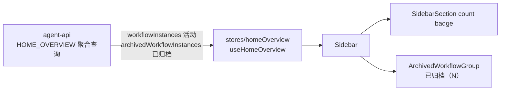
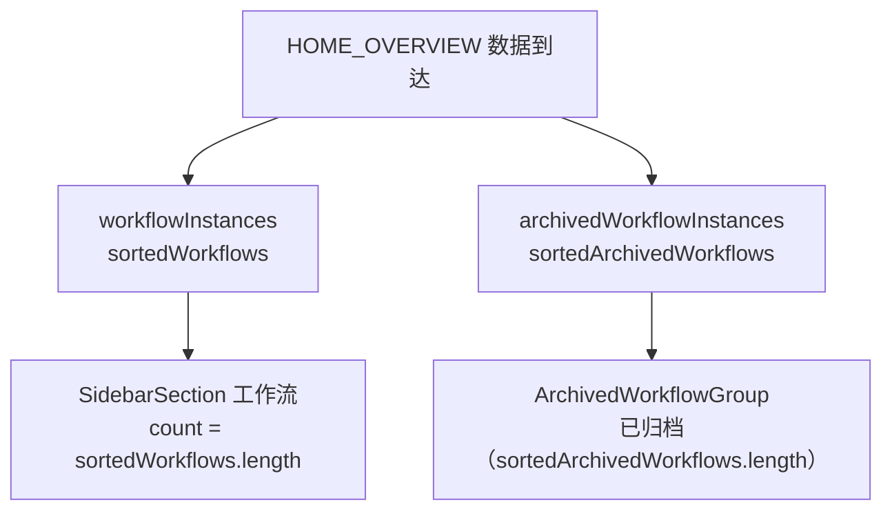

# 侧边栏数字 Badge 优化（活动数量口径） - 技术提案

**功能名称**: 侧边栏数字 Badge 优化
**关联 PRD**: [[../../../product/draft/20261107-sidebar-badge-active-count.md]]（`docs/product/draft/20261107-sidebar-badge-active-count.md`）
**技术提案版本**: v1.0
**创建日期**: 2026-11-07
**作者**: ZeroAsh Agent
**feat-branch**: `feat/sidebar-badge-active-count`（实现分支，自需求总分支 `prd/sidebar-badge-active-count` 切出）

## 1. 概述

### 1.1 背景

需求来源 GitHub Issue [Deliay/z-agent-gear#462](https://github.com/Deliay/z-agent-gear/issues/462)。`apps/agent-web/src/components/Sidebar.tsx` 中「工作流」分区标题行的数字 badge 当前为：

```tsx
count={sortedWorkflows.length + sortedArchivedWorkflows.length}
```

即「活动 + 已归档」总量。已归档实例本身已在分区内由 `ArchivedWorkflowGroup` 以「已归档（N）」自折叠分组单独计数展示，导致 badge 数字与展开后第一眼看到的活动列表不一致（badge 200 vs 活动 2 个）。

### 1.2 目标

1. 「工作流」分区 badge 仅统计活动工作流数量（`sortedWorkflows.length`）。
2. 已归档数量继续由「已归档（N）」分组标题承载，展示形态与交互不变。
3. 纯前端单行改动，零契约变更、零后端改动；按 TDD 红-绿-重构补齐 badge 口径断言。

### 1.3 范围

**做**：

- `apps/agent-web/src/components/Sidebar.tsx` 工作流分区 `count` 口径单行修改。
- `apps/agent-web/src/components/__tests__/Sidebar.test.tsx` 新增 badge 口径用例。

**不做**：

- 不改 GraphQL 契约、不改后端、不改 `HOME_OVERVIEW` 聚合查询字段。
- 不改「主机」「会话」「网关」分区 badge 口径（现状已符合「活动/可用」口径，见 §5.2 实现点 2 核对结论）。
- 不改「已归档（N）」分组的文案、形态与交互。
- 不改 Review 分区（「待 Review（N）」/「已 Review（N）」已为分开计数形态）。

## 2. 技术架构

### 2.1 系统架构图



数据侧：活动与已归档工作流实例在 `HOME_OVERVIEW` 中本就是两个独立字段下发（`contracts/home.graphql`），前端无需新增请求或字段。

### 2.2 技术栈

| 层级 | 技术选型 | 说明 |
|------|---------|------|
| 前端 | React 19 + TypeScript（strict）+ Vite + Tailwind CSS v4 + Apollo Client | 唯一涉及层级 |
| 测试 | Vitest + React Testing Library | 组件单测 |

### 2.3 模块划分

| 模块 | 职责 | 关键技术点 |
|------|------|-----------|
| `apps/agent-web/src/components/Sidebar.tsx` | 侧边栏四分区与 badge 渲染 | `SidebarSection` 的 `count` prop |
| `apps/agent-web/src/components/__tests__/Sidebar.test.tsx` | 侧边栏组件测试 | badge 口径断言 |

## 3. API 设计

### 3.1 API 契约

无契约变更。数据来源为既有 `HOME_OVERVIEW`（`apps/agent-web/src/graphql/home.ts`）：

- `homeOverview.workflowInstances`：活动工作流实例列表
- `homeOverview.archivedWorkflowInstances`：已归档工作流实例列表

### 3.2 内部接口

无。

## 4. 数据模型

### 4.1 数据库设计

无变更。

### 4.2 缓存设计

无变更（沿用 `HOME_OVERVIEW` 15s 轮询与 Apollo 缓存现状）。

## 5. 技术实现方案

### 5.1 核心流程



### 5.2 关键实现点

#### 实现点 1: 工作流分区 badge 口径修改

- **描述**: `apps/agent-web/src/components/Sidebar.tsx` 工作流分区（约 503 行）：
  - 修改前：`count={sortedWorkflows.length + sortedArchivedWorkflows.length}`
  - 修改后：`count={sortedWorkflows.length}`
- **技术细节**: `sortedWorkflows` / `sortedArchivedWorkflows` 均由 `sortByUpdatedAtDesc` 包装，`length` 与排序无关，改动不影响排序行为；`ArchivedWorkflowGroup` 的「已归档（N）」取自 `instances.length`，不受影响。
- **风险点**: 无。`SidebarSection` 对 `count` 恒渲染（`count !== undefined` 即显示），口径变化不产生新边界。

#### 实现点 2: 其余分区 badge 口径核对（只核对，不改行为）

- **描述**: 确认其余分区 badge 现状已符合「活动/可用」口径，本需求零改动：
  - 主机：`count={controllers.length}`——控制器无归档概念，保持。
  - 会话：`count={sessions.length}`——`sessions` 为活动会话（已归档在 `archivedSessions` 独立字段并由 `ArchivedSessionGroup` 展示「已归档（N）」），已符合。
  - 网关：`count={gatewayCount}`——仅统计在线主机网关行，无归档概念，保持。
  - 工作区 `TreeSection`（主机分区内）：`count={controllerWorkspaces.length}`（仅 `isEnabled` 工作区），无归档概念，保持。

#### 实现点 3: 组件测试补齐 badge 口径断言（TDD）

- **描述**: 先红后绿——在 `apps/agent-web/src/components/__tests__/Sidebar.test.tsx` 的「已归档工作流实例折叠」describe 中新增用例：
  - **T-BDG1**：1 个活动实例 + 1 个已归档实例时，「工作流」分区标题行 badge 文本为 `1`（定位方式：`data-testid="sidebar-section-workflows"` 容器内标题行的计数元素，注意与「已归档（1）」分组文本区分）。
  - **T-BDG2**：无活动实例、仅 2 个已归档实例时，badge 文本为 `0`，且「已归档（2）」分组仍渲染。
- **技术细节**: 现有断言（T-UI4-AGG2 的「已归档（1）」、T-WEB2 会话分组计数）均针对分组标题与列表内容，不随本次口径变化失效；需先以现状运行确认 T-BDG1/T-BDG2 红（现状 badge = 2 / 2），再改实现转绿。
- **风险点**: `Sidebar.test.tsx` 同一页面可能存在多个同文本数字（如网关计数），断言需限定在 `sidebar-section-workflows` 容器内查询。

## 6. 技术决策

### 6.1 决策列表

| 决策 | 选项 A | 选项 B | 最终选择 | 原因 |
|------|--------|--------|---------|------|
| badge 为 0 时是否隐藏 | 0 时隐藏 badge | 保持渲染 `0` | 选项 B | Issue 要求只改数字口径；`SidebarSection` 对全分区统一渲染 count，不为单一分区引入特殊形态，其余分区（会话等）现状也是 0 照常显示 |
| 「已归档」分组展示形态 | 按 Issue 示意改为「已归档[198]」方括号样式 | 保持现有「已归档（N）」 | 选项 B | 已归档数量已在分组标题分开展示，满足 Issue「分开展示」意图；Issue 明确只改 badge 数字、不改其他逻辑 |
| 已归档计数来源 | badge 旁新增已归档计数 | 由分区内分组承载（现状） | 选项 B | 分组标题已承载计数，新增会重复且超出「只改数字」范围 |

### 6.2 依赖与约束

| 类型 | 内容 | 说明 |
|------|------|------|
| 依赖 | `HOME_OVERVIEW` 的活动/已归档双字段 | 既有契约，无需变更 |
| 约束 | 只改 badge 数字口径 | 数据加载、排序、分组、交互、样式全部保持现状 |

## 7. 项目结构

涉及文件：

```
apps/agent-web/
└── src/
    └── components/
        ├── Sidebar.tsx                              # 工作流分区 count 口径单行修改
        └── __tests__/
            └── Sidebar.test.tsx                     # 新增 T-BDG1/T-BDG2 badge 口径用例
```

## 8. 测试策略

### 8.1 测试覆盖要求

- 新增组件单测 T-BDG1 / T-BDG2（先红后绿）。
- `apps/agent-web` 既有组件测试全量回归（Sidebar 相关套件）。
- E2E 不新增用例：`tests/e2e/src/sidebar-phase4.spec.ts` 无 badge 数字断言，本次改动不影响其覆盖点；badge 口径由组件单测锚定。

### 8.2 测试类型

| 类型 | 工具 | 覆盖范围 |
|------|------|---------|
| 组件单测 | Vitest + React Testing Library | badge 口径（活动+已归档并存 / 仅已归档） |
| 回归 | Vitest 既有套件 | 已归档分组、聚合列表、会话分组计数零回归 |

## 9. 部署方案

### 9.1 环境规划

| 环境 | 用途 | 部署方式 |
|------|------|---------|
| 常规发布 | 纯前端变更，随 agent-web 镜像常规发布 | 无特殊编排 |

### 9.2 配置管理

无新增配置项。

## 10. 验收标准

- [ ] 技术方案评审通过
- [ ] 「工作流」分区 badge = 活动数量（活动 + 已归档并存场景验证）
- [ ] 仅已归档场景 badge 显示 0，「已归档（N）」分组正常
- [ ] T-BDG1 / T-BDG2 组件单测通过，既有 Sidebar 测试零回归
- [ ] 分区展开/折叠、聚合列表、点击跳转等行为零回归

## 11. 相关文档

- 关联 PRD：[[../../../product/draft/20261107-sidebar-badge-active-count.md]]
- 需求来源：[Deliay/z-agent-gear#462](https://github.com/Deliay/z-agent-gear/issues/462)
- [[20261030-feat-ui-optimization-phase4.md]] — UI 优化四期（侧边栏四分区与已归档分组来源）
- [[20261104-feat-session-management-optimization.md]] — 会话管理优化（会话已归档分组口径）
- [Frontend Rules](../frontend-rules.md)
