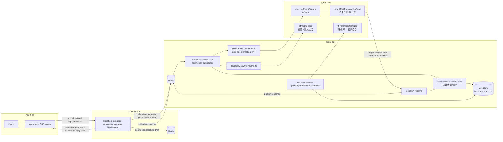
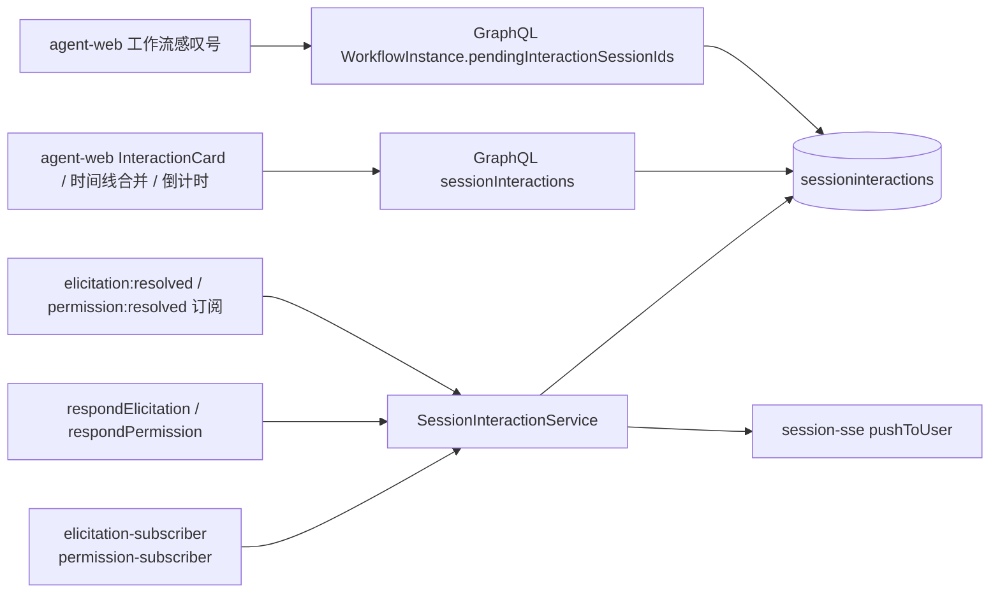
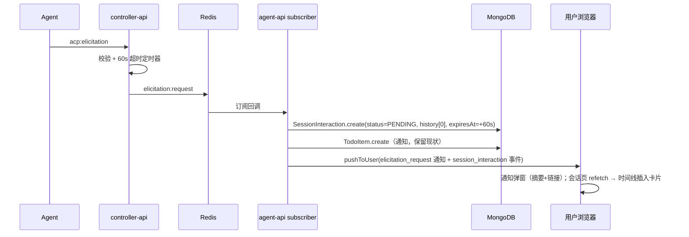
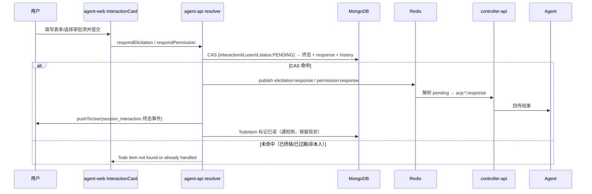
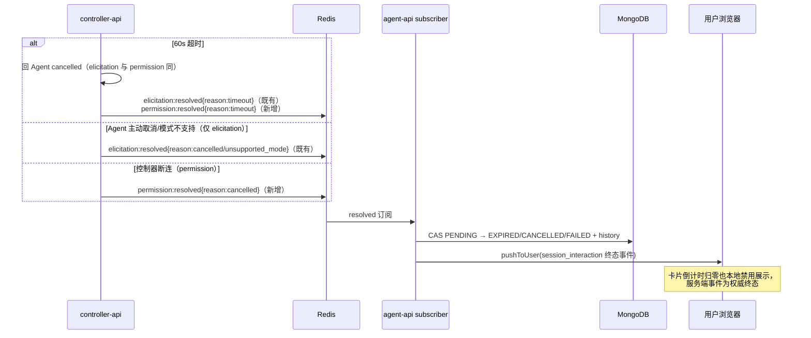
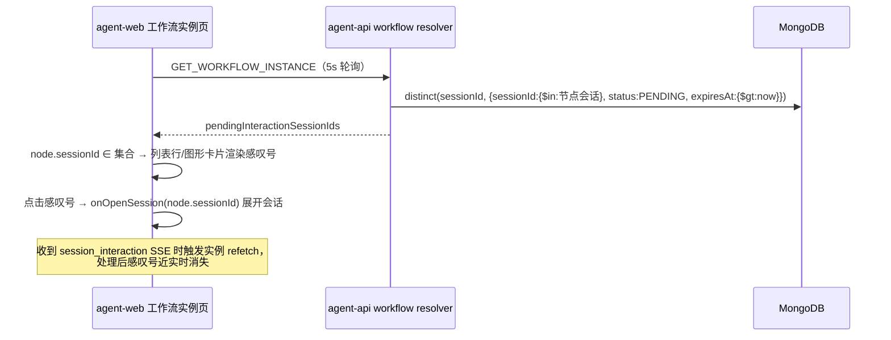

# 会话中的提问表单与权限审批作为会话内容出现 - 技术提案

**功能名称**: 会话交互卡片（Elicitation / Ask Permission）
**关联 PRD**: `docs/product/draft/20261112-session-interaction-cards.md`
**技术提案版本**: v1.0
**创建日期**: 2026-11-12
**作者**: z-agent-bot
**feat-branch**: `feat/session-interaction-cards`

## 1. 概述

### 1.1 背景

ACP 协议的 Elicitation（`elicitation/create`，form/url 两种模式）与 Ask Permission（`session/request_permission`）已接入平台，当前链路为：

```
Agent → agent-gear(bridge) → Socket.IO(acp:elicitation / acp:permission)
  → controller-api(elicitation-manager / permission-manager，60s 超时)
  → Redis(elicitation:request / permission:request)
  → agent-api(elicitation-subscriber / permission-subscriber)
  → TodoItem(5min TTL) + 用户级 SSE 通知
  → agent-web(TodoListPanel / PendingElicitationBanner → ElicitationDialog / PermissionDialog 弹窗)
```

响应链路为 GraphQL `respondElicitation` / `respondElicitation` → Redis `elicitation:response` / `permission:response` → controller-api 解析 pending Promise → 回传 Agent。

现状问题（对应 PRD）：交互仅以 TodoItem + 弹窗承载，不作为会话内容持久化；弹窗关闭或超时后无法回溯；工作流节点等待审批不可见。

另有一处**现存口径不一致**：controller-api 的实际等待超时为 60s（`TIMEOUT_MS = 60_000`，超时后回 Agent `cancelled`），而 TodoItem 的展示过期为 5 分钟（`expiresAt`），即「弹窗显示仍可作答的最后 4 分钟内提交必然无效」。本提案统一交互有效期口径并顺带修复。

### 1.2 目标

1. Elicitation / Permission 交互作为**一等会话内容**持久化（新集合 `sessioninteractions`），含完整状态机与迁移历史。
2. 会话时间线按触发时刻渲染交互卡片：待处理可作答（含倒计时），终态禁用并展示提交内容。
3. 弹窗降级为「通知 + 跳转会话链接」，表单仅存在于卡片。
4. 工作流实例页（列表/图形两视图）节点级「待审批」感叹号，点击展开对应会话。
5. 交互有效期与 controller-api 实际超时（60s）对齐，倒计时可信。

### 1.3 范围

**做**：

- agent-api：新增 `SessionInteraction` 模型/服务/GraphQL；改造 elicitation/permission 两个 subscriber 与 `respondElicitation`/`respondPermission` resolver；工作流实例待审批标记查询；迁移脚本（索引）。
- controller-api：`permission-manager` 超时/断开时新增 `permission:resolved` 事件发布（对齐 `elicitation:resolved` 语义）。
- agent-web：会话内 `InteractionCard`（elicitation 表单/url、permission 审批）与倒计时；时间线合并渲染；弹窗降级为通知+链接；工作流列表/图形视图感叹号。
- 契约：`contracts/agent-session.graphql`、`contracts/workflow.graphql`、`contracts/agent-session-websocket.md`。
- 测试：组件单测、服务单测、API 测试、E2E。

**不做**：

- 不改 ACP 协议与 agent-gear（事件上报/响应回传链路零改动）。
- 不动 harness 登录引导、workflow_intervention 待办的既有形态。
- 历史存量会话不回填交互卡片（上线前数据保持不变）。
- 会话导出 Markdown 本期不强制包含交互卡片（保留为后续优化项）。
- TodoItem 通知链路（铃铛/待办列表/未读计数）保持现状，不做结构性调整。

## 2. 技术架构

### 2.1 系统架构图



### 2.2 技术栈

| 层级 | 技术选型 | 说明 |
|------|---------|------|
| 前端 | React 19 + TypeScript + Tailwind v4 + Apollo Client | 卡片组件、时间线合并、倒计时、工作流视图 |
| 后端 | Node.js 24 + Express v5 + GraphQL-Yoga + Mongoose | 交互领域模型、subscriber、resolver |
| 数据库 | MongoDB | 新集合 `sessioninteractions` |
| 缓存/消息 | Redis（pub/sub + SSE 扇出） | 复用既有频道与 pushToUser |
| 中继 | Socket.IO（controller-api） | 仅新增 `permission:resolved` 发布点 |

### 2.3 模块划分



| 模块 | 职责 | 关键技术点 |
|------|------|-----------|
| `SessionInteractionService`（agent-api，新增） | 交互记录的创建、响应收敛、终态收敛、迁移历史追加的唯一读写口 | 状态机单调 CAS（`status:'pending'` 前置过滤）、`interactionId` 唯一 |
| subscriber ×2（agent-api，改造） | 事件 → 交互记录 + 待办通知 + SSE | 触发即落库；`elicitation:resolved`/`permission:resolved` 收敛终态 |
| respond resolver ×2（agent-api，改造） | 用户作答：校验 → 回传 Agent → 收敛 | 权威判定切换到 SessionInteraction（status + expiresAt），TodoItem 退化为通知已读 |
| permission-manager（controller-api，小改） | 超时/断连时补发 `permission:resolved` | 对齐 `elicitation:resolved` 的 timeout 语义 |
| GraphQL（agent-api） | `sessionInteractions` 查询、`WorkflowInstance.pendingInteractionSessionIds` | 会话归属校验；实例级一次查询避免 N+1 |
| agent-web 会话卡片 | 卡片渲染、表单交互、倒计时、时序合并 | 复用/提取 `ElicitationDialog` 表单渲染；纯客户端倒计时 + 服务端终态兜底 |
| agent-web 弹窗降级 | 通知摘要 + 跳转链接 | `ElicitationDialog`/`PermissionDialog` 内容替换为通知视图 |
| agent-web 工作流标记 | 列表/图形视图感叹号 + 点击展开会话 | 复用 `onOpenSession` / SessionSidePanel 打开链路 |

## 3. API 设计

### 3.1 API 契约

#### 3.1.1 `contracts/agent-session.graphql`（新增交互查询）

```graphql
# 会话交互状态机
enum SessionInteractionKind {
  ELICITATION
  PERMISSION
}

enum SessionInteractionStatus {
  PENDING      # 待处理（等待用户输入）
  ACCEPTED     # 已提交/已批准
  DECLINED     # 已拒绝（elicitation decline）
  CANCELLED    # 已取消（用户 cancel / Agent 取消）
  EXPIRED      # 已过期（超时未响应）
  FAILED       # 已失效（链路不支持等）
}

# 状态迁移记录（完整历史，按 at 升序）
type SessionInteractionEvent {
  state: SessionInteractionStatus!
  at: String!                    # ISO 时间
  actor: String!                 # agent | user | system
  detail: String                 # 补充说明（如 timeout / unsupported_mode）
}

type SessionInteractionResponse {
  action: String                 # accept | decline | cancel（elicitation）
  outcome: String                # selected | cancelled（permission）
  optionId: String               # 所选审批选项
  values: JSON                   # elicitation 提交的表单内容
}

type SessionInteraction {
  id: ID!
  sessionId: ID!
  interactionId: String!         # = requestId（幂等键）
  kind: SessionInteractionKind!
  status: SessionInteractionStatus!
  mode: String                   # form | url（elicitation）
  message: String
  requestedSchema: JSON          # elicitation 表单 schema
  url: String                    # url 模式链接（仅 http/https）
  elicitationId: String
  toolCallId: String
  toolCall: JSON                 # permission 工具调用详情 {toolCallId,title,kind,rawInput,locations}
  options: JSON                  # permission 审批选项 [{optionId,name,kind}]
  response: SessionInteractionResponse
  expiresAt: String              # 作答截止（创建 + 60s，与 controller 超时一致）
  createdAt: String!
  respondedAt: String
  resolvedAt: String
  history: [SessionInteractionEvent!]!
}

extend type Query {
  # 会话归属校验（含只读会话允许查看）；按 createdAt 升序返回全量（交互数量有界）
  sessionInteractions(sessionId: ID!): [SessionInteraction!]!
}
```

- `sessionInteractions` 的归属校验复用 `sessionService.findById(sessionId, userId)` 口径（与 `sessionMessages` 一致），非归属返回 `Session not found`；**只读会话允许查询**（回看场景）。
- `respondElicitation(requestId, action, values)` / `respondPermission(requestId, outcome, optionId)` **签名不变**（前端零迁移成本），内部权威判定从 TodoItem 切换到 SessionInteraction：
  - 未找到 `status=PENDING` 的本人交互 → `Todo item not found or already handled`（文案保持，前端映射不变）。
  - `expiresAt <= now` 的 PENDING 记录视为不可作答（返回同上错误），服务端收敛为 EXPIRED 由 resolved 事件兜底。
  - 成功后写 `status/response/respondedAt` 并 `$push history`（CAS 条件 `{interactionId, userId, status:'PENDING'}`，保证单调）。
- 用户级 SSE 新增事件（`GET /api/user/stream` 与会话级连接均经 `pushToUser` 下发）：

```json
{ "type": "session_interaction", "data": { "sessionId": "...", "interactionId": "...", "kind": "ELICITATION", "status": "PENDING" } }
```

前端收到后按 `sessionId` 命中当前打开会话则 `refetch` `sessionInteractions`；工作流实例页收到任意该事件则触发实例查询 refetch（5s 轮询兜底）。

#### 3.1.2 `contracts/workflow.graphql`（工作流待审批标记）

```graphql
extend type WorkflowInstance {
  # 存在「待处理且未过期」交互的节点会话 id 集合（一次查询，前端按 node.sessionId 匹配）
  pendingInteractionSessionIds: [ID!]!
}
```

- 字段级 resolver：`SessionInteraction.distinct('sessionId', { sessionId: { $in: nodeSessionIds }, status: 'PENDING', expiresAt: { $gt: now } })`，空会话集合短路返回 `[]`。
- 在 `resolvers/index.ts` 的 `WorkflowInstance` 键登记（漏登记运行时恒缺，遵循 AGENTS.md 陷阱提示）。

#### 3.1.3 `contracts/agent-session-websocket.md`（新增频道与口径）

- 新增 `permission:resolved`（controller-api → Redis）：
  - 触发点：`permission-manager.handleTimeout`（60s 超时回 Agent `cancelled` 时）与 `clearForSocket`（控制器断连清理 pending 时，`reason:'cancelled'`，detail `socket disconnected`）。
  - 载荷：`{ requestId, sessionId, reason: 'timeout' | 'cancelled', detail?, controllerId, userId, _meta? }`（与 `elicitation:resolved` 同构，reason 子集）。
  - agent-api 订阅后：`timeout → EXPIRED`、`cancelled → CANCELLED`，单调收敛（仅 `PENDING → 终态`）。
- 增补口径注记：Elicitation/Permission 的用户可作答时限统一为 **60s（controller-api `TIMEOUT_MS`）**；`sessioninteractions.expiresAt` 按事件到达 agent-api 时刻 + 60s 写入，卡片倒计时以该字段为唯一依据。TodoItem 的 5 分钟 `expiresAt` 仅为通知保留窗口（TTL 清理），不再作为作答有效性依据。

### 3.2 内部接口

| 接口 | 说明 |
|------|------|
| `SessionInteractionService.createFromPermissionRequest(data)` | permission subscriber 调用；`interactionId` 唯一冲突时忽略重复触发（幂等）并返回既有记录 |
| `SessionInteractionService.createFromElicitationRequest(data)` | elicitation subscriber 调用；同上幂等 |
| `SessionInteractionService.respondPermission({userId, interactionId, outcome, optionId})` | resolver 调用；CAS 收敛 + history；未命中返回 `null` |
| `SessionInteractionService.respondElicitation({userId, interactionId, action, values})` | resolver 调用；同上 |
| `SessionInteractionService.resolve({userId, interactionId?, sessionId?, resolution, detail})` | resolved 订阅调用；`PENDING→终态` 单调，requestId 缺失时按 sessionId 会话级批量收敛（沿用 elicitation 现有兜底语义） |
| `SessionInteractionService.markAgentCompleted(elicitationId, userId)` | `elicitation:complete` 订阅调用：仅向 history 追加 `ACCEPTED(detail:'agent completed')` 事件记录，**不改 status**（URL 模式的接受动作仍由用户「打开链接」触发 respond 完成，与现口径一致） |
| `SessionInteractionService.findPendingBySessionIds(sessionIds, now)` | 工作流实例 resolver 使用 |
| `SessionInteractionService.listBySession(sessionId)` | `sessionInteractions` 查询使用 |

## 4. 数据模型

### 4.1 数据库设计

#### 集合：`sessioninteractions`（agent-api 唯一写方）

| 字段 | 类型 | 说明 |
|------|------|------|
| userId | ObjectId ref User | 归属用户（租户隔离维度），required |
| tenantId | ObjectId ref Tenant | 租户留档；声明 `applyTenantScope`（与同类集合一致），显式写入（订阅链路经 `TodoService.resolveSessionTenantId` 同口径解析） |
| sessionId | ObjectId ref Session | 所属会话，required，index |
| interactionId | String | = requestId，**全局唯一索引**（重复触发幂等） |
| kind | String enum | `ELICITATION` / `PERMISSION` |
| status | String enum | `PENDING/ACCEPTED/DECLINED/CANCELLED/EXPIRED/FAILED`，default `PENDING` |
| mode | String enum | `form` / `url`（仅 elicitation） |
| message | String | 提问说明 / 审批标题（≤4000，落库前截断） |
| requestedSchema | Mixed | elicitation 表单 schema（≤64KB，controller 侧已校验） |
| url | String | url 模式链接（≤2048，仅 http/https，controller 侧已校验） |
| elicitationId | String | Agent 侧 elicitation id（url 模式 complete 匹配） |
| toolCallId | String | 关联工具调用 id |
| toolCall | Mixed | permission 工具调用快照 |
| options | [Mixed] | permission 审批选项 |
| response | Object | `{action?, outcome?, optionId?, values?}` |
| expiresAt | Date | 作答截止 = 创建时刻 + 60s（与 controller-api `TIMEOUT_MS` 对齐） |
| respondedAt | Date | 用户作答时刻 |
| resolvedAt | Date | 终态收敛时刻 |
| history | [子文档] | `{_id:false, state, at, actor, detail}`，创建时含 `PENDING(agent)` 首条 |

索引（迁移 `025-session-interactions` 显式创建，生产 `autoIndex=false` 兜底）：

```js
{ interactionId: 1 }            // unique，幂等键
{ sessionId: 1, createdAt: 1 }  // 会话时间线查询
{ sessionId: 1, status: 1, expiresAt: 1 } // 工作流 pending 聚合
{ 'elicitationId': 1 }          // url 模式 complete 匹配（sparse）
```

- **不设 TTL 索引**：过期交互必须随会话留存（卡片可回看），这是与 TodoItem（5min TTL）的本质区别。
- **会话删除连带**：`sessionService` 删除会话处（现 `AcpMessage.deleteMany({sessionId})` 同点）追加 `SessionInteraction.deleteMany({sessionId})`；会话导入覆盖（`session-import.ts`）同点处理。
- 读路径不挂 workspace-scope 插件：交互一律经「会话归属校验」访问（与 `acpmessages` 同口径），集合自身不引入新的可见性规则。

### 4.2 缓存设计

- 无新增缓存。实时性依赖既有 Redis pub/sub（事件）与用户级 SSE（`pushToUser`）扇出。
- 工作流 `pendingInteractionSessionIds` 随 `GET_WORKFLOW_INSTANCE` 5s 轮询自然刷新，不加缓存（查询走 `{sessionId,status,expiresAt}` 复合索引）。

## 5. 技术实现方案

### 5.1 核心流程

触发落库（elicitation 为例，permission 同构）：



用户作答：



超时与取消收敛：



工作流待审批标记：



### 5.2 关键实现点

#### 实现点 1: SessionInteraction 状态机与单调收敛

- **描述**：`PENDING → {ACCEPTED, DECLINED, CANCELLED, EXPIRED, FAILED}`，仅允许从 PENDING 迁移；所有终态写入统一走服务层 CAS：`updateOne({interactionId, userId, status:'PENDING'}, {$set:{status,resolvedAt,...}, $push:{history}})`。
- **技术细节**：
  - 触发幂等：`interactionId` 唯一索引；创建捕获 duplicate-key（E11000）→ 读返回既有记录（重试/重发不产生第二张卡片）。
  - 用户响应与 resolved 事件竞态：两者同一 CAS 条件，后到的写入自然不命中（`modifiedCount=0`，仅留 debug 日志），保证「已提交」不会被迟到的 timeout 覆盖（沿用 TodoItem 现有单调守卫语义）。
  - `history` 首条 `{state:'PENDING', at:createdAt, actor:'agent'}`；用户作答 `actor:'user'`；超时/取消/失效 `actor:'system'`。
  - permission 状态映射：`outcome=selected → ACCEPTED`（`response.outcome/optionId`），`outcome=cancelled → CANCELLED`；elicitation：`accept→ACCEPTED`（`response.action/values`）、`decline→DECLINED`、`cancel→CANCELLED`。
- **风险点**：`expiresAt` 时钟以 agent-api 服务器为准，与 controller-api 的 60s 定时器存在进程间时钟差（同机部署可忽略）；resolved 事件是权威终态，卡片本地倒计时仅为展示辅助。

#### 实现点 2: respond resolver 权威切换

- **描述**：`respondElicitation`/`respondPermission` 前置校验由 `todoService.isRespondableTodo` 改为 `SessionInteractionService` 的可作答判定（存在本人 `PENDING` 且 `expiresAt > now`）。
- **技术细节**：
  - 顺序保持「先校验 → publish 回传 → 收敛」的现有结构，但收敛改用交互 CAS；publish 之前先 CAS 成功（防止「校验通过但并发下双双回传 Agent」——CAS 是唯一互斥点）。
  - 即：**先 CAS 收敛成功才 publish response**（对现有顺序的调整点：现行为先 publish 再标记 todo 已读；新行为必须 CAS 先行，否则两个并发请求都会回传 Agent）。失败文案保持 `Todo item not found or already handled` 不变。
  - TodoItem 仅保留 `markTodoAsResponded` 已读标记（通知角标收敛），不再参与判定；`isRespondableTodo` 对 permission/elicitation 两类型在本链路废弃（harness login 仍使用，不删）。
- **风险点**：旧版前端（缓存的 SPA）仍调同一 mutation，签名与文案不变，无兼容风险。

#### 实现点 3: 会话时间线卡片渲染与倒计时（agent-web）

- **描述**：`MessageList` 数据流中，将 `sessionInteractions`（`fetchPolicy: cache-and-network`，随 SSE `session_interaction` 事件 refetch）按 `createdAt` 与消息分组结果合并排序，交互项渲染为 `InteractionCard`。
- **技术细节**：
  - 新组件 `components/session/InteractionCard.tsx`（容器 `data-interaction-id={interactionId}` 供滚动定位）：elicitation 分支渲染表单（**提取 `ElicitationDialog` 的 `renderField`/默认值/必答校验/多选拼接逻辑为共享模块 `components/session/elicitation-form.tsx`**，弹窗通知视图与卡片共用，保持 `items.anyOf` 多选 `.join(',')` 口径不变）；permission 分支复用 `PermissionDialog` 的工具调用摘要展示与选项按钮；url 分支渲染链接确认（`http/https` 白名单与 `noopener,noreferrer` 沿用）。
  - 状态展示：PENDING 可交互 + 倒计时；ACCEPTED 禁用并渲染 `response.values`（按 schema 字段标签回显提交内容）/所选审批项徽标；其余终态禁用 + 状态徽标（已拒绝/已取消/已过期/已失效）。
  - 倒计时：卡片级 `useEffect` 1s 定时器（复用 `ElicitationDialog` 的 `now` 模式，不用快照冻结），展示 `mm:ss`；归零本地禁用并展示「已过期」；服务端 `session_interaction` 终态事件到达后 refetch 覆盖为权威状态。
  - 时间线合并位置：在 `MessageList` 现有分组 memo 之后做一次稳定归并排序（key：`createdAt`，消息在前、同刻交互在后），避免影响 `group-messages`/`tool-call-state` 既有逻辑。
  - 滚动定位：通知跳转携带 `#interaction-<interactionId>` 锚点（或查询参数），会话页挂载/数据到达后 `scrollIntoView`。
- **风险点**：交互数量有界（每会话通常 < 数十条），全量加载可接受；时间线归并不引入分页交叉（消息分页仅影响 `acpmessages`，交互一次性加载）。

#### 实现点 4: 弹窗降级与通知保留

- **描述**：`ElicitationDialog`/`PermissionDialog` 不再渲染表单与审批按钮，替换为通知视图：类型徽标、会话标题、摘要、「前往会话处理」主按钮。
- **技术细节**：
  - 打开入口（`TodoListPanel`、`PendingElicitationBanner`）与 `stores/elicitationDialog` 互斥机制**保持不变**；弹窗内「前往会话处理」导航 `/sessions/{sessionId}#interaction-{interactionId}`。
  - `PendingElicitationBanner` 保持挂载（会话内仍有待处理提示价值），点击行为改为滚动定位到对应卡片，不再打开弹窗。
  - 通知文案含剩余可作答提示（如「该请求将在约 1 分钟后过期」），倒计时权威仍在卡片。
- **风险点**：ElicitationDialog 现有测试（终态展示、多选、过期定时器）随表单逻辑迁移到共享模块测试与卡片测试，原弹窗测试改写为通知视图断言。

#### 实现点 5: 工作流感叹号（列表 + 图形）

- **描述**：`WorkflowInstance.pendingInteractionSessionIds` 下发后，前端按 `node.sessionId` 匹配渲染感叹号。
- **技术细节**：
  - 列表视图 `WorkflowNodeTree` 的 `NodeCard` 头部行（状态徽标旁）渲染 `AlertCircle`（lucide，`text-amber-500`，`aria-label="有待处理的提问或审批"`）按钮；点击调用既有 `onOpenSession(node.sessionId)`。
  - 图形视图 `graph/WorkflowNodeCard.tsx` 同语义渲染（`nodrag` + `stopPropagation` 交互约束沿用），点击复用实例页打开会话侧栏（SessionSidePanel）链路；若图形视图当前无打开会话入口，则将实例页 `onOpenSession` 透传进 `WorkflowGraphView`（与详情抽屉状态提升同模式）。
  - 颜色语义遵循 `NODE_STATUS_VISUAL` 单一来源约束，不新增固定 hex（amber 语义与 REWORK 提示一致，组件内 tailwind 语义类）。
- **风险点**：`GET_WORKFLOW_INSTANCE` 轮询 5s + SSE 触发 refetch 双通道，感叹号消失延迟可接受（PRD 允许轮询级延迟）。

#### 实现点 6: controller-api `permission:resolved`

- **描述**：`permission-manager.handleTimeout` 与 `clearForSocket` 增加 `permission:resolved` 发布（`withTraceMeta` 沿用 `_meta` 注入由 `publishJson` 统一处理）。
- **技术细节**：载荷 `{requestId, sessionId, reason:'timeout'|'cancelled', detail?, controllerId, userId}`；agent-api `permission-subscriber` 增订阅该频道，经 `SessionInteractionService.resolve` 收敛（`timeout→EXPIRED`、`cancelled→CANCELLED`）；同步 `markTodoAsResponded` 收敛通知已读。
- **风险点**：断连清理（`clearForSocket`）时 Agent 侧 Promise 实际悬挂至进程退出——交互收敛为 CANCELLED 与用户可作答时限语义一致（Agent 已不可能再收到回答）；该场景卡片文案「已取消」。

## 6. 技术决策

### 6.1 决策列表

| 决策 | 选项 A | 选项 B | 最终选择 | 原因 |
|------|--------|--------|---------|------|
| 交互持久化载体 | `AcpMessage` 扩展 `type:'interaction'`，迁移追加消息、前端按 interactionId 合并 | 独立集合 `sessioninteractions`（状态机 + history 数组） | **B** | 状态机单点（status 字段 + CAS），工作流 pending 查询走复合索引一次 distinct，无需消息级聚合；时间线由前端按 createdAt 合并，不污染 ACP 消息模型；history 数组即完整迁移记录 |
| 卡片实时更新通道 | 复用 `session:message` 频道广播伪消息 | 用户级 SSE `pushToUser('session_interaction')` + Apollo refetch | **B** | 与 ACP 消息管线零耦合（不影响 `parseSessionUpdate`/合并/导出）；订阅方与 SSE 同在 agent-api 进程内，直接调用即可 |
| 作答时限口径 | 沿用 TodoItem 5 分钟 | 对齐 controller-api 60s（`TIMEOUT_MS`） | **B** | 修复「最后 4 分钟提交必然无效」的现存不一致；卡片倒计时必须可信 |
| permission 终态收敛 | 不收敛，靠前端 expiresAt 展示过期 | 新增 `permission:resolved`（timeout/cancelled） | **B** | 「完整状态迁移记录」要求服务端权威终态；与 elicitation 语义对齐，改动小 |
| 响应权威判定 | 继续用 `isRespondableTodo` | 切换到 SessionInteraction（PENDING + 未过期 + CAS） | **B** | TodoItem 有 TTL 且 isRead 语义不严谨（可手动已读）；交互记录才是状态机本体 |
| 工作流待审批标记 | 节点级字段 resolver（每节点一次查询） | 实例级 `pendingInteractionSessionIds` 一次查询 | **B** | 避免 N+1；前端按 sessionId 匹配即可覆盖列表/图形两视图 |
| 弹窗处理 | 删除弹窗组件 | 组件保留、内容降级为通知+链接 | **B** | Issue 明确要求保留弹窗作为通知与跳转入口；复用既有打开/互斥机制 |

### 6.2 依赖与约束

| 类型 | 内容 | 说明 |
|------|------|------|
| 依赖 | Redis pub/sub 三频道（request/response/resolved）与 Socket.IO 中继 | 全部沿用，仅新增 `permission:resolved` 一个频道 |
| 依赖 | 用户级 SSE（`GET /api/user/stream`）与 `useUserEventStream` | 实时事件下发复用 |
| 依赖 | `ElicitationDialog` 表单渲染逻辑 | 提取为共享模块，卡片与弹窗共用 |
| 约束 | 单实例部署前提 | 与 `KeyedMutex`/中断重试调度器同前提（进程内无新增锁，但 resolved/timeout 收敛依赖单写方语义） |
| 约束 | `resolvers/index.ts` 必须登记 `WorkflowInstance` 键与新 Query | 漏登记运行时不生效（AGENTS.md 明示陷阱） |
| 约束 | 迁移编号 | 最新已占用至 024，本提案使用 `025-session-interactions`（若并行需求占用则顺延） |

## 7. 项目结构

```
servers/agent-api/src/
├── models/session-interaction.ts                 # 新增：模型与索引声明
├── services/session-interaction-service.ts       # 新增：唯一读写口（创建/CAS 收敛/history/pending 聚合）
├── services/session-interaction-service.test.ts  # 新增：单测
├── services/elicitation-subscriber.ts            # 改造：创建交互 + resolved 收敛 + complete history + SSE
├── services/permission-subscriber.ts             # 改造：创建交互 + 订阅 permission:resolved 收敛 + SSE
├── graphql/schemas/session.ts                    # 改造：SessionInteraction 类型与 sessionInteractions 查询
├── graphql/schemas/workflow.ts                   # 改造：pendingInteractionSessionIds
├── graphql/resolvers/session.ts                  # 改造：查询 resolver（归属校验）
├── graphql/resolvers/workflow.ts                 # 改造：实例级 pending 字段
├── graphql/resolvers/todo.ts                     # 改造：respond* 权威切换到交互服务
├── graphql/resolvers/index.ts                    # 登记 Query / WorkflowInstance 键
├── services/session.ts                           # 改造：删除会话连带清理 sessioninteractions
├── services/session-import.ts                    # 改造：导入覆盖连带清理
└── migrations/025-session-interactions.ts        # 新增：索引迁移（含 .test.ts，真库）

servers/controller-api/src/services/permission-manager.ts  # 改造：timeout/clearForSocket 发布 permission:resolved
contracts/
├── agent-session.graphql                         # 新增交互类型与查询
├── workflow.graphql                              # WorkflowInstance.pendingInteractionSessionIds
└── agent-session-websocket.md                    # permission:resolved 频道与 60s 口径注记

apps/agent-web/src/
├── components/session/InteractionCard.tsx        # 新增：卡片（elicitation/permission/url/倒计时/终态）
├── components/session/elicitation-form.tsx       # 新增：自 ElicitationDialog 提取的共享表单渲染
├── components/session/__tests__/                 # 卡片与表单测试
├── components/ElicitationDialog.tsx              # 改造：降级为通知视图（共享表单迁出）
├── components/PermissionDialog.tsx               # 改造：降级为通知视图
├── components/session/MessageList.tsx            # 改造：时间线合并交互项
├── components/session/PendingElicitationBanner.tsx # 改造：点击滚动定位卡片
├── components/workflow/WorkflowNodeTree.tsx      # 改造：列表感叹号
├── components/workflow/graph/WorkflowNodeCard.tsx# 改造：图形感叹号
├── pages/WorkflowInstancePage.tsx                # 改造：下发 pending 集合 / 透传打开会话
├── graphql/queries.ts + types.ts                 # GET_SESSION_INTERACTIONS、类型
└── hooks/useUserEventStream.ts                   # 处理 session_interaction 事件 → refetch

tests/
├── api/src/agent-api/                            # elicitation/permission 会话卡片链路用例扩展
└── e2e/src/                                      # elicitation.spec.ts / permission.spec.ts 卡片化场景扩展
```

## 8. 测试策略

### 8.1 测试覆盖要求

- 服务层（SessionInteractionService）：创建幂等（重复 requestId 单卡片）、响应 CAS（成功/已终结/已过期/非本人）、resolved 单调（迟到 timeout 不覆盖 accepted）、history 完整性与 actor 序列、pending 聚合（过期剔除）、会话删除连带。
- subscriber：request 事件落库 + SSE 双事件（通知 + session_interaction）；resolved/complete 收敛与 history；无 userId 事件拒绝写入（沿用租户隔离红线）。
- resolver：respond* 签名/文案回归；CAS 先行于 publish（spy 断言顺序）；`sessionInteractions` 归属与只读会话放行；`pendingInteractionSessionIds` 登记与空集合短路。
- 迁移：025 幂等建索引（真库）。
- controller-api：timeout/clearForSocket 发布 `permission:resolved` 载荷与频道。
- agent-web：InteractionCard 各状态渲染（PENDING 倒计时/ACCEPTED 提交内容回显/各终态禁用徽标）、倒计时归零禁用、多选拼接回归、时间线合并排序、通知弹窗跳转、感叹号两视图渲染与点击打开会话、SSE 事件触发 refetch。
- 回归：`tests/api`（elicitation/permission 现有套件）、`tests/e2e`（elicitation.spec / permission.spec 扩展：会话内卡片作答全链路、工作流感叹号）。

### 8.2 测试类型

| 类型 | 工具 | 覆盖范围 |
|------|------|---------|
| 单元/服务测试 | Vitest | agent-api 服务/resolver/迁移；controller-api manager；agent-web 组件 |
| API 测试 | tests/api（Vitest） | 触发→落库→作答→回传→收敛全链路 GraphQL/频道断言 |
| E2E 测试 | Playwright | 会话内卡片作答、弹窗跳转、工作流感叹号 |

## 9. 部署方案

### 9.1 环境规划

| 环境 | 用途 | 部署方式 |
|------|------|---------|
| 本地开发 | 联调 | Aspire 编排（agent-api/controller-api/agent-web 同批更新） |
| 生产 | 发布 | agent-api（含迁移 025）→ controller-api → agent-web 顺序发布；迁移幂等先建索引 |

### 9.2 配置管理

- 无新增环境变量；作答时限复用 controller-api `TIMEOUT_MS`（60s，常量），如需可调另立提案。

## 10. 验收标准

- [ ] 技术方案评审通过
- [ ] Contract 评审通过（agent-session / workflow / websocket 三处）
- [ ] 代码实现完成
- [ ] 单元/服务测试通过（含迁移真库测试）
- [ ] API 测试通过（elicitation/permission 全链路 + 回归）
- [ ] E2E 测试通过（卡片作答/弹窗跳转/工作流感叹号）
- [ ] PRD 六项功能点验收标准逐条通过

## 11. 相关文档

- 关联 PRD：`docs/product/draft/20261112-session-interaction-cards.md`
- 关联 Issue：https://github.com/Deliay/z-agent-gear/issues/490
- 相关契约：`contracts/agent-session.graphql`、`contracts/workflow.graphql`、`contracts/agent-session-websocket.md`
- 相关既往提案：`docs/engineering/proposals/20260528-feat-acp-permission-reminder.md`（ACP 授权提醒）、`docs/engineering/proposals/20261104-fix-question-tool-multi-select.md`（question 多选呈现）、`docs/engineering/proposals/20260803-feat-acp-v1-completion.md`（ACP v1 补全）
