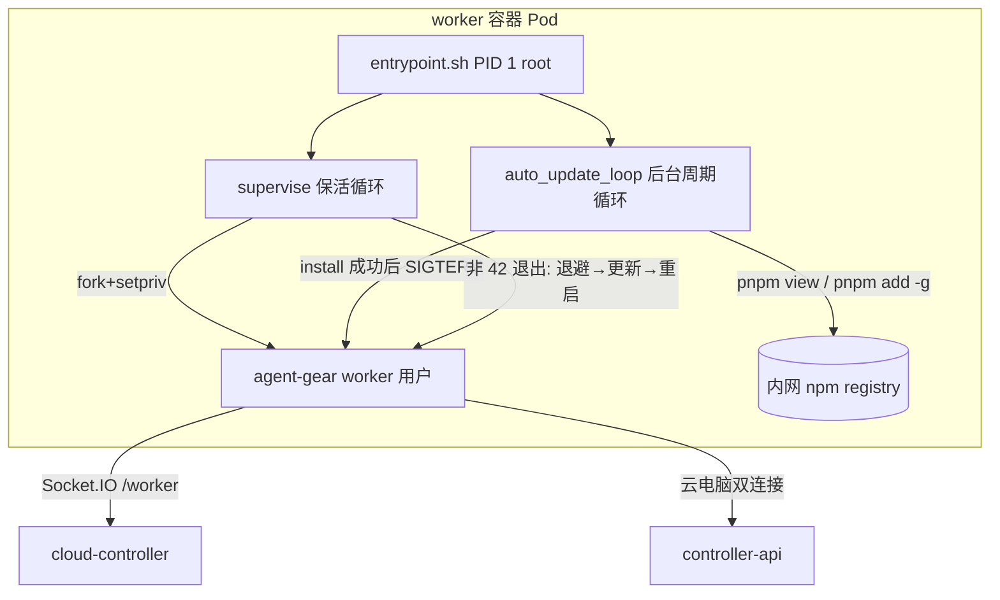
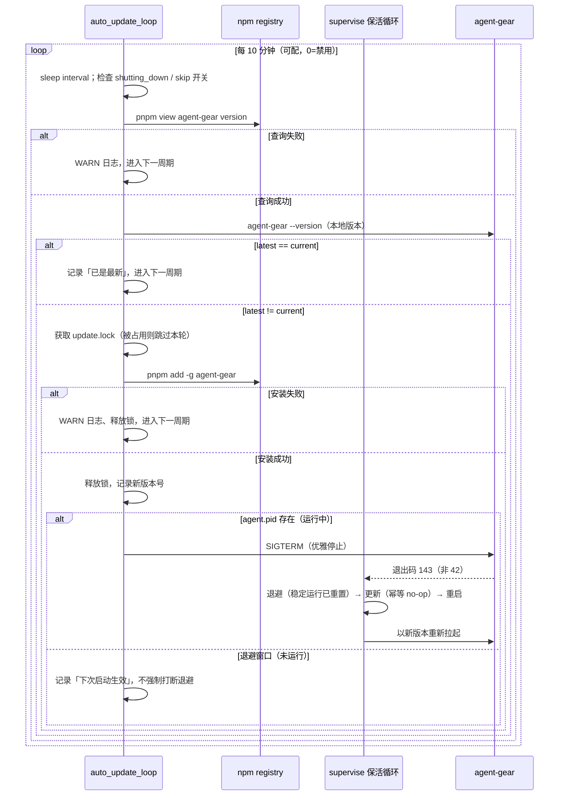

# 云环境 agent-gear 自动升级 - 技术提案

**功能名称**: 云环境 agent-gear 自动升级
**关联 PRD**: `docs/product/shipping/20261113-cloud-agent-gear-auto-upgrade.md`
**技术提案版本**: v1.0
**创建日期**: 2026-11-13
**作者**: ZeroAsh
**feat-branch**: `feat/cloud-agent-gear-auto-upgrade`

## 1. 概述

### 1.1 背景

云端工作容器的 agent-gear 由 worker 镜像 `entrypoint.sh` 安装并以保活循环监督运行。现有更新时机只有两个：容器**启动时**一次 `update_agent_gear`，以及 agent-gear **每次退出后**的重启前更新。健康的 agent-gear 是长连接常驻进程，一旦启动便不再退出，版本随之固定；而云电脑已取消最长运行时间限制，长期在线容器持续滞留旧版本。Issue #496 要求运行期间每 10 分钟检查一次更新，发现新版即安装并重启服务。

### 1.2 目标

- worker 容器运行期间按固定周期（默认 10 分钟）检查 registry 最新版与本地运行版，不一致时自动安装最新版并优雅重启 agent-gear。
- 与既有链路（启动更新、每轮重启前更新、VERSION_MISMATCH 扫描、保活退避、销毁信号）完全兼容，不引入重启风暴与并发安装。
- 检查/安装失败仅记录并按周期重试，容器内现有服务零影响。
- 升级过程符合单行 JSON 日志契约，全程可观测、无敏感信息。

### 1.3 范围

- **做**：`deploy/images/worker/entrypoint.sh` 新增周期自升级循环（检查 → 安装 → 优雅重启）；配套测试与 `BUILD.md` 口径更新。
- **不做**：不修改 `agent-gear` 本体、cloud-controller、controller-api、agent-api 与任何前端；不新增 GraphQL/WebSocket/REST 契约（**契约零变更**）；不改变本地控制器行为；「空闲时再重启」等时机优化不在本期。

## 2. 技术架构

### 2.1 系统架构图



### 2.2 技术栈

| 层级 | 技术选型 | 说明 |
|------|---------|------|
| 容器入口 | bash（`set -euo pipefail`） | 既有 `entrypoint.sh`，PID 1 监督者 |
| 包管理 | pnpm（固定版本 12.16.1） | 既有安装/更新链路，`pnpm view` 取最新版、`pnpm add -g` 安装 |
| 运行身份 | root（PID 1）+ worker（业务进程） | 经 `setpriv` 降权，沿用 `run_as_worker` 系列 |
| 日志 | 单行 JSON（printf） | 复用既有 `log()` 与 `json_escape()`，对齐 `contracts/observability.md` |
| 测试 | bash stub 测试 | 复用 `entrypoint.test.sh` 临时 PATH stub 体系 |

### 2.3 模块划分

| 模块 | 职责 | 关键技术点 |
|------|------|-----------|
| `auto_update_loop`（新增） | 周期检查、安装、触发优雅重启 | 间隔睡眠、版本比较、安装互斥、pidfile 信号 |
| `run_agent_gear`（改造） | 运行 agent-gear 并维护运行态标记 | 新增 `$RUN_DIR/agent.pid` 写入/清理 |
| `update_agent_gear`（改造） | 启动/每轮重启前更新 | 纳入同一把安装互斥锁，避免与周期安装并发 |
| `shutdown`（微调） | 销毁信号处理 | 先终止周期循环再转发子进程信号，销毁后绝不升级/重启 |

## 3. API 设计

### 3.1 API 契约

无对外 API 变更（无 GraphQL / WebSocket / REST 契约改动）。本需求对外仅体现为**容器运行时环境变量**，沿用既有 entrypoint 运行时参数口径（记录于 `entrypoint.sh` 头注释与 `deploy/images/worker/BUILD.md`，与 `ZAG_SKIP_AGENT_GEAR_UPDATE` / `ZAG_KEEPALIVE_BACKOFF_MS` 同级）：

| 环境变量 | 默认 | 说明 |
|---------|------|------|
| `ZAG_AGENT_GEAR_AUTO_UPDATE_INTERVAL_MS` | `600000`（10 分钟） | 周期自升级检查间隔（毫秒）；`0` = 禁用周期自升级；非法值（非非负整数）回退默认并 WARN |
| `ZAG_SKIP_AGENT_GEAR_UPDATE`（既有） | 未设置 | 总开关：置 `1` 时跳过全部安装/更新动作（启动、每轮、周期自升级），保活重启不受影响 |

cloud-controller 无需注入任何新 env（默认值收敛在入口，可用运行时同名环境变量覆盖，与 `NVM_*`/`NODE_VERSION` 等口径一致）。

### 3.2 内部接口

无服务端内部接口。容器内新增的运行时文件（均位于既有 `mktemp` 的 `$RUN_DIR`，随容器生命周期生灭，不落持久卷）：

| 文件 | 写入方 | 读取方 | 说明 |
|------|--------|--------|------|
| `$RUN_DIR/agent.pid` | `run_agent_gear` | `auto_update_loop` | 当前 agent-gear 子进程 PID；存在即「agent-gear 运行中」 |
| `$RUN_DIR/update.lock.d/` | 两条安装路径 | 两条安装路径 | `mkdir` 原子互斥目录（内含 `pid` 文件用于死锁回收） |

## 4. 数据模型

### 4.1 数据库设计

无数据库变更。

### 4.2 缓存设计

无缓存。版本检查每次实时查询 registry（`pnpm view agent-gear version`），10 分钟一次、单容器开销可忽略，内网 Nexus 代理可承载；不引入结果缓存，避免「回滚 latest 指针后容器不回落」的口径复杂化。

## 5. 技术实现方案

### 5.1 核心流程



### 5.2 关键实现点

#### 实现点 1: 周期检查循环 `auto_update_loop`

- **描述**: `main()` 在 `supervise_agent_gear` 之前以 `&` 启动后台循环并记录 `AUTO_UPDATE_PID`。循环每轮先 `sleep`（首轮检查即启动后 10 分钟，启动时 `update_agent_gear` 已完成一次安装/更新），随后依次判定：`shutting_down=1` → 退出；`ZAG_SKIP_AGENT_GEAR_UPDATE=1` → 本轮跳过；随后执行检查。
- **技术细节**:
  - 间隔解析：正整数毫秒，默认 `600000`；`0` 时循环启动即打印一次禁用日志并直接 return；非法值回退默认并 WARN。
  - 睡眠可中断：销毁路径由 `shutdown()` 主动 `kill "$AUTO_UPDATE_PID"` 终止循环，不等待整段睡眠。
  - 循环体内所有短生命周期子进程（`pnpm view`、`agent-gear --version`）经 `run_as_worker` 执行，输出捕获、错误吞掉转 WARN，不因 `set -e` 中断循环（命令替换 + `|| rc=$?` 形态）。
- **风险点**: 后台循环是 fork 子壳，读不到父壳后续变量变更——所有跨进程状态（运行中 PID、互斥锁、shutting_down）必须经文件/信号传递（见实现点 2/3）；`shutting_down` 在 fork 时的拷贝恒为 0，故循环每轮改为探测**销毁标记文件**（`shutdown()` 置位时同时 `touch "$RUN_DIR/shutdown"`）。

#### 实现点 2: 运行态标记 `$RUN_DIR/agent.pid`

- **描述**: `run_agent_gear` 在后台启动 agent-gear 后将其 PID 写入 `$RUN_DIR/agent.pid`，`wait` 返回后删除。周期循环据此区分「运行中（TERM 触发立即重启）」与「退避/更新窗口（下一轮自然带出新版本）」。
- **技术细节**: 写入在 `run_as_worker_exec ... &` 与 `CHILD_PID=$!` 之后原子的完成（同一语句块）；清理与 FIFO 清理同点。TERM 目标 PID 即 setpriv 链的顶层进程，信号沿既有 setpriv 链直达 agent-gear（与 T-EP7 既有断言同口径）。

#### 实现点 3: 安装互斥锁 `$RUN_DIR/update.lock.d`

- **描述**: `pnpm add -g` 全局安装不允许并发。两条安装路径（`update_agent_gear`：启动/每轮重启前；`auto_update_loop`：周期触发）共用一把 `mkdir` 原子锁。
- **技术细节**:
  - 获取：`mkdir "$RUN_DIR/update.lock.d" && echo $$ > .../pid`；失败则**跳过本次安装**（周期路径记录日志；保活路径等价于既有「更新失败容忍」语义——另一路径正在安装最新版，结果一致）。
  - 死锁回收：获取失败时读取锁内 `pid`，`kill -0` 不存在则视为残留锁，强制清理后重试一次。
  - `$RUN_DIR` 为容器单次运行 `mktemp` 目录，容器重启即清零，无跨生命周期残留。

#### 实现点 4: 优雅重启与既有语义的复用

- **描述**: 安装成功后对 `agent.pid` 指向的进程发 `SIGTERM`。supervise 循环将其视为「非 42 退出」：稳定运行 ≥60s 退避计数已重置 → 约 1s 退避 → `update_agent_gear`（已最新，幂等 no-op）→ 以新版本重启。重启不重放初始化（cloud-controller `hasSettledInit` 拦截），云电脑双连接由 agent-gear supervisor 自动重建。
- **技术细节**:
  - 不新增退出码、不改 `agent-gear`：完全复用既有信号与保活语义，版本门禁（VERSION_MISMATCH 扫描）行为不变。
  - TERM 前重新读取 `agent.pid` 并 `kill -0` 校验，规避 pid 复用竞态（文件刚删除则不动作）。
  - 销毁竞态：`shutdown()` 先 `kill "$AUTO_UPDATE_PID"`、置销毁标记，再转发子进程信号——销毁后循环不会再安装/TERM，supervise 因 `shutting_down=1` 不再拉起（既有断言口径）。
  - 孤儿收敛：若销毁恰好发生在周期安装进行中，循环壳被 kill 后 pnpm 短暂继续，随 Pod 回收终止；下次启动的 `update_agent_gear` 幂等修复，可接受。

#### 实现点 5: 版本比较口径

- **描述**: `latest=$(pnpm view agent-gear version)` 与 `current=$(agent-gear --version)` 去空白后字符串比较，不等即安装。
- **技术细节**:
  - 安装目标始终是 registry `latest` 标签：发布侧将 latest 回滚到旧版时，容器下一轮检查会「升级」到该回滚目标，自动愈合缺陷版本（与 PRD 兼容口径一致）。
  - 两段输出版本号均为 `agent-gear` 自身 `--version`（取 `package.json`）与 registry 元数据，格式受控；解析失败（空串/含空白）按检查失败处理。

#### 实现点 6: 日志口径

- **描述**: 全部走既有 `log()`（单行 JSON、`component=worker-entrypoint`），新增锚点：
  - `agent-gear auto-update loop started (interval=600s)` / `auto-update disabled (interval=0)` / `auto-update disabled (ZAG_SKIP_AGENT_GEAR_UPDATE=1)`（循环启动一次）
  - `agent-gear is up to date (<version>)`（每轮）
  - `new agent-gear version available: <current> -> <latest>; installing`
  - `agent-gear updated: <version>; restarting service to apply` / `...; will apply on next (re)start`
  - `WARN: agent-gear update check failed (...)` / `WARN: agent-gear auto-update install failed; will retry next round`
  - `agent-gear update skipped: another install in progress`
- **技术细节**: 版本串先经控制字符剔除再入日志（复用 `json_escape`）；绝不打印 `ZAG_CONTROLLER_KEY`/`ZAG_HOST_KEY`/token。

## 6. 技术决策

### 6.1 决策列表

| 决策 | 选项 A | 选项 B | 最终选择 | 原因 |
|------|--------|--------|---------|------|
| 检查循环位置 | entrypoint 后台循环 | agent-gear 内建自升级 / cloud-controller 下发升级指令 | **A** | 安装/重启生命周期本就在入口；云环境专属能力，不污染 CLI 本体；零契约零服务端改动 |
| 检查方式 | `pnpm view agent-gear version` | `pnpm outdated -g` / 解析 `npm show` 全量元数据 | **A** | 单一字段、与安装链路同工具同 registry，开销最小 |
| 重启触发 | SIGTERM 复用保活非 42 路径 | 新增专用退出码 / agent-gear 增加 reload 能力 | **A** | 不改动 agent-gear；既有退避/更新/重启语义直接复用，测试面最小 |
| 重启时机 | 安装成功即重启 | 等待会话空闲再重启 | **A** | Issue 明确口径；会话可经既有重连恢复；「空闲重启」留作后续优化 |
| 并发控制 | mkdir 锁 + 跳过 | flock 文件锁 | **A** | 与入口零依赖风格一致（不引 jq/python 之外的二进制假设）；「另一路径正在装最新版」时跳过结果等价 |
| 失败策略 | 仅记录、下周期重试 | 指数退避加快重试 | **A** | 周期即天然节流；失败多为来源不可用，加快重试无收益 |

### 6.2 依赖与约束

| 类型 | 内容 | 说明 |
|------|------|------|
| 依赖 | 既有 `run_as_worker` / `log()` / `update_agent_gear` / supervise 保活 | 全部复用，改动面收敛在入口单文件 |
| 依赖 | 内网 npm registry（`pnpm` 已配置） | 与启动更新同源，不新增渠道 |
| 依赖 | cloud-controller `hasSettledInit` 初始化去重、版本门禁 | 重启不重放初始化；升级方向恒向上，门禁语义不变 |
| 约束 | 仅 worker 镜像（云环境）；本地控制器不受影响 | 镜像重建发布后仅新容器生效，存量容器强制销毁重建（既有口径） |
| 约束 | bash + POSIX 工具集，不新增运行时依赖 | 与入口现有实现风格一致 |

## 7. 项目结构

```
deploy/images/worker/
├── Dockerfile           # 不变
├── entrypoint.sh        # 改：新增 auto_update_loop / agent.pid / update.lock，shutdown 联动
├── entrypoint.test.sh   # 改：新增 T-EP20 ~ T-EP27 用例
└── BUILD.md             # 改：默认启动流程、运行时 env 表、自验清单同步
```

其余目录（`servers/*`、`packages/*`、`apps/*`、`contracts/*`）零改动。

## 8. 测试策略

### 8.1 测试覆盖要求

- 静态校验：`bash -n deploy/images/worker/entrypoint.sh` 通过。
- stub 自动化：`bash deploy/images/worker/entrypoint.test.sh` 全量通过（既有 T-EP0~T-EP19 零回归 + 新增用例）。
- 测试继续沿用临时 PATH stub（假 `pnpm`/`agent-gear` 等），不触网、不触碰真实 `/home/worker`；检查间隔经 `ZAG_AGENT_GEAR_AUTO_UPDATE_INTERVAL_MS` 缩小到毫秒级驱动。

### 8.2 测试类型

| 类型 | 工具 | 覆盖范围 |
|------|------|---------|
| 静态 | `bash -n` | 入口语法 |
| 行为（stub） | `entrypoint.test.sh` | 下表新增用例 + 既有用例回归 |

新增 stub 用例：

| 用例 | 场景 | 断言 |
|------|------|------|
| T-EP20 | registry 有新版 | 触发安装 → TERM agent-gear → 重启后版本为新版；日志含 `new agent-gear version available` 与 `restarting service to apply` |
| T-EP21 | 无新版 | 零安装、零重启；日志含 `up to date` |
| T-EP22 | `pnpm view` 失败 | WARN、零安装零重启，服务继续 |
| T-EP23 | 安装失败 | WARN、不 TERM、不重启，服务继续 |
| T-EP24 | `ZAG_SKIP_AGENT_GEAR_UPDATE=1` | 周期循环零检查动作（registry 调用计数为 0） |
| T-EP25 | `ZAG_AGENT_GEAR_AUTO_UPDATE_INTERVAL_MS=0` | 循环即退，零检查动作，启动日志含禁用锚点 |
| T-EP26 | 销毁信号到达 | 循环被终止；销毁后无安装/无 TERM/无重启（扩展 T-EP7 口径） |
| T-EP27 | 检查命中时 agent-gear 处于退避窗口（无 agent.pid） | 安装执行但不发 TERM；日志含 `will apply on next (re)start`；下一轮启动使用新版本 |

## 9. 部署方案

### 9.1 环境规划

| 环境 | 用途 | 部署方式 |
|------|------|---------|
| worker 镜像 | 全部云端工作容器（云电脑 + 普通容器） | 重建并推送 `worker` 镜像，`WORKER_IMAGE` 指向新 tag |

发布顺序：合并本分支 → 重建推送 worker 镜像 → 新创建容器自动获得能力 → 存量容器按既有口径在维护窗口强制销毁重建一次（与版本门禁/保活历次发布口径一致）。无需任何服务端发布与数据迁移。

### 9.2 配置管理

- 默认间隔 10 分钟收敛在 `entrypoint.sh`；运维可按环境以 `ZAG_AGENT_GEAR_AUTO_UPDATE_INTERVAL_MS` 覆盖或置 `0` 禁用；`ZAG_SKIP_AGENT_GEAR_UPDATE=1` 为总开关（离线/排障出口）。
- `BUILD.md` 同步：默认启动流程补「周期自升级」第 5 步、运行时 env 表新增一行、自验清单补 T-EP20~T-EP27。

## 10. 验收标准

- [ ] 技术方案评审通过
- [ ] `bash -n entrypoint.sh` 与 `entrypoint.test.sh`（含 T-EP20~T-EP27、既有用例零回归）通过
- [ ] 内网 K8s 受控验收：起容器→注入受控新版到测试 registry（或桩 registry）→10 分钟（测试缩间隔）内观察到 `new version available` → 安装 → 重启 → 以新版本 `register` 成功且不重复初始化
- [ ] 注入 latest 回滚场景：latest 指回旧版后容器自动回落到该版本
- [ ] 销毁验收：升级进行中下发销毁，容器按既有流程退出，无残留重启
- [ ] 日志验收：检查/安装/重启锚点齐全，且无 `ZAG_CONTROLLER_KEY`/token/带凭据 URL
- [ ] PRD 功能点 1~4 验收标准逐条通过

## 11. 相关文档

- 关联 PRD：[[../../product/shipping/20261113-cloud-agent-gear-auto-upgrade.md]]
- 需求来源：[GitHub Issue Deliay/z-agent-gear#496](https://github.com/Deliay/z-agent-gear/issues/496)
- [[20261025-feat-cloud-host-keepalive.md]] — 云电脑保活与 worker 用户（保活/退避/自更新既有语义）
- [[20261017-feat-controller-version-requirement.md]] — 版本门禁与一次性自升级（VERSION_MISMATCH 链路）
- [[20261102-feat-cloud-storage.md]] — 主目录工具链自举（`bootstrap_home`/`ensure_pnpm` 口径）
- 开发规范：[[../common-rules.md]]、[[../backend-rules.md]]
