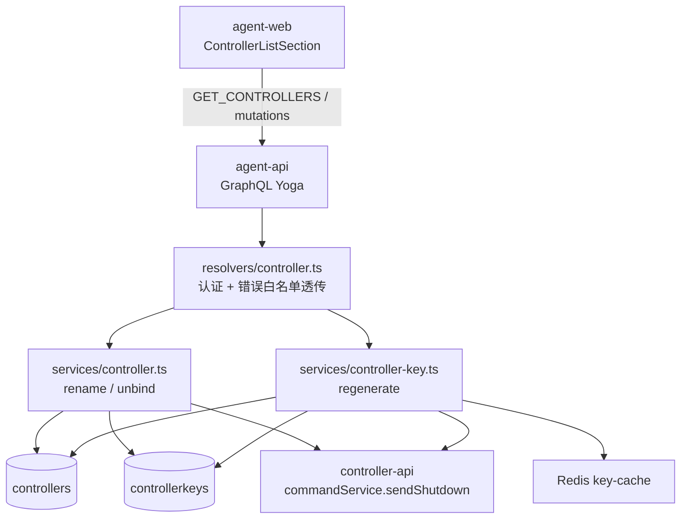

# 设置中控制器的操作按钮优化（云控制器操作限制） - 技术提案

**功能名称**: 云控制器操作按钮优化
**关联 PRD**: [[../../../product/draft/20261113-cloud-controller-operations-restriction.md]]（`docs/product/draft/20261113-cloud-controller-operations-restriction.md`）
**技术提案版本**: v1.0
**创建日期**: 2026-11-13
**作者**: ZeroAsh Agent
**feat-branch**: `feat/cloud-controller-operations-restriction`（实现分支，自需求总分支 `prd/cloud-controller-operations-restriction` 切出）

## 1. 概述

### 1.1 背景

需求来源 GitHub Issue [Deliay/z-agent-gear#489](https://github.com/Deliay/z-agent-gear/issues/489)：「对于云控制器，前端不显示，后端不允许『重命名、删除、重新生成key』这三个操作」。

云电脑对应 `Controller.type === 'cloud'` 的前台主机（约定见 `apps/agent-web/AGENTS.md`「云电脑（Cloud Host）约定」与 `contracts/agent-controller.graphql` 云电脑约定注释），其名称由 `createCloudHost` 编排预创建、连接凭据 `ControllerKey(type=cloud)` 在容器创建时经 env 固化下发、生命周期由云电脑管理流程（`stopCloudHost` / `deleteCloudHost`）编排。

现状代码事实（F1~F5）：

- **F1**：`apps/agent-web/src/components/settings/ControllerListSection.tsx` 的已绑定控制器行（L268-281）对所有类型渲染「配置 / 重命名 / 重新生成Key / 解绑」四个按钮；未绑定控制器行（L303-310）渲染「重新生成Key / 删除」。`controllerService.findAllByUser` 仅过滤已软删除云电脑的 Controller，**不过滤 cloud 类型**，故云电脑照常出现在该列表并带全部操作按钮。
- **F2**：`renameController` → `controllerService.rename`（`servers/agent-api/src/services/controller.ts:74`）直接 `findOneAndUpdate`，无 `type` 检查。
- **F3**：`unbindController` → `controllerService.unbind`（`servers/agent-api/src/services/controller.ts:84`）依次执行 `commandService.sendShutdown(keyId)` → `evictKeyById` → `ControllerKey.deleteOne` → `Controller.deleteOne`，无 `type` 检查。对云电脑执行会删除其连接凭据与 Controller 留档，云电脑立即失联且云端容器可能仍在计费运行。
- **F4**：`regenerateControllerKey` → `controllerKeyService.regenerate`（`servers/agent-api/src/services/controller-key.ts:121`）更新 keyHash 后将 Controller 置 `unbound`、evict 旧 key、缓存新 key 并 `sendShutdown`。容器内 `ZAG_HOST_KEY` 为创建期 env 固化值，无法获取新 key，云电脑永久离线。
- **F5**：三个 mutation 的 resolver（`servers/agent-api/src/graphql/resolvers/controller.ts`）均无错误包装；服务层抛出的普通 `Error` 会冒泡到 graphql-yoga（`servers/agent-api/src/index.ts:94` 未显式配置 `maskedErrors`，生产模式默认掩盖为 `Unexpected error.`）。参照同文件 `setControllerDefaultMcp` 对 `MCP_SERVER_NOT_FOUND` 的显式捕获模式，需在 resolver 将白名单文案转为 `GraphQLError` 透传。

另有两处附带事实：

- **F6**：`contracts/agent-controller.graphql` 缺少 `regenerateControllerKey` 与 `RegenerateControllerKeyInput` 定义（`servers/agent-api/src/graphql/schemas/controller.ts:86` 已实现，契约文件漏记），本提案顺手补齐，并在契约中增补三个 mutation 对云控制器的拒绝说明与错误文案表。
- **F7**：全仓 grep 确认 `renameController` / `unbindController` / `regenerateControllerKey` 的唯一前端入口为 `ControllerListSection.tsx`；controller-api 侧云电脑 worker 不发送 `unregister`（契约注释）；平台 MCP/admin tools 对控制器仅只读列举（`services/workflow/admin-tools.ts`），无写入口。三个 GraphQL mutation 即全部需拦截的入口。

### 1.2 目标

1. 前端：`ControllerListSection` 对 `type === 'cloud'` 的控制器行不渲染「重命名」「重新生成Key」「解绑/删除」按钮（已绑定与未绑定两个分组同样处理），「配置」按钮保留。
2. 后端：`controllerService.rename` / `controllerService.unbind` / `controllerKeyService.regenerate` 对 `type === 'cloud'` 的控制器在任何副作用发生之前抛错拒绝；resolver 将拒绝文案以 `GraphQLError` 逐字透传。
3. 契约：`contracts/agent-controller.graphql` 补齐 `regenerateControllerKey` 定义并增补云控制器拒绝说明与错误文案表。
4. 本地控制器（`local`/`github` 类型）行为零变化；按 TDD 红-绿-重构推进。

### 1.3 范围

**做**：

- `apps/agent-web/src/components/settings/ControllerListSection.tsx`：按 `ctrl.type === 'cloud'` 收敛按钮渲染（纯前端）。
- `servers/agent-api/src/services/controller.ts`：`rename` / `unbind` 增加 cloud 拒绝。
- `servers/agent-api/src/services/controller-key.ts`：`regenerate` 增加 cloud 拒绝。
- `servers/agent-api/src/graphql/resolvers/controller.ts`：三个 mutation 的错误白名单透传。
- `contracts/agent-controller.graphql`：补齐 `regenerateControllerKey` / `RegenerateControllerKeyInput` 与拒绝说明（`servers/agent-api/src/graphql/schemas/controller.ts` 为手写 schema 串，契约与 schema 双写核对，schema 无需改字段）。
- 测试：agent-api 服务层/resolver 单测、tests/api 用例、前端组件测试、E2E 用例（详见 §8）。

**不做**：

- 不改 `createControllerKey` / `renameControllerKey`（针对未绑定 Key，与控制器类型无关）。
- 不改 `setControllerWorktreeDir` / `setControllerDefaultMcp` / `setControllerWorktreeDir` 等其他控制器写操作（需求仅列三个操作）。
- 不改云电脑自身生命周期入口（`stopCloudHost` / `deleteCloudHost` / 云电脑配置页）。
- 不改 controller-api、cloud-controller、agent-gear；存量数据零迁移。
- 不在控制器管理中为云电脑新增「停止/删除」入口（云电脑生命周期仍由云电脑管理流程承担）。

## 2. 技术架构

### 2.1 系统架构图



改动点：`A` 层按类型收敛按钮；`D`/`E` 层在副作用之前做 cloud 拒绝；`C` 层透传文案。`F~I` 的行为对本地控制器不变。

### 2.2 技术栈

| 层级 | 技术选型 | 说明 |
|------|---------|------|
| 前端 | React 19 + TypeScript（strict）+ Vite + Tailwind CSS v4 + Apollo Client | 按钮渲染收敛 |
| 后端 | Node.js 24 + TypeScript（strict, ESM）+ Express v5 + GraphQL-Yoga + Mongoose | 服务层拒绝与错误透传 |
| 测试 | Vitest（单测/API）+ React Testing Library（组件）+ Playwright（E2E） | TDD 红-绿-重构 |

### 2.3 模块划分

| 模块 | 职责 | 关键技术点 |
|------|------|-----------|
| `apps/agent-web/src/components/settings/ControllerListSection.tsx` | 控制器列表与操作按钮渲染 | `ctrl.type === 'cloud'` 条件渲染 |
| `servers/agent-api/src/services/controller.ts` | `rename` / `unbind` 云控制器拒绝 | 先查 `type`，拒绝先于一切副作用 |
| `servers/agent-api/src/services/controller-key.ts` | `regenerate` 云控制器拒绝 | 复用已查出的 controller 判断 |
| `servers/agent-api/src/graphql/resolvers/controller.ts` | 错误白名单透传 | `GraphQLError` 逐字透传三条文案 |
| `contracts/agent-controller.graphql` | 契约补齐与拒绝说明 | 契约与手写 schema 双写核对 |

## 3. API 设计

### 3.1 API 契约

`contracts/agent-controller.graphql` 更新两处（schema 字段零变更，行为说明与补齐）：

1. **补齐既有定义**（F6，schema 早已实现）：

```graphql
input RegenerateControllerKeyInput {
  controllerId: ID!
}

extend type Mutation {
  regenerateControllerKey(input: RegenerateControllerKeyInput!): CreateKeyPayload!
}
```

2. **三个 mutation 增补云控制器拒绝说明**（注释 + 错误文案表）：

| Mutation | 云控制器行为 | 错误文案（逐字） |
|----------|-------------|------------------|
| `renameController` | 拒绝，名称不变，无副作用 | `cloud controller cannot be renamed` |
| `unbindController` | 拒绝，档案与凭据不变，不下发任何指令 | `cloud controller cannot be unbound` |
| `regenerateControllerKey` | 拒绝，旧凭据保持有效，连接状态不变 | `cloud controller key cannot be regenerated` |

其余口径不变：

- 三个操作的目标控制器不存在时，仍按现状返回 `Controller not found`（`unbindController` 为 `false`）。
- 三个操作对 `local` / `github` 类型控制器行为完全不变。
- 云电脑生命周期操作不由本契约承载（`stopCloudHost` / `deleteCloudHost` 见 `contracts/cloud-host.graphql`）。

### 3.2 内部接口

无新增。`commandService.sendShutdown` 等既有内部调用对本地控制器路径不变；云控制器路径在调用前即被拒绝。

## 4. 数据模型

### 4.1 数据库设计

无变更。`Controller.type`（`local` / `cloud` / `github`）为既有字段，拒绝判定直接读取，不新增字段、不建索引、不写迁移。

### 4.2 缓存设计

无变更。云控制器路径被拒绝时 **不发生** `cacheKey` / `evictKeyById`（F3/F4 的副作用在拒绝后均不执行）。

## 5. 技术实现方案

### 5.1 核心流程

```mermaid
flowchart TD
    subgraph 前端
        A[GET_CONTROLLERS 返回 controllers] --> B{ctrl.type === 'cloud'?}
        B -->|是| C[仅渲染「配置」按钮]
        B -->|否| D[渲染「配置/重命名/重新生成Key/解绑(删除)」]
    end
    subgraph 后端
        E[renameController / unbindController / regenerateControllerKey] --> F[findOne controller]
        F --> G{controller 存在?}
        G -->|否| H[按现状: Controller not found / false]
        G -->|是| I{type === 'cloud'?}
        I -->|是| J[throw 白名单文案<br/>零副作用]
        I -->|否| K[按现状执行]
        J --> L[resolver 捕获 → GraphQLError 逐字透传]
    end
```

### 5.2 关键实现点

#### 实现点 1: 前端按钮收敛（`ControllerListSection.tsx`）

- **描述**：已绑定控制器行（L268-281）与未绑定控制器行（L303-310）的按钮组按 `ctrl.type === 'cloud'` 条件渲染：
  - cloud：仅渲染「配置」按钮（未绑定分组无「配置」按钮，则渲染空按钮组；云控制器正常流程不会处于 `unbound`，该分支为防御性处理）。
  - 非 cloud：现状不变。
- **技术细节**：行数据已含 `type` 字段（`GET_CONTROLLERS` 查询 L37-52 已选择），无需改查询；`boundControllers` / `unboundControllers` 过滤逻辑不变。
- **风险点**：无。隐藏按钮后对应 Dialog（`renameTarget` / `confirmRegenerate` / `confirmUnbind`）状态不再被 cloud 行触发，本地行逻辑不变。

#### 实现点 2: `controllerService.rename` 云控制器拒绝

- **描述**：`rename` 先 `Controller.findOne({ _id: id, ...actorFilter(userId) }).lean()`，不存在返回 `null`（resolver 维持抛 `Controller not found`）；`type === 'cloud'` 抛 `Error('cloud controller cannot be renamed')`；否则执行既有 `findOneAndUpdate`。
- **技术细节**：多一次查询可接受（低频管理操作）；拒绝在写操作之前，零副作用。
- **风险点**：查询与更新之间存在并发窗口（极端情况下控制器在检查后变为 cloud）——云控制器类型为创建期固定、从不迁移，窗口不存在实际风险。

#### 实现点 3: `controllerService.unbind` 云控制器拒绝

- **描述**：`unbind` 既有 `findOne` 命中后，先判 `type === 'cloud'` 抛 `Error('cloud controller cannot be unbound')`，**必须位于 `sendShutdown` / `evictKeyById` / `deleteOne` 之前**；否则按现状执行。
- **技术细节**：该方法的副作用顺序（先指令后删除）在本地路径保持不变；cloud 路径保证「档案与凭据不变、实例不收到任何指令」（PRD 功能点 2）。
- **风险点**：返回值类型保持 `boolean` 不变——cloud 路径以抛错代替返回，不引入第三种返回形态。

#### 实现点 4: `controllerKeyService.regenerate` 云控制器拒绝

- **描述**：`regenerate` 既有第一步已 `Controller.findOne` 校验归属（`services/controller-key.ts:123`），命中且 `type === 'cloud'` 抛 `Error('cloud controller key cannot be regenerated')`；否则按现状执行。
- **技术细节**：拒绝点在任何写操作（`findOneAndUpdate` 换 hash、Controller 置 `unbound`、`cacheKey` / `evictKeyById`、`sendShutdown`）之前，保证「旧凭据仍有效、连接状态不变」。
- **风险点**：无新增查询（复用既有 controller 查询结果）。

#### 实现点 5: resolver 错误白名单透传

- **描述**：`renameController` / `unbindController` / `regenerateControllerKey` resolver 捕获服务层错误，三条白名单文案（§3.1 表）逐字转为 `GraphQLError` 抛出；其余错误按现状冒泡。
- **技术细节**：对齐同文件 `setControllerDefaultMcp` 对 `MCP_SERVER_NOT_FOUND` / `MCP_SERVER_NOT_SELECTABLE` 的捕获模式；白名单文案写入契约错误表（§3.1），前端原样 toast 展示。
- **风险点**：`unbindController` 现状无 try/catch，新增捕获不得改变正常路径的 `boolean` 返回形态。

#### 实现点 6: 契约补齐与双写核对

- **描述**：`contracts/agent-controller.graphql` 补齐 `RegenerateControllerKeyInput` / `regenerateControllerKey`（F6）并增补三个 mutation 的 cloud 拒绝注释与错误文案表；与手写 schema（`servers/agent-api/src/graphql/schemas/controller.ts`）逐字段核对一致。
- **技术细节**：schema 串无需改字段；`renameControllerKey` / `createControllerKey` 等其余定义不动。
- **风险点**：无（纯文档对齐）。

## 6. 技术决策

### 6.1 决策列表

| 决策 | 选项 A | 选项 B | 最终选择 | 原因 |
|------|--------|--------|---------|------|
| 前端入口形态 | 按钮禁用（disabled）+ 提示 | 不渲染按钮 | 选项 B | Issue 明确「前端不显示」；隐藏即消除误触入口，无需额外提示形态 |
| 后端拒绝位置 | resolver 层判定 | service 层判定 | 选项 B | service 是所有调用方（GraphQL/未来 MCP）唯一入口，拒绝逻辑单点收口；与 `repo workflow only supports cloud host`（service 层）等既有判例一致 |
| 错误文案 | 三操作统一一条 | 按操作分三条 | 选项 B | 便于定位与前端原样展示；风格对齐 `github account is locked` / `repo workflow only supports cloud host` 小写短句 |
| 拒绝时机 | 副作用中途拦截 | 任何副作用之前 | 选项 B | PRD 要求「无任何副作用」；unbind 的 `sendShutdown` 必须先拦截 |
| 未绑定分组的云控制器 | 单独空态文案 | 防御性同样隐藏按钮 | 选项 B | 正常流程云控制器不会处于 `unbound`；隐藏按钮即可覆盖异常数据，不引入新文案 |
| 契约补齐 `regenerateControllerKey` | 仅加拒绝说明 | 顺手补齐缺失定义 | 选项 B | 契约与手写 schema 对齐是项目铁律（双写），漏记随本次修订 |

### 6.2 依赖与约束

| 类型 | 内容 | 说明 |
|------|------|------|
| 依赖 | `Controller.type` 既有字段 | 创建期固定（`local`/`cloud`/`github`），无迁移 |
| 依赖 | 云电脑生命周期流程 | `stopCloudHost` / `deleteCloudHost` 既有能力，本需求零改动 |
| 约束 | 本地控制器行为零变化 | 三个操作的本地路径代码顺序与副作用保持不变 |
| 约束 | 错误文案逐字稳定 | 三条白名单文案写入契约，单测/API 测试逐字断言 |

## 7. 项目结构

涉及文件：

```
contracts/
└── agent-controller.graphql                      # 补齐 regenerateControllerKey + cloud 拒绝说明

apps/agent-web/
└── src/
    └── components/
        └── settings/
            ├── ControllerListSection.tsx         # 按 ctrl.type === 'cloud' 收敛按钮
            └── __tests__/
                └── ControllerListSection.test.tsx # 新增：cloud 仅「配置」/ local 按钮回归

servers/agent-api/
└── src/
    ├── services/
    │   ├── controller.ts                          # rename / unbind cloud 拒绝
    │   ├── controller.test.ts                     # 新增 T-CCOP1/T-CCOP2 + 本地回归
    │   ├── controller-key.ts                      # regenerate cloud 拒绝
    │   └── controller-key.test.ts                 # 新增 T-CCOP3 + 本地回归
    └── graphql/
        └── resolvers/
            ├── controller.ts                      # 三 mutation 错误白名单透传
            └── controller.test.ts                 # 新增 T-CCOP4~6 文案逐字断言

tests/api/
└── src/agent-api/
    └── controller.test.ts                         # 新增 T-CCOP-API1~3（云控制器夹具，MONGODB_URI）

tests/e2e/
└── src/
    └── settings-controller.spec.ts                # 新增 E2E-CCOP1（MONGODB_URI 夹具，缺省 skip）
```

## 8. 测试策略

### 8.1 测试覆盖要求

按 TDD 红-绿-重构：先写失败测试，再实现转绿。

**agent-api 单测（Vitest，mock 模型层）**：

| 用例 | 文件 | 断言 |
|------|------|------|
| T-CCOP1 | `services/controller.test.ts` | rename 命中 `type:'cloud'` → rejects `cloud controller cannot be renamed`，且 `findOneAndUpdate` 未被调用；`local` 回归通过 |
| T-CCOP2 | `services/controller.test.ts` | unbind 命中 cloud → rejects `cloud controller cannot be unbound`，且 `commandService.sendShutdown` / `evictKeyById` / `ControllerKey.deleteOne` / `Controller.deleteOne` 均未被调用；`local` 回归通过 |
| T-CCOP3 | `services/controller-key.test.ts` | regenerate 命中 cloud → rejects `cloud controller key cannot be regenerated`，且 `findOneAndUpdate` / `cacheKey` / `evictKeyById` / `sendShutdown` 未被调用，Controller 未被置 `unbound`；`local` 回归通过 |
| T-CCOP4~6 | `graphql/resolvers/controller.test.ts` | 三 mutation 对 cloud 抛 `GraphQLError` 且 `message` 逐字等于白名单文案；未认证仍为 `Not authenticated` |

**API 测试（tests/api，真实服务）**：

| 用例 | 断言 |
|------|------|
| T-CCOP-API1~3 | 经 `MONGODB_URI` 直插云控制器（`controllers` `type:'cloud'` + 绑定 `controllerkeys`）夹具：`renameController` / `unbindController` / `regenerateControllerKey` 均返回 GraphQL error 且文案逐字；操作后夹具行与 key 保持不变；缺 `MONGODB_URI` 时用例显式 skip 并标注（对齐 T-WS-ISO3 口径） |
| 回归 | 既有「renameController / unbindController / regenerate 本地路径」用例零改动通过 |

**前端组件测试（Vitest + RTL）**：

| 用例 | 断言 |
|------|------|
| T-CCOP-WEB1 | 列表含 cloud + local 两个已绑定控制器：cloud 行仅渲染「配置」按钮，无「重命名/重新生成Key/解绑」；local 行四按钮齐全（回归） |
| T-CCOP-WEB2 | 未绑定分组中出现 cloud 数据（防御）：不渲染「重新生成Key/删除」按钮 |

**E2E（Playwright）**：

| 用例 | 断言 |
|------|------|
| E2E-CCOP1 | `settings-controller.spec.ts` 新增：`MONGODB_URI` 直插云控制器夹具 → 设置页控制器列表该行仅见「配置」按钮；缺 `MONGODB_URI` 显式 skip 并输出指引 |

### 8.2 测试类型

| 类型 | 工具 | 覆盖范围 |
|------|------|---------|
| 服务层单测 | Vitest | 三操作的 cloud 拒绝与零副作用、本地回归 |
| Resolver 单测 | Vitest | 错误文案逐字透传、认证口径 |
| API 测试 | Vitest + 真实 Aspire 服务 | 端到端 GraphQL 拒绝与数据不变性 |
| 组件测试 | Vitest + React Testing Library | 按钮渲染收敛与本地回归 |
| E2E | Playwright | 设置页真实渲染（夹具驱动） |

## 9. 部署方案

### 9.1 环境规划

| 环境 | 用途 | 部署方式 |
|------|------|---------|
| 常规发布 | 前后端常规镜像发布 | 无特殊编排；无数据迁移；agent-gear 与 worker 镜像无需升级 |

### 9.2 配置管理

无新增配置项。

## 10. 验收标准

- [ ] 技术方案评审通过
- [ ] 契约更新（`regenerateControllerKey` 补齐 + cloud 拒绝说明与错误文案表）评审通过
- [ ] 设置页云电脑行不展示「重命名」「重新生成Key」「解绑/删除」，「配置」可用
- [ ] 直接调用三个 mutation 对云电脑均被拒绝且文案逐字正确，数据与连接状态零副作用
- [ ] 本地控制器三操作与「配置」零回归
- [ ] T-CCOP1~6、T-CCOP-API1~3、T-CCOP-WEB1~2、E2E-CCOP1 通过；agent-api / agent-web / tests/api / tests/e2e 既有套件零回归

## 11. 相关文档

- 关联 PRD：[[../../../product/draft/20261113-cloud-controller-operations-restriction.md]]
- 需求来源：[Deliay/z-agent-gear#489](https://github.com/Deliay/z-agent-gear/issues/489)
- 关联契约：`contracts/agent-controller.graphql`、`contracts/cloud-host.graphql`
- [[20260830-regenerate-controller-key.md]] — 控制器Key重新生成（本需求限制的操作之一）
- [[20261014-feat-cloud-agent-phase2.md]] — 云Agent二期（云电脑托管模型来源）
- [Backend Rules](../backend-rules.md)、[Frontend Rules](../frontend-rules.md)
