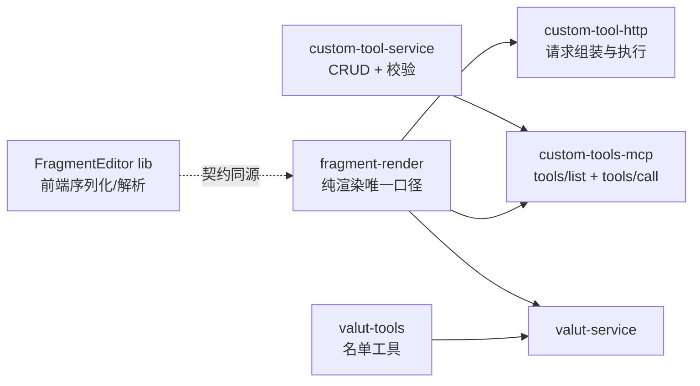
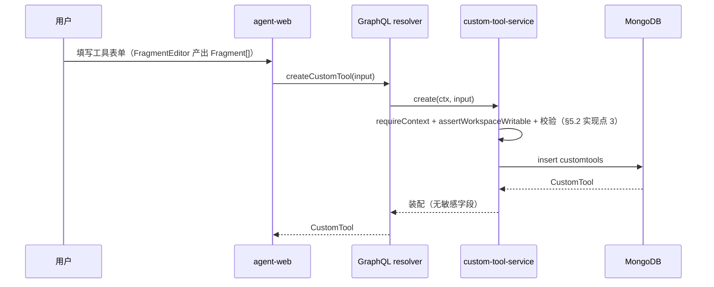
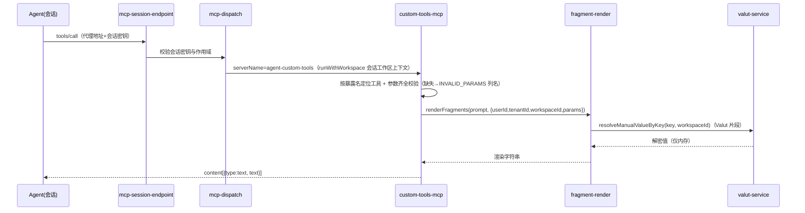
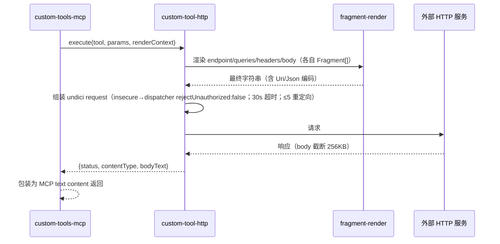

# 自定义渲染模板 + 自定义工具 MCP - 技术提案

**功能名称**: 自定义渲染模板 + 自定义工具 MCP
**关联 PRD**: [[../../product/draft/20261113-fragment-template-custom-tools.md]]
**技术提案版本**: v1.0
**创建日期**: 2026-11-13
**作者**: z-agent-bot
**feat-branch**: `feat/fragment-template-custom-tools`

## 1. 概述

### 1.1 背景

需求来源 [Issue #449](https://github.com/Deliay/z-agent-gear/issues/449)，依赖 #448（MCP+Valut 功能迭代）已落地的能力：Valut 三集合（`valutnamespaces`/`valutentries`/`valutrefs`）与 `valut-service` 唯一读写口、`custommcpservers` 与 `custom-mcp-forwarder` 服务端转发口径、平台 MCP 机制（`McpServer transport=platform` + `mcp-dispatch` 本地分发，已有 `agent-cloud-host-tools`/`agent-session-preview-tools`/`agent-workflow-tools` 等先例）、`sessionService.create` 公共路径恒装配先例（`ensureSessionPreviewToolsServer`）。

本期在此之上新增三块能力：标准 Fragment 渲染（服务端求值）、Valut MCP（名单可见不可取信）、工作区级自定义工具 MCP（prompt/http 两类，经平台 MCP 动态工具目录对会话提供）。

### 1.2 目标

- 服务端新增统一的 Fragment 渲染服务 `renderFragments(fragments, context)`：Plain 原样、Valut 按当前工作区 **manual** namespace 取值（取不到即失败）、Parameter 取调用入参（缺失即失败）；格式 Generic/Json/Uri 三种，集合可扩展。
- 新增平台 MCP `agent-valut-tools`：仅一个名单工具，返回会话租户+工作区内 manual 密钥名称列表；不存在任何取值工具。
- 新增平台 MCP `agent-custom-tools`：`tools/list` 动态枚举会话工作区的自定义工具并映射为 MCP 工具目录；`tools/call` 校验参数齐全后按类型执行（prompt 渲染返回 / http 服务端发起请求）。
- 设置页新增「自定义工具」区块与编辑对话框；新增可复用 `FragmentEditor` 组件与 `ArgsListEditor` 组件。

### 1.3 范围

**做**：
- agent-api：fragment-render 服务、两个平台 MCP（含会话装配与 dispatch 分发）、customtools 集合与 CRUD GraphQL、http 执行器。
- contracts：新增 `custom-tool.graphql`、`fragment-template.md`；`agent-session-websocket.md` 增补平台服务路由口径。
- agent-web：`FragmentEditor`（含纯函数 lib）、`ArgsListEditor`、设置页「自定义工具」区块与编辑对话框、GraphQL 查询/变更。

**不做**：
- form body 的文件类型（保留 `type` 字段，UI 禁用、服务端拒绝）。
- 新渲染格式（Base64 等）——格式枚举可扩展，本期仅 Generic/Json/Uri。
- 自定义工具的跨工作区共享/继承、服务端模板渲染预览接口（编辑器不求值，PRD 约束）。
- 服务托管（`service-*`）密钥的模板引用与名单透出（PRD 约束：仅 manual）。

## 2. 技术架构

### 2.1 系统架构图

```mermaid
graph TD
    subgraph agent-web[apps/agent-web]
        FE[FragmentEditor<br/>contentEditable 原子引用块]
        CT[设置页 自定义工具区块]
    end
    subgraph agent-api[servers/agent-api]
        FR[services/fragment-render.ts<br/>renderFragments 纯渲染]
        CT_SVC[services/custom-tool-service.ts<br/>customtools 唯一读写口]
        VT[services/valut-tools.ts<br/>平台 MCP agent-valut-tools]
        CT_MCP[services/custom-tools-mcp.ts<br/>平台 MCP agent-custom-tools]
        HTTP[services/custom-tool-http.ts<br/>http 执行器 undici]
        VS[valut-service<br/>resolveValue 唯一解密口]
        DISP[mcp-dispatch<br/>platform 分发]
        SESS[sessionService.create<br/>平台 MCP 恒装配]
    end
    subgraph mongo[(MongoDB)]
        CT_COL[(customtools)]
        V_COL[(valutentries)]
        M_COL[(mcpservers)]
    end
    FE -->|Fragment[] JSON| CT
    CT -->|GraphQL CRUD| CT_SVC
    CT_SVC --> CT_COL
    FR --> VS --> V_COL
    VT --> VS
    CT_MCP --> CT_SVC
    CT_MCP --> FR
    CT_MCP --> HTTP
    DISP --> VT
    DISP --> CT_MCP
    SESS --> M_COL
    EXT[外部 HTTP 服务] -.->|insecure 可跳过证书校验| HTTP
```

### 2.2 技术栈

| 层级 | 技术选型 | 说明 |
|------|---------|------|
| 前端 | React 19 + TypeScript + contentEditable | `FragmentEditor` 自实现原子引用块（不引入富文本框架，见决策 D4） |
| 后端 | Node.js 24 + Express v5 + GraphQL-Yoga + Mongoose | 沿用 agent-api 既有分层（models/services/graphql） |
| 数据库 | MongoDB（Mongoose） | 新增 `customtools` 集合；复用 `valutentries`/`mcpservers` |
| HTTP 客户端 | undici（Node 内建 fetch + `Agent` dispatcher） | `insecure` 经 `connect.tls.rejectUnauthorized:false` 实现 |
| 契约 | GraphQL SDL（`contracts/*.graphql`）+ Markdown（`contracts/*.md`） | 契约先行 |

### 2.3 模块划分



| 模块 | 职责 | 关键技术点 |
|------|------|-----------|
| `services/fragment-render.ts` | Fragment[] → string 的唯一渲染口径 | 依赖注入 `resolveValut`；格式管线；错误带引用定位 |
| `services/valut-tools.ts` | 平台 MCP `agent-valut-tools`（名单） | `ensure*Server` upsert；`valutManualOptions` 复用 |
| `services/custom-tools-mcp.ts` | 平台 MCP `agent-custom-tools`（动态目录与调用） | `buildSessionWorkspaceContext` 解析工作区；暴露名映射（D2） |
| `services/custom-tool-http.ts` | http 工具执行器 | undici `Agent`；30s 超时；响应截断；日志红线 |
| `services/custom-tool-service.ts` | customtools CRUD 与校验唯一读写口 | `requireContext()`；参数引用一致性校验 |
| `models/custom-tool.ts` | Mongoose 模型 | 独占型 workspace-scope；tenant 双注册 |
| agent-web `components/common/fragment-editor/` | 可复用编辑器 | contentEditable + 原子 chip；`$`/`#` 补全 |
| agent-web `components/settings/CustomToolSection.tsx` 等 | 管理界面 | 复用 Valut/自定义 MCP 区块形态 |

## 3. API 设计

### 3.1 API 契约

**新增 `contracts/fragment-template.md`**（语义契约，非 GraphQL）：

```typescript
// Fragment 模型（GraphQL 与存储、前后端共享的唯一形状）
type FragmentType = 'Plain' | 'Valut' | 'Parameter';
type FragmentFormat = 'Generic' | 'Json' | 'Uri';   // 可扩展集合，新增格式需先改契约
interface Fragment { type: FragmentType; value: string; format: FragmentFormat; }
interface RenderContext { userId: string; tenantId: string; workspaceId: string; params: Record<string, string>; }

renderFragments(fragments: Fragment[], context: RenderContext): Promise<string>
```

渲染规则（与 PRD 功能点 1 一一对应，错误口径见 §5.2）：
- `Plain` → 原样输出（空串省略）；`format` 对 Plain 无意义（恒按 Generic 处理）。
- `Valut` → 以 `value` 为 key，在 `context.workspaceId` 的 **manual** namespace 取值；取不到抛 `valut key not found: <key>`。
- `Parameter` → 取 `context.params[value]`；缺失抛 `missing parameter: <key>`。
- 取值后格式管线：`Generic` 原样；`Json` → `JSON.stringify(resolved)`；`Uri` → `encodeURIComponent(resolved)`。
- 上限：`fragments.length ≤ 200`，单 `value ≤ 4096`，渲染结果总长 `≤ 65536`（超限抛 `fragment template too large`）。

**新增 `contracts/custom-tool.graphql`**（要点摘录）：

```graphql
enum CustomToolType { prompt http }
enum FragmentType { Plain Valut Parameter }
enum FragmentFormat { Generic Json Uri }
enum CustomToolBodyType { text json form }
enum CustomToolFormFieldType { text file }   # file 本期保留、拒绝保存

type Fragment { type: FragmentType!, value: String!, format: FragmentFormat! }
type CustomToolArg { key: String!, name: String!, description: String }
type CustomToolFormField { key: String!, type: CustomToolFormFieldType!, value: [Fragment!]! }
type CustomToolKeyValue { key: String!, value: [Fragment!]! }

type CustomToolHttpConfig {
  method: String!                 # 常用下拉+自定义，^[!#$%&'*+.^_`|~0-9A-Za-z-]{1,32}$
  endpoint: [Fragment!]!
  insecure: Boolean!
  bodyType: CustomToolBodyType    # null = 无 body（GET 类）
  body: [Fragment!]               # bodyType text/json 时必填
  form: [CustomToolFormField!]    # bodyType form 时必填
  headers: [CustomToolKeyValue!]!
  queries: [CustomToolKeyValue!]!
}

type CustomTool {
  id: ID!
  name: String!                   # trim 1..64，工作区内唯一（展示名）
  description: String             # ≤512
  type: CustomToolType!
  args: [CustomToolArg!]!         # key ^[A-Za-z_][A-Za-z0-9_]{0,63}$，工具内唯一，≤32
  prompt: [Fragment!]             # type=prompt 必填
  http: CustomToolHttpConfig      # type=http 必填
  workspaceId: ID!
  createdBy: String!
  createdAt: String!
  updatedAt: String!
}

extend type Query {
  customTools: [CustomTool!]!       # 当前工作区（独占型可见集）
  customTool(id: ID!): CustomTool
}
extend type Mutation {
  createCustomTool(input: CreateCustomToolInput!): CustomTool!
  updateCustomTool(id: ID!, input: UpdateCustomToolInput!): CustomTool!
  deleteCustomTool(id: ID!): Boolean!
}
```

错误口径（白名单逐字透传，未命中收敛 `internal error`）：
`custom tool not found` / `invalid custom tool name` / `invalid custom tool description` /
`invalid custom tool args` / `invalid fragment template` / `invalid http config` /
`duplicate custom tool name` / `global workspace is read-only` / `Not found` /
`workspace not found` / `Not authenticated`。

**修订 `contracts/agent-session-websocket.md`**：平台 MCP 路由表增补 `agent-valut-tools`、`agent-custom-tools` 两个 `transport=platform` 服务的分发口径（不经 Redis、不经 `mcp:forward:*`，本地 handler 直发），并注明 `agent-custom-tools` 的 `tools/list` 为**动态目录**（按会话工作区实时枚举）。

`CreateSessionInput` 零变更：两个平台服务由 `sessionService.create` 公共路径恒装配（同 `agent-session-preview-tools` 先例），用户不可选、不出现在 MCP 选择列表（排除口径 `$nin` 增补两个名字）。

### 3.2 内部接口

- `fragment-render.ts`：
  ```typescript
  type ValutResolver = (key: string, ctx: { workspaceId: string }) => Promise<string | null>;
  renderFragments(fragments: Fragment[], context: RenderContext, resolveValut: ValutResolver): Promise<string>
  ```
  `resolveValut` 由 agent-api 注入（包装 `valut-service`），纯函数可独立单测。
- `valut-service.ts` 增补（唯一读写口内）：
  `resolveManualValueByKey(key, workspaceId): Promise<string | null>`——按 `{workspaceId, namespace:'manual', key}` 定位条目后走既有解密路径；明文不出服务。
- `custom-tool-service.ts`：`list/get/create/update/delete` + `listForMcp(workspaceContext)`（MCP 链路用，返回暴露所需最小字段）。
- `custom-tools-mcp.ts`：`handleCustomToolsMcpRequest({userId, sessionId}, request)`（与既有平台 handler 同形态，供 `mcp-dispatch` 分发）。
- `valut-tools.ts`：`handleValutToolsMcpRequest({userId, sessionId}, request)`。

## 4. 数据模型

### 4.1 数据库设计

**集合：`customtools`**（agent-api 唯一写方；模型 `models/custom-tool.ts`）

| 字段 | 类型 | 说明 |
|------|------|------|
| `tenantId` | ObjectId | 服务层显式写入（`applyTenantScope` 对无 userId 集合为 no-op） |
| `workspaceId` | ObjectId | 挂 `applyWorkspaceScope`（**独占型**） |
| `name` | String | trim 1..64；唯一索引 `uniq_custom_tool_workspace_name` `{workspaceId, name}`（迁移 026 建立） |
| `description` | String? | ≤512 |
| `type` | String | `'prompt' \| 'http'` |
| `args` | Array | `[{key, name, description?}]`，key 标识符规则、≤32、工具内唯一 |
| `prompt` | Array? | `Fragment[]`（type=prompt 必填，http 恒 null） |
| `http` | Object? | `{method, endpoint, insecure, bodyType?, body?, form?, headers, queries}`（type=http 必填，prompt 恒 null） |
| `createdBy` / `createdAt` / `updatedAt` | — | 口径同 `custommcpservers` |

注册要求（与 Valut 三集合一致）：`models/tenant-isolation.test.ts` 集合矩阵 + 迁移 013 `TENANT_ID_COLLECTIONS` 双注册（回填对新集合为 no-op）。

**迁移 `026-custom-tools`**：幂等创建 `uniq_custom_tool_workspace_name` 唯一索引（范式同 023/025，「先建后用」）。

**`mcpservers` 零迁移**：两个平台服务由 `ensure*Server(userId)` 幂等 upsert（`transport:'platform'`、`source:'platform'`、`enabled:true`），`tools` 快照分别为 `[valut_list]` 与 `[]`（动态目录，占位说明，见 D1）。

### 4.2 缓存设计

无新增缓存。`tools/list` 每次实时查询 `customtools`（与 custom MCP「删除即时失效优先于省一次查询」同口径）；`agent-custom-tools` 不引入 Redis 快照。

## 5. 技术实现方案

### 5.1 核心流程

自定义工具 CRUD：



Agent 调用自定义工具（prompt）：



Agent 调用自定义工具（http）：



### 5.2 关键实现点

#### 实现点 1: fragment-render 渲染服务

- **描述**：`services/fragment-render.ts` 为唯一渲染口径；纯函数 + 注入 `ValutResolver`，不直接 import Mongoose 模型。
- **技术细节**：
  - 逐片段解析 → 格式管线（`Generic` 恒等 / `Json` = `JSON.stringify` / `Uri` = `encodeURIComponent`）→ 拼接；`Plain` 跳过取值直接进格式管线（恒 Generic）。
  - 错误带定位：`valut key not found: <key>` / `missing parameter: <key>`（含片段序号细节进日志，对外仅白名单文案）。
  - 上限校验在进入渲染前完成（数量/单值/总长），超限 `fragment template too large`。
  - `resolveValut` 注入实现：调 `valut-service.resolveManualValueByKey`（新增），其内部复用既有解密路径（AES-256-GCM、`CREDENTIAL_ENCRYPTION_KEY` 未配置即抛错），且**只允许 manual namespace**——服务托管条目返回 `null`（PRD 约束）。
- **风险点**：`JSON.stringify` 输出带引号，Json 模式下用户模板若自写引号会双写——文档与编辑器提示中说明「Json 模式自动加引号转义」。

#### 实现点 2: 平台 MCP agent-valut-tools（名单）

- **描述**：`services/valut-tools.ts`，形态对齐 `session-preview-tools.ts`：`ensureValutToolsServer(userId)` 幂等 upsert + `handleValutToolsMcpRequest`。
- **技术细节**：
  - 工具定义单条：`valut_list`（`inputSchema {type:'object',properties:{}}`），描述「列出当前工作区可用（手动创建）的 Valut 密钥名称；不提供任何获取密钥值的工具」。
  - `tools/call valut_list`：复用 `valut-service.listManualOptions`（当前 ALS 工作区上下文，服务端强制 workspaceId=当前工作区），输出 `[{key, namespaceDisplayName}]`（**仅名称**，无 id 无值——避免 id 被拿去猜测调用其他接口；refs 不透出）。
  - 不存在取值工具：`tools/call` 其他名字一律 `METHOD_NOT_FOUND`。
- **风险点**：无 ALS 上下文返回空集（`listManualOptions` 既有口径），不误拒绝。

#### 实现点 3: custom-tool-service（CRUD 与校验）

- **描述**：`services/custom-tool-service.ts` 为 `customtools` 唯一读写口；GraphQL `schemas/custom-tool.ts` + `resolvers/custom-tool.ts`（均登记 index，`wrap()` 白名单透传）。
- **技术细节**：
  - 全部入口 `requireContext()`（无工作区上下文 → `workspace not found`）+ `assertWorkspaceWritable`（全局工作区 developer → `global workspace is read-only`）；跨工作区 id → `Not found`，不存在 → `custom tool not found`（存在性探针区分，同 Valut 口径）。
  - 校验（创建与更新同一纯函数）：
    - `name` trim 1..64，重名预检 + 唯一索引兜底（E11000 映射 `duplicate custom tool name`）；
    - `args`：≤32、key `^[A-Za-z_][A-Za-z0-9_]{0,63}$` 且唯一、name trim 1..64、description ≤256；
    - Fragment 通用校验（类型/格式枚举、数量 ≤200、单值 ≤4096）；
    - **引用一致性**：配置内所有 `Parameter` 片段的 value 必须 ∈ args keys；`Valut` 片段 value 符合 valut key 规则（trim 1..128 禁空白与控制字符）；违反 → `invalid fragment template`；
    - http：`method` 合法 token；`endpoint` 非空且渲染形态合法（首片段 Plain 以 `http://`/`https://` 开头）；`headers`/`queries` key 校验（header key 禁空白与冒号、唯一性 header 不重复——名单含 `cookie`/`host`/`content-length`/`authorization` 等；query key 禁空白）；`bodyType` 与 body/form 配对（GET/HEAD 类不强制清空但 UI 隐藏；保存时若 method ∈ GET 类且带 bodyType → `invalid http config`，口径与 PRD「GET 类隐藏 body」一致）；form 行 `type=file` → `invalid http config`（本期保留字段）。
  - 删除：`deleteOne` 按 id + 可见集；无级联（工具不持有 Valut ref——引用是「按名」弱引用，D6）。
- **风险点**：args 删减导致模板悬空引用——保存时一致性校验拦截（PRD 验收项）。

#### 实现点 4: 平台 MCP agent-custom-tools（动态目录与调用）

- **描述**：`services/custom-tools-mcp.ts`，形态对齐既有平台 handler；`ensureCustomToolsServer(userId)` 幂等 upsert。
- **技术细节**：
  - `tools/list`：以会话工作区上下文（`mcp-dispatch` 已 `runWithWorkspace(buildSessionWorkspaceContext(...))`）查 `customtools`（插件注入可见集）→ 映射 MCP 工具：
    - `name` = 暴露名（D2）；`description` = 工具描述（缺省用展示名）；`inputSchema` = `{type:'object', properties:{<argKey>:{type:'string', description: arg.description ?? arg.name}}, required:[全部 argKey]}`（MCP 层参数一律 string 序列化传递）。
  - `tools/call`：暴露名 → 工具（当前工作区可见集，查无 → `METHOD_NOT_FOUND`）→ 参数齐全校验（缺失 → `INVALID_PARAMS`，message 列缺失 key）→ `params` 归一（全部转 string）→ 分流：
    - prompt：`renderFragments(tool.prompt, ctx)` → `{content:[{type:'text', text}]}`；
    - http：`custom-tool-http.execute` → 结果包装（见实现点 5）。
  - 渲染失败（Valut 取不到/参数缺失）→ MCP 错误结果 `isError:true` + 白名单文案（**不回传任何密钥片段**）。
  - 删除即时失效：每次调用实时查询，无快照（与 custom-mcp-forwarder D9 同口径）。
- **风险点**：工作区无工具时 `tools/list` 返回空数组（合法）；同名工具被唯一索引根绝。

#### 实现点 5: custom-tool-http 执行器

- **描述**：`services/custom-tool-http.ts` 服务端发起请求（SSR 面与 custom-mcp-forwarder 同口径：目标不做内外网限制）。
- **技术细节**：
  - 渲染分工：`endpoint` 渲染后必须 `http(s)://` 开头（否则工具错误）；`queries` 逐行渲染后 `URL.searchParams.append`（值已 Uri 编码的片段经 encodeURIComponent 处理——格式管线统一负责，组装层不二次编码）；`headers` 同名多值 `Headers.append`；body 按 bodyType 组装（text→`text/plain`；json→`application/json`，渲染结果必须是合法 JSON 否则工具错误提示 `rendered body is not valid json`；form→`FormData`，`type=file` 不会出现——保存期已拦截）。
  - Content-Type：json/text 显式设置（可被 headers 中用户同名覆盖？——不允许：用户 headers 与托管 content-type 冲突时托管优先，与 custom-mcp-forwarder「托管凭据 set 覆盖」同思路）。
  - 执行：`undici.fetch(url, {method, headers, body, dispatcher: insecure ? insecureAgent : undefined, signal: AbortSignal.timeout(30_000), redirect:'follow'})`（`insecureAgent = new Agent({connect:{rejectUnauthorized:false}})`，模块级单例）；最多 5 次重定向（undici 默认）。
  - 响应：读取 text（`arrayBuffer` 上限 256KB 截断并标注 `truncated:true`）；返回 `{status, contentType, bodyText, truncated}`；网络错误/TLS 错误/超时 → `isError` 结果 + 归类文案（`request failed` / `request timeout` / `tls verification failed`——insecure 未勾选时自签证书归入 tls 文案并提示可勾选 insecure）。
  - **日志红线（沿用 custom-mcp-forwarder D4/D8）**：请求/响应正文、headers、endpoint 全串、渲染中间值一律不入日志；只记 `sessionId/toolId/name/status/reason/errName` 白名单字段；错误信息先替换敏感片段再截断。
- **风险点**：目标慢响应——30s 硬超时 + 响应体上限兜底；`insecure` 单例 Agent 不污染默认 dispatcher。

#### 实现点 6: 会话装配与 dispatch 分发

- **描述**：`sessionService.create` 公共路径恒装配两个平台服务（与 preview tools 同点位、同去重形态）：普通/云/工作流节点会话全覆盖。
- **技术细节**：
  - `mcpServerIds = Array.from(new Set([...mcpServerIds, valutToolsId, customToolsId]))`；平台 id 不参与用户所选校验（既有注释口径扩展）。
  - `mcp-dispatch` platform 分支 `runWithWorkspace(sessionContext, ...)` 内按 serverName 增补两个分支：`VALUT_TOOLS_SERVER_NAME` / `CUSTOM_TOOLS_SERVER_NAME`；通知（无 id）形态与既有平台一致（202 fire-and-forget）。
  - MCP 选择列表排除口径（`agent-cloud-host-tools`/`agent-session-preview-tools` 的 `$nin` 集合）增补两个新名字；`setControllerDefaultMcp` 校验同源。
- **风险点**：老会话（装配前创建）无此两服务——接受（继续会话/新会话获得），不回填。

#### 实现点 7: 前端 FragmentEditor（可复用组件）

- **描述**：`apps/agent-web/src/components/common/fragment-editor/`（组件 + `lib/fragment-editor.ts` 纯函数层），contentEditable 实现。
- **技术细节**：
  - **模型**：受控 `value: Fragment[]` / `onChange(Fragment[])`；props：`mode:'single'|'multi'`、`editorMode:'Generic'|'Json'|'Uri'`、`params: Record<string,{name,description?}>`、`placeholder?`、`disabled?`、`ariaLabel`。
  - **渲染**：Plain → 文本节点；Valut/Parameter → `contentEditable={false}` 的原子 chip（两类型不同配色的 `data-fragment-type` 标记，展示引用名与格式徽标，Uri/Json 格式在 chip 角标体现）；`lib/fragment-editor.ts` 提供 `fragmentsToNodes` / `nodesToFragments`（相邻 Plain 合并、空 Plain 省略）双向纯函数，round-trip 单测。
  - **录入**：`beforeinput` 拦截——`$` 打开参数补全浮层（列出 `params` 的 key+name+description，键盘/鼠标选择，Esc 关闭），`#` 打开 Valut 补全（数据源 `GET_VALUT_MANUAL_OPTIONS`，仅对话框打开时拉取，`cache-and-network`）；选中插入 chip（格式按当前 `editorMode`：Json/Uri 模式 chip format 相应，Plain 恒 Generic）；退格在 chip 边界整体删除（`keydown` 处理 selection 紧邻 chip 的场景）。
  - **单行模式**：拦截 Enter 与粘贴换行（粘贴文本 `\n` 替换为空格）；多行模式允许换行。
  - 补全浮层复用基础浮层原语（对齐既有 `Dialog`/popover 形态），不产生新依赖。
- **风险点**：contentEditable 跨浏览器行为差异——chip 一律原子不可编辑、禁止块内编辑来规避；IME 输入期间不触发补全（`compositionstart/end` 门控）。

#### 实现点 8: 前端设置页与工具编辑对话框

- **描述**：`pages/SettingsPage.tsx` 新增 `#custom-tool-section`（NAV「MCP」组内增补「自定义工具」，紧随自定义 MCP 区块），组件 `components/settings/CustomToolSection.tsx` + `CustomToolDialog.tsx` + 共享 `components/common/args-list-editor/ArgsListEditor.tsx`。
- **技术细节**：
  - 区块形态对齐 `CustomMcpSection`：标题 + 「工作区」badge、列表（名称/类型徽标/描述/更新时间）、空态「暂无自定义工具」、删除二次确认、`useWorkspaceAccess().readOnly` 收敛编辑入口。
  - 对话框：名称/描述/类型选择；`ArgsListEditor`（行：标识/名称/描述，增删改，标识重复与非法即时提示）；type=prompt → 提示文案 + 多行 `FragmentEditor`（Generic 模式）；type=http → `[method 下拉+可自定义输入][endpoint 单行 Uri 模式 FragmentEditor][insecure 勾选+风险提示]`、`[body]`（GET/HEAD 隐藏；POST 类默认 bodyType=json；text→多行 Generic、json→多行 Json 模式、form→键值行编辑器：key 单行 + type 下拉（text 可选 / file 禁用并提示「本期不支持」）+ value 单行 Generic FragmentEditor）、`[queries]`/`[headers]`（勾选展开、按行添加、key 校验即时提示、value 单行 FragmentEditor——queries Uri 模式、headers Generic 模式）。
  - 数据源：`graphql/custom-tool.ts`（GET_CUSTOM_TOOLS / CREATE/UPDATE/DELETE_CUSTOM_TOOL），`fetchPolicy:'cache-and-network'` + mutation `refetchQueries`；错误映射 `lib/custom-tool.ts`（契约白名单 → 中文），未命中原样展示。
- **风险点**：编辑器嵌套（http 表单内多处 FragmentEditor）状态串扰——每处独立受控 value，禁止共享 store。

## 6. 技术决策

### 6.1 决策列表

| 决策 | 选项 A | 选项 B | 最终选择 | 原因 |
|------|--------|--------|---------|------|
| D1 工具目录下发 | 静态快照进 `mcpservers.tools` | `tools/list` 动态枚举 | B | 增删改即时生效；与「删除即时失效」口径一致；快照需额外失效链路 |
| D2 工具暴露名 | 强制 MCP 安全名（`^[A-Za-z0-9_-]{1,64}$`） | 展示名自由 + 非安全名回退 `ct-<id后8位>` | B | Issue 示例为中文名「查询天气」；安全名直接用原名，非安全名用稳定别名（`tools/list` description 恒携带展示名） |
| D3 Valut 引用定位 | 按 key（名称）弱引用 | 按条目 id 强引用 | A | 编辑器/模板文本天然以名引用；删除密钥后渲染失败语义清晰（`valut key not found`）；key 工作区内唯一索引保证确定性 |
| D4 编辑器实现 | contentEditable 自实现 | Monaco/CodeMirror | A | 需原子引用块与单行/多行复用，富文本 chip 模型更贴切；Monaco 无内联原子 token 且对单行输入过重 |
| D5 http 执行位置 | 服务端执行 | 会话侧（容器内）执行 | A | 密钥不出服务端（PRD 安全红线）；与 custom-mcp-forwarder 同口径 |
| D6 insecure 实现 | `NODE_TLS_REJECT_UNAUTHORIZED=0` | undici `Agent{connect:{rejectUnauthorized:false}}` | B | 进程级开关会污染全部出站请求；dispatcher 级单例仅作用于该工具调用 |
| D7 装配范围 | 恒装配全部会话 | 按工作区是否有工具装配 | A | 与 preview tools 先例一致、路径唯一；空工作区 `tools/list` 返回空合法 |
| D8 渲染服务形态 | 新 shared package | agent-api 服务 + 前端 lib 双实现 | B | 渲染唯一消费点在后端（编辑器不求值）；前端仅需序列化/解析纯函数，契约 `fragment-template.md` 为单一事实源，两侧单测互锁 |

### 6.2 依赖与约束

| 类型 | 内容 | 说明 |
|------|------|------|
| 依赖 | Valut 三集合与 `valut-service`（#448 已落地） | Valut 取值唯一解密口；本期增补 `resolveManualValueByKey` |
| 依赖 | 平台 MCP 机制（`mcp-dispatch` platform 分支、`buildSessionWorkspaceContext`） | 零新机制分发与工作区上下文 |
| 依赖 | 多租户二期 workspace-scope/tenant-scope 插件 | customtools 独占型可见集与双注册 |
| 约束 | 明文不出服务端、日志白名单字段 | 沿用 custom-mcp-forwarder 红线 |
| 约束 | 单实例部署前提 | 与既有平台工具一致（无进程内定时器新增） |

## 7. 项目结构

```
servers/agent-api/src/
├── models/custom-tool.ts                      # customtools 模型（新增）
├── migrations/026-custom-tools.ts             # 唯一索引迁移（新增，含 .test.ts）
├── services/
│   ├── fragment-render.ts                     # renderFragments 唯一口径（新增，含 .test.ts）
│   ├── valut-service.ts                       # + resolveManualValueByKey（修改）
│   ├── valut-tools.ts                         # 平台 MCP agent-valut-tools（新增，含 .test.ts）
│   ├── custom-tool-service.ts                 # CRUD 唯一读写口（新增，含 .test.ts）
│   ├── custom-tools-mcp.ts                    # 平台 MCP agent-custom-tools（新增，含 .test.ts）
│   ├── custom-tool-http.ts                    # http 执行器（新增，含 .test.ts）
│   ├── mcp-dispatch.ts                        # + 两个 serverName 分支（修改）
│   └── session.ts                             # + 恒装配两个平台服务（修改）
└── graphql/
    ├── schemas/custom-tool.ts                 # 新增（登记 schemas/index.ts）
    └── resolvers/custom-tool.ts               # 新增（登记 resolvers/index.ts）

apps/agent-web/src/
├── components/common/fragment-editor/
│   ├── FragmentEditor.tsx                     # 可复用编辑器（新增，含 .test.tsx）
│   └── ...（chip / 补全浮层子组件）
├── components/common/args-list-editor/
│   └── ArgsListEditor.tsx                     # 参数列表编辑器（新增，含 .test.tsx）
├── components/settings/
│   ├── CustomToolSection.tsx                  # 设置页区块（新增，含 .test.tsx）
│   └── CustomToolDialog.tsx                   # 新增/编辑对话框（新增，含 .test.tsx）
├── lib/fragment-editor.ts                     # 序列化/解析纯函数（新增，含 .test.ts）
├── lib/custom-tool.ts                         # 错误文案映射（新增）
└── graphql/custom-tool.ts                     # 查询/变更（新增）

contracts/
├── custom-tool.graphql                        # 新增
├── fragment-template.md                       # 新增
└── agent-session-websocket.md                 # 平台服务路由表增补（修改）
```

## 8. 测试策略

### 8.1 测试覆盖要求

- 单元测试覆盖率：≥ 80%（新增代码）
- API 测试覆盖端点：`customTools` / `customTool(id)` / `createCustomTool` / `updateCustomTool` / `deleteCustomTool`

### 8.2 测试类型

| 类型 | 工具 | 覆盖范围 |
|------|------|---------|
| 单元测试 | Vitest | T-FR：fragment-render 三类型 × 三格式矩阵、错误定位、上限；T-VAL：valut-tools 名单仅 manual、无取值工具；T-CTS：custom-tool-service 校验矩阵 + 权限矩阵 + 无上下文拒绝 + 引用一致性；T-CTM：custom-tools-mcp 动态 list/暴露名映射/参数缺失 INVALID_PARAMS/删除即失效；T-CTH：http 执行器渲染组装/insecure/超时/截断/日志无敏感片段；T-MIG26：迁移幂等 |
| 组件测试 | Vitest + RTL | T-FE：FragmentEditor round-trip、补全触发与插入、单行拦截、chip 整体删除；T-ALE：ArgsListEditor 增删改与重复拦截；T-CTW：设置区块与对话框（类型切换、GET 隐藏 body、form file 禁用、只读收敛） |
| API 测试 | tests/api（Vitest） | CRUD 全链路 + 权限（全局 developer 拒绝/非成员 404 口径）+ 重名 409 口径 |
| E2E | tests/e2e（Playwright） | E2E-CT1 创建 prompt 工具并在会话中被 Agent 调用返回渲染串；E2E-CT2 http 工具打 fake upstream（含 Valut header 引用）回传状态与正文；E2E-CT3 Valut MCP 名单可见且无取值工具 |

## 9. 部署方案

### 9.1 环境规划

| 环境 | 用途 | 部署方式 |
|------|------|---------|
| 开发 | 本地编排 | `aspire start` 全量服务 |
| 生产 | K8s | agent-api / agent-web 随常规发布；迁移 026 随 agent-api 启动 runner 幂等执行 |

### 9.2 配置管理

- 无新增环境变量；复用 `CREDENTIAL_ENCRYPTION_KEY`（Valut 解密，未配置即抛错，既有口径）。
- http 执行器常量（30s 超时 / 256KB 截断 / 5 次重定向）代码内置，不开放 env（与 custom-mcp-forwarder 30s 常量的既有形态一致）。

## 10. 验收标准

- [ ] 技术方案评审通过
- [ ] Contract 评审通过（`custom-tool.graphql` / `fragment-template.md` / `agent-session-websocket.md` 增补）
- [ ] 代码实现完成（后端 6 个新服务/模型 + 前端编辑器与设置区块）
- [ ] 单元测试覆盖达标（≥80%，T-FR/T-VAL/T-CTS/T-CTM/T-CTH/T-MIG26/T-FE/T-ALE/T-CTW 全绿）
- [ ] API 测试通过（customtools CRUD 与权限矩阵）
- [ ] E2E 测试通过（E2E-CT1/CT2/CT3）

## 11. 相关文档

- 关联 PRD：[[../../product/draft/20261113-fragment-template-custom-tools.md]]
- 需求来源：[GitHub Issue Deliay/z-agent-gear#449](https://github.com/Deliay/z-agent-gear/issues/449)
- 依赖提案：[[20261104-feat-mcp-valut-iteration.md]]（Valut 底座与 custom-mcp-forwarder 口径来源）
- 关联契约：`contracts/valut.graphql`、`contracts/custom-mcp.graphql`（既有）、`contracts/custom-tool.graphql` / `contracts/fragment-template.md`（本期新增）
- 开发规范：[[../common-rules.md]]、[[../backend-rules.md]]、[[../frontend-rules.md]]
