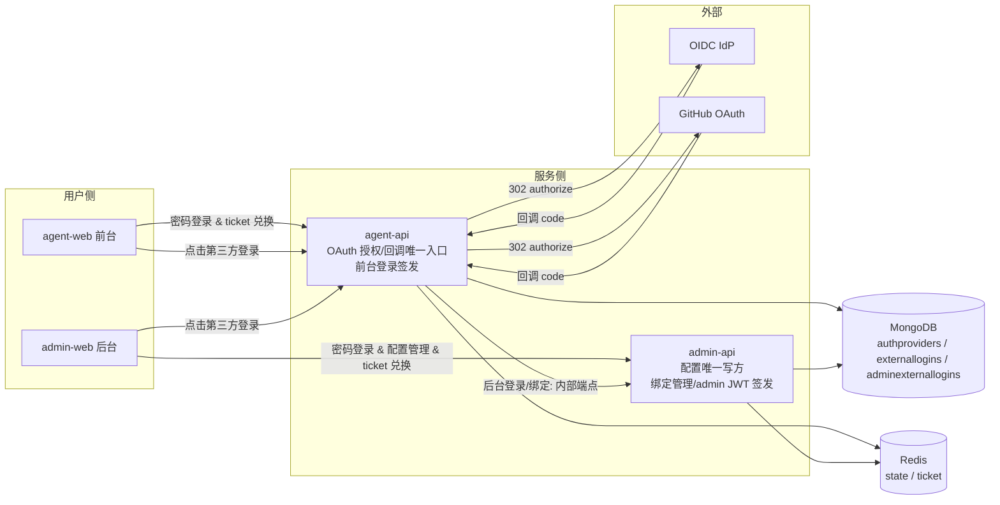
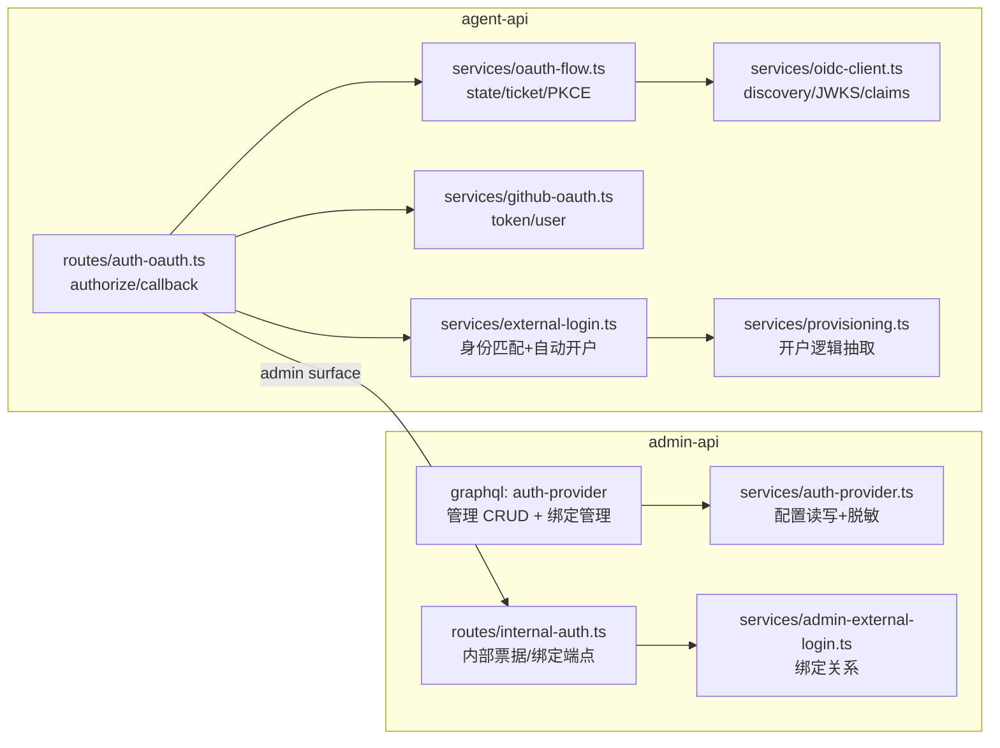
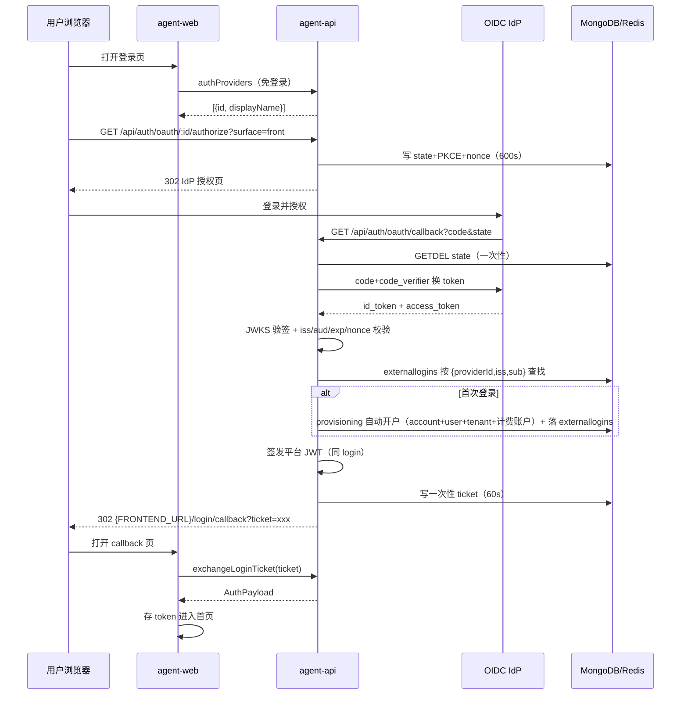
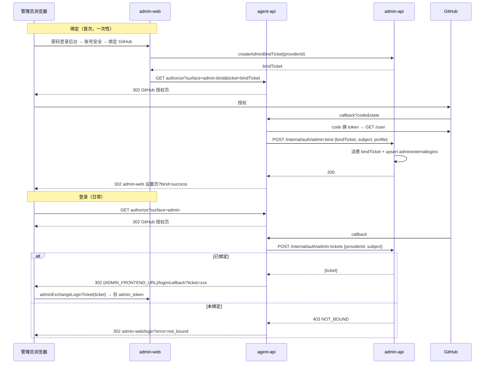

# 支持自定义 OIDC 登录和 GitHub OAuth 登录 - 技术提案

**功能名称**: 自定义 OIDC 登录与 GitHub OAuth 登录
**关联 PRD**: [[../../../product/draft/20261113-oidc-github-oauth-login.md]]
**技术提案版本**: v1.0
**创建日期**: 2026-11-13
**作者**: z-agent-bot
**feat-branch**: `feat/oidc-github-oauth-login`

## 1. 概述

### 1.1 背景

平台现有两套独立登录链路：

- **前台**（agent-web → agent-api）：`login(username, password)` GraphQL mutation，三层帐号模型（`accounts` 凭据 → `users` 身份 → `tenants` personal），签发 JWT（7d，载荷 userId）；注册硬关闭，开户仅经 admin-api 转发 agent-api `POST /internal/users`。
- **后台**（admin-web → admin-api）：`adminLogin(username, password)`，`admin_users` 集合，签发 admin JWT（载荷 adminId + pwdAt），带登录限速与强制改密。

Issue #503 要求在此之上增加两类外部身份登录：自定义 OIDC Provider（可多条）与 GitHub OAuth（单条），由后台统一配置，前后台登录页展示跳转登录按钮。

### 1.2 目标

1. admin-api 成为第三方登录配置的**唯一写方**（`authproviders` 集合），agent-api 只读镜像（沿用 providers 全局配置模式）。
2. agent-api 承载**全部 OAuth/OIDC 授权跳转与回调**（唯一对外回调地址，规避 GitHub OAuth App 仅支持单回调地址的限制），完成身份验证后按应用场景（surface）分流：前台登录直接签发前台登录票据；后台登录/绑定经 admin-api 内部端点换取票据/落绑定。
3. 前台首次外部登录**自动开户**（复用 `/internal/users` 开户逻辑，账户+用户+个人租户+零余额计费账户）。
4. 后台外部登录**必须先绑定**：管理员密码登录后自助完成绑定，绑定关系落 `adminexternallogins`。
5. 前端登录凭证经**一次性 ticket 兑换**（Redis GETDEL，60s TTL），浏览器 URL 不直接携带 JWT。

### 1.3 范围

**做**：
- `authproviders` 配置模型与后台管理 GraphQL（admin-api / admin-web「登录认证」页）
- agent-api OAuth 授权/回调 REST 链路（OIDC 授权码 + PKCE + nonce；GitHub OAuth 授权码 + state）
- 前台自动开户与外部身份集合 `externallogins`
- 后台绑定关系 `adminexternallogins` 与绑定/登录分流
- 前后台登录页第三方入口与 ticket 兑换（agent-web / admin-web）
- API 测试与 E2E（fake IdP / fake GitHub）

**不做**：
- 前台已有密码账户绑定外部身份（后续迭代）
- 「仅第三方登录、关闭密码登录」全局开关
- 多个 GitHub OAuth 配置、SAML/LDAP、SCIM 用户同步、登出联动（front-channel logout）
- 外部身份的权限/角色映射（如 IdP group → 租户角色）

## 2. 技术架构

### 2.1 系统架构图



**关键架构决策**：所有 OAuth 回调集中落在 agent-api（`GET /api/auth/oauth/callback`）。原因：GitHub OAuth App 仅允许登记**一个** Authorization callback URL；统一回调后，一个 GitHub OAuth App、一个 IdP  redirect_uri 即可同时服务前台与后台，达成 PRD「方便的配置」。admin 场景的票据铸造与绑定写入仍由 admin-api 内部端点完成（`INTERNAL_API_TOKEN` 鉴权，与 `/internal/users` 同信任级别），admin JWT 签发权不离开 admin-api。

### 2.2 技术栈

| 层级 | 技术选型 | 说明 |
|------|---------|------|
| 前端 | React 19 + Apollo Client + React Router v7 | agent-web / admin-web 登录页与设置页，禁止跨项目 import，各自独立演进 |
| 后端 | Node.js 24 + Express v5 + GraphQL-Yoga | agent-api（OAuth 链路 + 前台登录）、admin-api（配置管理 + 后台登录） |
| OIDC 客户端 | `openid-client` v6 | ESM 原生，处理 discovery / JWKS 验签 / PKCE / nonce（新增依赖，见 6.1 D1） |
| GitHub OAuth | 裸 `fetch` | authorize/token/user 三个端点，复用 `githubApiBaseUrl` 测试覆盖模式 |
| 数据库 | MongoDB（Mongoose 9） | `authproviders`（admin-api 写）/ `externallogins`（agent-api 写）/ `adminexternallogins`（admin-api 写） |
| 缓存 | Redis | OAuth state（600s）、一次性登录 ticket（60s，GETDEL）、绑定 ticket（600s）、discovery/JWKS 缓存 |

### 2.3 模块划分



| 模块 | 职责 | 关键技术点 |
|------|------|-----------|
| agent-api `routes/auth-oauth.ts` | `GET /api/auth/oauth/:providerId/authorize`、`GET /api/auth/oauth/callback` 唯一 REST 入口 | 全局 `express.json()` 之前挂载无要求（无验签原始字节需求）；错误一律 302 回登录页带 error code |
| agent-api `services/oauth-flow.ts` | state / ticket / bindTicket 的签发与消费（Redis） | state TTL 600s GETDEL 一次性；ticket TTL 60s GETDEL；`crypto.randomBytes` |
| agent-api `services/oidc-client.ts` | OIDC discovery、PKCE、token 交换、id_token 验签与 claims 归一 | `openid-client`；discovery/JWKS Redis 缓存；iss/aud/exp/nonce 校验 |
| agent-api `services/github-oauth.ts` | GitHub code→token→user | env 可覆盖 base URL（测试 fake）；token 仅服务端内存使用，不落库、不入日志 |
| agent-api `services/external-login.ts` | 按 `{providerId, subject}` 匹配身份；未命中自动开户并落 `externallogins` | 用户名派生与唯一化；复用 provisioning |
| agent-api `services/provisioning.ts` | 由 `routes/internal-users.ts` 抽取的开户三件套+计费账户逻辑 | 原端点改为薄封装，行为零变化（含幂等与回滚） |
| admin-api `services/auth-provider.ts` | `authproviders` CRUD（唯一写方） | secret AES-256-GCM 加密（复用 `services/crypto.ts`），出参恒不含 secret |
| admin-api `services/admin-external-login.ts` | 绑定关系读写（唯一写方） | 唯一索引 `{providerId,subject}`、`{adminUserId,providerId}` |
| admin-api `routes/internal-auth.ts` | `POST /internal/auth/admin-tickets`、`POST /internal/auth/admin-bind` | Bearer `INTERNAL_API_TOKEN` + `crypto.timingSafeEqual`（同 internal-users 模式） |

## 3. API 设计

### 3.1 API 契约

本期契约变更四处：`contracts/auth.graphql`、`contracts/admin-auth.graphql`、新增 `contracts/admin-auth-provider.graphql`、新增 `contracts/auth-oauth.md`（REST 重定向流程文档，形态同 websocket 契约）。

#### 3.1.1 `contracts/auth.graphql` 扩展（agent-api，前台）

```graphql
# 第三方登录入口信息（免登录查询，仅返回 enabled 且适用于前台的配置）
enum AuthProviderType {
  oidc
  github_oauth
}

type AuthProviderInfo {
  id: ID!
  type: AuthProviderType!
  displayName: String! # 按钮文案「使用 {displayName} 登录」；github_oauth 恒为 GitHub
}

extend type Query {
  # 免登录；无配置时返回 []
  authProviders: [AuthProviderInfo!]!
}

extend type Mutation {
  # 一次性登录票据兑换（OAuth 回调后前端凭 ticket 换 AuthPayload）；60s TTL、GETDEL 一次性
  # 失败：BAD_USER_INPUT('invalid or expired ticket')
  exchangeLoginTicket(ticket: String!): AuthPayload!
}
```

#### 3.1.2 `contracts/admin-auth.graphql` 扩展（admin-api，后台）

```graphql
type AdminAuthProviderInfo {
  id: ID!
  type: AuthProviderType! # 复用 contracts/auth.graphql 枚举口径
  displayName: String!
}

type AdminExternalLogin {
  id: ID!
  providerId: ID!
  providerDisplayName: String!
  externalUsername: String! # 外部帐号名（github login / preferred_username）
  createdAt: String!
}

extend type Query {
  # 免登录；仅返回 enabled 且适用于后台的配置
  adminAuthProviders: [AdminAuthProviderInfo!]!
  # 需管理员登录；当前管理员已绑定的外部身份
  adminExternalLogins: [AdminExternalLogin!]!
}

extend type Mutation {
  # 一次性登录票据兑换（同前台口径）
  adminExchangeLoginTicket(ticket: String!): AdminAuthPayload!
  # 需管理员登录；为当前管理员创建绑定票据（10 分钟有效），前端携票据跳转 agent-api 发起绑定
  createAdminBindTicket(providerId: ID!): String! # 返回 ticket
  # 需管理员登录；解除本人一条绑定
  unbindAdminExternalLogin(id: ID!): Boolean!
}
```

#### 3.1.3 新增 `contracts/admin-auth-provider.graphql`（admin-api，配置管理）

```graphql
# 登录认证配置（authproviders 集合，admin-api 唯一写方，agent-api 只读镜像）
# - secret 仅写入不回显：出参恒不含 secret；更新时省略 = 保持不变
# - github_oauth 全平台仅一条（部分唯一索引）
# - enabled=false 或两端 scope 均 false ⇒ 不出现在任何登录页

type OidcProvider {
  id: ID!
  type: AuthProviderType! # 恒 oidc
  displayName: String!
  issuer: String!
  clientId: String!
  scopes: String! # 缺省 "openid profile email"
  enabled: Boolean!
  enableFrontLogin: Boolean!
  enableAdminLogin: Boolean!
  hasSecret: Boolean! # 恒 true（创建必填）；便于前端展示「已设置」
  createdAt: String!
  updatedAt: String!
}

type GithubOauthConfig {
  id: ID!
  type: AuthProviderType! # 恒 github_oauth
  clientId: String!
  enabled: Boolean!
  enableFrontLogin: Boolean!
  enableAdminLogin: Boolean!
  hasSecret: Boolean!
  callbackUrl: String! # 展示用：agent-api 对外回调地址
  createdAt: String!
  updatedAt: String!
}

input OidcProviderInput {
  displayName: String # 更新可省略
  issuer: String
  clientId: String
  clientSecret: String # 仅写入；省略 = 不变
  scopes: String
  enabled: Boolean
  enableFrontLogin: Boolean
  enableAdminLogin: Boolean
}

input GithubOauthInput {
  clientId: String
  clientSecret: String # 仅写入；省略 = 不变
  enabled: Boolean
  enableFrontLogin: Boolean
  enableAdminLogin: Boolean
}

extend type Query {
  oidcProviders: [OidcProvider!]!
  githubOauthConfig: GithubOauthConfig # 未配置返回 null
}

extend type Mutation {
  createOidcProvider(input: OidcProviderInput!): OidcProvider!
  updateOidcProvider(id: ID!, input: OidcProviderInput!): OidcProvider!
  deleteOidcProvider(id: ID!): Boolean!
  upsertGithubOauthConfig(input: GithubOauthInput!): GithubOauthConfig!
}
```

#### 3.1.4 新增 `contracts/auth-oauth.md`（REST 流程契约）

文档化以下端点与错误码（要点）：

| 端点 | 服务 | 说明 |
|------|------|------|
| `GET /api/auth/oauth/:providerId/authorize?surface=front` | agent-api | 校验 provider 存在/启用/允许该 surface → 生成 state（+PKCE/nonce for OIDC）→ 302 到 IdP/GitHub 授权页 |
| `GET /api/auth/oauth/:providerId/authorize?surface=admin` | agent-api | 同上，surface=admin |
| `GET /api/auth/oauth/:providerId/authorize?surface=admin-bind&ticket=<bindTicket>` | agent-api | 绑定流程入口；bindTicket 由 admin-api `createAdminBindTicket` 签发，state 内携带 |
| `GET /api/auth/oauth/callback?code=&state=` | agent-api | 唯一回调：验 state → code 换 token → 归一身份 → 按 surface 分流（见 5.1） |
| `POST /internal/auth/admin-tickets` | admin-api | Bearer INTERNAL_API_TOKEN；入参 `{providerId, subject, profile}` → 校验绑定 → 返回 `{ticket}` 或 403 `NOT_BOUND` |
| `POST /internal/auth/admin-bind` | admin-api | Bearer INTERNAL_API_TOKEN；入参 `{bindTicket, providerId, subject, profile}` → 消费绑定票据 → upsert 绑定 → 200 |

错误码（302 回登录页 `?error=<code>`，前端映射友好文案）：

| code | 含义 |
|------|------|
| `access_denied` | 用户在授权页取消 |
| `invalid_state` | state 无效/过期/重放 |
| `provider_error` | IdP/GitHub 不可达或返回错误 |
| `provider_unavailable` | provider 已停用/删除或不允许该 surface |
| `not_bound` | 外部身份未绑定任何管理员账户 |
| `provision_failed` | 前台自动开户失败（如计费不可达） |

### 3.2 内部接口

- agent-api → admin-api `POST /internal/auth/admin-tickets`（后台登录换票据）与 `POST /internal/auth/admin-bind`（绑定落库）：复用 `config.adminApiUrl` + `config.internalApiToken`（agent-api 现有， billing 链路同款）；admin-api 侧鉴权与 `internal-users` 一致（`crypto.timingSafeEqual`）。
- Redis 键（均带 TTL，GETDEL 一次性消费）：
  - `oauth:state:{state}` → `{providerId, surface, codeVerifier?, nonce?, bindTicket?}`（600s）
  - `oauth:ticket:{ticket}` → `{token, user|admin}`（60s）
  - `oidc:discovery:{issuer}` → discovery JSON（1h）
  - `oidc:jwks:{issuer}` → JWKS（1h）

## 4. 数据模型

### 4.1 数据库设计

#### 集合: `authproviders`（admin-api 唯一写方；agent-api 只读镜像）

| 字段 | 类型 | 说明 |
|------|------|------|
| `_id` | ObjectId | 主键 |
| `type` | String | `oidc` \| `github_oauth` |
| `displayName` | String | OIDC 展示名（trim 1..64）；github 恒 `GitHub` |
| `issuer` | String? | OIDC 必填；https（开发环境允许 http 供 fake IdP，见 6.1 D8） |
| `clientId` | String | 必填，≤256 |
| `encryptedClientSecret` | {iv,ciphertext,tag} | AES-256-GCM（复用 `services/crypto.ts` + `CREDENTIAL_ENCRYPTION_KEY`） |
| `scopes` | String | OIDC 缺省 `openid profile email` |
| `enabled` | Boolean | 默认 false（创建后显式启用，避免半成品暴露到登录页） |
| `enableFrontLogin` | Boolean | 默认 true |
| `enableAdminLogin` | Boolean | 默认 false（后台登录默认关闭，显式开启） |
| `createdAt/updatedAt` | Date | timestamps |

索引：`{type:1}` 部分唯一索引（`partialFilterExpression: {type:'github_oauth'}`）保证 GitHub 单条；`{type:1, enabled:1}` 查询索引。由 admin-api 迁移 `022-auth-providers` 幂等创建。

#### 集合: `externallogins`（agent-api 唯一写方）

| 字段 | 类型 | 说明 |
|------|------|------|
| `_id` | ObjectId | 主键 |
| `userId` | ObjectId ref User | 平台用户 |
| `accountId` | ObjectId ref Account | 平台账户 |
| `providerId` | ObjectId | 来源配置（authproviders.\_id） |
| `issuer` | String? | OIDC 身份命名空间（github 为空） |
| `subject` | String | OIDC `sub` claim / GitHub 用户 id（字符串化） |
| `externalUsername` | String | 外部帐号名快照（github login / preferred_username / email） |
| `displayName` | String? | 外部展示名快照 |
| `avatarUrl` | String? | 头像快照（展示用，不持久化同步） |
| `createdAt` | Date | 首次绑定时间 |
| `lastLoginAt` | Date | 最近登录时间 |

索引：`{providerId:1, issuer:1, subject:1}` 唯一（`uniq_external_login_subject`）；`{userId:1}`。由 agent-api 迁移 `026-external-logins` 幂等创建。集合在 `models/tenant-isolation.test.ts` 与迁移 013 `TENANT_ID_COLLECTIONS` 双注册（带 userId，遵循「新增带 userId 集合」要求，`tenantId` 声明 + `applyTenantScope`）。

#### 集合: `adminexternallogins`（admin-api 唯一写方）

| 字段 | 类型 | 说明 |
|------|------|------|
| `_id` | ObjectId | 主键 |
| `adminUserId` | ObjectId ref AdminUser | 管理员 |
| `providerId` | ObjectId | 来源配置 |
| `issuer` | String? | OIDC |
| `subject` | String | 外部身份 |
| `externalUsername` | String | 外部帐号名快照 |
| `createdAt` | Date | 绑定时间 |
| `lastLoginAt` | Date | 最近登录时间 |

索引：`{providerId:1, issuer:1, subject:1}` 唯一；`{adminUserId:1, providerId:1}` 唯一（每管理员每 provider 一条）。同迁移 `022-auth-providers`。

#### `accounts` / `users` 兼容

OAuth 自动开户沿用现有 schema：`username` = 派生唯一用户名；`passwordHash` = 随机 32 字节再 bcrypt（任何人不知明文，等效禁用密码登录；该账户之后也无法用密码登录，除非后续提供「设置密码」能力——本期不做）。

### 4.2 缓存设计

| Key | TTL | 说明 |
|-----|-----|------|
| `oauth:state:{state}` | 600s | 授权请求状态，GETDEL 一次性；重放/过期 → `invalid_state` |
| `oauth:ticket:{ticket}` | 60s | 登录票据，GETDEL 一次性；前端超时/失败 → `invalid or expired ticket` |
| `oauth:bind-ticket:{ticket}` | 600s | 管理员绑定票据（admin-api 签发、admin-bind 消费，GETDEL） |
| `oidc:discovery:{issuer}` | 3600s | OIDC discovery 文档缓存 |
| `oidc:jwks:{issuer}` | 3600s | JWKS 缓存（验签失败时强刷一次） |

## 5. 技术实现方案

### 5.1 核心流程

前台 OIDC 登录（自动开户）：



后台 GitHub 登录（已绑定管理员）与绑定流程：



### 5.2 关键实现点

#### 实现点 1: 配置管理（admin-api）

- **描述**：`authproviders` 唯一写方；GraphQL resolver 全部要求管理员 JWT；`github_oauth` upsert 单文档（`findOneAndUpdate({type:'github_oauth'}, ..., {upsert:true})` + 部分唯一索引兜底并发）。
- **技术细节**：
  - secret 入库前 `encrypt()`（`services/crypto.ts`）；所有出参装配（`mapProvider`）显式不含 `encryptedClientSecret`，以 `hasSecret: true` 代之；schema 契约测试断言无 secret 出参。
  - 校验：displayName trim 1..64；issuer 必须合法 URL（生产 https）；clientId 非空 ≤256；scopes 非空。
  - `callbackUrl` 出参 = `config.agentApiPublicUrl + '/api/auth/oauth/callback'`（admin-api 新增 env `AGENT_API_PUBLIC_URL`，缺省从 `AGENT_API_URL` 派生，仅展示用）。
- **风险点**：agent-api 与 admin-api 共用 Mongo，模型文件双端镜像（同 providers 模式），索引声明必须逐字一致，由 admin-api 迁移建索引、agent-api `autoIndex=false` 不重复建。

#### 实现点 2: OIDC 客户端（agent-api `services/oidc-client.ts`）

- **描述**：按 issuer 发现（`{issuer}/.well-known/openid-configuration`），授权 URL 组装（S256 PKCE + nonce），code 交换与 id_token 验签。
- **技术细节**：
  - 新增依赖 `openid-client` v6（见 6.1 D1）；Redis 缓存 discovery 与 JWKS（1h），验签失败强刷一次再失败即 `provider_error`。
  - claims 归一：`{subject: sub, username: preferred_username ?? email本地段 ?? sub前8, displayName: name ?? preferred_username}`。
  - `iss` 校验按配置 issuer 精确匹配；`aud` 必须含 clientId；`nonce` 必须等于 state 中 nonce。
- **风险点**：部分 IdP 不支持 PKCE——discovery 未宣告 `code_challenge_methods_supported` 时降级为仅 state+nonce（日志 info 记录降级）；GitHub 不走本模块。

#### 实现点 3: 前台自动开户（agent-api）

- **描述**：`routes/internal-users.ts` 现有「账户+用户+个人租户+零余额计费账户+全局工作区」逻辑抽取为 `services/provisioning.ts` 的 `provisionUser({username, passwordHash?, source})`；`internal-users` 端点改为薄封装（行为零变化，存量测试 `internal-users.test.ts` 全绿为准）。
- **技术细节**：
  - 用户名派生（纯函数 `deriveUsername(profile)`）：`[a-zA-Z0-9_-]` 过滤 → 截断 20 → 不足 2 字符补 `u_`；冲突时追加 `-{4位随机}` 重试至多 5 次（唯一索引兜底）。
  - OAuth 开户 `passwordHash = hashPassword(randomBytes(32).hex)`。
  - 失败（含计费不可达）整体回滚并 302 `provision_failed`，与 internal-users 回滚语义一致。
- **风险点**：并发首登同一外部身份 → `externallogins` 唯一索引冲突方回读既有行（幂等），不重复开户（E11000 捕获回读模式，同 SessionReview）。

#### 实现点 4: 统一回调与 surface 分流（agent-api `routes/auth-oauth.ts`）

- **描述**：`GET /api/auth/oauth/callback` 消费 state → 按 provider.type 交换身份 → 归一 `{providerId, issuer?, subject, profile}` → 按 state.surface 分流：
  - `front`：`external-login.ts` 匹配/开户 → 签前台 JWT → 写 ticket → 302 `{FRONTEND_URL}/login/callback?ticket=`
  - `admin`：调 admin-api `admin-tickets` → 302 `{ADMIN_FRONTEND_URL}/login/callback?ticket=`；403 → 302 `?error=not_bound`
  - `admin-bind`：调 admin-api `admin-bind` → 302 `{ADMIN_FRONTEND_URL}/settings/security?bind=success|error`
- **技术细节**：agent-api 新增 env `PUBLIC_BASE_URL`（拼 redirect_uri 唯一事实源，生产必配，缺失且存在启用 provider 时启动告警）；`ADMIN_FRONTEND_URL`（admin 302 目标，缺省 `http://localhost:5174`）。
- **风险点**：回调路由必须在全局 `express.json()` 之前无特殊要求（GET 无 body）；错误一律 302 不回 JSON（浏览器场景）。

#### 实现点 5: 前端登录入口与兑换（agent-web / admin-web）

- **描述**：
  - agent-web `LoginPage`：`authProviders` 查询（`fetchPolicy: 'cache-first'`，失败静默降级为仅密码登录）→ 按钮区（「使用 {displayName} 登录」）→ 点击 `window.location.href = '/api/auth/oauth/{id}/authorize?surface=front'`（同源相对地址）。新增路由 `/login/callback`：读 `ticket` → `exchangeLoginTicket` → `useAuth.login` → 跳首页；读 `error` → 映射文案回登录页。URL 立即 `replaceState` 清 ticket。
  - admin-web `LoginPage`：同构（`adminAuthProviders` + `adminExchangeLoginTicket`）；新增 `pages/SecurityPage.tsx`（或并入现有设置区）承载绑定列表/绑定/解绑，`createAdminBindTicket` 后 `window.location` 到 agent-api authorize。
  - 组件从 agent-web 复制后独立演进，**禁止跨项目 import**（两 app 既有约束）。
- **风险点**：ticket 一次性，用户刷新 callback 页 → `invalid or expired ticket` → 引导重新登录（文案明确，不循环重试）。

## 6. 技术决策

### 6.1 决策列表

| 决策 | 选项 A | 选项 B | 最终选择 | 原因 |
|------|--------|--------|---------|------|
| D1 OIDC 客户端库 | `openid-client` v6 | `jose` + 手写 discovery/交换 | A | 标准 RP 实现，覆盖 discovery/JWKS 轮换/PKCE/nonce 边角；手写易漏验签细节，安全敏感不造轮子；v6 为 ESM 原生，匹配项目 ESM |
| D2 回调地址架构 | 统一回调在 agent-api | agent-api / admin-api 各自回调 | A | GitHub OAuth App 仅支持单回调地址；统一后 IdP/GitHub 只登记一个 redirect_uri，达成「方便的配置」；admin JWT 签发仍留在 admin-api 内部端点 |
| D3 前端收 token 方式 | URL query 直接带 JWT | 一次性 ticket 兑换（60s GETDEL） | B | JWT 不进浏览器历史/访问日志；与既有 Redis state/ticket 模式一致，成本极低 |
| D4 前台外部身份开户 | 自动开户 | 管理员预开户后关联 | A | PRD 功能点 3；否则 OIDC 对前台无意义（注册已硬关闭）；billing 账户同步开通 |
| D5 后台外部身份登录 | 先绑定后登录 | 按用户名自动匹配 / 自动开户 | A（绑定） | IdP 中任何人不得自动获得管理员权限（GitHub 可注册任意 login，自动匹配不安全）；绑定为一次性操作 |
| D6 配置存储位置 | admin-api 写 `authproviders`，agent-api 只读镜像 | 各自独立配置 | A | PRD 要求「后台配置」；沿用全局 providers 的写方/镜像既定模式 |
| D7 secret 保护 | AES-256-GCM 复用 crypto.ts | 明文存储 / 新加密方案 | A | 与 provider/valut 同一加密基建；出参恒不含 secret |
| D8 issuer 协议 | 生产强制 https，开发允许 http | 一律强制 https | A | 测试 fake IdP 与本地 IdP 需要 http；`nodeEnv=production` 时校验强制 https |
| D9 GitHub 用户信息 | `read:user user:email` scope，仅 `/user` | 追加 `/user/emails` 调用 | A | 身份锚点是 GitHub 数字 id（不依赖邮箱）；少一次调用，无公开邮箱用户可登录（PRD 边界） |
| D10 存量登录兼容 | 密码登录零改动并存 | 允许关闭密码登录 | A | PRD 明确保留本地登录兜底；关闭开关列为后续迭代 |

### 6.2 依赖与约束

| 类型 | 内容 | 说明 |
|------|------|------|
| 依赖 | `openid-client@^6`（agent-api 新增） | 唯一新增运行时依赖；需 lockfile 更新 |
| 依赖 | agent-api env：`PUBLIC_BASE_URL`、`ADMIN_FRONTEND_URL` | 回调与 302 目标；Aspire AppHost / compose / k8s manifest 需同步 |
| 依赖 | admin-api env：`AGENT_API_PUBLIC_URL`、`ADMIN_FRONTEND_URL` | 回调地址展示与绑定 302 目标 |
| 约束 | 单实例部署 | Redis state/ticket 无多实例问题；但 `externallogins` 首登并发依赖唯一索引幂等，与现有单实例前提一致 |
| 约束 | 禁止跨项目 import | admin-web 与 agent-web 登录组件各自实现 |

## 7. 项目结构

```
servers/agent-api/src/
├── routes/
│   ├── auth-oauth.ts                    # 新增：authorize/callback
│   └── internal-users.ts                # 重构：抽取 provisioning 后变薄
├── services/
│   ├── oauth-flow.ts                    # 新增：state/ticket 签发消费
│   ├── oidc-client.ts                   # 新增：discovery/PKCE/验签/claims
│   ├── github-oauth.ts                  # 新增：GitHub code→token→user
│   ├── external-login.ts                # 新增：身份匹配 + 自动开户编排
│   └── provisioning.ts                  # 新增：开户逻辑（自 internal-users 抽取）
├── models/
│   └── external-login.ts                # 新增（tenantId + applyTenantScope，双注册）
├── migrations/
│   └── 026-external-logins.ts           # 新增：唯一索引幂等创建
└── graphql/
    ├── schemas/auth.ts                  # 扩展 authProviders/exchangeLoginTicket
    └── resolvers/auth.ts                # 扩展（登记 resolvers/index.ts）

servers/admin-api/src/
├── models/
│   ├── auth-provider.ts                 # 新增
│   └── admin-external-login.ts          # 新增
├── services/
│   ├── auth-provider.ts                 # 新增：CRUD + 加密脱敏
│   └── admin-external-login.ts          # 新增：绑定关系
├── routes/
│   └── internal-auth.ts                 # 新增：admin-tickets / admin-bind
├── migrations/
│   └── 022-auth-providers.ts            # 新增：索引幂等创建
└── graphql/
    ├── schemas/auth-provider.ts         # 新增（登记 schemas/index.ts）
    ├── schemas/auth.ts                  # 扩展
    └── resolvers/...                    # 新增/扩展（登记 resolvers/index.ts）

apps/agent-web/src/
├── pages/LoginPage.tsx                  # 扩展：第三方按钮区
└── pages/LoginCallbackPage.tsx          # 新增：ticket 兑换

apps/admin-web/src/
├── pages/LoginPage.tsx                  # 扩展：第三方按钮区
├── pages/LoginCallbackPage.tsx          # 新增
├── pages/AuthProvidersPage.tsx          # 新增：登录认证配置
└── pages/SecurityPage.tsx               # 新增：管理员账号安全（绑定管理）

contracts/
├── auth.graphql                         # 扩展
├── admin-auth.graphql                   # 扩展
├── admin-auth-provider.graphql          # 新增
└── auth-oauth.md                        # 新增：REST 流程契约

tests/api/src/...                        # fake IdP / fake GitHub + 全流程用例
tests/e2e/src/...                        # 登录页按钮 + 真实重定向流程
```

## 8. 测试策略

### 8.1 测试覆盖要求

- 单元测试覆盖率：新增模块核心纯函数 100%（用户名派生、claims 归一、校验、错误映射），服务整体 ≥80%。
- API 测试覆盖端点：authorize（各 surface/未启用/未配置）、callback（成功首登/再登/取消/无效 state/未绑定）、两个 internal 端点（鉴权/绑定/换票）、ticket 兑换（一次性/过期）。
- 契约测试：`contracts/*.graphql` 与手写 schema 双写一致性（沿用 `graphql/schemas/*.test.ts` 模式）。

### 8.2 测试类型

| 类型 | 工具 | 覆盖范围 |
|------|------|---------|
| 单元测试 | Vitest | crypto 往返、deriveUsername、claims 归一、provider CRUD 校验、绑定唯一性、ticket/state 生命周期 |
| API 测试 | tests/api（真实 Mongo/Redis） | 本地 fake OIDC IdP（测试密钥对签 id_token，discovery/jwks/authorize/token 端点）+ fake GitHub（env 覆盖 base URL）全流程 |
| E2E | tests/e2e（Playwright） | 登录页按钮渲染与启停联动、完整重定向登录（fake IdP）、后台绑定→登录→解绑 |
| 回归 | 存量套件 | `internal-users.test.ts`（provisioning 抽取零回归）、auth/graphql 既有用例全绿 |

TDD：红-绿-重构循环，先写 fake IdP 与契约/模型测试，再实现。

## 9. 部署方案

### 9.1 环境规划

| 环境 | 用途 | 部署方式 |
|------|------|---------|
| 开发 | Aspire 编排 | AppHost 注入新增 env（`PUBLIC_BASE_URL=http://localhost:4000` 等） |
| 生产 | k8s / compose | manifest 增补 env；`PUBLIC_BASE_URL` 为对外 HTTPS 地址 |

### 9.2 配置管理

| env | 服务 | 说明 |
|-----|------|------|
| `PUBLIC_BASE_URL` | agent-api | 对外基地址（拼 redirect_uri）；存在启用 provider 时生产必配 |
| `ADMIN_FRONTEND_URL` | agent-api / admin-api | 后台前端地址（302 目标），缺省 `http://localhost:5174` |
| `AGENT_API_PUBLIC_URL` | admin-api | 配置页展示回调地址用，缺省从 `AGENT_API_URL` 派生 |
| `GITHUB_OAUTH_AUTHORIZE_URL` / `GITHUB_OAUTH_TOKEN_URL` / `GITHUB_OAUTH_API_BASE` | agent-api | 测试覆盖用（缺省官方地址），对齐 `githubApiBaseUrl` 先例 |

## 10. 验收标准

- [ ] 技术方案评审通过
- [ ] Contract 评审通过（auth/admin-auth/admin-auth-provider/auth-oauth.md）
- [ ] 代码实现完成（agent-api / admin-api / agent-web / admin-web）
- [ ] 单元测试覆盖达标
- [ ] API 测试通过（fake IdP / fake GitHub 全流程）
- [ ] E2E 测试通过（登录页与绑定流程）
- [ ] 存量测试零回归（尤其 internal-users / auth 既有套件）

## 11. 相关文档

- [[../../../product/draft/20261113-oidc-github-oauth-login.md]] — 关联 PRD
- [[../../acceptance/]] — 验收报告目录（实现后归档）
- [GitHub Issue #503](https://github.com/Deliay/z-agent-gear/issues/503)
- [[20261027-feat-multi-tenant-phase1.md]] — 三层帐号模型背景
- [[20260709-feat-github-account-binding.md]] — 既有 GitHub App 绑定（仓库访问，与本提案的 OAuth 登录相互独立）
