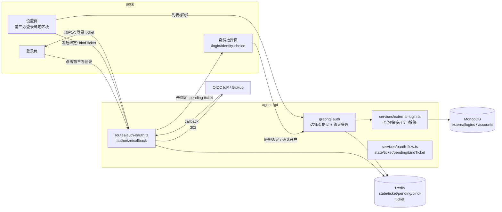
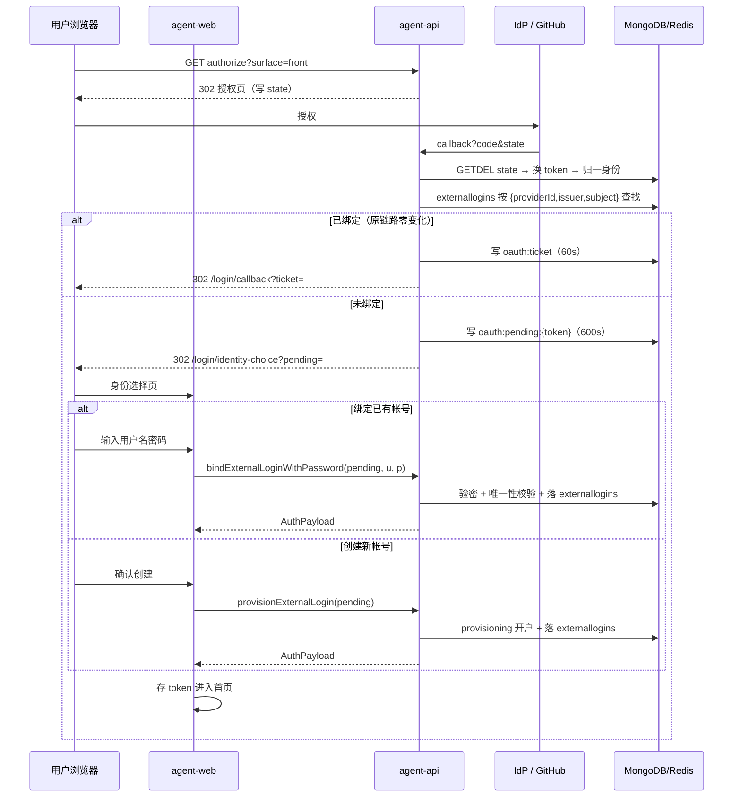
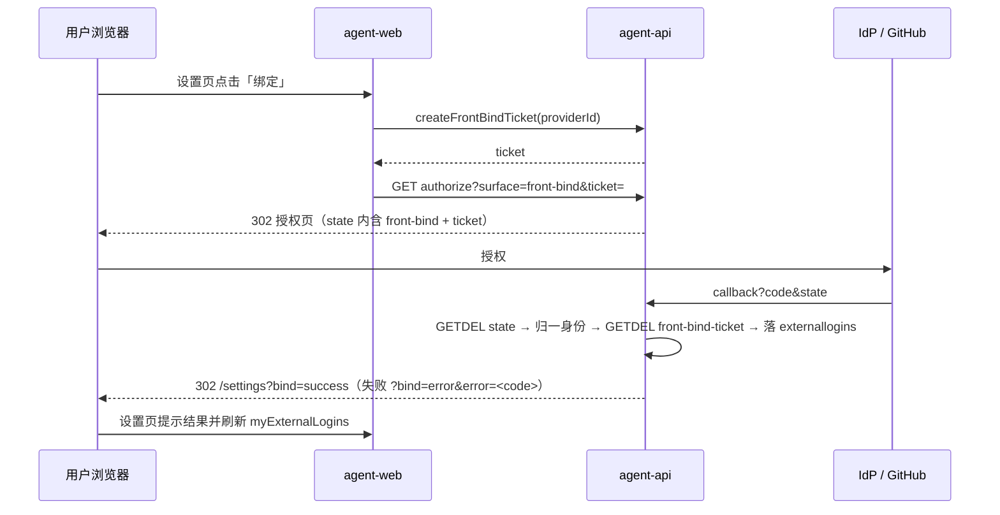

# OIDC 绑定优化 - 技术提案

**功能名称**: OIDC 绑定优化（外部身份首次登录身份选择与前台自助绑定管理）
**关联 PRD**: [[../../../product/shipping/20261114-oidc-binding-optimization.md]]
**技术提案版本**: v1.0
**创建日期**: 2026-11-14
**作者**: z-agent-bot
**feat-branch**: `feat/oidc-binding-optimization`

## 1. 概述

### 1.1 背景

[[20261113-feat-oidc-github-oauth-login.md]]（Issue #503）已上线前台第三方登录：agent-api 承载 OAuth/OIDC 授权与回调唯一入口，`externallogins` 集合以 `{providerId, issuer, subject}` 唯一锚定外部身份；**首次外部登录在 `resolveExternalLogin` 内静默自动开户**（account + user + personal tenant + 计费账户 + 全局工作区），签 JWT 后经一次性 ticket 回前台。

Issue #510 要求两点优化：

1. 外部身份首次进入（`externallogins` 未命中）时不再静默开户，改为落地「身份选择页」：**绑定已有帐号**（验证用户名密码后建立绑定）或**创建新帐号**（沿用原自动开户）。
2. 前台设置支持查看已绑定身份、对已启用 Provider 发起**手动绑定**、以及**解绑**。

### 1.2 目标

1. 前台回调分流重构：`externallogins` 命中 → 原登录票据链路零变化；未命中 → 签发一次性**待绑定身份凭证**（pending ticket），302 至身份选择页。
2. 新增两条免登录 GraphQL 变更完成选择页提交：`bindExternalLoginWithPassword`（验密后绑定并登录）、`provisionExternalLogin`（原自动开户）。
3. 新增前台绑定链路（已登录）：绑定票据 + 新 surface `front-bind`（复用统一回调），以及 `myExternalLogins` / `unbindExternalLogin` 管理面。
4. 安全不变量：外部身份全平台唯一归属；同一账户对同一 Provider 仅一条绑定；无密码账户的最后一条绑定不可解绑。

### 1.3 范围

**做**：
- agent-api：回调分流改造、pending ticket / 前台绑定票据、`external-login` 服务重构（查询/绑定/开户/解绑四入口）、`accounts.passwordless` 标记与迁移、auth GraphQL 契约扩展
- agent-web：身份选择页（新路由）、设置页「第三方登录绑定」区块、绑定结果回跳处理
- 契约：`contracts/auth.graphql` 扩展、`contracts/auth-oauth.md` 增补 surface 与错误码
- 测试：单元 / API（fake IdP）/ E2E

**不做**：
- 后台管理员绑定链路（`admin-bind` / `admin-tickets`）任何变更
- 忘记密码 / 重置密码、账户合并、换绑一步到位（先解绑再绑定）
- 关闭密码登录的全局开关、外部身份角色映射

## 2. 技术架构

### 2.1 系统架构图



admin-api 与 admin-web 本期零变更（`authproviders` 配置、`adminexternallogins` 绑定链路复用现状）；`accounts` 新增字段按「双服务同 PR」约束同步 admin-api 只读镜像。

### 2.2 技术栈

| 层级 | 技术选型 | 说明 |
|------|---------|------|
| 前端 | React 19 + Apollo Client + React Router v7 | agent-web 新增身份选择页与设置区块；无新增依赖 |
| 后端 | Node.js 24 + Express v5 + GraphQL-Yoga | agent-api 单服务变更 |
| 数据库 | MongoDB（Mongoose 9） | `externallogins` 加索引、`accounts` 加字段；无新集合 |
| 缓存 | Redis | pending ticket 与前台绑定票据（GETDEL 一次性，600s） |

### 2.3 模块划分

| 模块 | 职责 | 关键技术点 |
|------|------|-----------|
| `services/oauth-flow.ts` | 新增 pending ticket 与前台绑定票据的签发/消费 | `issuePendingIdentity` / `consumePendingIdentity` / `issueFrontBindTicket` / `consumeFrontBindTicket`，GETDEL 一次性 |
| `services/external-login.ts` | 重构为四入口：`findExternalLogin`（查询）、`bindExternalLoginToUser`（绑定）、`provisionExternalLogin`（开户+绑定）、`unbindExternalLogin`（解绑+防呆） | 唯一索引 E11000 回读判定；`provisionUser` 复用 |
| `routes/auth-oauth.ts` | `front` 回调未命中改道 pending；新增 `front-bind` surface | 错误一律 302；绑定票据消费失败区分错误码 |
| `graphql/schemas/auth.ts` + `resolvers/auth.ts` | 选择页两条免登录变更 + 绑定管理三件套 | 登记 `schemas/index.ts` / `resolvers/index.ts` |
| `models/account.ts` | 新增 `passwordless` 字段 | admin-api 镜像同 PR 同步 |
| `migrations/027-oidc-binding-optimization.ts` | 建 `{userId,providerId}` 唯一索引 + 回填 `passwordless` | 幂等；先建索引后回填 |

## 3. API 设计

### 3.1 API 契约

#### 3.1.1 `contracts/auth.graphql` 扩展

```graphql
# 当前登录用户的外部身份绑定信息
type ExternalLoginInfo {
  id: ID!
  providerId: ID!
  providerType: AuthProviderType!
  providerDisplayName: String!  # provider 被删除时回退外部帐号快照，enabled=false 时仍可展示
  providerEnabled: Boolean!     # false 时前端展示「已停用」
  externalUsername: String!
  displayName: String
  createdAt: String!            # 绑定时间
  lastLoginAt: String           # 最近登录时间（可空）
}

# 待绑定外部身份的展示信息（身份选择页；白名单字段，不含 subject/issuer）
type PendingExternalLoginInfo {
  providerDisplayName: String!
  externalUsername: String!
}

extend type Query {
  # 需登录；当前用户全部外部身份绑定（按 createdAt 升序）
  myExternalLogins: [ExternalLoginInfo!]!
  # 免登录；身份选择页摘要展示（不消费 ticket，仅展示）；ticket 不存在/过期返回 null
  pendingExternalLoginInfo(pendingToken: String!): PendingExternalLoginInfo
}

extend type Mutation {
  # —— 身份选择页（免登录；pendingToken 一次性 600s）——
  # 绑定已有帐号：验密 → 建立 externallogins → 签发 AuthPayload
  # 失败：BAD_USER_INPUT('invalid or expired pending token' | 'Invalid username or password'
  #        | 'identity already bound' | 'provider already bound' | 'provider unavailable')
  bindExternalLoginWithPassword(pendingToken: String!, username: String!, password: String!): AuthPayload!
  # 创建新帐号：沿用原自动开户（派生唯一用户名）→ 建立 externallogins → 签发 AuthPayload
  # 失败：BAD_USER_INPUT('invalid or expired pending token' | 'identity already bound'
  #        | 'provider unavailable' | 'provision failed')
  provisionExternalLogin(pendingToken: String!): AuthPayload!

  # —— 设置页绑定管理（需登录）——
  # 为当前用户签发前台绑定票据（600s）；前端携 ticket 跳
  # GET /api/auth/oauth/:providerId/authorize?surface=front-bind&ticket=<ticket>
  # 失败：'provider unavailable'（不存在/未启用/未开放前台）| 'provider already bound'
  createFrontBindTicket(providerId: ID!): String!
  # 解绑本人一条绑定；无密码账户的最后一条绑定拒绝：
  # 'cannot unbind last login method'；非本人/不存在：'external login not found'
  unbindExternalLogin(id: ID!): Boolean!
}
```

#### 3.1.2 `contracts/auth-oauth.md` 增补

- `surface` 新增第四值 `front-bind`：前台绑定。authorize 必须携带 `ticket=<frontBindTicket>`（缺失 → `invalid_request`）；provider 校验同 `front`（`enabled && enableFrontLogin`）。
- `front` 回调分流变更：`externallogins` 未命中时**不再自动开户**，改为写 `oauth:pending:{token}`（600s）后 302 `{FRONTEND_URL}/login/identity-choice?pending=<token>`。
- `front-bind` 回调：消费 state → 归一身份 → GETDEL `oauth:front-bind-ticket:{ticket}` 取 `{userId, providerId}` → 校验并落 `externallogins` → 302 `{FRONTEND_URL}/settings?bind=success`；失败 `?bind=error&error=<code>`。
- Redis 键新增：

| Key | TTL | 说明 |
|-----|-----|------|
| `oauth:pending:{token}` | 600s | `{providerId, issuer, subject, externalUsername, displayName?, avatarUrl?, failCount}`；GETDEL 一次性（验密失败不消费、仅累加 `failCount`，≥5 次作废） |
| `oauth:front-bind-ticket:{ticket}` | 600s | `{userId, providerId}`；GETDEL 一次性 |

- 错误码新增（302 场景）：

| code | 含义 | 前端文案（agent-web） |
|------|------|---------|
| `already_bound` | 该外部身份已被其他账户绑定（复用既有 code，前台文案独立） | 该身份已被其他账户绑定 |
| `provider_already_bound` | 当前账户已绑定该登录方式 | 当前账户已绑定该登录方式 |
| `invalid_bind_ticket` | 绑定票据无效/过期/已消费（复用既有 code） | 绑定已过期，请重新发起 |

- 身份选择页提交一律走 GraphQL（非 302），错误由 mutation 抛出。

### 3.2 内部接口

无新增服务间接口；admin-api 内部票据/绑定端点（`/internal/auth/admin-tickets`、`/internal/auth/admin-bind`）保持不变。

## 4. 数据模型

### 4.1 数据库设计

#### 集合: `externallogins`（agent-api 唯一写方，变更）

- 新增唯一索引 `uniq_external_login_user_provider` `{userId:1, providerId:1}`（每账户每 Provider 一条）。存量数据天然满足（自动开户每身份一个全新用户），迁移幂等创建。
- 字段不变；`userId`/`accountId` 继续指向被绑定账户（绑定已有帐号时为存量账户 id）。

#### 集合: `accounts`（agent-api 写方，变更）

| 字段 | 类型 | 说明 |
|------|------|------|
| `passwordless` | Boolean | 新增，默认 `false`；`provisionUser(source='oauth')` 创建账户时置 `true`（密码为随机值、用户不可知，等效无密码）。解绑防呆与后续「设置密码」能力的判定锚点 |

- admin-api `models/account.ts` 只读镜像同 PR 增补该字段（既有「双服务同 PR」约束）。
- 迁移 `027-oidc-binding-optimization`（幂等）：
  1. 创建 `externallogins.uniq_external_login_user_provider` 唯一索引；
  2. 回填：`accounts` 中 `_id ∈ externallogins.accountId` 且未设置 `passwordless` 的文档置 `passwordless: true`（存量自动开户账户全部为无密码账户）。

### 4.2 缓存设计

见 3.1.2 新增 Redis 键。既有 `oauth:state` / `oauth:ticket` / discovery / JWKS 缓存不变。

## 5. 技术实现方案

### 5.1 核心流程

首次外部登录（未命中 → 身份选择 → 二选一）：



设置页手动绑定（已登录）：



### 5.2 关键实现点

#### 实现点 1: `external-login.ts` 服务重构

- **描述**：现 `resolveExternalLogin`（命中即登录、未命中即开户）拆分为：
  - `findExternalLogin(identity)`：纯查询；命中更新 `lastLoginAt`/`externalUsername` 快照并返回绑定视图（原命中分支逐字搬移）。
  - `provisionExternalLogin(identity)`：原未命中分支（派生用户名 + `provisionUser(source='oauth')` + 落行 + 冲突回读），仅在「创建新帐号」提交时调用；E11000 回读到他人行 → `identity already bound`（不再幂等吞并）。
  - `bindExternalLoginToUser(user, identity)`：预检 + 落行（`userId/accountId/tenantId` 取自目标用户）；两个唯一索引任一 E11000 → 回读判定 `identity already bound` / `provider already bound`。
  - `unbindExternalLogin(userId, id)`：归属校验 → 防呆（见实现点 4）→ 删除。
- **风险点**：回调与两条 mutation 并发绑同一身份——唯一索引兜底，回读判定输出稳定错误；沿用 #503 单实例 + Redis 身份锁（`withIdentityLock`）不再必要于绑定路径（落行即唯一裁决），开户路径保留身份锁口径。

#### 实现点 2: pending ticket 与身份选择提交（免登录）

- **描述**：`oauth-flow.ts` 新增 `issuePendingIdentity`/`consumePendingIdentity`。payload 含归一身份 + `failCount`。
- **技术细节**：
  - 两条 mutation 先 `GET`（非消费）校验存在性；**绑定/开户成功路径才 GETDEL 消费**。
  - 验密失败：`failCount+1` 回写（保留原 TTL），≥5 次即删除（防密码爆破），文案与 `login` 逐字一致 `Invalid username or password`。
  - 两条 mutation 提交时复核 provider 仍 `enabled && enableFrontLogin`，否则 `provider unavailable`。
  - 成功后签发 JWT 直接经 `AuthPayload` 返回（不再经 60s ticket，因本链路为 GraphQL 直连而非 302）。
- **风险点**：pending 泄漏外部身份信息——payload 仅含外部身份字段，不含任何平台账户数据；身份选择页不渲染其他账户信息。

#### 实现点 3: `front-bind` surface 与绑定票据

- **描述**：已登录用户经 `createFrontBindTicket` 拿票据（payload `{userId, providerId}`，600s），跳 `authorize?surface=front-bind&ticket=`；回调消费票据落绑定。
- **技术细节**：
  - `createFrontBindTicket` 校验：provider `enabled && enableFrontLogin`（否则 `provider unavailable`）；当前用户该 provider 无既有绑定（否则 `provider already bound`）。
  - 回调绑定前复核：票据与 state.providerId 匹配（票据内含 providerId）；用户仍存在；两个唯一性预检（身份未被他人绑定、用户未绑定该 provider）。
  - 结果 302 设置页：`?bind=success` / `?bind=error&error=<code>`；`OAuthSurface` 联合类型扩为 `'front' | 'admin' | 'admin-bind' | 'front-bind'`。
- **风险点**：绑定票据与用户会话分离（票据自身承载 userId），回调无需会话 Cookie，跨浏览器标签页同样成立。

#### 实现点 4: 解绑防呆与 `passwordless` 标记

- **描述**：`unbindExternalLogin` 删除前统计当前用户绑定数；若为最后一条，加载 `accounts` 判定 `passwordless === true` → 抛 `cannot unbind last login method`。
- **技术细节**：`provisionUser(source='oauth')` 创建账户时写 `passwordless: true`；迁移 027 回填存量；`login` 对无密码账户行为不变（随机哈希验密必然失败，无需特判）。
- **风险点**：回填以 `externallogins.accountId` 为准，覆盖全部自动开户账户；后台开户账户不受影响（默认 false）。

#### 实现点 5: 前端（agent-web）

- **描述**：
  - 新路由 `/login/identity-choice`（`IdentityChoicePage`）：读取 `pending` 参数并立即 `replaceState` 清除；经免登录查询 `Query.pendingExternalLoginInfo(token)` 展示外部身份摘要（返回 `{providerDisplayName, externalUsername}` 白名单字段，不存在/过期返回 null → 页面提示「登录状态已过期，请重新登录」并引导回登录页）。
  - 两个操作区：绑定表单（用户名/密码 → `bindExternalLoginWithPassword`）与「创建新帐号」确认（→ `provisionExternalLogin`）；成功 `useAuth.login` 进首页。
  - 设置页「帐号」区块新增「第三方登录绑定」卡片（`components/settings/ExternalLoginBindingSection.tsx`）：`myExternalLogins` 列表 + `authProviders` 过滤出可绑定项（已绑定者置「已绑定」态）+ 解绑二次确认弹窗（复用 `UnbindConfirmDialog` 模式）；`SettingsPage` 识别 `?bind=success|error` → toast 提示并清理 URL。
  - `lib/auth-oauth.ts`：`oauthAuthorizeUrl` surface 联合类型扩展 + 错误码映射增补。
- **风险点**：`pendingExternalLoginInfo` 不消费 ticket，仅展示用途；返回字段白名单（无 subject/issuer）。

#### 实现点 6: GraphQL 登记与契约双写

- 新增 `pendingExternalLoginInfo` / `myExternalLogins` / `bindExternalLoginWithPassword` / `provisionExternalLogin` / `createFrontBindTicket` / `unbindExternalLogin` 必须登记 `schemas/index.ts` 与 `resolvers/index.ts`（手写 schema 串与契约双写，漏登记运行时无效——既有陷阱）。
- `ExternalLoginInfo.providerDisplayName/providerEnabled` 为类型级 resolver（按 providerId 查 `AuthProvider` 只读镜像，逐行查询，绑定数量小无 N+1 之忧），登记 `resolvers/index.ts` 对应键。

## 6. 技术决策

### 6.1 决策列表

| 决策 | 选项 A | 选项 B | 最终选择 | 原因 |
|------|--------|--------|---------|------|
| D1 未命中分流载体 | URL query 携带身份摘要 | Redis pending ticket（600s GETDEL） | B | 身份不进 URL/浏览器历史；与 state/ticket 模式一致；可携带 failCount 防爆破 |
| D2 选择页提交通道 | REST 302 继续 | GraphQL mutation 直连 | B | 表单校验错误需就地展示（302 无法携带表单状态）；成功后直接返 AuthPayload 少一次兑换 |
| D3 绑定已有帐号验密 | 验证目标账户密码 | 邮箱验证/管理员审批 | A | Issue 明确要求；平台无邮箱基础设施 |
| D4 每账户每 Provider 绑定数 | 仅一条 | 允许多条 | A | 与后台 `adminexternallogins` `{adminUserId,providerId}` 唯一口径一致；UI 呈现与换绑语义简单（先解后绑） |
| D5 解绑防呆判定 | `accounts.passwordless` 标记 | 提示风险但放行 | A（标记+拒绝） | 无密码账户解绑最后一条即永久失登录能力（无找回密码能力）；标记同时服务后续「设置密码」 |
| D6 前台绑定票据 | 复用登录态 Cookie 直发 | 独立 bindTicket（600s） | B | 与 `admin-bind` 既有模式对齐；OAuth 回跳不依赖会话 Cookie，跨标签页/隐身窗口成立 |
| D7 pending 验密失败处理 | 立即作废 | 计次保留（≥5 次作废） | B | 输错密码是常态，立即作废体验差；计次兜底爆破风险 |
| D8 已绑定身份再次首登 | 幂等吞并为登录 | 明确拒绝 | A（保持现状） | 命中分支链路零变化（PRD 兼容性要求） |

### 6.2 依赖与约束

| 类型 | 内容 | 说明 |
|------|------|------|
| 依赖 | #503 全部基础设施（authproviders / oauth-flow / oidc-client / github-oauth / provisioning） | 已合并入 main |
| 依赖 | admin-api `models/account.ts` 只读镜像 | 字段双服务同 PR |
| 约束 | 单实例部署 | 与既有 state/ticket/身份锁口径一致 |
| 约束 | 手写 GraphQL schema 与契约双写、resolver 登记 | 既有陷阱，契约测试兜底 |

## 7. 项目结构

```
servers/agent-api/src/
├── routes/auth-oauth.ts                  # 改：front 未命中改道 pending；新增 front-bind surface
├── services/
│   ├── oauth-flow.ts                     # 改：pending / front-bind-ticket 签发消费
│   ├── external-login.ts                 # 改：四入口重构（find/bind/provision/unbind）
│   └── provisioning.ts                   # 改：source='oauth' 写 passwordless
├── models/
│   ├── account.ts                        # 改：+passwordless
│   └── external-login.ts                 # 改：+uniq_external_login_user_provider 索引声明
├── migrations/
│   └── 027-oidc-binding-optimization.ts  # 新：唯一索引 + passwordless 回填
└── graphql/
    ├── schemas/auth.ts                   # 改：ExternalLoginInfo + 2 Query + 4 Mutation
    └── resolvers/auth.ts                 # 改：登记 resolvers/index.ts

servers/admin-api/src/models/account.ts   # 改：只读镜像 +passwordless（同 PR）

apps/agent-web/src/
├── pages/IdentityChoicePage.tsx          # 新：身份选择页
├── pages/SettingsPage.tsx                # 改：帐号区块挂载绑定卡片 + ?bind 结果处理
├── components/settings/ExternalLoginBindingSection.tsx  # 新：列表/绑定/解绑
└── lib/auth-oauth.ts                     # 改：surface 扩展 + 错误码映射

contracts/
├── auth.graphql                          # 改：扩展类型与操作
└── auth-oauth.md                         # 改：front-bind surface + pending/front-bind-ticket + 错误码

tests/api/src/agent-api/auth-oauth.test.ts    # 改：新增分流/绑定/解绑用例
tests/e2e/src/auth-oauth.spec.ts              # 改：选择页与设置页流程用例
```

## 8. 测试策略

### 8.1 测试覆盖要求

- 单元测试：`oauth-flow` 新票据生命周期、`external-login` 四入口（含 E11000 回读判定、防呆矩阵）、`provisioning` passwordless 写入、迁移 027 幂等（真库）。
- API 测试（fake IdP）：首登 → pending → 绑定已有帐号（正/误密码/计次作废/身份被抢绑）；→ 创建新帐号；front-bind 全流程（票据缺失/过期/重复绑定/身份占用）；解绑（正常/最后一条无密码拒绝/非本人）。
- 契约测试：`auth.ts` schema 与 `contracts/auth.graphql` 双写一致；resolver 登记守卫（`resolvers/index.test.ts`）。
- 回归：#503 既有 OAuth 套件（已绑定登录、admin/admin-bind、ticket 兑换）全绿；`internal-users` 套件零回归。

### 8.2 测试类型

| 类型 | 工具 | 覆盖范围 |
|------|------|---------|
| 单元测试 | Vitest | 纯函数与服务（mongodb-memory-server/真库按既有模式） |
| API 测试 | tests/api | fake IdP 全流程（复用 `fake-oidc-server.ts`） |
| E2E | tests/e2e（Playwright） | 选择页二选一、设置页绑定/解绑/防呆提示 |

TDD：红-绿-重构循环，先写迁移与服务测试，再实现。

## 9. 部署方案

无新增服务与 env；迁移 027 随 agent-api 启动幂等执行。发布顺序无特殊要求（旧版本不回读 `passwordless`）。

## 10. 验收标准

- [ ] 技术方案评审通过
- [ ] Contract 评审通过（auth.graphql / auth-oauth.md）
- [ ] 代码实现完成（agent-api / agent-web / admin-api 镜像）
- [ ] 单元测试覆盖达标
- [ ] API 测试通过（fake IdP 全流程）
- [ ] E2E 测试通过（身份选择页与设置页绑定管理）
- [ ] 存量测试零回归（#503 OAuth 套件、internal-users、auth 既有套件）

## 11. 相关文档

- [[../../../product/shipping/20261114-oidc-binding-optimization.md]] — 关联 PRD
- [[20261113-feat-oidc-github-oauth-login.md]] — 前置提案：自定义 OIDC 登录与 GitHub OAuth 登录
- [GitHub Issue #510](https://github.com/Deliay/z-agent-gear/issues/510)
- [[20261027-feat-multi-tenant-phase1.md]] — 三层帐号模型背景
