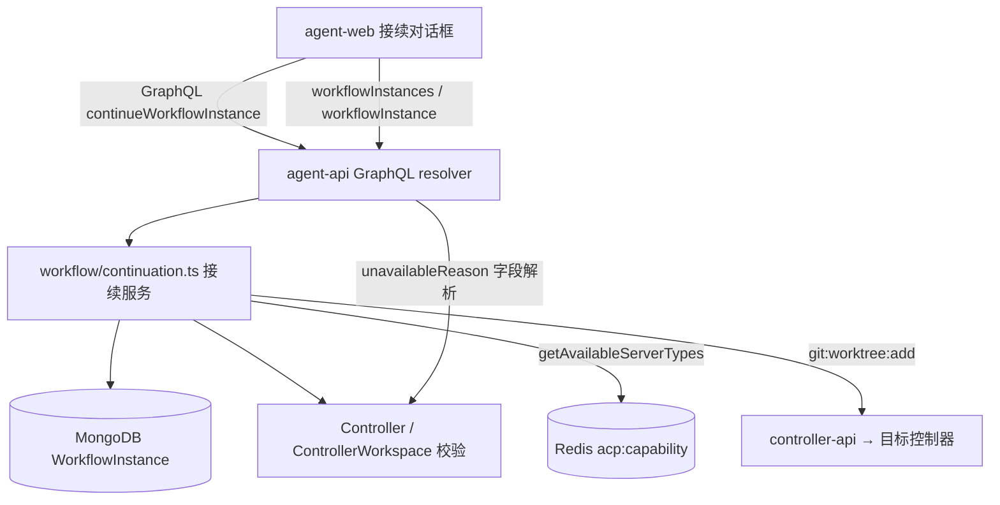
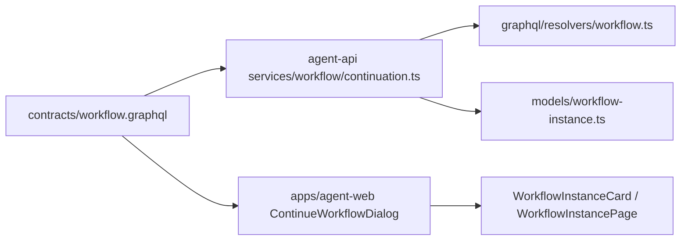
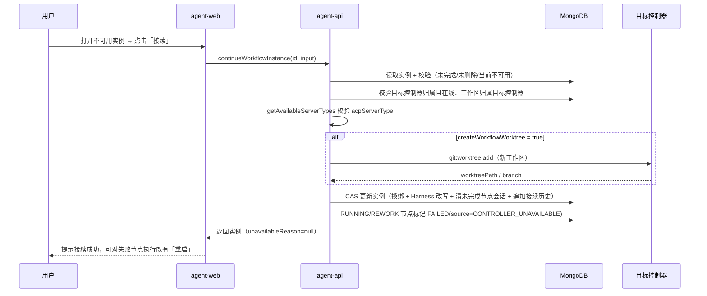

# 已实例化的工作流接续 - 技术提案

**功能名称**: 已实例化的工作流接续
**关联 PRD**: [[../../product/draft/20261114-workflow-instance-continuation.md]]
**技术提案版本**: v1.1
**创建日期**: 2026-11-14
**作者**: Agent
**feat-branch**: `feat/workflow-instance-continuation`

> 变更记录：v1.1（2026-11-14）按 PR #520 评审意见，Harness 改写由「统一一个 Harness」改为逐节点映射（`harnessMappings`），契约、实现点与决策表同步修订。

## 1. 概述

### 1.1 背景

工作流实例（`WorkflowInstance`）在实例化时绑定 `controllerId` 与 `workspaceId`（ControllerWorkspace），节点会话、Worktree、能力校验全部锚定该控制器。当控制器离线（`Controller.status != 'online'`）或被删除（Controller 文档不存在）后，实例不可用：节点无法流转、会话不可达，且现状没有任何迁移出口（`contracts/workflow.graphql` 中 `WorkflowInstance.controller` 注释已声明「可能已被删除，消费方须判空」，但前端未消费该场景）。

本提案对应 GitHub Issue Deliay/z-agent-gear#513：为不可用实例提供「接续」能力——选择新控制器、新工作路径、是否创建新 Worktree（默认勾选）、AI 节点 Harness，将实例迁移到新环境恢复流转。

### 1.2 目标

- 契约层新增实例不可用原因透出与 `continueWorkflowInstance` mutation；
- agent-api 实现接续服务：校验、换绑、可选 Worktree 创建、AI 节点 Harness 改写、接续历史记录；
- agent-web 在列表与详情展示不可用标识与「接续」入口，新增接续对话框；
- 存量可用实例行为零变化。

### 1.3 范围

做：
- 实例不可用判定（控制器离线 / 控制器已删除）与透出；
- 接续 mutation 与服务端编排（含新 Worktree 创建、逐节点 Harness 映射改写、接续历史）；
- 前端不可用标识、「接续」按钮与接续对话框（逐节点 Harness 选择）。

不做：
- 原控制器残留 Worktree / 文件的远程清理与跨控制器文件拷贝（原控制器不可达，物理上无法保证；界面文案提示用户自行处理）；
- 已完成（`finishedAt` 非空）或已删除实例的接续（无意义，拒绝）。

## 2. 技术架构

### 2.1 系统架构图



### 2.2 技术栈

| 层级 | 技术选型 | 说明 |
|------|---------|------|
| 前端 | React + TypeScript + Apollo Client | apps/agent-web，复用 InstantiateWorkflowDialog 的选择器与查询模式 |
| 后端 | Node.js + Express + GraphQL + Mongoose | servers/agent-api，新增 workflow/continuation.ts |
| 数据库 | MongoDB | WorkflowInstance 扩展字段，迁移脚本补历史数据（如需） |
| 缓存/通道 | Redis | 能力缓存读取与 git:worktree:add 命令通道（复用现状） |

### 2.3 模块划分



| 模块 | 职责 | 关键技术点 |
|------|------|-----------|
| contracts/workflow.graphql | 不可用原因枚举与接续 mutation 契约 | 双写手写 schema（resolvers 侧） |
| services/workflow/continuation.ts | 接续校验与编排 | 复用 capability、worktree 创建、CAS 更新 |
| models/workflow-instance.ts | 模型扩展 | continuationHistory 子文档数组 |
| resolvers/workflow.ts | unavailableReason 字段解析 + mutation 接线 | controller 缺失/状态判定 |
| apps/agent-web | 不可用标识 + 接续对话框 | 复用 GET_WORKSPACES / DETECT_GIT_REPO / GET_ACP_CAPABILITIES |

## 3. API 设计

### 3.1 API 契约

契约文件：`contracts/workflow.graphql`（手写 schema 同步双写）。

#### 枚举与字段扩展

```graphql
# 工作流实例不可用原因（null = 可用）
enum WorkflowInstanceUnavailableReason {
  # 控制器离线（Controller.status != online）
  CONTROLLER_OFFLINE
  # 控制器已被删除（Controller 文档不存在）
  CONTROLLER_DELETED
}

type WorkflowInstance {
  # ...既有字段不变...
  # 实例不可用原因；null = 可用。不可用时仅允许归档/删除/查看与「接续」
  unavailableReason: WorkflowInstanceUnavailableReason
  # 接续历史（时间升序）；无接续过为空数组
  continuationHistory: [WorkflowContinuation!]!
}

type WorkflowContinuation {
  fromControllerId: ID!
  fromWorkspaceId: ID!
  toControllerId: ID!
  toWorkspaceId: ID!
  at: String!
}
```

#### Mutation: continueWorkflowInstance

```graphql
# 逐节点 Harness 映射：覆盖实例中全部未完成 AI 节点
input NodeHarnessMappingInput {
  # 实例节点 id（仅允许 AI 类型且未完成的节点）
  nodeId: ID!
  # 该节点接续后使用的 Harness（必须在目标控制器可用能力内）
  acpServerType: String!
}

input ContinueWorkflowInstanceInput {
  # 目标控制器（必须归属当前用户且在线）
  controllerId: ID!
  # 目标项目工作区（ControllerWorkspace id，必须归属目标控制器；
  # 新路径由前端先经 createWorkspace 建立后传入）
  workspaceId: ID!
  # 是否在新工作区创建全新工作流 Worktree（默认 true；工作区非 Git 仓库时拒绝）
  createWorkflowWorktree: Boolean
  # 逐节点 Harness 映射：必须恰好覆盖全部未完成 AI 节点（不多不少）；
  # 每个 acpServerType 逐一校验在目标控制器可用能力内
  harnessMappings: [NodeHarnessMappingInput!]!
}

type Mutation {
  # 已实例化工作流接续：仅当实例处于不可用状态（unavailableReason 非空）时允许；
  # 已完成/已删除实例拒绝；成功后实例换绑新控制器/工作区并恢复流转
  continueWorkflowInstance(id: ID!, input: ContinueWorkflowInstanceInput!): WorkflowInstance!
}
```

- **请求**: `mutation { continueWorkflowInstance(id: "...", input: { controllerId, workspaceId, createWorkflowWorktree: true, harnessMappings: [{ nodeId: "n1", acpServerType: "kimi_code" }, { nodeId: "n2", acpServerType: "opencode" }] }) { id unavailableReason } }`
- **响应**: 200 返回更新后的 WorkflowInstance；错误以 GraphQL errors 返回（控制器不可用/归属错误/映射未覆盖全部未完成 AI 节点/含非 AI 或已完成节点/某 Harness 不支持/非 Git 工作区勾选 Worktree/实例已完成或已删除）。

### 3.2 内部接口

- `services/workflow/continuation.ts` 导出 `continueWorkflowInstance(userId, instanceId, input)`，供 resolver 调用；
- 复用 `getAvailableServerTypes(controllerId, userId)`（capability.ts）逐一校验映射中的目标 Harness；
- 复用实例服务内既有 Worktree 创建路径（`git:worktree:add` Redis 命令，含 worktreeDir 解析与随机后缀去重），抽取为可复用函数供两处调用；
- `unavailableReason` 判定函数 `resolveUnavailableReason(instance)`：controller 文档缺失 → `CONTROLLER_DELETED`；`status !== 'online'` → `CONTROLLER_OFFLINE`；否则 `null`。供 `workflowInstances`/`workflowInstance` 字段解析复用。

## 4. 数据模型

### 4.1 数据库设计

#### 集合: workflowinstances（扩展）

| 字段 | 类型 | 说明 |
|------|------|------|
| continuationHistory | 子文档数组 | `{ fromControllerId, fromWorkspaceId, toControllerId, toWorkspaceId, at }`，默认 `[]`，接续时 append |
| nodes[].agentConfig.acpServerType | String（既有） | 接续时仅改写未完成（status != DONE）AI 节点的该字段 |
| nodes[].sessionId | ObjectId（既有） | 接续时清空未完成节点的 sessionId（旧会话随原控制器不可达；已完成节点保留供只读回看） |
| controllerId / workspaceId | ObjectId（既有） | 接续成功时 CAS 更新为新值 |
| workflowWorktreePath / workflowWorktreeBranch | String（既有） | 勾选创建 Worktree 时更新为新值；未勾选时清空（不再指向旧控制器路径） |

存量数据零迁移：`continuationHistory` 缺省按空数组处理（Mongoose default）。

### 4.2 缓存设计

无新增缓存。目标 Harness 校验复用 Redis `acp:capability:<controllerId>`（TTL 3600，缺失回源 acp:check，现状口径不变）。

## 5. 技术实现方案

### 5.1 核心流程



### 5.2 关键实现点

#### 实现点 1: 不可用判定透出

- **描述**: `resolveUnavailableReason` 在 `workflowInstances` 列表与 `workflowInstance` 详情的字段解析中统一计算；controller 经 `Controller.findById` 批量/单条读取。
- **技术细节**: 列表场景按 controllerId 归组批量查询避免 N+1；判定纯函数便于单测。
- **风险点**: 控制器「短暂离线恢复在线」场景，标识随查询实时刷新自然消失，无状态残留。

#### 实现点 2: 接续服务编排

- **描述**: `continueWorkflowInstance` 串行执行校验 → Worktree 创建 → CAS 更新。
- **技术细节**:
  - 前置校验任一失败即整体拒绝，实例零改动；
  - Worktree 创建成功但 CAS 更新失败时，对新创建的 Worktree 执行 `git:worktree:remove` 回滚（复用既有清理路径），回滚失败记录告警日志；
  - 未完成 AI 节点 `agentConfig.acpServerType` 按 `harnessMappings` 逐节点改写（nodeId 精确匹配，映射未覆盖或含多余/非 AI/已完成节点即整体拒绝）；`initNewWorktree`/modeId/modelId 保持原快照不变；
  - 更新条件携带 `controllerId: <旧值>` 做 CAS，防并发重复接续。
- **风险点**: 目标控制器在 Worktree 创建后离线——CAS 已提交则实例可用性仍由 `unavailableReason` 动态判定兜底，可再次接续。

#### 实现点 3: 进行中节点收敛

- **描述**: 接续前处于 RUNNING/REWORK 的 AI 节点，其会话随原控制器不可达已死亡；接续时统一标记 `FAILED`，`failInfo.source = 'CONTROLLER_UNAVAILABLE'`，用户接续后走既有 `restartNode` 拉起新会话。
- **技术细节**: 复用引擎既有失败事件与状态转移；RETRY_FAILED 节点保持原状态（restartNode 已支持）。
- **风险点**: 无——restartNode 对 RUNNING/FAILED 均已支持，前端按钮现状可用。

#### 实现点 4: 前端接续对话框

- **描述**: 新增 `ContinueWorkflowDialog`：控制器选择（在线且归属当前用户）→ 工作路径选择（目标控制器下既有工作区，或 browseFolder/createFolder 新建后经 `createWorkspace` 落库）→ Worktree 勾选（默认勾选，`detectGitRepo` 非 Git 时置灰并提示）→ 逐节点 Harness 映射列表（列出实例全部未完成 AI 节点，每个节点一个下拉选择器，选项来自 `GET_ACP_CAPABILITIES`，默认沿用该节点原 Harness 若在可用清单内，否则留空待选）。
- **技术细节**: 选择器与查询模式复用 `InstantiateWorkflowDialog`；`WorkflowInstanceCard` 与 `WorkflowInstancePage` 依据 `unavailableReason` 渲染徽标与「接续」按钮，并禁用流转类操作（归档/删除/查看保持可用）。
- **风险点**: 提交后需 `refetch` 实例详情与列表保证标识即时刷新。

## 6. 技术决策

### 6.1 决策列表

| 决策 | 选项 A | 选项 B | 最终选择 | 原因 |
|------|--------|--------|---------|------|
| 不可用判定位置 | 前端自行判 controller 为空/离线 | 服务端透出 unavailableReason | B | 与 Session readOnlyReason 同构，规则集中后端，前端零规则重复 |
| 新工作路径建工作区 | continueWorkflowInstance 内联建 workspace | 前端先调 createWorkspace 再传 workspaceId | B | 复用既有 mutation 与校验，接续契约保持最小 |
| 进行中节点处理 | 保持 RUNNING 等待超时 | 接续时标记 FAILED(CONTROLLER_UNAVAILABLE) | B | 状态明确，用户经既有「重启」恢复，无幽灵 RUNNING |
| Harness 改写粒度 | 逐节点映射 | 统一一个 Harness | A | 按评审裁决：按当前实例逐节点配置 AI 节点 Harness，保留各节点差异化执行工具 |
| 旧 Worktree 处理 | 尝试远程清理 | 不清理，文案提示 | B | 原控制器不可达，清理无法保证，避免半吊子副作用 |

### 6.2 依赖与约束

| 类型 | 内容 | 说明 |
|------|------|------|
| 依赖 | `getAvailableServerTypes`（capability.ts） | 目标 Harness 校验 |
| 依赖 | `git:worktree:add` Redis 命令通道 | 新 Worktree 创建 |
| 依赖 | `createWorkspace` / `browseFolder` / `detectGitRepo` 既有契约 | 新工作路径建立与 Git 判定 |
| 约束 | 已完成/已删除实例拒绝接续 | 无流转意义 |
| 约束 | 已完成节点状态与产物零改动 | 进度保留是核心承诺 |

## 7. 项目结构

```
contracts/
└── workflow.graphql                      # 契约扩展
servers/agent-api/
└── src/
    ├── models/workflow-instance.ts       # continuationHistory 子文档
    ├── services/workflow/
    │   ├── continuation.ts               # 新增：接续服务
    │   ├── continuation.test.ts          # 新增：TDD 用例
    │   └── instance.ts                   # 抽取可复用 Worktree 创建函数
    └── graphql/
        ├── schemas/workflow.ts           # 手写 schema 双写
        └── resolvers/workflow.ts         # unavailableReason 解析 + mutation 接线
apps/agent-web/
└── src/
    ├── components/workflow/
    │   ├── ContinueWorkflowDialog.tsx    # 新增：接续对话框
    │   ├── WorkflowInstanceCard.tsx      # 不可用徽标 + 接续按钮
    │   └── __tests__/                    # 组件用例
    ├── pages/WorkflowInstancePage.tsx    # 详情页提示条与入口
    └── graphql/workflow.ts               # 查询/变更定义
tests/
├── api/                                  # continueWorkflowInstance 行为用例
└── e2e/                                  # 接续全链路用例
```

## 8. 测试策略

### 8.1 测试覆盖要求

- 接续服务单测覆盖全部校验分支与编排顺序；
- API 测试覆盖 `continueWorkflowInstance` 成功/失败路径与 `unavailableReason` 透出；
- E2E 覆盖「控制器离线 → 接续 → 重启节点继续流转」链路。

### 8.2 测试类型

| 类型 | 工具 | 覆盖范围 |
|------|------|---------|
| 单元测试 | Vitest（agent-api） | 不可用判定、接续校验、Harness 改写、CAS/回滚 |
| 组件测试 | Vitest（agent-web） | 徽标/按钮显隐、对话框默认值与提交门控 |
| API 测试 | tests/api | mutation 契约行为 |
| E2E 测试 | tests/e2e (Playwright) | 接续全链路 |

## 9. 部署方案

### 9.1 环境规划

| 环境 | 用途 | 部署方式 |
|------|------|---------|
| 本地 Aspire | 开发验证 | `aspire start` |
| 内网环境 | 验收 | Docker Compose（aspire/manifest） |

### 9.2 配置管理

无新增配置项；存量实例无需迁移脚本（continuationHistory 缺省空数组）。

## 10. 验收标准

- [ ] 技术方案评审通过
- [ ] Contract 评审通过（workflow.graphql 双写一致）
- [ ] 代码实现完成
- [ ] 单元测试覆盖达标（接续服务全分支）
- [ ] API 测试通过
- [ ] E2E 测试通过（离线 → 接续 → 恢复流转）
- [ ] 存量可用实例回归零变化

## 11. 相关文档

- 关联 PRD：[[../../product/draft/20261114-workflow-instance-continuation.md]]
- 来源 Issue：https://github.com/Deliay/z-agent-gear/issues/513
- [[20261103-feat-workflow-node-interrupt-retry.md]]（节点中断重试与 restartNode 口径）
- [[20261104-feat-session-management-optimization.md]]（readOnlyReason 判定同构参考）
- [[20261023-feat-workflow-github-pr-callback.md]]（工作流 PR 联动）
- 开发规范：[[../common-rules.md]]、[[../backend-rules.md]]、[[../frontend-rules.md]]
