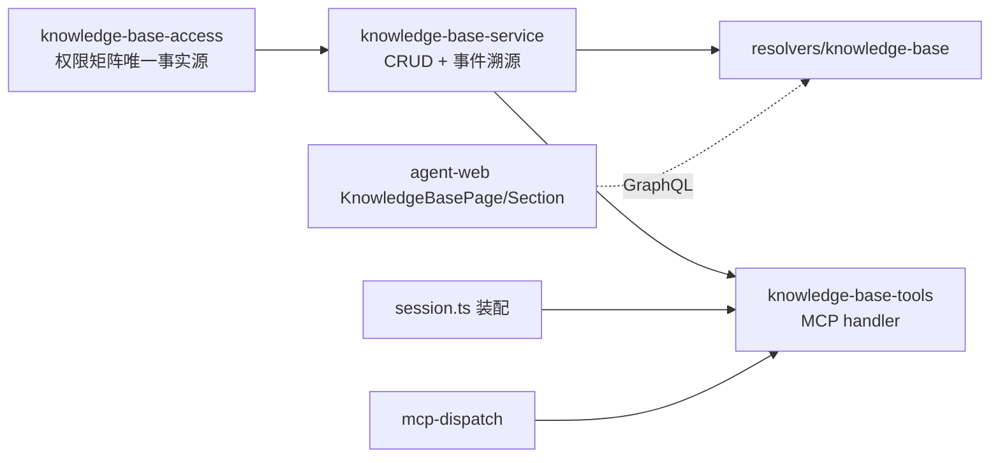
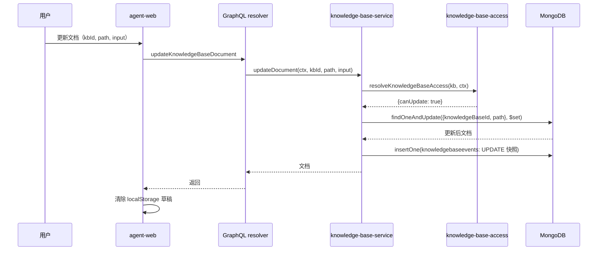
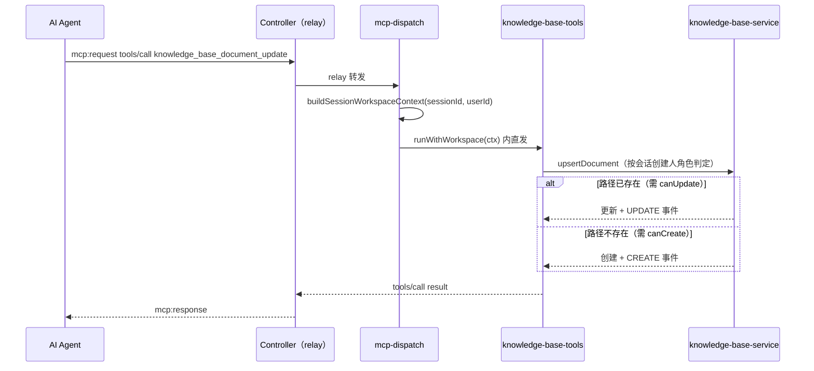

# 知识库 - 技术提案

**功能名称**: 知识库
**关联 PRD**: [[../../product/shipping/20261115-knowledge-base.md]]
**技术提案版本**: v1.0
**创建日期**: 2026-11-15
**作者**: z-agent-bot
**feat-branch**: `feat/knowledge-base`

## 1. 概述

### 1.1 背景

需求来源 [Issue #495](https://github.com/Deliay/z-agent-gear/issues/495)，PRD 见 [[../../product/shipping/20261115-knowledge-base.md]]。依赖已落地能力：

- **多租户二期**（提案 [[20261028-feat-multi-tenant-phase2.md]]）：`workspaces`（global/normal）、`tenantmembers.role`（admin/developer）、`WorkspaceContext`（`id/tenantId/type/role/readOnly/globalWorkspaceId`，ALS 承载）、`buildSessionWorkspaceContext`（MCP 链路按会话创建人构造上下文）；
- **平台 MCP 机制**：`McpServer transport=platform` + `mcp-dispatch` 本地直发 + `sessionService.create` 公共路径恒装配（`agent-valut-tools` / `agent-custom-tools` / `agent-session-preview-tools` 先例，见 servers/agent-api/AGENTS.md）；
- **前端基座**：Sidebar 四折叠分区（UI 优化四期）、`components/session/markdown` Markdown 渲染管线、`useWorkspaceAccess` 只读收敛。

### 1.2 目标

- 工作区级知识库：库（仅名称 + 权限模式）→ 文档（路径唯一 + 标题/标签/描述/Markdown 内容），路径以 `/` 开头、库内唯一。
- 类 git 版本化存储：创建/更新/删除全生命周期事件留痕（含完整快照），删除文档不删历史、同路径重建历史延续；库级全量历史按时间倒序可查。
- 四档权限模式 × 租户角色两档的显式矩阵；全局工作区知识库对同租户其他工作区可见，读写按库自身权限模式判定（**有意偏离**「全局工作区 developer 只读」的通用口径，见 D2）。
- 平台 MCP `agent-knowledge-base-tools`：列表/路径列表/获取/更新/删除 + 创建库（按会话创建人角色门控），可见性与界面完全同口径。
- agent-web：侧边栏「知识库」分区（树 + 创建 + 设置齿轮）、文档预览页（面包屑/标题/描述/标签/Markdown，限宽靠左）、分栏编辑（实时预览 + localStorage 草稿恢复）、历史版本抽屉、知识库设置。

### 1.3 范围

**做**：
- agent-api：三集合模型与迁移、`knowledge-base-access` 权限纯函数、`knowledge-base-service` 唯一读写口、GraphQL schema/resolver、平台 MCP `agent-knowledge-base-tools`（装配 + dispatch 路由）。
- contracts：新增 `knowledge-base.graphql`；增补 `mcp-server.graphql`（platform 注释）与 `agent-session-websocket.md`（平台路由表）。
- agent-web：侧边栏「知识库」分区、`/knowledge-bases/:kbId/*` 页面（预览/编辑/历史/设置）、GraphQL 查询/变更、草稿缓存 lib。
- tests/api、tests/e2e 套件。

**不做**：
- 历史版本一键回滚（可人工复制历史内容另行保存）、路径改名/移动（删除 + 新建替代）。
- 按成员/按路径的细粒度授权、知识库全文检索、跨租户共享。
- admin-api / admin-web 任何变更（后台不做多租户与业务资源设计，沿用既有口径）。

## 2. 技术架构

### 2.1 系统架构图

```mermaid
graph TD
    subgraph agent-web[apps/agent-web]
        SB[Sidebar 知识库分区<br/>KnowledgeBaseSection]
        PG[KnowledgeBasePage<br/>/knowledge-bases/:kbId/*]
        ED[KnowledgeBaseEditor<br/>分栏编辑 + 草稿缓存]
        HD[KnowledgeBaseHistoryDrawer]
    end
    subgraph agent-api[servers/agent-api]
        RS[graphql/resolvers/knowledge-base.ts]
        SV[services/knowledge-base-service.ts<br/>唯一读写口]
        AC[services/knowledge-base-access.ts<br/>权限矩阵纯函数]
        MCP[services/knowledge-base-tools.ts<br/>平台 MCP agent-knowledge-base-tools]
        DISP[mcp-dispatch platform 直发]
        SESS[sessionService.create 恒装配]
    end
    subgraph mongo[(MongoDB)]
        KB[(knowledgebases)]
        DOC[(knowledgebasedocuments)]
        EVT[(knowledgebaseevents)]
        MS[(mcpservers)]
    end
    SB -->|knowledgeBaseTree| RS
    PG -->|document / events| RS
    ED -->|create/update| RS
    RS --> SV --> AC
    SV --> KB
    SV --> DOC
    SV --> EVT
    DISP -->|runWithWorkspace 会话上下文| MCP --> SV
    SESS --> MS
    AI[AI Agent 会话] -->|mcp:request relay| DISP
```

### 2.2 技术栈

| 层级 | 技术选型 | 说明 |
|------|---------|------|
| 前端 | React 19 + TypeScript + Tailwind v4 + Apollo Client + React Router v7 | 沿用 agent-web 既有分层；预览复用 `components/session/markdown` |
| 后端 | Node.js 24 + Express v5 + GraphQL-Yoga + Mongoose | 沿用 agent-api 分层（models/services/graphql） |
| 数据库 | MongoDB | 新增 `knowledgebases`/`knowledgebasedocuments`/`knowledgebaseevents` 三集合 |
| 契约 | GraphQL SDL（`contracts/*.graphql`）+ Markdown（`contracts/*.md`） | 契约先行，schema 双写 |
| 测试 | Vitest（单测 + tests/api）+ Playwright（tests/e2e） | TDD 红-绿-重构 |

### 2.3 模块划分



| 模块 | 职责 | 关键技术点 |
|------|------|-----------|
| `services/knowledge-base-access.ts` | 四档模式 × 角色的访问判定（纯函数，唯一事实源） | 输入 KB + WorkspaceContext，输出 `{visible, canRead, canCreate, canUpdate, canDelete, canManage}` |
| `services/knowledge-base-service.ts` | 库/文档/事件唯一读写口 | `requireContext()` 守卫；事件与写同事务语义（先写业务行再追加事件，失败整体抛错）；路径归一校验 |
| `models/knowledge-base{,-document,-event}.ts` | 三集合 Mongoose 模型 | 无 `userId` 主维度（customtools 同口径）：不挂 `applyTenantScope`/`applyWorkspaceScope`，`tenantId` 服务层显式写入，可见性由 access 层保证（D2） |
| `services/knowledge-base-tools.ts` | 平台 MCP `agent-knowledge-base-tools` | `ensure*Server` upsert；tools/list 按角色门控 `knowledge_base_create` |
| `graphql/schemas/knowledge-base.ts` + `graphql/resolvers/knowledge-base.ts` | GraphQL 入口 | 均须登记 `schemas/index.ts` / `resolvers/index.ts`（漏登记运行时无效） |
| agent-web `components/knowledge-base/*`、`pages/KnowledgeBasePage.tsx` | 界面 | 树/预览/编辑/历史/设置；`lib/knowledge-base-draft.ts` 草稿缓存 |

## 3. API 设计

### 3.1 API 契约

**新增 `contracts/knowledge-base.graphql`**（要点摘录；错误文案白名单逐字列入契约注释，resolver `wrap()` 透传，未命中收敛 `internal error`）：

```graphql
enum KnowledgeBasePermissionMode {
  NONE          # 仅管理员可见
  READ_ONLY     # 非管理员只读
  UPDATE_ONLY   # 非管理员可读 + 创建 + 更新（不可删除）
  FULL_ACCESS   # 非管理员 CRUD
}

enum KnowledgeBaseEventOp { CREATE UPDATE DELETE }

type KnowledgeBaseAccess {
  canRead: Boolean!
  canCreate: Boolean!
  canUpdate: Boolean!
  canDelete: Boolean!
  canManage: Boolean!   # 重命名/权限模式/删除库（恒 = 当前用户是租户管理员）
}

type KnowledgeBase {
  id: ID!
  name: String!
  permissionMode: KnowledgeBasePermissionMode!
  global: Boolean!          # 归属工作区是否本租户全局工作区（来源徽标）
  myAccess: KnowledgeBaseAccess!
  createdAt: String!
  updatedAt: String!
}

type KnowledgeBaseDocumentMeta {
  path: String!
  title: String!
  tags: [String!]!
  description: String!
  updatedAt: String!
}

type KnowledgeBaseDocument {
  path: String!
  title: String!
  tags: [String!]!
  description: String!
  content: String!
  createdByName: String!
  updatedByName: String!
  createdAt: String!
  updatedAt: String!
}

type KnowledgeBaseTreeItem {
  knowledgeBase: KnowledgeBase!
  documents: [KnowledgeBaseDocumentMeta!]!   # 全库文档元信息（侧边栏树一次拉取）
}

type KnowledgeBaseEvent {
  id: ID!
  path: String!
  op: KnowledgeBaseEventOp!
  title: String!
  tags: [String!]!
  description: String!
  content: String!          # 快照（DELETE 保留删除前最后内容）
  actorName: String!
  createdAt: String!
}

extend type Query {
  knowledgeBases: [KnowledgeBase!]!
  knowledgeBaseTree: [KnowledgeBaseTreeItem!]!
  knowledgeBaseDocuments(knowledgeBaseId: ID!, prefix: String): [KnowledgeBaseDocumentMeta!]!
  knowledgeBaseDocument(knowledgeBaseId: ID!, path: String!): KnowledgeBaseDocument
  knowledgeBaseEvents(knowledgeBaseId: ID!, path: String, limit: Int, before: String): [KnowledgeBaseEvent!]!
}

extend type Mutation {
  createKnowledgeBase(name: String!): KnowledgeBase!
  renameKnowledgeBase(id: ID!, name: String!): KnowledgeBase!
  updateKnowledgeBasePermission(id: ID!, permissionMode: KnowledgeBasePermissionMode!): KnowledgeBase!
  deleteKnowledgeBase(id: ID!): Boolean!
  createKnowledgeBaseDocument(knowledgeBaseId: ID!, path: String!, input: KnowledgeBaseDocumentInput!): KnowledgeBaseDocument!
  updateKnowledgeBaseDocument(knowledgeBaseId: ID!, path: String!, input: KnowledgeBaseDocumentInput!): KnowledgeBaseDocument!
  deleteKnowledgeBaseDocument(knowledgeBaseId: ID!, path: String!): Boolean!
}

input KnowledgeBaseDocumentInput {
  title: String!
  tags: [String!]!
  description: String!
  content: String!
}
```

错误文案白名单（逐字）：`Not authenticated` / `workspace not found` / `knowledge base not found` / `knowledge base name already exists` / `invalid knowledge base name` / `not a tenant admin` / `knowledge base permission denied` / `knowledge base document not found` / `knowledge base document already exists` / `invalid document path` / `invalid document title` / `invalid document tags` / `invalid document description` / `invalid document content`。

语义要点：

- `knowledgeBases` / `knowledgeBaseTree`：可见集 = 本工作区 ∪ 本租户全局工作区的知识库，再按 access 过滤（NONE 对非管理员不可见）；每条带 `myAccess`。
- `knowledgeBaseDocument` 对不可见/无读权限/不存在统一返回 `null`（不泄露存在性）；写操作对不可见库/越权统一抛 `knowledge base not found` / `knowledge base permission denied`。
- `knowledgeBaseEvents`：`path` 缺省 = 全库历史（设置页），提供 = 单路径历史；恒按 `createdAt` 倒序；`limit` 缺省 50 上限 200，`before` 为游标（`createdAt` ISO）。
- 文档路径不可改名/移动；`createKnowledgeBaseDocument` 对既有路径抛 `knowledge base document already exists`（E11000 同口径收敛）。

**增补 `contracts/mcp-server.graphql`**：`McpServerSource.platform` 注释追加 `agent-knowledge-base-tools` 说明（知识库工具集，全部会话恒装配，`knowledge_base_create` 按会话创建人角色门控）。

**增补 `contracts/agent-session-websocket.md` §2.12.1 平台路由表**（新增一行）：

| serverName | 装配范围 | 工具 | 路由与服务端语义 |
|------------|----------|------|------------------|
| `agent-knowledge-base-tools` | 全部会话（恒装配） | `knowledge_base_create` / `knowledge_base_list` / `knowledge_base_document_list` / `knowledge_base_document_get` / `knowledge_base_document_update` / `knowledge_base_document_delete` | 本地 handler 直发；可见范围按「会话工作区 ∪ 本租户全局工作区」× 四档权限矩阵（与界面同口径）；`knowledge_base_create` 仅在会话创建人为租户管理员时出现在 tools/list |

### 3.2 内部接口

- `knowledge-base-access.ts`（纯函数，唯一判定源）：

```typescript
export interface KnowledgeBaseAccessResult {
  visible: boolean; canRead: boolean; canCreate: boolean; canUpdate: boolean; canDelete: boolean; canManage: boolean;
}
export function resolveKnowledgeBaseAccess(
  kb: { workspaceId: string; permissionMode: PermissionMode },
  context: WorkspaceContext,
): KnowledgeBaseAccessResult;
export function defaultPermissionMode(workspaceType: WorkspaceType): PermissionMode; // global→READ_ONLY, normal→NONE
```

- `knowledge-base-service.ts`：`list / listTree / get / create / rename / updatePermission / remove`（库）；`listDocuments / getDocument / createDocument / updateDocument / upsertDocument / deleteDocument`（文档）；`listEvents`（历史）。全部入口 `requireContext()`（无 ALS → `workspace not found`）。
- `normalizeDocumentPath(raw)`：trim → 必须 `/` 开头 → 去末尾 `/`（根除外）→ 拒空段/控制字符/NUL → 段 ≤128、全长 ≤512 → 归一返回；非法抛 `invalid document path`。
- 会话装配：`sessionService.create` 公共路径追加 `ensureKnowledgeBaseToolsServer(userId)` 恒装配并去重；默认 MCP 候选与 `setControllerDefaultMcp` 校验的 `$nin` 排除清单追加该名（两处，与 valut/custom-tools 同位）。

## 4. 数据模型

### 4.1 数据库设计

#### 集合: `knowledgebases`

| 字段 | 类型 | 说明 |
|------|------|------|
| `_id` | ObjectId | 主键 |
| `tenantId` | String | 归属租户（服务层显式写入；无 `userId` 主维度，不挂 tenant-scope，同 customtools 口径） |
| `workspaceId` | String | 归属工作区（global 或 normal） |
| `name` | String | 名称，trim 后 1..64，工作区内唯一 |
| `permissionMode` | String | `NONE`/`READ_ONLY`/`UPDATE_ONLY`/`FULL_ACCESS`，创建时按工作区类型落默认值 |
| `createdBy` | String | 创建人 userId（留痕） |
| `createdAt`/`updatedAt` | Date | 时间戳 |

唯一索引 `uniq_knowledge_base_workspace_name` `{workspaceId, name}`；索引 `{tenantId, workspaceId}`。

#### 集合: `knowledgebasedocuments`（仅存活动文档，删除即释放路径）

| 字段 | 类型 | 说明 |
|------|------|------|
| `_id` | ObjectId | 主键 |
| `tenantId` | String | 归属租户 |
| `knowledgeBaseId` | ObjectId ref KnowledgeBase | 所属知识库 |
| `path` | String | 归一化路径（`/a/b`），库内唯一 |
| `title` | String | trim 后 1..200 |
| `tags` | [String] | ≤16 个，每个 trim 后 1..32，去重 |
| `description` | String | ≤1024，可空串 |
| `content` | String | ≤256 KiB（262144 字符） |
| `createdBy`/`updatedBy` | String | 操作人 userId |
| `createdAt`/`updatedAt` | Date | 时间戳 |

唯一索引 `uniq_knowledge_base_doc_path` `{knowledgeBaseId, path}`（同索引支撑前缀查询：`{knowledgeBaseId, path: {$regex: '^<escaped prefix>'}}`）。

#### 集合: `knowledgebaseevents`（追加式事件溯源，无 TTL）

| 字段 | 类型 | 说明 |
|------|------|------|
| `_id` | ObjectId | 主键（兼作顺序依据） |
| `tenantId` | String | 归属租户 |
| `knowledgeBaseId` | ObjectId | 所属知识库 |
| `path` | String | 文档路径 |
| `op` | String | `CREATE`/`UPDATE`/`DELETE` |
| `title`/`tags`/`description`/`content` | 快照 | 操作后完整内容（DELETE 为删除前最后内容） |
| `actorId`/`actorName` | String | 操作人（名称快照，账户改名不影响历史） |
| `createdAt` | Date | 操作时间 |

索引 `{knowledgeBaseId, createdAt: -1}`（全库历史）、`{knowledgeBaseId, path, createdAt: -1}`（单路径历史）。**不提供任何更新/删除事件的入口**；删除知识库时级联删除其三集合行。

#### 迁移 `028-knowledge-base`

幂等创建上述索引（先建后用，生产 `autoIndex=false` 兜底），登记迁移 runner 与 `src/index.ts` 启动序列；无存量回填。三集合无 `userId`，**不进**迁移 013 `TENANT_ID_COLLECTIONS` 与 tenant-isolation CASES 矩阵（与 `customtools`/`custommcpservers` 同口径）；`models/workspace-isolation.test.ts` 与 `tenant-isolation.test.ts` 增补「不挂插件」的显式豁免断言。

### 4.2 缓存设计

- 服务端不引入 Redis 缓存：知识库为低频读写，直接查库（列表查询走 `{tenantId, workspaceId}` 索引）。
- 前端草稿缓存：`localStorage['kb-doc-draft:{kbId}:{path}']` = JSON `{title, tags, description, content, updatedAt}`，编辑输入防抖 300ms 写入，保存成功清除；进入编辑模式检测到缓存时弹恢复对话框（解析失败/形状非法按无缓存处理）。
- Apollo：`GET_KNOWLEDGE_BASE_TREE` 用 `cache-and-network`；文档/事件查询 `cache-and-network`；全部 mutation 后 `refetchQueries` 树与受影响文档。

## 5. 技术实现方案

### 5.1 核心流程





### 5.2 关键实现点

#### 实现点 1: 权限矩阵（`knowledge-base-access`）

- **描述**: 唯一判定源，输入 `kb + WorkspaceContext`：
  - `visible` = `kb.workspaceId ∈ {ctx.id, ctx.globalWorkspaceId}` 且非（`mode=NONE` 且 `role≠admin`）；
  - `canRead` = `visible`；`canCreate/canUpdate` = `role=admin` 或 `mode ∈ {UPDATE_ONLY, FULL_ACCESS}`；`canDelete` = `role=admin` 或 `mode=FULL_ACCESS`；`canManage` = `role=admin`；
  - 库创建（`createKnowledgeBase`）：`role≠admin` → `not a tenant admin`（全局工作区 developer 天然被此条拦截，无需 `global workspace is read-only`）。
- **风险点**: 不得复用 `applyWorkspaceScope` 插件——其「写只回当前工作区 + 全局 developer 只读拦截」与本需求「全局库按自身模式对跨工作区成员放行写」冲突（D2）；插件不挂、服务层显式判定，测试矩阵锁死。

#### 实现点 2: 事件溯源与删除语义

- **描述**: 写路径固定「业务行变更 → 追加事件」两步（同库顺序执行，事件写入失败整体抛错，不留半提交）；删除文档 = `deleteOne` 业务行 + `DELETE` 事件（快照为删除前内容）；同路径重建 = 新 `CREATE` 事件接续在历史尾部；历史查询只读事件集合，与文档存续无关。
- **风险点**: 并发同路径创建——依赖唯一索引，E11000 收敛 `knowledge base document already exists`；更新基于 `{knowledgeBaseId, path}` 精确匹配，matchedCount=0 → `knowledge base document not found`。

#### 实现点 3: 平台 MCP `agent-knowledge-base-tools`

- **描述**: 形态对齐 `valut-tools.ts`：`ensureKnowledgeBaseToolsServer` upsert + `handleKnowledgeBaseToolsMcpRequest` switch handler；`mcp-dispatch` platform 分支按 serverName 追加路由（`runWithWorkspace(buildSessionWorkspaceContext(...))` 内执行，上下文携带会话创建人角色）。tools/list 动态计算：非 admin 不返回 `knowledge_base_create`（D4）；tools/call 全部委托 service 层（权限二次校验，防绕过）。知识库定位参数：`knowledgeBaseId` 优先，缺省用 `knowledgeBaseName` 在可见集内解析（0 命中/多命中 → isError 明确提示）。
- **风险点**: 工具返回不携带任何越权内容——list 只出 `id/name/global/permissionMode/myAccess`；document_list 只出路径与元信息（无 content）；错误统一 `isError` 文本（白名单文案），不抛协议级异常。

#### 实现点 4: 前端页面与草稿

- **描述**: 路由 `knowledge-bases/:kbId/*`（App.tsx 新增，splat = 文档路径，`?edit=1` 进编辑模式）；侧边栏第五分区「知识库」（`KnowledgeBaseSection`，展开态持久化同既有四分区）；预览限宽靠左（`max-w-3xl` + `wrap-anywhere`/`min-w-0`，对齐 frontend-rules 溢出三件套）；编辑器左预览（复用 `MarkdownContent`）右表单（原生 textarea，D5）；草稿 `lib/knowledge-base-draft.ts`（键 `kb-doc-draft:{kbId}:{path}`，防抖写、保存清、损坏容忍）。
- **风险点**: 树数据与文档查询分离——树走 `knowledgeBaseTree`（一次拉取，metadata only），正文按需 `knowledgeBaseDocument`；加载分支一律 `loading && !data`（Apollo 轮询陷阱）；权限按钮以 `myAccess` + `useWorkspaceAccess` 收敛，服务端为权威。

## 6. 技术决策

### 6.1 决策列表

| 决策 | 选项 A | 选项 B | 最终选择 | 原因 |
|------|--------|--------|---------|------|
| D1 历史存储 | 文档内嵌版本数组 | 独立追加式事件集合（完整快照） | B | 内嵌数组无界膨胀且删除即丢；事件集合天然支持「删除不删历史、重建延续」与全库倒序 |
| D2 权限实现 | 复用 `applyWorkspaceScope` 插件 | 服务层显式矩阵（`knowledge-base-access`） | B | 需求要求全局库对跨工作区成员按库模式放行写，与插件「写只回当前工作区 + 全局只读」冲突 |
| D3 文档删除 | 软删除标记 | 硬删除业务行 + DELETE 事件 | B | 需求「删除同时释放路径」；历史由事件集合承担，活动集合保持路径唯一语义干净 |
| D4 MCP 创建库门控 | 工具恒在、调用时拒绝 | tools/list 按角色过滤 + 调用再校验 | B | 需求明确「需要管理员才能看到这个工具」；双保险防直接构造调用 |
| D5 编辑器形态 | Monaco 编辑集成 | 原生 textarea + 既有 MarkdownContent 预览 | B | 现有 Monaco 仅用于只读预览/diff seam；编辑需求轻量，不引入新复杂度 |
| D6 侧边栏数据 | 扩展 HOME_OVERVIEW | 独立 `knowledgeBaseTree` 查询 | B | 避免首页聚合膨胀；知识库按需拉取，工作区切换随 resetStore 自动刷新 |
| D7 浏览器路径 | query 参数 | 路径段 `/knowledge-bases/:kbId/*` | B | 需求「路径需要在浏览器的 path 中体现」 |
| D8 默认权限模式 | 全局/普通统一 NONE | 全局 READ_ONLY、普通 NONE | B | PRD：全局工作区默认「所有人读、管理员写」，普通工作区默认仅管理员 |
| D9 路径改名/移动 | 支持 rename | 不支持（删除+新建） | B | 需求未要求；历史按路径组织，rename 会撕裂历史归属 |
| D10 MCP 库定位 | 仅 id | id 优先、name 兜底（可见集内解析） | B | AI 对话中名称更自然；多命中明确报错 |

### 6.2 依赖与约束

| 类型 | 内容 | 说明 |
|------|------|------|
| 依赖 | `workspace-context.ts`（WorkspaceContext / requireContext / runWithWorkspace） | 权限判定输入 |
| 依赖 | `workspace-service.buildSessionWorkspaceContext` | MCP 链路会话创建人上下文（含角色） |
| 依赖 | `mcp-dispatch` platform 分支、`session.ts` 恒装配段 | MCP 接入点 |
| 依赖 | `components/session/markdown`（MarkdownContent） | 预览渲染复用 |
| 约束 | 单实例部署前提 | 与既有平台 MCP/服务一致（无分布式锁诉求，唯一索引兜底并发） |
| 约束 | 三集合不挂 tenant/workspace 插件 | 必须双注册豁免断言（tenant-isolation / workspace-isolation 测试） |

## 7. 项目结构

```
contracts/
└── knowledge-base.graphql                  # 新增契约
servers/agent-api/src/
├── models/
│   ├── knowledge-base.ts                   # knowledgebases
│   ├── knowledge-base-document.ts          # knowledgebasedocuments
│   └── knowledge-base-event.ts             # knowledgebaseevents
├── migrations/
│   └── 028-knowledge-base.ts               # 索引迁移（幂等）
├── services/
│   ├── knowledge-base-access.ts            # 权限矩阵纯函数
│   ├── knowledge-base-service.ts           # 唯一读写口
│   └── knowledge-base-tools.ts             # 平台 MCP
├── graphql/
│   ├── schemas/knowledge-base.ts           # 手写 schema（双写）
│   └── resolvers/knowledge-base.ts
apps/agent-web/src/
├── pages/KnowledgeBasePage.tsx             # /knowledge-bases/:kbId/*
├── components/knowledge-base/
│   ├── KnowledgeBaseSection.tsx            # 侧边栏分区（树）
│   ├── CreateKnowledgeBaseDialog.tsx
│   ├── KnowledgeBaseSettingsDialog.tsx     # 重命名/权限模式/全库历史/删除
│   ├── KnowledgeBasePreview.tsx
│   ├── KnowledgeBaseEditor.tsx             # 分栏编辑
│   └── KnowledgeBaseHistoryDrawer.tsx
├── graphql/knowledge-base.ts               # 查询/变更 + 手写类型
└── lib/
    ├── knowledge-base-path.ts              # 路径归一/父子/面包屑/新文档名
    └── knowledge-base-draft.ts             # localStorage 草稿
tests/api/src/agent-api/knowledge-base.test.ts
tests/e2e/src/knowledge-base.spec.ts
```

既有文件改动点：`session.ts`（装配 + `$nin` ×2）、`mcp-dispatch.ts`（路由）、`schemas/index.ts` / `resolvers/index.ts`（登记）、`Sidebar.tsx`（第五分区）、`App.tsx`（路由）、`contracts/mcp-server.graphql` 与 `contracts/agent-session-websocket.md`（注释/路由表）、`servers/agent-api/AGENTS.md` / `apps/agent-web/AGENTS.md` / `tests/api/AGENTS.md` / `tests/e2e/AGENTS.md`（实现期同步口径）。

## 8. 测试策略

### 8.1 测试覆盖要求

- 权限矩阵与事件溯源 100% 行为覆盖（纯函数 + 真库服务测试）；GraphQL 全操作经 tests/api 走真链路；MCP 经 fake controller relay 走 wire 级。
- API 测试覆盖端点：`knowledgeBases` / `knowledgeBaseTree` / `knowledgeBaseDocuments` / `knowledgeBaseDocument` / `knowledgeBaseEvents` / 全部 mutation / MCP 六工具。

### 8.2 测试类型

| 类型 | 工具 | 覆盖范围 |
|------|------|---------|
| 单测（agent-api） | Vitest + mongodb-memory-server | `knowledge-base-access.test.ts`（T-KBA1~8：四模式 × admin/developer × 本工作区/全局/跨工作区矩阵、默认模式）；`knowledge-base-service.test.ts`（T-KBS1~12 真库：CRUD、重名 E11000、路径校验矩阵、事件三操作快照、删除后重建历史延续、库级倒序、级联删除、越权逐字）；`knowledge-base-tools.test.ts`（T-KBT1~8：tools/list 门控、name 解析、document_update upsert 两分支、错误 isError 白名单）；`028-knowledge-base.test.ts`（迁移幂等 + 索引断言）；`schemas/knowledge-base.test.ts`（契约逐字段对齐）；`resolvers/knowledge-base.test.ts`（认证/白名单透传/登记） |
| API 测试 | tests/api（Aspire 全链路） | `knowledge-base.test.ts`：T-KB-API1 未认证；T-KB-API2 库 CRUD + 重名；T-KB-API3 文档 CRUD + 事件；T-KB-API4 权限矩阵（team 租户 admin/developer/outsider × 四模式 × 本工作区/全局）；T-KB-API5 MCP 经 fake controller relay（tools/list 门控、list/document_list/get/update/delete、越权拒绝）；T-KB-API6 路径与输入校验矩阵逐字 |
| E2E 测试 | tests/e2e（Playwright） | `knowledge-base.spec.ts`：E2E-KB1 侧边栏分区与创建对话框（非管理员无「+」）；E2E-KB2 树 + 条目「+」创建子文档自动进编辑；E2E-KB3 分栏编辑实时预览 + 保存 + 草稿恢复对话框；E2E-KB4 预览页元素与地址栏路径；E2E-KB5 历史抽屉版本预览；E2E-KB6 设置（改权限模式后 developer 视野变化）与全库历史；E2E-KB7 删除文档路径释放可重建 |

## 9. 部署方案

### 9.1 环境规划

| 环境 | 用途 | 部署方式 |
|------|------|---------|
| 开发 | Aspire 编排（agent-api / agent-web / MongoDB / Redis） | 零新增服务、零新增 env |
| 生产 | 随 agent-api / agent-web 既有发布链路 | 迁移 028 随 agent-api 启动幂等执行 |

### 9.2 配置管理

无新增配置项；不引入 feature flag（权限矩阵即开关）。回滚 = 回滚镜像（新增集合保留无影响，可按运维流程事后清理）。

## 10. 验收标准

- [ ] 技术方案评审通过
- [ ] Contract（knowledge-base.graphql / mcp-server.graphql / agent-session-websocket.md）评审通过
- [ ] 代码实现完成（agent-api + agent-web + 装配/路由/登记点）
- [ ] 单元测试覆盖达标（§8.2 单测矩阵全绿）
- [ ] API 测试通过（T-KB-API1~6）
- [ ] E2E 测试通过（E2E-KB1~7）
- [ ] PRD 功能点 1~6 逐条验收（含四种 MCP 会话场景的可见范围核对）

## 11. 相关文档

- [[../../product/shipping/20261115-knowledge-base.md]] — 关联 PRD
- [[20261028-feat-multi-tenant-phase2.md]] — 多租户二期（工作区/角色/上下文机制）
- [[20261104-feat-mcp-valut-iteration.md]] — 平台 MCP 与 Valut 先例
- [[20261113-feat-fragment-template-custom-tools.md]] — 平台 MCP 动态目录先例
- 需求来源 Issue：https://github.com/Deliay/z-agent-gear/issues/495
