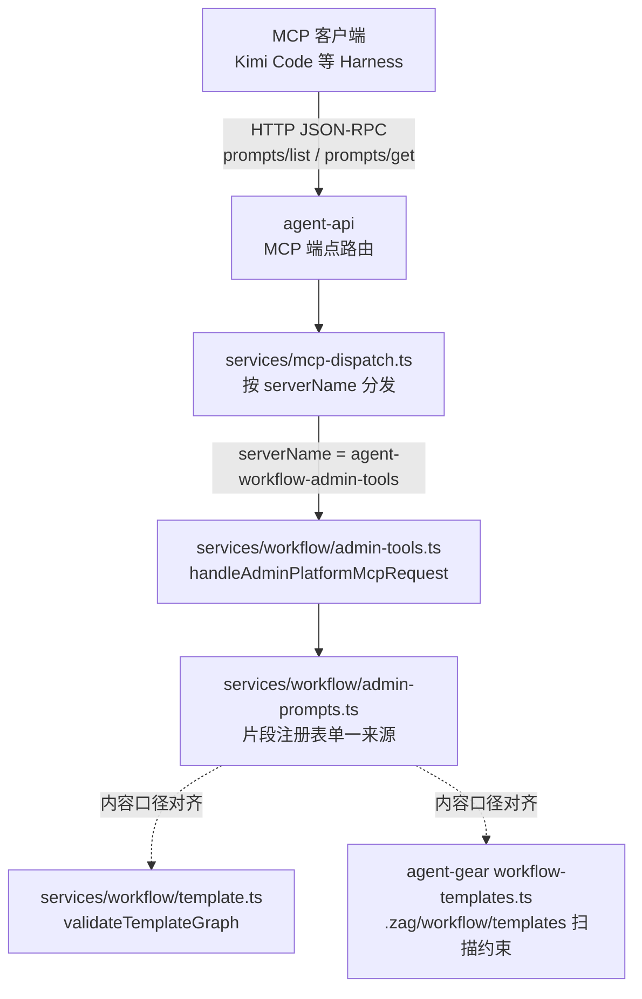
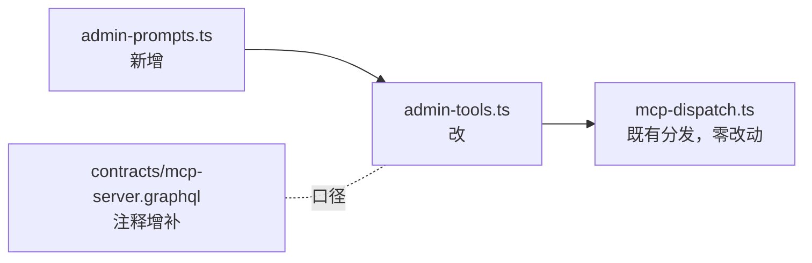
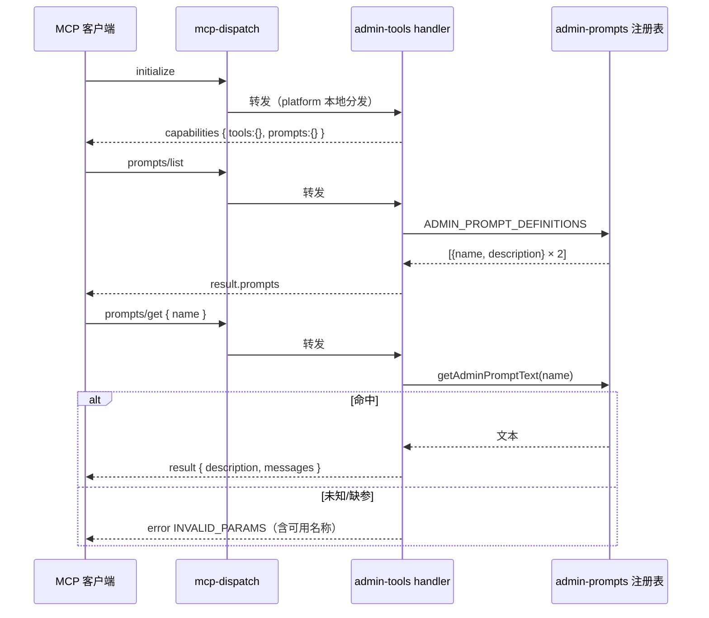

# 工作流MCP提供提示词片段 - 技术提案

**功能名称**: 工作流MCP提供提示词片段
**关联 PRD**: `docs/product/draft/20261115-workflow-mcp-prompt-snippets.md`（v1.0）
**技术提案版本**: v1.0
**创建日期**: 2026-11-15
**作者**: ZeroAsh Agent
**feat-branch**: `feat/workflow-mcp-prompt-snippets`

## 1. 概述

### 1.1 背景

PRD 要求工作流的 MCP 提供两个提示词片段：①工作流本身的 Schema 说明；②如何将工作流持久化到项目中。现状事实（代码核对）：

1. **平台内置 MCP 仅实现 tools 能力**：`servers/agent-api/src/services/workflow/admin-tools.ts` 的 `handleAdminPlatformMcpRequest` 与 `tool-handlers.ts` 的 `handlePlatformMcpRequest` 只处理 `initialize` / `notifications/*` / `ping` / `tools/list` / `tools/call`；`initialize` 返回 `capabilities: { tools: {} }`，**未声明 prompts 能力**，`prompts/list`、`prompts/get` 会落入 `METHOD_NOT_FOUND`。
2. **Schema 规则单一来源已存在**：`services/workflow/template.ts#validateTemplateGraph`（nodeKey 唯一、dependsOn 引用存在、DAG 无环、首节点唯一且 HUMAN、AI 节点 prompts ≥1、HUMAN/FLAG 不允许 prompts/artifactTitles、仅 HUMAN 可 linkUpstreamPullRequest）；节点字段在 `ADMIN_TOOL_SCHEMAS`（`admin-tools.ts`）与模型 `models/workflow-template.ts`；AI 节点 agentConfig 校验在 `services/workflow/configured.ts#validateAgentConfigs`（`acpServerType` 必填且须在控制器能力内、`initNewWorktree` 必填，`modeId`/`modelId` 可选）。
3. **项目持久化口径已存在**：agent-gear `packages/agent-controller/src/workflow-templates.ts`——约定子目录 `.zag/workflow/templates`、仅直下 `.json` 常规文件（符号链接按 stat 判定）、不递归、上限 20 文件 / 单文件 128KiB / 总量 1MiB；平台侧解析校验在 `services/workflow/repo-templates.ts#parseRepoTemplate`（顶层 `{name, description?, nodes}`，逐文件隔离、错误不互染）；配置入口 `configureRepoWorkflow`（`configured.ts#configureFromRepo`，快照语义、服务端不回读仓库文件）。
4. **MCP 分发链路**：`services/mcp-dispatch.ts` 按 serverName 把 platform 服务直接分发到本地 handler（不经 Redis 转发）；HTTP 入口在 `mcp-endpoint.ts` / 路由层（JSON-RPC over HTTP，session 作用域 token）。

### 1.2 目标

- 在平台内置 MCP 服务 `agent-workflow-admin-tools`（工作流管理工具集）上实现 MCP prompts 能力：`initialize` 声明 `capabilities.prompts`，新增 `prompts/list` 与 `prompts/get` 方法处理。
- 提供两个内置提示词片段（内容单一来源、随版本演进）：
  - `workflow-schema`：工作流 Schema 说明（顶层结构、节点类型、节点字段、图校验规则、agentConfig 说明）；
  - `workflow-project-persistence`：项目持久化指引（`.zag/workflow/templates/` 约定、JSON 文件格式与示例、文件约束、检测与配置生效方式）。
- 内容与代码规则同源：提示词文本中的规则与 `validateTemplateGraph` / `repo-templates.ts` / `workflow-templates.ts` 的实际口径逐条对齐，并有测试防漂移。

### 1.3 范围

**做**：

- 契约：`contracts/mcp-server.graphql` 平台内置服务注释增补 prompts 能力口径（`agent-workflow-admin-tools` 支持 `prompts/list`、`prompts/get`，片段清单与语义）。
- agent-api（`servers/agent-api`）：
  - 新增 `services/workflow/admin-prompts.ts`：片段注册表（name → {description, text}）单一来源；
  - `services/workflow/admin-tools.ts`：`initialize` capabilities 增加 `prompts: {}`；新增 `prompts/list`、`prompts/get` 分支；未知名称返回协议级错误并在 message 中列出可用名称。
- 单元测试（admin-prompts 注册表、handler 行为、内容防漂移守卫）。
- API 测试（经 MCP HTTP 端点全链路 `prompts/list` / `prompts/get` / 未知名称）。

**不做**：

- `agent-workflow-tools`（节点作用域工具集）的 prompts 能力（节点执行会话职责是节点任务操作；管理/创建场景经管理工具集，管理工具集可装配到任意会话，见 `contracts/mcp-server.graphql` 注释）。
- 提示词片段的用户侧自定义、版本化多份并存、i18n 多语言（本期仅中文权威文本）。
- 任何前端（agent-web / admin-web）、controller-api、agent-gear、数据模型与迁移改动。
- MCP `prompts/list` 分页（cursor）与 `arguments` 模板参数（片段无参数；列表恒 2 项）。

## 2. 技术架构

### 2.1 系统架构图



### 2.2 技术栈

| 层级 | 技术选型 | 说明 |
|------|---------|------|
| 后端 | Node.js 24 + TypeScript（strict/ESM）+ Express v5 | agent-api 现状一致 |
| 协议 | MCP（Streamable HTTP 形态，JSON-RPC 2.0），protocolVersion `2025-03-26` | 与 `initialize` 现有返回值一致 |
| 数据库 | 无变更 | 片段为代码常量，不落库 |
| 测试 | Vitest（单测）+ Aspire 真实服务（API） | TDD 红-绿-重构 |

### 2.3 模块划分



| 模块 | 职责 | 关键技术点 |
|------|------|-----------|
| `services/workflow/admin-prompts.ts`（新增） | 提示词片段注册表：`ADMIN_PROMPT_DEFINITIONS`（list 用 name/description）与 `getAdminPrompt(name)`（get 用 messages 组装） | 内容为模块内常量文本；导出可用名称列表供错误信息复用 |
| `services/workflow/admin-tools.ts`（改） | `initialize` 声明 `prompts: {}`；路由 `prompts/list` / `prompts/get` | 与 tools 分支同形态；未知名称 → `{ error: { code: 'INVALID_PARAMS', message } }` |
| `contracts/mcp-server.graphql`（改注释） | 平台内置服务注释增补 prompts 能力口径 | 契约先行，注释与实现同 PR |

## 3. API 设计

### 3.1 API 契约

平台 MCP 服务的方法面走 JSON-RPC（MCP 协议），不经 GraphQL；本期契约变更为 `contracts/mcp-server.graphql` 注释增补：

```graphql
enum McpServerSource {
  proxy
  manual    # P2 启用
  # 平台内置服务，随系统自动注册。节点作用域工具集（agent-workflow-tools）随节点会话自动装配；
  # 工作流管理工具集（agent-workflow-admin-tools）可装配到任意会话。
  # agent-workflow-admin-tools 支持 MCP prompts 能力（initialize 声明 capabilities.prompts）：
  #   prompts/list 返回内置提示词片段清单；prompts/get 按 name 获取片段内容（messages 形态）。
  #   内置片段：workflow-schema（工作流 Schema 说明）、workflow-project-persistence（项目持久化指引）。
  #   prompts/get 未知名称返回 INVALID_PARAMS，message 列出可用名称。
  platform
}
```

#### 方法 1: prompts/list（MCP 标准方法）

- **请求**
  - Method（JSON-RPC）: `prompts/list`
  - Params: 无
- **响应**
  - result:
    ```json
    {
      "prompts": [
        { "name": "workflow-schema", "description": "工作流 Schema 说明：工作流模板的顶层结构、节点类型、节点字段与图校验规则，以及 AI 节点 Agent 配置要求" },
        { "name": "workflow-project-persistence", "description": "工作流项目持久化指引：把模板以 JSON 文件放置到仓库 .zag/workflow/templates/ 的约定、格式、约束与生效方式" }
      ]
    }
    ```
  - 列表顺序稳定（注册表声明序），无 cursor 分页。

#### 方法 2: prompts/get（MCP 标准方法）

- **请求**
  - Method（JSON-RPC）: `prompts/get`
  - Params: `{ "name": "workflow-schema" }`（`name` 必填，非空字符串）
- **响应**
  - result:
    ```json
    {
      "description": "工作流 Schema 说明：……",
      "messages": [
        { "role": "user", "content": { "type": "text", "text": "<片段完整文本>" } }
      ]
    }
    ```
  - 片段无参数模板，`arguments` 不提供。
- **错误**
  - 缺 `params.name` 或为空：协议级 `{ code: 'INVALID_PARAMS', message: 'prompts/get 缺少 params.name。可用片段：workflow-schema、workflow-project-persistence。' }`
  - 未知名称：协议级 `{ code: 'INVALID_PARAMS', message: '未知提示词片段「<name>」。可用片段：workflow-schema、workflow-project-persistence。' }`

### 3.2 内部接口

```ts
// services/workflow/admin-prompts.ts
export interface AdminPromptDefinition {
  name: string;        // 片段名（kebab-case，稳定）
  description: string; // 一句话简介（prompts/list 与 prompts/get 的 description 共用）
}

/** 片段注册表（声明序即 prompts/list 顺序） */
export const ADMIN_PROMPT_DEFINITIONS: readonly AdminPromptDefinition[];

/** 可用片段名列表（错误信息复用，保证「所列即所得」） */
export function listAdminPromptNames(): string[];

/** 按名称取片段完整文本；未知名称返回 null */
export function getAdminPromptText(name: string): string | null;
```

`admin-tools.ts` 消费：

- `initialize` → `capabilities: { tools: {}, prompts: {} }`；
- `prompts/list` → `{ result: { prompts: ADMIN_PROMPT_DEFINITIONS } }`；
- `prompts/get` → 校验 `name` → `getAdminPromptText` 命中组装 `{ description, messages: [{ role: 'user', content: { type: 'text', text } }] }`，未命中/缺参返回上述 INVALID_PARAMS。

## 4. 数据模型

### 4.1 数据库设计

无数据库变更。提示词片段为代码内常量文本，随版本发布演进，不落库、不可由用户修改（与 `pr-prompts.ts` / `issues-prompts.ts` 的常量形态一致）。

### 4.2 缓存设计

无缓存：注册表为模块级常量，读取零开销。

## 5. 技术实现方案

### 5.1 核心流程



### 5.2 关键实现点

#### 实现点 1: 片段内容单一来源（`admin-prompts.ts`）

- **描述**: 两个片段的完整文本为模块内常量，导出注册表与读取函数；文本以 Markdown 结构组织（面向 LLM 消费）。
- **技术细节**:
  - `workflow-schema` 文本覆盖（与代码事实逐条对齐）：
    - 顶层：`{ name: string（必填，trim 后 1~64）, description?: string, nodes: Node[]（≥1） }`；
    - 节点字段：`nodeKey`（必填、全局唯一）、`type`（`HUMAN`/`AI`/`FLAG`）、`name`、`description?`、`stage`、`dependsOn`（string[]，空数组=首节点候选）、`requiresWorktree`（boolean）、`prompts`（仅 AI，≥1 条非空）、`artifactTitles`（仅 AI，可选）、`linkUpstreamPullRequest`（仅 HUMAN 可 true）；
    - 图规则：dependsOn 必须引用存在的 nodeKey、DAG 无环、入度为 0 的节点唯一且为 HUMAN；
    - agentConfig（配置/实例化阶段补齐，模板不含）：`acpServerType`（必填，在控制器能力内）、`initNewWorktree`（必填）、`modeId`/`modelId`（可选）。
  - `workflow-project-persistence` 文本覆盖：
    - 路径 `.zag/workflow/templates/`，一文件一模板、仅直下 `.json`、不递归；
    - JSON 结构与示例（顶层 name/description/nodes，**不含 agentConfig**——配置发生在平台侧快照）；
    - 约束：≤20 文件、单文件 ≤128KiB、总量 ≤1MiB、超出截断不生效；
    - 生效方式：新增工作目录 / GitHub 项目设置后自动检测提示；云电脑设置中可随时重新检测与配置；配置为快照语义，仓库后续修改不影响已配置工作流；不合法文件被标记并给出原因（不静默忽略）。
  - 注册表同时驱动 `prompts/list`、`prompts/get` 与错误信息中的可用名称（`listAdminPromptNames()`），保证三处一致。
- **风险点**: 文本与校验实现随时间漂移——由实现点 3 的守卫测试兜底。

#### 实现点 2: handler 路由与协议形态（`admin-tools.ts`）

- **描述**: 在 `handleAdminPlatformMcpRequest` 的 switch 中新增两个 case，并保持既有错误包装形态。
- **技术细节**:
  - `initialize` 返回值仅追加 `prompts: {}`（`tools: {}` 保留；serverInfo 不变）；
  - `prompts/list` / `prompts/get` 走 `result` 通道（非工具调用，不产出 `content`/`isError` 形态）；参数/名称错误走协议级 `error` 通道（与现有 `tools/call 缺少 params.name` 的 INVALID_PARAMS 形态一致）；
  - `prompts/get` 缺 `params.name` 与未知名称共用 INVALID_PARAMS，message 均附可用名称列表；
  - notification 语义由 `mcp-dispatch` 既有逻辑统一处理（无 id → 202 fire-and-forget），handler 无需区分。
- **风险点**: 无（新增 case 不影响既有分支）。

#### 实现点 3: 内容防漂移守卫测试

- **描述**: 单测断言片段文本中的关键规则语句与代码事实一致，规则变更时测试变红强制同步。
- **技术细节**:
  - 断言 `workflow-schema` 文本包含与 `validateTemplateGraph` 错误文案对应的关键约束表述（首节点唯一且 HUMAN、AI 节点 prompts ≥1、nodeKey 唯一、无环、仅 HUMAN 可 linkUpstreamPullRequest）；
  - 断言 `workflow-project-persistence` 文本包含 `.zag/workflow/templates`、20/128KiB/1MiB 上限（数值引用 agent-gear 常量不可能跨包 import，采用字面量断言并在注释注明来源 `packages/agent-controller/src/workflow-templates.ts`）；
  - 断言注册表名称集合与 prompts/list 输出一致。

## 6. 技术决策

### 6.1 决策列表

| 决策 | 选项 A | 选项 B | 最终选择 | 原因 |
|------|--------|--------|---------|------|
| 片段承载服务 | agent-workflow-admin-tools | agent-workflow-tools（节点作用域） | A | 创建模板/持久化属管理场景；节点工具集要求 workflow 作用域，普通管理会话没有；admin 工具集可装配到任意会话 |
| 内容来源 | 代码常量（随版本发布） | 数据库存储（可在线编辑） | A | 内容必须与校验代码同源演进，走代码评审；无运营诉求；与 pr-prompts/issues-prompts 形态一致 |
| 协议形态 | MCP prompts（prompts/list+prompts/get） | 新增普通 tool（如 getWorkflowPrompt） | A | 需求明确「提供提示词」；prompts 是 MCP 标准能力，客户端可发现/斜杠命令引用；PRD 功能点 3 按此语义描述 |
| 片段参数化 | 静态文本，无 arguments | 支持 arguments 模板插值 | A | 两片段均无需上下文参数；prompts/list 分页/参数化留待后续真实诉求 |
| 作用域校验 | 复用 admin 工具集现有 caller 校验（仅要求 userId） | 额外权限门禁 | A | 片段为公开规则说明、纯只读，与 listWorkflowTemplates 等只读工具同口径 |

### 6.2 依赖与约束

| 类型 | 内容 | 说明 |
|------|------|------|
| 依赖 | `validateTemplateGraph` / `ADMIN_TOOL_SCHEMAS` / `workflow-templates.ts` 常量 | 片段内容的事实来源；防漂移测试锁定 |
| 依赖 | `mcp-dispatch.ts` platform 本地分发 | 零改动复用 |
| 约束 | 单实例/多实例均可 | 纯常量读取，无进程内状态 |
| 约束 | 协议版本 `2025-03-26` | 与既有 `initialize` 返回值一致，不升级协议版本 |

## 7. 项目结构

```
servers/agent-api/
├── src/services/workflow/
│   ├── admin-prompts.ts            # 新增：提示词片段注册表（单一内容来源）
│   ├── admin-prompts.test.ts       # 新增：注册表/读取/防漂移守卫
│   ├── admin-tools.ts              # 改：initialize capabilities + prompts/list + prompts/get
│   └── admin-tools.test.ts         # 改：prompts 行为用例（initialize/list/get/未知名称）
contracts/
│   └── mcp-server.graphql          # 改：platform 注释增补 prompts 能力口径
tests/api/src/agent-api/
│   └── mcp-server.test.ts          # 改：MCP 端点全链路 prompts/list、prompts/get、未知名称
```

前端、controller-api、agent-gear、数据模型、迁移：零改动。

## 8. 测试策略

### 8.1 测试覆盖要求

- 新增代码行覆盖率 100%（admin-prompts.ts 全常量/纯函数，admin-tools.ts 新增分支全覆盖）。
- API 测试覆盖：`POST` MCP 端点的 `prompts/list`、`prompts/get`（命中/缺参/未知名称）、`initialize` capabilities 含 prompts。

### 8.2 测试类型

| 类型 | 工具 | 覆盖范围 |
|------|------|---------|
| 单元测试 | Vitest | `admin-prompts.test.ts`（T-AP1~5：注册表形状、名单一致、get 命中/未命中、文本防漂移断言×2）；`admin-tools.test.ts` 追加（T-AP6~10：initialize 声明 prompts、prompts/list 输出、prompts/get 命中 messages 形态、缺 name、未知名称含可用列表）；既有「tools/list 返回 13 个工具」等零回归 |
| API 测试 | Vitest + Aspire 真实服务 | `tests/api/src/agent-api/mcp-server.test.ts` 追加（T-AP-API1~3：经签发端点 prompts/list、prompts/get 命中、未知名称 INVALID_PARAMS） |
| E2E | 不新增 | 无界面变更；MCP 客户端消费形态由客户端自身能力决定 |

## 9. 部署方案

### 9.1 环境规划

| 环境 | 用途 | 部署方式 |
|------|------|---------|
| 开发 | 本地调试 | Aspire 编排（现状不变） |
| 生产 | 随 agent-api 常规发布 | 滚动发布，无迁移、无开关 |

### 9.2 配置管理

无新增配置项；无环境变量；无 Feature Flag（能力对不感知 prompts 的客户端完全透明，向后兼容）。

## 10. 验收标准

- [ ] 技术方案评审通过
- [ ] Contract 评审通过（`contracts/mcp-server.graphql` 注释增补）
- [ ] 代码实现完成（admin-prompts.ts + admin-tools.ts）
- [ ] 单元测试覆盖达标（新增分支全覆盖、防漂移守卫通过）
- [ ] API 测试通过（T-AP-API1~3）
- [ ] 既有 agent-api 全部测试零回归

## 11. 相关文档

- 关联 PRD：`docs/product/draft/20261115-workflow-mcp-prompt-snippets.md`（v1.0）
- 关联 Contract：`contracts/mcp-server.graphql`（platform 注释）
- 需求来源 Issue：https://github.com/Deliay/z-agent-gear/issues/523
- 事实来源代码：`servers/agent-api/src/services/workflow/template.ts`、`servers/agent-api/src/services/workflow/admin-tools.ts`、`servers/agent-api/src/services/workflow/repo-templates.ts`、`packages/agent-controller/src/workflow-templates.ts`
- 相邻提案：`docs/engineering/proposals/20261107-feat-workflow-template-project-persistence.md`（项目模板持久化）、`docs/engineering/proposals/20261023-feat-workflow-github-pr-callback.md`（提示词常量形态先例）
- 开发规范：`docs/engineering/common-rules.md`、`docs/engineering/backend-rules.md`
