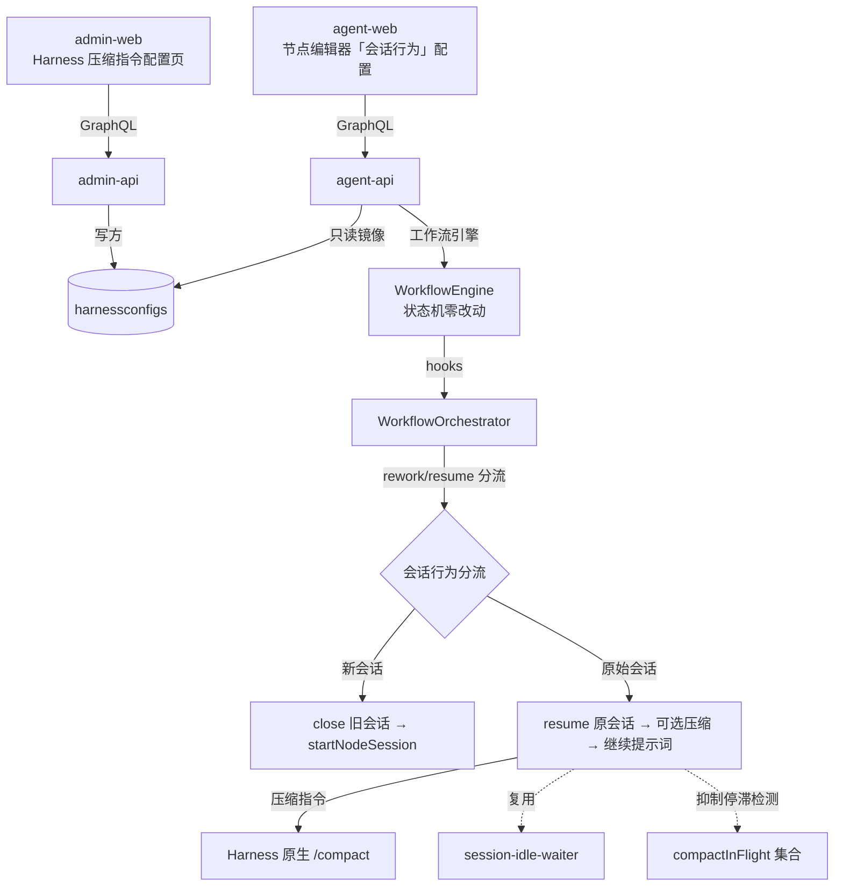
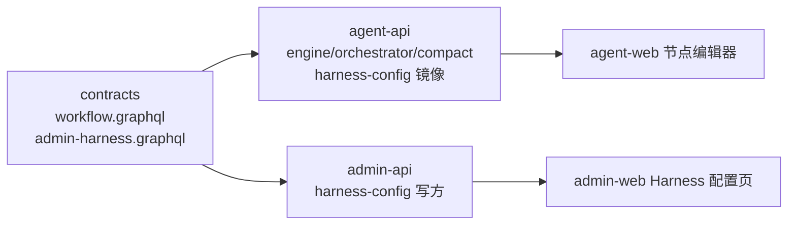
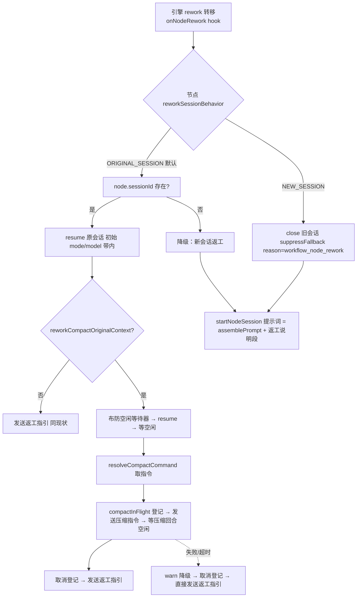
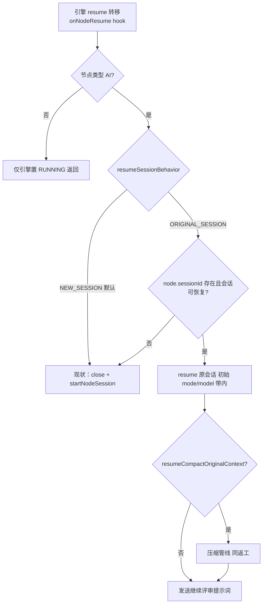
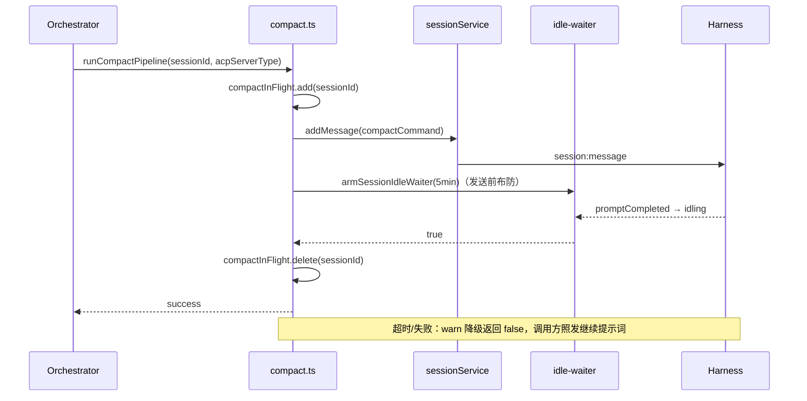

# 工作流打回/返工会话行为优化 - 技术提案

**功能名称**: 工作流打回/返工会话行为优化
**关联 PRD**: [[../../product/draft/20261115-workflow-reject-rework-session-behavior.md]]
**技术提案版本**: v1.0
**创建日期**: 2026-11-15
**作者**: z-agent-bot
**feat-branch**: `feat/workflow-reject-rework-session-behavior`
**需求来源**: GitHub Issue [Deliay/z-agent-gear#525](https://github.com/Deliay/z-agent-gear/issues/525)

## 1. 概述

### 1.1 背景

工作流引擎当前的打回/返工会话行为是硬编码的（代码事实见 §1.4），Issue #525 要求将两个维度的会话行为开放为节点级配置，并在「原始会话」下提供可选的上下文压缩能力；压缩指令与 Harness 相关，由后台按 Harness 类型配置，默认 `/compact`。

### 1.2 目标

- 工作流模板节点 / 已配置工作流节点 / 实例节点快照新增 4 个配置项：`reworkSessionBehavior`、`reworkCompactOriginalContext`、`resumeSessionBehavior`、`resumeCompactOriginalContext`；
- Orchestrator 的返工（rework）与复工（resume）管线按节点配置分流：新会话 / 原始会话（可压缩）；
- 压缩管线可复用既有「空闲等待器」，且不与中断自动重试（停滞检测）冲突；
- admin-api 新增 Harness 压缩指令配置（集合 + GraphQL + admin-web 页面），agent-api 只读镜像消费；
- 存量数据零迁移、零行为变化（默认值 = 现状）。

### 1.3 范围

**做**：

- agent-api：工作流契约与模型扩展、Orchestrator 会话行为分流、压缩管线、Harness 配置只读镜像与解析服务；
- admin-api：`harnessconfigs` 集合（唯一写方）、种子迁移、GraphQL 管理接口；
- agent-web：节点编辑器「会话行为」配置区（模板/已配置/实例化三入口共用组件 + 实例节点编辑弹窗）；
- admin-web：Harness 压缩指令配置页；
- 平台 MCP（`agent-workflow-admin-tools`）节点图 schema 同步扩展。

**不做**：

- 不改动工作流状态机（无新状态/事件）；
- 不改动 agent-gear / controller-api 协议（压缩指令即普通会话文本消息，由 Harness 原生解释）；
- 不支持人类节点 / FLAG 节点的会话行为配置（无会话概念）；
- 不做压缩效果度量与压缩策略自动推荐。

### 1.4 代码事实（现状）

| 事实 | 位置 |
|------|------|
| 返工（rework）= 原始会话：resume 原会话（带内下发初始 mode/model）后发送打回原因与返工指引 | `servers/agent-api/src/services/workflow/orchestrator.ts` `reworkNodeSession` |
| 打回后复工（resume）= 新会话：关闭 REJECT 节点空闲会话（`suppressFallback`）后 `startNodeSession` 全新拉起 | 同文件 `resumeNodeSession` |
| 新会话拉起：`assemblePrompt`（系统提示 + 节点提示词 + 上游产物 + 追加提示词）→ `sessionService.create` → `addMessage` | 同文件 `startNodeSession` / `assemblePrompt` |
| 节点配置解析快照优先、缺失回查已配置工作流 | `services/workflow/node-config.ts` `loadNodeConfig` |
| 空闲等待器（事件优先 + 15s DB 心跳兜底；须先布防再 resume） | `services/session-idle-waiter.ts` `armSessionIdleWaiter` |
| 停滞检测冲突面：promptCompleted→idling 且节点 RUNNING/REWORK 时排期中断重试 | `orchestrator.ts` `handleSessionIdled` → `interrupt-retry.ts` |
| resume 成功发布裸 `idling`（不带 promptCompleted，不触发停滞检测） | `session-idle-waiter.ts` 头注 |
| Harness 类型三值与 ACP 映射（OPENCODE→opencode、KIMI_CODE→kimi_code、DEEPSEEK_HARNESS→deepseek_harness） | `models/cloud-host.ts`、`contracts/cloud-host.graphql` |
| 后台写方/前台只读镜像先例（authproviders：admin-api 写、agent-api 只读镜像） | `servers/admin-api/src/models/auth-provider.ts`、`servers/agent-api/src/models/auth-provider.ts` |
| 节点图校验与归一入口 | `services/workflow/configured.ts` `normalizeConfiguredNodes` / `validateAgentConfigs` |
| 实例化快照复制 | `services/workflow/instance.ts`（nodes 映射，约 line 138） |

## 2. 技术架构

### 2.1 系统架构图



### 2.2 技术栈

| 层级 | 技术选型 | 说明 |
|------|---------|------|
| 前端（前台） | React 19 + Apollo Client（apps/agent-web） | 节点编辑器扩展 |
| 前端（后台） | React 19 + Apollo Client（apps/admin-web） | Harness 配置页 |
| 后端 | Node.js 24 + Express v5 + GraphQL-Yoga（agent-api / admin-api） | 契约先行 |
| 数据库 | MongoDB（Mongoose） | 节点图内嵌字段 + 新集合 harnessconfigs |
| 缓存 | Redis | Harness 配置短缓存（可选，见 §6.1 D3） |

### 2.3 模块划分



| 模块 | 职责 | 关键技术点 |
|------|------|-----------|
| `services/workflow/orchestrator.ts` | 返工/复工会话行为分流 | 新会话返工的提示词合成；原始会话恢复 + 可选压缩 |
| `services/workflow/compact.ts`（新） | 压缩管线与停滞检测抑制 | `armSessionIdleWaiter` 复用、`compactInFlight` 进程内集合 |
| `services/harness-config.ts`（新） | 压缩指令解析（ACP 类型 → Harness → 指令） | 只读镜像 + 默认 `/compact` 兜底 |
| `services/workflow/configured.ts` / `instance.ts` / `node-config.ts` | 配置归一、校验、快照复制 | 4 字段透传与默认值归一 |
| admin-api `services/harness-config.ts`（新） | 集合唯一写方 + 校验 | 种子迁移默认 `/compact` |
| agent-web `WorkflowGraphEditor` / `EditInstanceNodeDialog` | 「会话行为」配置 UI | 条件展示「压缩原始上下文」 |
| admin-web `HarnessConfigsPage`（新） | 压缩指令管理 | 三 Harness 列表 + 编辑保存 |

## 3. API 设计

### 3.1 API 契约

#### 契约 1：`contracts/workflow.graphql`（扩展）

新增枚举与 4 个节点字段（同步扩展 `WorkflowTemplateNode` / `WorkflowTemplateNodeInput` / `ConfiguredWorkflowNode` / `ConfiguredWorkflowNodeInput` / `WorkflowNode` / `WorkflowNodeUpdateInput` 六处）：

```graphql
# AI 节点打回/返工会话行为：NEW_SESSION=新会话 / ORIGINAL_SESSION=原始会话
enum WorkflowNodeSessionBehavior {
  NEW_SESSION
  ORIGINAL_SESSION
}

# —— 以下 4 字段出现在 WorkflowTemplateNode / ConfiguredWorkflowNode / WorkflowNode ——
# 返工时（节点被打回进入 REWORK 触发会话）行为；仅 AI 节点有意义；缺省 ORIGINAL_SESSION（=现状）
reworkSessionBehavior: WorkflowNodeSessionBehavior
# 返工时为原始会话时：恢复后先发送压缩指令再发送返工指引；缺省 false
reworkCompactOriginalContext: Boolean
# 打回后（本节点打回上游、返工完成后流转回本节点）行为；仅 AI 节点有意义；缺省 NEW_SESSION（=现状）
resumeSessionBehavior: WorkflowNodeSessionBehavior
# 打回后为原始会话时：恢复后先发送压缩指令再发送继续提示词；缺省 false
resumeCompactOriginalContext: Boolean
```

- Input 侧四字段均可选（不传 = 服务端按默认值归一）；
- 读取侧存量文档为 `null`（映射层按默认值归一输出，见 §4.1）；
- 校验规则（服务端强制）：`reworkCompactOriginalContext=true` 仅在 `reworkSessionBehavior=ORIGINAL_SESSION` 时合法；`resumeCompactOriginalContext=true` 仅在 `resumeSessionBehavior=ORIGINAL_SESSION` 时合法；行为为「新会话」时对应 compact 字段强制归一为 `false`（不产生错误）；HUMAN/FLAG 节点四字段强制为 null（同 `agentConfig` 纪律）。

#### 契约 2：`contracts/admin-harness.graphql`（新增）

```graphql
# Harness 平台配置（压缩指令等）。写方：admin-api；agent-api 只读镜像。
# 鉴权：全部 Query/Mutation 需要管理员 JWT；未认证 UNAUTHENTICATED。

# Harness 类型（与 contracts/cloud-host.graphql 的 HarnessType 同枚举值）
enum HarnessType {
  OPENCODE
  KIMI_CODE
  DEEPSEEK_HARNESS
}

type HarnessConfig {
  harnessType: HarnessType!
  # 原始上下文压缩指令：以 / 开头、trim 后 1~64 字符；默认 /compact
  compactCommand: String!
  updatedAt: String!
}

type Query {
  # 全量 Harness 配置（未配置的 Harness 以默认 /compact 归一返回）
  adminHarnessConfigs: [HarnessConfig!]!
}

type Mutation {
  # 按 harnessType upsert；compactCommand 校验失败返回 `invalid compact command`
  upsertHarnessConfig(harnessType: HarnessType!, compactCommand: String!): HarnessConfig!
}
```

错误文案表：`invalid compact command`（trim 后为空、超过 64 字符或不以 `/` 开头）。

### 3.2 内部接口

- agent-api `services/harness-config.ts`：
  - `resolveCompactCommand(acpServerType: string): Promise<string>` — ACP 类型 → HarnessType 映射（`opencode→OPENCODE`、`kimi_code→KIMI_CODE`、`deepseek_harness→DEEPSEEK_HARNESS`）；查只读镜像；未命中映射或未配置 → 返回默认 `'/compact'`；
  - `DEFAULT_COMPACT_COMMAND = '/compact'` 唯一来源。
- Orchestrator 内部：
  - `reworkNodeSession` 按 `reworkSessionBehavior` 分流；
  - `resumeNodeSession` 按 `resumeSessionBehavior` 分流；
  - `runCompactPipeline(sessionId, acpServerType)`：发送压缩指令 → 等待压缩回合空闲 → 返回是否成功（失败降级）。
- 平台 MCP `agent-workflow-admin-tools`：节点 schema 同步增加 4 个可选字段（`getWorkflowToolInputSchema` 返回的 JSON Schema 与节点归一逻辑同步）。

## 4. 数据模型

### 4.1 数据库设计

#### 集合：`workflowtemplates` / `configuredworkflows` / `workflowinstances`（节点子文档扩展）

三处节点子 Schema（`models/workflow-template.ts`、`models/configured-workflow.ts`、`models/workflow-instance.ts`）各增 4 字段：

| 字段 | 类型 | 默认 | 说明 |
|------|------|------|------|
| `reworkSessionBehavior` | String enum `NEW_SESSION/ORIGINAL_SESSION` | `ORIGINAL_SESSION` | 返工时行为（=现状） |
| `reworkCompactOriginalContext` | Boolean | `false` | 返工时压缩原始上下文 |
| `resumeSessionBehavior` | String enum | `NEW_SESSION` | 打回后行为（=现状） |
| `resumeCompactOriginalContext` | Boolean | `false` | 打回后压缩原始上下文 |

- **零迁移**：默认值即现状；存量行字段缺失由映射层（`mapTemplate` / `mapConfigured` / `mapInstance` 与 `loadNodeConfig`）按 `?? DEFAULT` 归一；
- HUMAN/FLAG 节点恒 null/undefined（与 `agentConfig` 同纪律，`default: undefined`）；
- 实例节点为实例化快照：`instance.ts` 实例化映射与 `updateWorkflowNode`（仅未开始节点可编辑）同步扩展。

#### 集合：`harnessconfigs`（新；admin-api 唯一写方）

| 字段 | 类型 | 说明 |
|------|------|------|
| `harnessType` | String enum（OPENCODE/KIMI_CODE/DEEPSEEK_HARNESS） | 唯一索引 `uniq_harness_config_type` |
| `compactCommand` | String | trim 后 1~64、`/` 开头 |
| `updatedAt/createdAt` | Date | timestamps |

- admin-api 种子迁移（新编号）：对三种 Harness `upsert` 默认 `/compact`（幂等，已存在不覆盖用户配置）；
- agent-api 只读镜像模型（`autoIndex=false`，同 authproviders 先例）。

### 4.2 缓存设计

- `resolveCompactCommand`：进程内 Map 缓存 `{harnessType → {command, expiresAt}}`，TTL 60s（压缩链路低频，优先「修改后快速生效」与「零 Redis 依赖」；命中失败不回填）；
- 不引入 Redis 缓存（D3，见 §6.1）。

## 5. 技术实现方案

### 5.1 核心流程

#### 返工时（rework）分流



**返工说明段（新会话返工的关键）**：全新会话的提示词 = `assemblePrompt` 结果 + 追加「## 返工说明」段，内容含：本节点处于返工状态、打回原因、产物重写要求、**必须调用 `completeCurrentRework`（而非 `completeCurrentNode`）完成返工**、必要时可 `rejectCurrentNode` 继续上溯。`startNodeSessionInner` 增加可选参数 `extraPromptSections: string[]`，仅拼装入首条消息（一次 addMessage，避免双 prompt 竞态）。

#### 打回后复工（resume）分流



**继续评审提示词（新常量 `RESUME_CONTINUE_PROMPT`）**：告知「你打回的上游节点已完成返工，产物已更新并重新写入黑板，请重新获取上游产物（getBlackboardValue / getNodeArtifactKeys）并继续本节点工作；确认无误后调用 completeCurrentNode（REWORK 状态下为 completeCurrentRework）」。

#### 压缩管线（`services/workflow/compact.ts`）



**与中断自动重试的冲突裁决（D1）**：压缩回合结束（promptCompleted→idling）会触发 `handleSessionIdled` → 节点 RUNNING/REWORK 时排期中断重试并重发兜底提示词，会污染压缩窗口。方案：进程内 `compactInFlight: Set<string>`（`compact.ts` 导出 `isCompactInFlight(sessionId)`）；`orchestrator.handleSessionIdled` 在查到节点后、排期前检查命中即跳过。单实例部署前提与 `KeyedMutex`/重试调度器一致。正常 resume 产生的是裸 `idling`（无 promptCompleted），天然不触发停滞检测；返工指引/继续提示词回合结束后的 idled 行为与现状一致（属正常工作回合）。

### 5.2 关键实现点

#### 实现点 1: 契约与模型扩展（六处类型 + 三处 Mongoose 子 Schema）

- **描述**: §3.1 六处 GraphQL 类型/Input 与 `workflow-template.ts` / `configured-workflow.ts` / `workflow-instance.ts` 三处节点子 Schema 各加 4 字段；
- **技术细节**: 手写 schema（`graphql/schemas/workflow.ts`）与契约**双写**；`mapInstance`/`mapTemplate`/`mapConfigured` 与 `loadNodeConfig` 按 `?? 'ORIGINAL_SESSION'` / `?? 'NEW_SESSION'` / `?? false` 归一；HUMAN/FLAG 归一为 null；「新会话 + compact=true」归一 compact=false；
- **风险点**: 手写 schema 漏改即运行时 `Cannot query field`——schema 契约测试必须逐字段对齐。

#### 实现点 2: 配置归一与快照复制

- **描述**: `configured.ts` `normalizeConfiguredNodes` 透传并归一 4 字段；`instance.ts` 实例化 nodes 映射复制 4 字段；`updateWorkflowNode` 允许未开始节点编辑；`validateAgentConfigs` 不涉及（与 Harness 能力无关）；
- **技术细节**: 归一函数 `normalizeNodeSessionBehavior(node)` 纯函数单一来源，configured/instance/template 三处共用；
- **风险点**: 实例接续（continuation.ts）只映射 `acpServerType`，4 字段随快照自然保留，无需改动——需测试锁定。

#### 实现点 3: Orchestrator 分流与新会话返工提示词

- **描述**: `reworkNodeSession` / `resumeNodeSession` 按配置分流（§5.1 两图）；
- **技术细节**: 新会话返工 = `close(suppressFallback, 'workflow_node_rework')` + `startNodeSession`（`extraPromptSections=[reworkSection]`）；`reworkSection` 文案含 completeCurrentRework 指引；`startNodeSessionInner` 增加可选参数（默认 undefined 不影响既有 3 处调用点）；原始会话恢复失败（resume `success:false` 或会话缺失）→ warn 并降级为新会话路径；
- **风险点**: REWORK 状态的新会话若错误引导调用 `completeCurrentNode` 会被引擎拒绝（from 不含 REWORK），文案必须以 `completeCurrentRework` 为唯一指引——提示词测试锁定。

#### 实现点 4: 压缩管线与停滞检测抑制

- **描述**: `services/workflow/compact.ts` 承载 `runCompactPipeline` 与 `isCompactInFlight`；`handleSessionIdled` 接入抑制；
- **技术细节**: 发送压缩指令前布防等待器（`armSessionIdleWaiter(sessionId, 5min)`），空闲后删除登记并返回 true；超时/异常 warn 返回 false（调用方降级直发继续提示词）；`handleSessionIdled` 在节点匹配后 `if (isCompactInFlight(sessionId)) return;`；
- **风险点**: 压缩等待期间节点被人工 complete/restart/删除——等待器结算后发送前需「双校验」（实例未删除 + 节点状态与 sessionId 未变，镜像 interrupt-retry 的发送前校验），不满足则放弃发送。

#### 实现点 5: Harness 压缩指令配置（admin-api 写方 + agent-api 只读镜像）

- **描述**: admin-api 新集合 `harnessconfigs`、种子迁移、`admin-harness.graphql` 实现；agent-api 只读镜像 + `resolveCompactCommand`；
- **技术细节**: upsert 校验（`/` 开头、1~64）；种子迁移幂等 `$setOnInsert`；agent-api 进程内 60s 缓存；
- **风险点**: agent-api 与 admin-api 的 HarnessType 枚举值漂移——镜像模型复用同一常量来源（agent-api 已有 `HARNESS_TYPES`）。

#### 实现点 6: 前端配置 UI（agent-web / admin-web）

- **描述**: agent-web 节点表单（`WorkflowGraphEditor` 节点编辑区与 `EditInstanceNodeDialog`）新增「会话行为」区：两组单选（新会话/原始会话）+ 条件展示「压缩原始上下文」勾选；`template-validation.ts` 类型与校验同步；admin-web 新增 Harness 配置页（路由 `/harness-configs` + AdminLayout 导航项）；
- **技术细节**: 选择「新会话」时隐藏并重置对应 compact 勾选；HUMAN/FLAG 节点不渲染该区；表单提交与服务端归一同口径；admin-web 列表固定渲染三种 Harness（未配置显示默认 `/compact`）；
- **风险点**: `EditInstanceNodeDialog` 重启模式不展示会话行为（重启仅改 agentConfig）。

## 6. 技术决策

### 6.1 决策列表

| 决策 | 选项 A | 选项 B | 最终选择 | 原因 |
|------|--------|--------|---------|------|
| D0 配置承载位置 | 节点级 4 个独立字段 | 并入 `agentConfig` 子对象 | **节点级独立字段** | 语义为节点生命周期行为（同 `requiresWorktree`/`linkUpstreamPullRequest` 先例），agentConfig 是 Harness/模型选择；HUMAN/FLAG 天然 null |
| D1 压缩与停滞检测冲突 | 复用 retryPhase 占位 | 进程内 `compactInFlight` 集合抑制 | **compactInFlight** | retryPhase 语义被重试 CAS 强占用，复用会相互踩踏；进程内集合与单实例部署前提一致、零迁移 |
| D2 新会话返工的提示词 | 先 assemblePrompt 再单独发返工指引（两条消息） | assemblePrompt + 返工说明段单条发送 | **单条发送** | 避免首回合进行中第二条 prompt 的排队/打断竞态；`extraPromptSections` 参数化 |
| D3 压缩指令缓存 | Redis 缓存 | 进程内 60s Map | **进程内 Map** | 低频读、容忍 60s 延迟生效；零新 Redis key 运维面 |
| D4 原始会话不可恢复 | 直接失败转人工 | 降级新会话执行 | **降级新会话** | 不阻断流程优先；warn 留痕可观测 |
| D5 压缩失败/超时 | 节点转 FAILED | 降级直发继续提示词 | **降级直发** | 压缩是优化项非前置条件；PRD 3.5 同口径 |
| D6 Harness 配置写方 | agent-api 前台写 | admin-api 后台写、agent-api 只读镜像 | **admin-api 写方** | Issue 明示「在后台配置」；authproviders 先例 |
| D7 存量行为 | 迁移回填显式字段 | 默认值 + 映射层归一 | **默认值归一，零迁移** | 默认即现状；减少迁移面 |

### 6.2 依赖与约束

| 类型 | 内容 | 说明 |
|------|------|------|
| 依赖 | `session-idle-waiter` / `sessionService.resume/addMessage/close` | 压缩管线与恢复链路复用，无协议改动 |
| 依赖 | Harness 原生支持压缩指令（`/compact`） | 不支持时按 D5 降级 |
| 约束 | 单实例部署 | `compactInFlight` 与 `KeyedMutex`/重试调度器同前提 |
| 约束 | agent-api / admin-api 共享 MongoDB | 只读镜像纪律：agent-api 不得写 `harnessconfigs` |
| 约束 | 手写 schema 与契约双写 | `graphql/schemas/workflow.ts` 与 admin-api schema 同步 |

## 7. 项目结构

```
contracts/
├── workflow.graphql                 # 扩展：WorkflowNodeSessionBehavior + 六处 4 字段
└── admin-harness.graphql            # 新增：HarnessConfig / adminHarnessConfigs / upsertHarnessConfig
servers/agent-api/src/
├── models/
│   ├── workflow-template.ts         # 节点子 Schema +4 字段
│   ├── configured-workflow.ts       # 同上
│   ├── workflow-instance.ts         # 同上（实例快照）
│   └── harness-config.ts            # 新增：harnessconfigs 只读镜像
├── services/
│   ├── harness-config.ts            # 新增：resolveCompactCommand + DEFAULT_COMPACT_COMMAND
│   └── workflow/
│       ├── compact.ts               # 新增：runCompactPipeline / isCompactInFlight
│       ├── orchestrator.ts          # rework/resume 分流 + handleSessionIdled 抑制
│       ├── configured.ts            # normalizeConfiguredNodes 归一
│       ├── instance.ts              # 实例化快照复制 / updateWorkflowNode
│       ├── node-config.ts           # loadNodeConfig 4 字段归一
│       ├── prompts.ts               # RESUME_CONTINUE_PROMPT + 返工说明段模板
│       └── admin-tools.ts           # MCP 节点 schema 扩展
├── servers/admin-api/src/
│   ├── models/harness-config.ts     # 新增（唯一写方）
│   ├── services/harness-config.ts   # 新增（upsert 校验）
│   ├── graphql/{schemas,resolvers}/harness-config.ts
│   └── migrations/0xx-harness-configs.ts  # 种子：三 Harness 默认 /compact
apps/
├── agent-web/src/components/workflow/
│   ├── WorkflowGraphEditor.tsx      # 节点表单「会话行为」区
│   ├── EditInstanceNodeDialog.tsx   # 实例节点编辑同步
│   └── template-validation.ts       # 类型与归一
└── admin-web/src/
    ├── pages/HarnessConfigsPage.tsx # 新增
    └── components/AdminLayout.tsx   # 导航项
```

## 8. 测试策略

### 8.1 测试覆盖要求

- 变更服务/模型行覆盖 ≥ 90%（TDD 红-绿-重构）；
- API 测试覆盖：workflow 节点 CRUD 4 字段读写与归一、admin-harness 查询与 upsert（含校验矩阵）；
- 手写 schema 与契约逐字段对齐测试（双写守卫）。

### 8.2 测试类型

| 类型 | 工具 | 覆盖范围 |
|------|------|---------|
| 单元测试 | Vitest（agent-api） | 归一函数（默认/新会话强制 compact=false/HUMAN null）；orchestrator 四象限分流；新会话返工提示词含 completeCurrentRework；压缩管线成功/超时/发送前双校验放弃；`handleSessionIdled` 抑制命中；`resolveCompactCommand` 映射/默认兜底/缓存；实例化快照复制与接续保留 |
| 单元测试 | Vitest（admin-api） | upsert 校验矩阵（`/` 开头/长度/trim）；种子迁移幂等不覆盖用户配置 |
| 单元测试 | Vitest（agent-web/admin-web） | 条件展示 compact 勾选、新会话重置勾选、HUMAN 不渲染；后台列表默认 `/compact` 展示与保存 |
| API 测试 | tests/api | workflow 模板/已配置/实例节点 4 字段端到端读写与归一；admin-harness GraphQL |
| E2E | tests/e2e（Playwright） | 节点编辑器配置保存回显；后台修改指令后保存生效 |

## 9. 部署方案

### 9.1 环境规划

| 环境 | 用途 | 部署方式 |
|------|------|---------|
| 本地 | 开发联调 | Aspire 编排（agent-api + admin-api + 前端 + MongoDB + Redis） |
| 生产 | 全量发布 | 常规滚动发布；admin-api 种子迁移随启动幂等执行 |

### 9.2 配置管理

- 无新增环境变量；压缩等待超时常量复用 `INTERRUPT_RETRY_IDLE_TIMEOUT_MS`（5 分钟）口径；
- Harness 压缩指令为后台数据配置，非 env。

## 10. 验收标准

- [ ] 技术方案评审通过
- [ ] Contract 评审通过（`workflow.graphql` 扩展 + `admin-harness.graphql` 新增）
- [ ] 代码实现完成（agent-api / admin-api / agent-web / admin-web）
- [ ] 单元测试覆盖达标，四象限分流与压缩管线用例全绿
- [ ] API 测试通过
- [ ] E2E 测试通过
- [ ] 存量模板/已配置工作流/运行中实例行为与升级前完全一致（回归用例锁定）

## 11. 相关文档

- 关联 PRD：[[../../product/draft/20261115-workflow-reject-rework-session-behavior.md]]
- 关联契约：`contracts/workflow.graphql`、`contracts/admin-harness.graphql`（新增）、`contracts/cloud-host.graphql`（HarnessType 枚举同源）
- 需求来源：[GitHub Issue #525](https://github.com/Deliay/z-agent-gear/issues/525)
- 相关提案：[[20261103-feat-workflow-node-interrupt-retry.md]]（空闲等待器与停滞检测）、[[20261114-feat-workflow-instance-continuation.md]]（接续快照）、[[20261023-feat-workflow-github-pr-callback.md]]（打回/返工链路）
- 开发规范：[[../common-rules.md]]、[[../backend-rules.md]]、[[../frontend-rules.md]]
