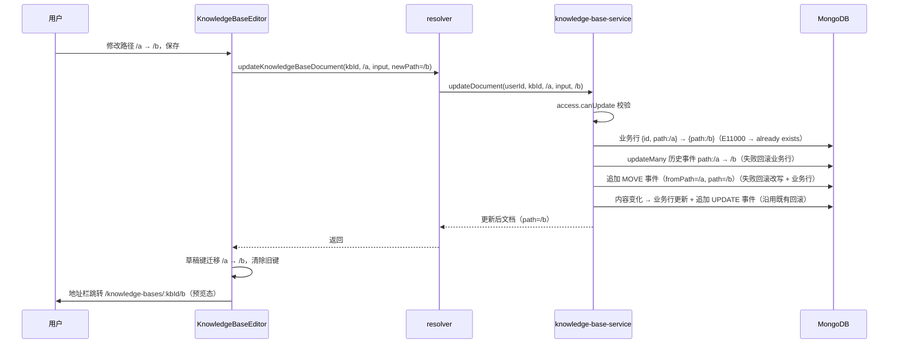

# 知识库优化 - 技术提案

**功能名称**: 知识库优化
**关联 PRD**: [[../../product/draft/20261116-knowledge-base-optimization.md]]
**技术提案版本**: v1.0
**创建日期**: 2026-11-16
**作者**: z-agent-bot
**feat-branch**: `feat/knowledge-base-optimization`

## 1. 概述

### 1.1 背景

需求来源 [Issue #541](https://github.com/Deliay/z-agent-gear/issues/541)，PRD 见 [[../../product/draft/20261116-knowledge-base-optimization.md]]。知识库已随 [[20261115-feat-knowledge-base.md]] 落地（三集合事件溯源、四档权限矩阵、平台 MCP 恒装配、侧边栏第五分区与 `/knowledge-bases/:kbId/*` 页面族）。本提案在其上做两项优化：

1. **文档路径可修改且历史跟随**：初版 D9 显式「不支持 rename（删除+新建替代，历史按路径独立留存）」，本期反转为「路径可修改、历史随文档带入新路径」。
2. **标签 badge 化编辑**：展示侧（预览/历史抽屉/实时预览）已是 `Badge` 徽章（K91 现状），编辑侧仍是逗号分隔文本输入（`KnowledgeBaseEditor` `tagsText` + `parseTags`），本期改为徽章编辑器。

### 1.2 目标

- `updateKnowledgeBaseDocument` 扩展可选 `newPath`：一次保存原子完成「移动 + 内容更新」；`KnowledgeBaseEventOp` 新增 `MOVE`、`KnowledgeBaseEvent` 新增 `fromPath`；移动时改写该路径全部历史事件的 `path`，历史在新路径下完整延续，原路径释放后重建历史独立。
- 移动权限 = `canUpdate`（与更新文档同档，UPDATE_ONLY 模式可用）；目标占用 / 路径非法 / 无权限全部复用既有错误白名单，零新增文案。
- MCP `knowledge_base_document_update` 同形扩展可选 `newPath`，与界面同口径。
- agent-web：编辑器新增路径输入（保存编排含草稿键迁移）；标签改为 `TagBadgeInput` 徽章编辑器，草稿形状扩展 `editedPath`（向后兼容）。

### 1.3 范围

**做**：
- contracts：`knowledge-base.graphql` 增补（`MOVE` op、`fromPath`、`newPath` 参数与语义注释）；`agent-session-websocket.md` §2.12.1 路由表口径增补。
- agent-api：`knowledge-base-service.moveDocument`（被 `updateDocument` 编排）、事件模型 `MOVE`/`fromPath`、`knowledge-base-tools` 的 `newPath` 参数、GraphQL schema/resolver 双写。
- agent-web：`KnowledgeBaseEditor` 路径输入与保存编排、`TagBadgeInput` 组件、草稿 lib 形状扩展、`EVENT_OP_LABELS` 增补。
- tests/api、tests/e2e 与组件单测。

**不做**：
- 批量移动 / 按虚拟目录整体移动、移动独立权限档、历史一键回滚（沿用既有口径）。
- 数据迁移（`MOVE`/`fromPath` 为增量扩展，存量事件零改动）；展示侧标签样式任何变更（已是 badge）。
- admin-api / admin-web 任何变更。

## 2. 技术架构

### 2.1 系统架构图

```mermaid
graph TD
    subgraph agent-web[apps/agent-web]
        ED[KnowledgeBaseEditor<br/>+ 路径输入 / 保存编排]
        TB[TagBadgeInput<br/>标签徽章编辑器]
        DR[lib/knowledge-base-draft<br/>+ editedPath 形状]
        HD[KnowledgeBaseHistoryDrawer<br/>EVENT_OP_LABELS + MOVE]
    end
    subgraph agent-api[servers/agent-api]
        RS[resolvers/knowledge-base.ts]
        SV[knowledge-base-service<br/>updateDocument + moveDocument]
        MD[models/knowledge-base-event<br/>op +MOVE / +fromPath]
        MCP[knowledge-base-tools<br/>document_update +newPath]
    end
    subgraph mongo[(MongoDB)]
        DOC[(knowledgebasedocuments)]
        EVT[(knowledgebaseevents)]
    end
    ED -->|updateKnowledgeBaseDocument<br/>path + newPath| RS
    TB --> ED
    ED --> DR
    RS --> SV
    MCP --> SV
    SV -->|业务行 path 更新| DOC
    SV -->|历史事件 path 改写<br/>+ MOVE 事件| EVT
    SV --> MD
    AI[AI Agent 会话] -->|mcp relay| MCP
```

### 2.2 技术栈

| 层级 | 技术选型 | 说明 |
|------|---------|------|
| 前端 | React 19 + TypeScript + Apollo Client | 沿用既有知识库页面族；`TagBadgeInput` 自足实现，不引第三方 tag 库（D6） |
| 后端 | Node.js 24 + Mongoose + GraphQL-Yoga | 沿用 knowledge-base-service 唯一读写口 |
| 数据库 | MongoDB | 零新集合、零新索引、零存量迁移 |
| 契约 | GraphQL SDL + Markdown | `knowledge-base.graphql` / `agent-session-websocket.md` 增补 |

### 2.3 模块划分

| 模块 | 职责 | 关键技术点 |
|------|------|-----------|
| `services/knowledge-base-service.ts` | `moveDocument` + `updateDocument` 编排 | 三步写不变量与回滚链（实现点 1） |
| `models/knowledge-base-event.ts` | `KNOWLEDGE_BASE_EVENT_OPS + 'MOVE'`、`fromPath` 可选字段 | enum 扩展即时生效，存量零迁移 |
| `services/knowledge-base-tools.ts` | `knowledge_base_document_update` 可选 `newPath` | 创建分支收到 `newPath` → INVALID_PARAMS（实现点 2） |
| `graphql/schemas|resolvers/knowledge-base.ts` | `newPath` 参数双写 | resolver 白名单透传，零新增文案 |
| `components/knowledge-base/TagBadgeInput.tsx` | 徽章编辑器 | 交互矩阵（实现点 4） |
| `components/knowledge-base/KnowledgeBaseEditor.tsx` | 路径输入 + 保存编排 | move→草稿迁移→update→navigate（实现点 3） |
| `lib/knowledge-base-draft.ts` | 草稿形状 `+ editedPath?: string` | 可选字段，旧草稿兼容（D7） |

## 3. API 设计

### 3.1 API 契约

**增补 `contracts/knowledge-base.graphql`**：

```graphql
enum KnowledgeBaseEventOp {
  CREATE
  UPDATE
  DELETE
  MOVE      # 路径修改：path=新路径、fromPath=原路径、快照为移动时点内容（内容不变）
}

type KnowledgeBaseEvent {
  id: ID!
  path: String!
  op: KnowledgeBaseEventOp!
  # 仅 MOVE 事件有值（原路径）；其余操作恒 null
  fromPath: String
  title: String!
  tags: [String!]!
  description: String!
  content: String!
  actorName: String!
  createdAt: String!
}

extend type Mutation {
  # newPath 可选：提供且归一化后与 path 不同 → 原子完成「移动 + 更新」；
  # 目标路径占用 → knowledge base document already exists；
  # newPath 与 path 相同 → 视为未提供（仅内容更新，不产生 MOVE 事件）
  updateKnowledgeBaseDocument(knowledgeBaseId: ID!, path: String!, input: KnowledgeBaseDocumentInput!, newPath: String): KnowledgeBaseDocument!
}
```

语义要点：

- **历史跟随**：移动时将该路径全部历史事件的 `path` 改写为新路径（`updateMany`），再追加一条 `MOVE` 事件（`path`=新路径、`fromPath`=原路径、快照=移动时点内容）。新路径历史查询天然包含移动前全部版本；原路径即刻释放，重建后历史从其 `CREATE` 独立起算。
- **事件双记录**：路径与内容同次保存同时变化 → 先记 `MOVE`（快照=移动前内容）再记 `UPDATE`（快照=新内容）；仅路径变化 → 仅 `MOVE`；仅内容变化 → 仅 `UPDATE`（零行为变化）。
- **权限**：移动按 `canUpdate` 判定（D3），与更新同档；越权 → `knowledge base permission denied`；源不存在 → `knowledge base document not found`。
- **错误白名单零新增**：复用 `invalid document path` / `knowledge base document not found` / `knowledge base document already exists` / `knowledge base permission denied`。

**增补 `contracts/agent-session-websocket.md` §2.12.1 路由表**：`knowledge_base_document_update` 行追加——可选参数 `newPath`（源文档存在时先移动再更新，口径与 `updateKnowledgeBaseDocument` 一致；源文档不存在走创建分支时提供 `newPath` → INVALID_PARAMS）。

### 3.2 内部接口

- `knowledge-base-service.ts`：

```typescript
// 移动唯一入口：权限/归一/占用校验 → 业务行 path 更新 → 历史事件 path 改写 → MOVE 事件
async moveDocument(userId: string, kbId: string, rawPath: string, rawNewPath: string): Promise<void>;
// updateDocument 签名扩展：newPath 提供且不同 → 先 moveDocument 再按原逻辑更新
async updateDocument(userId: string, kbId: string, rawPath: string, input: KnowledgeBaseDocumentInput, rawNewPath?: string): Promise<KnowledgeBaseDocumentView>;
// upsertDocument（MCP 专用）同形扩展可选 newPath（创建分支收到 → 抛错由 tools 层转 INVALID_PARAMS）
```

- `knowledge-base-access.ts`：零改动（移动复用 `canUpdate`）。
- agent-web `lib/knowledge-base-path.ts`：复用 `normalizeDocPathInput` 同款归一思路做**客户端预校验**（仅体验层，服务端仍为权威）。

## 4. 数据模型

### 4.1 数据库设计

#### 集合: `knowledgebaseevents`（唯一变更）

| 字段 | 类型 | 说明 |
|------|------|------|
| `op` | String | enum 追加 `MOVE`（`KNOWLEDGE_BASE_EVENT_OPS` 数组扩展） |
| `fromPath` | String | **新增可选字段**，仅 `MOVE` 事件写入（原路径）；存量事件无此字段，读取为 `undefined` → GraphQL `null` |

- 无新索引：历史查询仍走 `{knowledgeBaseId, path, createdAt: -1}`（移动后历史事件的 `path` 已是新路径，索引天然命中）。
- 无存量迁移：enum 扩展即时生效；`fromPath` 可选。
- 「事件集合无更新入口」不变量出现**唯一受控例外**：仅 `moveDocument` 内部 `updateMany` 改写历史事件 `path`（不暴露任何公共更新/删除入口，级联删除口径不变），见 D1。

### 4.2 缓存设计

- 服务端：不引入缓存（沿用既有口径）。
- 前端草稿：`kb-doc-draft:{kbId}:{path}` 键不变；草稿形状扩展 `editedPath?: string`（可选，旧草稿读取兼容）；**移动成功后草稿键迁移**（`writeDocumentDraft(newPath, 当前草稿)` + `clearDocumentDraft(oldPath)`），保证「移动成功但内容更新失败」时草稿在新路径下仍可恢复（实现点 3）。
- Apollo：move+update 后 `refetchQueries` 树与新路径文档/事件查询（旧路径文档查询由导航离开自然失效）。

## 5. 技术实现方案

### 5.1 核心流程



### 5.2 关键实现点

#### 实现点 1: moveDocument 三步写与回滚链

- **描述**：在既有「业务行变更 → 追加事件」两步不变量上扩展为三步：
  1. 业务行 `updateOne({_id, path: oldPath}, {$set: {path: newPath, updatedBy}})`——filter 带旧路径防 TOCTOU（并发移动同一文档时后到的 `matchedCount=0` → `knowledge base document not found`）；E11000 → `knowledge base document already exists`（唯一索引兜底目标占用，含同库并发）。
  2. 历史改写 `KnowledgeBaseEvent.updateMany({knowledgeBaseId, path: oldPath}, {$set: {path: newPath}})`；失败 → 回滚业务行 `path` 后整体抛错。
  3. 追加 `MOVE` 事件（`fromPath=oldPath`、`path=newPath`、快照=移动时点内容、actor 快照）；失败 → 反向 `updateMany` 回滚历史改写 + 回滚业务行后整体抛错（与既有「不留半提交」同语义）。
- **风险点**：回滚均为 best-effort（同既有事件失败回滚口径）；`newPath` 归一化复用 `normalizeDocumentPath` 唯一口径，两路径归一后相同 → 直接返回（幂等无操作，零事件）。

#### 实现点 2: MCP `knowledge_base_document_update` 扩展 `newPath`

- **描述**：inputSchema 追加可选 `newPath`（string，描述「新文档路径（移动，可选）」）；handler 透传至 `upsertDocument`：源路径存在 → 先移动（含校验）再更新；源路径不存在（创建分支）且提供 `newPath` → 返回 `isError`（INVALID_PARAMS 语义：创建时无移动对象）。tools/list 门控与权限矩阵零改动。
- **风险点**：错误统一 `isError` 文本白名单（复用既有文案），不抛协议级异常。

#### 实现点 3: 编辑器路径输入与保存编排

- **描述**：`KnowledgeBaseEditor` 新增「路径」输入（`font-mono`，预填当前路径）：
  - **文档已存在**（保存=更新）：路径输入归一化后与原路径不同 → 一次 `updateKnowledgeBaseDocument(..., newPath)` 完成移动+更新；成功后草稿键迁移、清除旧键、`navigate(knowledgeBaseDocHref(kbId, newPath))` 回预览态（沿用 `onSaved` 行为）。
  - **文档不存在**（保存=创建，`document=null` 直链场景）：以编辑后路径调 `createKnowledgeBaseDocument`。
  - 客户端预校验（`/` 开头、无空段、长度）仅做即时提示，服务端权威；保存失败（占用/非法/越权）保持编辑态并展示白名单中文映射（`lib/knowledge-base.ts` 映射表已覆盖全部复用文案，零新增）。
- **风险点**：编辑器以 `key={kbId:path}` 重挂载（KnowledgeBasePage 现状）——移动后导航到新路径自然重挂载，表单状态零残留；`editedPath` 写入草稿形状，恢复草稿时路径输入一并还原（PRD 边界情况）。

#### 实现点 4: TagBadgeInput 徽章编辑器

- **描述**：自足组件（`components/knowledge-base/TagBadgeInput.tsx`，D6），替换编辑器中「标签（逗号分隔）」`Input`：
  - 结构：`flex-wrap` 容器内 `Badge`（variant=outline，带 `×` 删除按钮）+ 内联无边框输入框；
  - 提交：Enter / `,` / `，` / blur（非空输入）；提交前 trim，重复（与既有 badge 相同）→ toast 提示且不添加；
  - 删除：badge `×` 逐枚删除；输入为空时 Backspace 删除末枚；
  - 粘贴：`onPaste` 文本含逗号（中英文）→ 拆分批量提交并按既有口径去重；
  - 上限：`maxLength=32`（输入框）；badge 达 16 枚 → 输入框禁用 + 提示文案（与服务端约束同值，服务端仍为权威）；
  - 受控接口：`{ value: string[]; onChange(tags: string[]): void; disabled?: boolean }`，编辑器 state 由 `tagsText: string` 改为 `tags: string[]`（草稿 `{tags: string[]}` 形状零迁移）；实时预览直接渲染同一数组（既有 Badge 展示不变）。
- **风险点**：中文输入法组合态（IME composition）期间不响应 Enter 提交（`isComposing` 门控，与 FragmentEditor 先例同口径）。

## 6. 技术决策

### 6.1 决策列表

| 决策 | 选项 A | 选项 B | 最终选择 | 原因 |
|------|--------|--------|---------|------|
| D1 历史跟随实现 | MOVE 事件 + 查询端链式递归解析 | 移动时 `updateMany` 改写历史事件 `path` + MOVE 事件 | B | 查询零复杂度、用户语义最直接（历史随文档走）；代价是事件集合出现唯一受控内部更新入口，可接受 |
| D2 路径修改契约形态 | 独立 `moveKnowledgeBaseDocument` + 前端两次调用 | `updateKnowledgeBaseDocument` 扩展可选 `newPath` 原子保存 | B | 保存原子性（无「已移动但内容未存」中间态）、草稿迁移简单、MCP 同形 |
| D3 移动权限档 | `canDelete` + `canCreate` | `canUpdate` | B | 内容不丢失、历史延续，语义即改名；UPDATE_ONLY 模式保持可用 |
| D4 同路径幂等 | 视为错误 | 视为未提供 `newPath` | B | 表单始终提交当前路径输入，相同是常态而非错误 |
| D5 路径+内容同次变化 | 单条 MOVE（快照=新内容） | MOVE（移动前快照）+ UPDATE（新内容）两条 | B | 历史如实反映两次事实，与既有事件语义一致 |
| D6 标签编辑器形态 | 引入第三方 tag-input 库 | 自足 `TagBadgeInput` | B | 交互面小（提交/删除/粘贴/上限），复用既有 `Badge`，不增依赖 |
| D7 草稿形状 | 新增 `editedPath` 必填并迁移旧草稿 | `editedPath` 可选、旧草稿兼容 | B | localStorage 无迁移窗口问题，读取兜底原路径 |
| D8 MOVE 事件展示 | 通用「更新」渲染 | `EVENT_OP_LABELS` 增补 `MOVE: '移动'` 并展示 `fromPath → path` | B | 历史可追溯性的直接体现（PRD 验收点） |

### 6.2 依赖与约束

| 类型 | 内容 | 说明 |
|------|------|------|
| 依赖 | `knowledge-base-service` 既有三步以内写路径与回滚惯例 | moveDocument 在其上扩展 |
| 依赖 | `normalizeDocumentPath` 唯一归一口径 | newPath 复用 |
| 依赖 | `lib/knowledge-base-path`（`knowledgeBaseDocHref` 等） | 前端导航与预校验 |
| 约束 | 单实例部署前提 | 唯一索引兜底并发（沿用既有口径） |
| 约束 | 事件集合公共「无更新入口」不变量 | 仅 moveDocument 内部受控例外（D1），测试锁死 |

## 7. 项目结构

```
contracts/
├── knowledge-base.graphql                  # 增补：MOVE op / fromPath / newPath 参数与语义注释
└── agent-session-websocket.md              # 增补：§2.12.1 路由表 newPath 口径
servers/agent-api/src/
├── models/knowledge-base-event.ts          # KNOWLEDGE_BASE_EVENT_OPS + 'MOVE'、+ fromPath
├── services/
│   ├── knowledge-base-service.ts           # + moveDocument；updateDocument/upsertDocument 扩展 newPath
│   └── knowledge-base-tools.ts             # document_update inputSchema + newPath 与分支语义
└── graphql/
    ├── schemas/knowledge-base.ts           # 双写
    └── resolvers/knowledge-base.ts         # 透传 newPath
apps/agent-web/src/
├── components/knowledge-base/
│   ├── KnowledgeBaseEditor.tsx             # 路径输入 + 保存编排 + TagBadgeInput 接入
│   └── TagBadgeInput.tsx                   # 新增徽章编辑器
├── lib/
│   ├── knowledge-base-draft.ts             # 草稿形状 + editedPath（可选）
│   └── knowledge-base.ts                   # EVENT_OP_LABELS + MOVE: '移动'
└── graphql/knowledge-base.ts               # UPDATE_KNOWLEDGE_BASE_DOCUMENT + newPath、手写类型
tests/api/src/agent-api/knowledge-base.test.ts
tests/e2e/src/knowledge-base.spec.ts
```

## 8. 测试策略

### 8.1 测试覆盖要求

- `moveDocument` 行为 100% 覆盖（真库服务测试）；契约逐字段对齐（schema 测试）；GraphQL 与 MCP 全链路经 tests/api；前端交互矩阵组件级覆盖。

### 8.2 测试类型

| 类型 | 工具 | 覆盖范围 |
|------|------|---------|
| 单测（agent-api） | Vitest + mongodb-memory-server | `knowledge-base-service.test.ts` 增补：T-KBS-M1~M10（移动成功历史全量带入 + MOVE 事件 fromPath/快照、目标占用逐字、路径非法、源不存在、四档权限矩阵（UPDATE_ONLY 放行/READ_ONLY 拒绝）、同路径幂等零事件、路径+内容双变化双事件、原路径重建历史独立、并发同文档移动 matchedCount=0、级联删除含 MOVE 事件）；`knowledge-base-tools.test.ts` 增补 newPath 两分支与 INVALID_PARAMS；`schemas/knowledge-base.test.ts` 契约对齐 |
| 组件单测（agent-web） | Vitest | `TagBadgeInput.test.tsx`：提交三触发、去重、逐枚删除、空输退格、粘贴拆分（中英文逗号）、16/32 上限、IME 门控；`KnowledgeBaseEditor.test.tsx` 增补：路径修改保存编排（newPath 传参、草稿键迁移、导航）、创建分支编辑路径 |
| API 测试 | tests/api（Aspire 全链路） | T-KB-API3 增补移动断言（历史带入、原路径释放重建、MOVE 事件）；T-KB-API4 权限矩阵增补移动行；T-KB-API5 MCP newPath 链路 |
| E2E 测试 | tests/e2e（Playwright） | E2E-KB 增补：编辑模式修改路径保存后新路径可访问且历史含移动记录、原路径可重建；标签 badge 编辑（生成/删除/粘贴拆分/上限提示） |

## 9. 部署方案

### 9.1 环境规划

| 环境 | 用途 | 部署方式 |
|------|------|---------|
| 开发 | Aspire 编排 | 零新增服务、零新增 env |
| 生产 | 随 agent-api / agent-web 既有发布链路 | 无迁移、无新配置 |

### 9.2 配置管理

无新增配置项与 feature flag。回滚 = 回滚镜像（已改写 `path` 的历史事件在新路径下仍可读，无需反向迁移）。

## 10. 验收标准

- [ ] 技术方案评审通过
- [ ] Contract（knowledge-base.graphql / agent-session-websocket.md）评审通过
- [ ] 代码实现完成（agent-api + agent-web）
- [ ] 单元测试覆盖达标（§8.2 单测矩阵全绿）
- [ ] API 测试通过（含移动与 MCP newPath 用例）
- [ ] E2E 测试通过（路径修改 + 标签 badge 编辑）
- [ ] PRD 功能点 1~2 逐条验收（含多次移动、原路径重建、AI 工具口径）

## 11. 相关文档

- [[../../product/draft/20261116-knowledge-base-optimization.md]] — 关联 PRD
- [[20261115-feat-knowledge-base.md]] — 知识库技术提案（基座）
- [[20261028-feat-multi-tenant-phase2.md]] — 工作区/角色上下文机制
- 需求来源 Issue：https://github.com/Deliay/z-agent-gear/issues/541
