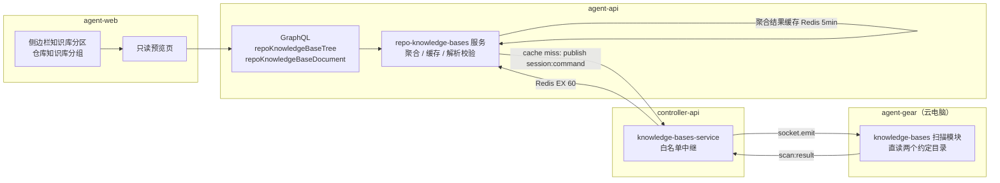
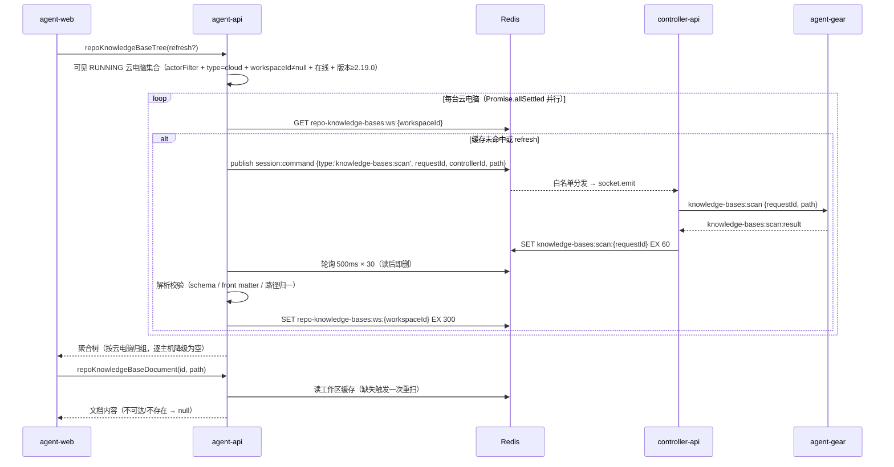

# 仓库内建知识库 - 技术提案

**功能名称**: 仓库内建知识库（知识库支持在代码仓库中内建）
**关联 PRD**: `docs/product/draft/20261116-knowledge-base-repo-built-in.md`
**技术提案版本**: v1.0
**创建日期**: 2026-11-16
**作者**: z-agent-bot
**feat-branch**: `feat/knowledge-base-repo-built-in`

## 1. 概述

### 1.1 背景

知识库（需求 #495，提案 `docs/engineering/proposals/20261115-feat-knowledge-base.md`）以三集合事件溯源落地工作区级 wiki，平台 MCP `agent-knowledge-base-tools` 向会话注入六个工具。工作流模板项目持久化（需求 #469，提案 `docs/engineering/proposals/20261107-feat-workflow-template-project-persistence.md`）建立了「仓库为唯一事实源、平台直读不持久化」的先例：agent-gear 2.18.0 提供 `workflow-templates:scan` 白名单扫描事件，controller-api 白名单中继并写 Redis 结果键，agent-api 轮询消费并逐文件解析校验。

需求 #545 要求知识库也支持从代码仓库中读取：仓库 `.zag/knowledges/` 与 `docs/knowledges/` 两个目录下，每个含 `knowledge-base.json` 的子文件夹即一个知识库（文件为 schema），库内 Markdown 文件为文档。仓库知识库**在知识库 MCP 中不显示、只在前端中显示、不允许修改**。

### 1.2 目标

- 复用「扫描事件 → 中继 → Redis 结果键 → 轮询消费」链路，agent-gear 新增 `knowledge-bases:scan` 事件扫描两个约定目录（含文档内容，白名单限界）。
- agent-api 聚合当前用户可见的 RUNNING 云电脑**默认工作区**的扫描结果，解析 `knowledge-base.json` schema 与 Markdown front matter，归一文档路径，经 GraphQL **只读查询**透出（树 + 单文档）。
- agent-web 侧边栏「知识库」分区追加「仓库知识库」分组（按云电脑归组、来源标识、重新检测），文档预览页只读复用。
- 仓库知识库**不落 MongoDB、不进知识库 MCP 工具、无任何 mutation**，扫描结果仅经 Redis 短缓存（5 分钟）。

### 1.3 范围

**本期范围**：

- agent-gear：`knowledge-bases` 扫描模块与 `knowledge-bases:scan` / `knowledge-bases:scan:result` 事件注册。
- controller-api：`session:command` 白名单新增 `knowledge-bases:scan` 中继与结果回写。
- agent-api：`repo-knowledge-bases` 服务（聚合/缓存/解析）与 GraphQL 两个只读查询。
- agent-web：侧边栏分组、只读预览接线、「重新检测」。
- 契约：`contracts/knowledge-base.graphql` 扩展、`contracts/agent-session-websocket.md` 新增两个事件小节。

**非目标**：

- 本地控制器（非云电脑）工作目录、云电脑上默认工作区以外的工作目录（与 #469 同口径，后续迭代扩展）。
- 仓库知识库的编辑、删除、历史版本、权限设置（历史即 Git 历史）。
- 知识库 MCP 工具暴露仓库知识库（AI 可直接读会话工作目录中的仓库文件）。
- 仓库知识库的实时同步与推送（仅短缓存 + 手动重新检测）。

## 2. 技术架构

### 2.1 系统架构图



### 2.2 技术栈

- agent-gear：Node.js 24 + TypeScript（strict、ESM）、`node:fs/promises`（与 `workflow-templates.ts` 同型直读）。
- controller-api：Socket.IO 中继 + ioredis（结果键 EX 60，与 `workflow-templates-service` 同型）。
- agent-api：Express v5 + GraphQL-Yoga + Mongoose + ioredis（轮询消费与聚合缓存）。
- agent-web：React 19 + Apollo Client + 既有 `MarkdownContent` 渲染管线。

### 2.3 模块划分

| 模块 | 位置 | 职责 |
|------|------|------|
| 扫描模块 | `packages/agent-controller/src/knowledge-bases.ts` | 直读 `<workspacePath>/.zag/knowledges/` 与 `<workspacePath>/docs/knowledges/`：发现知识库文件夹（含 `knowledge-base.json`）、收集库内 `.md` 文件（递归）并读取内容，白名单限界与错误归一 |
| 事件注册 | `packages/agent-controller/src/socketio-client.ts` | 注册 `knowledge-bases:scan` → 回 `knowledge-bases:scan:result`（日志不含文件内容） |
| 中继服务 | `servers/controller-api/src/services/knowledge-bases-service.ts` | `session:command` 白名单分发 → `socket.emit`；`socketio.ts` 监听 `knowledge-bases:scan:result` 写 Redis（EX 60） |
| 聚合服务 | `servers/agent-api/src/services/repo-knowledge-bases.ts` | 可见 RUNNING 云电脑默认工作区集合 → 缓存命中/并行扫描 → 解析校验（schema / front matter / 路径归一）→ 聚合视图；单文档读取（缓存优先） |
| GraphQL | `servers/agent-api/src/graphql/{schemas,resolvers}/knowledge-base.ts` | `repoKnowledgeBaseTree(refresh)` 与 `repoKnowledgeBaseDocument(id, path)` 两个只读查询（双写登记 `schemas/index.ts` / `resolvers/index.ts`） |
| 前端 | `apps/agent-web/src/components/knowledge-base/`、`lib/repo-knowledge-base.ts` | 侧边栏「仓库知识库」分组、只读预览接线、重新检测 |

## 3. API 设计

### 3.1 API 契约

**（a）`contracts/agent-session-websocket.md` 新增两节（顺延 §3.29/§3.30）**：`knowledge-bases:scan`（Server → Controller）与 `knowledge-bases:scan:result`（Controller → Server）。

请求 payload 与 `workflow-templates:scan` 同形（`{requestId, path}`），语义差异：扫描 `<path>/.zag/knowledges/` 与 `<path>/docs/knowledges/` 两个固定子目录。结果 payload：

```json
{
  "requestId": "string",
  "success": true,
  "sources": [
    {
      "source": "zag",
      "knowledgeBases": [
        {
          "folder": "team-rules",
          "schema": "{ \"name\": \"团队规范\" }",
          "documents": [
            { "path": "guides/git.md", "content": "---\ntitle: Git 规范\n---\n# ..." }
          ],
          "truncated": false
        },
        { "folder": "broken", "error": "file too large" }
      ],
      "truncated": false
    },
    { "source": "docs", "knowledgeBases": [], "truncated": false }
  ],
  "truncated": false
}
```

| 字段 | 类型 | 说明 |
|------|------|------|
| `sources[].source` | `'zag' \| 'docs'` | 来源目录标识（`.zag/knowledges/` ↔ `zag`，`docs/knowledges/` ↔ `docs`） |
| `sources[].knowledgeBases[].folder` | `string` | 知识库文件夹名（直接子目录，不含嵌套发现） |
| `sources[].knowledgeBases[].schema` | `string?` | `knowledge-base.json` 原文（≤64 KiB；超限该库 `error:'file too large'`） |
| `sources[].knowledgeBases[].documents[]` | `{path, content?}` | 库内 `.md` 文件（递归）；`path` 为库内相对 POSIX 路径；读取失败该文档附 `error` |
| `error` | `string?` | 白名单：`file too large` / `not found` / `permission denied`（与 §3.27 同表） |
| `truncated` | `boolean` | 各级数量/体积上限截断标记 |

约束（与 §3.27 同族，防漂移守卫）：

- 仅直读两个约定子目录；知识库发现**不递归**（仅直接子文件夹）；库内文档**递归**收集 `.md` 常规文件（符号链接按 `stat` 判定为常规文件才读取）。
- 目录不存在视为空（`success:true`、对应 source 空列表）；读取权限失败 `success:false, error:'permission denied'`。
- 上限：每来源目录 ≤20 个知识库（文件夹名 `localeCompare` 排序取前 20）；每库 ≤50 个文档；`knowledge-base.json` ≤64 KiB；单文档 ≤128 KiB；单库内容累计 ≤1 MiB；单来源累计 ≤2 MiB；超限按级 `truncated:true` 或条目级 `error:'file too large'`。
- 事件**不**使用 `fs:browse`/`fs:read-file` 会话路径白名单（检测可发生在会话启动前），路径由服务端按已登记工作区下发；仅读不写、不执行。

**（b）`contracts/knowledge-base.graphql` 扩展（只读，无 mutation）**：

```graphql
enum RepoKnowledgeBaseSource {
  ZAG    # .zag/knowledges/
  DOCS   # docs/knowledges/
}

type RepoKnowledgeBase {
  id: ID!                    # repo:<workspaceId>:<source>:<encodeURIComponent(folder)>
  name: String!              # schema.name（不合法时为空串，看 valid/errors）
  description: String!
  source: RepoKnowledgeBaseSource!
  folder: String!
  workspaceId: ID!
  cloudHostId: ID!
  cloudHostName: String!
  valid: Boolean!
  errors: [String!]!
}

type RepoKnowledgeBaseTreeItem {
  knowledgeBase: RepoKnowledgeBase!
  documents: [KnowledgeBaseDocumentMeta!]!   # 复用平台元信息形状（updatedAt = 扫描时刻）
}

type RepoKnowledgeBaseDocument {
  path: String!
  title: String!
  tags: [String!]!
  description: String!
  content: String!
}

extend type Query {
  # 仓库知识库树：聚合当前用户可见 RUNNING 云电脑默认工作区；refresh=true 绕过缓存重新检测
  repoKnowledgeBaseTree(refresh: Boolean): [RepoKnowledgeBaseTreeItem!]!
  # 单文档完整内容；不可达/不存在统一 null（不泄露存在性）
  repoKnowledgeBaseDocument(id: ID!, path: String!): RepoKnowledgeBaseDocument
}
```

错误口径：复用既有 `Not authenticated`；聚合内部失败（离线/超时/版本不支持）**逐主机降级为空**，不抛错；`repoKnowledgeBaseDocument` 对不可达 id、已失效工作区、不存在文档统一返回 `null`。契约注释同步声明「仓库知识库不进知识库 MCP 工具、只读、不落库」。

### 3.2 内部接口

```ts
// packages/agent-controller/src/knowledge-bases.ts
export const REPO_KNOWLEDGE_BASE_SOURCES = [
  { source: 'zag', subdir: '.zag/knowledges' },
  { source: 'docs', subdir: 'docs/knowledges' },
] as const;
export async function scanKnowledgeBases(workspacePath: string): Promise<KnowledgeBaseScanResult>;

// servers/agent-api/src/services/repo-knowledge-bases.ts
export const REPO_KNOWLEDGE_BASE_MIN_AGENT_GEAR_VERSION = '2.19.0';
export function isRepoKnowledgeBaseScanSupported(version: unknown): boolean;   // compareVersions 同型
export function parseRepoKnowledgeBaseSchema(raw: string): ParsedRepoKbSchema; // 纯函数
export function parseRepoDocument(rawPath: string, content: string): ParsedRepoDocument; // 纯函数（front matter + 路径归一）
class RepoKnowledgeBaseService {
  listTree(userId: string, refresh?: boolean): Promise<RepoKnowledgeBaseTreeItem[]>;
  getDocument(userId: string, id: string, path: string): Promise<RepoKnowledgeBaseDocument | null>;
}
export const repoKnowledgeBaseService: RepoKnowledgeBaseService;
```

`knowledge-base.json` schema（用户面契约）：

```json
{
  "name": "团队规范",                // 必填：trim 后 1..64
  "description": "……"               // 可选：≤1024
}
```

文档 front matter（可选，文件头 `---` 包围块，仅识别 `title` / `tags` / `description` 三键）：

```markdown
---
title: Git 提交规范
tags: [git, 规范]
description: 提交信息格式与分支约定
---

# 正文……
```

- front matter 解析为**极简手工解析器**（不引入 YAML 依赖）：仅当文件以 `---\n` 开头且在前 4 KiB 内存在闭合 `\n---` 时解析；每行 `key: value`；`tags` 支持 `[a, b]` 与逗号分隔两形态；值不含换行。块非法按「无 front matter」处理，不报错。
- 标题回退链：front matter `title` → 正文首个一级标题（`# `）→ 文件名（去 `.md`）。
- 字段限值与平台知识库同口径：title 1..200 / tags ≤16×1..32 去重 / description ≤1024；超限按非法收敛（front matter 该键忽略，回退默认），不使整个库非法。
- 文档路径归一：`/` + 库内相对 POSIX 路径去掉末尾 `.md`（大小写保留），随后复用平台 `normalizeDocumentPath` 校验（段非空、无控制字符、段 ≤128、全长 ≤512）；归一后冲突（如 `a.md` 与 `a.MD`、`a/b.md` 与 `a//b.md`）→ 该库标记不合法（`文档路径冲突：<path>`），冲突文档均不收录。

## 4. 数据模型

### 4.1 数据库设计

**零 MongoDB 变更**：仓库知识库不落库（D2），无新集合、无迁移、无索引。仓库为唯一事实源。

### 4.2 缓存设计

| 键 | 写方 | TTL | 内容 |
|----|------|-----|------|
| `knowledge-bases:scan:{requestId}` | controller-api 中继 | 60s | 单次扫描原始结果（与 `workflow-templates:scan` 同型，读后即删） |
| `repo-knowledge-bases:ws:{workspaceId}` | agent-api 聚合服务 | 300s | 该工作区解析后的知识库全集（含文档内容，≤2 MiB/来源上限天然限界） |

- 聚合树查询按工作区逐条读缓存；`refresh=true` 时删除缓存键后重扫。
- 文档查询读同一缓存；缓存缺失时触发一次重扫（等价于一次树加载）。
- 单文档内容不单独建缓存键（扫描结果天然含内容，D9）。

## 5. 技术实现方案

### 5.1 核心流程



### 5.2 关键实现点

1. **agent-gear 扫描模块（`packages/agent-controller/src/knowledge-bases.ts`）**：与 `workflow-templates.ts` 同型直读。两个固定子目录逐一扫描：`readdir({withFileTypes:true})` 发现直接子文件夹（符号链接按 `stat` 判定为目录才进入）；子文件夹内存在常规文件 `knowledge-base.json` 才识别为知识库；递归收集 `.md`（小写比较）常规文件，读取内容并累计体积。白名单错误归一 `file too large` / `not found` / `permission denied`；目录 ENOENT/ENOTDIR → 空。事件注册于 `socketio-client.ts`（日志 `knowledge_bases_scan` 仅含 `requestId/path`，不记录内容）。包版本升 2.19.0，agent-api 版本门禁 `isRepoKnowledgeBaseScanSupported` 同口径。
2. **controller-api 中继（`knowledge-bases-service.ts` + `session-command.ts` 白名单 + `socketio.ts` 监听）**：逐字镜像 `workflow-templates-service` 形态——`requestId && controllerId && path` 齐备才分发；结果键 `knowledge-bases:scan:{requestId}`（EX 60）；`sources` 非数组按 `{success:false}` 兜底落键。
3. **agent-api 聚合服务（`services/repo-knowledge-bases.ts`）**：
   - 云电脑集合：`CloudHost.find({...actorFilter(userId), status:'RUNNING', workspaceId:{$ne:null}, deletedAt:null})` → 关联 `ControllerWorkspace`（取 `path/controllerId`）与 `Controller`（`status==='online'` 且版本门禁通过）。**逐主机独立 Promise.allSettled**，单主机任何失败（工作区缺失/离线/超时/解析异常）降级为空数组，不影响聚合。
   - 缓存：`GET repo-knowledge-bases:ws:{workspaceId}`；`refresh=true` 先 `DEL`。miss 走扫描（publish + 500ms×30 轮询，与 `repo-templates.ts` 同参数）。
   - 解析为**纯函数层**（`parseRepoKnowledgeBaseSchema` / `parseRepoDocument`），逐库隔离：schema 非法 → 该库 `valid:false, errors:[...]`，不参与文档解析；合法库归一全部文档路径并检冲突。
   - 视图装配：id 编码 `repo:<workspaceId>:<source>:<encodeURIComponent(folder)>`；树条目 `documents` 复用 `KnowledgeBaseDocumentMeta` 形状（`updatedAt` 取扫描完成时刻 ISO）。
   - 文档查询：解码 id → 校验工作区归属（`controllerWorkspaceService.findById` + 云电脑 RUNNING 复核）→ 读缓存（miss 重扫）→ 按 `source/folder/path` 定位；任何一步不命中返回 `null`（不泄露存在性）。
4. **GraphQL**：`schemas/knowledge-base.ts` 追加类型与两个查询（手写 schema 与契约**双写**），`resolvers/knowledge-base.ts` 追加 resolver 并**登记 `resolvers/index.ts`**（漏登记运行时无效，既有陷阱）。resolver 薄封装：认证 → 委托 service → 错误白名单收敛（仅 `Not authenticated`，其余收敛 `internal error`）。
5. **知识库 MCP 零改动（D3）**：`services/knowledge-base-tools.ts` 六工具全部经 `knowledgeBaseService`（MongoDB 唯一读写口）执行；仓库知识库不进入该路径，天然不出现在 `knowledge_base_list` 等任何工具结果中；按名称调用解析范围为可见集（MongoDB），仓库库名解析为 0 命中 → 既有「未找到」isError 口径。
6. **agent-web**：
   - `lib/repo-knowledge-base.ts`：id 编解码（`repo:` 前缀判定）、`isRepoKnowledgeBaseId`。
   - `KnowledgeBaseSection`：平台树之后渲染「仓库知识库」分组——按 `cloudHostId` 归组（云电脑名徽标 + 来源徽标 `zag/docs`），条目无「+」/齿轮，文档无「+」；分组标题行「重新检测」（`refetch` 携带 `refresh:true`）；查询 `GET_REPO_KNOWLEDGE_BASE_TREE` 独立 `cache-and-network`（不进 HOME_OVERVIEW，与平台树 D4 同决策）。
   - `KnowledgeBasePage`：`kbId` 命中 `repo:` 前缀时走 repo 分支——元信息取自 `GET_REPO_KNOWLEDGE_BASE_TREE`、正文经 `GET_REPO_KNOWLEDGE_BASE_DOCUMENT`；只读渲染（隐藏编辑/删除/历史按钮；`?edit=1` 忽略）；不可达展示明确提示且不泄露内容。路由不变（`/knowledge-bases/:kbId/*`）。
   - 不合法库条目：树内灰显并展示 `errors[0]`（与 `RepoWorkflowSection` 同形态）。

## 6. 技术决策

### 6.1 决策列表

| # | 决策 | 理由 |
|---|------|------|
| D1 | 本期仅扫描 RUNNING 云电脑的**默认工作区**（GitHub 项目 clone 目录） | 「代码仓库」的平台语义即云电脑 Git 项目；与 #469 云电脑限定同口径；扫描面有界（每用户云电脑数有限） |
| D2 | 仓库知识库**不落 MongoDB**，仅 Redis 短缓存 | 仓库为唯一事实源（#469 先例）；避免双事实源脱节 |
| D3 | 知识库 MCP **零改动**（MongoDB 唯一读写口天然排除） | 需求明确「MCP 中不显示」；AI 可直接读会话工作目录仓库文件，无中间层 |
| D4 | GraphQL **只读**（两个查询，无 mutation） | 「不允许修改」；无写入口即无越权写仓库路径 |
| D5 | 两个来源目录 `.zag/knowledges/` 与 `docs/knowledges/`，`source` 枚举区分 | 需求指定；`.zag` 对齐工作流模板 `.zag/workflow/templates/` 约定（已核实模板实际路径） |
| D6 | 文档元信息取自可选 front matter，回退「首个一级标题 → 文件名」 | 编写体验贴近 Markdown 惯例；`knowledge-base.json` 保持最小 schema（name/description） |
| D7 | 聚合结果 Redis 缓存 5 分钟 + `refresh` 手动重新检测 | 侧边栏树为高频入口，不能每次触发继电器扫描；与「重新检测」产品口径一致 |
| D8 | id 编码 `repo:<workspaceId>:<source>:<encodeURIComponent(folder)>` | 复用既有 `/knowledge-bases/:kbId/*` 路由；与 Mongo ObjectId 天然区分；可解码定位工作区做归属校验 |
| D9 | 扫描结果含文档内容（≤128 KiB/篇限界），文档查询读缓存而非二次继电器 | 一次扫描服务树与正文两个查询；限界天然封顶缓存体积 |
| D10 | agent-gear 版本门禁 `>=2.19.0`，旧组件静默跳过该主机 | 与 `workflow-templates:scan` 2.18.0 门禁同口径，优雅降级 |
| D11 | front matter 手工极简解析，不引入 YAML 依赖 | 三键单行即够；避免为新场景新增依赖面 |
| D12 | 文档路径冲突整库标记不合法 | 大小写/形态冲突在 Linux 容器可读但跨平台不可移植，显式报错优于静默二选一 |

### 6.2 依赖与约束

- 依赖 `workflow-templates:scan` 链路全部先例（契约 §3.27/§3.28、`repo-templates.ts`、`workflow-templates-service.ts`）；扫描/中继/轮询参数与其对齐（500ms × 30、EX 60）。
- 依赖知识库（#495）的前端渲染管线与路由（`KnowledgeBaseSection` / `KnowledgeBasePage` / `MarkdownContent`）。
- 依赖云电脑默认工作区口径（`CloudHost.workspaceId`，#304 二期）。
- 受继电器链路约束：云电脑离线/版本不足时该主机无仓库知识库（降级语义已确认可接受）。
- 单实例部署前提沿用（轮询消费 Redis 结果键，与既有链路一致）。

## 7. 项目结构

**新增**：

- `packages/agent-controller/src/knowledge-bases.ts`（扫描模块）
- `packages/agent-controller/src/knowledge-bases.test.ts`
- `servers/controller-api/src/services/knowledge-bases-service.ts`（+ `.test.ts`）
- `servers/agent-api/src/services/repo-knowledge-bases.ts`（+ `.test.ts`）
- `apps/agent-web/src/lib/repo-knowledge-base.ts`（+ 测试）
- `apps/agent-web/src/components/knowledge-base/RepoKnowledgeBaseSection.tsx`（+ 测试）

**修改**：

- `packages/agent-controller/src/socketio-client.ts`（事件注册）、`package.json`（2.19.0）
- `servers/controller-api/src/services/{session-command.ts,socketio.ts}`（白名单 + 监听）
- `servers/agent-api/src/graphql/{schemas,resolvers}/knowledge-base.ts`、`{schemas,resolvers}/index.ts`
- `apps/agent-web/src/components/knowledge-base/{KnowledgeBaseSection.tsx,KnowledgeBasePreview.tsx}`、`pages/KnowledgeBasePage.tsx`、`graphql/knowledge-base.ts`
- `contracts/{knowledge-base.graphql, agent-session-websocket.md}`
- 各 AGENTS.md 口径同步（agent-controller / controller-api / agent-api / agent-web）

**测试**：`tests/api/src/agent-api/repo-knowledge-base.test.ts`、`tests/e2e/src/repo-knowledge-base.spec.ts`

## 8. 测试策略

- **agent-gear 单测（T-RKB-SCAN）**：两目录发现、`knowledge-base.json` 标识判定、递归收集 `.md`、符号链接判定、各级上限与截断、ENOENT/ENOTDIR 空、EACCES → `permission denied`、单文档超限 → `file too large`。
- **controller-api 单测（T-RKB-RELAY）**：白名单三要素齐备才分发、离线仅记 error、结果落键 EX 60、`sources` 非数组兜底。
- **agent-api 单测（T-RKB）**：schema 解析矩阵（缺 name/超长/非法 JSON）、front matter 三键与回退链、路径归一与冲突整库非法、聚合逐主机降级、版本门禁跳过、缓存命中/refresh 绕过、文档查询归属校验与 null 收敛；契约/schema 双写守卫与 resolver 登记守卫。
- **API 测试（tests/api，T-RKB-API）**：fake controller 全链路树查询与文档查询、不可达 null、MCP 工具列表不含仓库库。
- **前端组件（T-RKB-WEB）**：分组归组/徽标/重新检测、只读预览隐藏写入口、`?edit=1` 忽略、不合法库灰显。
- **E2E（E2E-RKB）**：放置知识库 → 侧边栏分组可见 → 预览只读 → 更新后重新检测生效 → 平台知识库零回归。

## 9. 验收标准

- [ ] PRD 功能点 1~4 全部验收项通过（放置规范识别、侧边栏分组、只读预览、MCP 不显示）。
- [ ] 平台托管知识库的功能（列表/树/预览/编辑/历史/设置/MCP）零回归。
- [ ] 契约 `knowledge-base.graphql` 与手写 schema 一致；`agent-session-websocket.md` 新事件与实现一致。
- [ ] 单测 / API / E2E 全绿；各包 AGENTS.md 口径同步。

## 10. 相关文档

- PRD：`docs/product/draft/20261116-knowledge-base-repo-built-in.md`
- 知识库提案：`docs/engineering/proposals/20261115-feat-knowledge-base.md`
- 工作流模板项目持久化提案：`docs/engineering/proposals/20261107-feat-workflow-template-project-persistence.md`
- 契约：`contracts/knowledge-base.graphql`、`contracts/agent-session-websocket.md`
- 需求来源：GitHub Issue [Deliay/z-agent-gear#545](https://github.com/Deliay/z-agent-gear/issues/545)
