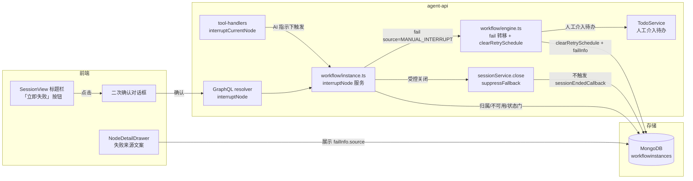
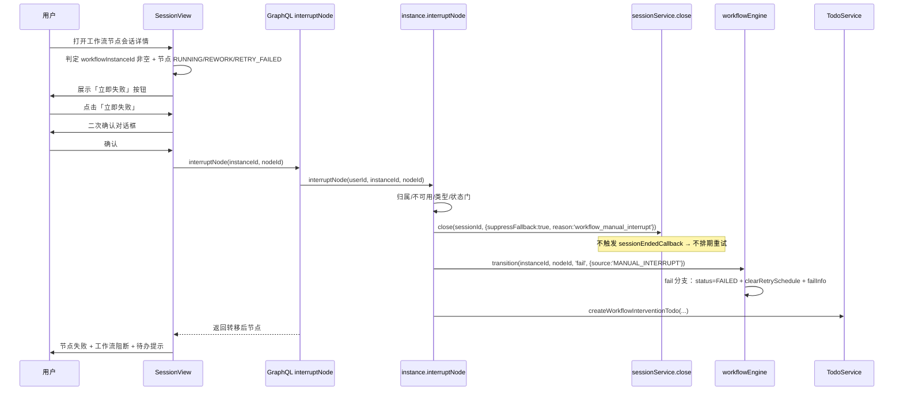

# 工作流支持打断 - 技术提案

**功能名称**: 工作流支持打断
**关联 PRD**: [20261116-workflow-interrupt.md](../../product/draft/20261116-workflow-interrupt.md)
**技术提案版本**: v1.0
**创建日期**: 2026-11-16
**作者**: ZeroAsh Agent（需求来源：[Deliay/z-agent-gear#512](https://github.com/Deliay/z-agent-gear/issues/512)）
**feat-branch**: `feat/workflow-interrupt`

## 1. 概述

### 1.1 背景

工作流 AI 节点中断自动重试机制（`services/workflow/interrupt-retry.ts`，提案 `20261103-feat-workflow-node-interrupt-retry`）现状：会话意外结束（`ended`）或停滞空闲（`idled`）时，`orchestrator.handleSessionEnded` / `handleSessionIdled` 统一走 `scheduleInterruptionRetry`——最多 10 次、指数退避（0/1/2/4/8/16/30/30/30/30 分钟，总窗口约 2 小时），10 次用尽经 `retryExhausted` 转 `RETRY_FAILED` + `failInfo.source='RETRY_EXHAUSTED'` + 人工介入待办。

该机制保证瞬时故障自愈，但**人类无法主动、即时叫停**：手动关闭会话仍经 `sessionService.close`（非 `suppressFallback`）触发 `sessionEndedCallback` → `handleSessionEnded` → 排期下一次重试，无法真正打断；唯一「立即失败」入口是 AI 侧 `failCurrentNode`（`source='LLM_REPORTED'`），人类侧缺失。

Issue #512 要求：在**会话详情**中增加「立即失败」按钮，中断会话，并让工作流**立即进入失败状态**（绕过 10 次自动重试）。

### 1.2 目标

1. 会话详情提供「立即失败」入口（仅工作流节点会话 + RUNNING/REWORK/RETRY_FAILED 状态可见）。
2. 确认后**受控关闭**节点会话（`suppressFallback:true`）——不触发 `sessionEndedCallback`、不排期重试、不消耗 `retryCount` 预算。
3. 引擎 `fail` 转移（`RUNNING/REWORK→FAILED`），`failInfo.source` 新增 `MANUAL_INTERRUPT`（人类主动打断），保留 `retryCount` 与调度字段清理口径与既有 `fail` 一致。
4. `clearRetrySchedule`（清 `nextRetryAt/retryPhase/retryDeadlineAt/retryTrigger`，保留 `retryCount`）——不新增重试排期。
5. 人工介入待办（`createWorkflowInterventionTodo`），复用既有 FAILED 恢复路径（`resumeFailedNode` / `restartNode`）。

### 1.3 范围

**做**（全部位于 `servers/agent-api` + `apps/agent-web` + `contracts`）：

- `services/workflow/instance.ts`：新增 `interruptNode(userId, instanceId, nodeId)`——归属校验 + 不可用门 + 节点状态门（RUNNING/REWORK/RETRY_FAILED）+ 受控关闭会话（`suppressFallback:true, reason:'workflow_manual_interrupt'`）+ 引擎 `fail` 转移（`source:'MANUAL_INTERRUPT'`）+ 人工介入待办。
- `services/workflow/engine.ts`：`fail` `from` 扩展 `RETRY_FAILED`（镜像 `resumeFailed` / `restart`）；`failInfo.source` 注释补 `MANUAL_INTERRUPT`；`fail` 分支保留 `retryCount` + `clearRetrySchedule`（既有口径不变）。
- `services/workflow/tool-handlers.ts`：新增 MCP 工具 `interruptCurrentNode`（节点作用域，人类不可直接调——本工具为 AI 在人类指示下触发打断的对称入口；描述注明「仅在人类明确要求立即打断节点时调用」）。工具总数 14→15。
- `services/workflow/pr-check-run-sync.ts`：`mapNodeStatusToCheckRun` 无需新增（FAILED 既有映射 `failure`，与 `LLM_REPORTED` 同族，语义一致）。
- 契约 `contracts/workflow.graphql`：`WorkflowNodeFailInfo.source` 注释补 `MANUAL_INTERRUPT`；新增 `interruptNode` mutation；`restartNode` 注释口径已含 RETRY_FAILED（不变）。
- `graphql/schemas/workflow.ts`（手写 schema）+ `graphql/resolvers/workflow.ts`：新增 `interruptNode` mutation 与 resolver。
- `apps/agent-web`：`SessionView` 标题栏「立即失败」按钮（仅工作流节点会话 + RUNNING/REWORK/RETRY_FAILED 可见）+ 二次确认对话框 + `failInfo.source` 文案展示；`NodeDetailDrawer` 失败来源文案（MANUAL_INTERRUPT）。
- 迁移 `028-workflow-interrupt`：无数据模型变更（`failInfo.source` 为自由文本 String，无需回填）；如需索引则幂等建 `failInfo.source` 部分索引（可选，本期不做）。
- 测试：agent-api 单测（引擎 / instance / tool-handlers）、agent-web 单测、`tests/api`、`tests/e2e`。

**不做**：

- 不新增节点状态（沿用 `FAILED`，不新增 `INTERRUPTED` 等状态——PRD 要求「进入失败状态」）。
- 不改变 `retryCount` 语义：人工打断不递增 `retryCount`、不排期重试（`clearRetrySchedule` 保留 `retryCount` 与既有 `fail` 一致）。
- 不新增 check-run 映射（FAILED 既有 `failure` 语义覆盖）。
- 不新增恢复入口（复用既有 `resumeFailedNode` / `restartNode`）。
- HUMAN 节点无 ACP 会话，本功能不提供 HUMAN 节点打断入口（HUMAN 节点既有 reject / 删除等操作覆盖）。
- 不改变 `handleSessionRemoved`（会话启动失败/被移除）维持立即 `FAILED`（`SESSION_START_FAILED`）口径。

## 2. 技术架构

### 2.1 系统架构图



### 2.2 技术栈

无变更：Node.js 24 + TypeScript（strict, ESM）、Express v5 + GraphQL-Yoga、Mongoose 9、ioredis、Vitest；前端 React 19 + Apollo Client。

### 2.3 模块划分

| 模块 | 职责 | 关键技术点 |
|------|------|-----------|
| `services/workflow/instance.ts` | 新增 `interruptNode` 服务：归属/不可用/状态门 + 受控关闭 + fail 转移 + 待办 | 复用 `restartNode` 归属与不可用门口径；`sessionService.close(suppressFallback:true)` 绕过重试排期 |
| `services/workflow/engine.ts` | `fail` from 扩展 RETRY_FAILED；`failInfo.source` 注释 | `fail` 分支保留 `retryCount` + `clearRetrySchedule`（既有口径不变） |
| `services/workflow/tool-handlers.ts` | 新增 `interruptCurrentNode` MCP 工具 | 节点作用域；工具总数 14→15；`fail` 转移 source=MANUAL_INTERRUPT |
| `services/workflow/pr-check-run-sync.ts` | 无新增（FAILED 既有 `failure` 映射） | 零改动 |
| `graphql/schemas/workflow.ts` + `resolvers/workflow.ts` | 新增 `interruptNode` mutation + resolver | 手写 schema 与契约双写 |
| `contracts/workflow.graphql` | `failInfo.source` 注释补 MANUAL_INTERRUPT + `interruptNode` mutation | 契约与手写 schema 双写 |
| `apps/agent-web` | SessionView 按钮 + 二次确认 + 失败来源文案 | 仅工作流节点会话 + 可打断状态可见 |

## 3. API 设计

### 3.1 API 契约（`contracts/workflow.graphql`）

```graphql
type WorkflowNodeFailInfo {
  reason: String!
  # 失败来源：SESSION_STUCK / LLM_REPORTED / SESSION_START_FAILED /
  # RETRY_EXHAUSTED（中断自动重试 10 次用尽）/
  # CONTROLLER_UNAVAILABLE（实例接续时收敛）/
  # MANUAL_INTERRUPT（人类在会话详情「立即失败」主动打断，绕过自动重试）
  source: String!
  at: String!
}

# 立即打断节点：人类在会话详情主动中断节点会话并让节点立即进入失败状态，
# 绕过中断自动重试机制（不消耗 retryCount 预算、不排期重试）。
# 仅允许 RUNNING/REWORK/RETRY_FAILED 的 AI 节点；实例不可用拒绝。
# 错误文案表：工作流实例不存在或无权限 / 工作流实例已删除 /
# 工作流实例不可用（控制器离线或已删除），请先接续后再操作 /
# 节点当前状态不允许立即打断 / 节点不是 AI 节点会话，无法打断
interruptNode(instanceId: ID!, nodeId: ID!): WorkflowNode!
```

- `restartNode` 注释口径已含 `RETRY_FAILED`（不变）。
- `resumeFailedNode` 为 MCP 工具（不进 GraphQL），描述不变（`FAILED/RETRY_FAILED→RUNNING`）。
- 引擎 `fail` 转移 `from` 扩展 `RETRY_FAILED`：`fail: { from: ['RUNNING', 'REWORK', 'RETRY_FAILED'], to: 'FAILED' }`。

### 3.2 内部接口

#### `workflowInstanceService.interruptNode`

```ts
async interruptNode(userId: string, instanceId: string, nodeId: string): Promise<WorkflowNodeDoc>
```

严格按序（与 `restartNode` 同口径）：
1. 读取（`findOne({ _id: instanceId, ...actorFilter(userId), deletedAt: null }).lean()`）→ 不存在抛「工作流实例不存在或无权限」。
2. 类型门：`node.type === 'AI'`（HUMAN/FLAG 无 ACP 会话，抛「节点不是 AI 节点会话，无法打断」）。
3. 不可用门：`resolveInstanceUnavailableReason(instance, loadControllerStatus)` 非空 → 抛「工作流实例不可用（控制器离线或已删除），请先接续后再操作」。
4. 状态门：`node.status ∈ { RUNNING, REWORK, RETRY_FAILED }` 否则抛「节点当前状态不允许立即打断」。
5. 受控关闭会话（`node.sessionId` 存在时）：`sessionService.close(sessionId, userId, { suppressFallback: true, reason: 'workflow_manual_interrupt' })`——**不触发 `sessionEndedCallback`、不排期重试**。会话已 ended/disconnected 时 `close` 幂等（返回 false，继续）。
6. 引擎 `fail` 转移：`workflowEngine.transition(instanceId, nodeId, 'fail', { source: 'MANUAL_INTERRUPT', reason: '人类主动打断：立即失败，绕过中断自动重试' })`。
7. 人工介入待办：`todoService.createWorkflowInterventionTodo({ userId, instanceId, instanceName, nodeId, nodeName, sessionId, reason: '人类主动立即打断，节点已进入失败状态，请人工介入' })`（失败仅 warn，不阻断主流程）。
8. 返回转移后节点（`mapInstanceNode`）。

#### `interruptCurrentNode` MCP 工具（节点作用域）

经 `loadScopeContext`（实例归属 + 节点存在）→ 状态门（RUNNING/REWORK/RETRY_FAILED）→ 受控关闭 + `fail` 转移（`source:'MANUAL_INTERRUPT'`）+ 待办。与 `failCurrentNode` / `resumeFailedNode` 同为节点作用域工具，工具总数 14→15。

## 4. 数据模型

### 4.1 `workflowinstances` 节点子文档（`models/workflow-instance.ts`）

**无新增字段**。沿用既有：

| 字段 | 类型 | 说明 |
|------|------|------|
| `status` | String enum | `fail` 转移目标 `FAILED`（`from` 扩展 `RETRY_FAILED`） |
| `retryCount` | Number | 既有；人工打断**不递增**（`fail` 分支 `clearRetrySchedule` 保留 `retryCount`，与既有 `fail` 一致） |
| `nextRetryAt` / `retryPhase` / `retryDeadlineAt` / `retryTrigger` | 既有 | `fail` 分支 `clearRetrySchedule` 置 null（不排期重试） |
| `failInfo` | `{ reason, source, at }` | `source` 新增 `'MANUAL_INTERRUPT'`（自由文本 String，无需迁移回填） |

### 4.2 迁移 `028-workflow-interrupt`

- **无数据模型变更**：`failInfo.source` 为自由文本 `String`，无需回填存量。
- 迁移脚本幂等 no-op（仅登记编号占位，确保迁移 runner 顺序一致）；如需 `failInfo.source` 部分索引则本期不建（人工打断低频，全量扫描可接受）。
- 编号 028（027 已被 oidc-binding-optimization 占用）。

### 4.3 缓存设计

无新增缓存；失败转移经 `workflowEngine.transition`（`KeyedMutex` 领域锁）串行化，与既有流转同口径。

## 5. 技术实现方案

### 5.1 核心流程

#### 5.1.1 人工立即打断（前端 → GraphQL → 服务）



#### 5.1.2 AI 指示下打断（MCP 工具 `interruptCurrentNode`）

人类在节点会话中给出「立即打断」指示 → AI 调用 `interruptCurrentNode`（节点作用域）→ `loadScopeContext` → 状态门 → 受控关闭 + `fail` 转移（`source:'MANUAL_INTERRUPT'`）+ 待办。与人工前端入口共用同一 `interruptNode` 服务逻辑。

#### 5.1.3 状态机变更（`engine.ts`）

```ts
const TRANSITIONS: Record<WorkflowEvent, { from: string[]; to: string }> = {
  // ……既有不变……
  fail: { from: ['RUNNING', 'REWORK', 'RETRY_FAILED'], to: 'FAILED' },  // from + RETRY_FAILED
  // ……
};
```

- `fail` 分支既有逻辑不变：`node.status = 'FAILED'` + `markLastNode` + `clearRetrySchedule`（清 `nextRetryAt/retryPhase/retryDeadlineAt/retryTrigger`，保留 `retryCount`）+ `failInfo { reason, source: payload.source ?? 'LLM_REPORTED', at }`。
- `from` 扩展 `RETRY_FAILED`：允许 `RETRY_FAILED`（自动重试用尽）节点经人工打断直接转 `FAILED`（与 `resumeFailed` / `restart` 的 `from` 含 `RETRY_FAILED` 对称）。
- `retryExhausted` / `fail` / `resumeFailed` / `restart` 的 `from` 关系：`retryExhausted`（RUNNING/REWORK→RETRY_FAILED）不变；`fail` 新增 RETRY_FAILED 来源；`resumeFailed`（FAILED/RETRY_FAILED→RUNNING）不变；`restart`（RUNNING/REWORK/FAILED/RETRY_FAILED→RUNNING）不变。
- `refreshCurrentNodeNames` 不变（仅 RUNNING）→ `FAILED` 天然阻断下游激活（非 DONE）。

### 5.2 关键实现点

#### 实现点 1：受控关闭绕过重试排期

- **描述**: 人工打断必须**不触发**中断自动重试排期，否则「立即失败」会立即被下一次重试覆盖。
- **技术细节**: `sessionService.close(sessionId, userId, { suppressFallback: true, reason: 'workflow_manual_interrupt' })`——`suppressFallback: true` 跳过 `sessionEndedCallback` → `orchestrator.handleSessionEnded` 不被触发 → `scheduleInterruptionRetry` 不排期。
- **风险点**: 若 `suppressFallback` 误传 false，关闭会触发 `handleSessionEnded` → 排期重试（首次立即）→ 与 `fail` 转移竞态。CAS 兜底：`scheduleInterruptionRetry` 前置过滤 `node.status !== 'RUNNING' && !== 'REWORK'` 时 skip；`fail` 转移后节点为 FAILED，重试排期 CAS 因 `status` 白名单不命中而 skip。但必须 `suppressFallback:true` 从源头杜绝，不依赖 CAS 兜底。

#### 实现点 2：`fail` from 扩展 RETRY_FAILED 的语义

- **描述**: `RETRY_FAILED`（自动重试用尽）节点现状只能经 `resumeFailed` / `restart` 恢复；人工打断需允许其直接转 `FAILED`。
- **技术细节**: `fail.from` 加 `RETRY_FAILED`。`fail` 分支 `clearRetrySchedule` 保留 `retryCount`（展示与排查），`failInfo.source='MANUAL_INTERRUPT'`。
- **风险点**: `RETRY_FAILED` 节点可能已无 `sessionId`（重试用尽时 `sessionId` 仍保留——`retryExhausted` 不清 `sessionId`）。`interruptNode` 状态门含 `RETRY_FAILED`，受控关闭时 `sessionId` 存在则 close，不存在则跳过直接 fail（幂等）。

#### 实现点 3：前端入口可见性门控

- **描述**: 「立即失败」按钮仅对工作流节点会话 + 可打断状态可见，避免非工作流会话 / 不可打断状态误展示。
- **技术细节**: `SessionView` 读取 `GET_SESSION` 的 `workflowInstanceId`（非空 = 工作流节点会话）+ `workflowNodeId` → 经 `GET_WORKFLOW_INSTANCE` 查节点 `status ∈ { RUNNING, REWORK, RETRY_FAILED }` → 渲染按钮。实例不可用（`unavailableReason` 非空）时置灰并提示「实例不可用，请先接续」。
- **风险点**: `SessionView` 既有 `workflowInstanceId` / `workflowNodeId` 字段（节点会话打标）已存在，无需新增查询字段；节点状态来自 `GET_WORKFLOW_INSTANCE`（5s 轮询）或首页聚合。二次确认对话框复用既有 `ConfirmDialog`。

#### 实现点 4：失败来源可辨识

- **描述**: 人类需辨识「主动打断」区别于「自动重试用尽」与「Agent 报告失败」。
- **技术细节**: `failInfo.source='MANUAL_INTERRUPT'`（独立来源值）。`NodeDetailDrawer` / `SessionView` 失败提示按 `source` 展示文案：`MANUAL_INTERRUPT` →「已被人工立即打断」；`RETRY_EXHAUSTED` →「重试失败」；`LLM_REPORTED` →「失败」；`SESSION_STUCK` / `SESSION_START_FAILED` / `CONTROLLER_UNAVAILABLE` → 既有文案。
- **风险点**: `failInfo.source` 为自由文本 String，前端按值匹配；新增值须同步契约注释与前端文案映射（单一来源）。

#### 实现点 5：与既有兜底机制的关系

- **描述**: `deferSessionFallback`（`FALLBACK_RETRY_MAX=3`，锁内 re-entrant 延迟转移）与 `scheduleInterruptionRetry`（10 次自动重试）是既有兜底层；本次在其上叠加**人工主动**路径，不改变既有兜底。
- **技术细节**: `interruptNode` 走 `sessionService.close(suppressFallback:true)` → 不触发 `sessionEndedCallback` → 不进入 `handleSessionEnded` / `scheduleInterruptionRetry`。`fail` 转移后节点 `FAILED`，即使后续有 `ended` 事件（close 回调 / 控制器上报）经 `handleSessionEnded` 前置过滤 `node.status !== 'RUNNING'` 而 skip。
- **风险点**: 无（既有兜底零回归，测试锁定）。

## 6. 技术决策

### 6.1 决策列表

| 决策 | 选项 A | 选项 B | 最终选择 | 原因 |
|------|--------|--------|---------|------|
| D1 失败状态 | 新增 `INTERRUPTED` 状态 | 沿用 `FAILED` | B | PRD 要求「进入失败状态」；新增状态需同步 check-run/前端/恢复路径，成本高语义无增益；`failInfo.source` 已可区分来源 |
| D2 重试预算 | 打断消耗 1 次重试预算 | 打断不消耗重试预算 | B | PRD 要求「绕过自动重试」；`suppressFallback` + `clearRetrySchedule` 保证不排期、不递增 `retryCount` |
| D3 关闭方式 | 普通 close（触发重试） | 受控 close（`suppressFallback:true`） | B | 受控关闭从源头杜绝 `sessionEndedCallback`，不依赖 CAS 兜底 |
| D4 `fail` from | 仅 RUNNING/REWORK | + RETRY_FAILED | B | 允许自动重试用尽节点经人工打断直接转 FAILED，与 `resumeFailed`/`restart` 的 from 对称 |
| D5 入口位置 | 节点详情抽屉 | 会话详情标题栏 | B | Issue #512 明确「在会话详情中增加立即失败按钮」；节点详情已有「重启节点」入口 |
| D6 二次确认 | 无确认 | 有确认 | B | 误触导致工作流立即失败不可逆，必须二次确认 |
| D7 AI 入口 | 不提供 MCP 工具 | 提供 `interruptCurrentNode` | B | 与 `failCurrentNode` / `resumeFailedNode` 对称，AI 在人类指示下可触发打断；工具总数 14→15 |
| D8 check-run 映射 | 新增 `INTERRUPTED` conclusion | 沿用 `FAILED` failure | B | 沿用 FAILED 语义（执行失败），不新增 check-run 状态 |

### 6.2 依赖与约束

| 类型 | 内容 | 说明 |
|------|------|------|
| 依赖 | `sessionService.close` 受控关闭 + `suppressFallback` 语义 | `interruptNode` 复用 |
| 依赖 | `todoService.createWorkflowInterventionTodo` | 人工介入待办 |
| 依赖 | `interrupt-retry.ts` 前置过滤（`status` 白名单） | 兜底竞态 CAS |
| 约束 | agent-api 单实例部署 | 与 `KeyedMutex` / 中断重试调度器同口径 |
| 约束 | 迁移编号 028 | 027 已被 oidc-binding-optimization 占用 |
| 约束 | 手写 schema 与契约双写 | `graphql/schemas/workflow.ts` + `contracts/workflow.graphql` |

## 7. 项目结构

```
servers/agent-api/
├── src/
│   ├── migrations/
│   │   └── 028-workflow-interrupt.ts        # 新增：幂等 no-op（无数据模型变更）
│   ├── models/
│   │   └── workflow-instance.ts             # 无新增字段（failInfo.source 自由文本）
│   ├── services/
│   │   ├── session.ts                       # 既有 close(suppressFallback) 复用
│   │   └── workflow/
│   │       ├── engine.ts                    # fail from + RETRY_FAILED；failInfo.source 注释
│   │       ├── instance.ts                  # +interruptNode 服务
│   │       ├── tool-handlers.ts             # +interruptCurrentNode 工具（14→15）
│   │       └── pr-check-run-sync.ts         # 无改动（FAILED 既有 failure 映射）
│   ├── graphql/
│   │   ├── schemas/workflow.ts              # +interruptNode mutation（手写 schema）
│   │   └── resolvers/workflow.ts            # +interruptNode resolver
│   └── index.ts                             # 挂载迁移 028（随启动执行）
contracts/
└── workflow.graphql                         # failInfo.source 注释 + interruptNode mutation
apps/agent-web/src/
├── components/session/
│   ├── SessionView.tsx                      # 标题栏「立即失败」按钮 + 二次确认 + 失败来源文案
│   └── SessionHeader.tsx（或标题栏组件）    # 按钮门控（workflowInstanceId + 状态）
├── components/workflow/
│   └── NodeDetailDrawer.tsx                 # failInfo.source 文案展示（MANUAL_INTERRUPT）
└── graphql/workflow.ts                      # INTERRUPT_NODE mutation + 类型
```

## 8. 测试策略

### 8.1 测试覆盖要求

- 新增/变更逻辑行覆盖 ≥ 80%（backend-rules 口径）；状态机与状态门分支全覆盖。
- API 测试覆盖：`interruptNode` mutation（归属/不可用/类型/状态门 + 成功转移 + 待办）；`restartNode` 接受 `RETRY_FAILED` 来源不变回归。
- E2E：工作流节点会话 →「立即失败」→ 二次确认 → 节点 FAILED + `failInfo.source=MANUAL_INTERRUPT` + 工作流阻断 + `retryCount` 未递增 + `nextRetryAt` null。

### 8.2 测试类型

| 类型 | 工具 | 覆盖范围 |
|------|------|---------|
| 单元（引擎） | Vitest | T-ENG1~4：`fail` from 扩展 RETRY_FAILED；`fail` 分支 `clearRetrySchedule` 保留 `retryCount` + `failInfo.source` 透传；非法转移拒绝（DONE/REJECT 等不可打断） |
| 单元（instance 服务） | Vitest | T-INT1~8：归属/不可用/类型/状态门各拒绝文案；受控关闭 `suppressFallback`（不触发 `sessionEndedCallback`）；`fail` 转移 `source=MANUAL_INTERRUPT`；待办创建；会话已 ended 幂等；并发 CAS |
| 单元（tool-handlers） | Vitest | T-TH1~3：`interruptCurrentNode` 节点作用域 + 状态门 + 转移；工具总数 14→15 守卫；未知工具拒绝 |
| 单元（迁移） | Vitest | T-MIG1：028 幂等 no-op（无数据模型变更） |
| 前端 | Vitest + RTL | T-WEB1~4：SessionView 按钮门控（工作流会话 + 状态 + 不可用置灰）；二次确认对话框；`failInfo.source` 文案映射（MANUAL_INTERRUPT / RETRY_EXHAUSTED / LLM_REPORTED）；NodeDetailDrawer 失败来源文案 |
| API | tests/api | `interruptNode` mutation 门控与成功转移；`restartNode` RETRY_FAILED 回归 |
| E2E | tests/e2e | 工作流节点会话「立即失败」全链路 → FAILED + 待办 + retryCount 未递增 + 不排期重试 |

## 9. 验收标准

- [ ] 技术方案评审通过
- [ ] Contract 评审通过（`failInfo.source` 注释补 `MANUAL_INTERRUPT` + `interruptNode` mutation）
- [ ] 代码实现完成（引擎 / instance 服务 / tool-handlers / 契约 / 手写 schema / 前端）
- [ ] 单元测试覆盖达标（8.1）
- [ ] API 测试通过
- [ ] E2E 测试通过
- [ ] 回归通过：既有 `orchestrator.test.ts` / `interrupt-retry.test.ts` 中断兜底用例全绿（`suppressFallback` 路径不排期重试）；`restartNode` RETRY_FAILED 来源不变

## 10. 相关文档

- 关联 PRD：[20261116-workflow-interrupt.md](../../product/draft/20261116-workflow-interrupt.md)
- 需求来源：[Deliay/z-agent-gear#512](https://github.com/Deliay/z-agent-gear/issues/512)
- 关联提案：[[20261103-feat-workflow-node-interrupt-retry.md]] — 中断自动重试 10 次基线
- 关联提案：[[20261114-feat-workflow-instance-continuation.md]] — 实例接续（不可用门口径）
- 关联契约：`contracts/workflow.graphql`
