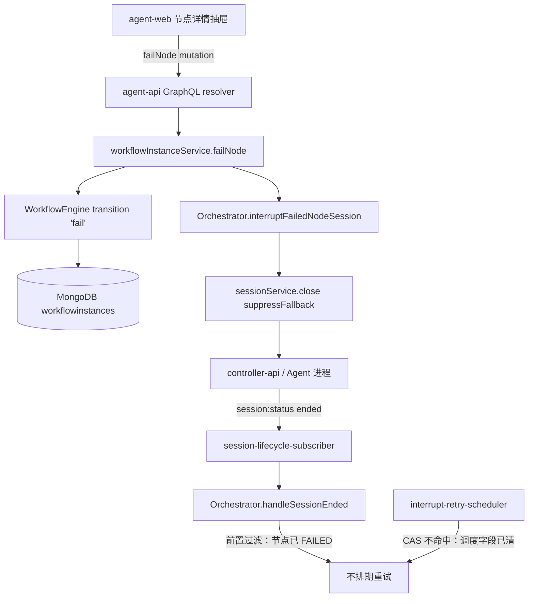
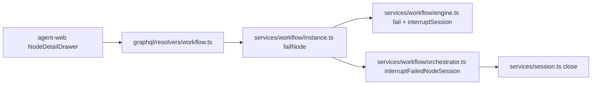
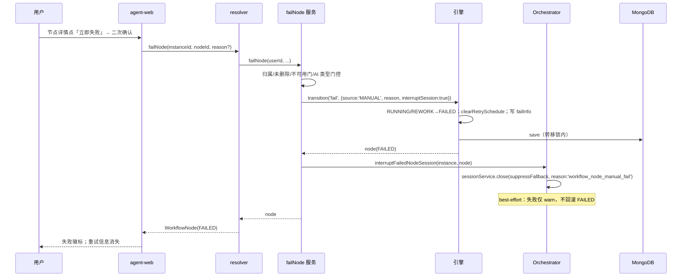

# 工作流节点「立即失败」 - 技术提案

**功能名称**: 工作流节点立即失败
**关联 PRD**: [[../../product/draft/20261116-workflow-node-manual-fail.md]]
**技术提案版本**: v1.0
**创建日期**: 2026-11-16
**作者**: ZeroAsh Agent
**feat-branch**: `feat/workflow-node-manual-fail`

## 1. 概述

### 1.1 背景

AI 节点会话中断后，平台按 PRD [[../../product/draft/20261103-workflow-node-interrupt-retry.md]] 自动重试最多 10 次（首次立即、指数退避、单次封顶 30 分钟，总窗口约 2 小时），用尽后节点转 `RETRY_FAILED`。当用户已明确节点无望时，缺少「人工主动短路」入口：只能干等重试耗尽或删除整个实例。

现状代码事实：

- 引擎 `fail` 事件（`RUNNING/REWORK → FAILED`，`engine.ts` TRANSITIONS）已存在，来源有 `SESSION_STUCK` / `LLM_REPORTED` / `SESSION_START_FAILED` / `RETRY_EXHAUSTED`（retryExhausted 事件）/ `CONTROLLER_UNAVAILABLE`；**没有任何面向用户的「立即失败」入口**，GraphQL 也未暴露 fail 类 mutation。
- 引擎 `fail` 分支**不触发会话 hook**（注释明确：`SESSION_STUCK` 来源会话已 ended；`LLM_REPORTED` 来源会话保留供人类对话介入）；`fail` 分支调用 `clearRetrySchedule(node)` 清调度字段、保留 `retryCount`。
- 中断自动重试全部经 CAS 防护：排期 CAS（`{nodeId, sessionId, status∈RUNNING/REWORK, retryPhase=expected, retryCount=快照}`）、重试管线发送前双校验（重读实例校验状态/sessionId/phase）、调度器扫描 B（`RECONNECTING` 超时重排同样 CAS）。节点一旦离开 `RUNNING/REWORK` 或调度字段被清，全部重试路径自然失效。
- `restartNode`（GraphQL mutation → `workflowInstanceService.restartNode` → `engine.transition('restart')` → `orchestrator.restartNodeSession` 内 `sessionService.close(..., {suppressFallback:true, reason:'workflow_node_restart'})` 后拉起新会话）是「人工关会话」的既有范式。
- 前端节点详情抽屉 `NodeDetailDrawer` 已承载「重启节点」按钮（AI 节点 RUNNING/REWORK/FAILED/RETRY_FAILED 可见，`unavailable` 时禁用）。

### 1.2 目标

1. 契约与服务端新增 `failNode` 变更：对 `RUNNING/REWORK` 的 AI 节点，人工触发「立即失败」——中断会话、取消全部自动重试、置 `FAILED`（`failInfo.source='MANUAL'`）。
2. 前端节点详情抽屉新增「立即失败」按钮与二次确认。
3. 复用既有「失败」语义与恢复路径，零数据迁移。

### 1.3 范围

**做**：
- `contracts/workflow.graphql` 新增 `failNode` mutation + `WorkflowNodeFailInfo.source` 注释增补 `MANUAL`；手写 schema `graphql/schemas/workflow.ts` 双写。
- agent-api：`workflowInstanceService.failNode` 服务编排；引擎 `fail` 转移支持 `interruptSession` 载荷（转移落库后关会话）；Orchestrator 新增失败会话中断动作。
- agent-web：`NodeDetailDrawer` 「立即失败」按钮 + 确认对话框；`graphql/workflow.ts` 新增 mutation。
- 单测 / API 测试。

**不做**：
- 不改中断自动重试机制（次数、退避、调度器）。
- 不改 `RETRY_FAILED` 语义与恢复路径；`RETRY_FAILED → FAILED` 不转换（`RETRY_FAILED` 已是阻断态）。
- 人类/旗帜节点不提供「立即失败」。
- 不新增 MCP 工具（AI 自判失败已有 `failCurrentNode`）；不新增人工介入待办（操作者即人工）。
- 不新增数据迁移（`failInfo.source` 为自由字符串，仅注释登记新取值）。

## 2. 技术架构

### 2.1 系统架构图



### 2.2 技术栈

| 层级 | 技术选型 | 说明 |
|------|---------|------|
| 前端 | React 19 + Apollo Client + Tailwind | agent-web，复用 `ConfirmDialog` 与抽屉按钮体系 |
| 后端 | Node.js + Express v5 + GraphQL-Yoga + Mongoose | agent-api 工作流域 |
| 数据库 | MongoDB `workflowinstances` | 无 schema 变更、无迁移 |
| 缓存 | Redis | 会话状态事件通道（复用，无变更） |

### 2.3 模块划分



| 模块 | 职责 | 关键技术点 |
|------|------|-----------|
| 契约/schema | `failNode` 变更与 `MANUAL` 来源注释 | 契约与手写 schema 双写（既有守卫测试口径） |
| instance.ts | 归属/状态/类型门控与编排 | 与 `restartNode` 同口径：actorFilter、deletedAt、不可用门 |
| engine.ts | `fail` 转移扩展 | 仅透传 `interruptSession` 至 hook；转移表不变 |
| orchestrator.ts | 转移后中断会话 | `sessionService.close(suppressFallback, reason:'workflow_node_manual_fail')`，best-effort |
| agent-web | 按钮与确认 | 仅 AI 且 RUNNING/REWORK 可见；`unavailable` 禁用 |

## 3. API 设计

### 3.1 API 契约

`contracts/workflow.graphql`：

```graphql
type Mutation {
  # ... 既有变更 ...
  # 立即失败（仅 AI 节点，RUNNING/REWORK→FAILED）：中断节点会话、取消全部中断自动重试，
  # 阻断工作流等待人工介入；failInfo.source='MANUAL'。
  # 错误文案表：工作流实例不存在或无权限 / 工作流实例中不存在节点：<nodeId> /
  # 工作流实例不可用（控制器离线或已删除），请先接续后再操作 /
  # 仅 AI 节点支持立即失败 / 引擎状态机拒绝文案（节点当前状态不允许「标记失败」）原样冒泡。
  failNode(instanceId: ID!, nodeId: ID!, reason: String): WorkflowNode!
}
```

`WorkflowNodeFailInfo.source` 注释增补 `MANUAL`（人工「立即失败」）：

```graphql
type WorkflowNodeFailInfo {
  reason: String!
  # 失败来源：SESSION_STUCK / LLM_REPORTED / SESSION_START_FAILED /
  # RETRY_EXHAUSTED（中断自动重试 10 次用尽）/
  # CONTROLLER_UNAVAILABLE（实例接续时收敛原控制器上不可达的进行中节点）/
  # MANUAL（人工「立即失败」）
  source: String!
  at: String!
}
```

手写 schema `graphql/schemas/workflow.ts` 同步双写（mutation 字段 + 注释）。

#### 接口: failNode

- **请求**
  - Method: GraphQL Mutation
  - Body:
    ```json
    {
      "instanceId": "<id>",
      "nodeId": "<nodeId>",
      "reason": "可选，失败原因；缺省为「人工标记失败」"
    }
    ```
- **响应**
  - 成功：更新后的 `WorkflowNode`（`status=FAILED`，`failInfo={source:'MANUAL', ...}`）
  - 失败：上表错误文案（`wrap()` 白名单/原样透传口径与既有变更一致）

### 3.2 内部接口

- `workflowInstanceService.failNode(userId, instanceId, nodeId, reason?) => Promise<WorkflowNodeDoc>`：GraphQL 唯一入口，无 MCP 暴露。
- 引擎 `TransitionPayload` 扩展：`fail` 事件新增可选 `interruptSession?: boolean`（缺省 false，旧路径行为不变）。

## 4. 数据模型

### 4.1 数据库设计

零 schema 变更、零迁移。`failInfo.source` 为 `String`（无枚举约束），新取值 `MANUAL` 仅在三处注释登记：

- `models/workflow-instance.ts` failInfoSchema source 注释；
- `contracts/workflow.graphql` `WorkflowNodeFailInfo.source` 注释；
- `graphql/schemas/workflow.ts` 手写 schema 注释。

行为字段沿用既有：`fail` 转移 `clearRetrySchedule(node)`（清 `nextRetryAt/retryPhase/retryDeadlineAt/retryTrigger`，保留 `retryCount` 供展示排查）、写 `failInfo`、`markLastNode`。

### 4.2 缓存设计

无新增缓存。会话中断经既有 Redis `session:status` 事件通道传播。

## 5. 技术实现方案

### 5.1 核心流程



### 5.2 关键实现点

#### 实现点 1：先转移、后关会话（顺序硬约束）

- **描述**: `failNode` 必须先完成引擎转移（FAILED 落库），再中断会话。反向（先关会话后转移）会在关会话产生的 `ended` 事件与转移落库之间形成窗口：`handleSessionEnded` 读到节点仍 `RUNNING` 而误排期一次重试。
- **技术细节**: 正向顺序下，`close` 触发的 `ended` 经 `onSessionStatus`/`onSessionEnded` 回调到达 `handleSessionEnded` 时，前置过滤（实例未删/节点 RUNNING/sessionId 匹配）已不命中（节点 FAILED），不排期。Orchestrator 新增 `interruptFailedNodeSession(instance, node)`：仅 AI 节点且 `node.sessionId` 非空时 `close({suppressFallback:true, reason:'workflow_node_manual_fail'})`；任何异常仅 `logger.warn`（FAILED 已落库，不回滚）。`reason` 字符串登记进既有 close reason 语义族（`workflow_node_restart` / `workflow_interruption_retry` / `workflow_node_rework` / `workspace_deleted`）。
- **风险点**: `close` 对控制器暂不可达为尽力而为（既有 close 语义），会话可能在控制器侧残留至断连超时收敛——可接受，节点 FAILED 已是事实源。

#### 实现点 2：重试路径的既有 CAS 防护复用（零新增机制）

- **描述**: 「立即失败」后不再发生任何自动重试，完全由既有防护自然保证：
  - 已排期（SCHEDULED）：`fail` 转移 `clearRetrySchedule` 清空调度字段，调度器扫描 A 无匹配；
  - 进行中（RECONNECTING）：重试管线发送前双校验重读实例，状态非 `RUNNING/REWORK` 放弃发送；调度器扫描 B 重排 CAS 期望 `retryPhase='RECONNECTING'`，已被清空不命中；
  - 后续会话事件（ended/idled）：`handleSessionEnded/handleSessionIdled` 前置过滤要求节点 `RUNNING`（或 `RUNNING/REWORK`），FAILED 不命中。
- **技术细节**: 测试需覆盖「SCHEDULED 状态下 failNode → 到期不触发」「RECONNECTING 状态下 failNode → 管线放弃发送」两个关键回归。

#### 实现点 3：引擎 `fail` 的 `interruptSession` 载荷

- **描述**: 引擎 `fail` 分支新增：转移完成（`apply` 内）不直接关会话；`TransitionPayload` 增加 `interruptSession?: boolean` 仅作标记透传。是否关会话由服务层在转移返回后执行（见实现点 1），引擎保持「fail 不触发会话 hook」的既有注释语义，仅注释补充「MANUAL 来源由服务层在转移后中断会话」。`TransitionPayload` 增加字段为最小侵入，避免新增引擎事件/转移规则。
- **技术细节**: 其他 `fail` 调用点（LLM `failCurrentNode`、`SESSION_STUCK` 兜底、`CONTROLLER_UNAVAILABLE` 收敛）不传该字段，行为逐字不变。`interruptSession` 不落库。

#### 实现点 4：服务门控与前端展示

- **描述**: `failNode` 门控与 `restartNode` 同口径：实例 `actorFilter(userId)` + `deletedAt:null`（「工作流实例不存在或无权限」）→ 节点存在（「工作流实例中不存在节点：<id>」）→ 不可用门（`resolveInstanceUnavailableReason` 非空 → 「工作流实例不可用（控制器离线或已删除），请先接续后再操作」）→ AI 类型门（非 AI → 「仅 AI 节点支持立即失败」）→ 引擎状态机门（非 RUNNING/REWORK 由引擎拒绝文案冒泡）。`reason` 缺省 `人工标记失败`；trim 后超长截断（≤500，与 `failCurrentNode` reason 口径对齐——tool-handlers 现有 reason 校验口径为准，若无上限则新增 500 上限并在契约注明）。
- **技术细节**: 前端 `NodeDetailDrawer`：`node.type==='AI' && ['RUNNING','REWORK'].includes(node.status)` 时在「重启节点」旁渲染 destructive 样式「立即失败」按钮（`unavailable` 禁用 + tooltip「实例不可用，请先接续」）；点击打开 `ConfirmDialog`（文案说明：将中断节点会话、取消全部自动重试并置为失败、阻断工作流），确认调 `FAIL_WORKFLOW_NODE`，成功 toast + 依赖 `GET_WORKFLOW_INSTANCE` 5s 轮询刷新（不额外 refetch，与重启节点同口径）。
- **风险点**: 用户在确认瞬间节点恰好完成/被并发流转——引擎状态机拒绝，前端原样展示错误文案（「节点当前状态为 DONE，不允许执行「标记失败」」），提示用户刷新。

## 6. 技术决策

### 6.1 决策列表

| 决策 | 选项 A | 选项 B | 最终选择 | 原因 |
|------|--------|--------|---------|------|
| 会话中断挂载点 | 引擎 fail 分支新增 hook（锁内、save 前） | 服务层转移返回后关会话 | B | 锁内关会话的 ended 事件会在 save 前读到旧状态误排期重试；服务层后置关闭由前置过滤天然去重 |
| 引擎改动形态 | 新增 `failImmediately` 事件 | `fail` 复用 + `interruptSession` 载荷 | B | 转移规则完全相同（RUNNING/REWORK→FAILED），新增事件只会复制规则；载荷最小侵入 |
| 适用节点类型 | 全部节点类型 | 仅 AI 节点 | B | HUMAN/FLAG 无会话与自动重试，无止损场景；AI 限制可在后续按需放开 |
| 适用节点状态 | RUNNING/REWORK/RETRY_FAILED | RUNNING/REWORK | B | `RETRY_FAILED` 已是阻断态，转换会模糊「重试失败」与「失败」语义（PRD 功能点 3 明确区分来源） |
| 失败原因输入 | 确认对话框含可选 reason 输入 | 固定默认原因，mutation 保留可选入参 | B | v1 交互最简；契约保留 `reason` 入参供后续扩展 |
| 人工介入待办 | 创建 | 不创建 | B | 操作者即人工本人，与 LLM_REPORTED 失败同口径不建待办 |

### 6.2 依赖与约束

| 类型 | 内容 | 说明 |
|------|------|------|
| 依赖 | `sessionService.close` 的 `suppressFallback` 语义 | 关闭不触发兜底重试排期（重试管线同款） |
| 依赖 | 中断重试 CAS 防护（排期/双校验/扫描 B） | 「立即失败」零新增取消防护的根基 |
| 约束 | agent-api 单实例部署 | 与 KeyedMutex / 中断重试调度器同前提 |
| 约束 | 契约与手写 schema 双写 | 漏改即运行时 `Cannot query field`，T-SCHEMA 守卫 |

## 7. 项目结构

```
contracts/
└── workflow.graphql                    # failNode mutation + MANUAL 来源注释
servers/agent-api/src/
├── graphql/
│   ├── schemas/workflow.ts             # 手写 schema 双写
│   └── resolvers/workflow.ts           # failNode resolver（登记既有 Mutation 对象）
├── models/workflow-instance.ts         # failInfo.source 注释增补 MANUAL
└── services/workflow/
    ├── engine.ts                       # TransitionPayload.interruptSession + 注释
    ├── instance.ts                     # failNode 服务编排
    ├── orchestrator.ts                 # interruptFailedNodeSession
    └── *.test.ts                       # engine/instance/orchestrator 回归
apps/agent-web/src/
├── graphql/workflow.ts                 # FAIL_WORKFLOW_NODE
└── components/workflow/NodeDetailDrawer.tsx  # 「立即失败」按钮 + ConfirmDialog
tests/api/src/agent-api/
└── workflow.test.ts                    # failNode 端到端（如需新文件则 workflow-fail-node.test.ts）
```

## 8. 测试策略

### 8.1 测试覆盖要求

- 新增分支（failNode 门控、interruptSession 路径、按钮可见性矩阵）100% 覆盖；既有工作流测试零回归。

### 8.2 测试类型

| 类型 | 工具 | 覆盖范围 |
|------|------|---------|
| 单元测试 | Vitest | 引擎 `fail` interruptSession 透传与旧路径不变；`failNode` 门控矩阵（归属/删除/不可用/非 AI/状态机拒绝）；Orchestrator 关会话（reason、suppressFallback、无 sessionId 跳过、异常仅 warn）；SCHEDULED/RECONNECTING 状态下 failNode 后调度器不触发、管线放弃发送；手写 schema 双写守卫 |
| 组件测试 | Vitest + RTL | NodeDetailDrawer 按钮可见性矩阵（AI×RUNNING/REWORK 可见；其余状态/HUMAN/FLAG 不可见；unavailable 禁用）；确认对话框确认/取消分支 |
| API 测试 | Vitest（tests/api） | `failNode` 端到端：成功路径（FAILED + source=MANUAL + 重试字段清空）、非归属/非 AI/终态节点拒绝 |

## 9. 部署方案

### 9.1 环境规划

| 环境 | 用途 | 部署方式 |
|------|------|---------|
| 本地 | 开发验证 | Aspire 编排（`aspire start`） |
| 生产 | 随版本发布 | 既有发布流水线，agent-api 滚动更新 |

### 9.2 配置管理

无新增配置项。

## 10. 验收标准

- [ ] 技术方案评审通过
- [ ] Contract 评审通过（`failNode` + `MANUAL` 注释双写）
- [ ] 代码实现完成
- [ ] 单元测试覆盖达标（新增分支 100%）
- [ ] API 测试通过
- [ ] 节点详情「立即失败」按钮按可见性矩阵展示，确认后节点即 FAILED、会话中断、不再自动重试

## 11. 相关文档

- 关联 PRD：[[../../product/draft/20261116-workflow-node-manual-fail.md]]
- 关联 PRD：[[../../product/draft/20261103-workflow-node-interrupt-retry.md]]
- 关联提案：[[20261103-feat-workflow-node-interrupt-retry.md]] — 中断自动重试机制（本提案复用其 CAS 防护）
- 关联提案：[[20261114-feat-workflow-instance-continuation.md]] — 实例接续（不可用门口径同源）
- 契约：[[../../../contracts/workflow.graphql]]
