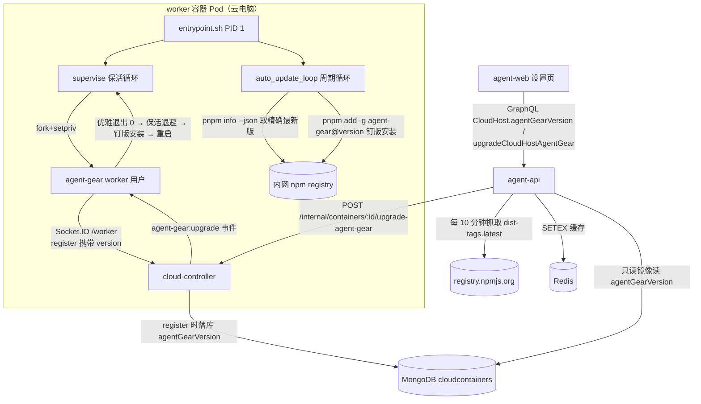
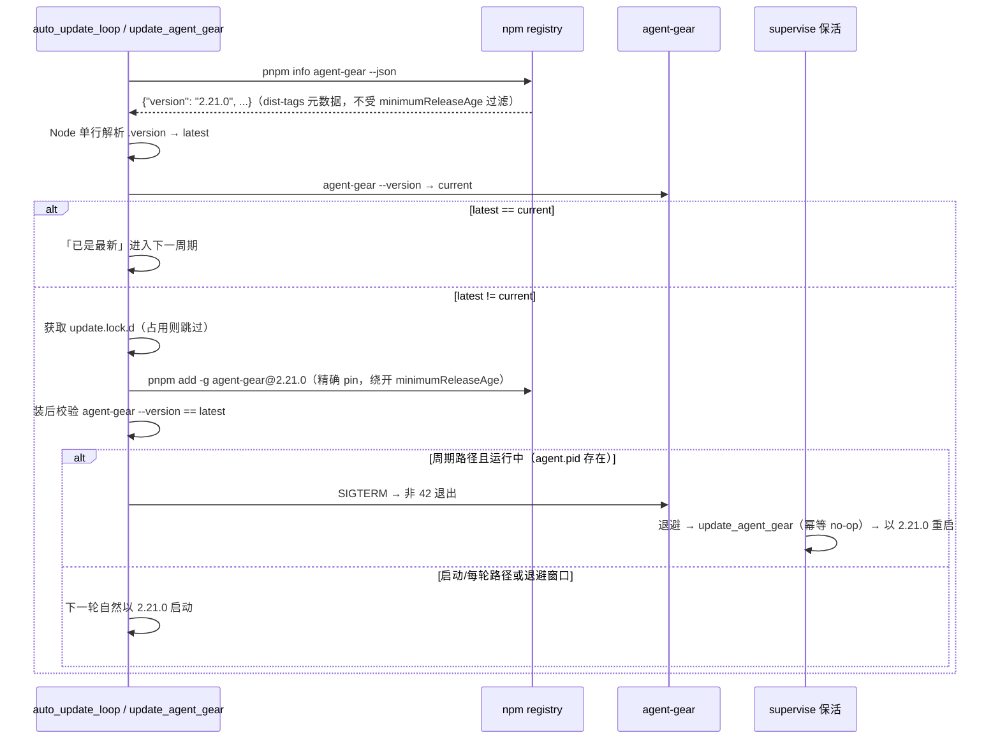
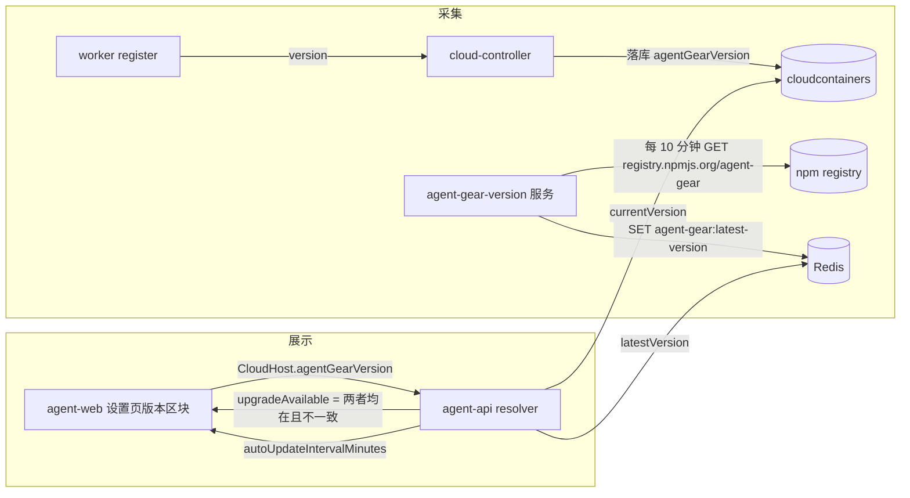
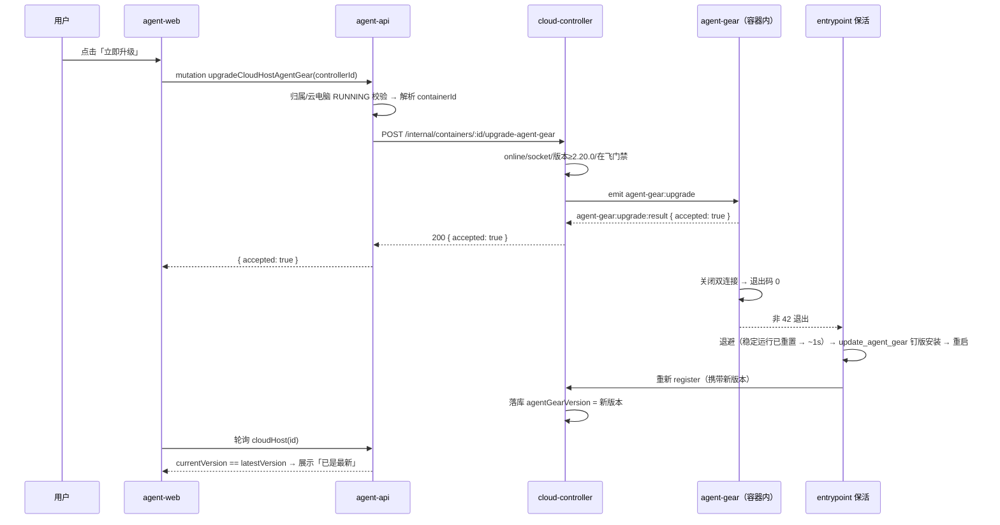

# 云电脑控制器包升级优化 - 技术提案

**功能名称**: 云电脑控制器包升级优化
**关联 PRD**: `docs/product/draft/20261117-cloud-agent-gear-upgrade-optimization.md`
**技术提案版本**: v1.0
**创建日期**: 2026-11-17
**作者**: ZeroAsh
**feat-branch**: `feat/cloud-agent-gear-upgrade-optimization`

## 1. 概述

### 1.1 背景

云环境 agent-gear 自动升级（[[20261113-feat-cloud-agent-gear-upgrade-optimization 的前置需求|20261113-feat-cloud-agent-gear-auto-upgrade.md]]）上线后，Issue #551 指出：worker 镜像 `entrypoint.sh` 的两条安装路径（启动/每轮 `update_agent_gear`、周期 `auto_update_loop`）均以 `pnpm add -g agent-gear@latest` 安装。pnpm 12 默认开启 `minimumReleaseAge`（供应链隔离，默认 24h），`latest` 标签解析会**回退到满足年龄要求的旧版本**——新版本发布后最长约 24h 内，自动升级实际安装的仍是旧版（现有代码以「安装后版本 != registry latest 则不重启、WARN 下周期重试」缓解，但无法缩短延迟）。

同时，用户无法看到云电脑当前/最新版本，也不能主动触发升级。Issue #551 要求：

1. 用 `pnpm info agent-gear --json` 取最新 `version`，安装命令从直接安装包名改为安装 `包名@版本号`；
2. 云电脑前端设置页展示当前版本（容器内 `pnpm agent-gear --version`）与最新版本（取自 `https://registry.npmjs.org/agent-gear`，存 Redis，10 分钟刷新一次）；
3. 版本不匹配时显示「立即升级」按钮，点击后立即升级；
4. 增加一行小字标注自动升级多少分钟检查一次。

### 1.2 目标

- worker 镜像两条安装路径统一改为「`pnpm info agent-gear --json` 解析精确最新版 → `pnpm add -g agent-gear@<精确版本>` 钉版安装」，精确版本号安装不受 `minimumReleaseAge` 约束（pnpm 12.16.1 行为，见 [pnpm/pnpm#9989](https://github.com/pnpm/pnpm/issues/9989)），新版本发布后一个检查周期（10 分钟）内即可自动升级到位。
- 设置页版本展示：当前版本取 worker `register` 上报并落库的版本（与容器内 `pnpm agent-gear --version` 同源，均为包 `package.json` version）；最新版本由 agent-api 定时从 npm registry 抓取并存 Redis（10 分钟刷新）。
- 「立即升级」：新增 cloud-controller → worker 的升级事件与 agent-api → cloud-controller 的内部端点；worker（agent-gear ≥2.20.0）收到事件后优雅退出（退出码 0），由既有保活链路完成「钉版安装 → 以新版本重启」，与周期自动升级共用同一条安装通道。
- 版本区块下方小字标注自动升级检查周期（分钟），数值与 worker 侧实际周期一致（默认 10）。

### 1.3 范围

- **做**：
  - `deploy/images/worker/entrypoint.sh`：`resolve_latest_version`（`pnpm info --json` → 精确版本）+ 两条安装路径钉版安装；配套 stub 测试与 `BUILD.md` 口径。
  - `servers/cloud-controller`：`register` 版本持久化到 `cloudcontainers.agentGearVersion`（含内部 API A.3 透出）；新增 `agent-gear:upgrade` / `agent-gear:upgrade:result` 事件对与 `POST /internal/containers/:id/upgrade-agent-gear` 内部端点（在线门禁 + 版本门禁 ≥2.20.0 + 单容器在飞互斥）。
  - `servers/agent-api`：`services/agent-gear-version.ts`（npm registry 抓取 + Redis 缓存 + 10 分钟调度器）；`CloudHost.agentGearVersion` 字段级 resolver 与 `upgradeCloudHostAgentGear` mutation；cloud-container 只读镜像同步。
  - `packages/agent-controller`（agent-gear 2.20.0）：`socketio-client` 新增 `agent-gear:upgrade` 事件处理（回执后优雅退出 0，复用保活重启）。
  - `apps/agent-web`：`CloudHostPanel` 版本区块（当前/最新/立即升级/周期小字）与升级轮询。
  - 契约：`contracts/cloud-host.graphql`、`contracts/cloud-controller-websocket.md`。
- **不做**：不改变本地控制器行为；不为「最新版本」提供用户级刷新按钮；不调整自动升级默认周期（10 分钟）；不扩展到工作负载/Harness 的升级；不新增 agent-gear 自安装通道（升级安装恒由 entrypoint 执行，见决策 D2）。

## 2. 技术架构

### 2.1 系统架构图



### 2.2 技术栈

| 层级 | 技术选型 | 说明 |
|------|---------|------|
| 容器入口 | bash（`set -euo pipefail`） | 既有 `entrypoint.sh`，PID 1 监督者 |
| 包管理 | pnpm（固定版本 12.16.1） | `pnpm info --json` 取元数据、`pnpm add -g <pkg>@<version>` 钉版安装 |
| cloud-controller | Node.js 24 + Express v5 + Socket.IO v4 + Mongoose | 注册版本落库、升级事件、内部端点 |
| agent-api | Node.js 24 + GraphQL-Yoga + Mongoose + Redis | 最新版本服务、GraphQL 字段/变更、升级编排 |
| agent-gear | Node.js 24 + socket.io-client（2.20.0） | 升级事件处理与优雅退出 |
| 前端 | React 19 + Apollo Client + Tailwind v4 | `CloudHostPanel` 版本区块 |
| 测试 | Vitest + bash stub 测试 | 各包既有测试体系 |

### 2.3 模块划分

| 模块 | 职责 | 关键技术点 |
|------|------|-----------|
| `resolve_latest_version`（entrypoint 新增） | 从 registry 元数据解析精确最新版本 | `pnpm info agent-gear --json` + Node 单行解析 `.version` |
| `update_agent_gear` / `auto_update_loop`（entrypoint 改造） | 启动/每轮/周期安装统一钉版 | 同一把 `update.lock.d` 互斥；保留「装后版本校验」 |
| `socketio-gateway`（cloud-controller 改造） | `register` 版本持久化 + 升级事件下发 | 版本门禁通过后落库；`agent-gear:upgrade` ack 等待 |
| `internal-api`（cloud-controller 新增端点） | `POST /internal/containers/:id/upgrade-agent-gear` | 在线/版本/在飞门禁，错误白名单 |
| `agent-gear-version`（agent-api 新增服务） | 最新版本抓取与缓存 | 10 分钟调度器、Redis 读写、进程内 single-flight 兜底 |
| `cloud-host` resolver/service（agent-api 改造） | `CloudHost.agentGearVersion` 字段与 `upgradeCloudHostAgentGear` | 归属校验、RUNNING 门禁、错误白名单透传 |
| `socketio-client`（agent-gear 改造） | `agent-gear:upgrade` 事件处理 | 回执 → 双连接关闭 → 退出码 0 |
| `CloudHostPanel`（agent-web 改造） | 版本区块与立即升级 | mutation 后轮询收敛 |

## 3. API 设计

### 3.1 API 契约

#### 3.1.1 GraphQL（`contracts/cloud-host.graphql` 扩展）

```graphql
# 云电脑工作组件（agent-gear）版本信息
type CloudHostAgentGearVersion {
  # 当前运行版本（worker register 上报并落库；未上报/离线前未上报过为 null）
  currentVersion: String
  # 发布源最新版本（agent-api 每 10 分钟刷新；尚未成功抓取时为 null）
  latestVersion: String
  # current 与 latest 均存在且不一致
  upgradeAvailable: Boolean!
  # 自动升级检查周期（分钟），与 worker 侧生效周期一致，默认 10
  autoUpdateIntervalMinutes: Int!
}

type CloudHost {
  # ...既有字段...
  agentGearVersion: CloudHostAgentGearVersion!
}

type CloudHostAgentGearUpgradeResult {
  # 升级指令已被云电脑接受（随后自动重启生效）；false 不会出现在成功响应（失败走错误）
  accepted: Boolean!
}

extend type Mutation {
  # 立即升级云电脑工作组件：版本不一致且 RUNNING 时可用；
  # 触发后云电脑短暂断连并以新版本恢复在线
  upgradeCloudHostAgentGear(controllerId: ID!): CloudHostAgentGearUpgradeResult!
}
```

错误白名单（resolver `wrap()` 逐字透传，未命中收敛 `internal error`）：

| 文案 | 触发 |
|------|------|
| `Not authenticated` | 未登录 |
| `Cloud host not found` | controllerId 无归属云电脑 |
| `cloud host is not running` | 云电脑非 RUNNING |
| `container is not online` | 容器离线/重启中 |
| `agent-gear upgrade is not supported by the current version` | 容器上报版本 <2.20.0 |
| `agent-gear upgrade already in progress` | 同一容器在飞升级未收敛（60s 互斥窗） |

#### 3.1.2 cloud-controller WebSocket（`contracts/cloud-controller-websocket.md` 扩展）

**§2 事件表新增：**

| 方向 | 事件名 | 说明 |
|------|--------|------|
| Server → Worker | `agent-gear:upgrade` | 要求 worker 立即执行升级：worker 回执后优雅退出（退出码 0），由入口保活链路完成钉版安装并以新版本重启；见 §2.11 |
| Worker → Server | `agent-gear:upgrade:result` | worker 接受/拒绝升级的回执；见 §2.12 |

**§2.11 `agent-gear:upgrade`（Server → Worker，本期新增）**

Payload：

| 字段 | 类型 | 必填 | 说明 |
|------|------|------|------|
| `targetVersion` | `string` | 否 | 目标版本（观测/日志用；安装始终解析 registry 最新版，不强制等于该值） |

客户端行为（agent-gear ≥2.20.0）：校验通过即 emit `agent-gear:upgrade:result { accepted: true, currentVersion }`，随后执行既有优雅退出路径（关闭双连接、停止心跳），以**退出码 0** 结束进程；入口保活按「非 42 退出」退避 → 钉版自更新 → 以新版本重启。正在退出中/连接已关闭时回执 `{ accepted: false, reason: 'shutting_down' }`。旧 worker（<2.20.0）无该事件监听，静默忽略（服务端在事件下发前已做版本门禁，见 §2.12）。

**§2.12 `agent-gear:upgrade:result`（Worker → Server，本期新增）**

Payload：

| 字段 | 类型 | 必填 | 说明 |
|------|------|------|------|
| `accepted` | `boolean` | 是 | 是否接受升级 |
| `currentVersion` | `string` | 否 | worker 当前版本（日志用） |
| `reason` | `string` | 否 | 拒绝原因（`shutting_down` 等） |

**§3.4 版本兼容追加**：升级事件最低版本 `MIN_UPGRADE_WORKER_VERSION = '2.20.0'`（代码常量，不通过环境变量配置）；仅用于升级事件门禁，不影响 `register` 既有门禁。

**附录 A.2 新增 A.2.14：**

```
POST /internal/containers/:id/upgrade-agent-gear
```

- Bearer `INTERNAL_API_TOKEN`；容器须 `online` 且有活跃 socket；容器上报版本须 ≥2.20.0。
- 同一容器在飞升级（60s 互斥窗）重复调用 → `409 UPGRADE_IN_PROGRESS`。
- 处理：emit `agent-gear:upgrade`，等待 `agent-gear:upgrade:result`（10s 超时）；`accepted:true` → 200；`accepted:false`/超时 → `409 UPGRADE_NOT_ACCEPTED`。

**响应 200：**

```json
{ "accepted": true, "containerId": "<id>", "currentVersion": "2.20.0" }
```

**错误：**

| 状态 | code | 说明 |
|------|------|------|
| 404 | `NOT_FOUND` | 容器不存在 |
| 409 | `CONTAINER_NOT_ONLINE` | 容器非 `online` 或无活跃 socket |
| 400 | `UPGRADE_UNSUPPORTED` | 上报版本 <2.20.0（含未上报） |
| 409 | `UPGRADE_IN_PROGRESS` | 在飞升级未收敛 |
| 409 | `UPGRADE_NOT_ACCEPTED` | worker 拒绝或回执超时 |

**附录 A.3 `CloudContainer` JSON 新增字段：**

| 字段 | 类型 | 说明 |
|------|------|------|
| `agentGearVersion` | `string \| null` | worker `register` 上报的 agent-gear 版本（每次成功注册刷新；未注册过为 `null`） |

#### 3.1.3 运行时环境变量

| 变量 | 服务 | 默认 | 说明 |
|------|------|------|------|
| `AGENT_GEAR_REGISTRY_URL` | agent-api | `https://registry.npmjs.org/agent-gear` | 最新版本元数据来源（包级 URL，读取 `dist-tags.latest`） |
| `AGENT_GEAR_VERSION_REFRESH_INTERVAL_MS` | agent-api | `600000`（10 分钟） | 最新版本刷新周期；`0` = 关闭定时刷新（仍可经查询路径触发单次抓取） |
| `AGENT_GEAR_AUTO_UPDATE_INTERVAL_MINUTES` | agent-api | `10` | 透出给前端的自动升级周期标注；须与 worker 侧 `ZAG_AGENT_GEAR_AUTO_UPDATE_INTERVAL_MS` 部署值一致 |

worker 侧无新增 env：`ZAG_AGENT_GEAR_AUTO_UPDATE_INTERVAL_MS` / `ZAG_SKIP_AGENT_GEAR_UPDATE` 口径不变。

### 3.2 内部接口

| 接口 | 方向 | 说明 |
|------|------|------|
| `POST /internal/containers/:id/upgrade-agent-gear` | agent-api → cloud-controller | 见 A.2.14 |
| `cloudcontainers.agentGearVersion` | cloud-controller → agent-api（共享库只读镜像） | register 成功后 `findOneAndUpdate` 刷新；agent-api 只读镜像 `models/cloud-container.ts` 同步字段 |
| Redis `agent-gear:latest-version` | agent-api 内部 | JSON `{ "version": "2.20.0", "fetchedAt": "<ISO>" }`；不设置 TTL（保留最后已知值），由刷新任务覆盖写 |

## 4. 数据模型

### 4.1 数据库设计

#### 集合：`cloudcontainers`（cloud-controller 唯一写方）

| 字段 | 类型 | 说明 |
|------|------|------|
| `agentGearVersion` | `String \| null`（default `null`） | 每次 `register` 版本门禁通过后刷新为上报版本；历史行 `null` 容忍。**零迁移**：不建索引、不回填 |

agent-api 只读镜像 `servers/agent-api/src/models/cloud-container.ts` 同步该字段（写方仍仅 cloud-controller）。

### 4.2 缓存设计

| key | 值 | 写入 | 读取 |
|-----|----|------|------|
| `agent-gear:latest-version` | JSON `{version, fetchedAt}` | 刷新任务（每 10 分钟）/ 查询路径 single-flight 兜底抓取 | `CloudHost.agentGearVersion.latestVersion` resolver |

- 刷新失败保留旧值并记 WARN；Redis 不可用时 resolver 降级 `latestVersion=null`（不阻断查询）。
- 无 TTL：「保留最后已知值」优先于「过期清空」，避免发布源抖动造成大面积 `upgradeAvailable` 抖动。

## 5. 技术实现方案

### 5.1 核心流程

#### 流程 1：自动升级直达最新版（entrypoint 改造后）



#### 流程 2：设置页版本展示



#### 流程 3：「立即升级」



### 5.2 关键实现点

#### 实现点 1：`resolve_latest_version`（entrypoint）

- **描述**：新增函数统一「从 registry 元数据解析精确最新版」：执行 `pnpm info agent-gear --json`，经 worker 环境自带 Node 单行解析 `.version`；解析失败（非零退出/空串/含空白）按检查失败处理。
- **技术细节**：
  - 解析不引 jq（与入口零依赖风格一致）：`run_as_worker node -e 'let s="";process.stdin.on("data",d=>s+=d).on("end",()=>{const v=JSON.parse(s).version;if(typeof v!=="string"||!v)process.exit(1);process.stdout.write(v)})'`，输出复用既有 `normalize_version` 归一。
  - `pnpm info`/`view`/`show` 为同一命令别名，读取的是 registry 元数据 `dist-tags.latest`，**不经 `minimumReleaseAge` 过滤**（与现有代码实测一致：`pnpm view agent-gear version` 返回的是真实 latest，而 `pnpm add -g agent-gear@latest` 解析被年龄门回退）。Issue 指定 `info --json`，按此实现。
  - stub 测试以假 `pnpm` 输出固定 JSON 驱动。
- **风险点**：registry 返回结构异常（缺 `version`）→ 按检查失败 WARN、下周期重试，不中断循环。

#### 实现点 2：两条安装路径统一钉版安装

- **描述**：`update_agent_gear`（启动/每轮）与 `auto_update_loop`（周期）的安装命令由 `pnpm add -g agent-gear@latest` 改为 `pnpm add -g agent-gear@<resolve_latest_version 结果>`。
- **技术细节**：
  - pnpm 12.16.1（worker 固定版本）下，**精确版本号安装不受 `minimumReleaseAge` 过滤**（[pnpm/pnpm#9989](https://github.com/pnpm/pnpm/issues/9989) 实证），因此钉版安装在新版本发布后立即可达。
  - `update_agent_gear` 改造后同样先 resolve：resolve 失败按既有「更新失败容忍」WARN 继续保活（与现状一致）。
  - `auto_update_loop` 保留既有「装后校验」：`installed == current` 或 `installed != latest` 时不 TERM、WARN 下周期重试（钉版后正常路径应恒 `installed == latest`，该校验转为防御性兜底）。
  - 安装互斥锁、`agent.pid` TERM 逻辑、销毁优先语义、日志锚点全部沿用；新增日志锚点仅「resolve 失败」一处（复用检查失败形态）。
- **风险点**：若未来 pnpm 变更精确 pin 语义（#9989 中有收紧讨论），钉版安装会退化为「装到成熟版本」——装后校验兜底识别并 WARN 重试，不产生错误重启；worker 固定 pnpm 12.16.1，行为稳定。

#### 实现点 3：`register` 版本落库（cloud-controller）

- **描述**：`socketio-gateway` 在版本门禁通过、注册副作用完成后，将上报版本 `findOneAndUpdate` 写入 `cloudcontainers.agentGearVersion`；A.3 JSON 透出该字段。
- **技术细节**：
  - 写入点位于「版本门禁通过」之后（拒绝路径零副作用的既有约束不变）；写失败仅 WARN，不阻断注册。
  - 升级重启后 worker 重新 `register`，字段自然刷新为新版本——「当前版本」的采集与「立即升级」的完成观测共用同一路径。
  - 内存 `workerVersions` Map 保留（runtime harness 版本门禁继续使用），落库字段服务于读侧展示。
- **风险点**：容器离线（connecting）期间展示的是最近一次上报值，可能与实际运行版本滞后一个重启周期——产品口径接受（PRD 3.5「按最近已知展示」）。

#### 实现点 4：最新版本服务 `agent-gear-version`（agent-api）

- **描述**：新增 `services/agent-gear-version.ts`：启动时立即抓取一次，随后按 `AGENT_GEAR_VERSION_REFRESH_INTERVAL_MS`（默认 600000）周期抓取 `AGENT_GEAR_REGISTRY_URL`，解析 `dist-tags.latest` 写 Redis；查询路径在缓存缺失时 single-flight 内联抓取兜底。
- **技术细节**：
  - 抓取用全局 `fetch` + `AbortController` 10s 超时；响应须 2xx 且 JSON 含字符串 `dist-tags.latest`，否则按失败保留旧值并 WARN。
  - 版本串校验：非空、≤64 字符、去控制字符（与 worker `sanitizeVersionForLog` 同口径）；非法值按抓取失败处理。
  - 调度器 `timer.unref()`，进程关闭不清 Redis（保留最后已知值）；单实例部署前提与既有调度器一致。
  - `getLatestAgentGearVersion()` 读 Redis；miss → 进程内 single-flight 触发一次抓取并回写；抓取也失败 → `null`（resolver 降级展示）。
- **风险点**：agent-api 到 `registry.npmjs.org` 的出网依赖——内网部署可经 `AGENT_GEAR_REGISTRY_URL` 指向内网 Nexus 代理（与 worker 安装口径同源），默认值按 Issue 指定。

#### 实现点 5：升级事件链路与「退出委托」重启（cloud-controller + agent-gear）

- **描述**：`POST /internal/containers/:id/upgrade-agent-gear` 门禁通过后 emit `agent-gear:upgrade`；agent-gear 回执 `accepted:true` 后**执行优雅退出（退出码 0）**，由 entrypoint 保活完成钉版安装与重启。agent-gear 自身**不执行安装**。
- **技术细节**：
  - **退出委托而非自安装**：容器内安装通道唯一（entrypoint 的 `update.lock.d` 互斥链路）。若 agent-gear 自安装，旧 entrypoint 在随后重启轮次会以 `@latest` 标签再解析——年龄门可能把刚钉版的新版「回退」到成熟旧版（降级风险）；且双安装通道并发无互斥。退出委托完全规避两者。
  - 退出码 0：既有语义「信号退出 → 入口保活重启」（契约 `agent-controller-websocket.md` §3.7）；稳定运行 ≥60s 退避计数已重置，约 1s 后进入钉版安装与重启。
  - cloud-controller 侧在飞互斥：进程内 Map `containerId → deadline`（60s 窗口）；重启/升级完成后 worker 断连重注册即自然出窗。单实例部署前提下可靠。
  - 版本门禁读 `workerVersions.get(containerId)`（register 内存值）≥2.20.0；未上报按不支持处理。
  - 回执等待：socket emit 后挂一次性 `agent-gear:upgrade:result` 监听 + 10s 超时；`accepted:false`（如 worker 正在退出）→ `409 UPGRADE_NOT_ACCEPTED`。
- **风险点**：`ZAG_SKIP_AGENT_GEAR_UPDATE=1` 的容器升级后版本不变（跳过重启轮次的安装）——属运维显式出口，resolver 不额外门禁，升级结果以前端轮询版本收敛为准（超时可重试）。

#### 实现点 6：GraphQL 与升级编排（agent-api）

- **描述**：`CloudHost.agentGearVersion` 字段级 resolver（登记 `resolvers/index.ts` 的 `CloudHost` 键）；`upgradeCloudHostAgentGear` mutation 走 `cloud-host-service` 编排。
- **技术细节**：
  - resolver 组装：`currentVersion` = 只读镜像按 `host.containerId` 查 `agentGearVersion`；`latestVersion` = `getLatestAgentGearVersion()`；`upgradeAvailable` = 两者非空且字符串不等；`autoUpdateIntervalMinutes` = 配置值（默认 10）。单字段失败降级（current 查询失败 → null；latest 缺失 → null），不拖垮 `CloudHost` 查询。
  - mutation 编排：认证 → `Controller.findOne({_id: controllerId, ...actorFilter})` 归属 → `CloudHost` 存在且未软删 → `status === 'RUNNING'`（否则 `cloud host is not running`）→ `containerId` 解析 → cloud-controller 客户端 `POST .../upgrade-agent-gear`（10s 超时）→ 错误码按白名单映射（404→`Cloud host not found`、CONTAINER_NOT_ONLINE→`container is not online`、UPGRADE_UNSUPPORTED→`agent-gear upgrade is not supported by the current version`、UPGRADE_IN_PROGRESS→`agent-gear upgrade already in progress`、UPGRADE_NOT_ACCEPTED→`container is not online`）。
  - 不创建 setup operation 台账：升级是秒级动作，完成状态由版本轮询观测（复用既有 `cloudHost(id)` 轮询，不新增持久化）。
- **风险点**：cloud-controller 不可达 → 收敛 `internal error`（与既有内部调用口径一致）。

#### 实现点 7：前端版本区块（agent-web）

- **描述**：`ControllerConfigPage` 的 `CloudHostPanel` 增加「工作组件」区块（`data-testid="cloud-host-agent-gear-version"`）。
- **技术细节**：
  - 展示：`当前版本 {currentVersion ?? '—'}` / `最新版本 {latestVersion ?? '—'}`；小字 `自动升级每 {autoUpdateIntervalMinutes} 分钟检查一次`（`text-xs text-muted-foreground`）。
  - 「立即升级」按钮：`upgradeAvailable && status==='RUNNING' && !deletedAt` 时渲染；点击调 mutation，成功后进入升级中态（按钮禁用 + spinner），以 `cloudHost(id)` 2s 轮询直至 `currentVersion === latestVersion`（toast「工作组件已升级到 {version}」）或 3 分钟超时（toast 提示可重试/等待自动升级）。
  - 查询选择集：`GET_CONTROLLERS` 与 `GET_CLOUD_HOST` 的 `cloudHost` 片段追加 `agentGearVersion { currentVersion latestVersion upgradeAvailable autoUpdateIntervalMinutes }`；`graphql/types.ts` 手写类型同步。
  - 错误 toast 中文映射白名单（`lib/cloud-host.ts` 或同域文件）：六条契约文案 + `internal error` 兜底。
- **风险点**：轮询期间用户离开页面即中止轮询（不残留定时器）；Apollo `cache-and-network` + `loading && !data` 既有口径。

#### 实现点 8：agent-gear 事件处理（2.20.0）

- **描述**：`packages/agent-controller/src/socketio-client.ts` 的 `/worker` 连接注册 `agent-gear:upgrade` 监听。
- **技术细节**：
  - handler：幂等守卫（已接受过升级/正在退出 → 回执 `{accepted:false, reason:'shutting_down'}`）→ emit `agent-gear:upgrade:result { accepted:true, currentVersion: CONTROLLER_VERSION }` → 复用 supervisor 优雅停机（云电脑模式关闭双连接；与 `unregistered` 路径同等的清理，但**不发送 unregister**、最终退出码 0 而非 42）。
  - 退出路径复用 `EXIT_SERVER_SHUTDOWN` 之外的既有「信号退出 0」语义，不新增退出码常量。
  - 包版本 `2.19.0 → 2.20.0`；`MIN_UPGRADE_WORKER_VERSION` 常量与本版本同步（防漂移测试断言）。
  - 日志：`agent_gear_upgrade` 仅含 `targetVersion/currentVersion/accepted`，无凭据。
- **风险点**：本地控制器模式不会收到该事件（仅 cloud-controller 下发），行为零变化（守卫测试断言无监听注册差异）。

## 6. 技术决策

### 6.1 决策列表

| 决策 | 选项 A | 选项 B | 最终选择 | 原因 |
|------|--------|--------|---------|------|
| D1 绕开 minimumReleaseAge 的方式 | 精确版本钉版安装（`info --json` 取版 + `包名@版本号`） | `minimumReleaseAgeExclude` 配置 agent-gear / 全局关闭年龄门 | **A** | Issue 指定；pnpm 12.16.1 实证精确 pin 豁免；不削弱供应链保护面、不引入配置漂移 |
| D2 「立即升级」的执行者 | agent-gear 回执后优雅退出，安装委托 entrypoint 保活链路 | agent-gear 自安装后退出 / cloud-controller 经 runtime-script 注入升级脚本 | **A** | 安装通道唯一（同一把互斥锁），避免双通道并发与旧 entrypoint `@latest` 回退降级；零新增安装代码路径 |
| D3 当前版本来源 | `register` 上报版本落库 `cloudcontainers.agentGearVersion` | 经 socket 实时下发 `pnpm agent-gear --version` 查询 | **A** | 与 `--version` 同源（包 version）；单一事实源、离线可读最近值、零新增查询链路 |
| D4 最新版本来源 | agent-api 每 10 分钟抓取 npm registry + Redis 缓存 | 前端直连 registry / cloud-controller 抓取 | **A** | Issue 指定（存 Redis、10 分钟）；出网口统一、全平台共享一份结果、Redis 为既有设施 |
| D5 升级触发通道 | 新增 `agent-gear:upgrade` 事件对（/worker 连接） | 复用 `workload:run`/`runtime-scripts` 执行升级脚本 | **A** | 工作负载脚本无法优雅重启父进程（脚本跑在 agent-gear 子进程树内）；专用事件语义清晰、带版本门禁与回执 |
| D6 版本门禁常量 | `MIN_UPGRADE_WORKER_VERSION='2.20.0'` 代码常量 | 不门禁，旧 worker 静默忽略事件 | **A** | 静默忽略会让用户看到「点了没反应」；门禁返回可读错误（等待自动升级或重建） |
| D7 升级完成观测 | 复用 register 落库 + 前端 `cloudHost(id)` 轮询 | 新增升级台账/进度回报 | **A** | 升级是秒级动作；版本收敛即完成信号，零新增持久化 |

### 6.2 依赖与约束

| 类型 | 内容 | 说明 |
|------|------|------|
| 依赖 | 既有保活/自更新/版本门禁/初始化去重链路 | 升级重启不重放初始化（`hasSettledInit`），双连接自动重建 |
| 依赖 | pnpm 精确 pin 豁免 `minimumReleaseAge` 的现行行为 | worker 固定 pnpm 12.16.1；行为变更时由装后校验兜底（WARN 重试，不错误重启） |
| 依赖 | agent-api 单实例部署 | 最新版本调度器、cloud-controller 在飞互斥均为进程内实现（与既有调度器/KeyedMutex 同前提） |
| 约束 | 存量旧容器 entrypoint 不更新（镜像 baked） | 旧容器自动升级仍有年龄门延迟（≤24h 收敛）；「立即升级」事件在其 agent-gear ≥2.20.0 后可用，且其重启轮次安装同样受年龄门影响——产品口径接受（PRD 3.5），重建后获得完整能力 |
| 约束 | `AGENT_GEAR_AUTO_UPDATE_INTERVAL_MINUTES` 为展示口径 | 须与 worker `ZAG_AGENT_GEAR_AUTO_UPDATE_INTERVAL_MS` 部署值一致；默认均为 10 分钟 |

## 7. 项目结构

```
deploy/images/worker/
├── entrypoint.sh        # 改：resolve_latest_version + 两处钉版安装
├── entrypoint.test.sh   # 改：新增 T-EP28 ~ T-EP34 用例
└── BUILD.md             # 改：钉版口径与自验清单

servers/cloud-controller/
├── src/models/cloud-container.ts           # 改：agentGearVersion 字段
├── src/services/socketio-gateway.ts        # 改：register 落库 + agent-gear:upgrade 下发/回执
├── src/services/worker-version.ts          # 改：MIN_UPGRADE_WORKER_VERSION 常量
├── src/routes/internal-api.ts              # 改：A.2.14 端点
└── 配套 *.test.ts

servers/agent-api/
├── src/models/cloud-container.ts           # 改：只读镜像同步字段
├── src/services/agent-gear-version.ts      # 新：最新版本抓取/缓存/调度
├── src/services/cloud-host-service.ts      # 改：版本信息组装 + upgrade 编排
├── src/graphql/schemas/cloud-host.ts       # 改：新类型/字段/mutation（手写 schema 双写）
├── src/graphql/resolvers/cloud-host.ts     # 改：resolver + 错误白名单
└── 配套 *.test.ts；src/index.ts 登记调度器

packages/agent-controller/
├── package.json                            # 改：2.19.0 → 2.20.0
├── src/socketio-client.ts                  # 改：agent-gear:upgrade 事件处理
└── 配套 *.test.ts

apps/agent-web/
├── src/pages/ControllerConfigPage.tsx      # 改：CloudHostPanel 版本区块
├── src/graphql/queries.ts / mutations.ts / types.ts  # 改：选择集与新 mutation
└── src/pages/__tests__/ControllerConfigPage.test.tsx # 改：版本区块用例

contracts/
├── cloud-host.graphql                      # 改：3.1.1 全部内容
└── cloud-controller-websocket.md           # 改：§2 事件表/§2.11/§2.12/§3.4/A.2.14/A.3

tests/
├── api/src/agent-api/cloud-host.test.ts    # 改：版本字段与升级 API 用例
└── e2e/src/settings-cloud-host-upgrade.spec.ts # 新：E2E
```

## 8. 测试策略

### 8.1 测试覆盖要求

- `bash -n deploy/images/worker/entrypoint.sh` 通过；`entrypoint.test.sh` 全量通过（既有用例零回归）。
- 各包 `pnpm run build` 与 `pnpm test` 通过；契约与手写 schema 双写一致性测试（既有守卫模式）。
- API 测试（`tests/api`）与 E2E（`tests/e2e`）按域补充。

### 8.2 测试类型

| 类型 | 工具 | 覆盖范围 |
|------|------|---------|
| 静态 | `bash -n` | entrypoint 语法 |
| 行为（stub） | `entrypoint.test.sh` | T-EP28~T-EP34（下表） |
| 单元 | Vitest | cloud-controller / agent-api / agent-gear / agent-web 各新增用例 |
| API | `tests/api` | GraphQL 版本字段、升级 mutation 全链路（fake cloud-controller） |
| E2E | `tests/e2e` | 设置页版本区块与立即升级 |

新增 entrypoint stub 用例：

| 用例 | 场景 | 断言 |
|------|------|------|
| T-EP28 | `pnpm info --json` 返回新版 | 解析出精确版本；安装命令参数为 `add -g agent-gear@<version>`（**非** `@latest`） |
| T-EP29 | `pnpm info` 失败/非法 JSON | WARN、零安装零重启，服务继续 |
| T-EP30 | `pnpm info` 返回缺 `version` 字段 | WARN、零安装 |
| T-EP31 | 启动路径 `update_agent_gear` | 同样钉版安装（参数含 `@<version>`），resolve 失败仅 WARN 继续保活 |
| T-EP32 | 钉版安装后版本校验不一致 | 不 TERM、WARN 下周期重试（防御兜底） |
| T-EP33 | 周期路径新版钉版成功且运行中 | TERM agent-gear、以新版本重启（对齐既有 T-EP20 口径） |
| T-EP34 | 发布侧 latest 回滚 | 解析到回滚目标版本并钉版「升级」到该版本（自愈合口径不变） |

其余包测试要点：

| 包 | 用例 |
|----|------|
| cloud-controller | register 落库/刷新 agentGearVersion；A.3 透出；A.2.14 五类门禁与回执超时；事件下发 payload |
| agent-api | 版本服务（抓取成功/失败保留旧值/非法版本拒绝/Redis 降级）；resolver 字段组装与降级；mutation 归属/RUNNING 门/六条白名单映射 |
| agent-gear | 事件回执与退出码 0；幂等守卫；云电脑/本地模式行为差异 |
| agent-web | 版本区块渲染三态（一致/不一致/缺失）；按钮可见性门；mutation 后轮询收敛与超时；周期小字 |
| API/E2E | `cloudHost.agentGearVersion` 查询；`upgradeCloudHostAgentGear` 全链路；E2E 版本区块与升级 |

## 9. 部署方案

### 9.1 环境规划

| 环境 | 用途 | 部署方式 |
|------|------|---------|
| npm registry | 发布 agent-gear 2.20.0 | 既有发布流水线 |
| worker 镜像 | 云端工作容器入口 | 重建并推送，`WORKER_IMAGE` 指向新 tag |
| cloud-controller / agent-api / agent-web | 服务端与前端 | 既有发布流程 |

**发布顺序**：合并本分支 → 发布 agent-gear 2.20.0 → 重建推送 worker 镜像 → 发布 cloud-controller / agent-api / agent-web（无相互硬依赖，旧组合优雅降级：旧 agent-gear 无事件监听但服务端门禁拦截；旧 agent-api 无新字段，前端按缺失降级）。新创建容器自动获得完整能力；存量容器按既有口径在维护窗口销毁重建一次。

### 9.2 配置管理

- 新增 env 见 §3.1.3：`AGENT_GEAR_REGISTRY_URL`（内网部署指向 Nexus 代理）、`AGENT_GEAR_VERSION_REFRESH_INTERVAL_MS`、`AGENT_GEAR_AUTO_UPDATE_INTERVAL_MINUTES`；Aspire AppHost 与 compose/k8s manifest 同步默认值。
- `BUILD.md` 同步：安装口径改为「info --json 解析 + 钉版安装」、自验清单补 T-EP28~T-EP34。

## 10. 验收标准

- [ ] 技术方案评审通过
- [ ] Contract 评审通过（`cloud-host.graphql` / `cloud-controller-websocket.md` 双写一致）
- [ ] 代码实现完成，各包 build/test 通过（含 T-EP28~T-EP34、既有用例零回归）
- [ ] 内网 K8s 受控验收：注入受控新版到测试 registry → 一个检查周期内观察到钉版安装与重启、以新版本 register 成功且不重复初始化
- [ ] 「立即升级」验收：版本不一致时按钮出现，点击后云电脑以新版本恢复在线，设置页版本信息收敛一致
- [ ] 最新版本展示与 npm registry 实际最新版一致，Redis 缓存按 10 分钟刷新、故障时保留旧值
- [ ] PRD 功能点 1~4 验收标准逐条通过

## 11. 相关文档

- 关联 PRD：[[../../product/draft/20261117-cloud-agent-gear-upgrade-optimization.md]]
- 需求来源：[GitHub Issue Deliay/z-agent-gear#551](https://github.com/Deliay/z-agent-gear/issues/551)
- [[20261113-feat-cloud-agent-gear-auto-upgrade.md]] — 云环境 agent-gear 自动升级（前置需求）
- [[20261025-feat-cloud-host-keepalive.md]] — 云电脑保活与 worker 用户（退出码与保活语义）
- [[20261017-feat-controller-version-requirement.md]] — 版本门禁与一次性自升级
- 开发规范：[[../common-rules.md]]、[[../backend-rules.md]]、[[../frontend-rules.md]]
- pnpm 语义参考：[pnpm/pnpm#9989 — minimumReleaseAge 不阻止精确版本安装](https://github.com/pnpm/pnpm/issues/9989)
