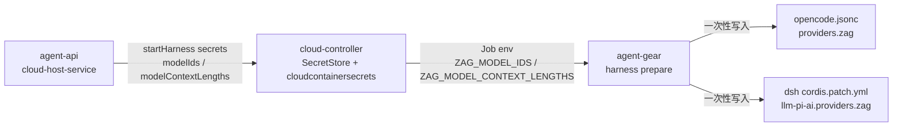
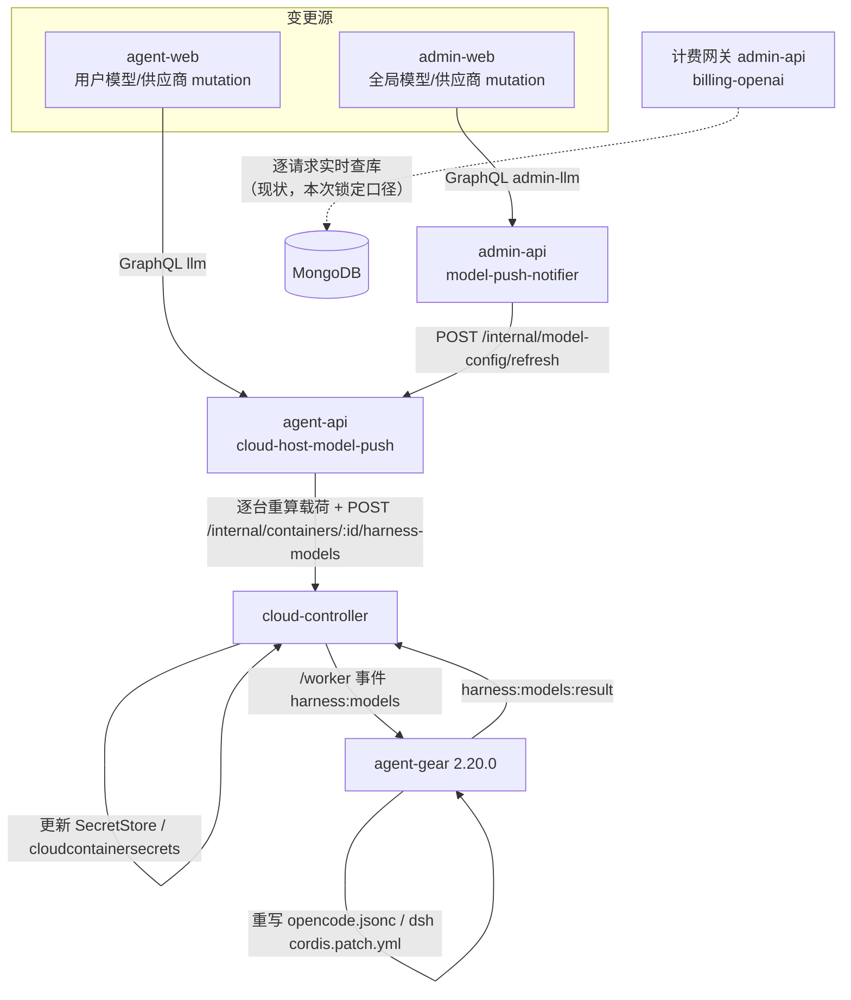
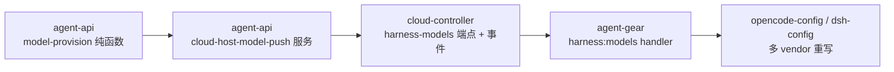
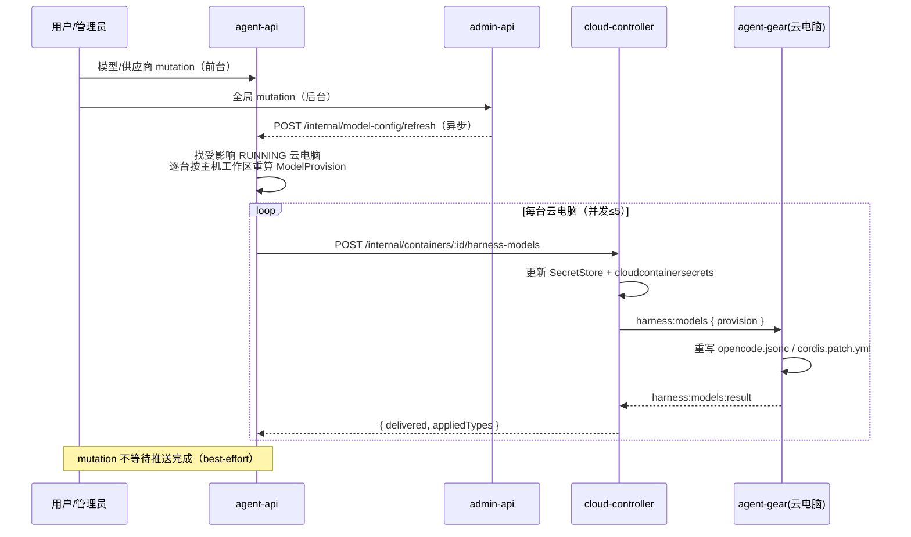

# 模型下发优化与云电脑配置实时下发 - 技术提案

**功能名称**: 模型下发优化与云电脑配置实时下发
**关联 PRD**: [`docs/product/draft/20261117-cloud-host-model-config-sync.md`](../../product/draft/20261117-cloud-host-model-config-sync.md)
**技术提案版本**: v1.1（v1.0 评审返工修订：新增用户模型上下文长度编辑与服务商上下文元数据自动获取——实现点 8/9、决策 D11~D14、契约 3 扩展与测试/验收同步补充）
**创建日期**: 2026-11-17
**作者**: z-agent-bot
**feat-branch**: `feat/cloud-host-model-config-sync`

## 1. 概述

### 1.1 背景

来源：GitHub Issue [Deliay/z-agent-gear#533](https://github.com/Deliay/z-agent-gear/issues/533)。云电脑（云端工作容器）的模型配置目前只在**创建期**一次性快照下发：



由此产生 Issue 中的四类问题（评审返工补充第 5 类上下文长度问题）：

1. **运行期不更新**：模型/供应商在创建后没有任何下发通道，已运行的云电脑永远使用创建时快照；
2. **vendor 前缀统一为 `zag`**：agent-gear `opencode-config.ts` / `dsh-config.ts` 把全部模型写入单一 `providers.zag`（`name/displayName: 'ZAG'`），用户自绑定模型丢失自有供应商标识；
3. **`zag` 无显示名称**：平台内置模型的 vendor 直接展示 `zag`/`ZAG`；
4. **模型修改的生效口径**：计费网关（admin-api `routes/billing-openai.ts`）`/v1/models` 与 `/chat/completions` 已**逐请求实时查库**（`isEnabled` 过滤 + provider 启用联查，禁用即 404 `model_not_found`，进行中请求不中断），需求点 4 在网关侧已满足，但云电脑内 harness 清单仍是旧快照，且该口径缺少契约固化与测试锁定；
5. **上下文长度（评审返工新增）**：`Model.contextLength` 只有 admin-api 侧可写（`updateModelContextLength` / `CustomModelInput.contextLength` 仅存在于 `admin-llm.graphql`），agent-api 用户侧 `CustomModelInput` 只有 `providerId/name` 且无任何编辑 mutation——用户添加的模型无法维护上下文长度；同时 `llm-api.fetchModels` 只返回模型 id 字符串，服务商上游返回的上下文元数据被丢弃（`importGlobalModels` 导入后一律「未设置」），用户只能人工查填。

### 1.2 目标

1. 用户前台、管理后台对模型/供应商的修改，秒级实时下发到全部 RUNNING 云电脑，云电脑内 harness 配置文件同步重写；
2. 云电脑内模型按真实供应商分组：global 模型 → vendor id `zag`、显示名 `Agent Gear`；user 模型 → vendor id = 绑定的 providerId、显示名 = provider.name；
3. 模型禁用等修改对网关调用立即生效（现状保持），并补齐契约口径与测试锁定；
4. 前台保存模型/供应商时提醒用户「部分 Harness 运行时不会重载模型配置」（后台不提醒）；
5. （评审返工新增）用户自己的模型支持上下文长度编辑（设置/修改/清空，口径与 admin 侧一致），并从服务商模型元数据中尽可能自动获取上下文长度——取不到则保持「未设置」由人工填写，人工值优先、不被后续同步覆盖。

### 1.3 范围

**做**：

- agent-api / admin-api 模型变更的实时下发编排（新增推送服务与内部端点）；
- cloud-controller 新增模型下发内部端点与 `/worker` 事件，secrets 增加 `modelProviders`；
- agent-gear 2.20.0：`harness:models` 事件处理、多 vendor 配置重写（opencode / dsh）、`ZAG_MODEL_PROVIDERS` 支持；
- 下发载荷构建口径与网关可调用口径对齐（供应商禁用/悬空不下发、同名 global 优先）；
- 网关 `owned_by` 显示名口径（`Agent Gear` / 供应商名）；
- agent-web 保存提醒；global 变更时 ACP 选项缓存全量失效；
- （评审返工新增）llm-api 服务商模型元数据获取（`fetchModelCatalog`）与上下文长度自动补全（agent-api 同步/新增、admin-api 导入）；
- （评审返工新增）agent-api 用户模型上下文长度编辑（`CustomModelInput.contextLength` + `updateModelContextLength`）与 agent-web 编辑/展示 UI。

**不做**：

- 进行中请求的中断处理（维持现状：不中断）；
- 非 RUNNING 云电脑的补发与事件错过的补发队列（见 §6 决策 D9）；
- kimi_code harness 的模型注入（其模型来自 kimi 登录态，平台本就不注入配置，仅受提醒文案覆盖）；
- 本地控制器的模型下发（本地控制器模型来自各自 ACP 工具探测，不走本平台模型库）；
- （评审返工新增）第三方模型目录（如 models.dev）兜底与「按模型名猜测上下文」——只采用服务商真实返回的元数据（决策 D12）；
- （评审返工新增）用户侧批量编辑上下文长度、按供应商整体设置上下文默认值。

## 2. 技术架构

### 2.1 系统架构图



### 2.2 技术栈

| 层级 | 技术选型 | 说明 |
|------|---------|------|
| 前端 | React 19 + Apollo Client（agent-web） | 保存提醒 toast |
| 后端 | Node.js 24 + Express v5 + GraphQL-Yoga（agent-api / admin-api / cloud-controller） | 推送编排与内部 REST |
| 工作组件 | Node.js 24 CLI（packages/agent-controller，agent-gear 2.20.0） | 事件处理与配置重写 |
| 数据库 | MongoDB（Mongoose） | 无新集合；`cloudcontainersecrets` 增可选字段 |
| 缓存 | Redis | ACP 选项缓存失效（既有机制复用） |

### 2.3 模块划分



| 模块 | 职责 | 关键技术点 |
|------|------|-----------|
| agent-api `services/model-provision.ts`（新） | 下发载荷唯一构建口径（纯函数） | 分组/去重/供应商联查，与网关可调用口径一致 |
| agent-api `services/cloud-host-model-push.ts`（新） | 受影响主机扇出与逐台重算 | `runWithWorkspace` 按主机资源工作区重算；best-effort |
| agent-api `routes/internal-model-config.ts`（新） | 接收 admin-api 的全局变更通知 | Bearer `INTERNAL_API_TOKEN`，202 异步 |
| admin-api `services/model-push-notifier.ts`（新） | 全局 mutation 后通知 agent-api | fire-and-forget，复用 `AGENT_API_URL` |
| cloud-controller `routes/internal-api.ts` | `POST /internal/containers/:id/harness-models` | 更新 secrets + emit + ack 等待 |
| agent-gear `harness/model-providers.ts`（新） | `ZAG_MODEL_PROVIDERS` / 事件载荷解析校验 | 缺省回退旧 `ZAG_MODEL_IDS` |
| agent-gear `opencode-config.ts` / `dsh-config.ts` | 多 vendor 配置重写 | 差集清理（状态文件）、原子写、0600/0700 |
| agent-web `ProviderSection` / `ModelSection` | 保存成功提醒 | 统一 toast |
| agent-api / admin-api `services/llm-api.ts`（改） | `fetchModelCatalog`：模型清单 + 上下文元数据尽力获取 | 兼容返回旧 `string[]` 形态的调用点；多字段映射（D11） |
| agent-api `services/model.ts`（改） | 用户模型上下文长度编辑与自动补全 | `updateContextLength` 用户侧口径（对齐 admin）、`createCustom` 补全 |
| agent-api `services/provider.ts`（改） | 同步模型时补全上下文长度 | upsert 仅补「未设置」，人工值不覆盖（D13） |
| agent-web `CustomModelDialog` / `ModelItem`（改） | 上下文长度编辑与自动带出 | 正整数校验、留空=未设置、保存提醒同口径 |

## 3. API 设计

### 3.1 API 契约

#### 契约 1：`contracts/cloud-controller-websocket.md`（事件 + 内部端点）

**下发载荷 ModelProvision**（事件与 secrets 共用结构）：

```json
{
  "providers": [
    {
      "vendorId": "zag",
      "displayName": "Agent Gear",
      "models": [{ "id": "kimi-k2", "contextLength": 262144 }]
    },
    {
      "vendorId": "65f0a1b2c3d4e5f60718293a",
      "displayName": "我的 OpenAI",
      "models": [{ "id": "gpt-5.1" }]
    }
  ]
}
```

- `vendorId`：global 模型恒为 `zag`；user 模型为绑定的 providerId（ObjectId 字符串）。
- `displayName`：`zag` 组恒为 `Agent Gear`；user 组为 provider.name。
- `models[].contextLength` 可选（正整数），未设置不携带。
- 组顺序：`zag` 组在前（存在时），其后按 provider 创建顺序；组内模型顺序与既有 `modelIds` 口径一致（sortOrder, createdAt）。

**事件 `harness:models`（Server → Worker）**：

| 字段 | 类型 | 必填 | 说明 |
|------|------|------|------|
| `requestId` | `string` | 是 | 关联 ack |
| `provision` | `ModelProvision` | 是 | 全量替换语义（非增量） |

**事件 `harness:models:result`（Worker → Server）**：

| 字段 | 类型 | 必填 | 说明 |
|------|------|------|------|
| `requestId` | `string` | 是 | 对应请求 |
| `success` | `boolean` | 是 | 全部目标 harness 重写成功 |
| `appliedTypes` | `string[]` | 是 | 实际重写的 harness 类型（`opencode` / `deepseek_harness` 子集） |
| `error` | `string` | 否 | 失败原因（脱敏，不含凭据/路径细节以外信息） |

旧 worker（<2.20.0）未注册该事件 handler，Socket.IO 语义下静默忽略 → 服务端按 ack 超时收敛 `delivered=false`（优雅降级，决策 D5）。

**内部端点（附录 A.2.14）**：

```
POST /internal/containers/:containerId/harness-models
Content-Type: application/json
Authorization: Bearer <INTERNAL_API_TOKEN>

{ "provision": { "providers": [ ... ] } }
```

- 容器不存在 → 404 `NOT_FOUND`；终态 → 409 `CONTAINER_NOT_ONLINE`（与 A.2.5 同风格）。
- 先更新 `SecretStore` 与 `cloudcontainersecrets`（含 `modelProviders`），再向在线 socket emit 并等待 ack（10s 超时）。
- 响应 200：`{ "delivered": true, "appliedTypes": [...] }` 或 `{ "delivered": false, "reason": "offline" | "ack_timeout" | "worker_error" }`。secret 已更新，`delivered=false` 不视为失败（决策 D9）。

**既有变更**：附录 A.2.2 `startHarness` 的 `secrets` 增加可选 `modelProviders`（JSON 字符串）；附录 B.2 Job env 表新增 `ZAG_MODEL_PROVIDERS`（携带时注入）；§2.1 事件总览增两行。

#### 契约 2：`contracts/billing-openai.openapi.yaml`（owned_by 口径）

`/v1/models` 返回条目的 `owned_by`：`scope=global` → `Agent Gear`；`scope=user` → 该模型绑定的供应商名称（provider.name）。其余结构不变。

#### 契约 3：`contracts/llm.graphql` / `contracts/admin-llm.graphql`（结构变更 + 注释补注）

**`contracts/llm.graphql`（用户侧，评审返工新增结构变更）**：

```graphql
input CustomModelInput {
  providerId: ID!
  name: String!
  contextLength: Int          # 新增：可选，新增时即设置最长上下文；缺省/传 null = 未设置
}

type ProviderModelOption {    # 新增类型
  name: String!
  contextLength: Int          # 可选；服务商元数据未提供时为 null
}

type Query {
  # 新增：拉取供应商上游模型清单（含上下文元数据），供新增自定义模型时带出上下文长度
  providerModelOptions(providerId: ID!): [ProviderModelOption!]!
}

type Mutation {
  # 新增：编辑用户自有模型（isCustom 与同步模型均可）的最长上下文；缺省/传 null = 清空
  updateModelContextLength(modelId: ID!, contextLength: Int): Model!
}
```

- 校验口径与 admin 侧一致：`contextLength` 为 null/缺省表示「未设置」，否则必须为 ≥1 的整数，非法值报 `contextLength must be a positive integer`；
- `updateModelContextLength` 仅作用于当前用户 `scope=user` 模型（自定义与同步模型）；global 模型或他人模型报 `Model not found`（不泄露存在性）；mutation 成功后触发实时下发（同契约补注口径）。

**`contracts/admin-llm.graphql`（评审返工增强）**：

- `type ProviderModelOption` 增加 `contextLength: Int`（上游提供时携带）；
- `importGlobalModels` 在上游提供上下文元数据时，导入的模型带上 `contextLength`（原一律「未设置」）；结构签名不变。

**补注（两份契约）**：provider/model 全部 mutation 成功后触发运行中云电脑的实时下发（best-effort，不阻断 mutation）；模型启停对网关调用逐请求立即生效。

#### 契约 4：agent-api 内部端点（本提案登记，同 `internal-cloud-host.ts` 风格不入 contracts/）

```
POST /internal/model-config/refresh
Authorization: Bearer <INTERNAL_API_TOKEN>
Content-Type: application/json

{ "scope": "global" }
```

- 语义：全局（scope=global）模型/供应商发生变更。agent-api 异步执行：全部 RUNNING 云电脑逐台重算下发 + 全部控制器 ACP 选项缓存 SCAN 失效（决策 D8）。
- 响应 202 `{ "accepted": true }`；鉴权失败 401。body 非法 400。
- admin-api 对每个全局 mutation 调用一次（去抖由 agent-api 侧单飞合并，见 §5.2 实现点 3）。

### 3.2 内部接口

| 调用方 | 被调方 | 接口 | 说明 |
|--------|--------|------|------|
| agent-api resolver | `cloud-host-model-push` | `pushForUserMutation(tenantId)` / `pushForGlobalMutation()` | fire-and-forget |
| agent-api → cloud-controller | `POST /internal/containers/:id/harness-models` | 单台下发 |
| admin-api → agent-api | `POST /internal/model-config/refresh` | 全局变更通知 |
| cloud-controller → agent-gear | `/worker` `harness:models` / `harness:models:result` | 容器配置重写 |

## 4. 数据模型

### 4.1 数据库设计

无新集合。cloud-controller `cloudcontainersecrets`（`models/harness-secret.ts`）新增可选字段：

| 字段 | 类型 | 说明 |
|------|------|------|
| `modelProviders` | `String`（default `null`） | ModelProvision JSON 字符串；null = 旧版本创建，回退 `modelIds` 构建 |

零迁移：存量行缺省 null，读取侧回退。agent-api / admin-api 不动模型层 schema——`Model.contextLength` 字段两侧已存在，本提案仅扩展其读写口径（返工新增：用户侧编辑与自动补全，见实现点 9）。

### 4.2 缓存设计

- ACP 选项缓存（controller-api `acp:options:<controllerId>:<serverType>`，300s/60s TTL 既有口径不变）：user 变更维持 `invalidateAcpOptionsForUser`；**global 变更**由 `/internal/model-config/refresh` 触发全量 SCAN 失效（复用 `services/acp-options-cache.ts` 的 SCAN 通道），消除「global 变更最长 300s 才生效」的窗口（现状 PRD v1.2 取舍的收口）。
- 不引入模型清单 Redis 缓存：网关保持逐请求查库（实时性语义来源）。

## 5. 技术实现方案

### 5.1 核心流程



### 5.2 关键实现点

#### 实现点 1：ModelProvision 构建口径（agent-api 纯函数）

- **描述**: `services/model-provision.ts` 导出纯函数 `buildModelProvision(models, providers): ModelProvision`，为创建期 `startHarness.secrets` 与运行期推送**唯一构建口径**。
- **技术细节**:
  - 输入为调用方上下文可见的模型全集（与创建期 `modelService.findAll()` 同来源）与相关 provider 行；
  - 过滤：`isEnabled === false` 剔除；provider 不存在或 `isEnabled === false` 的 user 模型剔除（与网关 B-7「列出即可调用」口径对齐，决策 D6）；
  - 同名去重：global 优先（与网关 `/v1/models` 同名不回退口径一致）；
  - 分组：global → `{vendorId:'zag', displayName:'Agent Gear'}`；user → 按 providerId 分组，`displayName = provider.name`；
  - `contextLength` 仅正整数携带（沿用既有口径）；
  - 创建期 `cloud-host-service.ts` 内联的 `modelIds`/`modelContextLengths` 构建改由该函数派生（旧字段=新载荷的扁平投影），保证双写一致。
- **风险点**: 旧行为会把「供应商已禁用的模型」写入 harness 清单（网关调用时 404）；新口径直接不下发，harness 清单与可调用集合一致 —— 属有意行为修正，PRD §3.5 已声明。

#### 实现点 2：推送服务与扇出（agent-api）

- **描述**: `services/cloud-host-model-push.ts`。
- **技术细节**:
  - user 变更：`pushForUserMutation(tenantId)` → 该租户全部 `status:'RUNNING'` 且未软删的 CloudHost；global 变更：全部 RUNNING CloudHost；
  - 逐台重算：无请求 ALS 时按 `host.resourceWorkspaceId` 经 `runWithWorkspace` 构造上下文再取模型（与创建期可见集同口径；参考 `buildSessionWorkspaceContext` 先例）；推送内容为**各主机自身可见集**，天然幂等且不会越权下发；
  - 并发上限 5，单台失败仅 `logger.warn` 继续；mutation 路径不 `await`（对齐 `invalidateAcpOptionsBestEffort` 先例）；
  - 无 RUNNING 主机 / 容器 `containerId` 缺失 → 跳过。
- **风险点**: 团队工作区下向全租户扇出会产生冗余推送（其他成员主机内容为各自可见集，幂等无害）。

#### 实现点 3：变更触发点

- **agent-api**：`graphql/resolvers/model.ts`（createCustomModel / deleteCustomModel / toggleModel / updateModelSortOrder / **updateModelContextLength**，评审返工新增）与 `graphql/resolvers/provider.ts`（create / update / delete / toggle / batch×3）成功后触发 `pushForUserMutation`（fire-and-forget + catch warn）；
- **admin-api**：`graphql/resolvers/model.ts` / `provider.ts` 的全部全局 mutation（含 `importGlobalModels`、`updateModelContextLength`）成功后经 `model-push-notifier` 调 `POST /internal/model-config/refresh`；
- **单飞去抖**：agent-api 对 global refresh 做进程内 single-flight（进行中合并后续触发），避免批量操作（batch/import）产生风暴；
- **ACP 缓存**：global refresh 同时全量 SCAN 失效（决策 D8）。

#### 实现点 4：cloud-controller 下发端点与 secrets 演进

- **描述**: `routes/internal-api.ts` 新增 A.2.14 端点；`secret-store.ts` / `harness-secret-repository.ts` / `models/harness-secret.ts` 增 `modelProviders`；`workload-dispatcher.ts` 注入 `ZAG_MODEL_PROVIDERS`（携带时）；`internal-api.ts` 的 `startHarness` secrets 解析同步。
- **技术细节**: 先持久化后 emit；ack 等待 10s；`restoreHarnessSecrets()` 重启恢复口径自然覆盖新字段。
- **风险点**: 推送与容器销毁并发 —— emit 前容器进入终态按 `CONTAINER_NOT_ONLINE` 收敛。

#### 实现点 5：agent-gear 配置重写（2.20.0）

- **描述**: `supervisor` 的 `/worker` 连接注册 `harness:models` handler；`harness prepare` 同源升级。
- **技术细节**:
  - `harness/model-providers.ts`：`parseModelProvision(json)` 结构校验（vendorId 非空、models 数组、id 非空）；`resolveProvision(env)`：`ZAG_MODEL_PROVIDERS` 优先，缺省回退 `ZAG_MODEL_IDS` + `ZAG_MODEL_CONTEXT_LENGTHS` 合成单 `zag` 组（向后兼容）；
  - `opencode-config.ts`：`buildZagProvider` → `buildProviders(provision)`（`zag` 组 `name: 'Agent Gear'`）；**差集清理**：`~/.zag/model-providers-state.json`（0600）记录上次写入的 vendorId 集合，本次重写后删除「上次有、本次无」的 `providers.<vendorId>` 条目；`providers.zag` 恒受管覆盖；用户手写 provider（package 不同）不受影响；
  - `dsh-config.ts`：`llm-pi-ai.config.providers` 全量多 vendor（`zag` displayName `Agent Gear`；user 组同 `apiKeyEnv/api/baseURL`）；`agent-default-model` / `acp` 的 provider 取**默认模型所在组**（第一组第一个模型；空清单保持仅 `provider: 'zag'` 旧形态）；
  - 事件 handler：校验 → 按 `ZAG_HARNESS_TYPES`（`PREPARE_HARNESS_TYPES` 子集）逐类型重写（复用写函数，不跑 CLI 硬校验）→ 回 `harness:models:result`；任一类型失败 `success:false` + error（脱敏）；
  - 原子写、0600/0700 权限、jsonc/yaml 注释保留等既有不变量全部沿用。
- **风险点**: OpenCode 运行实例是否热读配置不可控 → 由 PRD 功能点 2 的前台提醒覆盖（这正是「有些 harness 运行时不会重载模型配置」的落点）。

#### 实现点 6：网关口径锁定（admin-api）

- `toModelEntry` 的 `owned_by`：global → `Agent Gear`；user → provider.name（`/models` 既有 provider 联查扩展为 id→name 映射；chat 路径不改）；
- 逐请求实时判定保持现状（`isEnabled` + provider 联查）；补 API 测试固化「禁用即 404 / 进行中不中断」。

#### 实现点 7：前台提醒（agent-web）

- `ProviderSection`（保存供应商）与 `ModelSection`（新增/启停/删除/排序/**编辑上下文长度**，评审返工新增）的成功路径统一展示 toast：「部分 Harness 运行时不会重载模型配置，已运行的会话可能需要重启后生效」；admin-web 零改动。

#### 实现点 8：服务商上下文元数据尽力获取（llm-api，评审返工新增）

- **描述**: agent-api 与 admin-api 的 `services/llm-api.ts` 同步演进：`fetchModels` → `fetchModelCatalog(type, endpoint, apiKey): Promise<ProviderModelEntry[]>`（`{ name, contextLength? }`），保留 `fetchModels` 便捷方法（`map(e => e.name)`）以兼容既有调用点。
- **技术细节**:
  - OpenAI 兼容（`client.models.list()`）：对每个条目做**尽力字段映射**，命中即取正整数（D11）：`context_length` / `context_window` / `max_context_length` / `max_input_tokens` / `input_token_limit`；全部未命中或非正整数 → `contextLength: undefined`；
  - Anthropic（`client.models.list()`）：上游条目无上下文元数据 → 恒 `undefined`（「尽可能」的天然边界，不猜测）；
  - 元数据读取失败仅影响该条目取值，不影响清单获取本身；整体超时维持 `TIMEOUT_MS = 10s` 既有口径；
  - 不引入第三方模型目录、不按模型名推断（决策 D12）。
- **风险点**: 部分 OpenAI 兼容网关会在 `max_tokens`/`max_output_tokens` 里混装输出上限——这些字段**不在映射表内**，宁缺毋错（错了会污染 harness 端上下文窗口导致截断/浪费）。

#### 实现点 9：用户模型上下文长度编辑与自动补全（agent-api + agent-web，评审返工新增）

- **描述**: agent-api 服务/契约新增用户侧编辑能力；同步与新增路径接入自动补全；agent-web 增编辑 UI。
- **技术细节**:
  - `services/model.ts`：`createCustom` 接受可选 `contextLength`（`assertContextLength` 校验口径与 admin 一致：null/缺省=未设置，否则整数 ≥1）；新增 `updateContextLength(id, contextLength)`——仅 `scope=user` 模型（isCustom 与同步模型均可），global/他人模型报 `Model not found`，成功后由 resolver 触发 `pushForUserMutation`（并入实现点 3 触发清单）；
  - `graphql/schemas/model.ts` + `contracts/llm.graphql`：`CustomModelInput.contextLength`、`updateModelContextLength` mutation、`providerModelOptions(providerId)` query（内部调 `fetchModelCatalog`，走用户凭据解密路径，与 `provider.ts` 既有 `effectiveApiKey` 口径一致）；
  - 自动补全口径（决策 D13）：`provider.ts` 的 `syncSyncedModels` upsert 时**仅对 `contextLength` 为「未设置」的行**用上游值 `$set` 补全（`$set` 条件更新不做覆盖：已有值行不进 `$set` 列表，逐条比对后生成 ops）；`createCustom` 未显式传 `contextLength` 时调 `fetchModelCatalog` 尽力补全（失败/超时 → null，不阻塞创建）；
  - agent-web `CustomModelDialog`：新增「最长上下文大小（token）」输入（`inputMode="numeric"`，正整数校验，留空=未设置），选定供应商+输入模型名后经 `providerModelOptions` 匹配带出可改预填值（请求失败静默忽略）；`ModelItem` 展示「最长上下文：N tokens / 未设置」与编辑入口；编辑走 `updateModelContextLength`，成功 toast 含重载提醒（实现点 7 口径）；
  - admin-api `importModels` 同步接入 `fetchModelCatalog`：上游携带时写入 `contextLength`（原一律 null）。
- **风险点**: `providerModelOptions` 每次调用都会打上游（10s 超时）——前端做请求去抖与失能重复触发；服务端不做缓存（清单新鲜度优先，调用频率低）。

## 6. 技术决策

### 6.1 决策列表

| 决策 | 选项 A | 选项 B | 最终选择 | 原因 |
|------|--------|--------|---------|------|
| D1 下发通道 | 复用 `workload:run` 注入脚本改写配置 | 新增专用 `harness:models` 事件 | B | 配置重写已有成熟原子写实现；事件可携带结构化载荷与 ack，不污染工作负载日志口径 |
| D2 推送阻塞性 | mutation 等待推送完成 | fire-and-forget | B | 对齐 `invalidateAcpOptionsBestEffort`；网关逐请求判定兜底正确性，推送只影响 harness 展示清单 |
| D3 admin-api 通道 | admin-api 直连 cloud-controller | 经 agent-api 中转 | B | 模型可见集计算与云主机归属都在 agent-api；避免 admin-api 感知租户/工作区上下文 |
| D4 vendorId 取值 | 供应商 name slug | providerId（ObjectId） | B | Issue 明确要求「vendor id 是用户绑定的 provider id」；稳定唯一，不受改名影响 |
| D5 版本门禁 | 提升 `MIN_HARNESS_WORKER_VERSION` | 不提升，旧 worker 忽略事件 | B | 降级行为（保持快照）可接受；门禁提升会强制存量容器不可用 |
| D6 下发清单口径 | 与旧创建逻辑一致（含供应商禁用模型） | 与网关可调用口径一致（剔除） | B | harness 清单 = 实际可调用集合，消除「看得到调不了」 |
| D7 兼容策略 | 仅下发新字段 | secrets 新旧字段双写 | B | 旧 worker（<2.20.0）创建期 harness prepare 继续消费旧字段 |
| D8 global 变更 ACP 缓存 | 维持 300s TTL 兜底 | refresh 端点同步全量失效 | B | 消除 global 变更最长 300s 的漂移窗口 |
| D9 事件错过补发 | 重连补发队列 | 不补发 | B | secret 已更新，下次任意模型变更自然收敛；避免新增可靠队列复杂度 |
| D10 opencode 消失 vendor 清理 | 识别受管条目规则匹配 | 状态文件记录上次集合 | B | 显式状态可靠幂等，不误删用户手写 provider |
| D11 上下文元数据字段映射（返工新增） | 只认单一 `context_length` 字段 | 多字段白名单尽力映射 | B | OpenAI 兼容生态字段不统一（`context_length`/`context_window`/`max_context_length`/`max_input_tokens`/`input_token_limit`）；白名单排除 `max_tokens` 等输出上限字段，宁缺毋错 |
| D12 上下文取值来源（返工新增） | 第三方模型目录（models.dev）兜底 / 按模型名推断 | 只取服务商真实返回的元数据 | B | 目录/推断值与私有部署实际不符会误导截断策略；「尽可能」以真实元数据为界，取不到由人工编辑兜底 |
| D13 自动值与人工值冲突（返工新增） | 每次同步以上游值刷新 | 人工值优先，仅补「未设置」 | B | 人工修正代表用户真实意图；自动刷新会反复覆盖人工修正造成回退 |
| D14 用户侧 mutation 形态（返工新增） | 新命名 `updateCustomModelContextLength` | 与 admin 对齐 `updateModelContextLength` | B | 同语义同名降低前后端心智负担；作用域由服务层限定（scope=user，global/他人报 `Model not found`） |

### 6.2 依赖与约束

| 类型 | 内容 | 说明 |
|------|------|------|
| 依赖 | agent-gear 2.20.0 | `harness:models` 事件与多 vendor 重写；worker 镜像随实现 PR 升级基线 |
| 依赖 | `INTERNAL_API_TOKEN` 双通道 | admin-api → agent-api、agent-api → cloud-controller 既有鉴权复用 |
| 约束 | 单实例部署 | 推送扇出、single-flight 与既有调度器同为进程内语义 |
| 约束 | 明文边界 | 事件与日志不含 `modelApiKey`；载荷仅模型标识与展示名（`redactSecrets` 口径沿用） |

## 7. 项目结构

```
servers/agent-api/src/
├── services/model-provision.ts            # 新：ModelProvision 唯一构建口径（纯函数）
├── services/cloud-host-model-push.ts      # 新：扇出推送服务
├── services/cloud-host-service.ts         # 改：secrets 双写 modelProviders（复用 model-provision）
├── services/cloud-controller-client.ts    # 改：pushHarnessModels 客户端方法
├── services/llm-api.ts                    # 改（返工新增）：fetchModelCatalog 上下文元数据尽力获取
├── services/model.ts                      # 改（返工新增）：createCustom.contextLength + updateContextLength
├── services/provider.ts                   # 改：secrets 双写 + syncSyncedModels 补全 contextLength（返工新增）
├── routes/internal-model-config.ts        # 新：POST /internal/model-config/refresh
├── graphql/schemas/model.ts               # 改（返工新增）：契约镜像（contextLength / updateModelContextLength / providerModelOptions）
└── graphql/resolvers/{model,provider}.ts  # 改：mutation 成功后触发推送
servers/admin-api/src/
├── services/model-push-notifier.ts        # 新：通知 agent-api
├── services/llm-api.ts                    # 改（返工新增）：fetchModelCatalog（与 agent-api 同步演进）
├── services/model.ts                      # 改：importModels 携带 contextLength（返工新增）
├── routes/billing-openai.ts               # 改：owned_by 口径
└── graphql/resolvers/{model,provider}.ts  # 改：全局 mutation 后通知
servers/cloud-controller/src/
├── routes/internal-api.ts                 # 改：A.2.14 端点 + secrets 解析
├── services/{secret-store,workload-dispatcher}.ts  # 改：modelProviders / ZAG_MODEL_PROVIDERS
├── repositories/harness-secret-repository.ts       # 改：持久化新字段
└── models/harness-secret.ts               # 改：schema 新字段
packages/agent-controller/src/
├── harness/model-providers.ts             # 新：载荷解析/回退
├── harness/{opencode-config,dsh-config}.ts # 改：多 vendor 重写
├── cloud-host/supervisor.ts               # 改：harness:models 事件注册
└── commands/harness.ts                    # 改：prepare 同源升级
apps/agent-web/src/components/settings/
├── {ProviderSection,ModelSection}.tsx     # 改：保存成功提醒（含上下文编辑路径）
└── {CustomModelDialog,ModelItem}.tsx      # 改（返工新增）：上下文长度编辑/展示与自动带出
contracts/
├── cloud-controller-websocket.md          # 改：事件 + A.2.14 + B.2
├── billing-openai.openapi.yaml            # 改：owned_by 口径
└── {llm,admin-llm}.graphql                # 改：结构变更（返工新增）+ 注释补注
```

## 8. 测试策略

### 8.1 测试覆盖要求

- 遵循 TDD 红-绿-重构；新增纯函数与服务 100% 分支覆盖关键路径；
- API 测试覆盖：`POST /internal/model-config/refresh`（鉴权/202/400）、`POST /internal/containers/:id/harness-models`（404/409/delivered 两态）、网关 `/v1/models` 的 `owned_by` 与禁用即时生效回归；
- （返工新增）上下文长度链路覆盖：`fetchModelCatalog` 字段映射（含 `max_tokens` 类输出上限字段不误取）、`updateModelContextLength` 用户侧作用域与校验、同步/新增自动补全「仅补未设置」不覆盖人工值、编辑后触发实时下发。

### 8.2 测试类型

| 类型 | 工具 | 覆盖范围 |
|------|------|---------|
| 单元测试 | Vitest（各包） | model-provision 纯函数（分组/去重/悬空 provider/同名优先）、push 服务（扇出/短路/失败继续/上下文重算）、cloud-controller 端点与 secrets、agent-gear 解析与双 config 重写（含差集清理、默认模型组归属）、admin-api notifier 与 owned_by、llm-api fetchModelCatalog 字段映射（返工新增）、agent-api model 服务上下文编辑与补全口径（返工新增） |
| API 测试 | tests/api（Vitest + MongoMemoryServer） | 内部端点全链路、mutation → fake cloud-controller 收到推送、网关禁用即时生效、`updateModelContextLength` 作用域/校验/触发推送与 `providerModelOptions` 元数据带出（返工新增） |
| E2E 测试 | tests/e2e（Playwright） | 前台保存提醒展示；fake 容器链路 `harness:models` 到达与配置重写断言；用户模型上下文编辑/清空/自动带出展示（返工新增） |

## 9. 部署方案

### 9.1 环境规划

| 环境 | 用途 | 部署方式 |
|------|------|---------|
| 内网集成 | Aspire 编排全量服务 + tests/api + tests/e2e | `aspire start` |
| 生产 | 服务端四件滚动发布；worker 镜像随 agent-gear 2.20.x 重建发布 | 既有流水线 |

发布顺序：cloud-controller（新端点+字段，向后兼容）→ agent-api / admin-api（推送编排）→ worker 镜像（agent-gear 2.20.0）。回滚：服务端回滚后新事件不再产生，新 agent-gear 对旧服务端回退旧 env 字段，双向兼容。

### 9.2 配置管理

- 无新增环境变量；复用 `INTERNAL_API_TOKEN`、admin-api `AGENT_API_URL`（多租户一期已注入）。

## 10. 验收标准

- [ ] 技术方案评审通过
- [ ] Contract 评审通过（cloud-controller-websocket / billing-openai / llm×2）
- [ ] 前台修改模型后 RUNNING 云电脑秒级收到 `harness:models` 且配置重写（含多 vendor 分组）
- [ ] 后台修改全局模型后全部 RUNNING 云电脑同步生效，ACP 选项缓存同步失效
- [ ] 云电脑内平台组显示 `Agent Gear`，用户组显示供应商名称，vendor id 口径符合 §3.1
- [ ] 禁用模型后网关新请求立即 404 `model_not_found`，进行中请求正常完成
- [ ] 前台保存出现重载提醒，后台无提醒
- [ ] （返工新增）用户自己的模型可在前台设置/修改/清空最长上下文并实时下发；非法输入被拒绝；global 模型前台不可编辑
- [ ] （返工新增）服务商元数据携带上下文时同步/新增/导入自动补全，未携带或获取失败保持「未设置」；人工值不被后续同步覆盖
- [ ] 旧 worker 云电脑静默降级、新建云电脑与既有流程零回归
- [ ] 单元测试覆盖达标、API 测试通过、E2E 测试通过

## 11. 相关文档

- 关联 PRD：`docs/product/draft/20261117-cloud-host-model-config-sync.md`
- 需求来源：GitHub Issue [Deliay/z-agent-gear#533](https://github.com/Deliay/z-agent-gear/issues/533)
- 相关契约：`contracts/cloud-controller-websocket.md`、`contracts/billing-openai.openapi.yaml`、`contracts/llm.graphql`、`contracts/admin-llm.graphql`
- 既有提案：`docs/engineering/proposals/20261023-feat-cloud-container-optimization-phase2.md`（模型上下文长度下发）、`docs/engineering/proposals/20261025-fix-opencode-model-context-length.md`、`docs/engineering/proposals/20261025-feat-deepseek-harness.md`、`docs/engineering/proposals/20261020-fix-api-channel-model-fixes.md`
- 开发规范：`docs/engineering/common-rules.md`、`docs/engineering/backend-rules.md`、`docs/engineering/frontend-rules.md`
