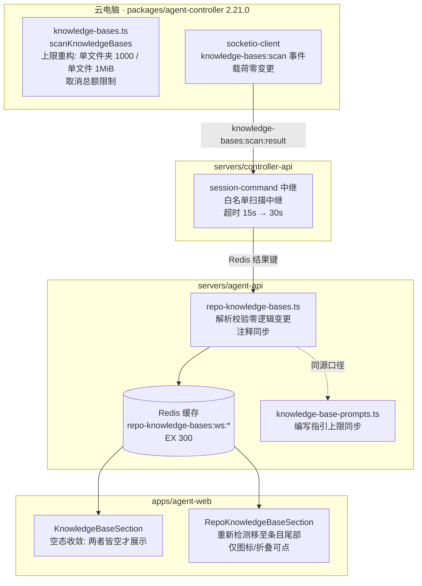
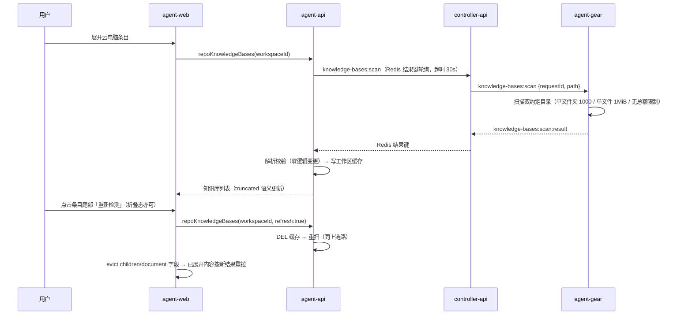

# 知识库优化二期 - 技术提案

**功能名称**: 知识库优化二期
**关联 PRD**: [[../../product/draft/20261117-knowledge-base-optimization-phase2.md]]
**技术提案版本**: v1.0
**创建日期**: 2026-11-17
**作者**: z-agent-bot
**feat-branch**: `feat/knowledge-base-optimization-phase2`
**领域模型影响**: `docs/knowledges/domain/B0-知识库/00-上下文概览.md` 与 `01-聚合与实体.md`（新增「仓库知识库只读视图」小节并回写加载上限口径）、`00-领域模型库-索引.md` / `02-上下文地图.md`（条目增补）；`docs/engineering/common-rules.md`「仓库知识库约束」行同步

## 1. 概述

### 1.1 背景

需求来源 [Issue #559](https://github.com/Deliay/z-agent-gear/issues/559)，PRD 见 [[../../product/draft/20261117-knowledge-base-optimization-phase2.md]]。仓库内建知识库（#545，见 [[20261116-feat-knowledge-base-repo-built-in.md]]）已落地完整链路：agent-gear `knowledge-bases:scan` 扫描 `.zag/knowledges/` 与 `docs/knowledges/` → controller-api 白名单中继 → agent-api `services/repo-knowledge-bases.ts` 解析校验 + 工作区级缓存 → GraphQL 四个只读查询 → agent-web 侧边栏「仓库知识库」分组（折叠懒加载）。本期针对 Issue #559 的三个问题做增量优化：

1. **空态文案矛盾**：`KnowledgeBaseSection` 在平台知识库为空时渲染「暂无知识库」，其后紧跟 `RepoKnowledgeBaseSection`（仓库知识库分组）——仓库知识库有内容时文案自相矛盾；
2. **加载上限过紧**：扫描器（`packages/agent-controller/src/knowledge-bases.ts`）现有上限为「每来源 20 库 / 每库 50 文档 / schema 64KiB / 单文档 128KiB / 单库累计 1MiB / 单来源累计 2MiB」，规模稍大的知识库即被 `truncated` 截断；
3. **「重新检测」入口形态**：`RepoKnowledgeBaseList` 在展开区右上以「图标 + 文字」单独占一行渲染刷新按钮，偏离列表操作入口形态且占纵向空间。

### 1.2 目标

- **上限口径重构**（功能点 2）：取消全部数量/体积总额限制（每来源 20 库、每库 50 文档、单库 1MiB、单来源 2MiB）；新增结构性上限「单文件夹直接子项 ≤ 1000」；单文件上限统一为 1MiB（文档与 `knowledge-base.json`，原 128KiB / 64KiB）。响应结构零变更，`truncated` 语义改为「单文件夹子项超 1000 截断」并沿既有路径逐级上浮。
- **空态收敛**（功能点 1）：「暂无知识库」仅在「平台知识库为空 且 仓库知识库分组不渲染」时展示；分组渲染（含加载中/失败态）即不展示空态文案。
- **「重新检测」迁移**（功能点 3）：移至 `HostNode`（云电脑折叠条目）标题行尾部，仅图标（`title`/`aria-label` 保留「重新检测」），折叠/展开状态均可触发 `refresh:true` 重扫并失效子查询缓存。
- **同源同步**：`contracts/agent-session-websocket.md` §3.29/§3.30、`contracts/knowledge-base.graphql` 注释、MCP 编写指引 `knowledge-base-prompts.ts` 与防漂移守卫随新口径同步；`docs/engineering/common-rules.md` 仓库知识库约束行、领域模型 B0-知识库同步回写。

### 1.3 范围

**做**：
- agent-gear `knowledge-bases.ts` 扫描上限重构（删 4 项总额上限、单文件 1MiB、单文件夹 1000 子项）；包版本 2.20.0 → 2.21.0。
- controller-api / agent-api 扫描中继与轮询超时口径上调（15s → 30s，适配大库扫描耗时）。
- agent-api `knowledge-base-prompts.ts` 编写指引上限表与自检清单同步；`repo-knowledge-bases.ts` 注释同步（解析逻辑零变更）。
- agent-web：`KnowledgeBaseSection` 空态收敛（`GET_REPO_KNOWLEDGE_BASE_HOSTS` 查询上提）、`RepoKnowledgeBaseSection`「重新检测」迁移至 `HostNode` 行尾图标化、知识库条目「已截断」/文档条目「文件过大」标示。
- 契约 §3.29/§3.30 约束与字段注释按新上限改写；`knowledge-base.graphql` 注释同步。
- 领域模型与 `common-rules.md` 同步；单测 / 组件测试 / API 测试 / E2E 测试同步更新。

**不做**：
- 平台托管知识库的任何行为与上限（内容 ≤262144 等）变更。
- 仓库知识库放置规范、识别规则（不递归发现、`knowledge-base.json` 标识、`.md` 收录）、只读语义、不进知识库 MCP 工具等口径变更。
- 总量安全阀（极高位兜底上限）——需求明确「取消总量限制」，体量风险见 §5.2 风险点与 D6。
- 缓存键 / TTL / 解析结构变更；GraphQL 查询签名变更；本地控制器仓库知识库支持。

## 2. 技术架构

### 2.1 系统架构图



### 2.2 技术栈

| 层级 | 技术选型 | 说明 |
|------|---------|------|
| 扫描执行 | Node.js + TypeScript（agent-gear） | 直读工作区约定目录，仅读不写、不执行 |
| 中继 | Socket.IO + Redis（controller-api） | 白名单事件中继，结果键 EX 60 |
| 服务 | Express + GraphQL-Yoga + Redis（agent-api） | 解析校验、工作区级缓存、四个只读查询 |
| 前端 | React + Apollo Client（agent-web） | 侧边栏折叠懒加载、空态收敛、行内操作入口 |
| 存储 | 无新增 | 仓库知识库不落 MongoDB（现状不变） |

### 2.3 模块划分

| 模块 | 职责 | 本期变更 |
|------|------|---------|
| `packages/agent-controller/src/knowledge-bases.ts` | 仓库知识库扫描（发现、收集、上限执行） | **上限重构**：删 `MAX_KNOWLEDGE_BASES_PER_SOURCE` / `MAX_DOCUMENTS_PER_BASE` / `MAX_BASE_TOTAL_BYTES` / `MAX_SOURCE_TOTAL_BYTES`，新增 `MAX_ENTRIES_PER_FOLDER = 1000`，单文件上限统一 `MAX_FILE_BYTES = 1MiB` |
| `servers/controller-api` 扫描中继 | `knowledge-bases:scan` 白名单中继 | 超时口径 15s → 30s（载荷零变更） |
| `servers/agent-api/src/services/repo-knowledge-bases.ts` | 扫描结果解析、校验、缓存、四级查询 | 零逻辑变更（注释同步） |
| `servers/agent-api/src/services/knowledge-base-prompts.ts` | 「仓库知识库编写指引」单一来源 | 上限表 / 自检清单同步新口径 |
| `apps/agent-web/.../KnowledgeBaseSection.tsx` | 知识库分区（平台库 + 仓库库挂载点） | 空态收敛：hosts 查询上提，「暂无知识库」双空才展示 |
| `apps/agent-web/.../RepoKnowledgeBaseSection.tsx` | 仓库知识库分组（折叠懒加载） | 「重新检测」迁移至 `HostNode` 行尾、仅图标、折叠可点 |
| `contracts/agent-session-websocket.md` §3.29/§3.30 | 扫描事件契约 | 约束与字段注释按新上限改写（结构零变更） |

## 3. API 设计

### 3.1 API 契约

**GraphQL 与 WS 契约结构零变更**；仅上限口径文本与 `truncated` 语义注释改写：

| 契约文件 | 变更 | 性质 |
|------|------|------|
| `contracts/agent-session-websocket.md` §3.29「约束」 | 上限 bullet 改写：「每个文件夹直接子项（目录与文件合计）按 `localeCompare` 排序取前 1000（超出 `truncated: true`）；单文件（文档与 `knowledge-base.json`）>1 MiB 标记 `error: 'file too large'`（`knowledge-base.json` 超限整库 error、不读文档；单文档超限逐条剔除）；无每库文档数 / 每来源知识库数 / 内容累计上限」 | 注释 |
| `contracts/agent-session-websocket.md` §3.30 字段表 | `schema` 注释「≤64 KiB」→「≤1 MiB」；`truncated`（条目级/来源级/整体）注释改为「因单文件夹子项超 1000 截断」 | 注释 |
| `contracts/knowledge-base.graphql` | `RepoKnowledgeBase.truncated` 注释同步（「因上限截断」→「因单文件夹子项超 1000 截断」） | 注释 |
| GraphQL 查询 | `repoKnowledgeBaseHosts` / `repoKnowledgeBases(workspaceId, refresh)` / `repoKnowledgeBaseDocumentChildren(id, path)` / `repoKnowledgeBaseDocument(id, path)` 签名与出参结构**零变更** | 无 |

错误文案白名单零新增（`file too large` / `not found` / `permission denied` / `repo knowledge base scan failed` 等沿用）。

### 3.2 内部接口

`knowledge-bases:scan` / `knowledge-bases:scan:result`（agent-gear ↔ controller-api）载荷结构逐字不变：

```json
{
  "requestId": "string",
  "success": true,
  "sources": [
    {
      "source": "zag",
      "knowledgeBases": [
        { "folder": "team-rules", "schema": "{...}", "documents": [{ "path": "guides/git.md", "content": "..." }], "truncated": false }
      ],
      "truncated": false
    }
  ],
  "truncated": false
}
```

仅执行口径变化：`truncated` 的产生条件由「文档数/体积累计超限」变为「单文件夹直接子项超 1000 被截断」，并沿「文件夹 → 知识库 → 来源 → 整体」逐级上浮（字段与上浮路径不变）。

## 4. 数据模型

### 4.1 数据库设计

**零 MongoDB 变更、零迁移、零索引**：仓库知识库不落库（仓库为唯一事实源，现状不变）；平台知识库三集合（knowledgebases / knowledgebasedocuments / knowledgebaseevents）零触碰。

### 4.2 缓存设计

| 键 | TTL | 内容 | 本期变化 |
|----|-----|------|---------|
| `repo-knowledge-bases:ws:{workspaceId}` | 300s | 解析后知识库全集（含文档内容） | 键/TTL/结构不变；**体积上浮**——原「单来源 2MiB」的天然封顶取消，极端仓库可产生大 value（风险见 §5.2） |
| `knowledge-bases:scan:{requestId}` | 60s | 单次扫描结果（读后即删） | 不变；体积同上上浮 |

## 5. 技术实现方案

### 5.1 核心流程



### 5.2 关键实现点

#### 实现点 1: agent-gear 扫描上限重构（`knowledge-bases.ts`）

- **描述**: 按新口径重写上限常量与截断逻辑。
- **技术细节**:
  - 删除 `MAX_KNOWLEDGE_BASES_PER_SOURCE` / `MAX_DOCUMENTS_PER_BASE` / `MAX_BASE_TOTAL_BYTES` / `MAX_SOURCE_TOTAL_BYTES` 与 `SourceScanState` 的字节累计（`baseBytes` / `sourceBytes` 双重检查一并删除）；
  - `MAX_SCHEMA_BYTES` / `MAX_DOCUMENT_BYTES` 合并为 `MAX_FILE_BYTES = 1024 * 1024`（单文件统一 1MiB；`stat` 预检 + 读后 `Buffer.byteLength` 复核两道保留）；
  - 新增 `MAX_ENTRIES_PER_FOLDER = 1000`：`scanSource` 的来源目录列取与 `collectMarkdownFiles` 的 `walk` 每次 `readdir` 结果按 `localeCompare` 排序后取前 1000 项（**目录与文件合计**，D3），超出部分不遍历；截断置所在知识库 `truncated`，沿既有路径上浮到来源与整体；
  - 单文档超 1MiB 仍逐条 `error: 'file too large'`（不读内容、不影响其余文档）；`knowledge-base.json` 超 1MiB 整库 `error: 'file too large'`（不解析 schema、不读文档）；
  - 模块头注释与 `packages/agent-controller/AGENTS.md` 上限段同步；包版本 `2.20.0` → `2.21.0`。
- **风险点**: 极端仓库（多层 1000 子项 × 1MiB 文件）扫描结果可达数百 MB（D6 明确接受；风险汇总见下）。

#### 实现点 2: 中继与轮询超时口径上调

- **描述**: 取消总量限制后大库扫描耗时上浮，沿用 15s 可能把大库误判为 `repo knowledge base scan failed`。
- **技术细节**: controller-api `knowledge-bases:scan` 中继等待上限 15s → 30s；agent-api 轮询 `500ms × 30` → `500ms × 60`；Redis 结果键 `EX 60` 保持（> TTL 兜底）。`workflow-templates:scan` 同型链路**不动**（上限未变）。
- **风险点**: 失败反馈延迟从 15s 变 30s（罕见路径，可接受）。

#### 实现点 3: MCP 编写指引与防漂移守卫同步

- **描述**: `knowledge-base-prompts.ts` 的「仓库知识库编写指引」是上限口径的对外说明，必须与扫描器一致。
- **技术细节**: §3「`knowledge-base.json`」的「文件超过 64KiB…」→「文件超过 1MiB…」；§4「单个文档超过 128KiB…」→「单个文档超过 1MiB…」；§6「数量与体积上限」表改为「单文件（文档与 `knowledge-base.json`）≤ 1MiB / 单个文件夹直接子项 ≤ 1000（超出截断）/ 无文档数与内容累计上限」；§8 自检清单同步；防漂移守卫 `knowledge-base-prompts.test.ts` T-RKB-P4 的字面量断言（`64KiB/128KiB/1MiB/2MiB`）改为新值（`1MiB` / `1000`）。
- **风险点**: 无（字面量守卫变红强制同步）。

#### 实现点 4: agent-web 空态收敛（功能点 1）

- **描述**: 「暂无知识库」仅在平台知识库与仓库知识库都为空时展示。
- **技术细节**:
  - `GET_REPO_KNOWLEDGE_BASE_HOSTS` 查询从 `RepoKnowledgeBaseSection` 上提到 `KnowledgeBaseSection`（同查询同变量 Apollo 自动去重；`RepoKnowledgeBaseSection` 改为接收 `hosts` / 状态 props 或经共享 hook 复用同一查询结果）；
  - 「暂无知识库」渲染条件 = `items.length === 0 && hosts 查询已定态 && hosts.length === 0`；具体口径：hosts 查询在途（`loading && !data`）不展示（防闪烁）、查询失败不展示（分组自身渲染「加载失败」与重试）、成功且为空才展示、非空不展示；
  - 平台知识库非空时行为不变。
- **风险点**: 查询上提后 `RepoKnowledgeBaseSection` 的独立测试需适配 props 形态（T-RKB-WEB2 的「无候选不渲染分组」断言保持）。

#### 实现点 5: agent-web「重新检测」迁移（功能点 3）

- **描述**: 刷新按钮从展开区独立行移至云电脑条目标题行尾部，仅图标、折叠可点。
- **技术细节**:
  - `HostNode` 行结构由单 `<button>` 调整为 flex 行（折叠切换按钮 + 尾部操作按钮，避免按钮嵌套）；尾部渲染 `RefreshCw` 图标按钮（`title` / `aria-label` 「重新检测」，保留 `data-testid="repo-kb-refresh"`），省略文字；
  - 点击处理沿用 D10 口径：`refetch({ workspaceId, refresh: true })` + `client.cache.evict({ fieldName: 'repoKnowledgeBaseDocumentChildren' })` / `repoKnowledgeBaseDocument`；**折叠态**（列表组件未挂载）经 `useLazyQuery` / `client.query`（`network-only`）触发同一查询，结果写缓存后展开即见新结果（D5）；加载中禁用防重复点击；
  - `scanSupported=false` 的条目不渲染该按钮（与不发起加载一致）；展开区的独立刷新行整体移除。
- **风险点**: 无（既有 T-RKB-WEB5 行为断言更新为新入口）。

#### 实现点 6: 截断与超限标示

- **描述**: 新上限下的两种截断/超限要有可见标示，避免「静默少内容」。
- **技术细节**: 知识库条目在 `truncated === true` 时渲染「已截断」徽标（数据已在 `RepoKnowledgeBaseData.truncated`，零契约变更）；单文档超 1MiB 的 `error: 'file too large'` 条目在树中灰显并标示「文件过大」（不进入预览）；`knowledge-base.json` 超限的知识库沿用不合法库灰显形态展示原因。
- **风险点**: 无（纯展示层）。

**体量风险汇总**（对应 D6）：取消总额限制后，单次扫描结果与工作区缓存体积不再有 2MiB/来源封顶，极端仓库（如 1000 项文件夹 × 多层 × 1MiB 文件）可产生大 Socket.IO 报文与大 Redis value（Redis 字符串上限 512MB）；常规规模（数百篇、MB 级）无碍。本期按需求不设安全阀；如线上出现极端仓库，后续可演进为「列表缓存不含文档内容、文档按需读取」的分层缓存（不改变对外口径）。

## 6. 技术决策

### 6.1 决策列表

| 决策 | 选项 A | 选项 B | 最终选择 | 原因 |
|------|--------|--------|---------|------|
| D1「仓库知识库为空」判定 | 分组可见性（hosts 为空 = 空） | 逐云电脑扫描判定知识库空集 | A | 分组内容按需加载，逐台扫描违背「初始不读任何仓库内容」；分组出现即有可浏览入口，空态文案不与之同屏 |
| D2 单文件上限口径 | 统一 1MiB（文档与 `knowledge-base.json`） | 文档 1MiB、`knowledge-base.json` 保持 64KiB | A | 需求表述为「单文件 1MB」，统一口径最简单；标识文件仅做 JSON 解析与字段校验，放宽无解析风险 |
| D3「单文件夹子项」计数对象 | 该文件夹 readdir 直接子项（目录与文件合计） | 仅计收录对象（`.md` / 子目录） | A | 与需求措辞一致，且对扫描工作量的约束更直接 |
| D4 `truncated` 承载 | 保持库级/来源级/整体三级字段，语义改为「单文件夹子项超 1000 截断」 | 新增文件夹级 `truncated` 字段 | A | 避免契约结构变更；截断只发生在罕见的 1000 上限处，库级标示已足够定位 |
| D5「重新检测」折叠态行为 | 立即扫描并写缓存 | 仅失效缓存、展开才扫 | A | 用户显式点击应有即时反馈；显式动作属于合法加载触发，不违背懒加载（懒加载约束的是「展开自动加载」） |
| D6 总量安全阀 | 不设（按需求取消总量限制） | 极高位兜底上限（如 512MiB） | A | 需求明确「取消总量限制」；体量风险已在 PRD 非功能与 §5.2 记录并给出后续演进路径 |
| D7 扫描超时口径 | 中继/轮询 15s → 30s | 保持 15s | A | 取消总额限制后大库扫描耗时上浮，15s 会把大库误判为扫描失败；结果键 EX 60 不变 |
| D8 旧 worker 兼容 | 不提升 `isRepoKnowledgeBaseScanSupported` 门禁（≥2.19.0） | 提升到 2.21.0 | A | 旧 worker 按旧上限截断只是内容不全、无错误，属优雅降级；提升门禁会让存量云电脑整组不可用，得不偿失 |

### 6.2 依赖与约束

| 类型 | 内容 | 说明 |
|------|------|------|
| 依赖 | 仓库内建知识库链路（#545） | 扫描/中继/解析/四级查询/前端分组均为其既有资产，本期只改口径与两处前端形态 |
| 依赖 | 知识库 MCP prompts 能力（D14/#545） | 编写指引单一来源 `knowledge-base-prompts.ts` + 防漂移守卫 |
| 约束 | 响应结构零变更 | `truncated` / `error` 字段与白名单文案沿用，契约仅注释改写 |
| 约束 | 仓库知识库只读、不落 MongoDB、不进知识库 MCP 工具 | 现状口径不变 |
| 约束 | agent-gear 上限常量跨包不可 import | 防漂移守卫继续以字面量断言锚定（T-RKB-P4 先例） |

## 7. 项目结构

```
z-agent-gear/
├── packages/agent-controller/
│   ├── package.json                          # 版本 2.20.0 → 2.21.0
│   ├── AGENTS.md                             # 上限段同步
│   └── src/
│       ├── knowledge-bases.ts                # 上限重构（核心）
│       └── knowledge-bases.test.ts           # 上限用例重写
├── servers/
│   ├── controller-api/src/services/
│   │   └── session-command.ts                # 扫描中继超时 15s → 30s
│   └── agent-api/src/services/
│       ├── repo-knowledge-bases.ts           # 注释同步（逻辑零变更）
│       ├── repo-knowledge-bases.test.ts      # 大 fixture 全量用例
│       ├── knowledge-base-prompts.ts         # 编写指引上限同步
│       └── knowledge-base-prompts.test.ts    # 防漂移守卫字面量更新
├── apps/agent-web/src/components/knowledge-base/
│   ├── KnowledgeBaseSection.tsx              # 空态收敛 + hosts 查询上提
│   ├── RepoKnowledgeBaseSection.tsx          # 重新检测迁移 + 截断/超限标示
│   └── __tests__/                            # 组件测试同步
├── contracts/
│   ├── agent-session-websocket.md            # §3.29/§3.30 上限口径改写
│   └── knowledge-base.graphql                # truncated 注释同步
├── tests/
│   ├── api/src/agent-api/repo-knowledge-base.test.ts
│   └── e2e/src/repo-knowledge-base.spec.ts
└── docs/
    ├── engineering/common-rules.md           # 仓库知识库约束行同步
    └── knowledges/domain/B0-知识库/          # 领域模型同步
```

## 8. 测试策略

### 8.1 测试覆盖要求

- 单元测试覆盖率 ≥ 80%（`common-rules.md`）；
- 扫描上限矩阵、空态收敛矩阵、刷新入口形态为必测项；既有 T-RKB-* / E2E-RKB* 全量回归。

### 8.2 测试类型

| 类型 | 工具 | 覆盖范围 |
|------|------|---------|
| 单元测试（agent-gear） | Vitest | `knowledge-bases.test.ts` 重写上限矩阵：T-RKB2-SCAN1（>50 篇 / 累计 >1MiB 全量加载、无总额截断）、T-RKB2-SCAN2（单文件夹 >1000 子项按名取前 1000 + truncated 逐级上浮）、T-RKB2-SCAN3（单文档 >1MiB 逐条 `file too large` 不影响其余）、T-RKB2-SCAN4（`knowledge-base.json` >1MiB 整库 error）、T-RKB2-SCAN5（来源目录 >1000 子项截断）；旧 T-RKB-SCAN7/7b/7c 上限用例删除或改写 |
| 单元测试（agent-api） | Vitest | `knowledge-base-prompts.test.ts` T-RKB2-P1（防漂移字面量 `1MiB` / `1000` 与扫描器一致）；`repo-knowledge-bases.test.ts` T-RKB2-SVC1（大 fixture 全量解析、truncated/error 透传零变化） |
| 组件测试（agent-web） | Vitest + RTL | `KnowledgeBaseSection.test.tsx` T-RKB2-WEB1（平台空 + hosts 非空 → 无「暂无知识库」）、T-RKB2-WEB2（平台空 + hosts 空 → 有）、T-RKB2-WEB3（hosts 在途/失败 → 无）；`RepoKnowledgeBaseSection.test.tsx` T-RKB2-WEB4（按钮位于条目尾部仅图标、折叠态可点、`refresh:true` + 缓存失效）、T-RKB2-WEB5（truncated/文件过大标示）；既有 T-RKB-WEB1~6 适配回归 |
| API 测试 | tests/api | `repo-knowledge-base.test.ts` T-RKB2-API1（超过原总额上限的 fixture 全量返回、truncated=false；1000 截断 fixture truncated=true） |
| E2E 测试 | Playwright | `repo-knowledge-base.spec.ts` 新增 E2E-RKB7（空态收敛三态）、E2E-RKB8（「重新检测」图标在条目尾部、折叠态点击后新内容呈现）；既有 E2E-RKB1~6 回归（E2E-RKB6 空态断言按新口径更新） |

## 9. 部署方案

### 9.1 环境规划

| 环境 | 用途 | 部署方式 |
|------|------|---------|
| 本地（Aspire） | 开发自测 | `aspire start` 全链路 |
| 云环境 | 生产 | 常规发布（agent-api / agent-web / controller-api）；agent-gear 随 2.21.0 发布由云电脑自动升级获取 |

### 9.2 配置管理

- 无新增配置项、无环境变量、无数据迁移。
- agent-gear 版本口径：`knowledge-bases:scan` 上限行为自 **2.21.0** 起；`isRepoKnowledgeBaseScanSupported` 门禁保持 ≥2.19.0（D8）——旧 worker 按旧上限截断（内容不全但无错误），升级后自动生效新上限。
- 扫描中继/轮询超时为代码常量（30s），不进配置。

## 10. 验收标准

- [ ] 技术方案评审通过（含领域模型同步检查）
- [ ] Contract 评审通过（§3.29/§3.30 注释口径与实现一致）
- [ ] 领域模型已同步更新（`docs/knowledges/domain/B0-知识库/`、索引、上下文地图）与 `common-rules.md` 仓库知识库约束
- [ ] 代码实现完成（扫描上限重构 / 空态收敛 / 重新检测迁移 / 标示）
- [ ] 单元测试覆盖达标（T-RKB2-* 矩阵全绿，既有 T-RKB-* 回归全绿）
- [ ] API 测试通过（T-RKB2-API1）
- [ ] E2E 测试通过（E2E-RKB7/RKB8 + E2E-RKB1~6 回归）
- [ ] 编写指引（`repo-knowledge-base-authoring`）与实际加载规则一致（防漂移守卫锁定）

## 11. 相关文档

- [[../../product/draft/20261117-knowledge-base-optimization-phase2.md]] — 关联 PRD
- [[20261116-feat-knowledge-base-repo-built-in.md]] — 仓库内建知识库技术提案（链路上游）
- [[20261116-feat-knowledge-base-optimization.md]] — 知识库优化（一期）技术提案
- [[20261115-feat-knowledge-base.md]] — 知识库技术提案
- `contracts/agent-session-websocket.md` §3.29/§3.30、`contracts/knowledge-base.graphql`
- 领域模型：`docs/knowledges/domain/B0-知识库/`
- 需求来源：GitHub Issue [Deliay/z-agent-gear#559](https://github.com/Deliay/z-agent-gear/issues/559)
