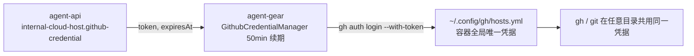
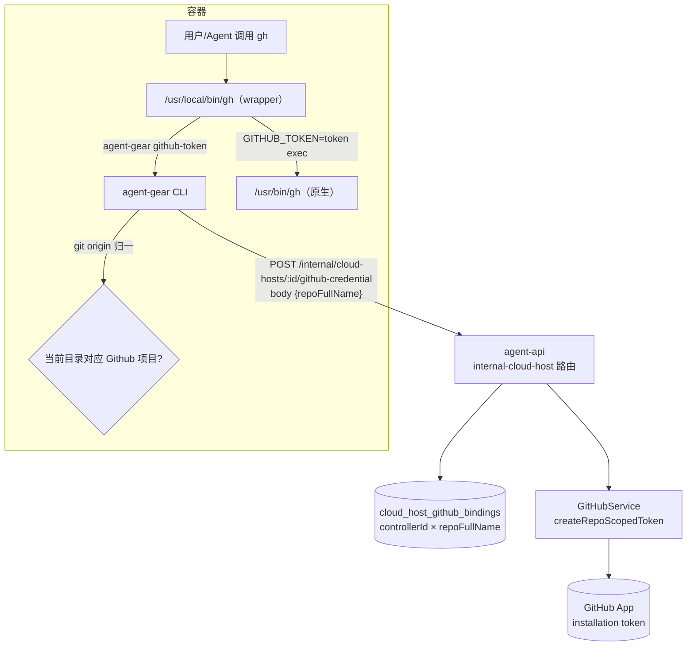
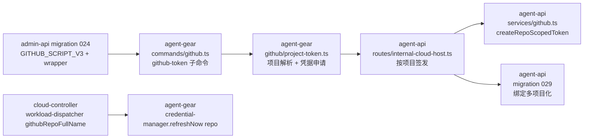
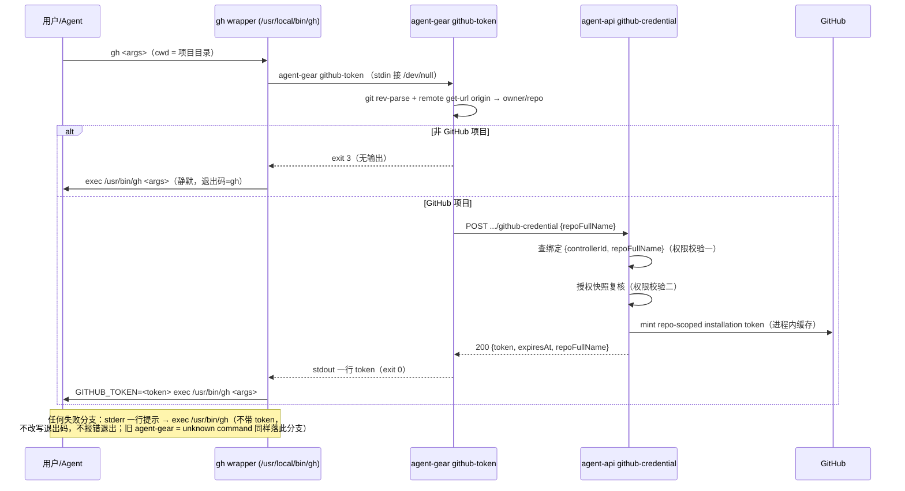

# 云电脑为不同项目获取不同的 Token - 技术提案

**功能名称**: 云电脑为不同项目获取不同的 Token
**关联 PRD**: [`docs/product/draft/20261118-github-project-token.md`](../../product/draft/20261118-github-project-token.md)
**技术提案版本**: v1.0
**创建日期**: 2026-11-18
**作者**: z-agent-bot
**feat-branch**: `feat/github-project-token`
**领域模型影响**: `docs/knowledges/domain/A0-GitHub集成/00-上下文概览.md`、`docs/knowledges/domain/A0-GitHub集成/01-聚合与实体.md`（CloudHostGithubBinding 唯一性口径、项目级凭据派生规则、核心不变量）

## 1. 概述

### 1.1 背景

来源：GitHub Issue [Deliay/z-agent-gear#566](https://github.com/Deliay/z-agent-gear/issues/566)。

云电脑容器中的 GitHub 凭据现状是「一机一凭据」：



- 绑定模型 `CloudHostGithubBinding` 以 `controllerId` **唯一**（一台云电脑一条绑定、一个 `repoFullName`），容器凭据端点只返回这一个仓库的 token；`GithubCredentialManager` 每 50 分钟续期并写入 `gh` 全局配置（`hosts.yml`）。
- 于是容器内任何目录执行 `gh`（或 git 走 `gh auth setup-git` 凭据助手）拿到的都是**同一个仓库作用域**的 token——在多项目场景下与「当前项目」错位：跨项目操作因 `repository is not authorized` 失败，或误用其它项目的凭据。

Issue 要求：安装 Github 工作负载时**覆盖一个自定义的 `gh` 命令**——该命令调用 agent-gear 判定当前工作目录是否对应一个 GitHub 项目（是否直接由 GitHub 初始化）；若对应，经**权限校验**后申请并下发**这个项目的 GITHUB_TOKEN**，再执行原始 `gh` 并传递 `GITHUB_TOKEN={} gh`；同时要求：

1. Github 工作负载脚本**支持已有容器再次执行**，能切换到下发的 wrapper script，且允许重复执行；
2. **兼容旧版本 agent-gear**：无法获得 token 时依然执行原始 `gh`，只打印错误，**不报错退出**。

### 1.2 目标

1. 容器内 `gh` 按「当前目录所属 GitHub 项目」动态获取**项目级** GITHUB_TOKEN（仓库作用域 installation token），以 `GITHUB_TOKEN=<token>` 环境变量执行原生 `gh`；
2. 项目判定与权限校验链路：当前目录 → git origin 归一为 `owner/repo` → 该仓库须为本机经「设置 Github 项目」初始化的项目（绑定记录）→ 账号授权快照校验 → 签发 token；
3. Github 工作负载脚本幂等可重复执行，重复执行把容器收敛到**最新 wrapper**（含旧容器从「无 wrapper」切换到「有 wrapper」）；
4. 全兼容降级：旧 agent-gear / 无 agent-gear / 非 GitHub 项目目录 / 权限不通过 / 平台不可达 → 仅 stderr 打印一行提示，照常执行原生 `gh`，退出码保持 `gh` 本身语义；
5. token 安全红线不放松：不落盘、不进日志、不进 argv，仅单次 `gh` 子进程环境变量内有效。

### 1.3 范围

**做**：

- `servers/admin-api/src/migrations/024-github-gh-wrapper.ts`：Github 预制工作负载 `initScript` 升级为 `GITHUB_SCRIPT_V3`（安装 gh + 覆盖 `/usr/local/bin/gh` wrapper，幂等锚点重设计）；
- `packages/agent-controller`：新增 `agent-gear github-token` 子命令（项目解析 + 项目级凭据申请）；`GithubCredentialManager.refreshNow(repoFullName?)` 支持按项目申请；
- `servers/agent-api`：`CloudHostGithubBinding` 唯一性改为 `{controllerId, repoFullName}`（迁移 029）；`POST /internal/cloud-hosts/:controllerId/github-credential` 支持可选 body `{repoFullName}` 按项目签发；
- `servers/cloud-controller`：`workload:run` 批次 `githubAuth` 增加可选 `githubRepoFullName`（Git 设置批次携带被克隆仓库）；
- `contracts/cloud-controller-websocket.md`：`workload:run` 载荷字段同步；
- 领域模型同步（A0-GitHub集成）。

**不做**：

- 不改变 `gh` 之外的命令（git 原生凭据助手仍走 `gh auth setup-git`，其经 wrapper 时自然受益，但不作为验收口径）；
- 不支持手动克隆仓库（无绑定记录）的项目级 token（按降级路径执行）；
- 不提供 token 缓存落盘/常驻凭据代理（保持「每次调用即时申请」，服务端进程内缓存兜住铸造成本）；
- 不改变 GithubCredentialManager 的 50 分钟全局续期机制与 `hosts.yml` 写入语义（其取主项目 token，兼容旧容器与 clone 前置凭据）；
- 不改变 `CloudHost.githubAccountId` 锁定语义与「设置 Github 项目」编排（仅绑定 upsert 键变化）。

## 2. 技术架构

### 2.1 系统架构图



### 2.2 技术栈

| 层级 | 技术选型 | 说明 |
|------|---------|------|
| 容器 wrapper | bash（`/usr/local/bin/gh`） | PATH 遮蔽 `/usr/bin/gh`，exec 绝对路径防递归 |
| 容器 CLI | Node.js + commander（agent-gear） | 新增 `github-token` 子命令 |
| 后端 | Express + Mongoose（agent-api） | 内部 REST 端点扩展；绑定模型索引调整 |
| 脚本分发 | admin-api migrations（cloudworkloads.initScript） | 019 幂等锚点纪律 + 字节匹配刷新 |
| 下发链路 | Socket.IO `workload:run`（cloud-controller → agent-gear） | `githubAuth` 批次前钩子按项目预取凭据 |

### 2.3 模块划分



| 模块 | 职责 | 关键技术点 |
|------|------|-----------|
| Github 工作负载脚本 V3 | 安装 gh、覆盖 wrapper、幂等收敛 | 版本 marker、sudoRootWrites/withSudo、硬校验 `gh --version` |
| gh wrapper | 项目 token 获取与降级执行 | stdin/argv/exit code 透传、`</dev/null` 防吞 stdin、退出码映射 |
| agent-gear `github-token` | 项目解析 + 凭据申请 | git remote 归一、stdout 唯一输出通道、退出码 0/3/其它 |
| agent-api 凭据端点 | 权限校验 + 项目级签发 | 绑定两键查询、授权快照复核、`repoFullName` 回显、双口径最小余量 |
| agent-api 绑定模型 | 一机多项目绑定 | 唯一索引 `{controllerId, repoFullName}`、主项目（最早绑定）语义 |
| cloud-controller 批次 | clone 前置凭据按项目预取 | `githubAuth` + `githubRepoFullName` 载荷字段 |

## 3. API 设计

### 3.1 API 契约

**GraphQL 无变更**（`contracts/github.graphql`、`contracts/cloud-host.graphql` 不动）。项目级凭据是容器内部链路，不新增用户面 GraphQL。

**`contracts/cloud-controller-websocket.md`（workload:run 载荷）**：

```yaml
# 批次级字段（既有 githubAuth 旁新增，仅在 githubAuth=true 时有意义）
githubAuth: boolean            # 既有语义不变：true 时客户端在执行本批第一条脚本前完成 gh 凭据申请与写入
githubRepoFullName: string     # 新增（可选）：本批针对的仓库 owner/repo；<br/>
                               # 提供时凭据申请按该仓库（项目级 token），缺省保持主项目语义
```

**agent-gear CLI 契约（新增子命令）**：

```text
agent-gear github-token [--cwd <dir>]

stdout: 成功时仅一行 token（唯一输出通道）
stderr: 失败原因（永不包含 token）
exit  : 0 = 已输出项目 token
        3 = 当前目录未对应 GitHub 项目（非 git 仓库 / 无 origin / origin 非 github.com），
            wrapper 静默降级，不打印提示
        其它 = 无法获得 token（含旧版 agent-gear 的 unknown command、env 缺失、
            平台不可达、未绑定/无权限、回显不匹配），wrapper 打印一行提示后降级
```

### 3.2 内部接口

**`POST /internal/cloud-hosts/:controllerId/github-credential`（扩展，保持向后兼容）**

- 鉴权：不变（`INTERNAL_API_TOKEN` 或本机 Controller key 双鉴权；401 `UNAUTHORIZED` / 403 `FORBIDDEN`）。
- Body（新增、可选）：

  ```json
  { "repoFullName": "owner/repo" }
  ```

- **请求**

  - Method/Path: `POST /internal/cloud-hosts/:controllerId/github-credential`
  - Body 语义：
    - **无 body / 无 `repoFullName`**（旧 agent-gear、GithubCredentialManager 周期续期）：返回**主项目**（`createdAt` 最早的绑定）token，`minRemainingMs = CONTAINER_CREDENTIAL_MIN_REMAINING_MS`（55 分钟）不变；单绑定存量数据行为逐字不变。
    - **带 `repoFullName`**（`github-token` 子命令、clone 前置预取）：按 `{controllerId, tenantId, repoFullName}` 查绑定——**绑定存在 = 该项目系「设置 Github 项目」直接初始化**（权限校验一：项目归属）；再由 `createRepoScopedToken(binding.accountId, repoFullName)` 复核 GitHubInstallation 授权快照（权限校验二：账号对仓库有权限）；命中后按需签发，`minRemainingMs` 取默认 5 分钟硬余量（单次命令即用即弃，最大化复用进程内 `repoTokenCache`）。

- **响应**

  - `200`：

    ```json
    { "token": "<repo-scoped installation token>", "expiresAt": "2026-11-18T19:30:00.000Z", "repoFullName": "owner/repo" }
    ```

    `repoFullName` 为**新增回显**（无 body 请求回显主项目仓库）；agent-gear 校验回显与请求一致（大小写不敏感），不一致按「无法获得 token」处理——封堵「新 agent-gear + 旧 agent-api 忽略 body 返回主项目 token」的混用窗口。

  - 错误（仅枚举码，无 token/无日志，口径不变）：

| Status | error | 触发 |
|---|---|---|
| 404 | `NOT_FOUND` | controllerId 非法 / 主机不存在 |
| 401/403 | `UNAUTHORIZED` / `FORBIDDEN` | 双鉴权失败 |
| 409 | `HOST_NOT_RUNNING` | 主机非 RUNNING/STARTING |
| 404 | `NO_BINDING` | 无 body 且本机无任何绑定 |
| 404 | `PROJECT_NOT_BOUND` | 带 `repoFullName` 但本机无该仓库绑定（未初始化项目） |
| 403 | `REPO_NOT_AUTHORIZED` | 绑定存在但授权快照不含该仓库（`repository is not authorized`） |
| 502 | `GITHUB_UNAVAILABLE` | GitHub 侧/铸造异常（catch-all，不变） |

## 4. 数据模型

### 4.1 数据库设计

**集合 `cloud_host_github_bindings`（改索引，无字段新增）**

| 项 | 现状 | 本提案 |
|---|---|---|
| 唯一索引 | `controllerId`（unique） | `uniq_cloud_host_github_binding {controllerId, repoFullName}` |
| upsert 键 | `{controllerId}`（一机一条，后写覆盖） | `{controllerId, tenantId, repoFullName}`（一机多项目，逐项目一条） |
| 无 body 凭据语义 | 唯一绑定 | **主项目** = `findOne({controllerId, tenantId}).sort({createdAt: 1})` |
| 其余字段 | `userId/tenantId/accountId/targetPath` | 不变（`targetPath` 仍为 finalPath） |

- 迁移 `servers/agent-api/src/migrations/029-github-binding-per-repo.ts`：**先建后删**（先创建组合唯一索引，成功后删除旧 `controllerId_1` unique）；存量数据每机至多一行、天然无冲突，零回填。
- 旧查询点同步：`internal-cloud-host.ts` 无 body 分支按主项目排序取首条；`cloud-host-github-service.runGitSetupStep` 的 upsert filter 增加 `repoFullName`。

### 4.2 缓存设计

| 缓存 | 变化 |
|---|---|
| `repoTokenCache`（agent-api 进程内，key `accountId:repoFullName(lower)`） | 不变；项目级签发按默认 5 分钟硬余量读取，同一项目高频 `gh` 调用共享同一 token（约 55 分钟内零铸造） |
| 容器侧 token 缓存 | **有意不做**（决策 D6）：wrapper 每次调用即时申请，token 不落盘 |
| `hosts.yml`（gh 全局配置） | 不变：仍由 GithubCredentialManager 写**主项目** token，服务 clone 前置与旧容器 |

## 5. 技术实现方案

### 5.1 核心流程



### 5.2 关键实现点

#### 实现点 1: Github 工作负载脚本 V3（wrapper 安装与幂等收敛）

- 新增迁移 `024-github-gh-wrapper.ts`，导出 `GITHUB_INIT_SCRIPT_V2`，并沿用 012 的 `sudoRootWrites(withSudo(...))` 包装生成 `GITHUB_SCRIPT_V3`；`refresh()` 按 **字节匹配** 旧脚本（`GITHUB_SCRIPT_V2` 及其 V1 形态）替换，管理员自定义脚本跳过并告警（019 幂等锚点纪律）。
- **幂等锚点重设计**（旧脚本 `command -v gh → exit 0` 会跳过 wrapper 安装，必须放弃该短路）：

  ```bash
  #!/usr/bin/env bash
  set -euo pipefail
  WRAP_MARKER='# zag-gh-wrapper:v1'
  WRAP_PATH=/usr/local/bin/gh
  REAL_GH=/usr/bin/gh

  # 幂等锚点：真实 gh 已安装 且 wrapper 为当前版本 → 经 wrapper 硬校验后退出
  if [ -x "$REAL_GH" ] && head -n 2 "$WRAP_PATH" 2>/dev/null | grep -qF "$WRAP_MARKER"; then
    gh --version >/dev/null
    exit 0
  fi

  # 1) 确保真实 gh（镜像预装 /usr/bin/gh，缺失时走内网 apt 代理；含 ${SUDO} 口径同 V2）
  if [ ! -x "$REAL_GH" ]; then
    ... apt 源 + apt-get install -y gh ...
  fi

  # 2) 旧容器「无 wrapper」或「wrapper 版本过旧」→ 无条件覆盖为下发版本（允许重复执行）
  #    防御：/usr/local/bin/gh 存在但非本 wrapper（如手工放置的真 gh）→ 让位到 gh.zag-real
  if [ -e "$WRAP_PATH" ] && ! head -n 2 "$WRAP_PATH" | grep -qF "$WRAP_MARKER"; then
    ${SUDO} mv "$WRAP_PATH" "$WRAP_PATH.zag-real"
  fi
  ${SUDO} tee "$WRAP_PATH" >/dev/null <<'WRAP'
  ...wrapper 脚本（见实现点 2）...
  WRAP
  ${SUDO} chmod 0755 "$WRAP_PATH"

  # 3) 硬校验：经 wrapper 执行，确认 PATH 解析到 wrapper 且原生 gh 可用
  command -v gh | grep -qxF "$WRAP_PATH"
  gh --version
  ```

- PATH 事实：worker 镜像 `WORKER_PATH` 与 sudo `secure_path` 均为 `/usr/local/bin` 先于 `/usr/bin`，wrapper 天然遮蔽 `/usr/bin/gh`（`command -v gh` 断言锁定该顺序）。
- 「支持已有容器再次执行」覆盖矩阵：镜像预装 gh（`/usr/bin/gh` 已存在）→ 直接装 wrapper；旧版脚本装出的容器（无 wrapper）→ 走 2) 切换到 wrapper；已装新 wrapper → 锚点早退。任意状态重复执行收敛一致。

#### 实现点 2: gh wrapper 行为

```bash
#!/usr/bin/env bash
# zag-gh-wrapper:v1
set -u
REAL_GH="${ZAG_GH_REAL:-/usr/bin/gh}"
[ -x "$REAL_GH" ] || REAL_GH=/usr/local/bin/gh.zag-real

# 显式跳过通道（agent-gear 内部调 gh 写配置时使用，见实现点 4）
if [ -n "${ZAG_GH_WRAPPER_SKIP_TOKEN:-}" ]; then exec "$REAL_GH" "$@"; fi

TOKEN=''
if OUT="$(agent-gear github-token </dev/null 2>/dev/null)"; then
  # 仅接受单行非空输出
  case "$OUT" in
    *$'\n'*) : ;;
    ?*) TOKEN="$OUT" ;;
  esac
else
  RC=$?
  if [ "$RC" -ne 3 ]; then
    echo "gh-wrapper: 无法获取项目级 GITHUB_TOKEN，按原样执行 gh（agent-gear exit $RC）" >&2
  fi
fi

if [ -n "$TOKEN" ]; then
  export GITHUB_TOKEN="$TOKEN"
fi
exec "$REAL_GH" "$@"
```

- **退出码映射**：`agent-gear` exit 0 且单行 token → 注入 `GITHUB_TOKEN` 执行；exit 3（非 GitHub 项目）→ **静默**执行原生 `gh`；其它（含旧版 agent-gear 的 `unknown command`、`command -v agent-gear` 为空导致的 127）→ **打印一行 stderr 提示**后执行原生 `gh`。wrapper 自身永远 `exec` 原生 `gh`，退出码恒为 `gh` 的退出码——满足「只打印错误，不报错退出」。
- **stdin 透传**：`agent-gear github-token </dev/null`——避免命令替换子进程吞掉 `gh` 的 stdin（如 `gh auth login --with-token` 读管道）；`exec` 后 stdin/argv 原样归 `gh`。
- **防递归**：恒以绝对路径 `exec` 原生 `gh`；`ZAG_GH_REAL` 可覆盖（迁移交接/异常布局兜底），找不到真实 gh 时输出明确错误并以 127 退出（仅此一种 wrapper 自身报错场景）。
- **安全红线**：token 只存在于 wrapper 进程内存与 `gh` 子进程 env（Issue 明确的 `GITHUB_TOKEN={} gh` 形态）；不落盘、不进 argv、提示信息不含 token。
- **git 凭据助手的自然受益**：`gh auth setup-git` 注册的 helper 是 `gh auth git-credential`，经 wrapper 时按 cwd 项目注入 token；获取失败自动回落 `hosts.yml`（现状行为）。不列入验收口径（决策 D7）。

#### 实现点 3: agent-gear `github-token` 子命令

- 新增 `packages/agent-controller/src/commands/github.ts`（`registerGithubCommands(program)`）+ `src/github/project-token.ts`，在 `src/index.ts` 注册（与 `registerHarnessCommands` 同位）。
- 项目解析（纯本地，先于任何网络调用）：
  1. `git -C <cwd> rev-parse --show-toplevel`（非 git 仓库 → exit 3）；
  2. `git -C <root> remote get-url origin` → 归一化（剥 scheme/userinfo/`.git`/尾斜杠；匹配 `github.com[:/]owner/repo` 两段非空）；无 origin / 非 github.com / 归一失败 → exit 3；
  3. 归一化口径与 `GITHUB_SETUP_SCRIPT` 的 `normalize_remote`、`services/workspace-path.ts#resolveClonePath` 保持一致（大小写按 GitHub 口径保留原样，服务端匹配大小写不敏感）。
- 凭据申请：`POST {ZAG_AGENT_API_ENDPOINT}/internal/cloud-hosts/{ZAG_CONTROLLER_ID}/github-credential`，`Authorization: Bearer ${ZAG_HOST_KEY}`，body `{repoFullName}`，10s 超时；env 三元组缺失 → stderr 提示 + 非 0/3 退出（旧容器同样落 wrapper 降级分支）。
- 输出纪律：成功时 **stdout 仅一行 token**；校验 `repoFullName` 回显与请求一致（大小写不敏感）、token 非空单行，否则按失败处理；任何失败仅 stderr（永不打印 token/请求头）。

#### 实现点 4: agent-api 端点扩展与绑定多项目化

- `routes/internal-cloud-host.ts`：
  - 解析可选 body `repoFullName`（trim、`owner/repo` 两段校验，非法 → 400 `INVALID_REPO`）；
  - 无 `repoFullName`：主项目语义（`sort({createdAt:1})` 取首条）+ 55 分钟余量；
  - 有 `repoFullName`：`findOne({controllerId, tenantId, repoFullName})`（`PROJECT_NOT_BOUND`）→ `createRepoScopedToken(...)`（`repository is not authorized` 映射 `REPO_NOT_AUTHORIZED`）+ 默认余量；
  - 响应统一加 `repoFullName` 回显；错误枚举见 §3.2，仍无任何日志输出。
- `services/cloud-host-github-service.ts#runGitSetupStep`：绑定 upsert filter 增加 `repoFullName`（一机多项目并存；重复设置同仓库仍幂等覆盖）。
- `models/cloud-host-github-binding.ts`：`controllerId` 去 unique，声明组合唯一 `uniq_cloud_host_github_binding {controllerId, repoFullName}`（与迁移 029 同名同键）；注释同步「一机多项目」。
- `services/github.ts`：`createRepoScopedToken` 不改（授权复核与缓存语义已满足）。

#### 实现点 5: clone 前置凭据按项目预取

- `servers/cloud-controller/src/services/workload-dispatcher.ts`：Git 设置批次（`githubAuth:true`）追加 `githubRepoFullName`（取该批 `repoFullName` 参数）；`contracts/cloud-controller-websocket.md` 同步（校验点与 A.2 附录）。
- `packages/agent-controller/src/workload-executor.ts` / `cloud-host/supervisor.ts`：`beforeGithubAuth(payload)` 改调 `credentialManager.refreshNow(payload.githubRepoFullName)`；`github/credential-manager.ts#refreshNow(repoFullName?)` 按 body 有无走项目/主项目两口径，回显校验同实现点 3。
- 效果：clone 阶段（目标目录尚未成形，wrapper 无法识别项目）由前置预取把**被克隆仓库**的 token 写入 `hosts.yml`，`gh repo clone` 照常成功；无 `githubRepoFullName` 的旧 payload 走主项目（单项目存量行为不变）。

#### 实现点 6: 内部调用旁路

- `github/gh-config.ts#writeGhAuth` 与 `commit-identity-manager` 等 agent-gear 内部调 `gh` 的场景，设置 `ZAG_GH_WRAPPER_SKIP_TOKEN=1` 直达原生 `gh`（写 `hosts.yml` 与项目判定无关，省一次子进程 + HTTP，并避免自指语义）。

## 6. 技术决策

### 6.1 决策列表

| # | 决策 | 选项 A | 选项 B | 最终选择 | 原因 |
|---|---|---|---|---|---|
| D1 | wrapper 落点 | 替换 `/usr/bin/gh` 本体 | `/usr/local/bin/gh` PATH 遮蔽 | B | 原生二进制不动、升级 gh 不冲突破坏；docker shim 同款先例；重复执行只重写 wrapper |
| D2 | 项目判定位置 | wrapper 内 bash 判定 | agent-gear 统一判定 | B | Issue 明确「调用 agent-gear」；git 归一口径与服务端同源，单一事实源 |
| D3 | token 传递 | 写 hosts.yml | `GITHUB_TOKEN={} gh` env | B | Issue 明确要求；单次子进程有效、不落盘 |
| D4 | 绑定粒度 | 维持一机一条 | `{controllerId, repoFullName}` 组合唯一 | B | 「不同项目不同 token」的前提；主项目语义保兼容 |
| D5 | 项目级签发最小余量 | 沿用 55 分钟 | 默认 5 分钟硬余量 | B | 55 分钟为 50 分钟周期续期设计；按需签发即用即弃，5 分钟余量下同项目约 55 分钟共享一 token，铸造成本≈不变 |
| D6 | 容器侧 token 缓存 | 落盘/常驻缓存 | 每次调用即时申请 | B | 落盘违反 token 不持久化不变量；服务端 `repoTokenCache` 已兜住铸造，延迟仅剩一次内网 HTTP + CLI 启动 |
| D7 | git 凭据助手 | 纳入本期验收 | 仅自然受益不承诺 | B | Issue 范围只提 `gh`；wrapper 对 helper 的注入行为存在但以 `gh` 为准收敛验收面 |
| D8 | 旧脚本切换 | 增量 patch 旧 wrapper | 无条件覆盖写（版本 marker） | B | docker shim 教训（运行环境手改回归）：脚本常量是唯一事实源，重复执行收敛到下发版本 |

### 6.2 依赖与约束

| 类型 | 内容 | 说明 |
|------|------|------|
| 依赖 | agent-gear ≥ 本期版本 | 旧版走降级分支（功能不生效但不报错）；容器自升级链路（#551）可送达新版 |
| 依赖 | Github 工作负载脚本重跑 | 存量容器需再次执行 Github 工作负载安装获得 wrapper（MCP `workload_install` / 设置流程） |
| 依赖 | GitHub App installation token | `createRepoScopedToken` 既有铸造与授权快照，无新权限面 |
| 约束 | 兼容降级硬约束 | 拿不到 token 必须执行原生 `gh`、只打印错误、不报错退出（Issue 明文） |
| 约束 | 幂等硬约束 | 安装脚本任意状态可重复执行并收敛（Issue 明文） |
| 约束 | token 红线 | 不落盘、不写日志、不进 argv/提示（沿用 20261029 凭据调查报告约束） |
| 约束 | 单实例/迁移纪律 | 迁移 029 先建后删索引；024 字节匹配刷新不覆盖管理员自定义脚本 |

## 7. 项目结构

```
servers/admin-api/src/migrations/
├── 024-github-gh-wrapper.ts          # 新增：GITHUB_SCRIPT_V3（含 wrapper heredoc）
└── 024-github-gh-wrapper.test.ts     # 新增：脚本锚点/marker/字节匹配刷新断言
packages/agent-controller/src/
├── commands/github.ts                # 新增：agent-gear github-token 子命令
├── github/project-token.ts           # 新增：项目解析 + 凭据申请（纯逻辑可测）
├── github/credential-manager.ts      # 修改：refreshNow(repoFullName?) 两口径 + 回显校验
├── github/gh-config.ts               # 修改：内部调 gh 加 ZAG_GH_WRAPPER_SKIP_TOKEN
├── workload-executor.ts              # 修改：beforeGithubAuth 透传 githubRepoFullName
├── cloud-host/supervisor.ts          # 修改：钩子转发
└── index.ts                          # 修改：registerGithubCommands 登记
servers/agent-api/src/
├── models/cloud-host-github-binding.ts   # 修改：组合唯一索引
├── routes/internal-cloud-host.ts         # 修改：body {repoFullName} + 回显 + 错误码
├── services/cloud-host-github-service.ts # 修改：绑定 upsert 两键
└── migrations/029-github-binding-per-repo.ts(+test)  # 新增：索引先建后删
servers/cloud-controller/src/services/
└── workload-dispatcher.ts            # 修改：githubAuth 批次追加 githubRepoFullName
contracts/
└── cloud-controller-websocket.md     # 修改：workload:run 载荷字段
docs/knowledges/domain/A0-GitHub集成/
├── 00-上下文概览.md                   # 修改：绑定多项目、不变量 4/8、gh wrapper 口径
└── 01-聚合与实体.md                   # 修改：绑定索引、派生规则、口径陷阱
```

## 8. 测试策略

### 8.1 测试覆盖要求

TDD 红-绿-重构；wrapper 行为以 bash 行为测试矩阵锁定（同 `github-setup-script.behavior.test.ts` 模式）。

- 单元测试：项目解析归一化矩阵、端点两口径与错误映射、refreshNow 回显校验；
- 行为测试：wrapper 全分支（假 `agent-gear` / 假原生 `gh` stub，PATH stub 模式同 `entrypoint.test.sh`）；
- 迁移测试：脚本锚点顺序、marker、字节匹配刷新（V2→V3、自定义跳过）、索引先建后删；
- API 测试：`tests/api` 全链路覆盖带/不带 `repoFullName` 的凭据端点。

### 8.2 测试类型

| 类型 | 工具 | 覆盖范围 |
|------|------|---------|
| 单元 | vitest | `project-token.test.ts`（T-GPT1~6：git 仓库/非仓库/无 origin/非 github/归一矩阵/回显不匹配）；`internal-cloud-host.test.ts` 扩展（T-ICG-P1~8：两口径、PROJECT_NOT_BOUND、REPO_NOT_AUTHORIZED、NO_BINDING、回显、55min/默认余量、双鉴权不变）；`credential-manager.test.ts` 扩展（T-CM-P1~3：repo body、回显校验、无 body 主项目） |
| 迁移 | vitest + MongoMemoryServer | `024-github-gh-wrapper.test.ts`（T-MIG-GW1~5）；`029-github-binding-per-repo.test.ts`（T-MIG-GB1~3：索引先建后删、存量单行兼容） |
| 行为（bash） | bash harness（stub agent-gear/gh） | wrapper 矩阵 T-WRP1~10：token 注入、exit 3 静默、失败提示、旧版 agent-gear（unknown command）、无 agent-gear（127）、stdin 透传、argv/退出码透传、单行校验（多行拒受）、SKIP_TOKEN 旁路、重复执行收敛 |
| API | supertest（tests/api） | T-GPT-API1~4：项目级签发、未初始化项目、无权限、旧调用形态逐字兼容 |
| E2E | playwright（tests/e2e） | 可选：云电脑双项目目录 `gh api user` 归属断言（以 mock/录制为主，不依赖真实 GitHub） |

## 9. 部署方案

### 9.1 环境规划

| 环境 | 用途 | 部署方式 |
|------|------|---------|
| 内网/生产 | agent-api / admin-api / cloud-controller | Aspire 编排滚动更新；迁移随启动执行 |
| 云电脑容器 | wrapper 与 agent-gear | agent-gear 自升级链路（#551）送达 `github-token`；wrapper 由 Github 工作负载重跑送达 |

### 9.2 配置管理与发布顺序

1. 发布 agent-api（迁移 029 自动执行；端点兼容新旧调用方）；
2. 发布 admin-api（迁移 024 刷新 `cloudworkloads.initScript`）与 cloud-controller、agent-gear；
3. 存量容器：对已设置 Github 项目的云电脑**再次执行 Github 工作负载安装**（或经设置流程触达）即切换到 wrapper；未重跑前行为与现状一致（无 wrapper = 原生 `gh`）；
4. 混用窗口兼容矩阵：

| 容器侧 \ 服务侧 | 旧 agent-api | 新 agent-api |
|---|---|---|
| 旧 agent-gear + 旧脚本 | 现状 | 现状（无 body 主项目，逐字兼容） |
| 旧 agent-gear + 新脚本 | wrapper 降级提示 + 原生 `gh`（hosts.yml 主项目） | 同左 |
| 新 agent-gear + 新脚本 | 回显校验失败 → 降级（安全兜底） | **完整项目级 token** |

## 10. 验收标准

- [ ] 技术方案评审通过
- [ ] Contract 评审通过（`contracts/cloud-controller-websocket.md` 载荷字段）
- [ ] 领域模型已同步更新（`docs/knowledges/domain/A0-GitHub集成/...`）
- [ ] 代码实现完成（TDD 红-绿-重构，测试先行）
- [ ] 同机双项目目录下 `gh` 各用各的项目级 `GITHUB_TOKEN`（可由 stub 断言 env 注入）
- [ ] 未初始化目录 / 权限不通过 / 平台不可达 / 旧版 agent-gear：均执行原生 `gh`、仅 stderr 一行提示、退出码为 `gh` 语义
- [ ] Github 工作负载对「镜像预装 gh / 旧脚本容器 / 新脚本容器」重复执行均成功收敛（wrapper marker 当前、`command -v gh` 解析到 wrapper）
- [ ] 单元测试覆盖达标、API 测试通过、E2E 测试通过
- [ ] token 不落盘、不进日志、不进 argv（测试断言 + 日志扫描）

## 11. 相关文档

- 关联 PRD：[`docs/product/draft/20261118-github-project-token.md`](../../product/draft/20261118-github-project-token.md)
- 关联 Issue：[Deliay/z-agent-gear#566](https://github.com/Deliay/z-agent-gear/issues/566)
- 相关提案：[[20261021-feat-github-workload.md]]（v1.1 废除一次性 secret env 下发）、[[20261104-fix-github-project-setup-optimization.md]]、[[20261103-docker-wrapper-name-rewrite-bug-investigation-report.md]]（wrapper 事实源教训）、[[20261029-github-credential-refresh-bug-investigation-report.md]]（凭据续期与 token 红线）
- 契约：`contracts/cloud-controller-websocket.md`、`contracts/cloud-host.graphql`（无变更，仅引用）
- 开发规范：`docs/engineering/common-rules.md`（Domain Model Sync）、`docs/engineering/backend-rules.md`
- 领域模型：`docs/knowledges/domain/A0-GitHub集成/00-上下文概览.md`、`docs/knowledges/domain/A0-GitHub集成/01-聚合与实体.md`
