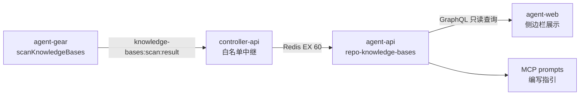
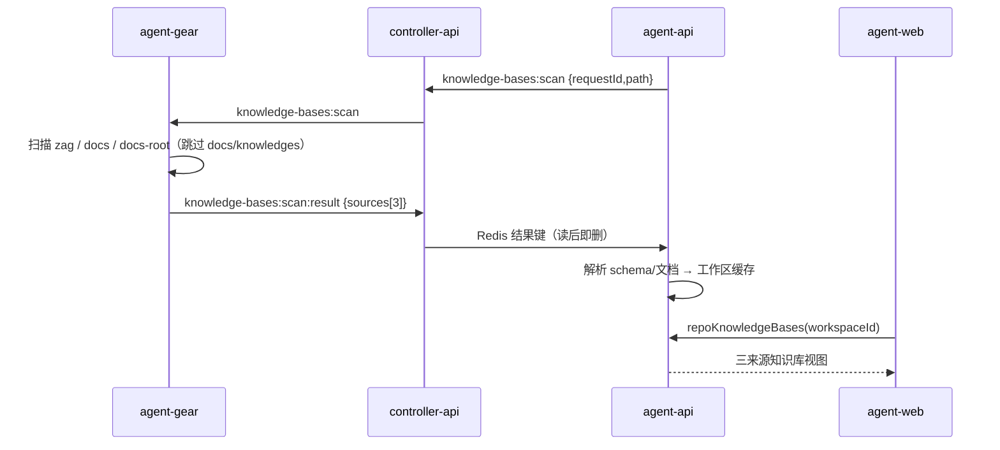

# 仓库知识库搜索路径扩展（docs 一层文件夹） - 技术提案

**功能名称**: 仓库知识库搜索路径扩展（docs 一层文件夹）
**关联 PRD**: [[../../product/draft/20261121-knowledge-base-docs-root.md]]
**技术提案版本**: v1.0
**创建日期**: 2026-11-21
**作者**: z-agent-bot
**feat-branch**: `feat/docs-root-knowledge-base`
**领域模型影响**: `docs/knowledges/domain/B0-知识库/00-上下文概览.md`、`01-聚合与实体.md`（发现规则、来源枚举 `DOCS_ROOT`）

## 1. 概述

### 1.1 背景

仓库知识库当前只识别两个约定目录：`.zag/knowledges/` 与 `docs/knowledges/`。项目已有 `docs/<主题>/` 目录结构时无法直接复用，必须搬迁内容。本提案在既有链路上增加第三来源，不改变既有来源语义。

### 1.2 目标

- agent-gear 扫描器新增 `docs-root` 来源：扫描仓库 `docs/` 的直接子文件夹，跳过 `knowledges` 容器，含常规文件 `knowledge-base.json` 即知识库。
- 契约（`agent-session-websocket` §3.29/§3.30、`knowledge-base.graphql`）扩展来源枚举，保持既有来源字段逐字兼容。
- agent-api 解析、缓存、GraphQL、MCP 编写指引与 agent-web 展示同步支持第三来源。
- 旧版 agent-gear（无第三来源）与旧版 agent-api（忽略第三来源）均优雅降级。

### 1.3 范围

- **做**：扫描器、契约、agent-api 服务/GraphQL/指引、agent-web 来源标识、单测/API/E2E。
- **不做**：更深层级递归发现、`docs/knowledges` 容器目录识别、扫描上限变化、平台托管知识库与 MCP 六工具变更、MongoDB 变更。

## 2. 技术架构

### 2.1 系统架构图



### 2.2 技术栈

| 层级 | 技术选型 | 说明 |
|------|---------|------|
| 工作组件 | Node.js 24 + TypeScript | `packages/agent-controller` 直读文件系统 |
| 中继 | Node.js + Redis | 既有 `knowledge-bases:scan` 事件与结果键，零协议变更 |
| 后端 | Node.js + GraphQL-Yoga | 来源枚举扩展与解析缓存 |
| 前端 | React + TypeScript | 来源标识与展示 |

### 2.3 模块划分

| 模块 | 职责 | 关键技术点 |
|------|------|-----------|
| `packages/agent-controller/src/knowledge-bases.ts` | 三来源扫描 | 来源表新增 `docs-root`；排除 `knowledges` 目录；沿用上限与错误归一 |
| `contracts/agent-session-websocket.md` §3.29/§3.30 | 扫描协议 | `source` 联合类型扩展 `docs-root`，语义与发现规则补充 |
| `contracts/knowledge-base.graphql` | 只读查询契约 | `RepoKnowledgeBaseSource` 增加 `DOCS_ROOT` |
| `servers/agent-api/src/services/repo-knowledge-bases.ts` | 解析/缓存/视图 | 来源映射与声明序扩展，缺失来源按空列表 |
| `servers/agent-api/src/services/knowledge-base-prompts.ts` | 编写指引 | 新增放置位置、目录示例、跳过规则；防漂移守卫同步 |
| `servers/agent-api/src/graphql/{schemas,resolvers}/knowledge-base.ts` | GraphQL | 手写 schema 增加枚举值 |
| `apps/agent-web/src/lib/repo-knowledge-base.ts` 等 | 前端展示 | 第三来源 id 解码、来源标识 |

## 3. API 设计

### 3.1 API 契约

#### 接口 1: `knowledge-bases:scan` / `knowledge-bases:scan:result`

- **请求**：`{ requestId, path }`（不变）
- **响应**：`sources` 由两项扩展为**最多三项**：

```json
{
  "requestId": "string",
  "success": true,
  "sources": [
    { "source": "zag", "knowledgeBases": [], "truncated": false },
    { "source": "docs", "knowledgeBases": [], "truncated": false },
    { "source": "docs-root", "knowledgeBases": [], "truncated": false }
  ],
  "truncated": false
}
```

- `sources[].source` 联合类型：`'zag' | 'docs' | 'docs-root'`。
- 旧版 agent-gear 只返回两项；agent-api 对缺失来源按空列表处理。

#### 接口 2: GraphQL `RepoKnowledgeBaseSource`

```graphql
enum RepoKnowledgeBaseSource {
  ZAG
  DOCS
  DOCS_ROOT
}
```

查询签名、字段与错误白名单不变。

### 3.2 内部接口

- id 形态保持 `repo:<workspaceId>:<source>:<encodeURIComponent(folder)>`，`source` 新增原始段 `docs-root`。
- 工作区级缓存结构不变，`knowledgeBases` 全集按来源声明序排列。

## 4. 数据模型

### 4.1 数据库设计

无变更：仓库知识库不落 MongoDB、无迁移、无索引。

### 4.2 缓存设计

| 键 | TTL | 变更 |
|---|---|---|
| `knowledge-bases:scan:{requestId}` | 60s | 载荷 sources 可含第三项 |
| `repo-knowledge-bases:ws:{workspaceId}` | 300s | 结构不变，可含 `DOCS_ROOT` 条目 |

## 5. 技术实现方案

### 5.1 核心流程



### 5.2 关键实现点

#### 实现点 1: 扫描来源表扩展

- **描述**: `REPO_KNOWLEDGE_BASE_SOURCES` 追加 `{ source: 'docs-root', subdir: 'docs', excludeFolders: ['knowledges'] }`。
- **技术细节**: `scanSource` 在收集候选文件夹时按名称过滤 `excludeFolders`；`docs` 目录不存在（ENOENT/ENOTDIR）→ 第三来源空列表；读取权限失败仍整体 `permission denied`。来源目录层截断语义不变（`docs/` 直接子项按名称取前 1000）。
- **风险点**: `docs` 与 `docs-root` 同时存在时 `docs` 扫描会读 `docs/knowledges`，`docs-root` 跳过容器，二者互不重复。

#### 实现点 2: agent-api 来源映射

- **描述**: `RepoKnowledgeBaseSource` 增加 `'DOCS_ROOT'`；`SOURCE_BY_RAW['docs-root']='DOCS_ROOT'`；`RAW_BY_SOURCE.DOCS_ROOT='docs-root'`；`SOURCE_ORDER=['ZAG','DOCS','DOCS_ROOT']`。
- **技术细节**: `buildCache` 按声明序输出；缺失 `docs-root` 视为空；`decodeRepoKnowledgeBaseId` 自动支持。id 编码无需改动。
- **风险点**: 未知来源原始段仍返回 `null`，不泄露/不误解析。

#### 实现点 3: 前端来源标识

- **描述**: `RepoKnowledgeBaseSource` 增加 `'DOCS_ROOT'`，`SOURCE_BY_RAW['docs-root']`；`sourceLabel('DOCS_ROOT')` 返回 `docs`（一层文件夹）；徽标文本 `docs/` 与既有 `zag` / `docs` 区分。
- **技术细节**: 仅改展示映射，不影响 id 解码与查询。
- **风险点**: 既有测试断言徽标文本需同步。

#### 实现点 4: 编写指引同步

- **描述**: §1 放置约定新增 `docs/<文件夹>/`；§2 目录示例新增；§8 自检清单新增；明确跳过 `docs/knowledges` 容器与不递归。
- **技术细节**: 防漂移守卫增加 `docs-root` / `docs/<文件夹>` / 跳过容器锚点。
- **风险点**: 跨包常量不能 import，守卫继续用字面量断言。

## 6. 技术决策

### 6.1 决策列表

| 决策 | 选项 A | 选项 B | 最终选择 | 原因 |
|------|--------|--------|---------|------|
| 来源表达 | 新增 `DOCS_ROOT` 来源 | 合并进 `DOCS` | A | 避免同名文件夹与既有 `docs/knowledges` 子文件夹的 ID 冲突；既有 ID 与展示零回归 |
| 容器目录 | 跳过 `docs/knowledges` | 按通用规则识别 | 跳过 | 该目录是既有来源容器，识别会产生语义混淆与层级错位 |
| 版本门禁 | 提升 `REPO_KNOWLEDGE_BASE_MIN_AGENT_GEAR_VERSION` | 保持 2.19.0 | 保持 | 能力按来源增量；旧组件缺第三来源时应继续可用，仅少一个来源 |
| 扫描实现 | 复用 `scanSource` + 排除名单 | 独立扫描函数 | 复用 | 上限、符号链接、错误归一与截断语义完全同构，避免二套实现漂移 |

### 6.2 依赖与约束

| 类型 | 内容 | 说明 |
|------|------|------|
| 依赖 | 既有 `knowledge-bases:scan` 中继链路 | 协议仅扩展联合类型，中继不改代码 |
| 约束 | 发现不递归、`knowledge-base.json` 为常规文件才识别 | 与既有来源一致 |
| 约束 | 三个来源共享单文件 1MiB / 单文件夹 1000 上限 | 无新增限制 |

## 7. 项目结构

```
packages/agent-controller/src/knowledge-bases.ts        # 来源表 + 排除名单
contracts/agent-session-websocket.md                     # §3.29/§3.30
contracts/knowledge-base.graphql                         # 来源枚举注释
servers/agent-api/src/services/repo-knowledge-bases.ts   # 来源映射
servers/agent-api/src/services/knowledge-base-prompts.ts # 编写指引
servers/agent-api/src/graphql/schemas/knowledge-base.ts  # 手写 schema
apps/agent-web/src/lib/repo-knowledge-base.ts            # id 解码/来源标识
apps/agent-web/src/components/knowledge-base/RepoKnowledgeBaseSection.tsx
```

## 8. 测试策略

### 8.1 测试覆盖要求

- 扫描器：第三来源识别、容器跳过、不递归、同名不冲突、上限与截断、ENOENT。
- 服务端：来源映射/声明序/缺失容错/id 编解码/提示词防漂移。
- 前端：id 解码、来源标识与徽标。
- API：GraphQL 返回第三来源；旧 fixture（仅两来源）零回归。
- E2E：三来源同时展示与展开。

### 8.2 测试类型

| 类型 | 工具 | 覆盖范围 |
|------|------|---------|
| 单元测试 | Vitest | agent-gear 扫描器 / agent-api 服务与指引 / agent-web lib 与组件 |
| API 测试 | Vitest + Socket.IO | T-RKB-API（fixture 扩展 docs-root） |
| E2E 测试 | Playwright | E2E-RKB（三来源展示与展开） |

## 9. 部署方案

### 9.1 环境规划

| 环境 | 用途 | 部署方式 |
|------|------|---------|
| 开发 | Aspire 全量编排 | `aspire start` |
| 生产 | agent-gear 随云电脑镜像 | 版本 2.23.0 |

### 9.2 配置管理

无新增 env；agent-gear 包版本 `2.22.0 → 2.23.0`。

## 10. 验收标准

- [ ] 技术方案评审通过
- [ ] Contract 评审通过
- [ ] 领域模型已同步更新（`docs/knowledges/domain`）
- [ ] 代码实现完成
- [ ] 单元测试覆盖达标
- [ ] API 测试通过
- [ ] E2E 测试通过

## 11. 相关文档

- [[../../product/draft/20261121-knowledge-base-docs-root.md]]
- [[../plan/20261121-feat-knowledge-base-docs-root.md]]
- [[../../../contracts/agent-session-websocket.md]]
- [[../../../contracts/knowledge-base.graphql]]
- [[../../knowledges/domain/B0-知识库/00-上下文概览.md]]
