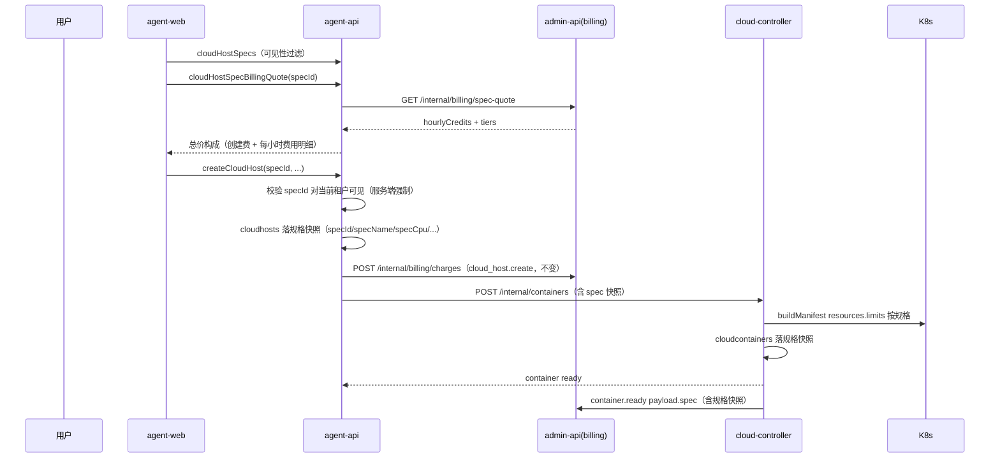
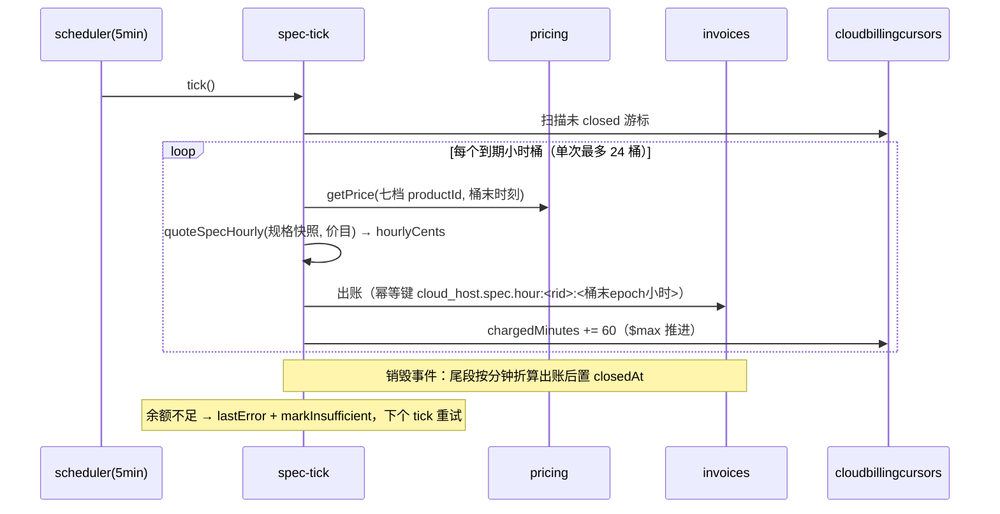

# 容器规格管理与云电脑分段计费 - 技术提案

**功能名称**: 容器规格管理与云电脑分段计费
**关联 PRD**: [[../../product/draft/20261124-container-spec-tiered-billing.md]]
**技术提案版本**: v1.0
**创建日期**: 2026-11-24
**作者**: z-agent-bot
**feat-branch**: `feat/container-spec-tiered-billing`
**领域模型影响**: `docs/knowledges/domain/40-云资源与Harness/00-上下文概览.md`、`01-聚合与实体.md`（新增 CloudHostSpec 聚合、CloudHost/CloudContainer 规格快照字段）；`docs/knowledges/domain/80-计费与计量/00-上下文概览.md`、`01-聚合与实体.md`（规格七档分段价目、CloudBillingCursor、container.ready 载荷）；`docs/knowledges/domain/02-上下文地图.md`（共享集合与集成事件）

## 1. 概述

### 1.1 背景

现状云电脑容器资源是全局硬编码的一套规格（`servers/cloud-controller/src/services/k8s-job-manager.ts` 的 `JOB_RESOURCES`：requests 0.1 vCPU/256Mi、limits 4 vCPU/8Gi，ephemeral-storage 仅 limits 由 `JOB_EPHEMERAL_STORAGE` 全局注入、缺省 10Gi），`CreateCloudHostInput` 无任何资源字段，计费为与资源无关的 `container.minute`（1 credit/分钟）分钟预留结算。本提案对应 PRD（Issue [#574](https://github.com/Deliay/z-agent-gear/issues/574)）引入：

1. **容器规格（Spec）实体**与后台管理（增删改 + 租户白名单可见性）；
2. **6 款预制规格**（含 0C 0G「不限制」规格，默认白名单开启且无租户可见）；
3. **创建云电脑选规格 + 总价计算**；
4. **新版云电脑分段计费**（CPU/内存/临时存储七档超额累进、按小时结算），**旧版云电脑计费零改动**。

### 1.2 技术目标

- 新增 `cloudhostspecs` 聚合（admin-api 唯一写方、agent-api 只读镜像），白名单可见性判定以服务端为准。
- 创建链路贯通规格：`CreateCloudHostInput.specId` → `cloudhosts` 规格快照 → `POST /internal/containers` `spec` 载荷 → Job `resources.limits` 按规格下发；0C 0G 全零规格不设置 resources。
- 新增规格七档分段价目（`productprices`）与纯函数计价 `quoteSpecHourly`，经 `/internal/billing/spec-quote` 供前台报价与后台预览。
- 新版云电脑按 `cloudbillingcursors` 游标 + 小时桶结算出账（账单 `category=container`、`refType=cloud_host`），尾段按分钟折算；**分流判定只看事件是否携带规格快照**，无快照走既有 `container.minute` 预留路径（旧版零改动）。
- 全链路 TDD 覆盖：规格校验/白名单可见性/迁移播种/分段计价边界/Job 资源映射/小时结算幂等/API/E2E。

### 1.3 范围

- **做**：admin-api（规格 CRUD、迁移播种、分段价目、spec-quote、小时结算 tick）、agent-api（规格可见性查询、创建链路、报价 resolver、CloudHost 规格快照）、cloud-controller（resources 按规格下发、cloudcontainers 快照、container.ready 载荷扩展）、admin-web（容器规格管理页）、agent-web（创建对话框规格选择与总价）、契约与领域模型同步、测试。
- **不做**：旧版云电脑迁移/重计费、运行中云电脑的规格变更（规格变更只影响后续创建）、规格自动伸缩、按租户差异化定价、云存储计费口径变化、worker/agent-gear 变更、`BillingCategory` 枚举扩展。

## 2. 技术架构

### 2.1 系统架构图

```mermaid
graph TD
    A[admin-web<br/>容器规格管理页] -->|adminCloudSpecs CRUD| B[admin-api<br/>cloudhostspecs 写方]
    T[adminTenants] -.租户多选 combo.-> A
    B -->|迁移 025 播种 6 款预制规格| B
    C[agent-web<br/>新建云电脑·规格选择] -->|cloudHostSpecs 可见性过滤| D[agent-api<br/>规格只读镜像 + 创建编排]
    D -->|specId 快照| E[(cloudhosts.spec* 快照)]
    D -->|POST /internal/containers spec| F[cloud-controller]
    F -->|resources.limits 按规格| G[K8s Job/Pod]
    F -->|(cloudcontainers.spec* 快照)<br/>container.ready + spec| H[billingoutbox → MQ]
    H --> I[admin-api billing<br/>分流：有 spec → 规格分段计费]
    I -->|quoteSpecHourly| J[(productprices 七档价目)]
    I --> K[(cloudbillingcursors 小时桶)]
    K --> L[(billinginvoices category=container)]
    D -->|/internal/billing/spec-quote| I
```

### 2.2 技术栈

| 层级 | 技术选型 | 说明 |
|------|---------|------|
| 前端 | React + TypeScript | admin-web 规格管理页（复用 CloudWorkloadsPage 列表/表单/删除模式）；agent-web 创建对话框规格区 |
| 后端 | Node.js + GraphQL-Yoga + Mongoose | admin-api（写方 + 计费）、agent-api（只读镜像 + 创建编排） |
| 编排 | cloud-controller + K8s Job | `buildManifest` resources 按规格下发 |
| 计费 | admin-api billing 服务 | productprices 价目 + 小时桶结算 + billinginvoices 出账 |
| 数据 | MongoDB | `cloudhostspecs`、`cloudbillingcursors` 新集合；`cloudhosts`/`cloudcontainers` 追加快照字段（零迁移） |

### 2.3 模块划分

| 模块 | 职责 | 关键技术点 |
|------|------|-----------|
| `servers/admin-api/src/models/cloud-host-spec.ts` | 规格聚合（唯一写方） | name unique、presetKey partial unique、allowedTenantIds |
| `servers/admin-api/src/graphql/{schemas,resolvers}/cloud-host-spec.ts` | 后台 CRUD | 校验白名单口径、全零组合规则 |
| `servers/admin-api/src/migrations/025-preset-cloud-host-specs.ts` | 预制规格播种 | presetKey/name 双查幂等，不覆盖修改、不重建删除 |
| `servers/admin-api/src/services/billing/spec-pricing.ts` | 分段计价纯函数 | `quoteSpecHourly` 七档超额累进，与 storage-pricing 同构 |
| `servers/admin-api/src/services/billing/spec-tick.ts` | 小时桶结算 | 桶锚点 billingStartedAt、幂等键、尾段分钟折算 |
| `servers/admin-api/src/models/cloud-billing-cursor.ts` | 结算游标 | `cloudbillingcursors`，resourceId unique |
| `servers/admin-api/src/routes/internal-billing.ts` | 内部报价端点 | `GET /internal/billing/spec-quote` |
| `servers/admin-api/src/services/billing/billing-service.ts` | 事件分流 | container.ready 带 spec → 建游标；不带 → 既有预留路径原样 |
| `servers/agent-api/src/models/cloud-host-spec.ts` | 只读镜像 | autoIndex=false，同 cloud-workload 镜像模式 |
| `servers/agent-api/src/services/cloud-host-spec-service.ts` | 可见性过滤 | `!whitelistEnabled || allowedTenantIds∋tenantId` |
| `servers/agent-api/src/services/cloud-host-service.ts` | 创建编排 | specId 校验 + 快照 + `/internal/containers` spec 载荷 |
| `servers/cloud-controller/src/services/k8s-job-manager.ts` | 资源映射 | `CreateJobInput.resources` 按规格覆盖，全零规格省略 resources |
| `servers/cloud-controller/src/routes/internal-api.ts` | 载荷解析 | `parseHarnessRequest` 增加 `spec` 白名单字段 |
| `apps/admin-web/src/pages/CloudHostSpecsPage.tsx` 等 | 规格管理 UI | 白名单 checkbox + 多选租户 combo（adminTenants 搜索分页） |
| `apps/agent-web/src/components/cloud-host/NewCloudHostDialog.tsx` | 创建 UI | 规格选择 + `cloudHostSpecBillingQuote` 总价 |

## 3. API 设计

### 3.1 API 契约

#### 3.1.1 新增 `contracts/admin-cloud-spec.graphql`

```graphql
"""容器规格（admin-api 唯一写方）"""
type AdminCloudSpec {
  id: ID!
  name: String!                 # 展示名，1..64，全局唯一
  cpu: Int!                     # 核，普通规格 1..64；不限制规格恒 0
  memoryGi: Int!                # GiB，普通规格 1..256；不限制规格恒 0
  ephemeralStorageGi: Int!      # GiB，普通规格 1..512；不限制规格恒 0
  unlimited: Boolean!           # 派生：三项全 0
  whitelistEnabled: Boolean!    # true 时仅 allowedTenantIds 内租户可见
  allowedTenantIds: [ID!]!      # 白名单租户；whitelistEnabled=false 时恒为空
  isPreset: Boolean!
  presetKey: String             # 预制播种键，非预制为 null
  createdAt: DateTime!
  updatedAt: DateTime!
}

input AdminCloudSpecInput {
  name: String!
  cpu: Int!
  memoryGi: Int!
  ephemeralStorageGi: Int!
  whitelistEnabled: Boolean!
  allowedTenantIds: [ID!]!      # whitelistEnabled=false 时服务端置空
}

extend type Query {
  adminCloudSpecs: [AdminCloudSpec!]!
  adminCloudSpec(id: ID!): AdminCloudSpec
}

extend type Mutation {
  adminCreateCloudSpec(input: AdminCloudSpecInput!): AdminCloudSpec!
  adminUpdateCloudSpec(id: ID!, input: AdminCloudSpecInput!): AdminCloudSpec!
  adminDeleteCloudSpec(id: ID!): Boolean!
}
```

校验规则（错误文案逐字）：
- `name is required` / `name is too long` / `spec name already exists`
- `invalid spec resources`（非全零组合时 cpu<1 或 memoryGi<1 或 ephemeralStorageGi<1，或超出上限；除全零外含 0 组合一律拒绝）
- `invalid tenant in whitelist`（allowedTenantIds 含不存在租户）
- 白名单上限 `allowedTenantIds` ≤ 200（防滥用）。

租户多选 combo 复用既有 `adminTenants(keyword, page, pageSize)`（`contracts/admin-tenant.graphql`），零契约新增。

#### 3.1.2 `contracts/cloud-host.graphql` 增量

```graphql
"""云电脑规格（前台可见性过滤后的只读视图）"""
type CloudHostSpec {
  id: ID!
  name: String!
  cpu: Int!
  memoryGi: Int!
  ephemeralStorageGi: Int!
  unlimited: Boolean!            # 三项全 0；前端渲染「不限制容器，随时可能会被系统销毁」
  hourlyCredits: Float!          # 按当前价目算出的每小时费用（credits）
}

"""规格分段计费报价（结构对齐 CloudStorageBillingQuote 的 tiers 口径）"""
type CloudHostSpecBillingQuote {
  hourlyCredits: Float!
  tiers: [CloudHostSpecQuoteTier!]!   # 分档明细：label + amountCredits
  availableBalance: Float!
}
type CloudHostSpecQuoteTier {
  label: String!                 # 如「CPU 4 核 × 15 credits/核/小时」
  amountCredits: Float!
}

extend type Query {
  """当前租户可见的规格列表（白名单过滤），按 cpu/memory 降序"""
  cloudHostSpecs: [CloudHostSpec!]!
  """按规格计算总价构成（创建对话框实时报价）"""
  cloudHostSpecBillingQuote(specId: ID!): CloudHostSpecBillingQuote!
}

input CreateCloudHostInput {
  # ...既有字段不变
  specId: ID!                    # 新增（必填）：必须对当前租户可见
}

type CloudHost {
  # ...既有字段不变
  spec: CloudHostSpec            # 新增：创建时规格快照（规格已删除仍可展示）
}
```

- `cloudHostBillingQuote`（createCredits / perMinuteCredits / availableBalance）保持不变：创建一次性扣费 `cloud_host.create` 口径不变；`perMinuteCredits` 仅旧版云电脑展示语义，标注 deprecated。
- `CloudHost.spec` 基于 `cloudhosts` 快照字段装配，不回查规格表（规格删除后仍可展示）。

#### 3.1.3 `contracts/admin-billing.graphql` 增量

- 头注内部端点表增补：`GET /internal/billing/spec-quote?specId=...`（或按 `cpu/memoryGi/ephemeralStorageGi` 直接报价，供后台预览）。
- 价目产品注记（`productprices.productId`，均 `per_unit`，单价为整数分，1 credit = 100 分）：

| productId | productName | 单价（分） | 语义 |
|---|---|---|---|
| `cloud_spec.cpu.tier1` | 规格 CPU ≤4 | 1500 | credits/核/小时，≤4 部分 |
| `cloud_spec.cpu.tier2` | 规格 CPU >4 | 3000 | credits/核/小时，>4 部分 |
| `cloud_spec.mem.tier1` | 规格内存 ≤4GiB | 1500 | credits/GiB/小时 |
| `cloud_spec.mem.tier2` | 规格内存 4-8GiB | 3000 | credits/GiB/小时 |
| `cloud_spec.mem.tier3` | 规格内存 8-16GiB | 4500 | credits/GiB/小时 |
| `cloud_spec.mem.tier4` | 规格内存 >16GiB | 6000 | credits/GiB/小时 |
| `cloud_spec.ephemeral.tier` | 规格临时存储 >10GiB | 1000 | credits/GiB/小时，≤10GiB 不收费 |

- `BillingCategory` 枚举**不变**（规格账单仍为 `container`，`refType=cloud_host`、`refId=<hostId>`）。

#### 3.1.4 `contracts/billing-events.asyncapi.yaml` 增量

`container.ready` payload 扩展（向后兼容，缺省即旧计费）：

```yaml
payload:
  billingStartedAt: { type: string, format: date-time }
  spec:                                    # 新增，可缺省
    type: object
    properties:
      specId: { type: string, nullable: true }
      name: { type: string }
      cpu: { type: integer }
      memoryGi: { type: integer }
      ephemeralStorageGi: { type: integer }
```

`container.destroyed` payload 不变（`{billingStartedAt, exitedAt, minutes?}` 已含尾段结算所需事实）。

#### 3.1.5 `contracts/cloud-controller-websocket.md` 附录 A 增量

`POST /internal/containers` 载荷新增可选 `spec`：

```json
{
  "spec": {
    "id": "<specId>",
    "name": "<名称>",
    "cpu": 8,
    "memoryGi": 16,
    "ephemeralStorageGi": 20
  }
}
```

- 缺省（旧客户端/管理后台 idle|admin-task|workflow|session 链路）→ 保持现状 `JOB_RESOURCES` + `JOB_EPHEMERAL_STORAGE` 行为，逐字不变。
- 全零 spec（0/0/0）→ Job **不设置 resources**（requests/limits 均省略）。
- 普通 spec → `limits = {cpu, memory: '<memoryGi>Gi', 'ephemeral-storage': '<ephemeralStorageGi>Gi'}`，`requests` 保持现状小值（cpu 0.1 / memory 256Mi，见 §6.1 D2）。
- 校验：三项均为整数 0..上限；「部分为 0」组合拒绝（400 `invalid spec`）。
- `cloudcontainers` 追加快照字段：`specId`（String，默认 null）、`specName`（String，默认 null）、`specCpu` / `specMemoryGi` / `specEphemeralStorageGi`（Number，默认 null）。

### 3.2 内部接口

| 接口 | 方向 | 说明 |
|------|------|------|
| `GET /internal/billing/spec-quote` | agent-api → admin-api | 入参 specId 或 {cpu,memoryGi,ephemeralStorageGi}；出参 `{hourlyCredits, tiers[], prices}`（结构对齐 `/internal/billing/storage-quote`） |
| `POST /internal/containers`（spec 载荷） | agent-api → cloud-controller | 规格快照下发（§3.1.5） |
| `container.ready` / `container.destroyed` | cloud-controller → admin-api billing | 规格快照/尾段事实（§3.1.4） |
| `adminTenants` | admin-web → admin-api | 白名单多选租户 combo 数据源（既有） |

## 4. 数据模型

### 4.1 数据库设计

#### 集合：`cloudhostspecs`（admin-api 唯一写方，agent-api 只读镜像）

| 字段 | 类型 | 必填/默认 | 说明 |
|------|------|-----------|------|
| name | String | 必填，trim 1..64，unique | 展示名 |
| cpu | Number | 必填，整数 0..64 | 核数；全零组合之一 |
| memoryGi | Number | 必填，整数 0..256 | 内存 GiB |
| ephemeralStorageGi | Number | 必填，整数 0..512 | 临时存储 GiB |
| whitelistEnabled | Boolean | 默认 false | true 时仅白名单租户可见 |
| allowedTenantIds | [String] | 默认 [] | 白名单租户 id（tenantId）；whitelistEnabled=false 保存时置空 |
| isPreset | Boolean | 默认 false | 展示标识 |
| presetKey | String | null | 预制播种键，partial unique sparse |
| createdAt / updatedAt | Date | 自动 | — |

索引：`name` unique；`presetKey` partial unique sparse；`{whitelistEnabled, allowedTenantIds}`（可见性查询）。

不变量：
- **组合规则**：`cpu=memoryGi=ephemeralStorageGi=0`（不限制规格）为唯一允许含 0 的组合；其余组合三项均 ≥1。
- **可见性口径**：租户可见 = `whitelistEnabled=false` **或** `tenantId ∈ allowedTenantIds`；`whitelistEnabled=true` 且空名单 = 无租户可见。
- **快照语义**：规格的修改/删除只影响后续创建；已创建云电脑以 `cloudhosts` 快照为准，计费、展示均不回查规格表。

#### 集合：`cloudbillingcursors`（admin-api 独占写）

| 字段 | 类型 | 必填/默认 | 说明 |
|------|------|-----------|------|
| resourceId | String | 必填，unique | 容器 id（与 billingreservations.resourceId 同口径，一容器一条） |
| hostId / hostName | String | 快照 | 云电脑标识（出账 refId） |
| accountId / tenantId | String | 必填 | 计费归属 |
| specId / specName | String / String | null | 规格快照 |
| specCpu / specMemoryGi / specEphemeralStorageGi | Number | 必填 | 计费资源量快照 |
| billingStartedAt | Date | 必填 | 桶锚点（= container.ready 的 billingStartedAt） |
| chargedMinutes | Number | 默认 0 | 已结算分钟数（整桶按 60 推进，尾段按实际分钟） |
| lastChargedAt | Date | null | 最近出账时间 |
| closedAt | Date | null | 尾段结算完成（销毁后收口） |
| lastError | String | null | 最近出账错误（失败即停，下个 tick 重试） |

索引：`{resourceId}` unique；`{closedAt, lastChargedAt}`（tick 扫描）。

#### 追加字段（零迁移，可缺省）

| 集合 | 字段 | 说明 |
|------|------|------|
| cloudhosts（agent-api） | specId / specName / specCpu / specMemoryGi / specEphemeralStorageGi | 创建时规格快照；旧数据全 null = 旧版云电脑 |
| cloudcontainers（cloud-controller） | specId / specName / specCpu / specMemoryGi / specEphemeralStorageGi | 同上（容器侧快照，事件与审计事实源） |

### 4.2 缓存设计

无新增缓存。规格列表/报价均为实时读（量小、低频）；`spec-quote` 结果不缓存（价目可能随时调整，要求实时反映）。

## 5. 技术实现方案

### 5.1 核心流程

**创建云电脑（带规格）**：



**规格分段小时计费（结算 tick）**：



**计价公式（超额累进分段）**：

```
cpuCents  = P_cpu1×min(cpu,4) + P_cpu2×max(0, cpu-4)
memCents  = P_mem1×min(mem,4) + P_mem2×clamp(mem-4, 0, 4)
          + P_mem3×clamp(mem-8, 0, 8) + P_mem4×max(0, mem-16)
ephCents  = P_eph×max(0, eph-10)          # ≤10GiB 不收费
hourlyCents = cpuCents + memCents + ephCents   # 分/小时；全零规格恒 0
```

示例（8C 16G 20G，价目 1500/3000/1500/3000/4500/6000/1000 分）：CPU 4×1500+4×3000=18000 分=180 credits；内存 4×1500+4×3000+8×4500=54000 分=540 credits；临时存储 10×1000=10000 分=100 credits；合计 **82000 分 = 820 credits/小时**（与 PRD 计费示例一致）。

### 5.2 关键实现点

#### 实现点 1: 规格可见性（白名单）判定

- **描述**: 可见性唯一口径：`whitelistEnabled=false` 或 `tenantId ∈ allowedTenantIds`。agent-api `cloudHostSpecs` 查询按 `AuthContext.tenantId` 过滤；`createCloudHost` 再次服务端校验（隐藏不作为安全边界）。
- **技术细节**: `allowedTenantIds` 存 String（与 `cloudcontainers.tenantId` 同口径）；查询 `{ $or: [{ whitelistEnabled: false }, { allowedTenantIds: tenantId }] }`，排序 `cpu desc, memoryGi desc, ephemeralStorageGi desc`（即 PRD 预制顺序）。
- **风险点**: 租户 id 类型（ObjectId vs String）混用——统一 String 存储，写入时 `String(tenantId)` 归一。

#### 实现点 2: 预制规格播种（admin-api migration 025）

- **描述**: 播种 6 款预制规格，幂等口径与预制工作负载一致：`findOne({presetKey})` → 未命中 `findOne({name})` → 均未命中才插入；**命中即跳过**（不覆盖管理员修改、删除不重建）。
- **技术细节**: presetKey = `8c16g-20g` / `8c8g-20g` / `4c8g-20g` / `2c4g-10g` / `1c2g-5g` / `unlimited-0c0g`；`unlimited-0c0g` 播种 `whitelistEnabled: true, allowedTenantIds: []`（默认无租户可见），其余 `whitelistEnabled: false`。同迁移建 `cloudbillingcursors` 索引。迁移日志遵守 migrations 结构化口径（`logger.child({ component: 'migration/025-...' })`）。
- **风险点**: 与并行需求的迁移编号协调（当前 admin-api 最大已用 024，本迁移取 025；若并行分支抢占则顺延并在计划期裁决）。

#### 实现点 3: K8s resources 按规格下发

- **描述**: `CreateJobInput` 增加可选 `resources`，`buildManifest` 由「模块常量拷贝」改为「按入参选择」：无 spec → 现状 `JOB_RESOURCES` + `JOB_EPHEMERAL_STORAGE` 逐字不变；全零 spec → 省略 resources；普通 spec → limits 按规格、requests 保持现状小值。
- **技术细节**: `K8sResourceList` 已有 `ephemeral-storage?: string`（`k8s-client.ts`），零类型破坏；`StartHarnessOptions.spec` 经 `parseHarnessRequest` 白名单校验（整数、0..上限、全零或全正）。
- **风险点**: 测试锚点（T-K5、T-IC-EPH1/2、E2E-4）断言旧常量——需保留旧路径断言并新增 spec 路径断言，防基线腐化。

#### 实现点 4: 计费分流（新旧并行，互不干扰）

- **描述**: 分流判定**只看 `container.ready` payload 是否携带 `spec`**：携带 → 创建 `cloudbillingcursors` 游标走分段小时计费（0 费用规格也走此路径，只是不出账）；不携带 → 既有 `priceContainer` 预留路径**逐字不变**。
- **技术细节**: 出账 `category=container`、`refType=cloud_host`、`refId=hostId`（从 admin-api `cloudcontainers` 只读镜像按 resourceId 解析 hostId）；账单 items 按分档拆条（productId 对应七档、quantity 为该档单位数），description 注明规格名与分档口径。`cloudbillingcursors` 不与 `billingreservations` 交互；旧版游标/预留互不可见。
- **风险点**: 发布顺序依赖（§9.2）：必须 cloud-controller 先于 agent-api 发布，否则「host 有 specId 但事件无 spec」会误入旧计费；发布顺序保证下该竞态不存在，另在 billing-service 加防御日志（host 快照含 spec 而 payload 无 spec → warn）。

#### 实现点 5: 小时桶结算与尾段折算

- **描述**: 桶锚点 `billingStartedAt`，第 n 桶 `[start+n·1h, start+(n+1)·1h)`；活跃容器 `due = floor((now-start)/1h)`，单次 tick 最多补 24 桶；销毁尾段按实际分钟折算出账后置 `closedAt`。游标以 `$max` 推进、绝不回退。
- **技术细节**: 幂等键 `cloud_host.spec.hour:<resourceId>:<bucketEndEpochHour>`（整桶）与 `cloud_host.spec.tail:<resourceId>`（尾段至多一次）；逐桶按**桶末时刻**取价目（价目调整只影响生效后的计费）；尾段金额 = `hourlyCents × ceil(尾段分钟) / 60` 向上取整到分（不足 1 分钟按 1 分钟，对齐旧「容器分钟」口径）；余额不足 → 记 `lastError` + `markInsufficient`（欠费宽限与强制销毁沿用现行机制），下个 tick 重试。
- **风险点**: 时钟/时区——统一 UTC 毫秒取整到小时；`exitedAt` 缺失时以事件时刻兜底。

#### 实现点 6: 前台总价计算

- **描述**: `NewCloudHostDialog` 新增「规格」选择区（单选卡片，展示资源明细与每小时费用）；选中即调 `cloudHostSpecBillingQuote(specId)` 刷新总价区：一次性创建费用（`cloudHostBillingQuote.createCredits`，不变）+ 每小时运行费用及 CPU/内存/临时存储分档明细 + 挂载云存储费用（既有 `cloudStorageBillingQuote` 并列展示）。全零规格渲染「不限制容器，随时可能会被系统销毁」徽标文案、每小时费用 0。
- **技术细节**: 报价 tiers 结构对齐云存储 `tiers[{label, amountCredits}]`，前端零新模式；`specId` 随 `CREATE_CLOUD_HOST` 提交，无可见规格时禁用创建按钮并提示。
- **风险点**: 旧字段 `perMinuteCredits` 展示语义收敛——新版对话框不再展示「x credit/分钟」，仅旧版云电脑详情保留。

## 6. 技术决策

### 6.1 决策列表

| # | 决策 | 选项 A | 选项 B | 最终选择 | 原因 |
|---|------|--------|--------|---------|------|
| D1 | 规格语义 | requests=limits（Guaranteed，容量预留） | limits=规格、requests 保持现状小值 | **B** | 规格是「上限额度」产品语义；避免大规格（8C16G）因 requests 占满节点不可调度；与现状 requests 口径连续 |
| D2 | requests 取值 | 沿用 0.1 vCPU/256Mi | 按规格比例 | **A** | 变更最小、可调度性最好；计费不依赖 requests |
| D3 | 0C 0G 下发 | limits 全 0 | 整体不设置 resources | **B** | K8s 中 0 值语义含糊；「不限制」即不设置（与 PRD「后端行为未设置即可」一致） |
| D4 | specId 必填性 | 可选（缺省默认规格） | 必填 | **B** | PRD 要求创建必须选规格；缺省默认档位会造成隐式花费 |
| D5 | 计费生效边界 | 按云电脑版本号 | 按「有无规格快照」 | **B** | 事实判据唯一、天然兼容旧数据（全 null=旧版）；无需版本字段 |
| D6 | 新计费粒度 | 沿用分钟预留 | 小时桶 + 尾段分钟折算 | **B** | 需求口径为「/小时」；小时桶对齐云存储结算模式，尾段折算兼顾公平 |
| D7 | 价目载体 | 硬编码常量 | productprices 七档 productId | **B** | 后台可调价是 PRD 验收项；与存储分档价目同构 |
| D8 | 报价实现 | agent-api 本地计算 | admin-api `/internal/billing/spec-quote` | **B** | 计价口径单一来源（admin-api billing），与 storage-quote 同构 |
| D9 | 规格修改对运行中主机 | 实时生效 | 创建时快照 | **B** | 计费可审计、可复算；避免「改规格即改在途账单」争议 |
| D10 | 白名单关闭时名单保留 | 保留 | 保存时置空 | **B** | 口径唯一，避免「隐藏的白名单」歧义 |
| D11 | 规格集合写方 | agent-api | admin-api（agent-api 只读镜像） | **A(admin-api)** | 规格是后台运营目录，与 CloudWorkload 同模式（admin-api 写方 + agent-api 镜像） |
| D12 | cursor 键 | hostId | resourceId（容器 id） | **B** | 与 billingreservations.resourceId 同口径、事件直接可得；一容器对应一次生命周期，hostId 由镜像解析 |
| D13 | 0 费用规格计费 | 跳过分流走旧路径 | 仍走新路径、仅不出账 | **B** | 分流判据唯一（有 spec 即新路径），防止 0C 0G 误入分钟计费 |
| D14 | BillingCategory | 新增 `spec` | 沿用 `container` | **B** | 账单分类语义未变（云电脑运行费）；避免全链路枚举扩散 |

### 6.2 依赖与约束

| 类型 | 内容 | 说明 |
|------|------|------|
| 依赖 | admin-api 计费底座（productprices / invoices / markInsufficient） | 分段价目与出账复用，零新账本语义 |
| 依赖 | admin-tenant `adminTenants` | 白名单多选 combo 数据源 |
| 依赖 | cloud-controller `POST /internal/containers` | spec 载荷下发（向后兼容可缺省） |
| 约束 | 旧版计费零改动 | `priceContainer` / billingreservations / settlement-tick 代码路径不改 |
| 约束 | 旧链路（管理后台容器）行为逐字不变 | 无 spec 载荷 → `JOB_RESOURCES` 现状口径 |
| 约束 | 迁移幂等口径 | 不覆盖管理员修改、删除不重建（预制工作负载同规格） |
| 约束 | 零迁移追加字段 | cloudhosts / cloudcontainers 新字段可缺省，不回填 |
| 约束 | 契约先行 | 先落 contracts/ 再实现（本提案为契约设计依据） |

## 7. 项目结构

```
contracts/
├── admin-cloud-spec.graphql            # 新增：规格 CRUD
├── cloud-host.graphql                  # 增量：CloudHostSpec / cloudHostSpecs / cloudHostSpecBillingQuote / CreateCloudHostInput.specId
├── admin-billing.graphql               # 增量：spec-quote 端点与七档价目注记
├── billing-events.asyncapi.yaml        # 增量：container.ready payload.spec
└── cloud-controller-websocket.md       # 增量：/internal/containers spec、cloudcontainers 快照字段

servers/admin-api/src/
├── migrations/025-preset-cloud-host-specs.ts   # 新增：预制规格播种 + 游标索引
├── models/cloud-host-spec.ts                   # 新增：cloudhostspecs
├── models/cloud-billing-cursor.ts              # 新增：cloudbillingcursors
├── graphql/{schemas,resolvers}/cloud-host-spec.ts  # 新增：admin CRUD
└── services/billing/
    ├── spec-pricing.ts                         # 新增：quoteSpecHourly 纯函数
    ├── spec-tick.ts                            # 新增：小时桶结算
    ├── pricing.ts                              # 增量：七档默认价 + ensureDefaultPrices
    ├── billing-service.ts                      # 增量：container.ready 分流
    └── scheduler.ts                            # 增量：spec-tick 注册

servers/agent-api/src/
├── models/cloud-host-spec.ts                   # 新增：只读镜像
├── services/cloud-host-spec-service.ts         # 新增：可见性过滤
├── services/cloud-host-service.ts              # 增量：specId 校验 + 快照 + spec 载荷
├── services/billing-client.ts                  # 增量：getSpecQuote
└── graphql/{schemas,resolvers}/cloud-host.ts   # 增量：cloudHostSpecs / cloudHostSpecBillingQuote / CloudHost.spec

servers/cloud-controller/src/
├── models/cloud-container.ts                   # 增量：spec* 快照字段
├── routes/internal-api.ts                      # 增量：parseHarnessRequest spec
└── services/{container-service,k8s-job-manager}.ts  # 增量：resources 按规格、container.ready spec

apps/admin-web/src/
├── pages/CloudHostSpecsPage.tsx                # 新增：规格列表
└── components/cloud-host-specs/                # 新增：SpecFormDialog（白名单 checkbox + 租户 combo）、DeleteSpecDialog

apps/agent-web/src/
└── components/cloud-host/NewCloudHostDialog.tsx  # 增量：规格选择 + 总价区
```

## 8. 测试策略

### 8.1 测试覆盖要求

- 单元测试覆盖率 ≥ 80%（新增模块）。
- API 测试覆盖：admin 规格 CRUD、可见性过滤、创建链路 specId 校验、spec-quote、结算 tick 全路径。
- E2E 覆盖：后台规格管理（白名单 combo）、创建对话框规格与总价、0C 0G 语义、旧版零回归。

### 8.2 测试类型

| 类型 | 工具 | 覆盖范围（用例矩阵） |
|------|------|---------------------|
| 单元（admin-api） | vitest | T-SPV1~6 规格校验（名称唯一/数值上限/全零或全正/白名单置空/租户校验/上限 200）；T-MIG-SP1~5 播种（6 款就位、0c0g 白名单默认、幂等重跑、不覆盖修改、不重建删除）；T-SPQ1~8 计价（七档边界 4C/8C/4-8-16G/10G、820 credits 示例、全零=0、价目缺失回落、按桶末取价）；T-SPT1~8 结算（整桶推进/单次 24 桶上限/幂等重放/尾段分钟折算/尾段至多一次/closedAt 收口/余额不足 lastError+markInsufficient/销毁事件兜底） |
| 单元（agent-api） | vitest | T-SPVIS1~4 可见性（公开/白名单命中/空名单不可见/移出名单不可见）；T-CHS1~3（specId 不存在/不可见拒绝、快照落库、旧输入兼容） |
| 单元（cloud-controller） | vitest | T-KSP1~4（普通 spec limits 映射/requests 保持现状小值/全零省略 resources/无 spec 回退 JOB_RESOURCES+JOB_EPHEMERAL_STORAGE 逐字不变）；T-PRS1~3（spec 载荷校验、非法组合 400、cloudcontainers 快照） |
| API 集成 | supertest + 真实 Mongo | adminCloudSpecs CRUD 全操作与错误文案；cloudHostSpecs 租户可见性；createCloudHost(specId) 含拒绝矩阵；/internal/billing/spec-quote；container.ready 带/不带 spec 分流（带→游标+出账，不带→旧预留路径零回归） |
| E2E | Playwright | 后台规格增删改 + 白名单勾选后多选租户 combo 行为（勾选出现/不勾隐藏/空名单无租户可见/0C 0G 默认勾选）；创建对话框规格列表排序与过滤、总价计算（含 8C 16G 20G = 820 credits/小时）、「不限制容器，随时可能会被系统销毁」文案；旧云电脑账单展示零回归 |

## 9. 部署方案

### 9.1 环境规划

| 环境 | 用途 | 部署方式 |
|------|------|---------|
| dev / aspire | 开发自测 | Aspire 编排（aspire start） |
| 测试 | API + E2E | docker compose / 内网环境 |
| 生产 | 发布 | 现行发布流水线 |

### 9.2 配置管理与发布顺序

发布顺序（**严格先后**，保证「有 spec 的主机必有带 spec 的事件」）：

1. **admin-api**：迁移 025（预制规格 + 游标索引）→ 七档价目 `ensureDefaultPrices` → `spec-quote` → `spec-tick` 调度（`SPEC_BILLING_TICK_MS` 默认 300000，对齐 `STORAGE_BILLING_TICK_MS`）。
2. **cloud-controller**：resources 按规格下发 + cloudcontainers 快照 + `container.ready` payload.spec（旧 agent-api 不带 spec 载荷 → 现状行为）。
3. **agent-api**：规格查询/报价/创建链路（旧事件无 spec → 旧计费不受影响）。
4. **admin-web / agent-web**：规格管理页与创建对话框。

回滚口径：前端/agent-api 回滚后创建走旧链路（无 spec → 现状默认资源 + 旧计费）；已创建的新版云电脑游标继续结算（admin-api 不回滚计费），回滚 cloud-controller 后新容器事件不带 spec 自动回旧路径。所有新集合/新字段可缺省，无破坏性迁移。

## 10. 验收标准

- [ ] 技术方案评审通过
- [ ] Contract 评审通过（admin-cloud-spec.graphql 新增，cloud-host/admin-billing/billing-events/cloud-controller-websocket 增量）
- [ ] 领域模型已同步更新（40-云资源与Harness、80-计费与计量、02-上下文地图）
- [ ] 6 款预制规格播种就位，0C 0G 默认白名单开启且无租户可见；幂等口径验证（不覆盖修改、不重建删除）
- [ ] 后台规格增删改 + 白名单多选租户 combo 全流程可用
- [ ] 创建云电脑按可见规格展示并计算总价（8C 16G 20G = 820 credits/小时 核对一致）
- [ ] 新版云电脑分段计费出账正确（分档明细、小时桶、尾段折算、幂等重放）
- [ ] 旧版云电脑计费与旧链路（管理后台容器资源）零回归
- [ ] 单元测试覆盖达标、API 测试通过、E2E 测试通过

## 11. 相关文档

- [[../../product/draft/20261124-container-spec-tiered-billing.md]] — 关联 PRD
- [GitHub Issue #574 增加新容器spec](https://github.com/Deliay/z-agent-gear/issues/574)
- [[20261023-feat-cloud-container-optimization-phase2.md]] — 现行 ephemeral-storage 10Gi 仅 limits 口径
- [[20261102-feat-cloud-storage.md]] — 云存储小时计费（storage-tick / storagebillingcursors 同构参照）
- [[20261027-feat-unlimited-cloud-hosts.md]] — cloud_host.create 一次性扣费口径
- [[../../knowledges/domain/40-云资源与Harness/00-上下文概览.md]]、[[../../knowledges/domain/80-计费与计量/00-上下文概览.md]] — 领域模型同步对象
- `docs/engineering/common-rules.md` — 开发规范（Domain Model Sync / TDD / 契约先行）

## 附录：代码事实核对（F）

- **F1** 资源常量唯一事实源：`servers/cloud-controller/src/services/k8s-job-manager.ts:20-23` `JOB_RESOURCES`（requests 0.1/256Mi、limits 4/8Gi），`buildManifest` 注入 `ephemeral-storage: cfg.ephemeralStorage ?? '10Gi'` 仅 limits。
- **F2** `CreateJobInput`（k8s-job-manager.ts:91-102）现无资源入参；`buildHarnessJobEnv`（container-service.ts:525-577）只管 env。
- **F3** `CreateCloudHostInput`（contracts/cloud-host.graphql:228-245）无任何资源字段；`NewCloudHostDialog` 无规格 UI。
- **F4** `cloudhosts`（agent-api models/cloud-host.ts）与 `cloudcontainers`（cloud-controller models/cloud-container.ts）均无资源/规格字段；`cloudcontainers.image` 是唯一资源邻近字段。
- **F5** 创建扣费：`cloud-host-service.ts:304-324` `cloud_host.create` 幂等扣费 + 失败退款（:463-465、:929-931）；报价 `cloudHostBillingQuote`（agent-api resolvers/cloud-host.ts:61-92，降级常量 5/1）。
- **F6** 分钟计费：`billingreservations`（productId `container.minute`）+ `settlement-tick.ts`；默认价 `pricing.ts:34` `DEFAULT_CONTAINER_MINUTE_CENTS=100`、`:36` `DEFAULT_CLOUD_HOST_CREATE_CENTS=500`。
- **F7** 存储分档价目与结算同构参照：`pricing.ts:38-47` 三档常量、`storage-pricing.ts#quoteStorageHourly`、`storage-tick.ts` 桶锚点/24 桶上限/幂等键 `cloud_storage.hour:<storageId>:<bucketEndEpochHour>`、`storagebillingcursors`。
- **F8** 价目真相：`productprices`（`servers/admin-api/src/models/product-price.ts`，pricingModel per_unit/per_token、unitPrice 整数分）；`ensureDefaultPrices()` `$setOnInsert` 播种不覆盖调价。
- **F9** `BillingCategory` = `container | model | manual | storage`（contracts/admin-billing.graphql:43-50 与 billing.graphql:23 双契约同值）；`BillingInvoice.refType/refId` 承载 `cloud_storage` 等关联。
- **F10** `container.ready` payload 现为 `{billingStartedAt}`（domain 80 事件表、billing-events.asyncapi.yaml）；`container.destroyed` 已含 `{billingStartedAt, exitedAt, minutes?}`。
- **F11** 预制播种幂等范式：admin-api 迁移 001/006/007/009/010/015/016 等统一「`findOne({presetKey})` → `findOne({name})` 双查命中即跳过、不覆盖修改、删除不重建」；`presetKey` 不出现在 GraphQL 契约。admin-api 当前最大迁移编号 024。
- **F12** 租户目录：`tenants`（admin-api models/tenant.ts 只读镜像；agent-api 唯一写方），`adminTenants(keyword, page, pageSize)`（contracts/admin-tenant.graphql:68-70）可直接服务白名单 combo。
- **F13** 可见性先例：providers/models `scope: global|user`、`applyWorkspaceScope` 独占/共享可见集（agent-api services/workspace-scope.ts）、知识库纯函数访问控制（knowledge-base-access.ts）——规格白名单采用纯过滤查询，不挂作用域插件（规格是平台目录而非工作区资源）。
- **F14** 测试锚点：`k8s-job-manager.test.ts:91-115`（T-K5/T-K5b 断言旧资源常量）、`tests/api/src/cloud-controller/internal-api.test.ts:900-911`（T-IC-EPH1/2）、`tests/e2e/src/admin-cloud-container.spec.ts:510-525`（E2E-4）——新用例并列补充，旧断言保留。
