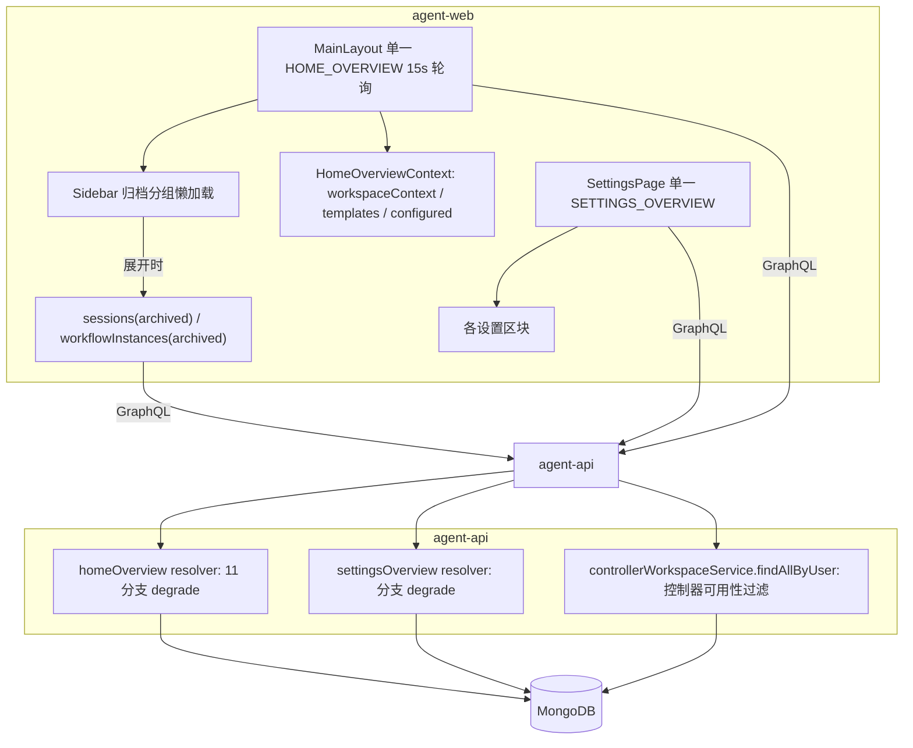
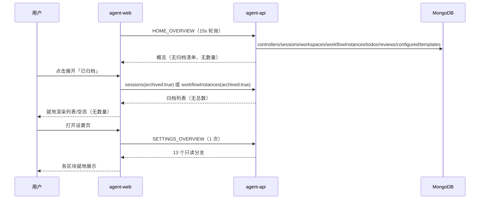

# 接口性能优化 - 技术提案

**功能名称**: 接口性能优化
**关联 PRD**: docs/product/draft/20261126-api-performance-optimization.md
**技术提案版本**: v1.0
**创建日期**: 2026-11-26
**作者**: z-agent-bot
**feat-branch**: `feat/api-performance-optimization`
**领域模型影响**: `docs/knowledges/domain/30-控制器/00-上下文概览.md`（项目工作区读口径：不返回已删除/离线控制器条目）、`docs/knowledges/domain/50-会话与交互/00-上下文概览.md` 与 `docs/knowledges/domain/60-工作流/00-上下文概览.md`（归档清单按需获取口径）；其余上下文无聚合/字段/状态机/权限变化，不更新。

## 1. 概述

### 1.1 背景

PRD（Issue [#584](https://github.com/Deliay/z-agent-gear/issues/584)）提出四点诉求：

1. 归档会话/归档工作流不再随首页概览直接获取，改为点击展开归档列表时才获取；同步移除 homeOverview 中的归档字段、移除前端计数展示，展开后也不展示具体数量。
2. `configuredWorkflows`、`workflowTemplates`、`GetWorkspaceContext` 并入 homeOverview，定时刷新。
3. GraphQL `workspaces` 查询不返回控制器已删除或已离线的项目工作区。
4. 聚合设置页对 GraphQL 的调用，减少 GraphQL 请求次数。

本提案覆盖上述四点的契约与实现设计。

### 1.2 现状分析

**首页聚合查询（homeOverview）现状**：`contracts/home.graphql:11-32` 的 `HomeOverview` 含 9 个分支，`servers/agent-api/src/graphql/resolvers/home.ts:55-137` 单次 `Promise.all` 并行取数（每分支 `degrade()` 失败降级空值，`:18-26`）。其中两个归档分支每次轮询都做**无上限全量拉取**：

| 分支 | 服务调用 | 特征 |
|------|---------|------|
| `archivedSessions` | `sessionService.findAllByUser(userId, {archived:true})`（`services/session.ts:176-191`） | 无 limit，`archivedAt:$ne:null` 全量 |
| `archivedWorkflowInstances` | `workflowInstanceService.list(userId, {archived:true})`（`services/workflow/instance.ts:133-147`） | 无 limit，携带完整 nodes 图 |

前端 `apps/agent-web/src/pages/MainLayout.tsx:42-54` 以 `useQuery(HOME_OVERVIEW, {pollInterval:15000})` 单查询单轮询，经 `stores/homeOverview.ts` 全局共享。侧边栏 `components/Sidebar.tsx` 中归档分组默认折叠（`ArchivedWorkflowGroup` `:692-716`、`ArchivedSessionGroup` `:754-794`），但列表数据与数量（`已归档（{n}）`，`:705`、`:775`）都来自 homeOverview——**用户不展开也要付全量拉取 + N+1 归属字段查询的代价**。另已知 N+1：`homeOverview.workflowInstances`（活跃+归档）每个实例的 `workspace`/`controller` 惰性字段各触发 1 次 `findById`（`resolvers/workflow.ts:478-488`），验收报告 `docs/engineering/acceptance/20261014-unified-home-display-acceptance-report.md:81` 已记录「实例数 N 时首屏多 2N 次查询」。归档清单移出后该 2N 中的归档部分随之消失。

**归档清单按需获取能力已存在（零新增）**：`sessions(controllerId, includeWorkflowSessions, archived: Boolean)`（`contracts/agent-session.graphql:567`）与 `workflowInstances(workspaceId, controllerId, archived: Boolean)`（`contracts/workflow.graphql:491`）均已支持 `archived` 参数；前端 `GET_WORKFLOW_INSTANCES`（`graphql/workflow.ts:444-445`）已定义 `$archived` 变量但无调用点。

**工作流配置/模板与工作区上下文现状**：

| 数据 | 服务端 | 前端消费 |
|------|--------|---------|
| `configuredWorkflows` | `resolvers/workflow.ts:217-225` → `services/workflow/configured.ts:187-191` | `settings/WorkflowSection.tsx:35-38`（cache-and-network + mount 再 refetch，`:44-51`）、`InstantiateWorkflowDialog.tsx:85-88`（弹窗打开 refetch `:124-134`）、`IssuesLinkageDialog.tsx:73-75`、`cloud-host/RepoWorkflowSection.tsx:87-107` |
| `workflowTemplates` | `resolvers/workflow.ts:207-211` → `services/workflow/template.ts:182-186` | 同上（`WorkflowSection.tsx:31-34`、`InstantiateWorkflowDialog.tsx:89-92`、`ConfigureWorkflowDialog.tsx:66`） |
| `GetWorkspaceContext` | 前端组合查询 `myWorkspaces + myTenants`（`graphql/queries.ts:1000-1028`）→ `resolvers/workspace.ts:62-85`（`toWorkspaceView` 每工作区一次 `workspaceFacets`，N+1；`myTenants` 重复跑 `accessibleWorkspaces`） | `hooks/useWorkspaceContextSync.ts:28-59` **独立 15s 轮询** + focus/visibility 立即 refetch |

即工作流配置/模板在多处「cache-and-network + 显式 refetch」双发，工作区上下文另起一路 15s 轮询——与 homeOverview 的 15s 轮询重复。

**`workspaces` 查询不过滤控制器可用性**：`contracts/controller-workspace.graphql:54-62` 的 `workspaces: [ControllerWorkspace!]!` → `resolvers/controller-workspace.ts:19-28` → `services/controller-workspace.ts:50-63`（`visibleControllerIds` 仅按 actor 过滤，无状态/软删过滤）。对比 `services/controller.ts:25-44` 的控制器列表**已**过滤软删云电脑（`CloudHost.deletedAt != null` 的 controller 剔除）。删除云电脑后 Controller 留档 `status:'offline'`（`services/controller.ts:66-70`），其项目工作区仍出现在 `workspaces` 与 `homeOverview.workspaces` 中。可用性判定口径已有权威纯函数：`services/workflow/unavailable.ts:10-15`（controller 缺失 → `CONTROLLER_DELETED`，`status !== 'online'` → `CONTROLLER_OFFLINE`）。

**设置页请求现状**：`pages/SettingsPage.tsx:209-285` 一次性挂载全部区块，Apollo 为普通 HttpLink 无批处理（`lib/apollo.ts:53-57`），单次打开约 **18~20 个 GraphQL 请求**，且存在重复与双发：

- `GET_PROVIDERS` 被 `ProviderSection.tsx:34` 与 `ModelSection.tsx:66` 各查一次；`GET_CONTROLLERS` 被 `ControllerListSection.tsx:110-112` 与 `WorkflowSection.tsx:37` 各查一次，且 `ControllerListSection` 自带 `pollInterval: 15000`（`:97`）常驻轮询；
- `WorkflowSection.tsx:44-51` 对两个查询 cache-and-network 后又显式 refetch（2 查询 ≈ 4 次网络请求）；
- `CLOUD_STORAGES` 双查询（`includeDestroyed:false/true`，`CloudStorageSection.tsx:189-196`）。

### 1.3 目标

- `homeOverview` 移除 `archivedSessions` / `archivedWorkflowInstances`；新增 `configuredWorkflows`、`workflowTemplates`、`workspaceContext` 三分支，随既有 15s 轮询定时刷新。
- 归档清单改为展开时按需拉取（复用既有 `archived` 参数查询），前端移除全部归档数量展示。
- `workspaces` 与 `homeOverview.workspaces` 在服务层统一过滤：控制器已删除或非 `online` 的项目工作区不返回。
- 新增 `settingsOverview` 聚合查询，把设置页只读数据收敛为一次请求；消除重复查询与设置页独立常驻轮询。

### 1.4 范围

| 范围 | 内容 |
|------|------|
| 做 | `contracts/` 契约变更（home.graphql 增删、settings.graphql 新增、controller-workspace.graphql 注释）与手写 schema 双写；agent-api homeOverview 扩展、settingsOverview 聚合、controller-workspace 过滤；agent-web 归档懒加载/去计数、workspaceContext 并入 home 数据、设置页聚合消费 |
| 不做 | `ControllerConfigPage`（单主机配置子页）内部查询合并；数据模型/索引/迁移（零变更）；`GET_WORKFLOW_INSTANCES` 等既有独立查询的服务端能力（仅前端消费侧切换）；归档数据生命周期；性能埋点/可观测性扩展 |

## 2. 技术架构

### 2.1 系统架构图



### 2.2 技术栈

| 层级 | 技术选型 | 说明 |
|------|---------|------|
| 前端 | React 19 + Apollo Client | 手写 GraphQL 类型（无 codegen），Context 分发聚合数据 |
| 后端 | Node.js + Express + GraphQL-Yoga + Mongoose | resolver 薄层，服务层聚合 |
| 数据库 | MongoDB | 零模型/索引变更，复用 `{userId, archivedAt, createdAt}` 等既有索引 |
| 其他 | Redis | 本需求不新增中继/缓存 |

### 2.3 模块划分

| 模块 | 职责 | 关键技术点 |
|------|------|-----------|
| contracts/ | 契约单一来源 | home.graphql 字段增删、settings.graphql 新增、schema 双写登记 |
| agent-api `resolvers/home.ts` | 首页聚合读模型 | 归档分支删除、3 个新分支接 `degrade()` |
| agent-api `resolvers/settings.ts`（新增） | 设置聚合读模型 | 复用 homeOverview 的 `Promise.all` + per-branch degrade 模式 |
| agent-api `services/controller-workspace.ts` | 项目工作区读过滤 | 控制器可用性过滤（服务层单点，双查询同口径） |
| agent-web `graphql/*` + `stores/*` | 聚合查询与共享状态 | HOME_OVERVIEW 选择集调整、SETTINGS_OVERVIEW 新增、类型同步 |
| agent-web `Sidebar.tsx` 归档分组 | 懒加载与去计数 | `skip: !open` 按需查询、空态/错误态 |
| agent-web `components/settings/*` | 聚合消费 | 页面级 Context 下发替代各自 useQuery |

## 3. API 设计

### 3.1 API 契约

#### 3.1.1 `contracts/home.graphql` — HomeOverview 字段增删

```graphql
type HomeOverview {
  controllers: [Controller!]!
  sessions: [Session!]!
  sessionTotalCount: Int!
  # 删除：archivedSessions / archivedWorkflowInstances
  #（归档清单改为按需拉取：sessions(archived:true) / workflowInstances(archived:true)，不再提供数量）
  workspaces: [ControllerWorkspace!]!
  workflowInstances: [WorkflowInstance!]!
  todos: [TodoItem!]!
  unreadTodoCount: Int!
  sessionReviews: [SessionReview!]!
  # 新增（随 15s 轮询定时刷新）
  configuredWorkflows: [ConfiguredWorkflow!]!
  workflowTemplates: [WorkflowTemplate!]!
  workspaceContext: WorkspaceContext!
}

# 新增：工作区上下文（原前端组合查询 GetWorkspaceContext = myWorkspaces + myTenants）
type WorkspaceContext {
  myWorkspaces: [Workspace!]!
  myTenants: [TenantMembership!]!
}
```

说明：
- `Workspace` / `TenantMembership` / `ConfiguredWorkflow` / `WorkflowTemplate` 均为既有契约类型（workspace.graphql / workflow.graphql），同 schema 拼接下直接引用，零类型新增（除 `WorkspaceContext` 包络）。
- 字段删除为破坏性变更：agent-api 与 agent-web 同仓库同版本发布（Aspire/Compose 整体部署），删除与前端切换在同一次发布内完成（见 §9）。

#### 3.1.2 `contracts/settings.graphql`（新增）— 设置页聚合查询

```graphql
type SettingsOverview {
  commitSettings: CommitSettings!        # 替代 GET_COMMIT_SETTINGS
  providers: [Provider!]!                # 替代 GET_PROVIDERS（两处共用，去重）
  models: [Model!]!                      # 替代 GET_MODELS
  controllerKeys: [ControllerKey!]!      # 替代 GET_CONTROLLER_KEYS
  mcpServers: [McpServer!]!              # 替代 GET_MCP_SERVERS
  valutEntries: [ValutEntry!]!           # 替代 GET_VALUT_ENTRIES
  customMcpServers: [CustomMcpServer!]!  # 替代 GET_CUSTOM_MCP_SERVERS
  customTools: [CustomTool!]!            # 替代 GET_CUSTOM_TOOLS
  githubAccounts: [GithubAccount!]!      # 替代 GET_GITHUB_ACCOUNTS
  githubAppUrl: String                   # 替代 GET_GITHUB_APP_URL
  myExternalLogins: [ExternalLogin!]!    # 替代 GET_MY_EXTERNAL_LOGINS
  authProviders: [AuthProvider!]!        # 替代 GET_AUTH_PROVIDERS
  cloudStorageCapabilities: CloudStorageCapabilities!  # 替代 CLOUD_STORAGE_CAPABILITIES
  cloudStorages: [CloudStorage!]!        # 替代 CLOUD_STORAGES(includeDestroyed:false)
}

extend type Query {
  settingsOverview: SettingsOverview!
}
```

说明：
- 各分支返回类型与被替代查询的返回口径**逐字段一致**（契约复用既有类型；实现中以现有 resolver/服务调用原样搬入聚合分支）。
- 分支失败相互隔离：沿用 homeOverview 的 `degrade()` 模式，单分支失败降级空值/默认值并记日志，不拖垮整页。
- 不并入 `settingsOverview` 的两类数据（见 §6 决策）：
  - `controllers`：直接复用 `homeOverview.controllers`（已随 15s 轮询刷新，单一来源）；设置页控制器区块不再自带 `GET_CONTROLLERS` 与 15s 轮询。
  - `workflowTemplates` / `configuredWorkflows`：按需求 2 并入 `homeOverview`，设置-工作流区块与「新建工作流」弹窗改读 home 数据。
- 保持按需（不进聚合）：`GET_VALUT_MANUAL_OPTIONS`（弹窗打开才需要）、`CLOUD_STORAGES(includeDestroyed:true)`（切换「含已销毁」才需要）、`repoWorkflowTemplates`（按工作区触发）。

#### 3.1.3 归档清单按需获取（零契约新增）

复用既有查询，前端在展开时调用：

- `sessions(archived: true)`（`contracts/agent-session.graphql:567`）
- `workflowInstances(archived: true)`（`contracts/workflow.graphql:491`）

#### 3.1.4 `contracts/controller-workspace.graphql` — 查询口径注释

`workspaces` 与 `homeOverview.workspaces` 注释增补：**不返回已删除控制器或 `status != 'online'` 控制器下的项目工作区**（数据保留，控制器恢复 online 后重新返回）。结构零变更。

### 3.2 内部接口

| 接口 | 变更 |
|------|------|
| `controllerWorkspaceService.findAllByUser(userId)` | 增加控制器可用性过滤（见 §5.2 实现点 3），`workspaces` 与 `homeOverview.workspaces` 同一路径自动同口径 |
| `workspaceService.accessibleWorkspaces(userId)` | 增加单请求内复用（`myWorkspaces`/`myTenants`/`workspaceContext` 分支共享一次结果），消除重复查询 |
| homeOverview resolver | 3 个新分支：`configuredWorkflowService.listForUser` / `workflowTemplateService.listForUser` / workspaceContext 组装 |
| settingsOverview resolver（新增） | 复用各既有服务调用组装 13 个只读分支 |

## 4. 数据模型

### 4.1 数据库设计

**零变更**：不新增/修改集合、字段、索引与迁移。相关既有索引已足够支撑按需归档查询：

| 集合 | 索引 | 用途 |
|------|------|------|
| sessions | `{userId:1, archivedAt:1, createdAt:-1}` | `sessions(archived:true)` |
| workflowinstances | `{userId:1, archivedAt:1, createdAt:-1}` | `workflowInstances(archived:true)` |
| controllerworkspaces | 既有查询路径不变 | 过滤在应用层完成（需先取 controllers 再过滤） |

### 4.2 缓存设计

不新增服务端缓存。前端沿用 Apollo InMemoryCache：HOME_OVERVIEW 为唯一 15s 轮询源；SETTINGS_OVERVIEW 首次进入设置页取一次，操作后经 `refetchQueries: [SETTINGS_OVERVIEW]` 局部失效；归档列表查询以「展开即取」为口径，不进入轮询。

## 5. 技术实现方案

### 5.1 核心流程



### 5.2 关键实现点

#### 实现点 1: 归档清单退出 homeOverview + 前端懒加载与去计数

- **服务端**：`contracts/home.graphql` 与 `schemas/home.ts` 删除 `archivedSessions`/`archivedWorkflowInstances`；`resolvers/home.ts` 删除两个归档分支（`archivedSessionDocs`/`archivedDocs`），`sessionTotalCount` 口径不变（活跃 `sessions.length`，`resolvers/home.ts:142`）。
- **前端**：`graphql/home.ts` HOME_OVERVIEW 选择集删除两段归档字段；`graphql/types.ts` `HomeOverviewData` 同步删除（`sessionTotalCount` 保留）。
- **懒加载**：`ArchivedSessionGroup` / `ArchivedWorkflowGroup`（`Sidebar.tsx:692-794`）改为自足组件：`useQuery(GET_SESSIONS-ish `sessions(archived:true)` / `GET_WORKFLOW_INSTANCES($archived:true)`, `{ skip: !open, fetchPolicy: 'cache-and-network' })`；展开才请求，折叠再展开可直接复用缓存。
- **去计数**：`已归档（{n}）` → `已归档`（`:705`、`:775`）；展开列表不渲染任何总数/计数；分区头部角标（活跃数，`SidebarSection.tsx:42-43`）保持现状。
- **常驻展示**：分组不再依赖 `sortedArchivedSessions.length > 0` 条件渲染（否则无法在未加载时判断），改为常驻可展开；空列表展示空态「暂无归档」。
- **配套**：`SessionView.tsx:566` 归档/取消归档的 `refetchQueries` 增补归档列表查询（或对归档查询 `evict`），保证展开内容即时一致。

#### 实现点 2: configuredWorkflows / workflowTemplates / workspaceContext 并入 homeOverview

- **服务端**：`resolvers/home.ts` 新增三分支（均包 `degrade()`）：
  - `configuredWorkflows` = `configuredWorkflowService.listForUser(userId)` + 既有 `mapConfigured`；
  - `workflowTemplates` = `workflowTemplateService.listForUser(userId)` + 既有 `mapTemplate`；
  - `workspaceContext` = `{ myWorkspaces, myTenants }`，复用 `resolvers/workspace.ts:62-85` 的组装逻辑并抽取共享 `accessibleWorkspaces` 单次调用（顺带消掉该路径的 N+1 重复查询）。
- **前端**：
  - `useWorkspaceContextSync` 的独立 15s 轮询**移除**，改为从 `HomeOverviewContext` 消费 `workspaceContext` 并沿用既有 `syncWorkspaceContext` 写入 `stores/workspace.ts`；focus/visibility 立即刷新改为 `refetch()` HOME_OVERVIEW；
  - `settings/WorkflowSection.tsx`、`InstantiateWorkflowDialog.tsx`、`IssuesLinkageDialog.tsx`、`RepoWorkflowSection.tsx`、`ConfigureWorkflowDialog.tsx` 改读 home 数据；保留「打开即最新」语义：弹窗/设置区块 mount 时 `refetch()` HOME_OVERVIEW（替代原 cache-and-network 双发）；
  - 变更类操作（模板编辑、工作流配置增删）的 `refetchQueries` 由 `GET_WORKFLOW_TEMPLATES`/`GET_CONFIGURED_WORKFLOWS` 改指 `HOME_OVERVIEW`。
- **风险点**：HOME_OVERVIEW 载荷新增模板/配置全量节点图——与移除的归档清单大致对冲，净载荷预期下降；若后续膨胀，再做字段裁剪/限量（本期不做）。

#### 实现点 3: workspaces 按控制器可用性过滤

- **落点**：`services/controller-workspace.ts` `findAllByUser(userId)`（`workspaces` 与 `homeOverview.workspaces` 的共同路径）：
  1. 取 controllers 时复用 `controllerService.findAllByUser` 的口径（已剔除软删云电脑的 controller）；
  2. 过滤 `status === 'online'` 之外的 controller（与 `services/workflow/unavailable.ts:10-15` 的 `CONTROLLER_OFFLINE` 口径一致：非 online 即不可用，覆盖 offline / registering / unbound）；
  3. 仅返回 `controllerId ∈ 可用集合` 的 `controllerworkspaces` 行。
- **数据保留**：过滤仅作用于查询返回，不做任何删除/标记；控制器恢复 online 后条目自动重新返回。
- **不受影响**：`ensureWorkspace`、工作区删除/归档会话连带逻辑、写路径与详情查询（按 id）不变。

#### 实现点 4: settingsOverview 聚合设置页 GraphQL 调用

- **服务端**：新增 `resolvers/settings.ts` + `schemas/settings.ts`（对齐 `contracts/settings.graphql`，`resolvers/index.ts` 登记），13 个只读分支原样复用现有服务调用，`Promise.all` + per-branch `degrade()`。
- **前端**：`SettingsPage.tsx` 单一 `useQuery(SETTINGS_OVERVIEW)`，经 Context 下发；各区块（`ExternalLoginBindingSection` / `GithubBindingSection` / `GitSettingsSection` / `ProviderSection` / `ModelSection` / `ControllerListSection` / `McpRegistrySection` / `ValutSection` / `CustomMcpSection` / `CustomToolSection` / `CloudStorageSection`）删除自身只读 useQuery，改消费 Context；写操作 `refetchQueries: [SETTINGS_OVERVIEW]`。
- **去重与去轮询**：`GET_PROVIDERS` 双查、`GET_CONTROLLERS` 双查消除；`ControllerListSection` 的 `pollInterval: 15000`（`:97`）移除，控制器在线状态改由 `homeOverview.controllers`（全局 15s）驱动——设置页控制器区块与首页同源同新鲜度。
- **请求量**：设置页打开 18~20 次 → **1 次** SETTINGS_OVERVIEW（+弹窗/切换类按需查询），详见 §5.2 实现点 2/4 与 §6 D5/D6。

## 6. 技术决策

### 6.1 决策列表

| 决策 | 选项 A | 选项 B | 最终选择 | 原因 |
|------|--------|--------|---------|------|
| 归档清单获取 | 复用 `sessions/workflowInstances(archived:true)` | 新增专用 archived 查询 | A | 契约零新增；服务端能力已存在且有索引 |
| 归档分组展示 | 常驻「已归档」无数量 | 保留 homeOverview 存在性标记控制显隐 | A | 需求明确「干掉计数」；标记字段违背「不直接获取」意图，且空态/加载态可覆盖 |
| workspaceContext 承载 | 并入 homeOverview 新字段 | 保留独立查询+轮询 | A | 需求点名并入；省一路 15s 轮询与 focus refetch |
| workspaces 过滤落点 | 服务层 `findAllByUser` | 各 resolver 各自过滤 | A | `workspaces` 与 `homeOverview.workspaces` 同口径，单点维护 |
| 「已离线」判定 | `status !== 'online'` | 仅 `status === 'offline'` | A | 与 `WorkflowInstanceUnavailableReason` 既有语义一致；registering/unbound 同样不可用 |
| 设置页收敛方式 | `settingsOverview` 聚合查询 | Apollo BatchLink HTTP 批处理 | A | 与 homeOverview 既有模式一致；BatchLink 只减 HTTP 往返不减 GraphQL operation 数，且需服务端批处理开关 |
| 设置页 controllers 来源 | 复用 `homeOverview.controllers` | settingsOverview 自带 controllers | A | 单一来源；15s 新鲜度免费获得；避免两处 controllers 不一致 |
| 设置区块数据下发 | 页面级 Context | 各区块保留 useQuery 共享缓存 | A | 单请求 + 显式失效语义清晰；消除 cache-and-network 双发 |
| 契约破坏性字段删除 | 同版本同步删除 | 先停用消费、下版本删字段 | A | monorepo 整体部署，旧前端不存在于新服务端之后；简化变更 |

### 6.2 依赖与约束

| 类型 | 内容 | 说明 |
|------|------|------|
| 依赖 | 既有 `archived` 参数查询能力 | 零服务端新增 |
| 依赖 | homeOverview 15s 轮询与 SSE refetch 机制 | workspaceContext 定时刷新的载体 |
| 约束 | 前端 GraphQL 类型手写 | `graphql/types.ts`、`graphql/home.ts` 与契约同步双写 |
| 约束 | 契约与手写 schema 双写 | `contracts/*.graphql` ↔ `src/graphql/schemas/*` |
| 约束 | 不放宽任何权限过滤 | 聚合仅合并请求，tenant/workspace/actor 过滤原样保留 |

## 7. 项目结构

```
contracts/
├── home.graphql                        # 字段增删 + WorkspaceContext
├── settings.graphql                    # 新增：settingsOverview 聚合
└── controller-workspace.graphql        # 注释增补查询口径

servers/agent-api/src/
├── graphql/
│   ├── schemas/{home.ts, settings.ts 新增, workflow.ts}
│   ├── resolvers/{home.ts, settings.ts 新增, workspace.ts, controller-workspace.ts}
│   └── resolvers/index.ts              # 登记新 resolver
└── services/
    ├── controller-workspace.ts         # 控制器可用性过滤
    └── workspace.ts                    # accessibleWorkspaces 单请求复用

apps/agent-web/src/
├── graphql/{home.ts, queries.ts, workflow.ts, types.ts}
├── pages/{MainLayout.tsx, SettingsPage.tsx}
├── hooks/useWorkspaceContextSync.ts    # 改为消费 home 数据
├── stores/{homeOverview.ts, workspace.ts}
├── components/Sidebar.tsx              # 归档分组懒加载 + 去计数
└── components/settings/*               # 聚合消费改造
```

## 8. 测试策略

### 8.1 测试覆盖要求

- 受影响 resolver/服务单元测试覆盖 ≥ 现状（TDD 红-绿-重构）。
- API 测试覆盖：homeOverview 字段契约、settingsOverview 全分支、workspaces 过滤矩阵。
- E2E 覆盖：首屏请求计数、归档懒加载、设置页请求计数。

### 8.2 测试类型

| 类型 | 工具 | 覆盖范围 |
|------|------|---------|
| 单元测试 | Vitest | `resolvers/home.test.ts` 扩展（归档分支移除、3 新分支、degrade）；`resolvers/settings.test.ts`（13 分支 + 单分支失败降级）；`services/controller-workspace` 过滤矩阵（online / offline / registering / unbound / 控制器缺失 / 软删云电脑） |
| API 测试 | tests/api | T-HP1：homeOverview 无 archivedSessions/archivedWorkflowInstances 且含 configuredWorkflows/workflowTemplates/workspaceContext；T-HP2：workspaceContext 与 myWorkspaces/myTenants 口径一致；T-WSF1：workspaces 过滤矩阵（含恢复在线重新可见）；T-SET1：settingsOverview 13 分支返回与原查询逐字段一致；T-SET2：单分支故障不拖垮整页 |
| E2E | tests/e2e（Playwright） | E2E-HP1：打开应用首屏仅 1 次 HomeOverview 且不含归档清单（更新 `home.spec.ts` T-E1/T-E2 请求计数断言）；E2E-HP2：展开「已归档」才发归档请求、标题与列表无数量、空态可展开；E2E-HP3：工作区上下文/模板/配置随轮询刷新；E2E-WSF1：新建工作流弹窗不展示离线/删除控制器工作区；E2E-SET1：设置页打开请求 ≤ 3 且各区块内容完整、操作后即时更新 |

## 9. 部署方案

### 9.1 环境规划

| 环境 | 用途 | 部署方式 |
|------|------|---------|
| 开发/测试 | Aspire / Docker Compose 整体编排 | 同版本发布 agent-api + agent-web |
| 生产 | 现有发布流程 | 同版本发布（含契约） |

### 9.2 配置管理

- 无新增配置项/环境变量。
- **发布顺序约束**：`homeOverview` 归档字段删除属破坏性契约变更，agent-api 与 agent-web 必须**同版本发布**（monorepo 整体部署天然满足）；如遇灰度先发服务端，需回退前端旧版本或跳过该灰度。
- **回滚**：整版本回退即可，零数据迁移、无数据丢失风险。

## 10. 验收标准

- [ ] 技术方案评审通过
- [ ] Contract 评审通过（home.graphql 增删、settings.graphql 新增、schema 双写一致）
- [ ] 领域模型已同步更新（`docs/knowledges/domain`：30-控制器 / 50-会话与交互 / 60-工作流）
- [ ] 代码实现完成（agent-api + agent-web）
- [ ] 单元测试覆盖达标
- [ ] API 测试通过（T-HP1/T-HP2/T-WSF1/T-SET1/T-SET2）
- [ ] E2E 测试通过（E2E-HP1~3 / E2E-WSF1 / E2E-SET1）
- [ ] 需求四点逐条可演示：归档懒加载无计数、homeOverview 定时刷新三分支、workspaces 过滤、设置页请求收敛

## 11. 相关文档

- 关联 PRD：`docs/product/draft/20261126-api-performance-optimization.md`
- 来源 Issue：[Deliay/z-agent-gear#584](https://github.com/Deliay/z-agent-gear/issues/584)
- 关联 Contract：`contracts/home.graphql`、`contracts/settings.graphql`、`contracts/controller-workspace.graphql`、`contracts/agent-session.graphql`、`contracts/workflow.graphql`
- 开发规范：`docs/engineering/common-rules.md`、`docs/engineering/backend-rules.md`、`docs/engineering/frontend-rules.md`
- 领域模型：`docs/knowledges/domain/30-控制器/00-上下文概览.md`、`docs/knowledges/domain/50-会话与交互/00-上下文概览.md`、`docs/knowledges/domain/60-工作流/00-上下文概览.md`
- 既有先例：`docs/engineering/proposals/20261013-feat-unified-home-display.md`（homeOverview 聚合模式）、`docs/engineering/acceptance/20261014-unified-home-display-acceptance-report.md`（2N 归属字段查询记录）
