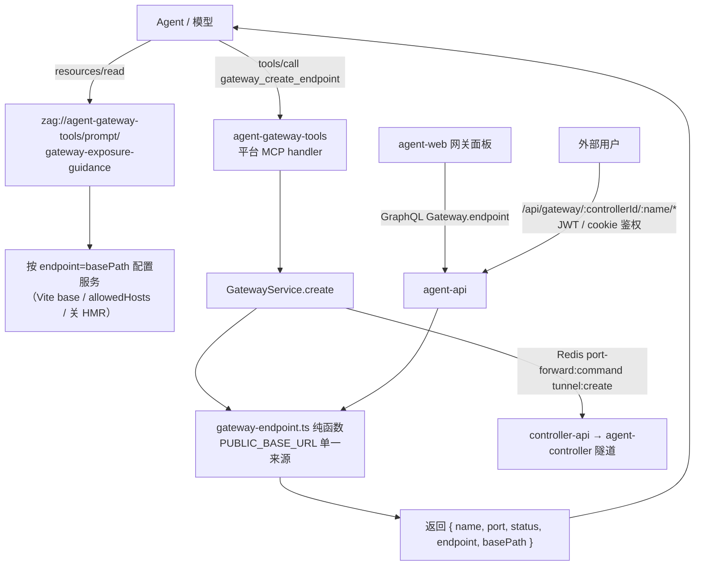
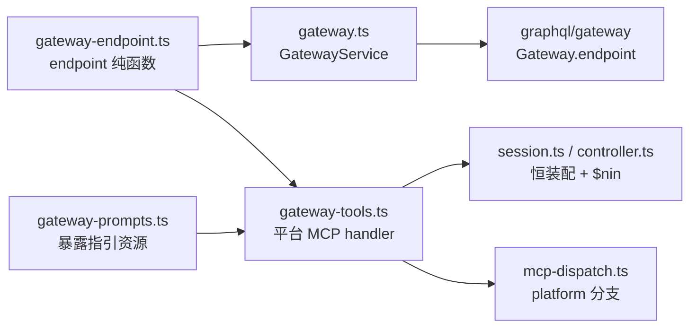
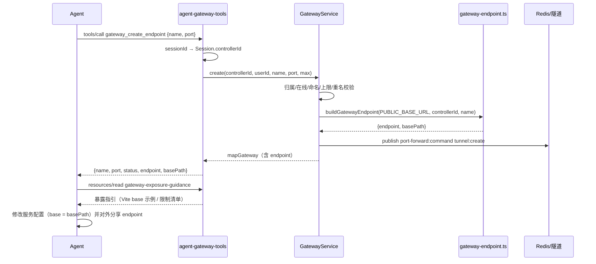

# 网关功能更新 - 技术提案

**功能名称**: 网关端点返回与服务暴露指引
**关联 PRD**: [`docs/product/draft/20261126-gateway-mcp-endpoint.md`](../../product/draft/20261126-gateway-mcp-endpoint.md)
**技术提案版本**: v1.0
**创建日期**: 2026-11-26
**作者**: z-agent-bot
**feat-branch**: `feat/gateway-mcp-endpoint`
**领域模型影响**: `docs/knowledges/domain/70-模型网关/00-上下文概览.md`、`docs/knowledges/domain/70-模型网关/01-聚合与实体.md`（Gateway endpoint 派生口径、平台 MCP 网关工具与暴露指引资源、代理限制口径）

## 1. 概述

### 1.1 背景

来源：GitHub Issue [Deliay/z-agent-gear#565](https://github.com/Deliay/z-agent-gear/issues/565)（「网关功能更新」）：

> - 网关功能MCP在创建endpoint之后支持返回具体的endpoint
> - 增加网关功能的暴露提示词：引导agent使用返回的endpoint作为外网的basePath暴露服务，比如修改vite设置等等

前置调查（[Issue #565 调查报告](https://github.com/Deliay/z-agent-gear/blob/bugfix/gateway-mcp-endpoint/docs/engineering/acceptance/20261126-gateway-mcp-endpoint-bug-investigation-report.md)，位于 `bugfix/gateway-mcp-endpoint` 分支）已定位根因为**能力缺口**而非既有缺陷：

1. **没有面向 Agent 的网关 MCP**：平台 MCP 服务清单中无网关服务（`services/session.ts` 仅恒装配 5 个平台服务，`services/mcp-dispatch.ts` platform 分支无网关路由），Agent 没有「创建 endpoint」入口；
2. **创建链路不返回 endpoint**：GraphQL `Gateway` 与 `gatewayService.mapGateway` 只有 `id/controllerId/name/port/status/createdAt`，URL 唯一拼接点在前端（`window.location.origin`），服务端 `PUBLIC_BASE_URL` 已存在但未被网关使用；
3. **无任何暴露指引**：无 resources/工具描述告知 Agent「用返回的 endpoint 作为外网 basePath 配置服务（如 Vite `base`）」；且 #580 已裁决平台片段只用 MCP resources 投递、不恢复 prompts。

### 1.2 目标

1. 新增平台 MCP 网关工具 `agent-gateway-tools`：Agent 可创建/列出/删除服务端点，**创建成功后返回具体 `endpoint` 与 `basePath`**，Agent 直接使用返回值、无需自行拼接地址。
2. **endpoint 单一来源**：服务端以 `PUBLIC_BASE_URL` 为唯一事实源计算 endpoint（纯函数），GraphQL `Gateway.endpoint` 与 MCP 返回同源；前端改读该字段，消除 `window.location.origin` 双源漂移。
3. **暴露指引经 MCP resources 投递**（遵守 #580 裁决）：`zag://agent-gateway-tools/prompt/gateway-exposure-guidance`，引导 Agent 以 endpoint 为外网 basePath 配置服务（Vite `base` 等示例），并覆盖鉴权/HMR/超时/命名上限等限制。

### 1.3 范围

**做**：endpoint 派生单一来源（`gateway-endpoint.ts` 纯函数）、GraphQL `Gateway.endpoint` 字段、平台 MCP `agent-gateway-tools`（3 工具 + 1 资源）、装配与路由四处接线、前端地址读字段、契约/领域模型/AGENTS 同步、单测 + API + E2E 测试。

**不做**：不恢复 MCP prompts（#580 已裁决）；不改造代理数据面（不支持 WebSocket upgrade / 匿名访问，本期以指引显式规避）；不改 `port-forward:command` 协议与 `gateway-proxy` 鉴权/超时语义；无新集合、无迁移（endpoint 为派生字段不落库）；不切换网关 `{userId}` 作用域口径（见 D6）。

## 2. 技术架构

### 2.1 系统架构图



### 2.2 技术栈

| 层级 | 技术选型 | 说明 |
|------|---------|------|
| 后端 | Node.js 24 + TypeScript（ESM）/ Express v5 | `servers/agent-api`，平台 MCP handler 与 GraphQL |
| 数据 | MongoDB（Mongoose）/ Redis | `gateways` 集合零变更；Redis 仅既有 `port-forward:command` |
| MCP | JSON-RPC（tools + resources） | 平台内置 MCP 服务，`mcp-dispatch` 本地 handler 直发 |
| 前端 | React + Vite（agent-web） | 网关面板地址改读 `Gateway.endpoint` |
| 契约 | GraphQL + MCP 路由表 | `contracts/gateway.graphql`、`contracts/mcp-server.graphql`、`contracts/agent-session-websocket.md` |

### 2.3 模块划分



| 模块 | 职责 | 关键技术点 |
|------|------|-----------|
| `services/gateway-endpoint.ts`（新增） | endpoint/basePath 唯一计算口径 | 纯函数、零 IO；尾斜杠归一；controllerId/name 路径编码 |
| `services/gateway.ts`（修改） | 网关 CRUD（复用现有） | `mapGateway` 注入 `endpoint`；错误文案零变化 |
| `services/gateway-tools.ts`（新增） | 平台 MCP `agent-gateway-tools` | `tools/list`、`tools/call`、`resources/list`、`resources/read`；照 `valut-tools.ts` 范式 |
| `services/gateway-prompts.ts`（新增） | 暴露指引 Markdown 单一来源 | 资源注册表 + 防漂移守卫（照 `admin-prompts.ts` 范式） |
| 装配与路由（修改） | 会话恒装配与分发 | `session.ts` 恒装配去重、`controllers/controller.ts` + `session.ts` 两处 `$nin`、`mcp-dispatch.ts` platform 链分支 |
| `apps/agent-web`（修改） | 网关面板地址展示 | `GatewayItem.tsx` 改读 `gateway.endpoint`，删除 origin 拼接 |

## 3. API 设计

### 3.1 API 契约

#### 契约变更 1: `contracts/gateway.graphql` — `Gateway.endpoint`

```graphql
type Gateway {
  id: ID!
  controllerId: ID!
  name: String!
  port: Int!
  status: String!
  createdAt: String!
  "对外访问地址（服务端单一来源派生，含尾斜杠），如 https://host/api/gateway/{controllerId}/{name}/"
  endpoint: String!
}
```

- `endpoint` 为**派生只读字段**（不落库），由 `buildGatewayEndpoint(publicBaseUrl, controllerId, name)` 唯一计算；
- `createGateway` / `gateways` 返回值同源携带；前端展示地址改读该字段。

#### 契约变更 2: `contracts/mcp-server.graphql` + `contracts/agent-session-websocket.md` §2.12.1

- 平台服务注解新增 `agent-gateway-tools`（工具清单、resources URI 约定 `zag://agent-gateway-tools/prompt/<name>`）；
- §2.12.1 平台内置 MCP 服务路由表新增一行（serverName / 装配范围「全部会话（恒装配）」/ 工具 / 路由与语义）。

#### MCP 工具契约（`agent-gateway-tools`，`transport=platform`）

`initialize` 返回 `capabilities: { tools: {}, resources: {} }`。

**工具 1: `gateway_list`** — 列出当前会话控制器上的端点

- 入参：无
- 出参：

```json
{
  "gateways": [
    {
      "name": "my-service",
      "port": 5173,
      "status": "active",
      "endpoint": "https://host/api/gateway/66f1.../my-service/",
      "basePath": "/api/gateway/66f1.../my-service/"
    }
  ],
  "limit": 5
}
```

**工具 2: `gateway_create_endpoint`** — 创建端点并返回具体 endpoint

- 入参：

```json
{
  "name": "my-service",
  "port": 5173
}
```

- 出参（成功）：

```json
{
  "name": "my-service",
  "port": 5173,
  "status": "active",
  "endpoint": "https://host/api/gateway/66f1.../my-service/",
  "basePath": "/api/gateway/66f1.../my-service/"
}
```

- 错误（`isError: true`，可读文案逐字沿用 `GatewayService` 白名单）：

| 场景 | 文案 |
|------|------|
| 名称非法 | `Name can only contain letters, numbers, hyphens, and underscores` |
| 名称长度 | `Name length must be 1-50 characters` |
| 重名 | `Gateway name already exists` |
| 超上限 | `Maximum 5 gateways per controller` |
| 控制器不存在/离线 | `Controller not found` / `Controller is not online` |
| 参数缺失/非法 | `INVALID_PARAMS`（附字段名与取值规则） |

**工具 3: `gateway_delete_endpoint`** — 删除端点

- 入参：`{ "name": "my-service" }`
- 出参：`{ "deleted": true }`；未命中（他人端点/不存在）`isError: true`，文案 `Gateway not found or not active` 同口径不泄露存在性。

**工具 description 统一附加一句发现引导**：「创建端点后请阅读资源 `zag://agent-gateway-tools/prompt/gateway-exposure-guidance`，以返回的 endpoint 作为外网 basePath 配置服务（如 Vite `base`）」。

#### 资源契约（暴露指引）

- `resources/list` 返回 `{ resources: [{ uri: "zag://agent-gateway-tools/prompt/gateway-exposure-guidance", name: "gateway-exposure-guidance", mimeType: "text/markdown" }] }`；
- `resources/read` 返回指引 Markdown 正文；未知 URI → `INVALID_PARAMS` 附可用 URI 列表（`isError` 形态同 `tools/call` 之外走协议级 error，与 `admin-tools.ts` 的 `prompts/get` 错误形态一致）。

### 3.2 内部接口

| 接口 | 形态 | 说明 |
|------|------|------|
| `buildGatewayEndpoint(publicBaseUrl, controllerId, name)` | 纯函数 → `string` | `{publicBaseUrl}/api/gateway/{controllerId}/{name}/`，`publicBaseUrl` 去尾斜杠、段编码 |
| `buildGatewayBasePath(controllerId, name)` | 纯函数 → `string` | `/api/gateway/{controllerId}/{name}/` |
| `gatewayService.create/findAllByController/delete` | 既有签名不变 | `mapGateway` 输出追加 `endpoint` |
| `gatewayTools` handler | `handleGatewayToolsMcpRequest(payload, caller)` | `caller` 携带 `userId/sessionId`；controllerId 由 `sessionId → Session.controllerId` 解析（不接受外部传入 controllerId，见 D9） |
| `mcp-dispatch` platform 分支 | 链尾追加 `agent-gateway-tools` 直发 | 未知 serverName 仍 `SERVER_NOT_FOUND` |

## 4. 数据模型

### 4.1 数据库设计

**零变更、零迁移**。`gateways` 集合与索引保持现状：

#### 表/集合: gateways（现状，无改动）

| 字段 | 类型 | 说明 |
|------|------|------|
| controllerId | ObjectId → Controller | 所属控制器，index |
| userId / tenantId | ObjectId | 归属（保留 `{userId}` 口径，见 D6） |
| name | String | 1..50，`[a-zA-Z0-9_-]+`，`{controllerId,name}` 唯一 |
| port | Number | 1..65535 |
| status | String | active / inactive / error（仅写 active） |

索引：`{controllerId,name}` unique、`{userId}`、`{controllerId,status}`（均现状）。

### 4.2 缓存设计

无新增缓存。`endpoint` 为派生值对象（内存即时计算），不落库不缓存：

```jsonc
// GatewayEndpoint（派生值对象，非集合）
{
  "endpoint": "{PUBLIC_BASE_URL}/api/gateway/{controllerId}/{name}/",
  "basePath": "/api/gateway/{controllerId}/{name}/"
}
```

## 5. 技术实现方案

### 5.1 核心流程



### 5.2 关键实现点

#### 实现点 1: endpoint 单一来源（`gateway-endpoint.ts`）

- **描述**: 新增纯函数模块 `servers/agent-api/src/services/gateway-endpoint.ts`，`buildGatewayEndpoint(publicBaseUrl, controllerId, name)` 输出 `{publicBaseUrl}/api/gateway/{controllerId}/{name}/`、`buildGatewayBasePath(controllerId, name)` 输出 path 部分；两者恒以 `/` 开头和结尾。
- **技术细节**: `publicBaseUrl` 取 `config.publicBaseUrl`（`PUBLIC_BASE_URL`，默认 `http://localhost:10001`，已去尾斜杠）；`controllerId/name` 走 `encodeURIComponent` 路径段编码；与代理路由 `router.all('/gateway/:controllerId/:name/{*path}')`（挂载 `/api`）逐字对齐。`gatewayService.mapGateway` 与 GraphQL `Gateway.endpoint` 字段、MCP 返回全部复用该模块，**禁止第二处拼接**。
- **风险点**: `PUBLIC_BASE_URL` 未配置时返回 localhost 地址不可对外（见 6.2 部署约束与 R1）。

#### 实现点 2: 平台 MCP `agent-gateway-tools`（`gateway-tools.ts`）

- **描述**: 照 `valut-tools.ts` / `knowledge-base-tools.ts` 范式新增平台 MCP 服务：`ensureGatewayToolsServer` upsert `McpServer` 行 + `handleGatewayToolsMcpRequest` 按 `method` switch（`initialize` / `tools/list` / `tools/call` / `resources/list` / `resources/read`）。
- **技术细节**: `initialize` 声明 `capabilities: { tools: {}, resources: {} }`；`tools/call` 从 `caller.sessionId` 解析会话所属 controller 后调 `gatewayService`；返回值 `isError: true` + 白名单逐字文案（3.1 错误表）；工具 description 附加暴露指引发现引导。会话无控制器/控制器不可见按 `Controller not found` 同口径。
- **风险点**: 工具是模型可控的副作用操作（擅自暴露端口）；工具 description 明确「仅在用户要求暴露服务时使用」，指引中重复强调。

#### 实现点 3: 暴露指引资源（`gateway-prompts.ts`）

- **描述**: 单一来源 Markdown 常量注册表（照 `admin-prompts.ts` 范式），URI `zag://agent-gateway-tools/prompt/gateway-exposure-guidance`，经 `resources/list` / `resources/read` 投递（**不用 prompts**，#580 裁决）。
- **技术细节（指引内容要点，与实现同源、有防漂移守卫）**:
  1. `endpoint` 是完整外网 URL、`basePath` 是其 path 部分，恒以 `/` 开头结尾；**必须使用工具返回值，禁止自行拼接 `localhost:{port}`**；
  2. 以 basePath 作为服务的外网访问基础路径：Vite `base: '<basePath>'`（开发与构建同效）、`server.allowedHosts` 放行平台域名、**`server.hmr: false`（网关不支持 WebSocket upgrade，HMR 长连接必失败）**或改轮询；静态资源走相对路径；
  3. 其他框架同义映射：Next.js `basePath`/`assetPrefix`、Nuxt `app.baseURL`、Spring `context-path`；
  4. 访问前提与限制：需登录访问（JWT/cookie，非匿名公网）、单请求 30s 超时、端点上限 5/控制器、命名 `[a-zA-Z0-9_-]{1,50}` 且控制器内唯一；
  5. 仅在用户要求暴露服务时创建端点，用完建议删除。
- **风险点**: 指引与网关实际能力漂移；用 `gateway-prompts.test.ts` 字面量断言守卫（如 HMR/上限/鉴权关键词）。

#### 实现点 4: 装配与路由四处接线

- **描述**: 新服务进入会话与分发链路，照知识库工具先例（漏一处即口径漂移）。
- **技术细节**:
  1. `services/session.ts` `sessionService.create` 公共路径**恒装配并去重**（普通/云/工作流节点会话全覆盖）；
  2. 默认 MCP 候选与 `setControllerDefaultMcp` 校验的排除口径 `$nin` **两处**（`services/session.ts`、`controllers/controller.ts`）追加 `agent-gateway-tools`（选平台服务报 `MCP_SERVER_NOT_SELECTABLE`）；
  3. `services/mcp-dispatch.ts` platform 链尾追加 `agent-gateway-tools` 分支直发本地 handler；
  4. `contracts/agent-session-websocket.md` §2.12.1 路由表一行 + `contracts/mcp-server.graphql` 注解。

#### 实现点 5: 前端地址单一来源

- **描述**: `apps/agent-web/src/components/GatewayItem.tsx` 的 `accessUrl` 改读 `gateway.endpoint`（GraphQL 查询补字段），删除 `${window.location.origin}/api/gateway/...` 拼接。
- **技术细节**: 展示与「复制地址」按钮同源；`PUBLIC_BASE_URL` 与 web origin 不一致时以服务端为准（R2 风险消除）。
- **风险点**: 老版本缓存的 GraphQL 查询缺字段时 UI 兜底显示空（不拼假地址）。

## 6. 技术决策

### 6.1 决策列表

| 决策 | 选项 A | 选项 B | 最终选择 | 原因 |
|------|--------|--------|---------|------|
| D1 endpoint host 口径 | 服务端 `PUBLIC_BASE_URL` 单一来源 | 前端 `window.location.origin` 拼接 | **A** | 服务端可被 MCP/GraphQL/UI 三方同源复用，消除双源漂移（调查报告 R2） |
| D2 工具命名与范围 | `gateway_list` / `gateway_create_endpoint` / `gateway_delete_endpoint` | `gateway_create` 等短名 / 增加 `gateway_update` | **A** | 与 Issue「创建 endpoint」措辞对齐；update 无需求不扩面 |
| D3 装配范围 | 全部会话恒装配 | 仅云会话/仅本地会话 | **A** | 所有会话都绑定控制器，暴露本地服务是通用诉求；与 preview/valut 恒装配先例一致 |
| D4 指引通道 | MCP resources（`zag://.../prompt/...`） | 恢复 MCP prompts / 工具 description 长文 | **A** | #580 已裁决平台片段只用 resources、不恢复 prompts；description 仅留一句发现引导 |
| D5 WebSocket/HMR | 指引显式关闭 HMR / 轮询 | 网关支持 WS upgrade | **A** | upgrade 是跨 agent-api/controller-api/agent-controller 的数据面改造，另立需求；指引先行规避 |
| D6 网关作用域 | 保留 `{userId}` 个人口径 | 切换工作区成员可见 | **A** | 避免本期扩大语义（撞名/可见性行为变化）；与多租户二期「网关保留 `{userId}` 例外」一致 |
| D7 数据模型 | 派生字段不落库、零迁移 | 落库 endpoint 字段 + 迁移 | **A** | endpoint 可由 `PUBLIC_BASE_URL + controllerId + name` 完全推导，落库反而引入漂移 |
| D8 controller 归属 | 工具以会话所在 controller 为操作对象 | 工具入参传 controllerId | **A** | 会话天然绑定控制器，杜绝传错/越权 controllerId；`gateway_list` 零入参 |
| D9 错误与返回形态 | 白名单逐字文案 + `isError` | 新造错误码体系 | **A** | 复用 `GatewayService` 既有文案（契约/领域模型已登记），零新增错误面 |
| D10 前端地址 | 改读 `Gateway.endpoint` | 前端保留拼接、仅 MCP 用服务端 | **A** | PRD 功能点 3「地址口径唯一」要求 UI 与 MCP 逐字一致 |

### 6.2 依赖与约束

| 类型 | 内容 | 说明 |
|------|------|------|
| 依赖 | 统一网关既有链路（`GatewayService`、`gateway-proxy`、`port-forward:command` 隧道） | 复用零改动，仅 `mapGateway` 增输出 |
| 依赖 | 平台 MCP 基建（`mcp-dispatch`、`sessionService.create` 恒装配、`McpServer` upsert 范式） | 照 `valut-tools.ts` / `knowledge-base-tools.ts` 先例 |
| 依赖 | #580 平台片段 resources 通道 | 指引投递唯一合法通道 |
| 约束 | `PUBLIC_BASE_URL` 部署必配 | 默认 `http://localhost:10001` 仅供本地开发；生产未配置则 endpoint 指向本机不可对外，需在部署文档/发布检查中要求配置（R1） |
| 约束 | 代理鉴权/超时语义不变 | 登录访问（JWT/cookie）、30s 超时、无 WS upgrade；指引必须如实说明 |
| 约束 | 单实例部署前提 | 与既有 `KeyedMutex`/调度器同前提，本期无新增进程内状态 |

**风险与回滚**：

| # | 风险 | 缓解 |
|---|------|------|
| R1 | `PUBLIC_BASE_URL` 未配置/配错 | 部署约束 + 指引/工具 description 提示地址以返回值为准；配置变更即时生效（派生字段） |
| R2 | UI 与 MCP 地址漂移 | D1/D10 单一来源 + E2E 逐字一致性断言 |
| R3 | 用户期望匿名访问/分享给未登录者 | 指引与工具 description 明示「需登录访问」；匿名暴露另立需求 |
| R4 | Agent 擅自暴露端口 | 工具 description + 指引双重声明「仅在用户要求时使用」；后续可加权限开关（产品决策） |
| R5 | 指引与网关能力漂移 | `gateway-prompts.test.ts` 防漂移守卫（HMR/上限/鉴权关键词字面量断言） |

回滚：本期全部为增量（新模块 + 新字段 + 新资源），回滚即下线 `agent-gateway-tools` 装配与 `Gateway.endpoint` 字段，网关既有能力不受影响。

## 7. 项目结构

```
servers/agent-api/src/
├── services/
│   ├── gateway-endpoint.ts            # 新增：endpoint/basePath 纯函数（单一来源）
│   ├── gateway-endpoint.test.ts       # 新增：纯函数单测
│   ├── gateway-tools.ts               # 新增：平台 MCP agent-gateway-tools（tools + resources）
│   ├── gateway-tools.test.ts          # 新增：工具/资源行为单测
│   ├── gateway-prompts.ts             # 新增：暴露指引 Markdown 注册表（单一来源）
│   ├── gateway-prompts.test.ts        # 新增：防漂移守卫
│   ├── gateway.ts                     # 修改：mapGateway 注入 endpoint
│   ├── gateway.test.ts                # 修改：create/list 返回 endpoint 断言
│   ├── session.ts                     # 修改：恒装配第 6 个平台服务 + $nin
│   └── mcp-dispatch.ts                # 修改：platform 链尾分支
├── controllers/
│   └── controller.ts                  # 修改：默认 MCP 排除 $nin
└── graphql/
    ├── schemas/gateway.ts             # 修改：Gateway.endpoint 字段
    └── resolvers/gateway.ts           # 修改：透出 endpoint

apps/agent-web/src/components/
└── GatewayItem.tsx                    # 修改：地址改读 gateway.endpoint

contracts/
├── gateway.graphql                    # 修改：Gateway.endpoint
├── mcp-server.graphql                 # 修改：平台服务注解
└── agent-session-websocket.md         # 修改：§2.12.1 路由表一行

tests/api/src/agent-api/               # 修改：MCP relay 全链路用例
tests/e2e/src/gateway.spec.ts          # 修改：UI 与 MCP 地址一致性
```

## 8. 测试策略

### 8.1 测试覆盖要求

- 单元测试覆盖率 ≥ 80%（`servers/agent-api` 口径不变）；
- API 测试覆盖：`agent-gateway-tools` 的 `tools/list` / `tools/call`（三工具）/ `resources/read` 全链路（fake controller relay 形态，参考 `tests/api/src/agent-api/mcp-server.test.ts`）；
- TDD 红-绿-重构：**先红后绿**——将调查分支 `bugfix/gateway-mcp-endpoint` 的最小复现 `gateway-endpoint.repro.test.ts`（`T-GMCP-REPRO-1` create 返回 endpoint、`T-GMCP-REPRO-2` gateway-tools handler 存在，当前稳定 RED）移植为本分支 RED 种子，再逐条实现转绿。

### 8.2 测试类型

| 类型 | 工具 | 覆盖范围 |
|------|------|---------|
| 单元（纯函数） | Vitest | `gateway-endpoint.test.ts`：`PUBLIC_BASE_URL` 尾斜杠归一、controllerId/name 编码、尾 `/`、basePath 形态 |
| 单元（服务层） | Vitest | `gateway.test.ts` 扩展：`create`/`findAllByController` 返回 `endpoint` 且与 helper 一致；既有 11 用例零回归 |
| 单元（MCP） | Vitest | `gateway-tools.test.ts`：initialize 声明 tools+resources、三工具输入输出、错误白名单逐字、资源 read/未知 URI、description 含发现引导 |
| 单元（资源） | Vitest | `gateway-prompts.test.ts`：指引正文含 Vite `base`/`hmr: false`/鉴权/上限/禁拼 localhost 关键词（防漂移守卫） |
| 单元（装配/路由） | Vitest | `session.test.ts` 恒装配去重 + 两处 `$nin`；`mcp-dispatch.test.ts` platform 分支直发、未知 serverName 仍 `SERVER_NOT_FOUND` |
| API 集成 | tests/api | 创建会话后 `mcpEndpoint.serverNames` 含 `agent-gateway-tools`；`tools/call` 创建返回 endpoint 与 GraphQL/代理路由一致；`resources/read` 正文可达 |
| E2E | Playwright | `gateway.spec.ts` 扩展：UI 展示/复制地址与 MCP 返回 endpoint **逐字一致**；无权限 401、未命中 404、超时 502 文案零变化 |
| 安全回归 | Vitest + API | 匿名访问 endpoint 仍 401；工具不可见/不可删他人端点；不泄露其他用户网关 |

## 9. 验收标准

- [ ] 技术方案评审通过
- [ ] Contract 评审通过（`gateway.graphql` / `mcp-server.graphql` / `agent-session-websocket.md`）
- [ ] 领域模型已同步更新（`docs/knowledges/domain/70-模型网关`）
- [ ] `gateway_create_endpoint` 创建成功返回具体 `endpoint` 与 `basePath`，与 GraphQL `Gateway.endpoint`、UI 展示逐字一致
- [ ] 暴露指引资源可读且覆盖 Vite 示例、鉴权/HMR/超时/命名上限限制、禁拼地址要求
- [ ] 代码实现完成（含两处 `$nin` 与 dispatch 分支接线）
- [ ] 单元测试覆盖达标（含 RED 种子 `T-GMCP-REPRO-1/2` 转绿）
- [ ] API 测试通过（MCP relay 全链路）
- [ ] E2E 测试通过（地址一致性 + 网关既有行为零回归）

## 10. 相关文档

- [关联 PRD](../../product/draft/20261126-gateway-mcp-endpoint.md)
- [统一网关 PRD](../../product/released/20260707-unified-gateway.md) / [统一网关技术提案](20260707-feat-unified-gateway.md)
- Issue #565 调查报告（`bugfix/gateway-mcp-endpoint` 分支 `docs/engineering/acceptance/20261126-gateway-mcp-endpoint-bug-investigation-report.md`）与最小复现 `gateway-endpoint.repro.test.ts`
- #580 平台片段 resources 裁决（`docs/engineering/acceptance/20261126-mcp-prompts-not-visible-bug-investigation-report.md`）
- 契约：`contracts/gateway.graphql`、`contracts/gateway-proxy.openapi.yaml`、`contracts/mcp-server.graphql`、`contracts/agent-session-websocket.md`
- 领域模型：`docs/knowledges/domain/70-模型网关/00-上下文概览.md`、`docs/knowledges/domain/70-模型网关/01-聚合与实体.md`
- 开发规范：`docs/engineering/common-rules.md`、`docs/engineering/backend-rules.md`
