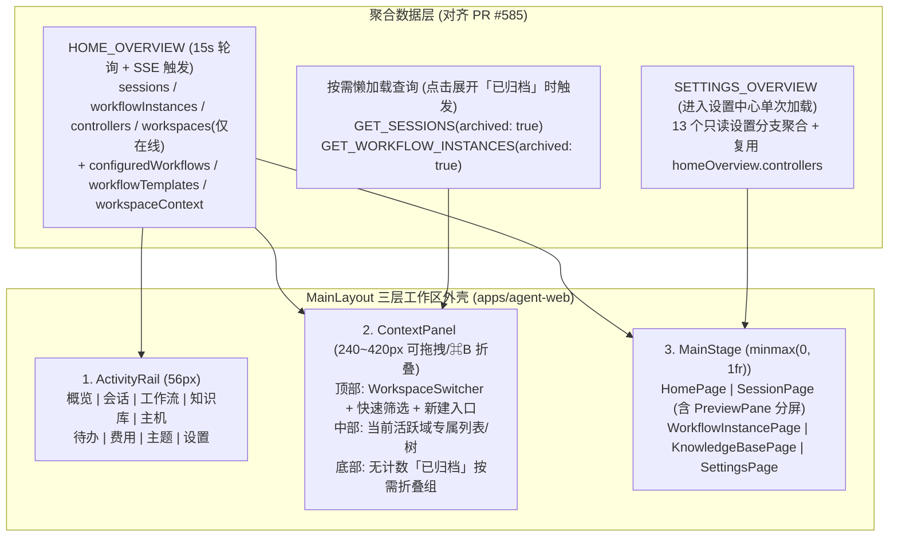
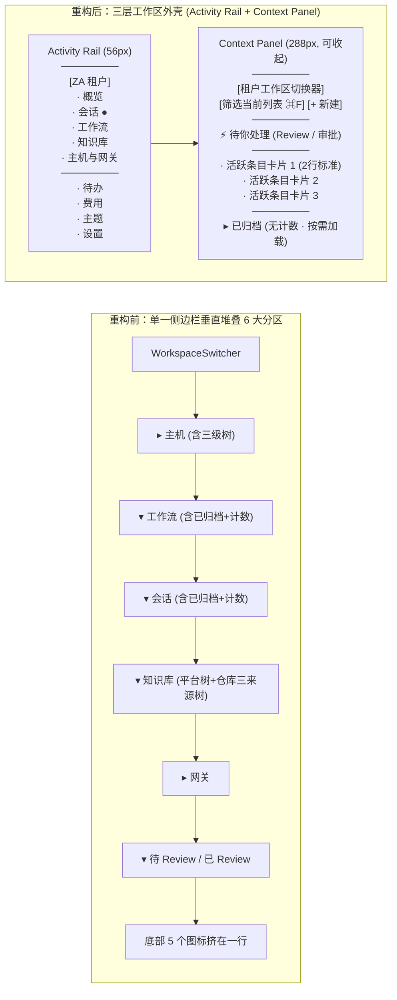
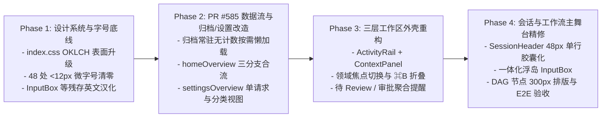

# 整体工作区 UI/UX 重构与视觉规范升级 - 技术提案

**功能名称**: 整体工作区 UI/UX 重构与视觉规范升级
**关联 PRD**: [docs/product/draft/20261126-ui-ux-workspace-overhaul.md](../../product/draft/20261126-ui-ux-workspace-overhaul.md)
**关联规范**: [docs/engineering/ui-ux-standards.md](../ui-ux-standards.md)
**协同提案**: `docs/engineering/proposals/20261126-feat-api-performance-optimization.md`（PR #585 / Issue #584）
**技术提案版本**: v1.0
**创建日期**: 2026-11-26
**作者**: ZeroAsh Agent
**feat-branch**: `refactor/ui-ux-workspace-overhaul`
**领域模型影响**: 本提案为前端工作区架构与 UI/UX 视觉系统重构，不新增后端持久化实体或状态机；数据读口径严格对齐 PR #585 已在 `docs/knowledges/domain/30-控制器/00-上下文概览.md`、`50-会话与交互/00-上下文概览.md`、`60-工作流/00-上下文概览.md` 中同步的口径（项目工作区仅返回在线控制器条目、归档会话/归档工作流按需获取）。

## 1. 概述

### 1.1 背景与现状审计（UI/UX Codebase Audit）

通过对 [`apps/agent-web`](../../../apps/agent-web) 与 [`apps/admin-web`](../../../apps/admin-web) 的全面代码审计，结合正在推进的 **PR #585（接口性能优化 #584）**，当前前端 UI/UX 存在以下核心架构与实现症结：

1. **单一侧边栏（`Sidebar.tsx` 795 行）职责与纵向空间严重过载**：
   - `MainLayout.tsx` 采用固定的两列网格 `grid-cols-[var(--sidebar-width,20rem)_minmax(0,1fr)]`。
   - `Sidebar.tsx` 在同一纵向滚动容器内依次挂载了：`WorkspaceSwitcher`、`SidebarSection("hosts")`（内嵌控制器 → 工作区 → Worktree 三级树）、`SidebarSection("workflows")`、`SidebarSection("sessions")`、`KnowledgeBaseSection`（内嵌平台知识库多级树 + `RepoKnowledgeBaseSection` 三来源云电脑树）、`SidebarSection("gateways")`、`ReviewSection`，外加底部 5 个全局图标按钮（`TodoListPanel`、`ThemeToggle`、`新建会话`、`我的费用`、`设置`）。
   - 当用户同时展开「会话」与「知识库」或「主机」时，单个 `320px` 侧栏内出现多达 4 层缩进与数百个 DOM 节点，纵向滚动条严重碎片化。
2. **全站存在 48 处 `< 12px`（`text-[9px]` / `text-[10px]` / `text-[11px]`）微字号**：
   - 经 `rg "text-\[(9|10|11)px\]" apps/` 精确统计，共 **48 处**硬编码微字号分布在 18 个核心组件中：
     - `text-[9px]`（6 处）：`KnowledgeBasePage.tsx:165`、`RepoKnowledgeBaseSection.tsx:84,199,208`、`KnowledgeBaseSection.tsx:233`、`ResourceChip.tsx:38`。
     - `text-[10px]`（37 处）：`SidebarSection.tsx:43`、`TreeSection.tsx:55`、`WorkflowNodeTree.tsx`（5 处）、`WorkflowNodeCard.tsx`（8 处）、`ResourceChip.tsx`（2 处）、`WorkflowGraphView.tsx:153`、`WorkflowInstanceCard.tsx`（2 处）、`NodeDetailDrawer.tsx`（3 处）、`PreviewTabBar.tsx`（2 处）、`ReviewPanel.tsx`（2 处）、`InputBox.tsx:304`、`DiffView.tsx:67`、`ConfigOptionsPanel.tsx:50`、`FragmentEditor.tsx:57` 等。
     - `text-[11px]`（5 处）：`WorkflowNodeCard.tsx`（3 处）、`ModelSelectDialog.tsx:70`、`KnowledgeBaseSettingsDialog.tsx:276`。
3. **设置中心（`SettingsPage.tsx`）信息架构与 PR #585 聚合改造耦合点**：
   - `SettingsPage.tsx` 在单页内垂直渲染 12 个 `<section>`，打开页面时各子组件各自触发 `useQuery`（共 18~20 次请求），且 `ControllerListSection` 独立持有 `pollInterval: 15000`。
   - 当 URL 含有 `?controllerId=xxx` 时，`SettingsPage.tsx:139` 直接 `return <ControllerConfigPage />`，导致整个设置页导航栏被替换为另一套 `200px` 侧栏，用户体验割裂。
4. **会话舞台（`SessionHeader.tsx` & `InputBox.tsx`）视觉噪音与中英混杂**：
   - `SessionHeader.tsx` 将 7 类元数据平铺在同一 flex 行，依赖 `ResizeObserver` 测量 `TOOLBAR_MIN_INFO_WIDTH = 192` 来被动折叠工具栏。
   - `InputBox.tsx:365-404` 仍硬编码英文文案：`"Session is not active..."`、`"Agent is processing..."`、`"Type your message..."`、`"Stop"`、`"Send"`，违反简体中文统一规范。

### 1.2 重构目标

1. **落地三层工作区外壳（3-Tier Workspace Shell）**：拆解 `MainLayout` 与 `Sidebar`，构建 `ActivityRail`（`56px` 一级导航轨）+ `ContextPanel`（`240px–420px` 可调宽/可收起二级聚焦面板）+ `MainStage`（主工作舞台）。
2. **全站微字号清零与设计系统 Token 升级**：将 `apps/agent-web/src/index.css` 与 `apps/admin-web/src/index.css` 升级为带色相微调的 OKLCH 表面层级体系，100% 替换 48 处 `text-[9px|10px|11px]` 为标准 `text-xs`（`12px`）或 `text-sm`（`14px`），全面应用 `tabular-nums`。
3. **与 PR #585（接口性能优化）深度协同**：
   - 二级面板的会话与工作流列表底部实现**常驻无计数、点击展开按需懒加载**的 `ArchivedSessionGroup` 与 `ArchivedWorkflowGroup`。
   - 顶层 `MainLayout` 消费 `HOME_OVERVIEW`（含 `configuredWorkflows`、`workflowTemplates`、`workspaceContext`）并同步至 `useWorkspaceStore`。
   - 设置中心基于 `SETTINGS_OVERVIEW` 单请求 Context + 左侧分类聚焦视图 + 面包屑嵌入式 `ControllerConfigView` 重构。
   - 所有工作区选择器（`NewSessionDialog`、`InstantiateWorkflowDialog`、`ContinueWorkflowDialog`）统一消费已过滤离线/已删除控制器的工作区列表。

### 1.3 范围

- **包含**：
  - `docs/engineering/ui-ux-standards.md` 设计规范建立与 `AGENTS.md` / `frontend-rules.md` 索引登记。
  - `apps/agent-web` 整体布局外壳重构、微字号清零、中英文案统一、首页/会话页/工作流页/知识库页/设置中心 UI 重构。
  - `apps/admin-web` 主题表面 Token 同步与导航顶栏视觉对齐。
- **不包含**：
  - 除 PR #585 已定义的契约变更（`home.graphql`、`settings.graphql`、`controller-workspace.graphql`）之外，本 UI/UX 重构**不新增任何额外的后端 GraphQL/REST 契约变更**。

---

## 2. 技术架构与布局组成

### 2.1 三层工作区架构与数据流图（含 PR #585 协同）

### 2.2 模块划分与组件重构映射

| 模块层级 | 新增 / 重构组件路径 | 核心职责与设计说明 |
|---------|-------------------|------------------|
| **设计系统基础** | `apps/agent-web/src/index.css` `apps/admin-web/src/index.css` | 升级 OKLCH 表面明度梯度（`--background` / `--sidebar` / `--card` / `--popover`），定义语义状态色与 `.tabular-nums` 工具类 |
| **工作区外壳** | `apps/agent-web/src/pages/MainLayout.tsx` | 桌面端网格升级为 `grid-cols-[56px_var(--context-width,288px)_minmax(0,1fr)]`（当 ContextPanel 收起时为 `grid-cols-[56px_minmax(0,1fr)]`）；集成 `Cmd+B` 与 `Cmd+K` 全局快捷键 |
| **一级导航轨** | `apps/agent-web/src/components/layout/ActivityRail.tsx` | 56px 垂直导航轨，承载五大核心工作域切换、待处理 Review / 审批交互的圆点徽标提醒、底部全局工具栏 |
| **二级上下文面板** | `apps/agent-web/src/components/layout/ContextPanel.tsx` | 承载 `WorkspaceSwitcher`、列表搜索框、当前活动域列表（会话 / 工作流 / 知识库 / 主机与网关）及底部按需加载的「已归档」分组 |
| **按需归档组件** | `apps/agent-web/src/components/sidebar/ArchivedSessionGroup.tsx` `apps/agent-web/src/components/sidebar/ArchivedWorkflowGroup.tsx` | **对齐 PR #585**：常驻渲染「已归档」（无计数），首次点击 `archivedOpen=true` 时触发 `useQuery(..., { skip: !archivedOpen })`，渲染加载态/空态/列表 |
| **会话舞台组件** | `apps/agent-web/src/components/session/SessionHeader.tsx` `apps/agent-web/src/components/session/InputBox.tsx` | 顶栏收敛为 `48px` 单行，路径/Worktree/Harness 收纳进 `EnvironmentInfoPill`；`InputBox` 升级为一体化浮岛卡片，文案 100% 汉化 |
| **设置中心舞台** | `apps/agent-web/src/pages/SettingsPage.tsx` `apps/agent-web/src/pages/ControllerConfigPage.tsx` | **对齐 PR #585**：顶层提供 `SettingsOverviewContext`；左侧分类导航支持分类聚焦切换；`?controllerId=xxx` 嵌入设置舞台主区并配顶部面包屑导航 |

---

## 3. 核心重构设计详述

### 3.1 空间布局重构：从「六合一挤迫侧栏」到「三层工作区外壳」

#### 现状问题与重构对比

- **领域与路由自动联动**：
  - 当路由为 `/sessions` 或 `/sessions/:id` 时，`ActivityRail` 自动高亮「会话」，`ContextPanel` 专注展示「待处理 Review/审批提醒 + 活跃会话列表 + 已归档折叠组」。
  - 当路由为 `/workflows/:id` 时，`ActivityRail` 自动高亮「工作流」，`ContextPanel` 专注展示「活跃工作流列表 + 已归档折叠组」。
  - 当路由为 `/knowledge-bases/:kbId/*` 时，`ActivityRail` 自动高亮「知识库」，`ContextPanel` 专注展示「平台知识库树 + 仓库内建知识库懒加载树」，拥有整屏高度无需与会话列表争抢空间。
  - 用户也可随时点击 `ActivityRail` 上的任意图标临时切换 `ContextPanel` 的列表域，而不必先离开当前主舞台正在查看的会话或文档。

### 3.2 排版与微字号清零计划（48 处 `< 12px` 全面迁移矩阵）

根据 [`docs/engineering/ui-ux-standards.md`](../ui-ux-standards.md) 第二节规定，全站最小字号为 `text-xs`（`12px` / `0.75rem`）。48 处存量微字号的精确替换方案如下：

| 所在组件文件 | 存量微字号类名与行数 | 重构后标准类名 | 视觉调整说明 |
|-------------|-------------------|--------------|------------|
| `pages/KnowledgeBasePage.tsx` | `:165` `text-[9px]` | `text-xs` (`12px`) | 仓库知识库面包屑来源 Badge 调整为 `px-1.5 py-0.5 text-xs` |
| `components/knowledge-base/KnowledgeBaseSection.tsx` | `:233` `text-[9px]` | `text-xs` (`12px`) | 「全局」知识库 Badge 升级为 `px-1.5 py-0.5 text-xs` |
| `components/knowledge-base/RepoKnowledgeBaseSection.tsx` | `:84,199,208` `text-[9px]` `:215,221,339,373` `text-[10px]` | `text-xs` (`12px`) | 仓库来源标签、错误提示、空态与主机计数全部统一为 `text-xs` |
| `components/knowledge-base/KnowledgeBaseSettingsDialog.tsx` | `:276` `text-[11px]` | `text-xs` (`12px`) | 历史事件文档路径 `font-mono text-xs` |
| `components/sidebar/SidebarSection.tsx` `components/tree/TreeSection.tsx` | `:43` `text-[10px]` `:55` `text-[10px]` | `text-xs tabular-nums` | 分区计数胶囊升级为 `px-1.5 py-0.5 text-xs tabular-nums` |
| `components/workflow/WorkflowInstanceCard.tsx` | `:66,74` `text-[10px]` | `text-xs` (`12px`) | 工作流卡片不可用徽标与状态徽标升级为 `text-xs` |
| `components/workflow/WorkflowNodeTree.tsx` | `:87,91,110,119,138` `text-[10px]` | `text-xs` (`12px`) | 列表视图节点类型、Harness、PR 与检查项徽标统一为 `text-xs` |
| `components/workflow/graph/WorkflowNodeCard.tsx` | `:73,78,83,109,115,154,163,178` `text-[10px]` `:95,127,138` `text-[11px]` | `text-xs` (`12px`) | DAG 节点卡片宽度由 `280px` 微调至 `300px`，容纳 `12px` 徽标与动态行且不折行拥挤 |
| `components/workflow/graph/ResourceChip.tsx` `components/workflow/WorkflowGraphView.tsx` | `:29,38,74` `text-[9px]`/`text-[10px]` `:153` `text-[10px]` | `text-xs` (`12px`) | 图上黑板/PR/追加提示词资源芯片与顶部「实例资源」标签统一为 `text-xs` |
| `components/workflow/NodeDetailDrawer.tsx` `components/workflow/ContinueWorkflowDialog.tsx` | `:74,79,84` `text-[10px]` `:333` `text-[10px]` | `text-xs` (`12px`) | 抽屉顶栏状态胶囊与接续对话框节点标签升级为 `text-xs` |
| `components/session/preview/PreviewTabBar.tsx` `components/session/preview/ReviewPanel.tsx` | `:56,57` `text-[10px]` `:148,160` `text-[10px]` | `text-xs` (`12px`) | 分屏 Tab 栏「常开/预览」标识与 Review 目录分组路径升级为 `text-xs` |
| `components/session/InputBox.tsx` `components/session/MessageItem.tsx` `components/session/DiffView.tsx` `components/session/ConfigOptionsPanel.tsx` `components/session/ModelSelectDialog.tsx` | `:304` `text-[10px]` `:158` `text-[10px]` `:67` `text-[10px]` `:50` `text-[10px]` `:70` `text-[11px]` | `text-xs` (`12px`) | 批注来源徽标、图片名、Diff 新增标记、配置项分组标题与模型分组说明统一为 `text-xs` |
| `components/common/fragment-editor/FragmentEditor.tsx` | `:57` `text-[10px]` | `text-xs` (`12px`) | Fragment 原子引用块标签升级为 `text-xs` |

### 3.3 与 PR #585（接口性能优化）的 UI/数据流协同实现

1. **归档分组按需懒加载与去计数（`ArchivedSessionGroup` & `ArchivedWorkflowGroup`）**：
   - 移除 `Sidebar.tsx` 对 `homeOverview.archivedSessions` 与 `homeOverview.archivedWorkflowInstances` 的依赖。
   - 会话与工作流列表底部**无条件常驻渲染** `ArchivedSessionGroup` / `ArchivedWorkflowGroup`，按钮文案固定为 `已归档`（严禁渲染 `（{count}）`）。
   - 组件内部持有一个 `const [archivedOpen, setArchivedOpen] = useState(false)` 状态，并使用 Apollo `useQuery(GET_SESSIONS, { variables: { archived: true }, skip: !archivedOpen, fetchPolicy: 'cache-and-network', notifyOnNetworkStatusChange: false })`。
   - 状态渲染矩阵：
     - `archivedOpen === false`：仅显示 `▸ 已归档` 折叠按钮，零网络请求。
     - `archivedOpen === true && loading && !data`：展开区渲染 `
加载中…
`。
     - `archivedOpen === true && error && !data`：展开区渲染内联错误提示与「重试」按钮。
     - `archivedOpen === true && list.length === 0`：展开区渲染 `
暂无归档
`。
     - `archivedOpen === true && list.length > 0`：渲染两行式归档条目列表（无总数标题）。

2. **首页概览三分支同步（`configuredWorkflows` / `workflowTemplates` / `workspaceContext`）**：
   - `useWorkspaceContextSync()` 改为直接从 `useHomeOverview()` 读取 `data?.workspaceContext`，移除独立的 `GET_WORKSPACE_CONTEXT` 15s 轮询与 `window.focus` 监听。
   - `InstantiateWorkflowDialog` 与 `SettingsPage` 的 `WorkflowSection` 优先消费 `useHomeOverview().data` 中的 `configuredWorkflows` 与 `workflowTemplates`，打开弹窗零加载闪烁。

3. **设置中心单次聚合与分类聚焦视图（`SettingsPage.tsx`）**：
   - 进入 `/settings` 时，顶层执行一次 `useQuery(SETTINGS_OVERVIEW)`，通过 `SettingsOverviewContext` 向各设置区块分发只读数据；控制器列表直接取自 `useHomeOverview().data?.controllers`。
   - 左侧设置分类栏支持点击切换当前激活分类（默认展示「全部」或按分类 Tab 聚焦渲染，消除 12 个区块盲目长滚），并在进入 `?controllerId=xxx` 时在设置主舞台顶部渲染 `设置中心 / 控制器管理 / {controller.name}` 面包屑导航栏。

---

## 4. 分阶段实施与迁移计划（Phased Rollout Plan）

为保证重构过程零回归、可独立测试与平滑演进，遵循 TDD 红-绿-重构循环拆分为 4 个阶段：

### Phase 1：设计系统 Token 升级、48 处微字号清零与文案统一
- 更新 `apps/agent-web/src/index.css` 与 `apps/admin-web/src/index.css` 的 OKLCH 表面明度变量。
- 批量替换 18 个组件中的 48 处 `text-[9px|10px|11px]` 为 `text-xs`，并添加单测守卫（扫描 `src/**/*.tsx` 禁止出现 `text-\[(9|10|11)px\]`）。
- 汉化 `InputBox.tsx`、`SessionListEntry` 等残存英文交互文案。

### Phase 2：对接 PR #585 聚合数据流（归档懒加载 + 设置中心聚合与分类化）
- 改造 `ArchivedSessionGroup` 与 `ArchivedWorkflowGroup` 为无计数、点击展开按需查询。
- 改造 `useWorkspaceContextSync`、`InstantiateWorkflowDialog`、`SettingsPage` 对接 `HOME_OVERVIEW` 与 `SETTINGS_OVERVIEW`。
- 将 `SettingsPage` 升级为分类聚焦视图 + 面包屑嵌入式 `ControllerConfigPage`。

### Phase 3：三层工作区外壳（`ActivityRail` + `ContextPanel` + `MainStage`）
- 新增 `ActivityRail.tsx` 与 `ContextPanel.tsx`，重构 `MainLayout.tsx`。
- 实现桌面端一键折叠二级面板（`Cmd+B`）、全局命令与快速新建弹窗（`Cmd+K`）及移动端底部导航兼容。

### Phase 4：会话舞台与工作流舞台精细化打磨
- 重构 `SessionHeader.tsx` 为 `48px` 单行紧凑顶栏 + `EnvironmentInfoPill` 胶囊。
- 重构 `InputBox.tsx` 为一体化浮岛输入卡片。
- 调整 `WorkflowNodeCard.tsx` 节点尺寸与间距以完美适配 `12px` 徽标体系。

---

## 5. 测试策略

| 测试层级 | 工具 | 核心验证点 |
|---------|------|-----------|
| **设计规范守卫单测** | Vitest | 新增 `src/__tests__/ui-ux-standards.test.ts`：静态扫描 `apps/agent-web/src` 与 `apps/admin-web/src` 全部 `.tsx` 文件，断言零 `text-[9px]`、`text-[10px]`、`text-[11px]` 出现 |
| **组件单元测试** | Vitest + RTL | `MainLayout.test.tsx`、`Sidebar.test.tsx`（归档默认不发请求、无计数、点击展开加载与空态）、`SettingsPage.test.tsx`（单次 `SETTINGS_OVERVIEW` 聚合消费与分类切换）、`InputBox.test.tsx`（全中文按钮与占位符） |
| **E2E 测试** | Playwright | 验证首屏仅 1 次 `HomeOverview` 请求、展开「已归档」才发起归档查询且无数量显示、打开设置页请求数 ≤ 3、窄屏与宽屏下 `scrollWidth - clientWidth <= 1` 零横向溢出 |

## 6. 验收标准

- [ ] [`docs/engineering/ui-ux-standards.md`](../ui-ux-standards.md) 设计规范就位并在 `docs/engineering/AGENTS.md` 与 `frontend-rules.md` 登记。
- [ ] 全站 48 处 `< 12px` 微字号 100% 清零，守卫单测通过。
- [ ] 三层工作区外壳（Activity Rail + Context Panel + Main Stage）交互流畅，支持拖拽调宽与一键折叠。
- [ ] 完整对齐 PR #585 四项要求：归档按需加载且无数量、首页概览并入三分支、工作区列表过滤离线/删除控制器、设置中心单次聚合加载。
- [ ] 亮色与暗色主题对比度达标，全站操作文案 100% 简体中文。

## 7. 相关文档

- 关联 PRD：[docs/product/draft/20261126-ui-ux-workspace-overhaul.md](../../product/draft/20261126-ui-ux-workspace-overhaul.md)
- 设计规范：[docs/engineering/ui-ux-standards.md](../ui-ux-standards.md)
- 协同 PR 与提案：[Deliay/z-agent-gear#585](https://github.com/Deliay/z-agent-gear/pull/585)（`docs/engineering/proposals/20261126-feat-api-performance-optimization.md`）
- 前端开发规范：[docs/engineering/frontend-rules.md](../frontend-rules.md)
