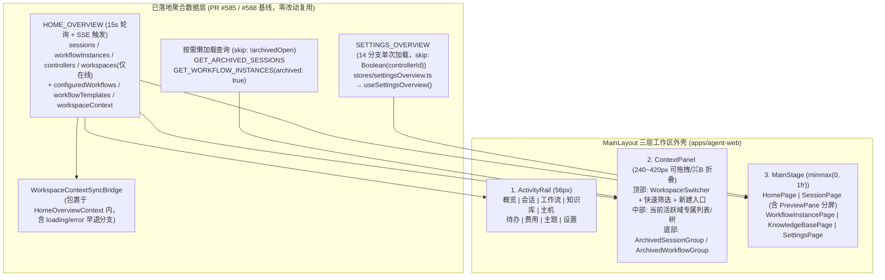
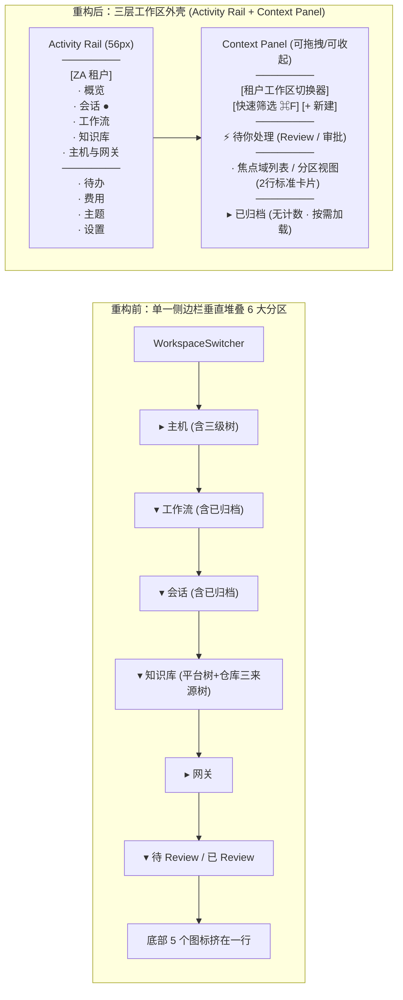
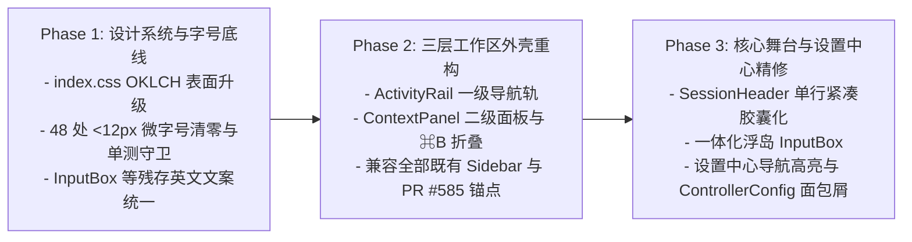

# 整体工作区 UI/UX 重构与视觉规范升级 - 技术提案

**功能名称**: 整体工作区 UI/UX 重构与视觉规范升级
**关联 PRD**: [docs/product/draft/20261126-ui-ux-workspace-overhaul.md](../../product/draft/20261126-ui-ux-workspace-overhaul.md)
**关联规范**: [docs/engineering/ui-ux-standards.md](../ui-ux-standards.md)
**前置已合入提案**: [docs/engineering/proposals/20261126-feat-api-performance-optimization.md](20261126-feat-api-performance-optimization.md)（PR #585 / #588，Issue #584）
**技术提案版本**: v1.1（同步 `main` 已合入的 PR #585 / #588 代码事实）
**创建日期**: 2026-11-26
**作者**: ZeroAsh Agent
**feat-branch**: `refactor/ui-ux-workspace-overhaul`
**领域模型影响**: 本提案为纯前端工作区架构与 UI/UX 视觉系统重构，不改变任何后端持久化实体、契约或状态机；数据读口径 100% 遵循 PR #585 已在 [`docs/knowledges/domain/30-控制器/00-上下文概览.md`](../../knowledges/domain/30-控制器/00-上下文概览.md)、[`50-会话与交互/00-上下文概览.md`](../../knowledges/domain/50-会话与交互/00-上下文概览.md)、[`60-工作流/00-上下文概览.md`](../../knowledges/domain/60-工作流/00-上下文概览.md) 中落地的口径。

## 1. 概述

### 1.1 背景与主干最新代码审计（Post-PR #585 Codebase Audit）

**PR #585（及其实现 PR #588）已合入 `main` 分支**，完成了接口性能优化（#584）的全部后端契约与前端数据流改造：
- `contracts/home.graphql` 与 `servers/agent-api` 已移除 `homeOverview.archivedSessions` / `archivedWorkflowInstances`，并入 `configuredWorkflows`、`workflowTemplates`、`workspaceContext` 三分支；`workspaces` 服务层已过滤已删除或非 `online` 控制器下的项目工作区。
- `contracts/settings.graphql` 已新增 **14 分支**的 `SettingsOverview` 聚合查询（`commitSettings`、`providers`、`models`、`controllerKeys`、`mcpServers`、`valutEntries`、`customMcpServers`、`customTools`、`githubAccounts`、`githubAppUrl`、`myExternalLogins`、`authProviders`、`cloudStorageCapabilities`、`cloudStorages`）。
- 前端 [`apps/agent-web`](../../../apps/agent-web) 已落地：
  - `MainLayout.tsx` 挂载 `HomeOverviewContext.Provider` 与 `<WorkspaceContextSyncBridge />`（含 `loading` 与 `error && !data` 早退分支包裹，防止失效工作区死锁）。
  - `Sidebar.tsx` 内 `ArchivedSessionGroup`（按需查询 `GET_ARCHIVED_SESSIONS`，`data-testid="sidebar-archived-session-list"`）与 `ArchivedWorkflowGroup`（按需查询 `GET_WORKFLOW_INSTANCES(archived: true)`，`data-testid="sidebar-archived-workflow-list"`）已实现常驻折叠、无数量展示、点击展开按需拉取及「加载中… / 加载失败+重试 / 暂无归档」三态。
  - `SettingsPage.tsx` 已通过 `stores/settingsOverview.ts`（`SettingsOverviewContext` / `useSettingsOverview()`）单次请求 `SETTINGS_OVERVIEW`（在 `skip: Boolean(controllerId)` 下避免进入控制器子页无谓签发 `githubAppUrl` OAuth state），各设置区块已改为消费 Context，且模板/配置写操作 `refetchQueries` 已统一指向 `HOME_OVERVIEW`。

在此最新主干基线上，经对 [`apps/agent-web`](../../../apps/agent-web) 与 [`apps/admin-web`](../../../apps/admin-web) 的 UI/UX 全面审计，当前界面在**空间布局、字体可读性、信息密度与视觉层级**上仍存在 4 大核心问题：

1. **单一侧边栏（`Sidebar.tsx` 838 行）职责与纵向空间严重过载**：
   - `MainLayout.tsx` 桌面端仍采用固定的两列网格 `grid-cols-[var(--sidebar-width,20rem)_minmax(0,1fr)]`。
   - `Sidebar.tsx` 在同一纵向滚动容器内依次挂载了：`WorkspaceSwitcher`、`SidebarSection("hosts")`（内嵌控制器 → 工作区 → Worktree 三级树）、`SidebarSection("workflows")`、`SidebarSection("sessions")`、`KnowledgeBaseSection`（内嵌平台知识库多级树 + `RepoKnowledgeBaseSection` 三来源云电脑树）、`SidebarSection("gateways")`、`ReviewSection`，外加底部 5 个全局图标按钮（`TodoListPanel`、`ThemeToggle`、`新建会话`、`我的费用`、`设置`）。
   - 当用户同时展开「会话」与「知识库」或「主机」时，单个侧栏内出现多达 4 层缩进与数百个 DOM 节点，纵向滚动条严重碎片化。
2. **全站存在 48 处 `< 12px`（`text-[9px]` / `text-[10px]` / `text-[11px]`）微字号**：
   - 经 `rg "text-\[(9|10|11)px\]" apps/` 精确统计，主干仍存留 **48 处**硬编码微字号分布在 18 个核心组件中：
     - `text-[9px]`（6 处）：`KnowledgeBasePage.tsx:165`、`RepoKnowledgeBaseSection.tsx:84,199,208`、`KnowledgeBaseSection.tsx:233`、`ResourceChip.tsx:38`。
     - `text-[10px]`（37 处）：`SidebarSection.tsx:43`、`TreeSection.tsx:55`、`WorkflowNodeTree.tsx`（5 处）、`WorkflowNodeCard.tsx`（8 处）、`ResourceChip.tsx`（2 处）、`WorkflowGraphView.tsx:153`、`WorkflowInstanceCard.tsx`（2 处）、`NodeDetailDrawer.tsx`（3 处）、`PreviewTabBar.tsx`（2 处）、`ReviewPanel.tsx`（2 处）、`InputBox.tsx:304`、`DiffView.tsx:67`、`ConfigOptionsPanel.tsx:50`、`FragmentEditor.tsx:57` 等。
     - `text-[11px]`（5 处）：`WorkflowNodeCard.tsx`（3 处）、`ModelSelectDialog.tsx:70`、`KnowledgeBaseSettingsDialog.tsx:276`。
3. **设置中心（`SettingsPage.tsx` 304 行）12 区块单页长滚与子页导航割裂**：
   - 虽然数据层已通过 `SettingsOverviewContext` 收敛为 1 次请求，但 UI 层仍将 12 个功能区块平铺在同一个超长滚动容器内；且当 `?controllerId=xxx` 时直接早退替换为 `<ControllerConfigPage />`，丢失外层设置中心导航上下文。
4. **会话舞台（`SessionHeader.tsx` & `InputBox.tsx`）视觉噪音与中英混杂**：
   - `SessionHeader.tsx` 将 7 类元数据平铺在同一 flex 行，依赖 `ResizeObserver` 测量 `TOOLBAR_MIN_INFO_WIDTH = 192` 被动折叠工具栏。
   - `InputBox.tsx:365-404` 與 `Sidebar.tsx:762` 仍硬编码英文文案：`"Session is not active..."`、`"Agent is processing..."`、`"Type your message..."`、`"Stop"`、`"Send"`、`"New Session"`，违反简体中文统一规范。

### 1.2 重构目标

1. **落地三层工作区外壳（3-Tier Workspace Shell）**：演进 `MainLayout` 与 `Sidebar`，构建 `ActivityRail`（`56px` 一级导航轨）+ `ContextPanel`（`240px–420px` 可调宽/可 `⌘B` 收起二级聚焦面板）+ `MainStage`（主工作舞台）。
2. **全站微字号清零与设计系统 Token 升级**：将 `apps/agent-web/src/index.css` 与 `apps/admin-web/src/index.css` 升级为带色相微调的 OKLCH 表面层级体系，100% 替换 48 处 `text-[9px|10px|11px]` 为标准 `text-xs`（`12px`）或 `text-sm`（`14px`），全面应用 `tabular-nums`。
3. **100% 保护 PR #585 / #588 已落地的聚合数据流与 E2E 测试不变量**：
   - 保持 `MainLayout` 的 `HomeOverviewContext.Provider` + `<WorkspaceContextSyncBridge />` 包裹结构（含 `loading` / `error` 早退分支），确保首屏仅 1 次 `HomeOverview` 请求。
   - 在二级上下文面板中直接复用已落地的 `ArchivedSessionGroup` 与 `ArchivedWorkflowGroup`（保留 `data-testid="sidebar-archived-session-list"` 与 `data-testid="sidebar-archived-workflow-list"`、无计数、点击展开按需查询）。
   - 在 `SettingsPage` 中保留 `SettingsOverviewContext.Provider` 与 `skip: Boolean(controllerId)` 优化，升级视觉呈现为分类聚焦视图 + 面包屑嵌入式 `ControllerConfigPage`（同时兼容 `/settings?section=valut&entry=<id>` 深链穿透与锚点滚动）。

### 1.3 范围

- **包含**：
  - [`docs/engineering/ui-ux-standards.md`](../ui-ux-standards.md) 设计规范建立与 `AGENTS.md` / `frontend-rules.md` 索引登记。
  - `apps/agent-web` 整体布局外壳重构、48 处微字号清零、中英文案统一、首页/会话页/工作流页/知识库页/设置中心 UI 重构。
  - `apps/admin-web` 主题表面 Token 同步与导航顶栏视觉对齐。
- **不包含**：
  - **零后端改动、零 GraphQL 契约改动**（PR #585/#588 已完成全部所需契约与后端实现，本重构为纯前端 UI/UX 升级）。

---

## 2. 技术架构与布局组成

### 2.1 三层工作区架构与数据流图（基于 PR #585 已合入基线）

### 2.2 模块划分与组件重构映射

| 模块层级 | 新增 / 重构组件路径 | 核心职责与设计说明 |
|---------|-------------------|------------------|
| **设计系统基础** | `apps/agent-web/src/index.css` `apps/admin-web/src/index.css` | 升级 OKLCH 表面明度梯度（`--background` / `--sidebar` / `--card` / `--popover`），定义语义状态色与 `.tabular-nums` 工具类 |
| **工作区外壳** | `apps/agent-web/src/pages/MainLayout.tsx` | 保持 `HomeOverviewContext.Provider` + `WorkspaceContextSyncBridge` 不变量；桌面端网格升级为 `grid-cols-[56px_var(--sidebar-width,20rem)_minmax(0,1fr)]`（当二级面板收起时为 `grid-cols-[56px_minmax(0,1fr)]`） |
| **一级导航轨** | `apps/agent-web/src/components/layout/ActivityRail.tsx` | 56px 垂直导航轨，承载五大核心工作域切换、待处理 Review / 审批交互的圆点徽标提醒、底部全局工具栏（`TodoListPanel`、`ThemeToggle`、`我的费用`、`设置`） |
| **二级上下文面板** | `apps/agent-web/src/components/Sidebar.tsx`（重构为聚焦型 ContextPanel） | 承载 `WorkspaceSwitcher`、列表搜索框、当前活动域列表（或支持全部折叠分区模式与单域聚焦模式无缝切换，100% 兼容既有 `sidebar-section-*` 测试锚点）及底部已落地的 `ArchivedSessionGroup` / `ArchivedWorkflowGroup` |
| **会话舞台组件** | `apps/agent-web/src/components/session/SessionHeader.tsx` `apps/agent-web/src/components/session/InputBox.tsx` | 顶栏收敛为 `48px` 单行，路径/Worktree/Harness 收纳进环境胶囊；`InputBox` 升级为一体化浮岛卡片，文案 100% 汉化 |
| **设置中心舞台** | `apps/agent-web/src/pages/SettingsPage.tsx` `apps/agent-web/src/pages/ControllerConfigPage.tsx` | 复用 `SettingsOverviewContext`（14 分支）；左侧分类导航增强选中高亮与分组视觉；`ControllerConfigPage` 顶部增加面包屑导航栏（`设置 / 控制器管理 / {controller.name}`） |

---

## 3. 核心重构设计详述

### 3.1 空间布局重构：三层工作区外壳与既有 E2E 锚点兼容设计

#### 现状问题与重构对比

- **焦点切换与存量 E2E 锚点 100% 兼容策略**：
  - 存量 E2E 测试（如 `tests/e2e/src/home.spec.ts`、`sidebar-phase4.spec.ts`、`session-archive.spec.ts`）依赖 `nav[aria-label="Sidebar"]`、`data-testid="sidebar-section-{hosts|workflows|sessions|knowledgeBases|gateways}"`、`data-testid="sidebar-archived-session-list"` 及 `data-testid="sidebar-archived-workflow-list"`。
  - 为确保重构后**零 E2E 破坏**：
    1. `ActivityRail` 点击领域图标时，自动将该领域对应的 `SidebarSection` 展开并滚动置顶（或在「聚焦单域模式」与「全分区模式」间切换，默认保持 DOM 锚点可访问）。
    2. 保留 `localStorage['sidebar-sections-expanded']` 与 `localStorage['sidebar-width']` 的持久化键名与读写契约不变。
    3. 新增 `Cmd+B` 一键折叠/展开 `ContextPanel` 能力，为小屏桌面或需要全宽代码 Diff 预览的场景释放 `280px+` 水平空间。

### 3.2 排版与微字号清零计划（48 处 `< 12px` 全面迁移矩阵）

根据 [`docs/engineering/ui-ux-standards.md`](../ui-ux-standards.md) 第二节规定，全站最小字号为 `text-xs`（`12px` / `0.75rem`）。主干 48 处存量微字号的精确替换方案如下：

| 所在组件文件 | 存量微字号类名与行数 | 重构后标准类名 | 视觉调整说明 |
|-------------|-------------------|--------------|------------|
| `pages/KnowledgeBasePage.tsx` | `:165` `text-[9px]` | `text-xs` (`12px`) | 仓库知识库面包屑来源 Badge 调整为 `px-1.5 py-0.5 text-xs` |
| `components/knowledge-base/KnowledgeBaseSection.tsx` | `:233` `text-[9px]` | `text-xs` (`12px`) | 「全局」知识库 Badge 升级为 `px-1.5 py-0.5 text-xs` |
| `components/knowledge-base/RepoKnowledgeBaseSection.tsx` | `:84,199,208` `text-[9px]` `:215,221,339,373` `text-[10px]` | `text-xs` (`12px`) | 仓库来源标签、错误提示、空态与主机计数全部统一为 `text-xs` |
| `components/knowledge-base/KnowledgeBaseSettingsDialog.tsx` | `:276` `text-[11px]` | `text-xs` (`12px`) | 历史事件文档路径 `font-mono text-xs` |
| `components/sidebar/SidebarSection.tsx` `components/tree/TreeSection.tsx` | `:43` `text-[10px]` `:55` `text-[10px]` | `text-xs tabular-nums` | 分区计数胶囊升级为 `px-1.5 py-0.5 text-xs tabular-nums` |
| `components/workflow/WorkflowInstanceCard.tsx` | `:66,74` `text-[10px]` | `text-xs` (`12px`) | 工作流卡片不可用徽标与状态徽标升级为 `text-xs` |
| `components/workflow/WorkflowNodeTree.tsx` | `:87,91,110,119,138` `text-[10px]` | `text-xs` (`12px`) | 列表视图节点类型、Harness、PR 与检查项徽标统一为 `text-xs` |
| `components/workflow/graph/WorkflowNodeCard.tsx` | `:73,78,83,109,115,154,163,178` `text-[10px]` `:95,127,138` `text-[11px]` | `text-xs` (`12px`) | DAG 节点卡片徽标与动态行全面升级为 `text-xs` |
| `components/workflow/graph/ResourceChip.tsx` `components/workflow/WorkflowGraphView.tsx` | `:29,38,74` `text-[9px]`/`text-[10px]` `:153` `text-[10px]` | `text-xs` (`12px`) | 图上黑板/PR/追加提示词资源芯片与顶部「实例资源」标签统一为 `text-xs` |
| `components/workflow/NodeDetailDrawer.tsx` `components/workflow/ContinueWorkflowDialog.tsx` | `:74,79,84` `text-[10px]` `:333` `text-[10px]` | `text-xs` (`12px`) | 抽屉顶栏状态胶囊与接续对话框节点标签升级为 `text-xs` |
| `components/session/preview/PreviewTabBar.tsx` `components/session/preview/ReviewPanel.tsx` | `:56,57` `text-[10px]` `:148,160` `text-[10px]` | `text-xs` (`12px`) | 分屏 Tab 栏「常开/预览」标识与 Review 目录分组路径升级为 `text-xs` |
| `components/session/InputBox.tsx` `components/session/MessageItem.tsx` `components/session/DiffView.tsx` `components/session/ConfigOptionsPanel.tsx` `components/session/ModelSelectDialog.tsx` | `:304` `text-[10px]` `:158` `text-[10px]` `:67` `text-[10px]` `:50` `text-[10px]` `:70` `text-[11px]` | `text-xs` (`12px`) | 批注来源徽标、图片名、Diff 新增标记、配置项分组标题与模型分组说明统一为 `text-xs` |
| `components/common/fragment-editor/FragmentEditor.tsx` | `:57` `text-[10px]` | `text-xs` (`12px`) | Fragment 原子引用块标签升级为 `text-xs` |

### 3.3 基于 PR #585 / #588 基线的设置中心与控制器配置体验升级

PR #585 / #588 已在 `SettingsPage.tsx` 中落地了 `SETTINGS_OVERVIEW`（14 分支）与 `SettingsOverviewContext`，并在 `controllerId` 存在时通过 `skip: Boolean(controllerId)` 跳过聚合查询。在此基础上，UI/UX 重构做以下两点体验增强（严守既有数据流不变量）：

1. **设置导航分类高亮与聚焦体验**：
   - 在 `SettingsPage.tsx` 左侧导航栏（`nav[aria-label="Settings navigation"]`）引入当前激活分类状态（`activeSectionId`，支持点击切换与 IntersectionObserver 滚动高亮），并为每个分组补充精致的卡片容器层级与统一的区块头部说明。
   - 完整保留 `#account-section`、`#github-section`、`#git-section`、`#provider-section`、`#model-section`、`#controller-section`、`#mcp-section`、`#valut-section`、`#custom-mcp-section`、`#custom-tool-section`、`#workflow-section`、`#storage-section` 的 DOM ID，确保 `/settings?section=valut&entry=<id>` 等穿透定位与全部 E2E 测试（`tests/e2e/src/settings-overview.spec.ts`）100% 兼容。
2. **控制器/云电脑配置页（`ControllerConfigPage.tsx`）面包屑头部升级**：
   - 保持 `SettingsPage.tsx` 中 `skip: Boolean(controllerId)` 的早退渲染机制（不额外触发 `SETTINGS_OVERVIEW` 请求，不破坏 `E2E-SET1` 请求数预算）。
   - 在 `ControllerConfigPage.tsx` 顶部新增统一的面包屑顶栏（`设置中心 / 控制器管理 / {controller.name}`）与在线状态胶囊，让用户从设置中心进入主机配置时拥有连贯的视觉脉络与显著的返回入口。

---

## 4. 分阶段实施与迁移计划（Phased Rollout Plan）

由于前期的「PR #585 数据流与归档/设置聚合改造」已在 `main` 分支合入，本重构计划收敛为 **3 个高内聚纯前端阶段**，遵循 TDD 红-绿-重构循环推进：

### Phase 1：设计系统 Token 升级、48 处微字号清零与文案统一
- 更新 `apps/agent-web/src/index.css` 与 `apps/admin-web/src/index.css` 的 OKLCH 表面明度变量（区分 `--background`、`--sidebar`、`--card`、`--popover`）。
- 批量替换 18 个组件中的 48 处 `text-[9px|10px|11px]` 为 `text-xs`，并新增单测守卫 `src/__tests__/ui-ux-standards.test.ts`（静态扫描 `apps/agent-web/src` 与 `apps/admin-web/src` 全部 `.tsx` 文件，禁止出现 `text-\[(9|10|11)px\]`）。
- 审查并统一 `InputBox.tsx` 等处残存的中英混杂交互文案（同步更新对应组件单测断言）。

### Phase 2：三层工作区外壳（`ActivityRail` + `ContextPanel` + `MainStage`）
- 新增 `apps/agent-web/src/components/layout/ActivityRail.tsx`，重构 `MainLayout.tsx` 与 `Sidebar.tsx`。
- 保持 `HomeOverviewContext.Provider` + `WorkspaceContextSyncBridge` 包裹结构与 `ArchivedSessionGroup` / `ArchivedWorkflowGroup` 懒加载逻辑零改动。
- 实现桌面端一键折叠二级面板（`Cmd+B`）及移动端导航兼容。

### Phase 3：会话舞台、工作流舞台与设置中心精细化打磨
- 优化 `SessionHeader.tsx` 为 `48px` 单行紧凑顶栏 + 环境信息胶囊。
- 优化 `InputBox.tsx` 为一体化浮岛输入卡片。
- 优化 `SettingsPage.tsx` 导航激活态与 `ControllerConfigPage.tsx` 顶部面包屑导航栏。

---

## 5. 测试策略

| 测试层级 | 工具 | 核心验证点 |
|---------|------|-----------|
| **设计规范守卫单测** | Vitest | 新增 `src/__tests__/ui-ux-standards.test.ts`：静态扫描 `apps/agent-web/src` 与 `apps/admin-web/src` 全部 `.tsx` 文件，断言零 `text-[9px]`、`text-[10px]`、`text-[11px]` 出现 |
| **组件单元测试** | Vitest + RTL | `MainLayout.test.tsx`、`Sidebar.test.tsx`（含 PR #585 新增的归档懒加载/去计数用例）、`SettingsPage.test.tsx`（单次 `SETTINGS_OVERVIEW` 消费）、`ControllerConfigPage.test.tsx`、`InputBox.test.tsx` |
| **E2E 回归测试** | Playwright | 完整通过 `tests/e2e/src/home.spec.ts`（E2E-HP1~3）、`session-archive.spec.ts`、`settings-overview.spec.ts`（E2E-SET1）、`sidebar-phase4.spec.ts`、`workflow-graph.spec.ts`，并验证窄屏与宽屏下 `scrollWidth - clientWidth <= 1` 零横向溢出 |

## 6. 验收标准

- [ ] [`docs/engineering/ui-ux-standards.md`](../ui-ux-standards.md) 设计规范就位并在 `docs/engineering/AGENTS.md` 与 `frontend-rules.md` 登记。
- [ ] 全站 48 处 `< 12px` 微字号 100% 清零，守卫单测通过。
- [ ] 三层工作区外壳（Activity Rail + Context Panel + Main Stage）交互流畅，支持拖拽调宽与一键折叠。
- [ ] 100% 保持 PR #585 / #588 已落地的全部性能与交互不变量（归档按需加载无数量、`homeOverview` 三分支同步、在线控制器工作区过滤、`settingsOverview` 14 分支单次聚合加载）。
- [ ] 亮色与暗色主题对比度达标，全站操作文案统一。

## 7. 相关文档

- 关联 PRD：[docs/product/draft/20261126-ui-ux-workspace-overhaul.md](../../product/draft/20261126-ui-ux-workspace-overhaul.md)
- 设计规范：[docs/engineering/ui-ux-standards.md](../ui-ux-standards.md)
- 前置已合入方案（PR #585 / #588）：[docs/product/draft/20261126-api-performance-optimization.md](../../product/draft/20261126-api-performance-optimization.md)、[docs/engineering/proposals/20261126-feat-api-performance-optimization.md](20261126-feat-api-performance-optimization.md)、[docs/engineering/plan/20261126-feat-api-performance-optimization.md](../plan/20261126-feat-api-performance-optimization.md)
- 前端开发规范：[docs/engineering/frontend-rules.md](../frontend-rules.md)
