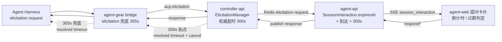
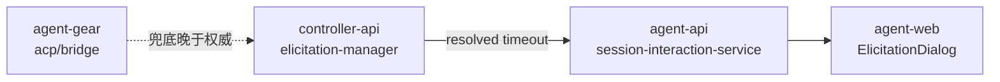
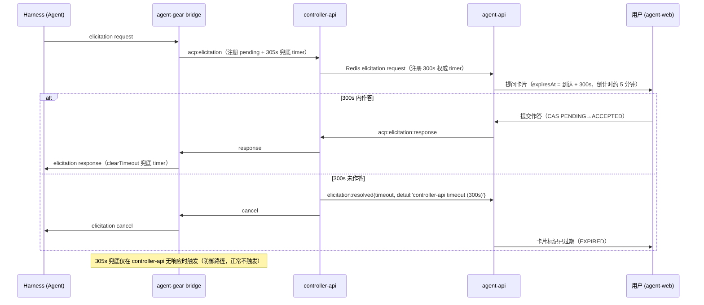

# 提问超时从 60 秒改为 300 秒 - 技术提案

**功能名称**: 提问超时从 60 秒改为 300 秒
**关联 PRD**: [[../../product/draft/20261127-question-timeout-300s.md]]
**技术提案版本**: v1.0
**创建日期**: 2026-11-27
**作者**: z-agent-bot
**feat-branch**: `feat/question-timeout-300s`
**领域模型影响**: `docs/knowledges/domain/50-会话与交互/00-上下文概览.md`、`docs/knowledges/domain/50-会话与交互/01-聚合与实体.md`（交互作答时限口径 60s → 提问 300s / 权限审批 60s 拆分）；`docs/knowledges/domain/01-通用语言-术语表.md`（SessionInteraction 条目与「作答时限 vs 5 分钟」注）

## 1. 概述

### 1.1 背景

PRD（Issue [#602](https://github.com/Deliay/z-agent-gear/issues/602)）要求把会话内「提问」的用户可作答时限从 60 秒改为 300 秒。现状超时链路存在三个与时限相关的落点（详见 1.4 代码事实核对）：

1. **controller-api `ElicitationManager.TIMEOUT_MS = 60_000`**：唯一用户可见超时的权威计时器，到点发布 `elicitation:resolved{reason:'timeout'}` + 回 Agent `cancel`；
2. **agent-api `SessionInteraction.expiresAt`**：提问卡片倒计时与过期判定的唯一依据，= 事件到达 agent-api 时刻 + 60s；
3. **agent-gear bridge elicitation 兜底 timer 65s**：controller-api 无响应时的防御性兜底（权威 60s + 5s race 余量），到点自动取消并发出 `resolved{timeout, detail:'bridge timeout (65s)'}`。

权限审批（`PermissionManager.TIMEOUT_MS = 60_000`）**不在本次范围**，维持 60s（PRD 3.6 范围边界、D1）。

### 1.2 技术目标

- 提问（elicitation）作答时限全链路统一改为 **300s**：权威超时、卡片倒计时、兜底 timer、文案四处口径一致。
- 权限审批（permission）超时链路**零改动**：`PermissionManager.TIMEOUT_MS`、permission 兜底 65s、permission 的 `expiresAt` 均保持现状。
- `sessioninteractions.expiresAt` 由「两 kind 共用一个常量」改为**按 kind 拆分**，成为两种时限并存后的单一口径来源。
- 契约中「Elicitation / Permission 统一 60s 口径」的描述同步为拆分口径，避免契约与实现漂移。
- 全链路 TDD 覆盖：定时器取值、detail 文案、expiresAt 分 kind 断言、权限审批零回归。

### 1.3 范围

- **做**：controller-api elicitation 超时常量与文案、agent-api expiresAt 按 kind 拆常量、agent-gear bridge elicitation 兜底 305s 与文案、agent-web 过期提示文案、契约口径描述、三份 AGENTS.md 口径、领域模型同步、测试矩阵。
- **不做**：权限审批超时调整（维持 60s）、超时时长 env/用户级可配配置、超时后交互语义变化、`TodoItem` 5 分钟通知 TTL 调整、controller-api `permission-manager.ts` 与 `permission:resolved` 链路任何改动。

### 1.4 代码事实核对

| # | 事实 |
|---|------|
| F1 | `servers/controller-api/src/services/elicitation-manager.ts`：L56 `const TIMEOUT_MS = 60_000`（唯一用户可见超时）；L136-138 注册 `setTimeout(..., TIMEOUT_MS)`；L246 `detail: 'controller-api timeout (60s)'`；L132/L237/L267 注释写「60s」 |
| F2 | `servers/controller-api/src/services/permission-manager.ts`：L40 `TIMEOUT_MS = 60_000`、L150 `detail: 'controller-api timeout (60s)'`——权限审批，**本次零改动** |
| F3 | `servers/agent-api/src/services/session-interaction-service.ts`：L7-8 `SESSION_INTERACTION_TIMEOUT_MS = 60_000`（注释「与 controller-api `TIMEOUT_MS`（60s）对齐」）；L173（elicitation）与 L193（permission）共用同一常量；L132 注释「+ 60s」 |
| F4 | `packages/agent-controller/src/acp/bridge.ts`：elicitation 兜底 L1038-1057 `setTimeout(..., 65_000)`、L1048 日志 `'elicitation timed out after 65s, auto-cancelling'`、L1054 `detail: 'bridge timeout (65s)'`；permission 兜底 L978-982 `65_000` 不动；L421/L445/L1127/L1208 注释提「65s」 |
| F5 | `apps/agent-web/src/components/ElicitationDialog.tsx` L86：文案「该请求将在约 1 分钟后过期；请在会话内的提问卡片中填写并提交。」 |
| F6 | `contracts/agent-session.graphql` L299：`expiresAt` 注释「作答截止（创建 + 60s，与 controller-api TIMEOUT_MS 一致）」 |
| F7 | `contracts/agent-session-websocket.md` §2.34.1「作答时限统一口径」（L989-991）：Elicitation / Permission 统一 60s、`expiresAt` = 到达 + 60s、TodoItem 5min 仅通知 TTL；同节 detail 示例 `controller-api timeout (60s)`；§2.34/§2.34.1 两处「65s」描述（elicitation 相关） |
| F8 | 现状超时链路：controller-api 60s 权威超时先于 bridge 65s 兜底触发；`expiresAt` 是卡片倒计时与过期判定唯一依据；TodoItem 5min 仅通知 TTL，不参与作答有效性 |
| F9 | 测试触点：`servers/controller-api/src/services/elicitation-manager.test.ts` T-S5/T-S8（`advanceTimersByTime(60_000)`、detail 断言）；`packages/agent-controller/src/acp/bridge.test.ts`「65s timeout」用例与 T-B4/T-B5（`advanceTimersByTimeAsync(65_000)`、`detail: 'bridge timeout (65s)'`）；`servers/agent-api/src/services/session-interaction-service.test.ts` T-SI1（expiresAt≈+60s）、T-SI7（detail）；`tests/api/src/agent-api/elicitation.test.ts` API-SI1/SI2（≤65_000 断言、detail）；`tests/e2e/src/elicitation.spec.ts`（detail）；`apps/agent-web/src/components/ElicitationDialog.test.tsx`（「约 1 分钟后过期」） |
| F10 | AGENTS.md 口径：`servers/controller-api/AGENTS.md` L44-46（`TIMEOUT_MS=60s` 唯一用户可见超时、permission detail 文案）、`servers/agent-api/AGENTS.md` L53（expiresAt = 到达 + 60s）、`packages/agent-controller/AGENTS.md` L344/L349（65s 兜底描述） |

## 2. 技术架构

### 2.1 系统架构图



### 2.2 技术栈

| 层级 | 技术选型 | 说明 |
|------|---------|------|
| 前端 | agent-web（React + TS） | 提问卡片/弹窗文案与倒计时展示（倒计时以 `expiresAt` 为唯一依据，前端零逻辑改动） |
| 后端 | controller-api / agent-api（Node.js + TS） | 权威超时计时器、`sessioninteractions.expiresAt` 写入 |
| 客户端 | packages/agent-controller（agent-gear） | bridge elicitation 兜底 timer |
| 契约 | contracts/ GraphQL + WebSocket 契约 | 仅口径描述与注释同步，无协议结构变更 |
| 数据库 | MongoDB（`sessioninteractions`） | 无 Schema 变更，仅 `expiresAt` 取值语义按 kind 拆分 |

### 2.3 模块划分



| 模块 | 职责 | 关键技术点 |
|------|------|-----------|
| controller-api `elicitation-manager` | 权威超时计时（唯一用户可见超时） | `TIMEOUT_MS` 300_000；到点 `resolved{timeout}` + 回 Agent `cancel` |
| agent-api `session-interaction-service` | 会话交互唯一读写口，`expiresAt` 写入 | 按 kind 拆常量：ELICITATION 300s / PERMISSION 60s |
| agent-gear `acp/bridge` | elicitation 兜底 timer | 305_000（权威 + 5s race 余量）；permission 兜底 65s 不动 |
| agent-web `ElicitationDialog` | 降级提醒弹窗文案 | 「约 5 分钟后过期」 |

## 3. API 设计

无新增/变更接口与协议结构，仅以下契约描述与注释同步（随实现阶段落地）：

### 3.1 API 契约

- `contracts/agent-session.graphql`（`SessionInteraction.expiresAt` 注释）：
  - 现状：`# 作答截止（创建 + 60s，与 controller-api TIMEOUT_MS 一致）`
  - 改为：`# 作答截止（提问 = 创建 + 300s、权限审批 = 创建 + 60s，分别对齐 controller-api elicitation/permission TIMEOUT_MS）`
- `contracts/agent-session-websocket.md` §2.34.1「作答时限统一口径」改为拆分口径：
  - **提问（Elicitation）作答时限 300s**（controller-api `ElicitationManager.TIMEOUT_MS`）；
  - **权限审批（Permission）作答时限 60s**（controller-api `PermissionManager.TIMEOUT_MS`，维持现状）；
  - `sessioninteractions.expiresAt` 按 kind 写入：提问 = 事件到达 agent-api 时刻 + 300s、权限审批 = + 60s；卡片倒计时仍以该字段为唯一依据；TodoItem 的 5 分钟 `expiresAt` 仅为通知保留窗口（TTL 清理）不变。
  - detail 示例 `controller-api timeout (60s)` → `controller-api timeout (300s)`（elicitation 处；permission 处保持 60s 示例）。
- `contracts/agent-session-websocket.md` §2.34/§2.34.1 中 elicitation 相关「65s」描述 → 「305s」（bridge 兜底）；permission 相关 65s 描述不动。

### 3.2 内部接口

无变更。`acp:elicitation:resolved` / `permission:resolved` 的 reason 语义与收敛不变量（租户隔离、终态单调）不变。

## 4. 数据模型

### 4.1 数据库设计

#### 表/集合: `sessioninteractions`

| 字段 | 类型 | 说明 |
|------|------|------|
| `expiresAt` | Date | 作答截止，**取值语义变更**：`kind='ELICITATION'` = 创建 + 300s；`kind='PERMISSION'` = 创建 + 60s（现状两 kind 共用 60s） |

无 Schema/索引变更（既有 `{sessionId,status,expiresAt}` 等索引沿用）；`TodoItem.expiresAt`（5 分钟通知 TTL）不变。

### 4.2 缓存设计

无涉及。

## 5. 技术实现方案

### 5.1 核心流程



### 5.2 关键实现点

#### 实现点 1: controller-api elicitation 权威超时 300s

- **描述**: `elicitation-manager.ts` `TIMEOUT_MS` 60_000 → 300_000；`detail: 'controller-api timeout (60s)'` → `'controller-api timeout (300s)'`；L132/L237/L267 注释「60s」→「300s」。
- **技术细节**: 收敛不变量（`filter.resolution = null` 单调、缺 `userId` 拒绝）不变；重复 requestId 清旧 timer 逻辑（T-S8）不变，仅 timer 取值变。
- **风险点**: 无。`permission-manager.ts` 零改动。

#### 实现点 2: agent-api `expiresAt` 按 kind 拆常量

- **描述**: `session-interaction-service.ts` 将 `SESSION_INTERACTION_TIMEOUT_MS` 拆为 `ELICITATION_TIMEOUT_MS = 300_000` 与 `PERMISSION_TIMEOUT_MS = 60_000`（单一来源，禁止散落字面量）；`createFromElicitationRequest` 用 300s、`createFromPermissionRequest` 用 60s；L7-8/L132 注释同步。
- **技术细节**: `expiresAt` 仍是 CAS 过期判定（`expiresAt: { $gt: now }`）与卡片倒计时的唯一依据，逻辑零变化，仅取值按 kind 分流。
- **风险点**: 需保证两个 kind 的写入口各自引用正确常量（测试矩阵 T-ET3 双向断言）。

#### 实现点 3: agent-gear bridge elicitation 兜底 305s

- **描述**: `bridge.ts` elicitation 兜底 `65_000` → `305_000`（L1057）；L1048 日志 `'elicitation timed out after 65s, auto-cancelling'` → `...305s...`；L1054 `detail: 'bridge timeout (305s)'`；L421/L445/L1127/L1208 注释「65s」→「305s」。
- **技术细节**: 兜底 = 权威 300s + 5s race 余量，与现状「60 + 5」同构；permission 兜底 65_000（L978-982）不动。收敛路径（`clearTimeout` + `resolved{cancelled}`）不变。
- **风险点**: 旧版 bridge（65s 兜底）混部期间会先于 300s 权威超时触发（见 R1）。

#### 实现点 4: agent-web 过期提示文案

- **描述**: `ElicitationDialog.tsx` L86「该请求将在约 1 分钟后过期」→「该请求将在约 **5 分钟**后过期」；「该问询已过期」不变。
- **技术细节**: 倒计时组件以 `expiresAt` 驱动，前端零逻辑改动。

#### 实现点 5: 契约口径同步

- **描述**: 按 §3.1 更新 `contracts/agent-session.graphql` 注释与 `contracts/agent-session-websocket.md` §2.34/§2.34.1 口径描述与 detail 示例。
- **技术细节**: 仅描述/注释，无协议结构变更；契约同步随实现阶段同 PR 落地。

#### 实现点 6: AGENTS.md 口径同步

- **描述**: `servers/controller-api/AGENTS.md` L44-46（60s 口径与 permission detail 示例）、`servers/agent-api/AGENTS.md` L53（+60s）、`packages/agent-controller/AGENTS.md` L344/L349（65s 兜底描述）同步为拆分口径。

#### 实现点 7: 领域模型同步（随本提案落地）

- **描述**: `docs/knowledges/domain/50-会话与交互/00-上下文概览.md`（交互状态机超时迁移、作答口径、口径陷阱 1）、`01-聚合与实体.md`（`expiresAt` 行）、`docs/knowledges/domain/01-通用语言-术语表.md`（SessionInteraction 条目与「作答时限 vs 5 分钟」注）。

## 6. 技术决策

### 6.1 决策列表

| 决策 | 选项 A | 选项 B | 最终选择 | 原因 |
|------|--------|--------|---------|------|
| D1 范围 | 提问与权限审批一起改 300s | 仅提问改 300s，权限审批留 60s | **B** | Issue 用词「提问」对应 UI「提问卡片」（elicitation）；权限审批诉求是快速决策、有独立超时语义（`permissionTimeoutAction`），PRD 3.6 明确非目标，留待评审调整 |
| D2 改动落点 | 只改 controller-api 一处 | 三层同步（controller-api / agent-api / bridge） | **B** | 卡片倒计时唯一依据是 agent-api `expiresAt`、兜底在 bridge，单点修改必然口径漂移 |
| D3 配置化 | 超时做成 env 可配 | 固定常量 | **B** | Issue 为固定值调整，无配置诉求（YAGNI），改值走发版 |
| D4 兜底取值 | bridge 兜底保持 65s | 兜底 = 300 + 5 = 305s | **B** | 兜底必须晚于权威超时，否则会先于 controller-api 误取消；保持「权威 + 5s」与现状同构 |
| D5 agent-api 常量 | 单常量改 300s（权限审批跟着变） | 按 kind 拆两个常量 | **B** | 权限审批必须保持 60s（D1），单常量无法两速并存 |
| D6 契约同步 | 本阶段不动契约 | 契约随实现同步（仅描述/注释） | **B** | 契约「统一 60s 口径」描述与现实不符即误导；无结构变更，随实现同 PR 落地 |
| D7 文案粒度 | 「约 5 分钟」 | 「300 秒」 | **A** | 与现有「约 1 分钟」粒度一致，面向用户口语化 |
| D8 detail 文案 | 保持 `(60s)` 字样 | 同步改为 `(300s)` / bridge `(305s)` | **B** | detail 仅展示/日志（逻辑分支只看 `reason`），同步可避免误导，混部安全 |

### 6.2 依赖与约束

| 类型 | 内容 | 说明 |
|------|------|------|
| 依赖 | agent-gear（bridge）随包升级 | 未升级控制器上 65s 兜底先触发（R1）；云电脑有自动升级机制收敛 |
| 约束 | 权限审批链路零改动 | `permission-manager.ts`、`permission:resolved`、permission 兜底 65s、permission `expiresAt` 60s 全部不动 |
| 约束 | `expiresAt` 仍是作答有效性唯一口径 | TodoItem 5min 通知 TTL 语义不变 |

### 6.3 风险

| 风险 | 影响 | 缓解 |
|------|------|------|
| R1 旧版 bridge 65s 兜底先于 300s 权威超时触发 | 未升级控制器上提问最迟约 65s 被取消（等同现状口径，不享受 300s） | controller-api 与 agent-gear 同批发版；云电脑自动升级收敛到最新 bridge；混部期间无功能回归 |
| R2 提问悬挂时间变长（最长 5 分钟） | Agent 等待窗口变长 | 超时后自动继续语义不变，5 分钟为 Issue 指定值 |
| R3 测试中大量 60_000/65_000 字面量 | 遗漏即假绿 | 测试矩阵逐条列明（§8），TDD 红绿先改断言再改实现 |

## 7. 项目结构

```
z-agent-gear/
├── contracts/
│   ├── agent-session.graphql              # expiresAt 注释（F6）
│   └── agent-session-websocket.md         # §2.34/§2.34.1 口径与 detail 示例（F7）
├── servers/
│   ├── controller-api/src/services/
│   │   ├── elicitation-manager.ts         # TIMEOUT_MS 300_000 + detail (300s)（F1）
│   │   └── permission-manager.ts          # 零改动（F2）
│   └── agent-api/src/services/
│       └── session-interaction-service.ts # expiresAt 按 kind 拆常量（F3）
├── packages/agent-controller/src/acp/
│   └── bridge.ts                          # elicitation 兜底 305_000 + 文案（F4）
├── apps/agent-web/src/components/
│   └── ElicitationDialog.tsx              # 「约 5 分钟后过期」（F5）
└── docs/
    ├── knowledges/domain/                 # 领域模型同步（实现点 7）
    └── engineering/proposals/20261127-fix-question-timeout-300s.md  # 本提案
```

## 8. 测试策略

TDD 红绿重构：先改断言（红）→ 改实现（绿）→ 收敛常量单一来源（重构）。

### 8.1 测试覆盖要求

- 涉及模块单测覆盖率不下降；四个超时落点（权威 / expiresAt / 兜底 / 文案）100% 断言覆盖。
- 权限审批链路以「零 diff + 既有测试零改动」为回归口径。

### 8.2 测试类型

| 编号 | 类型 | 覆盖范围 |
|------|------|---------|
| T-ET1 | 单元（controller-api） | `elicitation-manager.test.ts`：T-S5/T-S8 等 `advanceTimersByTime(60_000)` → `300_000`；300s 到点发 `resolved{timeout, detail:'controller-api timeout (300s)'}` + 回 cancel；提前响应不触发 |
| T-ET2 | 单元（agent-gear） | `bridge.test.ts`：elicitation 兜底用例与 T-B4/T-B5 的 `65_000` → `305_000`、`detail: 'bridge timeout (305s)'`；permission 65s 用例**不动** |
| T-ET3 | 单元（agent-api） | `session-interaction-service.test.ts`：T-SI1 elicitation `expiresAt` ≈ +300s；**新增** permission `expiresAt` ≈ +60s 断言；T-SI7 detail 文案；T-SI5 过期拒答不变 |
| T-ET4 | API（tests/api） | `agent-api/elicitation.test.ts` API-SI1/SI2：`expiresAt` 窗口断言（≤65_000 → 300s 口径）、`detail: 'controller-api timeout (300s)'`；`permission.test.ts` API-SI7 零改动 |
| T-ET5 | E2E（tests/e2e） | `elicitation.spec.ts`：detail 文案、超时窗口按 300s、过期卡片态 |
| T-ET6 | 单元（agent-web） | `ElicitationDialog.test.tsx`：「约 5 分钟后过期」文案 |

## 9. 部署方案

### 9.1 环境规划

| 环境 | 用途 | 部署方式 |
|------|------|---------|
| 全环境 | 常规发版 | controller-api / agent-api 随服务发版；agent-gear 随包版本升级（云电脑自动升级收敛） |

### 9.2 配置管理

无新增配置项、无数据迁移。升级兼容说明：

- `detail` 为展示字段，逻辑分支只看 `reason`，新旧混部安全；
- **升级顺序敏感**：旧版 bridge 的 65s 兜底会在 300s 权威超时前提前取消提问（表现约等于现状 60s 口径，无回归但不享受 300s），需 controller-api 与 agent-gear 同批发版（R1）。

## 10. 验收标准

- [ ] 技术方案评审通过
- [ ] 契约口径描述评审通过（Elicitation 300s / Permission 60s 拆分口径）
- [ ] 领域模型已同步更新（`docs/knowledges/domain`）
- [ ] 代码实现完成（F1/F3/F4/F5 四处落点 + 契约/AGENTS 口径）
- [ ] 单元测试覆盖达标（T-ET1~T-ET3、T-ET6）
- [ ] API 测试通过（T-ET4，permission 零改动回归）
- [ ] E2E 测试通过（T-ET5）
- [ ] 提问 5 分钟内作答有效、超时自动过期；权限审批仍 60s 超时零回归

## 11. 相关文档

- 关联 PRD：[[../../product/draft/20261127-question-timeout-300s.md]]
- 需求来源：[Deliay/z-agent-gear#602](https://github.com/Deliay/z-agent-gear/issues/602)
- 关联 Contract：`contracts/agent-session.graphql`、`contracts/agent-session-websocket.md`
- 开发规范：`docs/engineering/common-rules.md`（Domain Model Sync）
- 领域模型文档：`docs/knowledges/domain/50-会话与交互/00-上下文概览.md`、`docs/knowledges/domain/50-会话与交互/01-聚合与实体.md`、`docs/knowledges/domain/01-通用语言-术语表.md`
