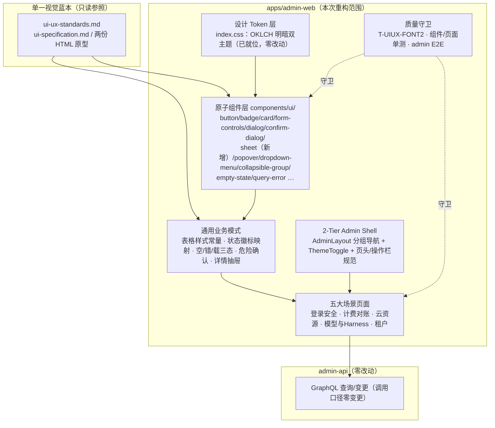
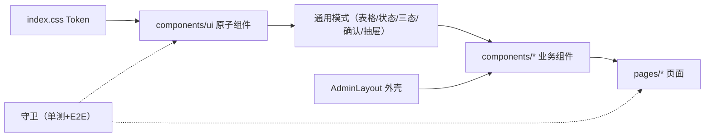
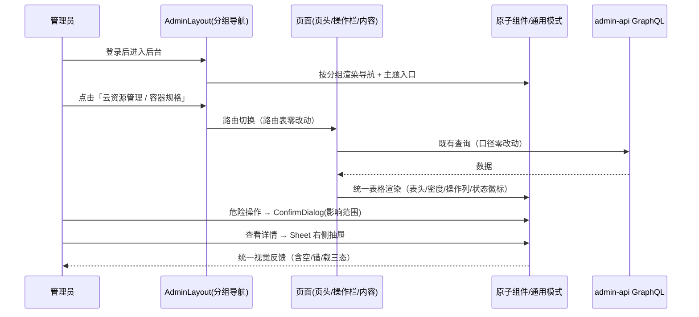

# 后台 UI 重构（管理后台全量 UI 升级） - 技术提案

**功能名称**: 后台 UI 重构（管理后台全量 UI 升级）
**关联 PRD**: [docs/product/draft/20261127-admin-web-ui-overhaul.md](../../product/draft/20261127-admin-web-ui-overhaul.md)
**关联规范 / 原型**: [docs/engineering/ui-ux-standards.md](../ui-ux-standards.md) · [prototypes/20261127-ui-specification.md](../prototypes/20261127-ui-specification.md) · [prototypes/20261126-ui-ux-workspace-overhaul.html](../prototypes/20261126-ui-ux-workspace-overhaul.html) · [prototypes/20261127-ui-specification.html](../prototypes/20261127-ui-specification.html)
**前置已合入提案**: [20261126-refactor-ui-ux-workspace-overhaul.md](20261126-refactor-ui-ux-workspace-overhaul.md)（PR #587，设计规范建立 + OKLCH Token 升级 + 微字号清零与守卫）
**技术提案版本**: v1.0
**创建日期**: 2026-11-27
**作者**: z-agent-bot
**feat-branch**: `feat/admin-web-ui-overhaul`
**领域模型影响**: 无影响。本提案为纯前端（`apps/admin-web`）视觉与交互重构，不改变任何领域概念、聚合、状态机、权限口径与后端契约（GraphQL 查询/变更调用零增删改），因此 `docs/knowledges/domain` 无需更新；若实现期发现界面文案与领域术语不一致，以领域模型为准修正文案（不回写领域模型）。

## 1. 概述

### 1.1 背景

UI 规范（`20261127-ui-specification.md`）为产品确立了统一设计语言：OKLCH 四级表面层级、字号阶梯（≥12px 红线）、语义状态色矩阵、组件化体系三层（原子组件 → 通用业务模式 → 九大业务场景蓝图），其中 §3.2 明确了管理后台的 **2-Tier Admin Shell**（左侧固定宽分组导航 + 右侧自适应数据工作台），§6 场景 H/I 明确了计费对账与管理后台运维工作台的组件级规范。

前置提案（PR #587）已完成：设计规范文档落地、前后台 `index.css` OKLCH 表面层级 Token 升级（`--background: oklch(0.99 0.002 264)` 等，含 `.dark` 全套）、全站 `<12px` 微字号清零与静态守卫单测（`apps/admin-web/src/__tests__/ui-ux-standards.test.ts` 的 `T-UIUX-FONT2`）、前台工作区三层外壳重构。

对 `apps/admin-web` 的现状审计（`feat` 基线 = `main` @03e2ddbd）显示，管理后台距规范目标仍有 6 项差距：

| # | 现状事实（代码可验证） | 规范目标（UI 规范出处） |
|---|---|---|
| F1 | `components/AdminLayout.tsx`（77 行）：固定 `240px` 单列导航，`NAV_ITEMS` 11 项扁平平铺、无分组；底部仅用户名 + 退出登录 | §3.2 四分组导航（云资源管理 / 模型与 Harness / 租户与计费 / 系统安全）+ 右侧「页头 → 操作栏 → 表格/卡片 → 抽屉/弹窗」工作台 |
| F2 | 暗色 Token 已就位（`index.css` `.dark` 块）但**无任何主题切换逻辑**（全包无 `classList`/`matchMedia`/`theme` 持久化），`.dark` 类永远不会被应用 | §5 `ThemeToggle`：亮/暗/跟随系统三态切换，持久化 `localStorage('theme')` |
| F3 | `components/ui/` 已有 16 个原子组件（badge/button/card/checkbox/collapsible-group/confirm-dialog/dialog/dropdown-menu/empty-state/input/label/popover/query-error/scroll-area/select/switch），button 变体/尺寸已对齐 §4；**缺 `ui/sheet.tsx`** | §4 `Sheet`（右侧滑出抽屉 `w-[400px]–[560px]`）用于详情检视类内容 |
| F4 | `components/billing/ReceiptDrawer.tsx` 以居中 `Dialog`（`sm:max-w-lg`）实现收据详情 | §6 场景 H：`ReceiptDrawer` 为右侧 `Sheet`，完整计费维度拆解 |
| F5 | 15 个页面各自实现表格/表单/空态/错误态（如 `BillingPage.tsx` 592 行、`AuthProvidersPage.tsx` 467 行），表头/行密度/操作列/状态徽标样式不统一；容器状态文案映射散落在 `components/cloud-containers/labels.ts` 等处 | §6 场景 I：高密度表格规范（表头 `text-xs font-medium text-muted-foreground bg-muted/40`、单元格 `text-sm py-2.5 px-3`、操作列靠右 `Button size="sm" variant="ghost"`）；§2.4 跨领域状态色统一映射 |
| F6 | 金额/计数展示未统一 `tabular-nums`；危险操作确认文案口径不一 | §6 场景 H 金额强制 `tabular-nums` 右对齐；§4 危险操作强制 `ConfirmDialog` 且明确影响范围文案 |

### 1.2 目标

1. **落地 2-Tier Admin Shell**：`AdminLayout` 分组导航（四分组）+ 统一工作台页结构 + 主题切换入口，补齐 Skip Link 与焦点管理等可访问性基线。
2. **原子组件层收口**：补齐 `ui/sheet.tsx`，逐个校对 `components/ui/` 与规范 §4 的变体、尺寸、无障碍要求，形成前后台同 API 的组件层。
3. **通用业务模式统一**：表格、状态徽标、空态/加载/错误态、表单校验态、危险确认、详情抽屉各只有一种规范实现，并以集中式映射/样式常量固化口径。
4. **五大场景逐页升级**：登录与账号安全、计费与对账、云资源管理、模型与 Harness、租户管理——全部 15 个页面按新规范重构视觉与交互，**功能行为、GraphQL 调用、校验口径零变更**。
5. **质量守卫**：`T-UIUX-FONT2` 持续生效；新增管理后台外壳/主题/表格规范 E2E 用例；11 个既有 admin E2E 与全部组件/页面单测零回归。

### 1.3 范围

- **包含**：`apps/admin-web` 全量（布局外壳、`components/ui/` 原子组件层、`components/**` 业务组件、`pages/**` 全部 15 个页面、主题能力、配套单测与 `tests/e2e/src/admin-*.spec.ts` 回归及新增用例）。
- **不包含**：任何后端（`servers/*`）与契约（`contracts/*`）改动；`apps/agent-web` 改动（前台已按同规范完成重构，仅作口径参照）；任何功能新增/删除/行为调整；GraphQL 查询/变更的字段与调用节奏调整。

## 2. 技术架构

### 2.1 系统架构图



### 2.2 技术栈

| 层级 | 技术选型 | 说明 |
|------|---------|------|
| 前端 | React 19 + TypeScript（strict）+ Vite | 沿用现状（`apps/admin-web/AGENTS.md`） |
| 样式 | Tailwind CSS v4（`@theme inline` + OKLCH Token） | Token 层已对齐规范，本次零改动 |
| 原子组件 | `@base-ui/react` + `class-variance-authority`（CVA） | 沿用现状；`Sheet` 同栈补齐 |
| 数据 | Apollo Client 4（GraphQL） | **零改动**：查询/变更/轮询节奏逐字节保持 |
| 路由 | React Router v7 | 路由表零改动（仅默认落点与导航呈现调整） |
| 测试 | Vitest + React Testing Library / Playwright（tests/e2e） | 沿用现状，新增守卫用例 |

### 2.3 模块划分



| 模块 | 职责 | 关键技术点 |
|------|------|-----------|
| `index.css` | 设计 Token 单一来源 | 已对齐规范 §2，本次仅补 `.dark` 激活链路所需的 `color-scheme` 微调（如需） |
| `components/ui/` | 原子组件（与前台同 API 同视觉，独立副本） | 新增 `sheet.tsx`；逐件校对 §4 变体/尺寸/aria |
| `components/AdminLayout.tsx` | 2-Tier 外壳、分组导航、主题入口、退出登录 | 四分组导航、`aria-current` 激活态、Skip Link |
| `lib/theme.ts`（新增） | 主题状态单源 | `localStorage('theme')` 三态 + `matchMedia` 跟随系统 + `html.dark` |
| `lib/*`（样式/映射常量） | 表格样式常量、状态徽标统一映射 | 收敛 `labels.ts` 等散落映射，与规范 §2.4 状态色矩阵一一对应 |
| `components/billing|cloud-containers|cloud-host-specs|cloud-workloads|models|providers|tenants|base-images/` | 业务组件 | 逐场景按批次换用新原子组件与通用模式 |
| `pages/`（15 个） | 页面编排 | 统一「页头 → 操作栏 → 内容」结构；逻辑与查询零改动 |
| `src/__tests__/ui-ux-standards.test.ts` | 静态守卫 | `T-UIUX-FONT2` 保持；可扩展断言（如禁止硬编码十六进制色值） |

## 3. API 设计

### 3.1 API 契约

**零契约变更。** 本次重构不新增、不修改、不删除任何 GraphQL 查询/变更字段，`contracts/` 目录零改动。所有页面的查询文档（`graphql/queries.ts`、`graphql/mutations.ts`、`graphql/auth-providers.ts`、`graphql/harness-config.ts`）与调用时机逐字节保持，仅 JSX 呈现层变更。

### 3.2 内部接口

前端内部新增的仅为纯 UI 模块，不涉及任何服务间接口：

| 模块 | 接口 | 说明 |
|------|------|------|
| `lib/theme.ts` | `getTheme()/setTheme()/subscribe()` | 主题读写与 `matchMedia` 订阅（纯浏览器态） |
| `components/ui/sheet.tsx` | `<Sheet><SheetTrigger/><SheetContent side="right"/></Sheet>` | 右侧抽屉原子组件（与前台同 API） |
| 样式/映射常量 | `TABLE_HEAD_CLASS` 等常量、`statusBadgeProps()` | 表格与状态徽标统一口径（纯函数） |

## 4. 数据模型

### 4.1 数据库设计

**零变更。** 纯前端重构，不涉及任何集合、字段、索引或迁移。

### 4.2 缓存设计

**零变更。** Apollo Client 缓存策略、轮询间隔（如云端容器 10s、日志 5s）与 `refetchQueries` 口径保持不变；主题偏好仅使用 `localStorage`（键 `theme`，取值 `light|dark|system`），不引入任何服务端状态。

## 5. 技术实现方案

### 5.1 核心流程



### 5.2 关键实现点

#### 实现点 1: AdminLayout 分组导航（2-Tier Admin Shell）

- **描述**: 按规范 §3.2 将 `NAV_ITEMS` 重组为四分组（云资源管理：云端容器/容器规格/工作负载/基础镜像；模型与 Harness：模型配置/Harness 配置；租户与计费：租户管理/费用中心/对账中心；系统安全：登录认证/账号安全），组头使用 `text-xs text-muted-foreground` 分组标题，激活项保留 `aria-current="page"` 与底色高亮；底部用户栏追加 `ThemeToggle`（Monitor/Sun/Moon 三态图标）；主区补「跳到主要内容」Skip Link → `#main-content`。
- **技术细节**: 保持 `NavLink` 语义与现有可访问名称（如 `aria-label="后台导航"`）不变，确保既有页面单测/E2E 选择器不因分组化失效；默认落点 `/models` 零改动。
- **风险点**: 分组标题引入新 DOM 层级可能影响以 `ul > li` 计数的断言——实现时逐一核对 `pages/__tests__` 与 `components/__tests__/AdminLayout.test.tsx` 并同步更新。

#### 实现点 2: 主题切换（ThemeToggle + lib/theme.ts）

- **描述**: 新增 `lib/theme.ts` 单源模块：`theme ∈ {light, dark, system}` 持久化 `localStorage('theme')`；`system` 时经 `matchMedia('(prefers-color-scheme: dark)')` 跟随并监听变化；统一驱动 `document.documentElement.classList.toggle('dark')`。`ThemeToggle` 放置于 `AdminLayout` 底部用户栏。
- **技术细节**: 应用启动时（`main.tsx` 或 `AdminLayout` 挂载前）同步应用已存主题，避免亮→暗闪烁；`index.css` 现有 `.dark` Token 块即为目标值来源，零色值改动。
- **风险点**: 测试环境 `localStorage` 隔离（Vitest 每用例清理）；E2E 断言持久化需刷新后复核。

#### 实现点 3: 原子组件层补齐（`ui/sheet.tsx`）与逐件校对

- **描述**: 以 `@base-ui/react` 新增 `sheet.tsx`（右侧滑出抽屉，宽 `400–560px`，移动端 `w-full`，`Esc` 关闭、焦点圈定），API 与前台同形（独立副本，遵守「禁止跨项目 import」红线）；对 `button/badge/card/form-controls/dialog/confirm-dialog/popover/dropdown-menu/collapsible-group/empty-state/query-error` 逐件对照规范 §4 的变体、尺寸、`aria-*` 与焦点样式清单校对补齐。
- **技术细节**: `button` 变体（含 `ghost-danger`/`link`）与 8 档尺寸已达标（审计 F3），仅补缺项；表单控件错误态统一 `aria-invalid:border-destructive aria-invalid:ring-destructive/20`。
- **风险点**: 组件 API 变更若涉及 props 收紧，需同步更新引用点与组件测试。

#### 实现点 4: 通用业务模式固化

- **描述**: ① 表格规范——以样式常量（如 `TABLE_HEAD_CLASS = "text-xs font-medium text-muted-foreground bg-muted/40"`、单元格 `text-sm py-2.5 px-3`、操作列靠右 `Button size="sm" variant="ghost"`）统一全部列表页；② 状态徽标——建立 `statusBadgeProps()` 统一映射（对齐规范 §2.4 状态色矩阵：success/warning/info/destructive/muted），收敛 `cloud-containers/labels.ts` 等散落口径；③ 三态——加载中/错误+重试（`QueryError`）/空态（`EmptyState`）统一接入所有列表与详情；④ 危险确认——全部删除/销毁/移除走 `ConfirmDialog` 并展示影响范围文案；⑤ 详情抽屉——`ReceiptDrawer` 由 `Dialog` 改 `Sheet`，金额 `tabular-nums` 右对齐、入账 `text-success`、异常 `text-destructive`。
- **技术细节**: 采用「样式常量 + 既有 JSX 结构微调」而非抽象通用 Table 组件（见 6.1 决策 D2），把 DOM 结构变化压到最小。
- **风险点**: 样式类名变更会使快照/类名断言失效——测试更新跟随每个批次提交。

#### 实现点 5: 五大场景逐页升级（批次制）

| 批次 | 页面 | 重点 |
|------|------|------|
| P4a 登录与安全 | `LoginPage` / `ChangePasswordPage` / `AuthProvidersPage` / `SecurityPage` | 居中单卡片 `max-w-[400px] rounded-xl p-6`、第三方登录 `variant="outline" w-full` 按钮组、错误提示条 `bg-destructive/10 text-destructive`、secret 恒「已设置」不回显 |
| P4b 计费与对账 | `BillingPage` / `ReconciliationPage` 及 `components/billing/*` | 金额 `tabular-nums` 右对齐、入账/扣费/异常三色、`ReceiptDrawer`→`Sheet`（含分段/折算明细拆解）、`RollupChart` 图表色映射 `--chart-1~5`、`RechargeDialog`/`ModelPricingSection`/`MyApiKeyManager` 控件统一 |
| P4c 云资源管理 | `CloudContainersPage` / `CloudHostSpecsPage` / `CloudWorkloadsPage` / `BaseImagePage` 及 `components/cloud-*` | 表格规范、状态徽标映射（含「初始化中」进度文案）、`StartContainerDialog`/`WorkloadParamsForm`/`ParamSchemaEditor`/`TenantWhitelistPicker` 控件统一、`WorkloadLogsDialog` 等宽深色日志区、销毁/删除影响范围确认 |
| P4d 模型与 Harness | `ModelConfigPage` / `HarnessConfigsPage` 及 `components/models|providers/*` | 分组折叠（`CollapsibleGroup`）、`ImportModelsDialog`/`CustomModelDialog` 表单统一、`ModelRenameRecordsPanel` 只读折叠区块、逐行保存表单校验态统一 |
| P4e 租户管理 | `TenantsPage` / `TenantDetailPage` 及 `components/tenants/*` | 类型/角色徽标统一、开户/创建团队租户弹窗统一、移除成员/变更角色影响说明与二次确认、只读区域表达强化 |

- **技术细节**: 每批次仅触碰呈现层（JSX/className/文案），`useQuery`/`useMutation` 文档、变量、轮询与错误映射逻辑零改动；校验口径（如 `lib/cloud-host-spec.ts`、`lib/harness-config.ts` 的前端预校验）原样保留。
- **风险点**: 大文件页面（`BillingPage` 592 行）改动面大——按子组件切片推进，配合页面单测逐块回归。

#### 实现点 6: 质量守卫与回归

- **描述**: `T-UIUX-FONT2` 保持；新增/更新组件与页面单测覆盖新结构；新增 `tests/e2e/src/admin-ui-shell.spec.ts`（E2E-AUI-1 分组导航四组可达与激活态、E2E-AUI-2 主题切换即时生效与刷新持久化、E2E-AUI-3 表格规范与危险确认抽查）；11 个既有 `admin-*.spec.ts` 全量回归作零行为变更证据。
- **风险点**: E2E 依赖可访问名称与文案——文案统一时同步核对选择器，禁止无脑替换导致断言漂移。

## 6. 技术决策

### 6.1 决策列表

| # | 决策 | 选项 A | 选项 B | 最终选择 | 原因 |
|---|------|--------|--------|---------|------|
| D1 | 前后台组件复用方式 | 复制到 `admin-web` 独立演进 | 跨项目 import 共享 | **A** | `apps/admin-web/AGENTS.md` 明令「禁止跨项目 import」；以规范文档为共同蓝本保持同 API 同视觉即可 |
| D2 | 表格统一方式 | 样式常量 + 既有结构微调 | 抽象通用 DataTable 组件 | **A** | 最小化 DOM 结构变更，测试回归面小；表格形态差异大（树形/分组/批量），强行抽象收益低 |
| D3 | 收据详情呈现 | 居中 Dialog（现状） | 右侧 Sheet | **B** | 规范 §6 场景 H 明确 `ReceiptDrawer` 为右侧抽屉，且不离开列表上下文 |
| D4 | 主题切换入口位置 | 顶部页头 | 左侧导航底部用户栏 | **B** | 与前台 `ThemeToggle` 位置口径一致，常驻可见、逐页可用 |
| D5 | 交付节奏 | 一次性全量重构 | 分批逐页（P1→P5） | **B** | 每批可独立回归与发布，随时可中止不烂尾；符合「重构期间随时可发布」约束 |
| D6 | 表单校验策略 | 保持既有前端预校验 + 服务端兜底 | 收敛为仅服务端校验 | **A** | PRD 约束「功能行为零变更」，校验口径不属于本次重构对象，仅统一错误呈现样式 |
| D7 | 暗色 Token 来源 | 直接复用 `index.css` 现有 `.dark` 块 | 按规范重新生成色值 | **A** | 现有 Token 与规范 §2 逐值一致（PR #587 已同步），零色值改动降低风险 |
| D8 | 守卫扩展程度 | 仅保留 `T-UIUX-FONT2` | 增加禁硬编码色值/表格规范静态断言 | **B**（适度） | 增加少量静态断言（硬编码 hex 色值、微字号）固化成果，避免守卫过重拖累开发 |

### 6.2 依赖与约束

| 类型 | 内容 | 说明 |
|------|------|------|
| 依赖 | `docs/engineering/ui-ux-standards.md`、`docs/engineering/prototypes/20261127-ui-specification.md` 及两份 HTML 原型 | 唯一视觉蓝本，实现期以规范为准裁决样式争议 |
| 依赖 | PR #587 已合入的 Token/守卫基建 | 直接复用，零重复建设 |
| 约束 | 零契约/零后端/零数据模型变更 | GraphQL 调用文档与节奏逐字节保持 |
| 约束 | 禁止跨项目 import | `apps/admin-web/AGENTS.md` 红线 |
| 约束 | 最小字号 ≥ 12px、全简体中文、敏感值不回显 | 规范硬性红线 + PRD 约束 |
| 约束 | 既有 11 个 admin E2E 与全部单测须零回归 | 重构正确性证据 |

## 7. 项目结构

```
apps/admin-web/src/
├── index.css                       # 设计 Token（本次零/微改动）
├── main.tsx                        # 主题初始应用接线（新增 1 处）
├── components/
│   ├── AdminLayout.tsx             # 2-Tier 外壳：分组导航 + ThemeToggle + Skip Link
│   ├── ProtectedRoute.tsx
│   ├── ui/                         # 原子组件层
│   │   ├── sheet.tsx               # 新增（右侧抽屉）
│   │   ├── button.tsx / badge.tsx / card.tsx / …   # 逐件校对 §4
│   │   └── query-error.tsx / empty-state.tsx
│   ├── billing/                    # P4b（含 ReceiptDrawer → Sheet）
│   ├── cloud-containers|cloud-host-specs|cloud-workloads|base-images/  # P4c
│   ├── models|providers/           # P4d
│   └── tenants/                    # P4e
├── lib/
│   ├── theme.ts                    # 新增：主题三态单源
│   ├── table-styles.ts             # 新增：表格样式常量
│   └── status-labels.ts            # 收敛状态徽标统一映射
└── pages/                          # 15 个页面按批次升级（逻辑零改动）
tests/e2e/src/
├── admin-*.spec.ts                 # 11 个既有用例零回归
└── admin-ui-shell.spec.ts          # 新增：E2E-AUI-1~3
apps/admin-web/src/__tests__/ui-ux-standards.test.ts  # T-UIUX-FONT2（保持 + 适度扩展）
```

## 8. 测试策略

### 8.1 测试覆盖要求

- 单元测试覆盖率：不低于现状基线（组件与页面测试逐批更新，行为断言不减少）。
- 静态守卫：`T-UIUX-FONT2`（微字号零容忍）必须持续通过；扩展断言（硬编码 hex 色值）随 P1 落地。
- API 测试覆盖的端点：**无新增**（零契约变更；`tests/api` 零改动）。

### 8.2 测试类型

| 类型 | 工具 | 覆盖范围 |
|------|------|---------|
| 静态守卫单测 | Vitest | `ui-ux-standards.test.ts`：微字号扫描全量 `src/**`（+ 扩展断言） |
| 组件单测 | Vitest + RTL | `ui/sheet` 新增用例；button/confirm-dialog/empty-state 等既有用例随结构调整更新 |
| 页面单测 | Vitest + RTL | `pages/__tests__` 13 个文件全量回归：分组导航、表格行渲染、弹窗提交 payload、错误映射逐字节不变 |
| E2E 回归 | Playwright | `admin-auth`/`admin-auth-oauth`/`admin-base-image`/`admin-billing`/`admin-cloud-container`/`admin-cloud-host-spec`/`admin-cloud-workload`/`admin-harness-config`/`admin-model-config`/`admin-tenant`/`admin-team-tenant` 共 11 个 spec 零回归 |
| E2E 新增 | Playwright | `admin-ui-shell.spec.ts`：E2E-AUI-1 分组导航可达性/激活态、E2E-AUI-2 主题三态切换与刷新持久化、E2E-AUI-3 表格规范与危险确认抽查 |
| 视觉走查 | 手动清单 | 亮/暗双主题 × 15 页走查（对比度、长文本截断、宽屏 1280/1440/1920 不破版） |
| 性能不变量 | E2E 网络断言 | 各页 GraphQL 请求数与重构前一致（零新增查询） |

## 9. 部署方案

### 9.1 环境规划

| 环境 | 用途 | 部署方式 |
|------|------|---------|
| 开发/联调 | Aspire 编排本地验证 | `aspire start`（现状流程不变） |
| 生产 | 常规前端构建发布 | 随 `admin-web` 构建产物发布（Vite build），无后端/数据配套动作 |

### 9.2 配置管理

零新增配置项。主题偏好为浏览器本地 `localStorage('theme')`，不进入任何服务端配置。回滚方案：纯前端变更，回退构建版本即完全回滚，无数据迁移、无兼容窗口。

## 10. 验收标准

- [ ] 技术方案评审通过
- [ ] 契约零变更（`contracts/` 与 `tests/api` 零改动，评审确认）
- [ ] 领域模型同步结论评审通过（无领域影响，理由见文首「领域模型影响」）
- [ ] 四分组导航与全部 15 个页面重构完成，功能行为零回归
- [ ] 亮/暗/跟随系统三主题可用且持久化；两主题对比度达标（WCAG AA）
- [ ] 表格/表单/弹窗/抽屉/危险确认/三态统一规范落地（抽查清单通过）
- [ ] `T-UIUX-FONT2` 通过；扩展静态守卫通过
- [ ] 全部组件/页面单测通过、11 个 admin E2E 零回归、E2E-AUI-1~3 通过
- [ ] lint / build 通过

## 11. 相关文档

- 关联 PRD：[docs/product/draft/20261127-admin-web-ui-overhaul.md](../../product/draft/20261127-admin-web-ui-overhaul.md)
- UI 规范与全场景组件化设计文档：[docs/engineering/prototypes/20261127-ui-specification.md](../prototypes/20261127-ui-specification.md)
- 交互式设计原型：[20261126-ui-ux-workspace-overhaul.html](../prototypes/20261126-ui-ux-workspace-overhaul.html) · [20261127-ui-specification.html](../prototypes/20261127-ui-specification.html)
- UI/UX 设计规范：[docs/engineering/ui-ux-standards.md](../ui-ux-standards.md)
- 前置提案：[20261126-refactor-ui-ux-workspace-overhaul.md](20261126-refactor-ui-ux-workspace-overhaul.md)（PR #587）
- 开发规范：[docs/engineering/common-rules.md](../common-rules.md) · [docs/engineering/frontend-rules.md](../frontend-rules.md) · [apps/admin-web/AGENTS.md](../../../apps/admin-web/AGENTS.md)
