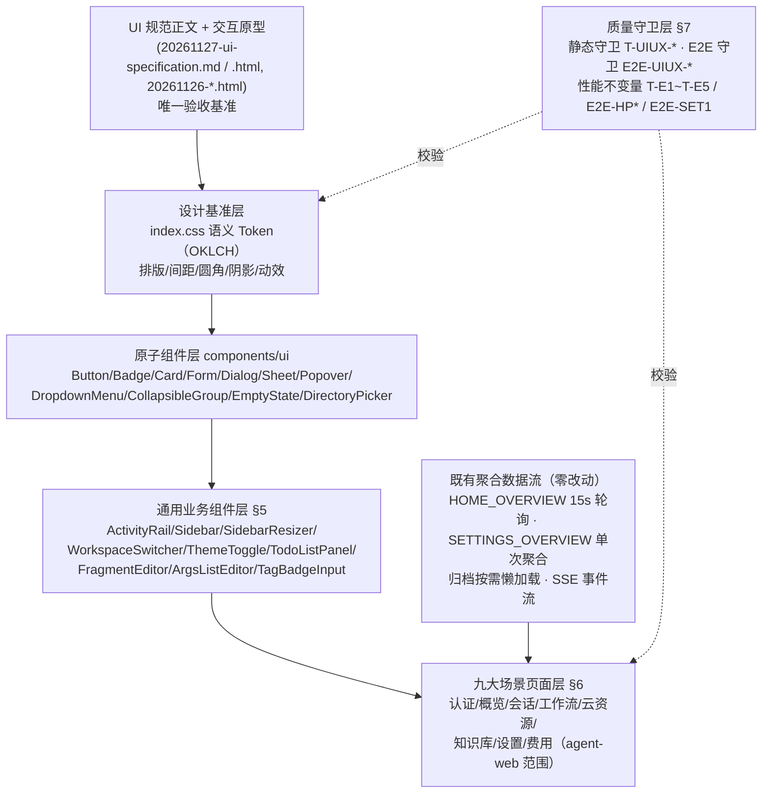
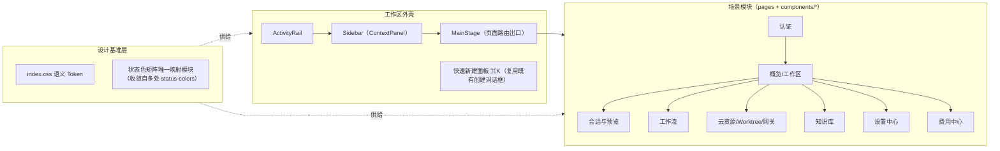
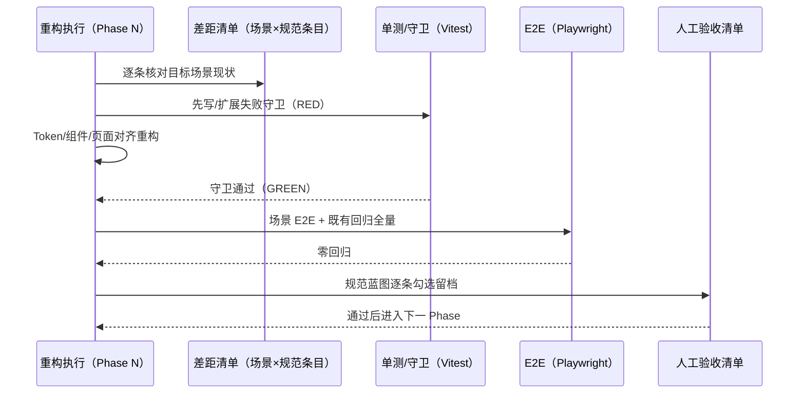

# Agent Web 全场景 UI 重构 - 技术提案

**功能名称**: Agent Web 全场景 UI 重构
**关联 PRD**: [docs/product/draft/20261127-agent-web-full-ui-rework.md](../../product/draft/20261127-agent-web-full-ui-rework.md)
**关联规范**: [docs/engineering/prototypes/20261127-ui-specification.md](../prototypes/20261127-ui-specification.md)（UI 规范正文）· [docs/engineering/ui-ux-standards.md](../ui-ux-standards.md)
**前置已合入提案**: [20261126-refactor-ui-ux-workspace-overhaul.md](20261126-refactor-ui-ux-workspace-overhaul.md)（PR #587，一期工作区外壳重构）· [20261126-feat-api-performance-optimization.md](20261126-feat-api-performance-optimization.md)（PR #585 / #588，接口性能优化）
**技术提案版本**: v1.0
**创建日期**: 2026-11-27
**作者**: ZeroAsh Agent
**feat-branch**: `feat/agent-web-full-ui-rework`
**领域模型影响**: 无（见 [§12 领域模型影响核对](#12-领域模型影响核对)：纯前端表现层重构，零契约、零持久化实体、零状态机/权限变化，数据读口径 100% 复用 PR #585 已同步的领域模型口径）

## 1. 概述

### 1.1 背景

本提案依据三份上游设计产物（均为 `main` 已合入文档）：

| 上游产物 | 定位 | 对本提案的作用 |
| --- | --- | --- |
| [`prototypes/20261126-ui-ux-workspace-overhaul.html`](../prototypes/20261126-ui-ux-workspace-overhaul.html) | 交互原型 v2.0：三层工作区外壳、全局快速新建（⌘K）、九大场景目标交互演示 | 交互与布局的目标形态基准 |
| [`prototypes/20261127-ui-specification.html`](../prototypes/20261127-ui-specification.html) | UI 规范交互式演示手册 | 规范条目的可视化对照 |
| [`prototypes/20261127-ui-specification.md`](../prototypes/20261127-ui-specification.md) | UI 规范正文：视觉风格、Token 体系、三层布局、原子组件（§4）、通用业务组件（§5）、九大场景组件蓝图（§6）、交互/无障碍/守卫（§7） | **唯一验收基准** |

**已落地基线（main @ 03e2ddbd）**：

- PR #587 已实现一期重构：三层工作区外壳（`components/layout/ActivityRail.tsx` + `Sidebar` / `SidebarResizer` / `MainStage`，`MainLayout` 网格 `3.5rem | --sidebar-width | 1fr`）、`⌘B` 折叠、全站微字号清零、OKLCH 表面层级 Token（`index.css` 含 74 处 `oklch` 定义）、Skip Link（`跳到主要内容`）、守卫测试 `apps/agent-web/src/__tests__/ui-ux-standards.test.ts`（T-UIUX-FONT1）与 `tests/e2e/src/ui-ux-workspace.spec.ts`（E2E-UIUX-1/2）、`MainLayout.test.tsx`（T-UIUX-SHELL1）。
- PR #585 / #588 已落地聚合数据流口径：`homeOverview` 15s 单查询轮询、`settingsOverview` 单次聚合（`skip: Boolean(controllerId)`）、已归档分组无计数按需懒加载、离线/已删除控制器工作区过滤。

**现状与规范的差距审计（对 main 代码逐条核对，本提案立项依据）**：

| # | 差距 | 代码事实 |
| --- | --- | --- |
| G1 | 硬编码色值残留 | `grep` 统计 `text-\|bg-\|border-<palette>-<n>` 硬编码 **79 处**、分布于 20+ 文件（`pages/BillingPage.tsx`、`components/session/preview/*`、`components/session/MessageList.tsx`、`components/workflow/*` 等），违反规范 §2「禁止在组件内硬编码散乱的 Tailwind 色值」 |
| G2 | `tabular-nums` 覆盖不足 | 仅 **8 个文件**使用，规范 §1.2 要求金额/Token/倒计时/计数/表格数值列全量等宽对齐 |
| G3 | 会话顶栏未达规范 §6-C | `SessionHeader.tsx` 仍以 `TOOLBAR_MIN_INFO_WIDTH = 192` 被动折叠工具栏，控制器/工作目录等环境信息以裸文本平铺未收敛为「环境信息胶囊」，与规范 §6-C「单行紧凑顶栏 + 环境胶囊收纳」目标形态存在差距 |
| G4 | 场景内组件未逐条对齐 | 159 个非测试组件、14 个页面中，认证、概览、工作流、云资源、知识库、设置、费用各场景的卡片/弹窗/空态/错误态细节尚未按规范 §6 逐场景核对收口 |
| G5 | 状态表达存在多套写法 | 会话/云电脑/工作流状态的用色与文案散落在 `session/status-colors.ts` 等多处，未收敛为规范 §2.4 的唯一映射 |
| G6 | 全局快速新建缺失 | 原型定义了 ⌘K 全局命令/新建面板（「快速拉起会话 / 实例化工作流」），当前仅有分散的各列表「+」入口 |
| G7 | 守卫覆盖面不足 | 现有守卫只覆盖微字号与外壳布局；硬编码色值、`tabular-nums`、焦点呈现、状态映射等基准尚未被自动化保护 |

### 1.2 目标

1. **全场景规范对齐**：按规范 §6 九大场景（认证、概览与工作区、会话与实时预览、工作流、云电脑/主机/Worktree、知识库、设置中心、费用中心）逐场景完成 `apps/agent-web` 界面重构，逐条满足规范蓝图。
2. **设计基准层单一事实来源**：色彩/排版/间距/圆角/阴影/动效全部经由 `index.css` 语义 Token 与 `components/ui` 原子组件表达，硬编码色值清零（G1）、`tabular-nums` 全量覆盖（G2）。
3. **状态表达唯一映射**：按规范 §2.4 建立跨领域状态色矩阵唯一实现，全站复用（G5）。
4. **体验补全**：落地会话顶栏环境胶囊（G3）与 ⌘K 全局快速新建（G6）。
5. **守卫防回归**：把设计基准固化为静态守卫 + E2E 守卫（G7），并保证既有测试零回归、首屏请求量零增加。

### 1.3 范围

- **包含**：`apps/agent-web` 全部页面（14 个）与组件（159 个）的规范对齐重构；设计 Token 与原子组件收口；全局快速新建面板；静态/E2E 守卫扩展；`tests/e2e` 相关用例同步。
- **不包含**：
  - `apps/admin-web`（规范 §3.2/§6-I 覆盖它，但本期需求范围仅 `agent-web`；admin-web 仅在共用 `index.css` Token 时被动受益，不做场景重构）。
  - 任何后端（`servers/*`）、GraphQL/OpenAPI 契约（`contracts/*`）、数据模型、部署形态变更。
  - 新业务功能与新领域概念（快速新建面板是既有「新建会话 / 实例化工作流」能力的聚合入口，不新增领域语义）。

## 2. 技术架构

### 2.1 系统架构图



### 2.2 技术栈

| 层级 | 技术选型 | 说明 |
|------|---------|------|
| 前端框架 | React 19 + TypeScript（strict） | 现状不变 |
| 构建 | Vite + Tailwind CSS v4（`@tailwindcss/vite`） | 现状不变，Token 以 CSS 变量为单一事实来源 |
| 组件基座 | `@base-ui/react` + `class-variance-authority`（CVA） | 现状不变，原子组件 API 与视觉 Token 前后台一致 |
| 数据层 | Apollo Client + 既有聚合查询 | **零改动**，见 §3 |
| 路由/状态 | React Router v7 + React Context / Zustand | 现状不变 |
| 测试 | Vitest + React Testing Library（单测/守卫）· Playwright（E2E） | 现状不变，仅扩展用例 |
| 依赖策略 | **零新增运行时依赖** | 懒加载（Mermaid/Monaco/xterm-headless）沿用现状 |

### 2.3 模块划分



| 模块 | 职责 | 关键技术点 |
|------|------|-----------|
| 设计基准层 | 语义 Token、状态色矩阵、排版/间距/圆角/动效工具类 | 单一事实来源；禁止组件内硬编码色值（守卫拦截） |
| 原子组件层 | 规范 §4 十类基础组件的变体/尺寸/无障碍规格对齐 | CVA 变体表对齐规范表格；`aria-label` / `focus-visible` 强制 |
| 通用业务组件层 | 规范 §5 跨场景组件 | ActivityRail 指示条与徽标、Sidebar 分区与归档分组、WorkspaceSwitcher、TodoListPanel、FragmentEditor 等 |
| 场景页面层 | 规范 §6 九大场景逐场景对齐 | 按 Phase 分批重构，逐场景验收清单留档 |
| 质量守卫层 | 静态扫描 + E2E + 性能不变量 | 守卫先行（红）→ 重构（绿），防回归 |

## 3. API 设计

### 3.1 API 契约

**零契约变更。** 本提案不新增、不修改任何 GraphQL/OpenAPI 契约字段或端点；所有界面数据经由既有查询/订阅获取。

### 3.2 内部接口（受保护不变量清单）

以下既有数据接口口径是重构的**硬约束**，任何 Phase 均不得破坏：

| 不变量 | 口径 | 来源 |
| --- | --- | --- |
| 首页聚合 | `MainLayout` 唯一一次 `HOME_OVERVIEW` 查询（15s 轮询 + SSE 触发），子组件经 `stores/homeOverview` 消费，**不得各自发起信息流查询** | `apps/agent-web/AGENTS.md`、PR #585 |
| 设置聚合 | `SettingsOverviewContext` 单次 `SETTINGS_OVERVIEW`，进入控制器子页 `skip: Boolean(controllerId)` | PR #585/#587 |
| 归档按需 | 「已归档」分组常驻折叠、**不显示计数**、展开时才拉取（`GET_ARCHIVED_SESSIONS` / `GET_WORKFLOW_INSTANCES(archived:true)`） | PR #585 |
| 工作区过滤 | 新建/实例化/设置中的工作区列表仅展示在线且未删除控制器下的条目 | PR #585 |
| 轮询不卸载 | 加载分支只认 `loading && !data`，轮询期间不得卸载页面/清空表单 | `frontend-rules.md` Apollo v4 陷阱 |
| SSE 事件流 | `useUserEventStream` 各事件（会话交互、Review、Harness 登录等）驱动的局部刷新行为不变 | 现状 |

## 4. 数据模型

**零数据模型变更。** 不新增/修改任何 Mongoose 模型、迁移或缓存键；`localStorage` 持久化键（`sidebar-width`、`sidebar-sections-expanded`、`theme` 等）键名与读写契约保持不变。

## 5. 技术实现方案

### 5.1 核心流程



- **守卫先行**：每个 Phase 先把对应基准写成失败测试（红），再重构到通过（绿），遵循仓库 TDD 红-绿-重构流程。
- **逐场景验收**：每个场景产出一份「规范条目 → 实现位置 → 验收结果」对照记录，附在 PR 描述中供评审。

### 5.2 关键实现点（分 Phase 实施计划）

#### Phase 0：差距审计工具化与基准清单

- 把规范 §1–§7 条目转为可核对清单（「场景 × 规范条目」矩阵），覆盖 G1–G7 全部差距。
- 以 `rg` 脚本固化现状基线数字（硬编码色值 79 处清单、`tabular-nums` 缺口清单），作为清零进度的度量。

#### Phase 1：设计基准层收口（G1/G2/G5）

- `index.css`：按规范 §2 校准中性表面/品牌/语义色/图表专色 Token（OKLCH，亮暗双套），保持既有变量名不破坏消费方。
- **硬编码色值清零**：79 处 `text-|bg-|border-<palette>-<n>` 按语义映射替换为 Token 类（成功/警告/信息/危险/品牌/中性六类），图表与预览批注改用规范 §2.3 专色；确无语义可归的按「新增语义 Token」处理，禁止就地硬编码。
- **状态色矩阵唯一映射**：把散落的 `session/status-colors.ts` 等收敛为共享映射模块（规范 §2.4：会话 5 态 / 云电脑 4 态 / 工作流节点 6 态的圆点、动效、徽标样式、中文文案），全站消费同一实现。
- `tabular-nums` 补齐：金额、Token、倒计时、计数徽章、表格数值列全量接入。
- 焦点呈现统一 `focus-visible:ring-*`，间距/圆角按规范 §1.3 网格与圆角比例校准。
- **验收**：守卫 T-UIUX-COLOR（硬编码色扫描）、T-UIUX-TABULAR、T-UIUX-FONT1/2 全绿；主题切换对比度抽查通过。

#### Phase 2：工作区外壳与导航收口（G6 + 规范 §3/§5）

- `ActivityRail`：按规范 §5 校准 56px 轨道——激活指示条（2px 品牌色）、图标下 12px 标签、待处理圆点徽标、底部折叠按钮与在线计数；`⌘B` 行为保持。
- `Sidebar`（ContextPanel）：分区头 `h-8` + 悬浮「+」+ `tabular-nums` 计数徽章；「已归档」分组保持无计数、按需懒加载；`SidebarResizer` 保持 `220–420px`、`localStorage` 持久化；空态收敛。
- `WorkspaceSwitcher` / `ThemeToggle` / `TodoListPanel` 细节对齐规范 §5。
- **新增 ⌘K 快速新建面板**（G6）：全局命令/新建入口，聚合「快速拉起会话 / 实例化工作流」，复用既有 `NewSessionDialog` / `InstantiateWorkflowDialog` 表单与提交链路（零新领域语义），`Esc` 关闭、键盘可达。
- **验收**：T-UIUX-SHELL1 扩展 + E2E-UIUX-1/2 扩展（含 ⌘K 流程）。

#### Phase 3：认证与概览场景（规范 §6-A/§6-B）

- `LoginPage` / `LoginCallbackPage` / `IdentityChoicePage` / `ChangePasswordPage`：居中单卡片（规范 §6-A 规格）、第三方登录按钮组统一、错误提示条统一、确认无注册入口。
- `HomePage`：欢迎区 + 3 列 KPI 统计卡（`tabular-nums`）+ 最近会话卡片 + 工作流/协同动态区；`WorkspacePage` / `TenantMembersPage` / `WorkspaceMembersDialog` / `WorkspaceContextBanner` 角色徽标与只读提示对齐。
- **验收**：场景 A/B 验收清单 + auth 相关 E2E 零回归。

#### Phase 4：会话与实时分屏预览场景（规范 §6-C，G3）

- **`SessionHeader` 重构（G3）**：单行 `h-12` 顶栏——标题 + 状态圆点 + 工作区/分支；环境信息（控制器/工作目录/Worktree/Harness/时间）收纳为悬停可见的环境胶囊；右侧模型/模式切换、能力面板、归档/导出、分屏切换收纳有序；移除 `TOOLBAR_MIN_INFO_WIDTH` 被动折叠机制。
- 消息时间线：`MessageList/MessageItem` 最大阅读宽居中、用户气泡与 AI 流式排布、`ThoughtBlock` 折叠、`CodeBlock` 表头（语言/复制/换行）、`MermaidBlock` 懒加载、`ScrollToBottomButton` 智能跟随（保持 IntersectionObserver 口径）。
- 工具调用族：`ToolCallCard` 三态合并、`ReadCard/FetchCard/SubAgentCard`、`DiffView`（行号 + Prism）、`TerminalOutput`（xterm-headless 纯文本画面行，零 `dangerouslySetInnerHTML`）、`UsageCard` 统一卡片规格（规范 §4 Card：≤2 层嵌套）。
- 内联交互：`InteractionCard` / `elicitation-form` / `PendingElicitationBanner` / `PlanCard` / `PlanFloatingCard` 倒计时与状态留痕口径不变，视觉对齐。
- `InputBox` 一体化浮岛：模式/模型/配置/附件/批注片段收进输入卡片底栏，`/` 唤起 `CommandSuggest`，中文主按钮（发送 `⌘↵` / 停止），只读态收敛提示条。
- 分屏预览族：`PreviewPane` 三态、`PreviewTabBar`、`CodePreview`（`.zag-focus-highlight` 行定位）、`HtmlPreview`（`data-zag-hover/selected` 选取）、`MarkdownPreview`（`.md-annotation-highlight`）、`ReviewPanel` / `AnnotationPopup` / `AnnotationList` 按规范 §2.3 专色与 §6-C 规格。
- **验收**：session-* 全族 E2E（含 `session-preview.spec.ts`、`session-rendering.spec.ts`、`session-mobile.spec.ts`）零回归 + 场景 C 验收清单。

#### Phase 5：工作流编排场景（规范 §6-D）

- `WorkflowInstanceCard` 两行卡片、`WorkflowGraphView` + `WorkflowNodeCard`（dagre TB、`bg-card` 不透明、顶部语义色状态条、`ResourceChip`、静态「正在思考」动态行、执行节点窗口 `fitView`）、`WorkflowNodeTree`。
- `NodeDetailDrawer`（PR 联动区块前置、`HumanNodeActions` 就地审批/打回、「立即失败」二次确认、进入 `SessionSidePanel`）、`BlackboardPanel`。
- 弹窗族 `TemplateEditorDialog` / `ConfigureWorkflowDialog` / `InstantiateWorkflowDialog` / `ContinueWorkflowDialog` 表单与不可用徽标统一。
- **验收**：workflow 相关 E2E 零回归 + 场景 D 验收清单。

#### Phase 6：云电脑、控制器、Worktree 与网关场景（规范 §6-E）

- `NewCloudHostDialog` 分步编排（规格选择卡 + 实时报价 + 云存储 + 工作负载多选 + GitHub 锁定）视觉统一；`StopCloudHostDialog` / `DeleteCloudHostDialog` 影响范围与二次确认规范。
- `CloudHostWorkloadsSection`（分组/徽标/参数表单）、`CloudHostIssuesLinkageSection`、`GithubProjectSetupDialog` / `GithubSetupProgressDialog`、`RepoWorkflowSection`、`WorktreeSidebarGroup`、`GatewaySection` / `GatewayDialog`、`HarnessLoginDialog`（`tabular-nums` 倒计时）。
- 云电脑状态文案/颜色/动效接入 Phase 1 状态色矩阵。
- **验收**：cloud-host-* / gateway / harness-login / github-workload E2E 零回归 + 场景 E 验收清单。

#### Phase 7：知识库场景（规范 §6-F）

- `KnowledgeBasePage` / `KnowledgeBaseSection` / `RepoKnowledgeBaseSection`（来源徽标、只读收敛、懒加载树、截断/超限标识）、`KnowledgeBasePreview` / `KnowledgeBaseEditor`（分栏 + 草稿 + 路径移动 + `TagBadgeInput`）、`KnowledgeBaseHistoryDrawer`（事件流）、`KnowledgeBaseSettingsDialog` / `CreateKnowledgeBaseDialog`。
- front matter 结构化表格、空态收敛、权限矩阵展示口径不变。
- **验收**：knowledge-base / repo-knowledge-base E2E 零回归 + 场景 F 验收清单。

#### Phase 8：设置中心与控制器配置场景（规范 §6-G）

- `SettingsPage`：桌面端 200px 分组导航（可见 H1、分组标题、`data-active` 高亮）+ 分区视觉统一；`WorkspaceContextBanner` 常驻。
- `ControllerConfigPage`：面包屑栏（`设置 / 控制器 / {分组}`）+ 左侧分组切换 + 云端控制器隐藏本地专属危险操作（保持 T-CCOP 口径）。
- 各 Section（Provider/Model/ControllerList/HarnessTools/McpRegistry/McpDefault/CustomMcp/CustomTool/Valut/GitSettings/GithubBinding/CloudStorage/ExternalLogin）表单、开关、空态、错误文案统一；`ValutSection` 保持「明文不出服务端」视觉契约。
- **验收**：settings-* / settings-overview E2E 零回归（含 E2E-SET1 性能不变量）+ 场景 G 验收清单。

#### Phase 9：费用中心场景（规范 §6-H）

- `BillingPage`（前台）：余额/趋势/明细列表，金额与单价 `tabular-nums` 右对齐，充值 `text-success`、异常 `text-destructive`；账单行 → 明细抽屉维度拆解展示口径不变。
- **验收**：billing E2E 零回归 + 场景 H 验收清单。

#### Phase 10：响应式与移动端收口（规范 §3.3）

- `<768px`：隐藏 `ActivityRail` / `SidebarResizer`；列表路由全屏 `Sidebar` + 底部「我的费用 / 设置」导航行；详情路由全屏舞台 + `MobileBackButton`；输入区与对话框宽度约束、禁止横向溢出。
- **验收**：`responsive-layout.spec.ts` / `session-mobile.spec.ts` 零回归 + 移动端核心任务清单。

#### Phase 11：质量守卫扩展与文档收口（G7 + 规范 §7）

- 静态守卫扩展：T-UIUX-COLOR（硬编码语义色）、T-UIUX-TABULAR、T-UIUX-FOCUS（可交互元素焦点呈现抽样）；沿用 T-UIUX-FONT1/FONT2。
- E2E 守卫扩展：E2E-UIUX-1/2 覆盖面扩充（⌘K、状态色抽样、设置导航激活态、控制器配置面包屑）。
- 性能不变量保护：`home.spec.ts`（T-E1~T-E5 / E2E-HP1~HP3）、`settings-overview.spec.ts`（E2E-SET1）确保零冗余查询。
- 文档收口：`apps/agent-web/AGENTS.md` 视觉口径同步、`docs/product/AGENTS.md` 与 `docs/engineering/AGENTS.md` 索引登记。

## 6. 技术决策

### 6.1 决策列表

| 决策 | 选项 A | 选项 B | 最终选择 | 原因 |
|------|--------|--------|---------|------|
| D1 实施策略 | 整页一次性重写 | 分阶段渐进对齐（守卫先行） | B | 每阶段可独立发布/回滚，E2E 零回归可控 |
| D2 数据层 | 顺带优化查询 | 零改动复用既有聚合口径 | B | 需求为纯 UI 重构；性能不变量是硬约束 |
| D3 硬编码色值 | 就地换近似色 | 归入语义 Token 后替换，确无语义则新增 Token | B | 规范 §2 单一事实来源，防再次漂移 |
| D4 状态色 | 各场景自行维护 | 收敛为共享映射模块（规范 §2.4 唯一映射） | B | 解决 G5 多套写法并存 |
| D5 E2E 锚点 | 随重构自由调整 | `data-testid`/`aria-label`/localStorage 键保持兼容，确需变更同步改写用例并留档 | B | 降低回归面，保护既有 130+ 用例 |
| D6 组件基座 | 引入新 UI 框架 | 继续 `@base-ui/react` + CVA + Tailwind v4 | B | 零新增依赖，规范 §4 即基于现状定义 |
| D7 移动端 | 维护独立移动实现 | 同批组件断点适配 | B | 规范 §3.3 为同一套组件的响应式回退 |
| D8 快速新建 ⌘K | 新写创建表单 | 复用 `NewSessionDialog` / `InstantiateWorkflowDialog` | B | 零新领域语义、零提交链路改动 |
| D9 admin-web | 一并场景重构 | 本期仅 agent-web | B | 需求范围明确「整个 agent-web」；admin-web 另立需求 |
| D10 顺序 | 全场景并行 | 基准层 → 外壳 → 场景逐个 → 守卫收口 | B | 基准先行可避免场景间返工 |

### 6.2 依赖与约束

| 类型 | 内容 | 说明 |
|------|------|------|
| 依赖 | UI 规范正文 + 交互原型 + `ui-ux-standards.md` | 唯一验收基准 |
| 依赖 | PR #585/#587/#588 已落地基线 | 三层外壳、Token、聚合数据流、既有守卫 |
| 约束 | 零契约、零数据模型、零部署变更 | §3/§4 |
| 约束 | 既有交互口径不得回退 | 归档无计数按需加载、设置一次加载、离线工作区过滤、轮询不卸载 |
| 约束 | 文案 100% 简体中文、专有名词标准写法 | 规范 §1.1 |
| 约束 | 遵循 `frontend-rules.md` / `common-rules.md`（TDD、领域模型同步） | 仓库规范 |

## 7. 项目结构

```
apps/agent-web/src/
├── index.css                  # 设计基准层：OKLCH 语义 Token（单一事实来源）
├── components/
│   ├── ui/                    # 原子组件层（规范 §4，变体/尺寸/无障碍对齐）
│   ├── layout/                # 工作区外壳（ActivityRail 等，规范 §3.1）
│   ├── sidebar/               # ContextPanel 分区（含归档分组）
│   ├── session/               # 场景 C：时间线/工具卡/输入区/预览分屏
│   ├── workflow/              # 场景 D：实例卡/DAG/节点详情
│   ├── cloud-host/            # 场景 E：云电脑/工作负载/GitHub 设置
│   ├── knowledge-base/        # 场景 F：树/编辑器/历史
│   ├── settings/              # 场景 G：设置区块
│   └── ...                    # 通用业务组件（规范 §5）
├── pages/                     # 页面层（14 个页面，规范 §6 场景归属）
├── hooks/ · stores/ · lib/    # 逻辑层（数据流零改动；新增 status-matrix 等纯函数）
├── graphql/                   # 零改动
└── __tests__/                 # 静态守卫（T-UIUX-*）
tests/e2e/src/                 # E2E 守卫与场景回归（E2E-UIUX-* 等）
```

## 8. 测试策略

### 8.1 测试覆盖要求

- 重构触及的组件单测覆盖达标（Vitest + React Testing Library，沿用仓库 TDD 流程）。
- 静态守卫全绿：T-UIUX-FONT1/FONT2（既有）、T-UIUX-COLOR、T-UIUX-TABULAR、T-UIUX-FOCUS（新增）。
- 既有 E2E 全量零回归（`tests/e2e` 现有 130+ 用例），新增 E2E-UIUX 扩展用例。

### 8.2 测试类型

| 类型 | 工具 | 覆盖范围 |
|------|------|---------|
| 静态守卫 | Vitest 源码扫描 | 微字号、硬编码语义色、`tabular-nums`、焦点呈现 |
| 组件单测 | Vitest + RTL | 每 Phase 触及的组件变体、状态映射、交互细节 |
| E2E 功能回归 | Playwright | 会话/工作流/云资源/知识库/设置/费用全族既有用例 |
| E2E UIUX 守卫 | Playwright | 三层外壳、⌘B、⌘K、导航激活态、面包屑、状态色抽样 |
| 性能不变量 | Playwright | T-E1~T-E5 / E2E-HP1~HP3（首屏零冗余查询）、E2E-SET1（设置单请求） |
| 移动端 | Playwright | `responsive-layout` / `session-mobile`，无横向溢出 |

## 9. 部署方案

### 9.1 环境规划

| 环境 | 用途 | 部署方式 |
|------|------|---------|
| 开发/联调 | 逐 Phase 验证 | `aspire start` 编排（现状不变） |
| 生产 | 随常规前端发布 | 构建产物发布，零配置/零迁移 |

### 9.2 配置管理

无新增配置项、无环境变量、无迁移。回滚粒度为 PR：单场景 Phase 独立提交，异常时按 Phase `git revert`（遵循 z-git：只 merge 不 rebase）。

## 10. 验收标准

- [ ] 技术方案评审通过
- [ ] 领域模型影响核对完成（§12，无变更理由留档）
- [ ] G1 硬编码色值清零（静态守卫拦截）/ G2 `tabular-nums` 全量覆盖 / G5 状态色唯一映射
- [ ] G3 会话顶栏环境胶囊落地 / G6 ⌘K 快速新建面板落地
- [ ] 九大场景逐场景验收清单全部勾选留档
- [ ] 静态守卫与 E2E 守卫全量通过（含新增用例）
- [ ] 既有 E2E 130+ 用例零回归，性能不变量（T-E1~T-E5 / E2E-HP* / E2E-SET1）通过
- [ ] 移动端核心任务清单通过，无横向溢出
- [ ] 文档收口：`apps/agent-web/AGENTS.md` 与索引登记同步

## 11. 相关文档

- 关联 PRD：[docs/product/draft/20261127-agent-web-full-ui-rework.md](../../product/draft/20261127-agent-web-full-ui-rework.md)
- 设计基准：[UI 规范正文](../prototypes/20261127-ui-specification.md) · [交互式演示手册](../prototypes/20261127-ui-specification.html) · [工作区重构原型](../prototypes/20261126-ui-ux-workspace-overhaul.html)
- 前置提案：[20261126-refactor-ui-ux-workspace-overhaul.md](20261126-refactor-ui-ux-workspace-overhaul.md) · [20261126-feat-api-performance-optimization.md](20261126-feat-api-performance-optimization.md)
- 开发规范：[`common-rules.md`](../common-rules.md) · [`frontend-rules.md`](../frontend-rules.md) · [`ui-ux-standards.md`](../ui-ux-standards.md) · [`apps/agent-web/AGENTS.md`](../../../apps/agent-web/AGENTS.md)

## 12. 领域模型影响核对

本提案为纯前端表现层重构。按 `common-rules.md`「Domain Model Sync」逐上下文核对，`docs/knowledges/domain` **无需变更**，理由如下：

| 上下文 | 核对结论 |
| --- | --- |
| 10-身份与租户 / 20-工作区 | 认证与工作区切换仅改呈现，账号/租户/工作区概念、角色与权限判定不变 |
| 30-控制器 | 控制器/密钥/项目工作区仅改列表与配置页呈现，生命周期与可见性口径不变 |
| 40-云资源与Harness | 云电脑/存储/工作负载状态机不变，仅状态文案与配色接入统一映射（规范 §2.4 为既有状态的展示口径，非新状态） |
| 50-会话与交互 | 会话/消息/交互/评审/待办聚合不变，时间线与卡片仅改视觉；交互卡片合并与倒计时口径沿用现状 |
| 60-工作流 | 模板/配置/实例与节点状态机不变，DAG/抽屉仅改呈现 |
| 70-模型网关 | 供应商/模型/网关仅改设置呈现 |
| 80-计费与计量 | 资金/计费口径不变，仅数值排版与明细抽屉呈现 |
| 90-密钥与工具 | Valut「明文不出服务端」契约不变（仅视觉维持该契约） |
| A0-GitHub集成 / B0-知识库 | 绑定/提交身份、知识库权限矩阵与事件流不变，仅改呈现 |

数据读口径 100% 复用 PR #585 已同步的领域模型口径（`docs/knowledges/domain/30-控制器`、`50-会话与交互`、`60-工作流` 中已落地的归档/聚合/过滤语义）；实现阶段若发现代码事实与领域模型不一致，按「代码为准」回写修正。
