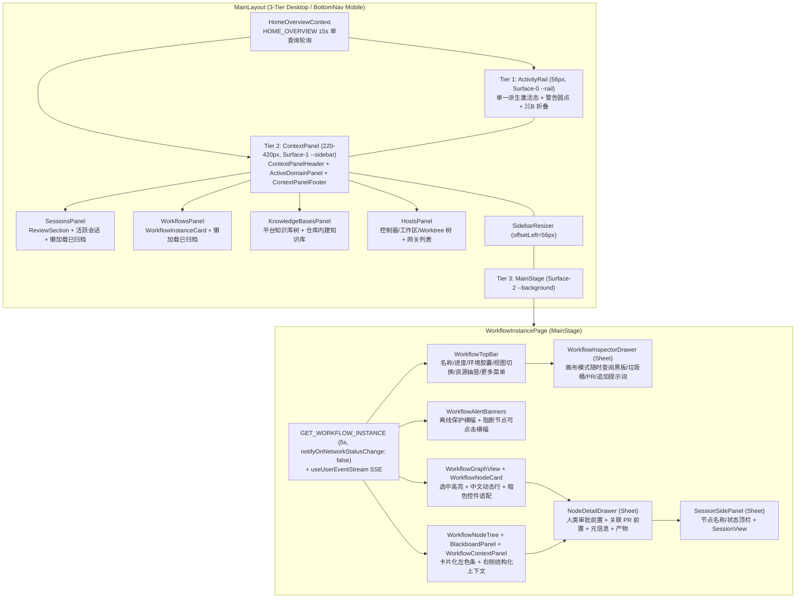
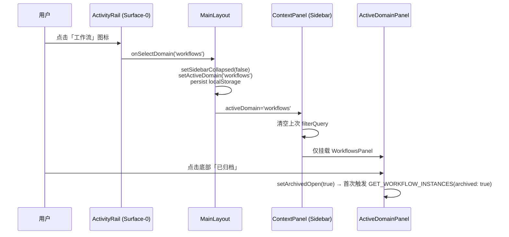
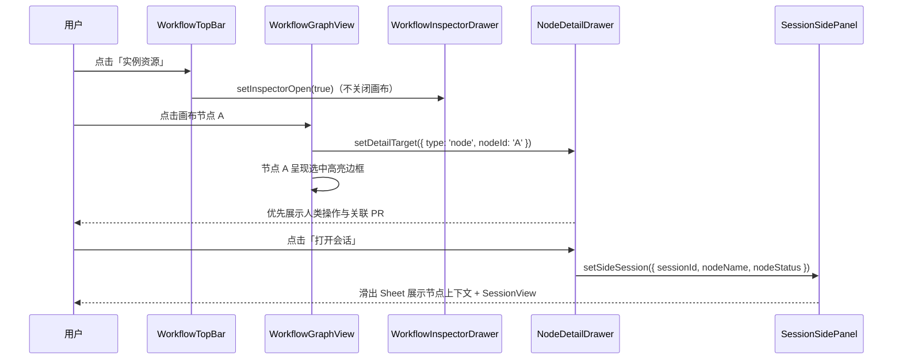

# 左侧导航面板与工作流实例详情重构 - 技术提案

**功能名称**: 左侧导航面板与工作流实例详情重构
**关联 PRD**: [docs/product/draft/20261127-sidebar-and-workflow-detail-refactor.md](../../product/draft/20261127-sidebar-and-workflow-detail-refactor.md)
**关联规范**: [docs/engineering/prototypes/20261127-ui-specification.md](../prototypes/20261127-ui-specification.md) · [docs/engineering/prototypes/20261127-ui-specification.html](../prototypes/20261127-ui-specification.html) · [docs/engineering/ui-ux-standards.md](../ui-ux-standards.md)
**技术提案版本**: v1.0
**创建日期**: 2026-11-27
**作者**: ZeroAsh Agent
**feat-branch**: `feat/sidebar-and-workflow-detail-refactor`
**领域模型影响**: 无（见 [§12 领域模型影响核对](#12-领域模型影响核对)：纯前端表现层与组件结构重构，零后端、零 GraphQL/OpenAPI 契约、零持久化实体、零状态机与权限口径变化）

---

## 1. 概述

### 1.1 背景

在 PR #587（`20261126-refactor-ui-ux-workspace-overhaul`）与 PR #595（`20261127-refactor-agent-web-full-ui-rework`）落地三层工作区外壳与全局 Token 后，对照 `main` 现存代码与 [`20261127-ui-specification.md`](../prototypes/20261127-ui-specification.md) / [`20261127-ui-specification.html`](../prototypes/20261127-ui-specification.html) / [`20261126-ui-ux-workspace-overhaul.html`](../prototypes/20261126-ui-ux-workspace-overhaul.html) 逐项审计，发现 **左侧导航面板** 与 **工作流实例详情页** 仍保留大量旧骨架与规范差距，是本次专项重构的直接依据：

#### 差距审计 A：左侧导航面板（`MainLayout` + `ActivityRail` + `Sidebar`）

| # | 差距项 | `main` 代码事实 | 规范目标 |
|---|---|---|---|
| L1 | **仍为 6 分区手风琴堆叠** | `Sidebar.tsx`（835 行单体）同时渲染 `hosts` / `workflows` / `sessions` / `knowledgeBases` / `gateways` / `ReviewSection` 6 个纵向折叠区；点击 `ActivityRail` 仅展开对应手风琴并 `scrollIntoView` | 领域聚焦 `ContextPanel`：一次仅呈现当前激活领域的专属视图，彻底终结纵向手风琴堆叠（`ui-ux-standards.md` §1.1 / §4.2、`20261127-ui-specification.html` §4） |
| L2 | **Surface-0 / Surface-1 无明度差** | `ActivityRail.tsx:79` 使用 `bg-sidebar`，与 `Sidebar.tsx:243` 完全同色；`index.css` 缺少 `--rail` Token | 引入 `--rail`（Light `oklch(0.962 0.005 264)` / Dark `oklch(0.132 0.005 264)`）表达 Surface-0，与 Surface-1 `--sidebar` 形成清晰递进 |
| L3 | **Rail 双高亮 Bug** | `ActivityRail.tsx:103` 判定 `isSelected = activeSection === key \|\| isRouteActive`，当 `focusTarget.section` 与当前路由不一致时（如点击 `hosts` 后进入 `/sessions/:id`）出现两个 `ActiveIndicator` | 收敛为单一派生激活态 `resolvedActiveRailKey`，任意时刻至多一个 `ActiveIndicator` |
| L4 | **桌面底栏入口重复与英文残留** | `Sidebar.tsx:637-676` 在桌面端重复渲染「新建会话」「我的费用」「Settings」（且 `aria-label="Settings"`、会话默认名 `'New Session'` 为英文），与 `ActivityRail` 底部重叠 | 桌面端 `ContextPanelFooter` 仅保留「用户名 + `TodoListPanel` + `ThemeToggle`」；移动端保留费用/设置直达；全量清理英文残留为「未命名会话」「设置」 |
| L5 | **缺领域标题栏、本地筛选与折叠持久化** | `Sidebar.tsx` 顶部仅有 `WorkspaceSwitcher`，无领域主新建按钮、无活跃列表本地筛选框；`MainLayout.tsx:48` 的 `sidebarCollapsed` 未持久化，宽度默认回退 `20rem`（320px） | `ContextPanelHeader` 整合 `WorkspaceSwitcher` + 本地筛选框（会话/工作流域）+ 领域标题/等宽计数/主新建按钮；折叠态持久化至 `localStorage`，默认宽 `280px`（`220–420px`） |

#### 差距审计 B：工作流实例详情页（`WorkflowInstancePage` 及 `components/workflow/*`）

| # | 差距项 | `main` 代码事实 | 规范目标 |
|---|---|---|---|
| W1 | **顶栏松散、缺进度与环境胶囊** | `WorkflowInstancePage.tsx:233-304` 为散落 `flex-wrap` 行，`text-xl font-bold`，缺节点完成进度（`X/Y`）与环境信息胶囊；`删除实例` 危险按钮与视图切换并排 | 统一单行 `WorkflowTopBar`（`h-12 border-b bg-card/60`）：名称 + 重命名 + 状态/进度胶囊（`tabular-nums`）+ 环境信息 Popover 胶囊 + PR 徽标 + 分段视图切换器 + 「实例资源」抽屉开关 + 更多操作 `DropdownMenu`（归档/删除） |
| W2 | **画布模式下黑板与上下文不可见** | `WorkflowInstancePage.tsx:358-368` 在 `viewMode === 'graph'` 时隐藏 `BlackboardPanel` 与 `WorkflowContextPanel`，仅留窄顶条 `instance-resource-row` | 新增 `WorkflowInspectorDrawer`（`Sheet`），在画布模式下点击顶栏「实例资源」随时滑出查看黑板、垃圾桶、关联 PR 与追加提示词 |
| W3 | **阻断横幅用原始 Emoji 且不可直达节点** | `WorkflowInstancePage.tsx:336` 使用原始 `⚠️` 字符，失败节点列表为纯文本不可点击 | 使用 `AlertTriangle` 语义图标 + 结构化 `WorkflowAlertBanners`，支持点击失败节点直达 `NodeDetailDrawer` 或 `SessionSidePanel` |
| W4 | **画布节点缺选中态、残留英文与暗色控件待对齐** | `WorkflowNodeCard.tsx:25` 返回 `'Concluding...'`；点击打开抽屉后画布节点无选中边框高亮；`ReactFlow` Controls/MiniMap 未完全绑定语义表面变量 | 中文化为「正在汇总结果…」；透传 `selectedNodeId` 呈现 `ring-2 ring-primary/60 border-primary` 选中态；统一 `ReactFlow` 暗色表面变量 |
| W5 | **列表节点与右侧面板缺乏表面层次** | `WorkflowNodeTree.tsx:68` 裸 `rounded-lg border p-3`（缺 `bg-card` 与左状态色条）；`BlackboardPanel` / `WorkflowContextPanel` 为无容器裸按钮列表 | `WorkflowNodeTree` 卡片升级为 `bg-card` + 4px 语义左色条 + `tabular-nums`；`BlackboardPanel` 与 `WorkflowContextPanel` 封装规范卡片容器与分割线 |
| W6 | **抽屉信息优先级倒置与会话面板非标准 Sheet** | `NodeDetailDrawer.tsx:206` 将 `HumanNodeActions` 置于所有 `nodeArtifacts` 之后，且 `关联 Pull Request` 位于 `Field` 之后；`SessionSidePanel.tsx:17` 用 `Dialog` 手写定位且标题仅写 `"节点会话"` | `NodeDetailDrawer` 重排为「状态与操作栏 → 人类节点操作（前置）→ 关联 PR（前置）→ 基础元信息与错误条 → 节点产物」；`SessionSidePanel` 改用标准 `Sheet` 并展示所属节点名称/状态与全屏跳转入口 |

### 1.2 目标

1. 将 835 行单体 `Sidebar.tsx` 拆解为清晰模块化组件，落地「Surface-0 `ActivityRail` + Surface-1 领域聚焦 `ContextPanel`」架构。
2. 全面重构 `WorkflowInstancePage` 及其子组件（顶栏、横幅、画布节点、节点列表、实例资源抽屉、节点详情抽屉、节点会话侧面板），实现双视图视觉与信息口径统一。
3. 零新增 GraphQL 请求、零破坏既有性能不变量（`T-E1`~`T-E5` / `E2E-HP1`~`3`），全量通过微字号/硬编码色值守卫与新增单元/E2E 回归测试。

### 1.3 范围

- **包含**：
  - `apps/agent-web/src/index.css`（新增 `--rail` Surface-0 Token）
  - `apps/agent-web/src/pages/MainLayout.tsx`、`apps/agent-web/src/components/layout/ActivityRail.tsx`、`apps/agent-web/src/components/Sidebar.tsx` 及拆出的 `apps/agent-web/src/components/sidebar/*` 领域面板组件、`apps/agent-web/src/lib/sidebar-prefs.ts`、`apps/agent-web/src/lib/sidebar-width.ts`
  - `apps/agent-web/src/pages/WorkflowInstancePage.tsx` 及 `apps/agent-web/src/components/workflow/*`（`WorkflowTopBar`、`WorkflowAlertBanners`、`WorkflowInspectorDrawer`、`WorkflowGraphView`、`WorkflowNodeCard`、`WorkflowNodeTree`、`BlackboardPanel`、`WorkflowContextPanel`、`NodeDetailDrawer`、`SessionSidePanel`）
  - 对应 Vitest 单元测试与 `tests/e2e/src/ui-ux-workspace.spec.ts` 更新/扩展
- **不包含**：
  - `apps/admin-web`、`servers/*`、`contracts/*`、数据库模型与部署配置
  - 新增业务功能或修改现有工作流状态机、权限规则

---

## 2. 技术架构

### 2.1 系统架构图



### 2.2 技术栈

沿用 `apps/agent-web` 既有技术栈，零新增第三方依赖：

| 层级 | 技术选型 | 说明 |
|------|---------|------|
| 框架 | React 19 + TypeScript (strict) | 函数组件 + Hooks |
| 样式 | Tailwind CSS v4 + OKLCH CSS Variables | 新增 `--rail` Surface-0 Token，零硬编码色值 |
| 原语组件 | `@base-ui/react` (`components/ui/*`) | `Sheet`、`Popover`、`DropdownMenu`、`ConfirmDialog`、`Button`、`Badge`、`Input` |
| 拓扑画布 | `@xyflow/react` + Dagre | 竖向 TB 布局、选中态联动、语义变量适配 |
| 数据层 | Apollo Client v4 + SSE (`useUserEventStream`) | 完全复用既有查询与缓存 |
| 测试 | Vitest + React Testing Library + Playwright | 单元测试 + 静态守卫 + E2E 回归 |

### 2.3 模块划分

#### 模块 A：左侧导航面板拆分（终结 835 行单体 `Sidebar.tsx`）

| 模块 | 路径 | 职责 | 关键技术点 |
|------|------|------|-----------|
| `ActivityRail` | `components/layout/ActivityRail.tsx` | 56px 一级导航轨（Surface-0 `bg-rail`） | 唯一激活态 `activeRailKey`；`home`/`sessions`/`workflows`/`knowledgeBases`/`hosts`/`billing`/`settings` 互斥高亮 |
| `Sidebar`（壳层） | `components/Sidebar.tsx` | `ContextPanel` 容器，管理弹窗状态与领域分发，保留 `nav[aria-label="Sidebar"]` | 持有当前激活领域 `activeDomain`、本地筛选词 `filterQuery` 与弹窗状态（`NewSessionDialog` / `NewCloudHostDialog` / `InstantiateWorkflowDialog` / `GatewayDialog` / `GithubProjectSetupDialog`） |
| `ContextPanelHeader` | `components/sidebar/ContextPanelHeader.tsx` | 顶部固定区：工作区切换器 + 领域标题/等宽计数/主新建按钮 + 本地筛选框 | 仅在 `sessions` / `workflows` 领域渲染本地筛选输入框（带一键清空与 `⌘K` 快捷新建触发） |
| `SessionsPanel` | `components/sidebar/SessionsPanel.tsx` | 会话领域专视图 | 置顶 `ReviewSection`（空不渲染）+ 过滤后活跃会话列表（空标题回退「未命名会话」）+ 底部粘滞 `ArchivedSessionGroup`（无计数、按需加载） |
| `WorkflowsPanel` | `components/sidebar/WorkflowsPanel.tsx` | 工作流领域专视图 | 过滤后 `WorkflowInstanceCard` 列表 + 底部粘滞 `ArchivedWorkflowGroup`（无计数、按需加载） |
| `KnowledgeBasesPanel` | `components/sidebar/KnowledgeBasesPanel.tsx` | 知识库领域专视图 | 复用并解耦 `KnowledgeBaseSection` 内容体（平台知识库树 + `RepoKnowledgeBaseSection`），无外层冗余手风琴头 |
| `HostsPanel` | `components/sidebar/HostsPanel.tsx` | 主机与网关领域专视图 | 控制器/云电脑 → 工作区 → `WorktreeSidebarGroup` 树 + 下半区「网关」分组（`GatewayItem` 列表 + 新增网关） |
| `ContextPanelFooter` | `components/sidebar/ContextPanelFooter.tsx` | 精简底栏 | 桌面端仅保留「用户名 + `TodoListPanel` + `ThemeToggle`」；移动端保留「我的费用」「设置」直达行 |

#### 模块 B：工作流实例详情拆分

| 模块 | 路径 | 职责 | 关键技术点 |
|------|------|------|-----------|
| `WorkflowTopBar` | `components/workflow/WorkflowTopBar.tsx` | 单行顶部上下文栏（`h-12 border-b`） | 实例名 + 重命名按钮、状态/完成进度胶囊（`doneCount/totalCount`，`tabular-nums`）、环境信息 Popover 胶囊（控制器/工作区/分支）、PR 快捷计数徽标、分段 `图表/列表` 切换器、`实例资源` 抽屉按钮、`更多操作` `DropdownMenu`（归档/删除） |
| `WorkflowAlertBanners` | `components/workflow/WorkflowAlertBanners.tsx` | 离线保护与节点阻断警示横幅 | `AlertTriangle` 语义图标替代 `⚠️`；阻断节点列表支持点击直达 `onSelectNode(nodeId)` 或 `onOpenSession(sessionId)` |
| `WorkflowInspectorDrawer` | `components/workflow/WorkflowInspectorDrawer.tsx` | 图表模式下的实例资源侧抽屉（`Sheet`） | 复用 `BlackboardPanel` 与 `WorkflowContextPanel`，让画布模式下随时查阅黑板、垃圾桶、关联 PR 与追加提示词 |
| `WorkflowGraphView` & `WorkflowNodeCard` | `components/workflow/WorkflowGraphView.tsx` & `graph/WorkflowNodeCard.tsx` | 竖向 DAG 画布与节点卡片 | 透传 `selectedNodeId` 渲染卡片选中高亮；`Concluding...` → `正在汇总结果…`；React Flow 控件/缩略图适配语义 CSS 变量 |
| `WorkflowNodeTree` | `components/workflow/WorkflowNodeTree.tsx` | 列表模式节点卡片树 | 统一 `bg-card` + 4px 语义左色条 + `tabular-nums` + 规范徽标底色 |
| `BlackboardPanel` & `WorkflowContextPanel` | `components/workflow/BlackboardPanel.tsx` & `WorkflowContextPanel.tsx` | 实例上下文只读面板 | 升级为 `bg-card border rounded-lg` 结构化分区容器，列表右栏与画布抽屉共用 |
| `NodeDetailDrawer` | `components/workflow/NodeDetailDrawer.tsx` | 节点/资源详情抽屉 | 信息重排：状态与操作栏 → 人类节点 `HumanNodeActions` 前置 → `关联 Pull Request` 前置 → 基础元信息与错误条 → 节点产物 |
| `SessionSidePanel` | `components/workflow/SessionSidePanel.tsx` | 节点会话侧面板 | 从手写定位 `Dialog` 重构为标准 `Sheet`（宽 `sm:max-w-4xl`），顶栏展示节点名、状态徽标与「独立页面打开」链接 |

---

## 3. API 与数据流设计

### 3.1 API 契约

**本次重构不新增或修改任何 GraphQL Schema / OpenAPI / Socket.IO 契约**，100% 复用现有聚合查询与事件流：

- **左侧面板**：
  - `HOME_OVERVIEW`（由 `MainLayout` 单一 15s 轮询，经 `HomeOverviewContext` 分发给 `ActivityRail` 与 `ContextPanel`）
  - `GET_ARCHIVED_SESSIONS`（`SessionsPanel` 底部「已归档」展开时 `skip: !archivedOpen` 按需请求）
  - `GET_WORKFLOW_INSTANCES(archived: true)`（`WorkflowsPanel` 底部「已归档」展开时 `skip: !archivedOpen` 按需请求）
  - `GET_KNOWLEDGE_BASE_TREE` & `GET_REPO_KNOWLEDGE_BASE_HOSTS`（仅当 `KnowledgeBasesPanel` 处于激活域时挂载，避免在会话/工作流域下做无用渲染）
  - `CLOUD_HOST_CAPABILITIES`（用于「主机」领域的新建云电脑入口，沿用缓存）
- **工作流实例详情**：
  - `GET_WORKFLOW_INSTANCE`（5s 轮询，`notifyOnNetworkStatusChange: false`，防止轮询卸载组件）
  - `useUserEventStream`（`onSessionInteraction` 触发实例近实时 `refetch`）
  - `GET_ACP_CAPABILITIES` / `GET_ACP_SERVER_OPTIONS`（编辑/重启节点与画布模型名称映射）
  - 变更操作沿用 `DELETE_WORKFLOW_INSTANCE`、`ARCHIVE_WORKFLOW_INSTANCE`、`RENAME_WORKFLOW_INSTANCE` 等既有 Mutation。

### 3.2 性能不变量保障

- 首屏登录至 `/` 仍只发起 **1 次 `HOME_OVERVIEW`**，不触发任何归档查询（守卫：`tests/e2e/src/home.spec.ts` `T-E1`~`T-E5`）。
- 本地筛选纯前端 `useMemo` 过滤 `sessions` / `workflowInstances` 数组，零网络开销。

---

## 4. 状态与本地持久化设计

### 4.1 CSS 表面层级 Token（`apps/agent-web/src/index.css`）

新增 `--rail`（Surface-0）并注册至 `@theme inline`：

```css
/* :root (Light) */
--rail: oklch(0.962 0.005 264);

/* .dark (Dark) */
--rail: oklch(0.132 0.005 264);

/* @theme inline */
--color-rail: var(--rail);
```

4 级表面层级完整闭环：`bg-rail`（Surface-0）→ `bg-sidebar`（Surface-1）→ `bg-background` / `bg-card`（Surface-2）→ `bg-popover`（Surface-3）。

### 4.2 `localStorage` 持久化键

| Key | 类型与默认值 | 职责与兼容性 |
|-----|-------------|-------------|
| `sidebar-active-domain` | `'sessions' \| 'workflows' \| 'knowledgeBases' \| 'hosts'`，默认 `'sessions'` | 记忆上次聚焦领域；非法值回退 `'sessions'` |
| `sidebar-collapsed` | `'0' \| '1'`，默认 `'0'` | 记忆桌面端列表栏收起状态（`⌘B` / 按钮同步写入） |
| `sidebar-width` | 数值 `220–420`，默认改为 `280` | 对齐规范 §3.1 默认 `280px`；已有合法值保留，越界值自动 clamp |
| `workflow-view-mode` | `'graph' \| 'list'`，默认 `'list'` | 保持既有键与默认值，避免破坏存量 E2E 用例的初始断言 |

### 4.3 路由与一级导航轨唯一激活态派生规则

```ts
export type RailKey = 'home' | 'sessions' | 'workflows' | 'knowledgeBases' | 'hosts' | 'billing' | 'settings';
export type ContextDomainKey = 'sessions' | 'workflows' | 'knowledgeBases' | 'hosts';
```

- 路由进入 `/sessions/*` → 自动同步 `activeDomain = 'sessions'`
- 路由进入 `/workflows/*` → 自动同步 `activeDomain = 'workflows'`
- 路由进入 `/knowledge-bases/*` → 自动同步 `activeDomain = 'knowledgeBases'`
- `ActivityRail` 高亮判定（**互斥单一值**）：
  - 若当前在 `/` 且用户未主动切换领域 → 高亮 `'home'`（若用户点击了某个领域图标，如 `'hosts'`，则切换高亮为 `'hosts'` 并聚焦该领域）
  - 若当前在 `/billing*` → 高亮 `'billing'`（用户主动点击领域图标时允许临时高亮该领域以查看列表）
  - 若当前在 `/settings*` → 高亮 `'settings'`
  - 其他情况 → 高亮 `activeDomain`
- 结果：任意时刻 `data-testid="rail-active-indicator"` 在 DOM 中**严格有且仅有 1 个**。

---

## 5. 技术实现方案

### 5.1 核心流程

#### 流程 1：左侧导航切换与领域聚焦



#### 流程 2：工作流画布选中节点、查看实例资源与会话面板



### 5.2 关键实现点

#### 实现点 1：左侧面板 `ContextPanel` 与移动端兼容
- 桌面端：`MainLayout` 渲染 `ActivityRail` + `{!sidebarCollapsed && (<><Sidebar activeDomain={activeDomain} ... /><SidebarResizer ... /></>)}` + `<main>`。
- 移动端（`< 768px`）：隐藏 `ActivityRail`，在 `Sidebar` 顶部增加紧凑的 4 领域分段标签栏（`会话 / 工作流 / 知识库 / 主机`），底部保留「我的费用」「设置」直达行，避免移动端失去领域切换入口。
- 本地筛选匹配规则：
  - `SessionsPanel`：按 `session.title` 与推导的工作区名做不区分大小写子串匹配；
  - `WorkflowsPanel`：按 `instance.name` 与 `instance.workspace?.name` 匹配。
- 保留关键 `data-testid` 稳定锚点：`activity-rail`、`rail-item-{key}`、`rail-active-indicator`、`rail-toggle-sidebar`、`sidebar-session-list`、`sidebar-workflow-list`、`sidebar-gateway-list`、`review-section`、`workflow-instance-card`，并新增 `context-panel-header`、`context-panel-filter`、`context-panel-domain-{domain}`。

#### 实现点 2：`WorkflowTopBar` 进度计算与环境信息胶囊
- 节点完成进度：`doneCount = instance.nodes.filter(n => n.status === 'DONE').length`，`totalCount = instance.nodes.length`，胶囊展示 `已完成 {doneCount}/{totalCount}`（附加 `tabular-nums`）。
- 环境信息胶囊：触发按钮展示控制器名或工作区名（单行 `max-w-44 truncate`），点击打开 `Popover` 展示完整控制器名称、控制器状态、工作区名称、工作目录/Worktree 路径与实例创建时间；窄容器严格遵循 `min-w-0` + `wrap-anywhere`。
- 更多操作菜单：使用 `@base-ui/react` `DropdownMenu` 收纳「归档/取消归档」与危险操作「删除实例」（`text-destructive-text`），防止在顶栏误触。

#### 实现点 3：`WorkflowNodeCard` 选中高亮与中文化
- `WorkflowGraphView` 将 `selectedNodeId = detailTarget?.type === 'node' ? detailTarget.nodeId : null` 注入节点 `data.selected`。
- `WorkflowNodeCard` 根据 `data.selected` 应用 `ring-2 ring-primary/50 border-primary`，关闭抽屉时自动取消高亮。
- `liveActivityLabel`：`activity?.kind === 'text'` 返回 `'正在汇总结果…'`，彻底消除 `'Concluding...'`。
- `ReactFlow` 的 `<Controls>` 与 `<MiniMap>` 通过语义类/CSS 变量覆盖暗色背景与边框（`!bg-card !border-border`），杜绝暗色模式下白底控件。

#### 实现点 4：`NodeDetailDrawer` 信息重排与 `SessionSidePanel` 标准化
- `NodeDetailDrawer` 渲染顺序固定为：
  1. 状态与操作栏（类型、状态徽标、返工数、打开会话、重启节点、立即失败）
  2. `actionable && <HumanNodeActions ... />`（置于浅底高亮区块 `rounded-lg border border-warning/30 bg-warning/5 p-3`）
  3. `nodeLinks.length > 0`（关联 Pull Request 区块）
  4. 基础元信息（阶段、说明、开始时间、最近返工、自动重试进度）+ 失败/打回说明
  5. `nodeArtifacts`（产物列表，使用 `border-t` 分隔而非多层卡片套娃）
- `SessionSidePanel` 改用 `@/components/ui/sheet` 的 `Sheet` + `SheetContent`，接受 `target: { sessionId: string; nodeName?: string; nodeStatus?: WorkflowNodeStatus } | null`，顶栏展示节点名、状态徽标与「独立页面打开」链接（`/sessions/${sessionId}`）。

---

## 6. 技术决策

### 6.1 决策列表

| 决策 | 选项 A | 选项 B | 最终选择 | 原因 |
|------|--------|--------|---------|------|
| D1: 左侧面板组织形态 | 保留 6 手风琴 + 点击滚动 | 领域聚焦 `ContextPanel`（一次渲染 1 个领域） | **选项 B** | 直接对齐 `20261127-ui-specification.html` §4 与 `ui-ux-standards.md` §4.2「终结无限纵向折叠手风琴」 |
| D2: `ReviewSection` 归属 | 独立成为第 5 个 Rail 图标 | 置顶于「会话」领域内 + Rail 警告圆点 | **选项 B** | Review 强关联会话，保持 Rail 精简（4 个核心领域），空时不占空间，且不打破既有 `review-section` 语义 |
| D3: 「网关」归属 | 独立 Rail 图标 | 归入「主机（Hosts）」领域下半区 | **选项 B** | 对齐 `ui-ux-standards.md` §4.2「主机与环境（含网关）」，共享控制器在线状态上下文 |
| D4: 桌面端底栏去重 | 保留 Sidebar 底部费用/设置按钮 | 桌面端移除重复入口，仅保留用户/待办/主题；移动端保留直达 | **选项 B** | `ActivityRail` 底部已有费用与设置，去除重复减少视觉噪点；移动端保留确保无入口丢失 |
| D5: 画布模式实例资源查看方式 | 常驻分栏挤压画布宽度 | 顶栏「实例资源」按钮触发右侧 `Sheet` 抽屉 | **选项 B** | 保持 DAG 画布最大可用面积，同时 100% 解决画布模式下黑板与追加提示词不可见的问题 |
| D6: 工作流默认视图模式 | 改为默认 `'graph'` | 保持默认 `'list'` + `localStorage` 记忆 | **选项 B** | 兼容既有测试基线，同时用户在首次切换至 `'graph'` 后自动记忆 |
| D7: 危险操作放置 | 顶栏直接暴露「删除实例」按钮 | 收纳进顶栏右侧「更多操作」`DropdownMenu` + `ConfirmDialog` | **选项 B** | 避免与视图切换按钮紧邻导致误触，符合精密工具顶栏克制原则 |

### 6.2 依赖与约束

| 类型 | 内容 | 说明 |
|------|------|------|
| 依赖 | `@xyflow/react`、`@base-ui/react`、`lucide-react` | 均为 `apps/agent-web` 已安装依赖，零新增包 |
| 约束 | 静态守卫 `T-UIUX-FONT1` 与硬编码色值守卫 | 新增/修改的所有 `.tsx` 严禁出现 `< 12px` 字号及散落 Tailwind 色板类名 |
| 约束 | Apollo v4 轮询规范 | 严禁 `if (loading)` 卸载已渲染页面，保持 `loading && !instance` 与 `notifyOnNetworkStatusChange: false` |

---

## 7. 项目结构（变更文件清单）

```
apps/agent-web/src/
├── index.css                                       # [修改] 新增 --rail Surface-0 Token
├── lib/
│   ├── sidebar-prefs.ts                            # [修改] 新增 ContextDomainKey / activeDomain / collapsed 读写，保留 sortByUpdatedAtDesc
│   └── sidebar-width.ts                            # [修改] 默认宽度调整为 280px（范围 220–420px）
├── pages/
│   ├── MainLayout.tsx                              # [修改] 单一激活态派生、领域切换与折叠态持久化
│   └── WorkflowInstancePage.tsx                    # [重构] 接入 WorkflowTopBar / WorkflowAlertBanners / WorkflowInspectorDrawer / 选中态联动
└── components/
    ├── layout/
    │   └── ActivityRail.tsx                        # [重构] Surface-0 bg-rail、唯一激活态、文案对齐
    ├── Sidebar.tsx                                 # [重构] 精简为 ContextPanel 容器与弹窗调度层
    ├── sidebar/
    │   ├── ContextPanelHeader.tsx                  # [新增] 工作区切换 + 领域标题/计数/主新建 + 本地筛选
    │   ├── ContextPanelFooter.tsx                  # [新增] 精简底部状态栏（桌面去重、移动保留直达）
    │   ├── SessionsPanel.tsx                       # [新增] 会话领域专视图（含 ReviewSection 与按需归档）
    │   ├── WorkflowsPanel.tsx                      # [新增] 工作流领域专视图（含按需归档）
    │   ├── KnowledgeBasesPanel.tsx                 # [新增] 知识库领域专视图
    │   ├── HostsPanel.tsx                          # [新增] 主机/工作区/Worktree 树 + 网关列表
    │   └── ReviewSection.tsx                       # [微调] 视觉细节对齐新列表卡片与 tabular-nums
    └── workflow/
        ├── WorkflowTopBar.tsx                      # [新增] 单行顶部上下文栏 + 环境胶囊 + 更多菜单
        ├── WorkflowAlertBanners.tsx                # [新增] 离线保护与阻断节点可点击警示横幅
        ├── WorkflowInspectorDrawer.tsx             # [新增] 画布模式实例资源侧抽屉
        ├── WorkflowGraphView.tsx                   # [修改] 透传 selectedNodeId、适配暗色控件样式
        ├── graph/WorkflowNodeCard.tsx              # [修改] 选中高亮态、中文化动态行、细节收口
        ├── WorkflowNodeTree.tsx                    # [重构] 统一 bg-card + 4px 语义左色条 + tabular-nums
        ├── BlackboardPanel.tsx                     # [重构] 结构化卡片容器与清晰折叠头
        ├── WorkflowContextPanel.tsx                # [重构] 结构化卡片容器与清晰折叠头
        ├── NodeDetailDrawer.tsx                    # [重构] 前置人类审批与关联 PR、优化分区层次
        └── SessionSidePanel.tsx                    # [重构] 改用标准 Sheet + 节点上下文顶栏
```

---

## 8. 测试策略（TDD）

### 8.1 单元测试规划（Vitest + React Testing Library）

采用红-绿-重构循环，逐行为先写失败测试再实现：

| 编号 | 覆盖模块 | 测试行为 |
|------|---------|---------|
| `T-SIDEBAR-1` | `ActivityRail` | Surface-0 使用 `bg-rail`；任意路由与领域组合下 DOM 中严格仅有 1 个 `rail-active-indicator` |
| `T-SIDEBAR-2` | `MainLayout` + `Sidebar` | 点击一级导航轨「工作流」「知识库」「主机」「会话」，ContextPanel 仅渲染目标领域，不渲染其余领域内容 |
| `T-SIDEBAR-3` | `MainLayout` | `Cmd/Ctrl + B` 与收起按钮切换列表栏并持久化至 `localStorage`；收起后点击领域图标自动展开 |
| `T-SIDEBAR-4` | `SessionsPanel` & `WorkflowsPanel` | 本地筛选关键词即时过滤列表、无匹配展示空态与清空按钮；空标题会话显示「未命名会话」 |
| `T-SIDEBAR-5` | `SessionsPanel` & `WorkflowsPanel` | 「已归档」常驻折叠且无计数；首次点击展开后按需发起查询，不随首屏请求 |
| `T-SIDEBAR-6` | `ContextPanelFooter` | 桌面端不渲染重复的费用/设置/新建会话按钮；移动端渲染费用与设置直达链接与领域切换 |
| `T-WF-DETAIL-1` | `WorkflowTopBar` | 展示实例名、重命名、完成进度（`tabular-nums`）、环境信息胶囊（点击弹出控制器/工作区详情）、分段视图切换与更多菜单（归档/删除） |
| `T-WF-DETAIL-2` | `WorkflowAlertBanners` | 离线横幅可触发接续弹窗；阻断横幅不含原始 `⚠️` 且点击失败节点可打开详情抽屉 |
| `T-WF-DETAIL-3` | `WorkflowInspectorDrawer` | 图表模式下点击顶栏「实例资源」打开右侧抽屉，完整展示黑板、垃圾桶、关联 PR 与追加提示词 |
| `T-WF-DETAIL-4` | `WorkflowNodeCard` & `WorkflowGraphView` | `text` 活动显示「正在汇总结果…」；选中节点呈现高亮态；轮询刷新不重置手动视角 |
| `T-WF-DETAIL-5` | `NodeDetailDrawer` | DOM 顺序校验：`HumanNodeActions` 与 `关联 Pull Request` 出现在 `nodeArtifacts` 之前 |
| `T-WF-DETAIL-6` | `SessionSidePanel` | 以 `Sheet` 渲染并展示所属节点名、状态徽标与独立页面跳转链接 |

### 8.2 存量测试同步更新

- 同步更新 `apps/agent-web/src/components/__tests__/Sidebar.test.tsx`、`apps/agent-web/src/pages/__tests__/MainLayout.test.tsx`、`apps/agent-web/src/pages/__tests__/WorkflowInstancePage.test.tsx` 中依赖旧手风琴展开逻辑或顶栏删除按钮直出的断言（与真实行为同步，遵循 `common-rules.md`「状态语义演进要回填测试断言」）。
- 全量运行 `apps/agent-web/src/__tests__/ui-ux-standards.test.ts`（`T-UIUX-FONT1` 与硬编码色值守卫）。

### 8.3 E2E 测试（Playwright）

- 更新 `tests/e2e/src/ui-ux-workspace.spec.ts`：
  - `E2E-UIUX-1`：验证领域聚焦切换（点击「主机」后展示主机域而非手风琴）、唯一激活指示条、`Ctrl/Cmd+B` 折叠持久化、桌面底栏无重复入口。
  - 新增 `E2E-UIUX-6`（工作流实例详情重构验收）：验证单行顶栏进度与环境胶囊、图表模式下打开「实例资源」抽屉、点击画布节点高亮并打开抽屉、桌面与移动端无横向溢出（`scrollWidth - clientWidth <= 1`）。
- 回归运行 `tests/e2e/src/home.spec.ts`（确保 `T-E1`~`T-E5` 首屏单请求与归档按需加载零退化）。

---

## 9. 分阶段实施计划

1. **Phase 1：左侧导航面板重构**
   - `index.css` 补充 `--rail` Token；更新 `sidebar-prefs.ts` 与 `sidebar-width.ts`；
   - 重构 `ActivityRail` 唯一激活态与 `MainLayout` 持久化；
   - 拆分 `ContextPanelHeader` / `ContextPanelFooter` / `SessionsPanel` / `WorkflowsPanel` / `KnowledgeBasesPanel` / `HostsPanel` 并瘦身 `Sidebar.tsx`；
   - 跑通 Phase 1 单元测试与静态守卫。
2. **Phase 2：工作流实例详情重构**
   - 实现 `WorkflowTopBar`、`WorkflowAlertBanners`、`WorkflowInspectorDrawer`；
   - 重构 `WorkflowNodeCard` / `WorkflowGraphView` / `WorkflowNodeTree` / `BlackboardPanel` / `WorkflowContextPanel` / `NodeDetailDrawer` / `SessionSidePanel` 与 `WorkflowInstancePage`；
   - 跑通 Phase 2 单元测试与静态守卫。
3. **Phase 3：全量验证与 E2E 验收**
   - 运行 `apps/agent-web` 全部单测、TypeScript 类型检查与构建；
   - 串行运行 `ui-ux-workspace.spec.ts` 与 `home.spec.ts` E2E 回归，确认零溢出、零冗余请求、零回归。

---

## 10. 验收标准

- [ ] 技术方案与 PRD 评审通过
- [ ] 领域模型影响核对完成（确认无领域模型变更）
- [ ] Phase 1 左侧导航面板重构完成，单元测试全绿
- [ ] Phase 2 工作流实例详情重构完成，单元测试全绿
- [ ] `T-UIUX-FONT1` 微字号守卫与硬编码色值守卫通过
- [ ] TypeScript `tsc --noEmit` 与 Vite build 通过
- [ ] `E2E-UIUX-1`、`E2E-UIUX-6` 与 `home.spec.ts` 回归通过

---

## 11. 相关文档

- [关联 PRD：左侧导航面板与工作流实例详情重构](../../product/draft/20261127-sidebar-and-workflow-detail-refactor.md)
- [UI 规范与全场景组件化设计文档](../prototypes/20261127-ui-specification.md)
- [UI 规范交互式演示手册](../prototypes/20261127-ui-specification.html)
- [工作区 UI/UX 重构交互原型](../prototypes/20261126-ui-ux-workspace-overhaul.html)
- [UI/UX 设计规范](../ui-ux-standards.md)
- [前端开发规范](../frontend-rules.md)
- [通用开发规范](../common-rules.md)
- [领域模型库总索引](../../knowledges/domain/00-领域模型库-索引.md)

---

## 12. 领域模型影响核对

按 [`docs/engineering/common-rules.md`](../common-rules.md)「Domain Model Sync（领域模型同步）」逐项核对 `docs/knowledges/domain/`：

| 限界上下文 | 核对结果 | 说明 |
|-----------|---------|------|
| `30-控制器` / `40-云资源与Harness` | 无变更 | 仅在前端「主机」领域视图重新组织现有控制器、工作区、Worktree 与网关的呈现位置，实体/状态机/契约零变更 |
| `50-会话与交互` | 无变更 | 仅调整会话列表与 `ReviewSection` 在左侧面板的展示方式及空标题默认展示文案，会话状态机、消息与评审模型零变更 |
| `60-工作流` | 无变更 | 工作流实例、节点状态机（`INITIALIZING`/`READY`/`RUNNING`/`REWORK`/`DONE`/`REJECT`/`FAILED`/`RETRY_FAILED`）、黑板、关联 PR 与接续语义零变更，仅重构前端详情页布局与抽屉信息排序 |
| `B0-知识库` | 无变更 | 仅将现有平台知识库与仓库内建知识库收敛至「知识库」领域专视图，权限矩阵与只读扫描口径零变更 |
| `00-领域模型库-索引` / `02-上下文地图` | 无变更 | 无新增或调整限界上下文与跨上下文集成关系 |

**结论**：本次重构为纯前端表现层与组件结构重构，不涉及任何领域模型、契约或持久化实体变更，无需修改 `docs/knowledges/domain/` 文档。
