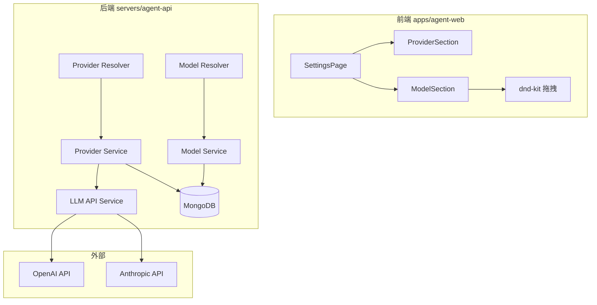
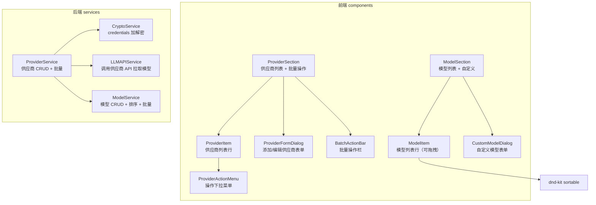
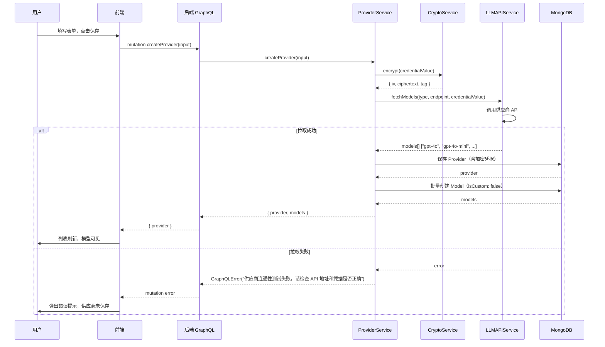
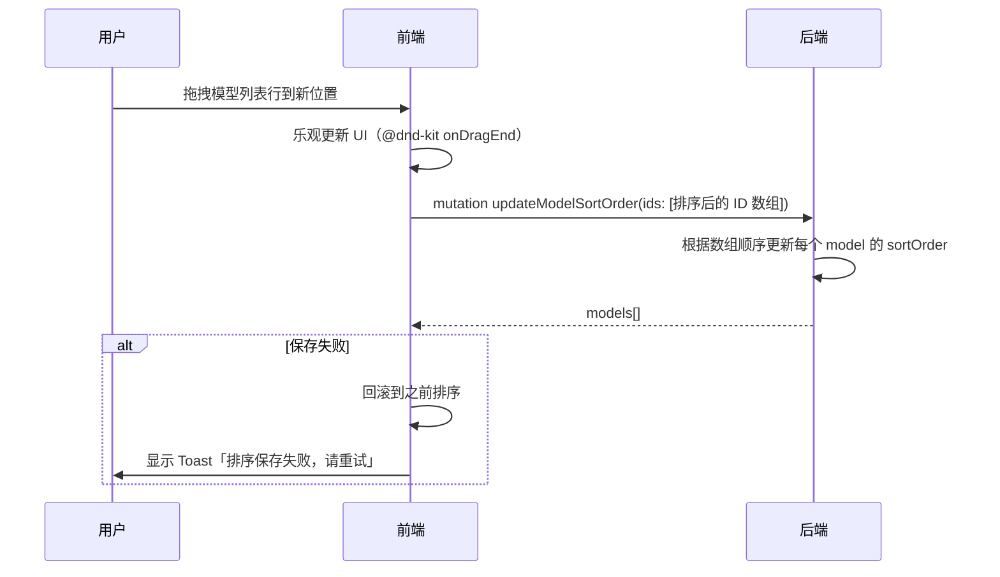

# 设置页 LLM 供应商与模型管理 - 技术提案

**功能名称**: 设置页 LLM 供应商与模型管理
**关联 PRD**: `llm-provider-settings.md`
**技术提案版本**: v1.0
**创建日期**: 2026-05-17
**作者**: ZeroAsh
**feat-branch**: `feat/llm-provider-settings`

## 1. 概述

### 1.1 背景

基于 PRD `llm-provider-settings.md`，需要为设置页新增 LLM 供应商账号绑定与模型管理能力。当前设置页仅有「帐号」section，用户无法配置 API 凭据和管理模型列表。

### 1.2 目标

- 在设置页左侧导航新增「模型设置」分类，右侧平铺「供应商设置」和「可用模型」两个 section
- 支持供应商账号的 CRUD、多选批量操作
- 新增/编辑供应商时自动调用其 API 拉取模型列表
- 支持自定义模型、拖拽排序、模型禁用/启用
- credentials 加密存储，前端脱敏展示

### 1.3 范围

- 包含：供应商设置 CRUD、批量操作、模型自动拉取、自定义模型、拖拽排序、模型禁用
- 不包含：供应商 API 调用代理的限流/重试策略、第三方 OAuth 绑定、模型用量统计

## 2. 技术架构

### 2.1 系统架构图



### 2.2 技术栈

| 层级 | 技术选型 | 说明 |
|------|---------|------|
| 前端 | React 19 + TypeScript | SPA |
| 前端拖拽 | `@dnd-kit/core` + `@dnd-kit/sortable` | 模型列表拖拽排序 |
| 前端 GraphQL | Apollo Client | 已有 |
| 前端 UI | shadcn/ui (Tailwind) | 已有，Checkbox/DropdownMenu/Select 等新增 |
| 后端 | Express v5 + GraphQL-Yoga | 已有 |
| 后端加密 | `crypto` (Node.js built-in) | AES-256-GCM 加密 credentials |
| 数据库 | MongoDB + Mongoose | 新增 Provider/Model 集合 |
| 外部 SDK - OpenAI | `openai` ^6.38.0 | 官方 TS 库，`client.models.list()` 拉取模型列表 |
| 外部 SDK - Anthropic | `@anthropic-ai/sdk` ^0.96.0 | 官方 TS 库，`client.models.list()` 拉取模型列表 |

### 2.3 模块划分



| 模块 | 职责 | 关键技术点 |
|------|------|-----------|
| 前端 ProviderSection | 展示供应商列表、添加、批量操作 | checkbox 多选、批量操作栏浮现 |
| 前端 ModelSection | 展示模型列表、自定义、拖拽排序 | `@dnd-kit` sortable 拖拽 |
| 后端 Provider Resolver | GraphQL 供应商 CRUD 接口 | 批量操作、状态管理 |
| 后端 Model Resolver | GraphQL 模型管理接口 | 排序持久化、批量状态管理 |
| 后端 LLM API Service | 调用 OpenAI/Anthropic 模型列表 API | 错误不阻塞保存 |
| 后端 Crypto Service | 加密/解密 credentials | AES-256-GCM + 固定密钥 |

## 3. API 设计

### 3.1 GraphQL Schema

```graphql
enum ProviderType {
  OpenAI
  Anthropic
}

enum CredentialType {
  api_key
}

type Provider {
  id: ID!
  name: String!
  type: ProviderType!
  endpoint: String!
  credentialType: CredentialType!
  credentialValue: String!    # 脱敏后返回 (sk-****1234)
  isEnabled: Boolean!
  models: [Model!]!
  createdAt: String!
  updatedAt: String!
}

type Model {
  id: ID!
  providerId: ID!
  provider: Provider!
  name: String!
  isCustom: Boolean!          # true = 用户自定义，false = API 自动拉取
  isEnabled: Boolean!
  sortOrder: Int!
  createdAt: String!
  updatedAt: String!
}

# 供应商输入
input ProviderInput {
  name: String!
  type: ProviderType!
  endpoint: String!
  credentialType: CredentialType! = api_key
  credentialValue: String!
}

# 自定义模型输入
input CustomModelInput {
  providerId: ID!
  name: String!
}

type ProviderBatchPayload {
  successCount: Int!
}

type ModelBatchPayload {
  successCount: Int!
}

type Query {
  providers: [Provider!]!
  models: [Model!]!
  modelsByProvider(providerId: ID!): [Model!]!
}

type Mutation {
  # 供应商 CRUD
  createProvider(input: ProviderInput!): Provider!    # 先拉取模型验证连通性，成功才保存
  updateProvider(id: ID!, input: ProviderInput!): Provider!  # 先重新拉取模型验证连通性，成功才更新
  deleteProvider(id: ID!): Boolean!
  toggleProvider(id: ID!): Provider!

  # 供应商批量操作
  batchEnableProviders(ids: [ID!]!): ProviderBatchPayload!
  batchDisableProviders(ids: [ID!]!): ProviderBatchPayload!
  batchDeleteProviders(ids: [ID!]!): ProviderBatchPayload!

  # 模型管理
  createCustomModel(input: CustomModelInput!): Model!
  toggleModel(id: ID!): Model!
  updateModelSortOrder(ids: [ID!]!): [Model!]!   # ids 按排序顺序传入
}
```

### 3.2 脱敏规则

- `credentialValue` 在前端展示时脱敏：保留前 3 位和后 4 位，中间用 `****` 替代
- 例：`sk-proj-abc123def456` → `sk-p****3456`
- 后端 GraphQL resolver 中自动脱敏

### 3.3 外部 API 对接

使用官方 SDK 替代裸 `fetch` 调用，以获得类型安全、内置重试/超时/错误处理、自动分页等能力。

| SDK | 包名 | 版本 | 许可 | 周下载量 |
|-----|------|------|------|---------|
| OpenAI | `openai` | ^6.38.0 | Apache-2.0 | 19.7M |
| Anthropic | `@anthropic-ai/sdk` | ^0.96.0 | MIT | 17.9M |

#### OpenAI 模型列表

```typescript
import OpenAI from 'openai';

const client = new OpenAI({
  apiKey: '<decrypted_credential>',
  baseURL: '<user_endpoint>',  // 支持自定义 endpoint
});

// client.models.list() 返回 ModelsPage，支持自动分页
const models: string[] = [];
for await (const model of client.models.list()) {
  models.push(model.id);
}
```

`Model` 对象结构：
```json
{
  "id": "gpt-4o",
  "object": "model",
  "created": 1700000000,
  "owned_by": "openai"
}
```

#### Anthropic 模型列表

```typescript
import Anthropic from '@anthropic-ai/sdk';

const client = new Anthropic({
  apiKey: '<decrypted_credential>',
  baseURL: '<user_endpoint>',  // 支持自定义 endpoint，需包含 /v1 后缀
});

// client.models.list() 返回 ModelInfosPage，支持自动分页
const models: string[] = [];
for await (const modelInfo of client.models.list()) {
  models.push(modelInfo.id);
}
```

`ModelInfo` 对象结构：
```json
{
  "id": "claude-sonnet-4-20250514",
  "display_name": "Claude Sonnet 4",
  "created_at": "2025-05-14T00:00:00Z",
  "type": "model"
}
```

## 4. 数据模型

### 4.1 Provider 集合

| 字段 | 类型 | 说明 |
|------|------|------|
| _id | ObjectId | 主键 |
| name | String, unique, required | 供应商名称（用户自定义） |
| type | String, enum: OpenAI/Anthropic, required | 供应商类型 |
| endpoint | String, required | API 接口地址 |
| credentialType | String, default: api_key | 凭据类型（预留扩展） |
| encryptedCredential | Object, required | 加密后的凭据数据 |
| encryptedCredential.iv | String | AES 初始化向量 |
| encryptedCredential.ciphertext | String | 加密后的密文 |
| encryptedCredential.tag | String | GCM 认证标签 |
| isEnabled | Boolean, default: true | 启用/禁用状态 |
| createdAt | Date | 创建时间 |
| updatedAt | Date | 更新时间 |

### 4.2 Model 集合

| 字段 | 类型 | 说明 |
|------|------|------|
| _id | ObjectId | 主键 |
| providerId | ObjectId, ref: Provider, required, index | 关联供应商 |
| name | String, required | 模型名称 |
| isCustom | Boolean, default: false | 是否为用户自定义 |
| isEnabled | Boolean, default: true | 启用/禁用状态 |
| sortOrder | Number, default: 0 | 排序序号 |
| createdAt | Date | 创建时间 |
| updatedAt | Date | 更新时间 |

索引：`{ providerId: 1, name: 1 }` (unique compound index)

### 4.3 供应商-模型级联关系

- 删除供应商 → 级联删除关联 Model
- 禁用供应商 → 关联 Model 自动禁用（`isEnabled: false`），不可单独启用
- 启用供应商 → 恢复关联 Model 到供应商禁用前的状态（可在 Model 上存储 `wasEnabledBeforeProviderDisabled` 字段，或统一恢复为启用）

### 4.4 缓存设计

- 暂不引入缓存层，供应商和模型数据量较小，直接查库
- 后续如需优化可在 Provider/Model resolver 层添加 Redis 缓存

## 5. 技术实现方案

### 5.1 核心流程

#### 新增供应商流程



#### 拖拽排序流程



### 5.2 关键实现点

#### 实现点 1: 凭据加密存储

- **描述**: 使用 Node.js 内置 `crypto` 模块的 AES-256-GCM 对 API Key 进行加密
- **技术细节**:
  - 加密密钥从环境变量 `CREDENTIAL_ENCRYPTION_KEY` 读取（32 字节 hex 编码）
  - 每次加密生成随机 16 字节 IV
  - GCM 模式提供认证加密，防止篡改
  - 存储结构：`{ iv: hex, ciphertext: hex, tag: hex }`
- **风险点**: 加密密钥管理——开发环境可使用固定密钥，生产环境需通过安全渠道配置

#### 实现点 2: LLM API 模型拉取

- **描述**: 新增/编辑供应商时，先调用供应商 API 测试连通性（拉取模型列表），成功后才保存数据
- **技术细节**:
  - `LLMAPIService` 根据 `ProviderType` 选择对应的 SDK：
    - OpenAI: `new OpenAI({ apiKey, baseURL })` → `client.models.list()`
    - Anthropic: `new Anthropic({ apiKey, baseURL })` → `client.models.list()`
    - baseURL 从用户配置的 endpoint 传入，支持自定义接口地址
  - 调用前先从 `CryptoService` 解密 `encryptedCredential` 得到明文 API Key
  - 使用 `for await...of` 自动分页遍历
  - SDK 内置超时、重试和错误处理（SDK 默认超时 10 分钟，可配置 `timeout` 选项）
  - **拉取失败阻塞主流程**：捕获 SDK 抛出的 `APIError`，向上抛出 `GraphQLError`，供应商不保存
- **风险点**: 注意 `baseURL` 需包含 `/v1` 路径后缀（如 `https://custom.com/v1`），SDK 内部拼接路径时不会自动补全

#### 实现点 3: 前端设置页布局改造

- **描述**: 在现有 2-column 设置页中新增「模型设置」导航分类，平铺「供应商设置」和「可用模型」两个 section
- **技术细节**:
  - 现有 `SettingsPage.tsx` 左侧 nav 新增「模型设置」项
  - 右侧内容区新增 `ProviderSection` 和 `ModelSection` 组件
  - 点击左侧 nav 项时，使用 `scrollIntoView` 平滑滚动到对应 section
  - 导航高亮基于 IntersectionObserver 或点击状态
  - 使用 `id` 属性 + `useLocation` hash 实现锚点定位

#### 实现点 4: 前端多选批量操作

- **描述**: 供应商列表支持 checkbox 多选或长按进入多选模式
- **技术细节**:
  - 每个 `ProviderItem` 前方有 checkbox
  - 勾选任意 checkbox 后，页面顶部浮现 `BatchActionBar`，包含「启用」「禁用」「删除」按钮
  - 长按供应商条目 500ms 进入多选模式（同时选中该条目）
  - 多选模式下，`BatchActionBar` 显示已选数量
  - 点击「取消」或按 Escape 退出多选模式
  - 批量操作调用对应的 batch mutation

#### 实现点 5: 禁用供应商与模型级联

- 禁用供应商时：后端级联更新该供应商所有模型 `isEnabled = false`
- 启用供应商时：后端级联恢复该供应商所有模型 `isEnabled = true`
- 前端 `ModelItem` 判断：如果 `model.provider.isEnabled === false`，禁用开关不可操作，显示「供应商已禁用」提示

## 6. 技术决策

### 6.1 决策列表

| 决策 | 选项 A | 选项 B | 最终选择 | 原因 |
|------|--------|--------|---------|------|
| 凭据加密 | AES-256-GCM (Node crypto) | bcrypt | AES-256-GCM | 可逆加密，后端可以解密用于 API 调用 |
| 拖拽库 | `@dnd-kit/core` + `@dnd-kit/sortable` | `react-beautiful-dnd` | `@dnd-kit` | react-beautiful-dnd 已不再维护 |
| 模型拉取实现 | 官方 SDK (`openai` / `@anthropic-ai/sdk`) | 裸 `fetch` | 官方 SDK | 类型安全、内置重试/错误处理/自动分页、0 dep 或 2 dep |
| 模型拉取错误处理 | 先测试连通性，失败则拒绝保存 | 保存后异步拉取，失败仅提示 | 先测试后保存 | 确保只有配置正确的供应商才能被保存，避免无效数据 |
| 批量操作实现 | 单次 mutation 传 ID 数组 | 逐个调 mutation | 单次 mutation | 减少网络请求，原子性更好 |
| 模型排序持久化 | 排序后立即自动保存 | 拖拽后点击保存按钮 | 自动保存 | 更好的用户体验 |

### 6.2 依赖与约束

| 类型 | 内容 | 说明 |
|------|------|------|
| 依赖 | `@dnd-kit/core` + `@dnd-kit/sortable` | 前端拖拽排序 |
| 依赖 | `@radix-ui/react-checkbox` | shadcn/ui checkbox（如未安装） |
| 依赖 | `@radix-ui/react-dropdown-menu` | 供应商操作菜单 |
| 依赖 | `@radix-ui/react-select` | 供应商类型/凭据类型下拉选择 |
| 依赖 | `lucide-react` | 图标（已有） |
| 依赖 | `openai` | ^6.38.0 OpenAI 官方 TypeScript SDK |
| 依赖 | `@anthropic-ai/sdk` | ^0.96.0 Anthropic 官方 TypeScript SDK |
| 依赖 | `crypto` (Node.js built-in) | 凭据加解密 |
| 约束 | 前端遵循 `docs/engineering/frontend-rules.md` | |
| 约束 | 后端遵循 `docs/engineering/backend-rules.md` | |
| 约束 | credentials 不得明文存储在数据库 | |
| 约束 | credentials 不得在前端完整展示 | |

## 7. 项目结构

```
# 后端新增/修改
servers/agent-api/
├── src/
│   ├── graphql/
│   │   ├── schemas/
│   │   │   ├── index.ts              # 修改：注册 provider/model typeDefs
│   │   │   ├── auth.ts               # 不变
│   │   │   ├── provider.ts           # 新增：Provider GraphQL typeDefs
│   │   │   └── model.ts              # 新增：Model GraphQL typeDefs
│   │   └── resolvers/
│   │       ├── index.ts              # 修改：注册 provider/model resolvers
│   │       ├── auth.ts               # 不变
│   │       ├── provider.ts           # 新增：Provider resolvers
│   │       └── model.ts              # 新增：Model resolvers
│   ├── models/
│   │   ├── user.ts                   # 不变
│   │   ├── provider.ts               # 新增：Provider Mongoose model
│   │   └── model.ts                  # 新增：Model Mongoose model
│   ├── services/
│   │   ├── auth.ts                   # 不变
│   │   ├── provider.ts               # 新增：Provider 业务逻辑
│   │   ├── model.ts                  # 新增：Model 业务逻辑
│   │   ├── crypto.ts                 # 新增：凭据加解密
│   │   └── llm-api.ts                # 新增：LLM API 调用
│   ├── middleware/
│   │   └── auth.ts                   # 不变
│   └── index.ts                      # 不变
├── contracts/
│   └── llm.graphql                   # 新增：GraphQL 契约文件
└── tests/
    ├── provider.test.ts              # 新增
    ├── model.test.ts                 # 新增
    └── crypto.test.ts                # 新增

# 前端新增/修改
apps/agent-web/
├── src/
│   ├── pages/
│   │   └── SettingsPage.tsx          # 修改：新增模型设置导航 + section
│   ├── components/
│   │   ├── settings/
│   │   │   ├── ProviderSection.tsx    # 新增：供应商设置 section
│   │   │   ├── ProviderItem.tsx       # 新增：供应商列表行
│   │   │   ├── ProviderFormDialog.tsx # 新增：添加/编辑供应商表单对话框
│   │   │   ├── ProviderActionMenu.tsx # 新增：操作下拉菜单
│   │   │   ├── BatchActionBar.tsx     # 新增：批量操作栏
│   │   │   ├── ModelSection.tsx       # 新增：可用模型 section
│   │   │   ├── ModelItem.tsx          # 新增：模型列表行（可拖拽）
│   │   │   └── CustomModelDialog.tsx  # 新增：自定义模型对话框
│   │   └── ui/                       # 可能新增 checkbox, select, dropdown-menu
│   ├── graphql/
│   │   ├── queries.ts                # 新增：provider/model queries
│   │   └── mutations.ts              # 新增：provider/model mutations
│   └── lib/
│       └── credential.ts             # 新增：前端脱敏工具函数
```

## 8. 测试策略

### 8.1 测试覆盖要求

- 后端 GraphQL 测试覆盖：Provider 所有 CRUD + 批量操作 + Model 管理 + 模型拉取
- 后端加密解密单元测试：加解密正确性、解密失败处理
- 前端组件测试覆盖：ProviderSection、ModelSection、表单验证、拖拽交互

### 8.2 测试类型

| 类型 | 工具 | 覆盖范围 |
|------|------|---------|
| 后端 GraphQL 集成测试 | Vitest + supertest | provider/model 所有 mutation/query |
| 后端服务单元测试 | Vitest | crypto service, llm-api service |
| 前端组件测试 | Vitest + React Testing Library | 渲染、表单交互、拖拽 |
| 前端 hooks 测试 | Vitest + React Testing Library | 批量选择逻辑、脱敏工具 |

## 9. 配置管理

| 配置项 | 说明 | 是否必填 |
|--------|------|---------|
| `CREDENTIAL_ENCRYPTION_KEY` | AES-256 密钥，32 字节 hex（64 hex chars） | 是（生产环境） |

## 10. 验收标准

- [ ] 技术方案评审通过
- [ ] Contract 评审通过
- [ ] 代码实现完成
- [ ] API 测试通过
- [ ] 前端组件测试通过

## 11. 相关文档

- [关联 PRD](../../product/shipping/llm-provider-settings.md)
- [前端规范](../frontend-rules.md)
- [后端规范](../backend-rules.md)
- [用户认证与设置页技术方案](./user-auth-and-settings.md)
