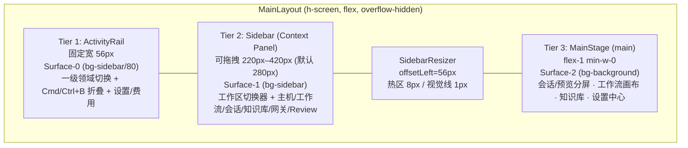

# ZeroAsh's Agent Gear — UI 规范与全场景组件化设计文档（UI Specification）

**适用范围**：[`apps/agent-web`](../../../apps/agent-web)（多端 Agent 工作台）与 [`apps/admin-web`](../../../apps/admin-web)（平台运维与计费管理后台）  
**配套原型**：[`20261126-ui-ux-workspace-overhaul.html`](./20261126-ui-ux-workspace-overhaul.html) · [`20261127-ui-specification.html`](./20261127-ui-specification.html)（交互式规范演示手册）  
**关联规范**：[`../ui-ux-standards.md`](../ui-ux-standards.md) · [`../frontend-rules.md`](../frontend-rules.md)  
**文档版本**：v1.0  
**创建日期**：2026-11-27

---

## 1. 整体视觉风格与设计哲学（Overall Visual Style）

### 1.1 美学定位：极简精密工程工作台（Precision Developer Workbench）

ZeroAsh's Agent Gear 面向高频、长时间使用多 Agent 协同、云电脑容器、工作流 DAG 与代码预览的工程研发人员。整体视觉语言参考 **Linear / Raycast / VS Code** 的精密工具美学，强调以下五个核心特征：

1. **克制与视觉耐久（Restrained & Visually Durable）**
   - 摒弃高饱和度霓虹渐变、大面积纯黑/纯白高反差与装饰性阴影；采用基于 **OKLCH 感知均匀色彩空间** 的低饱和度冷灰中性色阶（色相锚定 `264°` 靛蓝微调），让用户在 8 小时以上的连续会话与代码审阅中不易视觉疲劳。
2. **表面层级优先于重边框（Surface Hierarchy over Heavy Borders）**
   - 通过 **4 级微明度差** 区分空间层次：`Surface-0`（Activity Rail 导航轨）→ `Surface-1`（Sidebar 上下文列表）→ `Surface-2`（主画布与内容卡片）→ `Surface-3`（Popover / Dialog / 抽屉），仅辅以 `1px` 低对比度分割线（暗色模式 `oklch(1 0 0 / 11%)`）。
3. **零微字号底线（Zero Micro-Font Policy）**
   - 全站严禁出现 `< 12px` 的字号（禁止 `text-[9px]` / `text-[10px]` / `text-[11px]`），由自动化静态单测 `T-UIUX-FONT1` / `T-UIUX-FONT2` 强制守卫。正文交互基准为 `14px`（`text-sm`），元信息与状态徽标底线为 `12px`（`text-xs`）。
4. **函数式微动效（Functional Motion Only）**
   - 动效仅服务于状态反馈与空间连续性：运行中节点/会话圆点使用 `animate-pulse`，按钮点击微沉 `active:translate-y-px`，展开/折叠平滑过渡 `150ms–200ms`，禁止无关的弹性/炫技动画。
5. **100% 术语一致性与性能感知（Terminology & Performance-Aware UX）**
   - 交互文案统一简体中文（专有技术名词 `Session`、`Worktree`、`MCP`、`Harness`、`Valut`、`ACP`、`Credits` 保持标准写法）。
   - UI 呈现严格对齐聚合数据契约（`homeOverview` / `settingsOverview`）：「已归档」分组常驻折叠且**不显示计数**，点击展开后按需懒加载。

### 1.2 排版系统（Typography System）

| 类别 | 字体栈（CSS Token） | 适用场景 |
| --- | --- | --- |
| **无衬线主字体** | `'Geist Variable', 'Inter', system-ui, 'Segoe UI', 'PingFang SC', 'Hiragino Sans GB', 'Microsoft YaHei', sans-serif` | 全局 UI 导航、表单、按钮、对话正文、卡片标题 |
| **等宽代码字体** | `'Geist Mono Variable', 'JetBrains Mono', ui-monospace, SFMono-Regular, Menlo, Monaco, Consolas, monospace` | 代码块、Diff、终端输出、文件路径、Commit Hash、API Key |
| **等宽数字对齐** | `tabular-nums`（`font-variant-numeric: tabular-nums`） | Credits 余额、Token 计量、倒计时、资源计数徽章、表格数值列 |

| 语义层级 | Tailwind 类名 | 字号 | 行高 | 字重 | 典型用途 |
| --- | --- | --- | --- | --- | --- |
| **页面主标题 (H1)** | `text-xl` / `text-2xl` | `20px–24px` | `1.3` | `600` (`font-semibold`) | 控制台首页标题、工作流详情标题、知识库 H1 |
| **区块标题 (H2/H3)** | `text-base` / `text-lg` | `16px–18px` | `1.4` | `600` (`font-semibold`) | 设置分组标题、弹窗标题、详情抽屉主标题 |
| **正文与交互 (Body)** | `text-sm` | `14px` | `1.5`（对话区 `1.6`） | `400` / `500` | 按钮、输入框、列表项、对话消息、表格单元格 |
| **元信息与徽标 (Meta)** | `text-xs` | `12px` | `1.4` | `400` / `500` | Badge、状态标签、时间戳、快捷键提示、分组副标题 |

### 1.3 空间、圆角与阴影体系（Spacing, Radius & Elevation）

- **空间网格**：严格遵循 `4px` 基准网格（`4 / 8 / 12 / 16 / 20 / 24 / 32px`）。
- **圆角比例**（基准 `--radius: 0.625rem` / `10px`）：
  - `--radius-sm` (`6px`)：紧凑标签、行内代码、小徽章
  - `--radius-md` (`8px`)：标准按钮、输入框、侧边栏列表项
  - `--radius-lg` (`10px`)：卡片（`Card`）、Popover、工具调用块
  - `--radius-xl` (`14px`)：模态框（`Dialog`）、浮动输入面板
  - `rounded-full`：状态徽标（`Badge`）、状态圆点、头像
- **阴影规范**：亮色模式仅在 `Popover` / `Dialog` / `DropdownMenu` 使用克制的 `shadow-sm` / `shadow-lg`；暗色模式主要依靠表面亮度递增（`0.145 → 0.175 → 0.205 → 0.225`）与 `1px` 细描边表达海拔，不叠加浑浊黑影。

---

## 2. 色彩调色板与语义 Token 系统（Color Palette & Tokens）

系统采用单一事实来源的 CSS 变量（定义于 [`apps/agent-web/src/index.css`](../../../apps/agent-web/src/index.css) 与 [`apps/admin-web/src/index.css`](../../../apps/admin-web/src/index.css)），全面满足 **WCAG AA（文本对比度 ≥ 4.5:1）**。

### 2.1 中性表面与文本色阶（Surface & Neutral Palette）

| 语义 Token | Light 模式 (OKLCH) | Light 近似 Hex | Dark 模式 (OKLCH) | Dark 近似 Hex | 层级与用途 |
| --- | --- | --- | --- | --- | --- |
| `--background` | `oklch(0.99 0.002 264)` | `#FCFCFD` | `oklch(0.145 0.005 264)` | `#090A0F` | **Surface-2 主画布**：对话流、工作流画布、主工作区 |
| `--sidebar` | `oklch(0.975 0.004 264)` | `#F6F7F9` | `oklch(0.175 0.006 264)` | `#101218` | **Surface-1 导航栏**：Context Panel 列表栏、Admin 侧栏 |
| `--card` | `oklch(1 0 0)` | `#FFFFFF` | `oklch(0.205 0.008 264)` | `#171923` | **Surface-2 卡片**：设置卡片、工作流节点、统计面板 |
| `--popover` | `oklch(1 0 0)` | `#FFFFFF` | `oklch(0.225 0.010 264)` | `#1C1F2B` | **Surface-3 弹层**：Dialog、Popover、DropdownMenu |
| `--muted` | `oklch(0.955 0.005 264)` | `#EFF1F5` | `oklch(0.255 0.008 264)` | `#232633` | 次级胶囊底色、代码块表头、悬停/禁用表面 |
| `--secondary` | `oklch(0.96 0.005 264)` | `#F1F2F6` | `oklch(0.255 0.008 264)` | `#232633` | 次要按钮底色、辅助标签底色 |
| `--accent` | `oklch(0.955 0.005 264)` | `#EFF1F5` | `oklch(0.255 0.008 264)` | `#232633` | 导航选中态与悬停反馈底色 |
| `--foreground` | `oklch(0.145 0.005 264)` | `#090A0F` | `oklch(0.985 0 0)` | `#FAFAFA` | 主文本、标题 |
| `--muted-foreground` | `oklch(0.52 0.008 264)` | `#686D7C` | `oklch(0.708 0.006 264)` | `#A0A4B1` | 副标题、占位符、元信息、辅助图标 |
| `--border` | `oklch(0.91 0.005 264)` | `#E1E3EA` | `oklch(1 0 0 / 11%)` | `rgba(255,255,255,0.11)` | 全局分割线与容器描边 |
| `--input` | `oklch(0.91 0.005 264)` | `#E1E3EA` | `oklch(1 0 0 / 15%)` | `rgba(255,255,255,0.15)` | 表单控件描边 |

### 2.2 品牌主色与语义状态色（Brand & Semantic Palette）

| 语义 Token | Light 模式 (OKLCH) | Light 近似 Hex | Dark 模式 (OKLCH) | Dark 近似 Hex | 语义映射与使用规范 |
| --- | --- | --- | --- | --- | --- |
| `--primary` | `oklch(0.54 0.19 264)` | `#4F5BD5` | `oklch(0.70 0.15 264)` | `#818CF8` | **Indigo-Violet 品牌主色**：主按钮、聚焦态、ActivityRail 激活指示条 |
| `--primary-foreground` | `oklch(0.985 0 0)` | `#FAFAFA` | `oklch(0.205 0.008 264)` | `#171923` | 主按钮文字 |
| `--ring` | `oklch(0.54 0.19 264)` | `#4F5BD5` | `oklch(0.70 0.15 264)` | `#818CF8` | 键盘焦点外环（`focus-visible:ring-2/3`） |
| `--success` | `oklch(0.55 0.17 148)` | `#1E9E5A` | `oklch(0.68 0.15 148)` | `#4ADE80` | 空闲（idling）、运行中（RUNNING）、在线、完成（COMPLETED） |
| `--warning` | `oklch(0.72 0.16 75)` | `#D98A16` | `oklch(0.78 0.14 75)` | `#FBBF24` | 创建中/启动中/停止中、等待人工交互/待审批、返工（REWORK） |
| `--info` | `oklch(0.58 0.15 245)` | `#2585D6` | `oklch(0.68 0.14 245)` | `#60A5FA` | 工作中（running）、AI 推理流式输出、进行中节点 |
| `--destructive` | `oklch(0.58 0.22 27)` | `#DC3B2E` | `oklch(0.70 0.19 22)` | `#F87171` | 失败（FAILED）、断连（disconnected）、危险删除/销毁操作 |

### 2.3 图表与预览批注专色（Charts & Preview Highlights）

| 类别 | Token / CSS Class | 色值定义 | 使用场景 |
| --- | --- | --- | --- |
| **数据图表** | `--chart-1` ~ `--chart-5` | 依次映射 `primary` / `success` / `warning` / `info` / `destructive` | 计费中心 `RollupChart` 费用趋势、Token 消耗分布 |
| **代码行聚焦** | `.zag-focus-highlight` / `.zag-focus-marker` | `rgb(250 204 21 / 0.28)` / `rgb(250 204 21 / 0.12)` | Monaco 代码预览目标行定位与范围标记 |
| **HTML 沙箱选取** | `[data-zag-hover]` / `[data-zag-selected]` | `#3b82f6` (2px outline) / `#f59e0b` (2px outline + 12% tint) | `HtmlPreview` iframe 元素悬停与选中批注 |
| **Markdown 批注** | `.md-annotation-highlight` | `rgb(250 204 21 / 0.30)` | `MarkdownPreview` 源码映射高亮区 |

### 2.4 跨领域状态色统一映射表（Domain State Color Matrix）

| 领域 | 状态值 | 指示点 / 动效 | 徽标样式 | 中文文案 |
| --- | --- | --- | --- | --- |
| **会话 (`Session`)** | `creating` / `connecting` | `bg-warning animate-pulse` | `bg-warning/15 text-warning` | 创建中 / 连接中 |
| **会话 (`Session`)** | `idling` | `bg-success` | `bg-success/15 text-success` | 空闲 |
| **会话 (`Session`)** | `running` | `bg-info animate-pulse` | `bg-info/15 text-info` | 工作中 |
| **会话 (`Session`)** | `disconnected` | `bg-destructive` | `bg-destructive/15 text-destructive` | 已断连 |
| **会话 (`Session`)** | `ended` | `bg-muted-foreground` | `bg-muted text-muted-foreground` | 已结束 |
| **云电脑 (`CloudHost`)** | `STARTING` / `STOPPING` | `bg-warning animate-pulse` | `bg-warning/15 text-warning` | 启动中 / 停止中 |
| **云电脑 (`CloudHost`)** | `RUNNING` | `bg-success` | `bg-success/15 text-success` | 运行中 |
| **云电脑 (`CloudHost`)** | `FAILED` | `bg-destructive` | `bg-destructive/15 text-destructive` | 失败 |
| **云电脑 (`CloudHost`)** | `STOPPED` | `bg-muted-foreground` | `bg-muted text-muted-foreground` | 已销毁 |
| **工作流节点 (`WorkflowNode`)** | `PENDING` / `RUNNING` / `WAITING_HUMAN` / `REWORK` / `COMPLETED` / `FAILED` | 分别对应 `muted-foreground` / `info animate-pulse` / `warning animate-pulse` / `warning` / `success` / `destructive` | 统一使用 `bg-card` 不透明底色 + 语义边框/左竖条 | 待执行 / 执行中 / 等待人工 / 返工 / 已完成 / 失败 |

---

## 3. 空间布局架构与响应式规范（Layout Architecture）

### 3.1 前台工作台：桌面端 3-Tier Workspace Shell（`>= 768px`）

- **Tier 1 — `ActivityRail`（56px 固定宽度）**：承载高频一级领域导航（概览、会话、工作流、知识库、主机），底部固定列表栏折叠/展开按钮（同步支持 `Cmd/Ctrl + B` 全局快捷键）、在线控制器计数徽标、我的费用与设置中心入口。
- **Tier 2 — `Sidebar` Context Panel（可收起、可拖拽 `220px–420px`）**：保留完整的工作区切换器（`WorkspaceSwitcher`）、聚合列表分区与底部用户栏（待办面板、主题切换、快捷新建）。点击 `ActivityRail` 任意领域图标时，自动展开对应 `SidebarSection` 并滚动定位。
- **Tier 3 — `MainStage`（`flex-1 min-w-0`）**：单聚焦内容舞台；进入会话内容预览模式时可在舞台内进一步三态分屏（仅对话 / 对话+预览 / 仅预览）。

### 3.2 管理后台：2-Tier Admin Shell（`apps/admin-web`）

- 左侧固定宽导航栏（`AdminLayout`，`bg-sidebar border-r`）：按「云资源管理（容器/规格/工作负载/基础镜像）」「模型与 Harness（模型配置/Harness 配置）」「租户与计费（租户管理/费用中心/对账）」「系统安全（登录供应商/安全设置）」分组。
- 右侧自适应数据工作台（`bg-background`）：顶部页头 + 操作栏 + 表格/卡片列表 + 右侧抽屉（`ReceiptDrawer`）或弹窗表单。

### 3.3 移动端响应式回退（`< 768px`）

- 隐藏桌面端 `ActivityRail` 与 `SidebarResizer`。
- 列表路由（`/`、`/sessions`）全屏展示 `Sidebar`，底部提供直接进入「我的费用」与「设置」的导航行。
- 详情路由（`/sessions/:id`、`/workflows/:id`、`/knowledge-bases/:kbId`、`/settings`）全屏渲染主舞台，顶部固定 `MobileBackButton` 返回列表。

---

## 4. 组件化体系 — 第一层：基础原子组件库（Atomic UI Primitives）

所有基础原子组件基于 `@base-ui/react` + `class-variance-authority`（CVA）构建，位于 `components/ui/`（前后台保持一致 API 与视觉 Token）。

| 组件 | 文件路径 | 变体与尺寸规格 | 设计细节与无障碍规范 |
| --- | --- | --- | --- |
| **Button** | `ui/button.tsx` | **Variants**: `default` (primary), `outline`, `secondary`, `ghost`, `destructive` (10% tint + red text), `ghost-danger`, `link` **Sizes**: `xs` (`h-6 px-2 text-xs`), `sm` (`h-7 px-2.5 text-[0.8rem]`), `default` (`h-8 px-2.5 text-sm`), `lg` (`h-9 px-2.5`), `icon` (`size-8`), `icon-xs` (`size-6`), `icon-sm` (`size-7`), `icon-lg` (`size-9`) | 统一 `rounded-lg`、`focus-visible:ring-3 focus-visible:ring-ring/50`、`disabled:opacity-50`、`active:translate-y-px`；图标按钮必须带 `aria-label` |
| **Badge** | `ui/badge.tsx` | **Variants**: `default`, `secondary`, `destructive`, `outline` | `rounded-full border px-2 py-0.5 text-xs font-medium`；严禁字号小于 `text-xs`；计数徽标附加 `tabular-nums` |
| **Card** | `ui/card.tsx` | `Card`, `CardHeader`, `CardTitle`, `CardDescription`, `CardContent`, `CardFooter` | `bg-card text-card-foreground border border-border rounded-lg`；严禁超过 2 层带边框圆角卡片嵌套，内部子区改用 `border-t` 或 `bg-muted/40` |
| **Form Controls** | `ui/input.tsx`, `ui/select.tsx`, `ui/checkbox.tsx`, `ui/switch.tsx`, `ui/label.tsx` | 标准高度 `h-8` / `h-9`，字号 `text-sm`，描边 `border-input` | 错误态统一 `aria-invalid:border-destructive aria-invalid:ring-destructive/20`；Label 与控件通过 `htmlFor` 绑定 |
| **Dialog & ConfirmDialog** | `ui/dialog.tsx`, `ui/confirm-dialog.tsx` | 居中模态层（`bg-popover rounded-xl shadow-lg`）+ 半透明遮罩 | 危险操作（删除工作区/云电脑/知识库）强制使用 `ConfirmDialog`，明确展示影响范围文案（如连带归档会话数量） |
| **Sheet** | `ui/sheet.tsx` | 右侧滑出抽屉（`w-[400px]–[560px]`，移动端 `w-full`） | 用于 `NodeDetailDrawer`、`KnowledgeBaseHistoryDrawer`、`ReceiptDrawer` 等无需离开当前上下文的详情检视 |
| **Popover & DropdownMenu** | `ui/popover.tsx`, `ui/dropdown-menu.tsx` | `bg-popover rounded-lg border shadow-md z-50` | 视口边界自动防溢出；菜单项最小高度 `32px`，支持方向键与 `Esc` 关闭 |
| **CollapsibleGroup** | `ui/collapsible-group.tsx` | 可折叠分组容器（带旋转 Chevron 图标与 `aria-expanded`） | 用于侧边栏分组、归档分组、模型供应商折叠组 |
| **EmptyState** | `ui/empty-state.tsx` | 居中图标 + 标题（`text-sm font-medium`）+ 说明（`text-xs text-muted-foreground`）+ 可选主操作按钮 | 侧边栏紧凑空态遵循「空态收敛」原则，不堆叠占位卡片 |
| **DirectoryPicker** | `ui/DirectoryPicker.tsx` | 远程/本地文件系统逐级目录浏览器 | 面包屑路径 + 列表项高亮 + 路径手动输入回退 |
| **QueryError** | `admin-web/ui/query-error.tsx` | 统一错误提示条 + 重试按钮 | 替代裸报错文案，保留重试入口 |

---

## 5. 组件化体系 — 第二层：跨场景通用业务组件（Shared Domain Patterns）

| 组件 | 核心职责 | 关键设计细节 |
| --- | --- | --- |
| **`ActivityRail`** | 桌面端 56px 一级领域导航轨 | 左侧 `2px` `bg-primary` 指示条标识当前激活领域；每个图标下方配 `12px` 简短标签（概览/会话/工作流/知识库/主机）；底部固定折叠按钮与在线主机计数 |
| **`Sidebar` & `SidebarSection`** | 可调宽二级上下文列表与分区头 | 分区头固定 `h-8`，右侧悬浮 `+` 快捷操作按钮与 `tabular-nums` 计数徽章；「已归档」分组（`ArchivedSessionGroup` / `ArchivedWorkflowGroup`）常驻折叠、**无计数**、展开懒加载 |
| **`SidebarResizer`** | 侧栏拖拽调宽分隔条 | `role="separator"`，`aria-orientation="vertical"`，支持 `offsetLeft={56}`，拖拽范围 `220px–420px` 并持久化 `localStorage` |
| **`WorkspaceSwitcher`** | 多租户工作区上下文切换器 | 按个人/团队分组的 `<optgroup>` 下拉切换，自动写入 `x-workspace-id` 请求头，随 `homeOverview` 15s 轮询自动同步新团队工作区 |
| **`ThemeToggle`** | 亮色 / 暗色 / 跟随系统三态切换 | 图标依次为 `Monitor` / `Sun` / `Moon`，持久化 `localStorage('theme')` 并同步 `html.dark` |
| **`TodoListPanel`** | 全局待办与 Check Runs 提醒面板 | 铃铛入口带未处理红点计数，Popover 内按会话/工作流聚合待办与 GitHub Check Runs 状态 |
| **`FragmentEditor`** | 原子化提示词/模板片段编辑器 | 基于 `contentEditable`，支持 `{{valut.key}}` / `{{arg}}` 原子引用块（不可拆字、整体退格删除、语法高亮胶囊） |
| **`ArgsListEditor`** | 动态参数列表编辑器 | 用于自定义工具与工作负载参数 schema 编辑，支持参数名、类型、必填开关、默认值与描述行内增删 |
| **`TagBadgeInput`** | 自足标签徽章输入框 | 回车/逗号创建 `Badge` 标签、退格删除末项、防重校验，用于知识库文档标签编辑 |

---

## 6. 组件化体系 — 第三层：全场景业务组件蓝图（Scenario-Based Componentization）

下面将全项目按 **9 大核心业务场景** 拆解组件职责、交互态与视觉规范。

### 场景 A：认证与身份绑定（Authentication & Onboarding）

- **涉及页面**：`LoginPage`（前/后台）、`LoginCallbackPage`、`IdentityChoicePage`、`ChangePasswordPage`（后台首登强制改密）。
- **视觉布局**：居中单卡片（`max-w-[400px]`，`bg-card border rounded-xl p-6`），置于微对比 `bg-background` 画布中央。
- **组件设计细节**：
  - 前台硬关闭公开注册（无注册表单与入口），支持账号密码登录及后台配置的 OIDC / GitHub OAuth 按钮组（图标 + 供应商名，统一样式 `variant="outline" w-full`）。
  - `IdentityChoicePage`：OAuth 首次登录未命中既有账号时，以双选卡片（绑定已有账号验密 vs 创建新账号）清晰分流。
  - `ChangePasswordPage`：后台初始种子密码首次登录后强制拦截，含密码强度校验与错误提示条（`bg-destructive/10 text-destructive`）。

### 场景 B：工作台概览与多租户工作区（Home Overview & Workspace Context）

- **涉及页面与组件**：`HomePage`、`WorkspacePage`、`TenantMembersPage`、`WorkspaceMembersDialog`、`WorkspaceContextBanner`、`WorkspaceManagerDialog`。
- **组件设计细节**：
  - `HomePage`：顶部欢迎区（H1 `text-2xl font-semibold`）+ 3 列 KPI 统计卡（在线控制器 / 会话总数 / 控制器总数，数值 `text-2xl font-semibold tabular-nums`）+ 最近会话列表卡片。
  - `WorkspaceContextBanner`：在设置页顶部常驻提示当前所处租户与工作区作用域（个人全局 / 团队全局 / 团队项目工作区），当角色为 `developer` 且处于全局只读区时展示醒目只读提示徽标。
  - `TenantMembersPage` & `WorkspaceMembersDialog`：角色徽标区分 `admin`（`primary`）与 `developer`（`secondary`），内置最后一位管理员保护禁用态与提示。

### 场景 C：Agent 会话与实时分屏预览（Agent Session & Live Preview）

这是系统使用时长最高的核心交互场景，分为 **消息时间线**、**底部输入控制区** 与 **右侧实时预览分屏** 三大子模块：

| 子模块 | 核心组件 | 设计与交互细节 |
| --- | --- | --- |
| **会话顶栏** | `SessionHeader`, `ModelSwitcher`, `ModeSwitcher`, `AgentCapabilityPanel`, `ConfigOptionsPanel` | 单行紧凑顶栏（`h-12 border-b`）：左侧展示会话标题 + 状态圆点 + 所属工作区/分支；右侧提供模型切换、模式切换（`code`/`plan` 等）、能力面板弹窗、归档/导出 Markdown 与分屏切换按钮 |
| **消息时间线** | `MessageList`, `MessageItem`, `ThoughtBlock`, `MarkdownContent`, `CodeBlock`, `MermaidBlock`, `MessageActions`, `ScrollToBottomButton` | 最大阅读宽 `max-w-3xl` 居中；用户消息采用浅色圆角气泡（`bg-muted/60`），AI 消息无边框流式排布；`ThoughtBlock` 默认折叠可展开；`CodeBlock` 固定深色高对比表头（语言标签 + 复制 + 自动换行）；`MermaidBlock` 异步懒加载并支持源码回退；`IntersectionObserver` 驱动智能跟随滚动与「回到底部」悬浮按钮 |
| **工具调用与终端** | `ToolCallCard`, `ToolCallRawSection`, `ReadCard`, `FetchCard`, `SubAgentCard`, `DiffView`, `TerminalOutput`, `UsageCard` | 多消息三态合并（`pending` → `running` → `completed/error`）；`DiffView` 基于 `jsdiff` + 行号 + Prism 逐行语法高亮；`TerminalOutput` 使用 `xterm-headless` 仿真解析为最终纯画面行（零 `dangerouslySetInnerHTML`），固定深黑终端面板 |
| **内联交互卡片** | `InteractionCard`, `elicitation-form`, `PendingElicitationBanner`, `PlanCard`, `PlanFloatingCard` | 提问表单（支持单选/多选 `anyOf`/文本）与权限审批直接作为时间线卡片呈现，附带 `60s` `tabular-nums` 倒计时与状态留痕；`PlanCard` 展示任务进度条与已完成项删除线 |
| **底部输入区** | `InputBox`, `CommandSuggest`, `ResumeConfirmDialog` | 自适应高度多行输入框，支持 `/` 向上弹出的 `CommandSuggest` 命令面板、附件式代码/文档预览批注片段胶囊、工作区删除/云电脑终态时的只读提示条（隐藏输入与「继续」按钮） |
| **实时分屏预览** | `PreviewPane`, `PreviewTabBar`, `CodePreview`, `HtmlPreview`, `MarkdownPreview`, `ReviewPanel`, `AnnotationPopup`, `AnnotationList` | 三态布局（仅对话 / 对话+预览 / 仅预览）；写文件常开 Diff Tab，读文件复用共享预览 Tab；支持 Monaco 行定位高亮、HTML 沙箱元素选取、Markdown `sourcepos` 批注，并通过 `ReviewPanel` 承载平台 Review 工具的通过/驳回/仅评论审批 |

### 场景 D：工作流编排与 DAG 画布（Workflow Orchestration & Graph）

- **涉及组件**：`WorkflowInstancePage`、`WorkflowInstanceCard`、`WorkflowGraphView`、`WorkflowNodeCard`、`ResourceChip`、`WorkflowNodeTree`、`NodeDetailDrawer`、`SessionSidePanel`、`BlackboardPanel`、`HumanNodeActions`、`TemplateEditorDialog`、`ConfigureWorkflowDialog`、`InstantiateWorkflowDialog`、`ContinueWorkflowDialog`。
- **组件设计细节**：
  - **两行实例卡片 (`WorkflowInstanceCard`)**：第 1 行展示实例名 + 状态圆点 + 待人工交互感叹号徽标；第 2 行以 `text-xs text-muted-foreground` 展示所属工作区名与进度计数（`3/10`）。
  - **DAG 画布 (`WorkflowGraphView` + `WorkflowNodeCard`)**：基于 React Flow + Dagre 自顶向下（TB）自动布局，支持围绕当前执行中节点前后各 2 张卡片自动 `fitView` 居中；节点卡片统一不透明 `bg-card`，顶部语义色状态条，内含节点名、Harness/角色标识、`ResourceChip`（PR / Issue / Worktree 徽标）与静态「正在思考」动态指示行。
  - **节点详情抽屉 (`NodeDetailDrawer`)**：点击任意节点滑出右侧 `Sheet`，PR 联动区块前置展示，支持人类节点审批/打回（`HumanNodeActions`）、AI 节点「立即失败」（二次确认）与进入 `SessionSidePanel` 实时查看节点会话。
  - **工作流接续 (`ContinueWorkflowDialog`)**：当原控制器不可用时展示不可用徽标，弹窗支持重新选择控制器/工作区/新 Worktree 并逐节点映射 Harness。

### 场景 E：云电脑、本地控制器与 Git Worktree（Cloud Host, Controller & Worktree）

- **涉及组件**：`NewCloudHostDialog`、`StopCloudHostDialog`、`DeleteCloudHostDialog`、`CloudHostWorkloadsSection`、`CloudHostIssuesLinkageSection`、`GithubProjectSetupDialog`、`GithubSetupProgressDialog`、`RepoWorkflowSection`、`RepoWorkflowPromptDialog`、`WorktreeSidebarGroup`、`GatewaySection`、`GatewayDialog`、`HarnessLoginDialog`。
- **组件设计细节**：
  - **云电脑创建 (`NewCloudHostDialog`)**：按「规格选择（含小时/启动 Credits 实时报价）→ 可选云存储挂载 → Harness 与标准工作负载多选 → GitHub 账号锁定」分步编排。
  - **停止与存储归档 (`StopCloudHostDialog`)**：挂载云存储时提供「停止时归档存储」勾选框与计费差异说明（归档半价 vs 保持 IDLE 全价）。
  - **Harness 登录引导 (`HarnessLoginDialog`)**：逐字展示设备登录链接与验证码、一键复制、新标签打开（`noreferrer`）与 `tabular-nums` 倒计时。
  - **端口转发网关 (`GatewaySection` / `GatewayDialog`)**：侧边栏独立「网关」分区展示转发端口与可达状态。

### 场景 F：知识库与仓库内建文档（Knowledge Base & Repo Docs）

- **涉及组件**：`KnowledgeBasePage`、`KnowledgeBaseSection`、`RepoKnowledgeBaseSection`、`RepoKnowledgeBaseContent`、`KnowledgeBasePreview`、`KnowledgeBaseEditor`、`KnowledgeBaseHistoryDrawer`、`KnowledgeBaseSettingsDialog`、`CreateKnowledgeBaseDialog`。
- **组件设计细节**：
  - **双来源清晰区分**：平台托管知识库（可读写、四档权限矩阵、支持文档移动+更新与事件溯源历史）与仓库内建知识库（`.zag/knowledges/`、`docs/knowledges/`、`docs/` 一层目录，严格只读、默认折叠按需扫描、front matter 渲染为结构化表格、带来源徽标与超限/截断标识）。
  - **分栏编辑器 (`KnowledgeBaseEditor`)**：左侧源码编辑（含 `localStorage` 草稿自动保存、路径重命名/移动输入与 `TagBadgeInput`），右侧实时 Markdown 预览；历史抽屉（`KnowledgeBaseHistoryDrawer`）按时间倒序展示 `CREATE` / `UPDATE` / `MOVE` / `DELETE` 事件流。

### 场景 G：设置中心与控制器配置（Settings Center & Controller Config）

- **涉及页面与组件**：`SettingsPage`、`ControllerConfigPage`、`ProviderSection`、`ModelSection`、`ControllerListSection`、`HarnessToolsSection`、`WorkspaceSection`、`McpRegistrySection`、`McpDefaultSection`、`CustomMcpSection`、`CustomToolSection`、`ValutSection`、`GitSettingsSection`、`GithubBindingSection`、`CloudStorageSection`、`ExternalLoginBindingSection`。
- **组件设计细节**：
  - **设置中心导航 (`SettingsPage`)**：桌面端 `200px` 左侧分组导航（带可见 `<h1>设置</h1>` 标题、分组标题 `text-xs text-muted-foreground` 与当前激活项 `data-active="true"` 高亮底色）；共享 `SettingsOverviewContext` 单次聚合查询（进入控制器子页时 `skip: Boolean(controllerId)`）。
  - **控制器配置子页 (`ControllerConfigPage`)**：顶部固定面包屑栏（`设置 / 控制器 / {当前配置分组}`，`aria-label="控制器配置面包屑"`），左侧分组切换「工作区配置 / 可用 Harness 工具 / 默认 MCP / Github 设置 / 工作流配置 / 工作负载 / 版本升级」，云端控制器自动隐藏本地专属危险操作（重命名/重置 Key/解绑）。
  - **Valut 密钥库 (`ValutSection`)**：严格遵循「明文不出服务端」视觉契约——列表仅展示 Key 名称、命名空间与引用计数，值字段仅创建/编辑弹窗可填。

### 场景 H：费用中心与计费对账（Credits Billing & Reconciliation）

- **涉及页面与组件**：前台 `BillingPage`；后台 `BillingPage`、`ReconciliationPage`、`AccountTable`、`InvoiceTable`、`ReceiptDrawer`、`RechargeDialog`、`RollupChart`、`ModelPricingSection`、`MyApiKeyManager`。
- **组件设计细节**：
  - 全部金额（Credits）、单价（每百万 Token / 每小时规格费）与增减明细强制使用 `tabular-nums` 右对齐，正数充值使用 `text-success`，扣费使用默认前景色或 `text-muted-foreground`，异常差异使用 `text-destructive`。
  - 点击账单行滑出 `ReceiptDrawer`（右侧 `Sheet`）展示完整计费维度拆解（未缓存输入 / 缓存输入 / 输出 / 中断 20%-80% 折算明细 / 存储小时桶）。

### 场景 I：管理后台运维工作台（Admin Console — `apps/admin-web`）

- **涉及页面**：`CloudContainersPage`、`CloudHostSpecsPage`、`CloudWorkloadsPage`、`BaseImagePage`、`HarnessConfigsPage`、`ModelConfigPage`、`TenantsPage`、`TenantDetailPage`、`AuthProvidersPage`、`SecurityPage`。
- **组件设计细节**：
  - **高信息密度表格规范**：表头固定 `text-xs font-medium text-muted-foreground bg-muted/40`，单元格 `text-sm py-2.5 px-3`，操作列靠右对齐使用 `Button size="sm" variant="ghost"`。
  - **专用表单组件**：`TenantWhitelistPicker`（规格白名单多选组合框）、`ParamSchemaEditor`（工作负载参数定义器）、`WorkloadLogsDialog`（等宽深色容器初始化日志检视器）、`ModelRenameRecordsPanel`（模型改名审计轨迹）。

---

## 7. 交互、无障碍与自动化质量守卫（Interaction, A11y & Guardrails）

1. **焦点与键盘导航**：
   - 所有可交互元素必须支持键盘 Tab 到达，并显式呈现 `focus-visible:ring-2/3 focus-visible:ring-ring`。
   - 全局快捷键：`Cmd/Ctrl + B` 折叠/展开侧边 Context Panel；`/` 在会话输入框触发命令建议；`Esc` 关闭当前弹层/抽屉。
   - 顶层 `Skip Link`（`跳到主要内容` → `#main-content`）保留为首个可聚焦元素。
2. **静态与集成自动化守卫**：
   - **微字号零容忍守卫**：[`apps/agent-web/src/__tests__/ui-ux-standards.test.ts`](../../../apps/agent-web/src/__tests__/ui-ux-standards.test.ts)（`T-UIUX-FONT1`）与 [`apps/admin-web/src/__tests__/ui-ux-standards.test.ts`](../../../apps/admin-web/src/__tests__/ui-ux-standards.test.ts)（`T-UIUX-FONT2`）扫描全量 `src/**/*.{ts,tsx}`，出现 `text-[9px]` / `text-[10px]` / `text-[11px]` 即刻阻断测试。
   - **外壳与导航 E2E 守卫**：[`tests/e2e/src/ui-ux-workspace.spec.ts`](../../../tests/e2e/src/ui-ux-workspace.spec.ts)（`E2E-UIUX-1` / `E2E-UIUX-2`）在真实浏览器下验证 3-Tier Shell、`Cmd/Ctrl+B`、侧栏聚焦、设置导航激活态与控制器配置面包屑。
   - **性能不变量守卫**：[`tests/e2e/src/home.spec.ts`](../../../tests/e2e/src/home.spec.ts)（`T-E1`~`T-E5` / `E2E-HP1`~`E2E-HP3`）与 [`tests/e2e/src/settings-overview.spec.ts`](../../../tests/e2e/src/settings-overview.spec.ts)（`E2E-SET1`）确保 UI 重构不引入任何额外冗余 GraphQL 查询。
