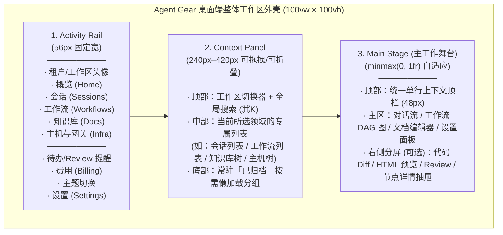

# UI/UX 设计规范（Design System & Guidelines）

本文档定义了 **ZeroAsh's Agent Gear** 前端应用（[`apps/agent-web`](../../apps/agent-web) 与 [`apps/admin-web`](../../apps/admin-web)）的统一 UI/UX 设计规范。所有新增功能、界面重构与组件开发必须严格遵循本规范，确保多端管理体验简洁、克制、现代且视觉耐久。

## 1. 核心设计原则（Core Design Principles）

1. **清晰高于密度（Clarity over Density）**：拒绝把所有功能分区无差别堆叠在同一视口。通过「一级导航分流（Activity Rail）+ 聚焦上下文面板」取代无限纵向折叠手风琴。
2. **可读性底线（Zero Micro-Font Policy）**：严禁使用小于 `12px`（`0.75rem` / `text-xs`）的字号。界面正文统一以 `14px`（`text-sm`）为基准，长文与对话消息阅读区支持 `14px–15px` 舒适行高，消除 `9px`/`10px`/`11px` 带来的视觉疲劳。
3. **现代且视觉耐久（Modern & Visually Durable）**：基于感知均匀的 OKLCH 色彩空间构建亮/暗双主题，使用微对比表面层级（Surface Hierarchy）、克制的边框（`1px` 低饱和度分割）与函数式微交互，杜绝廉价霓虹渐变与杂乱装饰。
4. **首屏与按需透明（Performance-Aware UX）**：界面状态与数据加载策略对齐（参见 `homeOverview` 与 `settingsOverview` 聚合规范）：常驻视图零冗余轮询，次级/归档数据点击展开时按需懒加载并就地呈现骨架态，不展示易抖动的冗余计数。
5. **100% 语言与术语一致性**：界面操作文案统一使用简体中文（专有技术名词如 `Session`、`Worktree`、`MCP`、`Harness`、`Valut` 保持标准大小写），严禁出现中英混杂按钮（如 `"Send"` / `"Stop"` / `"New Session"`）。

---

## 2. 字体与排版规范（Typography Scale & Rules）

### 2.1 字体栈（Font Stack）

- **无衬线主字体（UI & 正文）**：`--font-sans: 'Geist Variable', 'Inter', -apple-system, BlinkMacSystemFont, 'PingFang SC', 'Hiragino Sans GB', 'Microsoft YaHei', sans-serif`
- **等宽代码字体（代码、路径、终端、Token 计量）**：`--font-mono: 'Geist Mono Variable', 'JetBrains Mono', ui-monospace, SFMono-Regular, Menlo, Monaco, Consolas, monospace`
- **数字排版**：凡涉及金额（Credits）、Token 用量、倒计时、表格序号与时间戳，必须附加 `tabular-nums`（等宽数字对齐），防止数值跳动引起布局抖动。

### 2.2 字号层级与硬性底线（Type Scale）

> **硬性红线**：全站禁止在任何业务组件中使用 `text-[9px]`、`text-[10px]`、`text-[11px]`。最小合法字号为 `12px`（`text-xs`）。

| 语义层级 | Tailwind 类名 | 字号 (px / rem) | 行高 (Line Height) | 字重 (Weight) | 典型应用场景 |
|---------|--------------|----------------|-------------------|--------------|------------|
| 页面主标题 (Page Title) | `text-xl` / `text-2xl` | `20px–24px` (`1.25–1.5rem`) | `1.3` | `600` (`font-semibold`) | 控制台首页标题、设置分类主标题、知识库文档 H1 |
| 区块标题 (Section Header) | `text-base` / `text-lg` | `16px–18px` (`1.0–1.125rem`) | `1.4` | `600` (`font-semibold`) | 设置卡片标题、弹窗标题、工作流详情抽屉主标题 |
| 正文与主交互 (Body / Primary UI) | `text-sm` | `14px` (`0.875rem`) | `1.5` (`1.6` 对话区) | `400` / `500` | 导航项、列表主标题、对话消息流、表单输入、按钮文案 |
| 辅助元信息与徽标 (Meta / Badge) | `text-xs` | `12px` (`0.75rem`) | `1.4` | `400` / `500` | 状态徽标（Badge）、工作区路径副标题、时间戳、快捷键提示、分组栏目标题 |

---

## 3. 色彩与主题系统（Color & Surface System）

采用 OKLCH 感知均匀色彩空间，确保亮色（Light）与暗色（Dark）模式下拥有同等的视觉对比度（文本对比度满足 WCAG AA ≥ 4.5:1）。

### 3.1 表面层级（Surface Hierarchy）

通过明度差区分「底层画布 → 导航侧栏 → 内容卡片 → 浮动弹层」，避免所有容器同色导致只能依赖粗边框分割：

| 语义 Token | Light 模式 (OKLCH) | Dark 模式 (OKLCH) | 用途说明 |
|-----------|-------------------|------------------|---------|
| `--background` | `oklch(0.99 0.002 264)` | `oklch(0.145 0.005 264)` | 主工作区画布背景（会话流、工作流画布、文档阅读区） |
| `--sidebar` | `oklch(0.975 0.004 264)` | `oklch(0.175 0.006 264)` | 侧边导航栏与次级列表面板背景 |
| `--card` | `oklch(1 0 0)` | `oklch(0.205 0.008 264)` | 独立信息卡片、设置面板容器、工作流节点卡片（禁止暗色下白底） |
| `--popover` | `oklch(1 0 0)` | `oklch(0.225 0.010 264)` | 下拉菜单、命令面板（`Cmd+K`）、模态弹窗、悬浮提示 |
| `--muted` | `oklch(0.955 0.005 264)` | `oklch(0.255 0.008 264)` | 次级胶囊背景、代码块表头、禁用态底色 |
| `--border` | `oklch(0.91 0.005 264)` | `oklch(1 0 0 / 11%)` | 全局分割线与卡片描边 |

### 3.2 品牌与语义状态色（Semantic Status Tokens）

所有状态表达（会话状态、工作流节点状态、控制器在线状态、云电脑生命周期）必须引用统一语义 Token，禁止在组件内硬编码散乱的 Tailwind 色值（如混用 `yellow-500` / `amber-500` / `emerald-600` / `green-500`）：

| 状态语义 | Token 名称 | Light 模式 | Dark 模式 | 适用场景 |
|---------|-----------|-----------|----------|---------|
| **品牌主色 / 进行中** | `--primary` | `oklch(0.54 0.19 264)` | `oklch(0.70 0.15 264)` | 主操作按钮、选中导航指示、AI 思考/运行中状态 |
| **成功 / 在线 / 已完成** | `--success` | `oklch(0.55 0.17 148)` | `oklch(0.68 0.15 148)` | 控制器在线、云电脑 RUNNING、节点 COMPLETED、Review 通过 |
| **警告 / 待介入 / 返工** | `--warning` | `oklch(0.72 0.16 75)` | `oklch(0.78 0.14 75)` | 待人工审批（Elicitation/Permission）、人类节点待办、节点 REWORK/REJECTED |
| **危险 / 失败 / 离线阻断** | `--destructive` | `oklch(0.58 0.22 27)` | `oklch(0.70 0.19 22)` | 节点 FAILED/RETRY_FAILED、控制器离线不可用、欠费告警、删除确认 |
| **信息 / 等待 / 归档** | `--info` | `oklch(0.58 0.15 245)` | `oklch(0.68 0.14 245)` | 队列等待、能力提示、次级信息徽标 |

---

## 4. 空间布局与工作区架构（Workspace Layout & Architecture）

### 4.1 整体三层工作区架构（3-Tier Workspace Shell）

为解决「单一侧边栏同时堆叠工作区切换器 + 6 个折叠手风琴分区」导致的视野拥挤与滚动迷失，桌面端采用 **Activity Rail（一级导航轨）+ Context Panel（二级上下文面板）+ Main Stage（主舞台，支持分屏 Inspector）** 的现代 IDE 级工作区架构：

### 4.2 各区域布局准则

1. **Activity Rail（一级导航轨，宽度 `56px`）**：
   - 承载最高频的一级领域切换：**概览**、**会话**、**工作流**、**知识库**、**主机与环境（含网关）**。
   - 当存在待处理的 **Review** 或 **待审批交互（Pending Interaction）** 时，在对应图标右上角展示高对比度状态圆点徽标（不展示冗长数字）。
   - 底部固定收纳低频全局入口：**待办面板（Todo）**、**费用中心（Billing）**、**主题切换**、**设置中心（Settings）** 与用户头像。

2. **Context Panel（二级上下文列表，默认 `280px`，支持 `220px–440px` 拖拽调宽与 `Cmd+B` 一键收起）**：
   - **一次只聚焦一个主领域**（或提供「工作台聚合」与「领域专视图」快速切换），彻底告别 6 个手风琴同时展开的局促感。
   - **顶部固定区**：集成紧凑型 **租户/工作区切换器（Workspace Switcher）**、只读状态胶囊与当前领域的「+ 新建」主按钮。
   - **列表卡片规范**：每个条目严格限制在 **2 行以内**：
     - 第一行：状态圆点（`8px`）+ 标题（`text-sm font-medium truncate`）+ 关键状态徽标（`text-xs`）。
     - 第二行：所属项目工作区 / 控制器环境 + 相对更新时间（`text-xs text-muted-foreground`）。
   - **「已归档」分组（对齐 #584 / PR #585 规范）**：
     - 位于会话列表与工作流列表底部，常驻显示 `> 已归档` 折叠行。
     - **严禁展示归档数量**（无论折叠还是展开均不显示括号计数）。
     - 默认折叠且首屏不请求归档数据；用户首次点击展开时发起按需查询（`GET_ARCHIVED_SESSIONS` / `GET_WORKFLOW_INSTANCES(archived: true)`），展开区就地展示「加载中…」态、「加载失败 + 重试」、归档列表或「暂无归档」空态。

3. **Main Stage（主工作舞台）**：
   - **统一顶栏（Top Context Bar，高度 `48px`）**：左侧展示面包屑/标题 + 核心状态徽标；次要环境信息（如完整工作目录路径、Worktree 路径、创建时间、Harness 类型）收敛进紧凑的 **环境信息胶囊（点击或悬停展开详情 Popover）**；右侧固定分屏切换器与高频操作按钮。
   - **对话舞台（Session Stage）**：
     - 单栏模式下消息流居中阅读宽度上限为 `840px`（`max-w-3xl mx-auto`），分屏模式下自适应占满左栏，保证长代码与 Markdown 表格舒适阅读。
     - 底部输入区（Prompt Composer）采用一体化浮岛卡片设计：模型切换器、模式切换器、图片上传与片段标签（Prompt Parts）整合在输入框内底栏，发送/停止按钮采用明确中文标识（「发送 `⌘↵`」/「停止生成」）。
   - **设置中心（Settings Stage，对齐 #584 / PR #585 `settingsOverview`）**：
     - 打开设置页时通过 `SETTINGS_OVERVIEW`（14 分支）与 `SettingsOverviewContext` **单次聚合请求**加载全部设置区块只读数据（进入 `?controllerId=xxx` 控制器配置子页时 `skip: Boolean(controllerId)` 避免无谓签发 OAuth state），复用 `homeOverview.controllers` 实时状态，不在设置页内启动独立轮询。
     - 左侧二级分类导航支持分类切换或锚点高亮联动；当进入某个控制器/云电脑详情（`?controllerId=xxx`）时，在顶部展示清晰的 **面包屑返回栏（`设置中心 / 控制器管理 / <主机名>`）**。

4. **响应式与移动端适配（Responsive Breakpoints）**：
   - `< 768px`（移动端）：隐藏桌面端 Activity Rail，采用 **底部导航栏（Bottom Tab Bar：概览 / 会话 / 工作流 / 知识库 / 设置）** + Master-Detail 页面推入动画。
   - `768px–1023px`（平板/窄屏桌面）：保留 Activity Rail，Context Panel 可折叠为抽屉（Drawer），会话分屏自动回退为「上下分栏」或 Tab 切换。
   - `≥ 1024px`（标准桌面）：完整三栏架构，会话舞台支持「左右分栏」实时代码/HTML/Review 预览。

---

## 5. 组件与交互规范（Component & Interaction Standards）

### 5.1 间距与圆角（Spacing & Radius）

- **基础网格**：以 `4px` 为最小间距单位。卡片内边距统一为 `p-4`（`16px`）或 `p-5`（`20px`），页面级容器内边距为 `p-6`（`24px`）。
- **圆角体系**：
  - 按钮、输入框、下拉框、列表选中项：`rounded-md`（`6px–8px`）
  - 卡片、模态弹窗、浮层面板：`rounded-lg`（`10px`）
  - 状态胶囊（Status Pill）：`rounded-full`

### 5.2 状态反馈与防抖动（Loading, Polling & Empty States）

1. **轮询零卸载原则**：所有带 `pollInterval` 的页面或组件，加载态判断必须写成 `loading && !data`，并配合 `notifyOnNetworkStatusChange: false`（或顶层 Context 缓存），严禁在 15s/5s 后台轮询时闪烁 Spinner 或卸载用户正在输入的表单。
2. **局部错误隔离**：设置页或首页概览某一子分支数据降级时，仅在对应卡片内展示内联错误提示与「重试」按钮，不得阻塞其余正常区块渲染。
3. **过滤不可用工作区（对齐 PR #585 规范）**：所有工作区选择器（新建会话、实例化工作流、设置页工作区列表）仅展示**在线且未删除控制器**下的项目工作区；对于已绑定离线控制器的存量工作流实例，在详情页顶栏展示明确的「控制器离线 · 接续到新环境」引导横幅。

### 5.3 溢出与长文本防御（Overflow Defense）

- 所有 Flex 行内包含可变长文本的子项必须声明 `min-w-0`，文本节点使用 `truncate` 或 `wrap-anywhere`。
- 所有 Grid 容器必须显式声明 `grid-cols-1` 作为窄屏基准轨（`minmax(0, 1fr)`），防止代码块或长路径撑破视口。
- 代码块与终端渲染区（`xterm-headless`）固定使用深色高对比度表面，提供一键复制与自动换行开关。

---

## 6. 禁止出现的设计反模式（Forbidden Anti-Patterns）

- ❌ **禁止微字号**：严禁出现 `< 12px` 的文字（如 `text-[9px]`、`text-[10px]`、`text-[11px]`）。
- ❌ **禁止归档计数与首屏预拉归档**：侧边栏「已归档」分组不得显示条目数量，不得在应用启动时请求归档数据。
- ❌ **禁止暗色模式下硬编码亮色背景**：工作流画布节点、代码差异对比、弹窗卡片在暗色模式下严禁残留 `bg-white` 或低对比度灰字。
- ❌ **禁止中英混杂的交互文案**：按钮与占位符不得残存英文（如 `Send`、`Stop`、`Type your message...`、`New Session`、`Loading...`）。
- ❌ **禁止多级嵌套卡片（Card-in-Card-in-Card）**：卡片内部需要分组时，使用 `border-t` 分割线或浅底色区块（`bg-muted/40`），禁止超过两层的带描边圆角卡片嵌套。

## 7. 相关文档

- [[frontend-rules.md]] — 前端开发技术规范
- [[common-rules.md]] — 通用开发规范与领域模型同步准则
- [[../product/released/20260721-frontend-design-overhaul.md]] — 整体前端设计优化 PRD
- [[../product/draft/20261030-ui-optimization-phase4.md]] — UI 优化四期 PRD
- [[AGENTS.md]] — Engineering 文档目录规范
