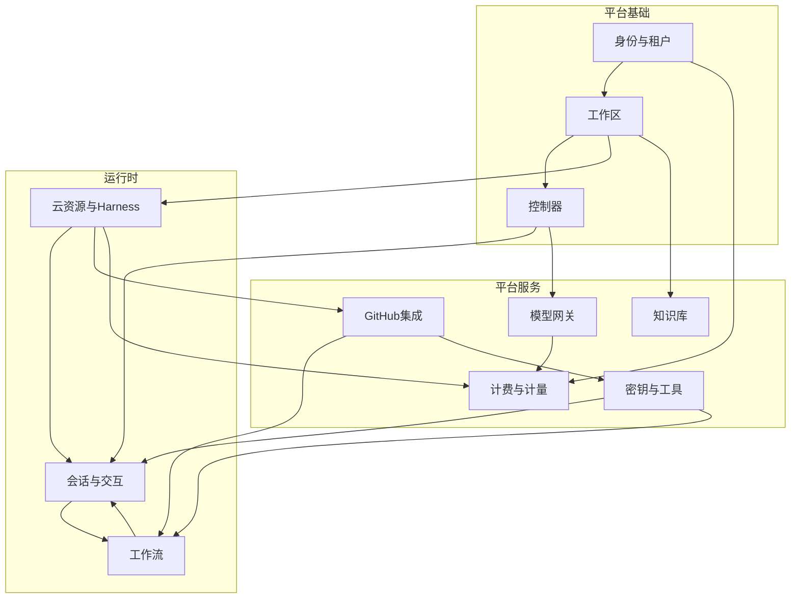
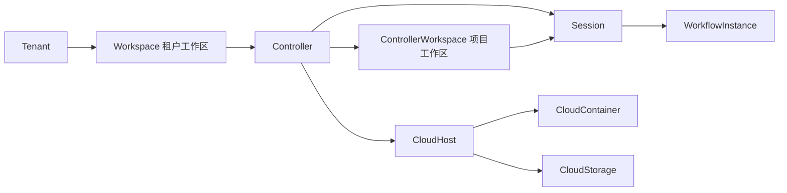
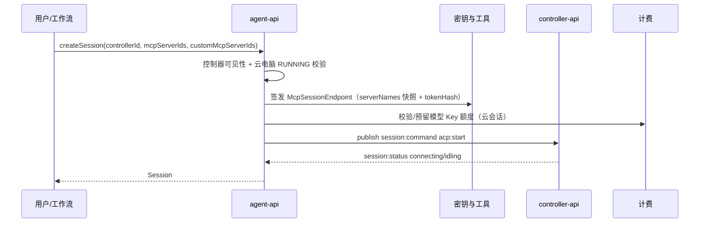
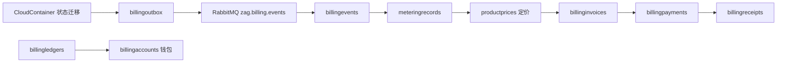
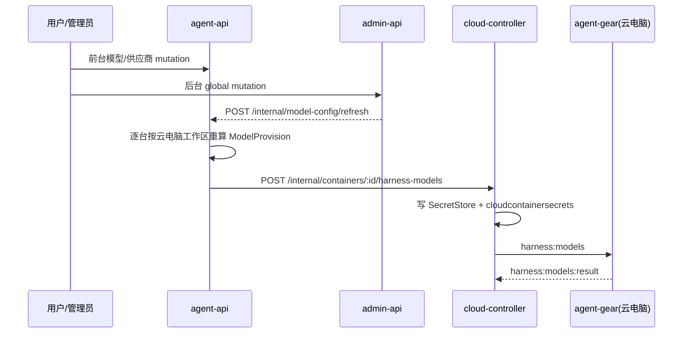
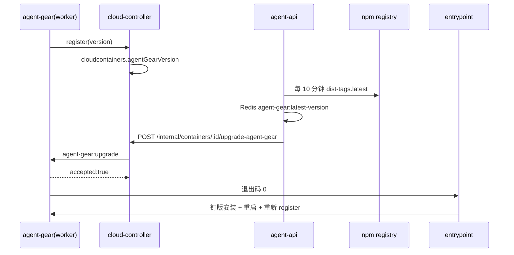

# 上下文地图

## 一、全景图

## 二、上下文清单与职责

| 上下文 | 核心职责 | 不负责 |
|---|---|---|
| 身份与租户 | 登录、身份、租户与成员角色、第三方身份绑定 | 工作区可见性、资源归属 |
| 工作区 | 租户内协作边界、可见性计算、作用域注入 | 项目目录管理（属控制器） |
| 控制器 | 执行侧接入、密钥、项目工作区与 worktree | 容器编排（属云资源） |
| 云资源与Harness | 云电脑/容器/存储生命周期、工作负载安装 | 用哪个 Agent（属会话） |
| 会话与交互 | ACP 会话生命周期、消息、审批问询、评审 | 何时该建会话（属工作流/前端） |
| 工作流 | 节点图编排、状态机推进、中断重试、自动化 | Agent 内部行为 |
| 模型网关 | 供应商/模型目录、端口映射代理 | API Key 计费与限流（属计费） |
| 计费与计量 | 资金账户、账本、预留结算、出账、价目 | 资源生命周期决策 |
| 密钥与工具 | 加密密钥、MCP 注册与转发、自定义工具 | 会话装配策略（属会话） |
| GitHub集成 | 账号/安装/仓库绑定、提交身份、Issue 联动配置 | 工作流实例状态机 |
| 知识库 | 文档存取、路径规范、事件溯源、库级权限 | 团队成员权限（复用工作区角色） |

## 三、关键上下游关系

### 3.1 资源归属链

### 3.2 会话创建时的跨上下文协作

### 3.3 计费事件链

### 3.4 模型变更实时下发

### 3.5 云电脑工作组件版本与升级

## 四、集成方式分类

| 方式 | 场景 | 示例 |
|---|---|---|
| **同库共享集合** | 单写方 + 只读镜像 | admin-api 只读 cloudhosts/cloudstorages；cloud-controller 与 admin-api 共享 billingoutbox |
| **GraphQL 契约** | 前后台读写 | contracts/*.graphql |
| **Redis Pub/Sub** | 实时命令与事件 | session:command / session:message / session:status / permission:* / elicitation:* |
| **Redis 缓存** | 跨请求共享快照 | agent-gear:latest-version（最新 agent-gear 版本，无 TTL）；acp:options:* |
| **Socket.IO Worker 事件** | 云电脑运行期控制 | agent-gear:upgrade / agent-gear:upgrade:result；harness:models / harness:models:result |
| **SSE** | 前端推送 | session_interaction / session_review_* / message / status |
| **RabbitMQ** | 计费事件 | container.ready / container.destroyed / model_call.* / billing.settlement.cycle |
| **内部 REST** | 服务间同步 | /internal/containers、/internal/containers/:id/harness-models、/internal/containers/:id/upgrade-agent-gear、/internal/model-config/refresh、/internal/billing/*、/internal/cloud-hosts/:controllerId/* |
| **MCP 平台服务** | Agent 工具面 | agent-knowledge-base-tools / agent-workflow-tools / agent-cloud-host-tools / agent-valut-tools / agent-custom-tools / agent-session-preview-tools |

## 五、一致的跨上下文口径（必须遵守）

1. **归属查询**：已归属工作区的资源一律用 actorFilter(userId) + 作用域插件，禁止显式写 userId。
2. **租户隔离**：带 userId 的集合必须声明 tenantId 并 applyTenantScope；显式豁免集合（如 user_commit_settings）需在测试矩阵中登记。
3. **写入口单一**：每个集合声明唯一写方，其他服务只读镜像。
4. **状态迁移 CAS**：所有生命周期状态以 {_id, status: from} 条件更新，禁止读-改-写。
5. **领域事件先落库后发布**：业务行变更与事件追加同生共死，事件失败回滚业务行。
6. **明文零外泄**：凭据/token 只存密文或哈希，出参装配显式白名单。

## 六、相关文档

- /01-通用语言-术语表.md
- /00-领域模型库-索引.md
