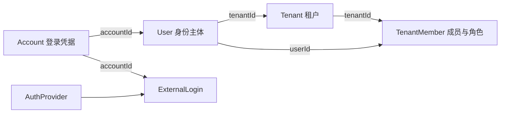

# 身份与租户 · 上下文概览

## 职责边界

负责「谁在登录、属于哪个租户、在租户里是什么角色、如何用第三方身份登录」。
**不负责**：工作区可见性（见 20-工作区）、资源归属校验（各上下文自查）。

## 聚合清单

| 聚合/实体 | 集合 | 角色 |
|---|---|---|
| Account | accounts | 登录凭据（username + passwordHash） |
| User | users | 身份主体，token 载荷 |
| Tenant | tenants | 计费与隔离边界 |
| TenantMember | tenantmembers | 成员关系与角色（事实源） |
| AuthProvider | authproviders | 平台级 OAuth/OIDC 配置 |
| ExternalLogin | externallogins | 前台外部身份绑定 |
| AdminUser / AdminExternalLogin | admin_users / adminexternallogins | 后台账号体系（独立） |

## 三层账模型

- personal 场景：User._id = tenantId = Tenant._id，TenantMember 恒 1 行 role=admin。
- team 场景：users.tenantId 仍指向个人租户；团队归属由 tenantmembers 裁决。

## 核心不变量

1. **username 唯一性只在 accounts 裁决**，users 上的 username/passwordHash 是迁移遗留字段，不再参与登录。
2. **token 载荷是 userId**；登录流程 Account → bcrypt → User → 签发。
3. **身份锚点是 {providerId, issuer, subject}**，不看 email；并发首登靠唯一索引兜底。
4. **后台第三方登录必须先绑定**，未绑定一律 NOT_BOUND，杜绝 IdP 任意用户获得管理员权限。
5. **last-admin 保护**：移除/降级最后一名租户 admin 拒绝。
6. **personal 租户不可变**：不能改名、不能加成员、不能删。
7. **passwordless 账户最后一条绑定不可解绑**（否则永久失去登录方式）。

## 状态与枚举

| 概念 | 取值 |
|---|---|
| Tenant.type | personal / team |
| TenantMember.role | admin / developer |
| User.globalPermissionTimeoutAction | allow_once / reject / cancel |
| AuthProvider.type | oidc / github_oauth |
| AuthProvider 开关 | enabled / enableFrontLogin / enableAdminLogin |
| AdminUser.mustChangePassword | true / false |
| ExternalLogin 唯一键 | {providerId,issuer,subject}、{userId,providerId} |

## 领域事件与副作用

- 开户：创建 Account + User + personal Tenant + 全局工作区 + admin 成员行 + 计费账户。
- 成员变更：审计日志 workspace.member.add / remove / role_change。
- 移除租户成员：级联删除该成员在本租户的全部 workspacemembers 行（资源保留原工作区）。
- OAuth 首登未绑定时**不再自动开户**，写 oauth:pending:{token}（600s）并跳转身份选择页。
- 绑定/解绑：唯一索引 E11000 回读判定 IDENTITY_ALREADY_BOUND / PROVIDER_ALREADY_BOUND。

## 对外契约

| 契约 | 覆盖 |
|---|---|
| contracts/auth.graphql | me / login / authProviders / myExternalLogins / provisionExternalLogin / bindExternalLoginWithPassword / createFrontBindTicket / unbindExternalLogin |
| contracts/auth-oauth.md | REST 授权与回调（surface=front/admin/admin-bind/front-bind），一次性 state/ticket |
| contracts/admin-auth.graphql | adminLogin / changeAdminPassword / adminExchangeLoginTicket / createAdminBindTicket |
| contracts/admin-auth-provider.graphql | OIDC 与 GitHub OAuth 配置管理（secret 只写不回显，hasSecret 表示已设置） |
| contracts/workspace.graphql | myTenants / tenantMembers / addTenantMember / removeTenantMember / changeTenantMemberRole |

## 跨上下文关系

| 方向 | 关系 |
|---|---|
| 身份 → 工作区 | Tenant 是 Workspace 的归属；TenantMember.role 决定工作区读写权限 |
| 身份 → 所有资源 | 资源普遍带 userId + tenantId，用于隔离与归属 |
| 身份 ← 计费 | BillingAccount.ownerType=tenant，ownerId=tenantId |
| 身份 ← 知识库 | canManage 恒等于「是否租户 admin」 |
| 身份 ← 云资源 | CloudHost 计费、隔离均以 tenantId 为准 |

## 口径陷阱

1. **admin-api 的同名集合是只读镜像**，唯一例外是 authproviders（admin-api 唯一写方，agent-api 只读）。
2. **User.tenant 是字段级 resolver**，不是数据库字段；personal 回退视图 memberCount=1。
3. **TenantMember 不挂任何作用域插件**，查询必须显式 {tenantId,userId}。
4. **users.tenantId 与 tenantmembers 语义不同**：前者是个人租户指针，后者才是团队归属。
5. **admin 前端登录与前台登录完全独立**，不存在“同一个账号两种身份”。

## 相关文档

- /10-身份与租户/01-聚合与实体.md
- /20-工作区/00-上下文概览.md
- /02-上下文地图.md
