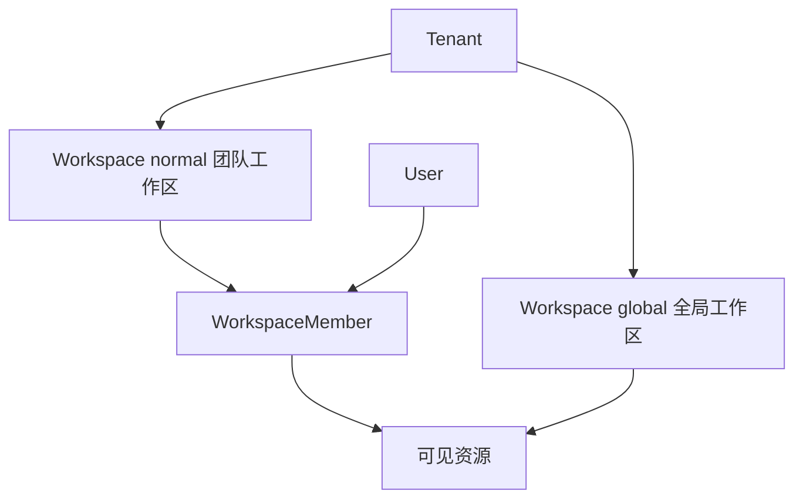

# 工作区 · 上下文概览

## 职责边界

负责「租户内的协作边界」：工作区划分、成员加入、资源可见性计算、作用域注入与只读拦截。
**不负责**：控制器上的项目目录（见 30-控制器）。

## 聚合清单

| 聚合 | 集合 | 说明 |
|---|---|---|
| Workspace | workspaces | type=global / normal，每租户恰一个 global |
| WorkspaceMember | workspacemembers | normal 工作区的 developer 白名单；global 无成员行 |

## 核心模型

- **global 工作区**：名称恒「全局工作区」，不可改名/删除，**无成员行**（语义=租户全员）。
- **normal 工作区**：team 租户 admin 创建，developer 需显式加入。
- 可见性：admin 看租户全部；developer 看 global + 已加入的 normal。
- 只读：readOnly = type==global 且 role==developer。

## 作用域插件（实现层不变量）

### tenant-scope（services/tenant-scope.ts）

- 仅对同时声明 userId 与 tenantId 的 schema 生效。
- 查询前为 {userId} 注入 tenantId：有工作区上下文用上下文 tenantId，否则用 userId（personal）。
- 显式 tenantId 不覆盖；递归处理 $or/$and/$nor 内 userId 分支；userId 为操作符对象（$in 等）时不复制。
- 写入（save / insertMany / $set.userId / $setOnInsert.userId）自动补 tenantId。
- aggregate 不走插件。

### workspace-scope（services/workspace-scope.ts）

| 选项 | 语义 |
|---|---|
| 默认（独占型） | 读 = 当前工作区；写 = 当前工作区 |
| shared | 读 = 当前工作区 ∪ 本租户全局工作区 |
| builtinVisible | 额外放行 isBuiltin:true |
| globalScopeVisible | 额外放行 scope:'global' 平台内置行 |

- 写法：save/insertMany 强制归属当前工作区，显式其它工作区 → workspace not found。
- 只读拦截唯一拦截点：context.readOnly=true 时全部写拒绝 global workspace is read-only。
- **无 ALS 上下文不注入、不校验**（引擎/内部/迁移链路显式传值）。

### 上下文对象 WorkspaceContext

| 字段 | 说明 |
|---|---|
| id / tenantId | 当前工作区与租户 |
| type | global / normal |
| role | admin / developer |
| readOnly | global + developer |
| globalWorkspaceId | 本租户全局工作区 id |

- actorFilter(userId)：有上下文返回 {}，否则 {userId}。
- exclusiveVisibleWorkspaceIds：恒 [当前]。
- sharedVisibleWorkspaceIds：normal 返回 [当前, 全局]。

## 核心不变量

1. 每租户恰一个 global 工作区（partial unique index uniq_global_workspace_per_tenant）。
2. 工作区名在租户内唯一（{tenantId,name} unique）。
3. 仅 team 租户可创建 normal 工作区（personal → personal tenant cannot create workspaces）。
4. 删除保护：11 类资源任一存在 → workspace is not empty（Session / Controller / ControllerKey / CloudHost / CloudStorage 未销毁 / ConfiguredWorkflow / WorkflowInstance / WorkflowTemplate / Provider / Model / GitHubAccount）。
5. 添加成员要求目标是本租户成员，否则 user is not a tenant member。
6. 移除租户成员时级联删除其 workspacemembers 行。

## 对外契约

contracts/workspace.graphql：myWorkspaces / myTenants / workspaceMembers / tenantMembers / searchAccounts / createTenantWorkspace / renameTenantWorkspace / deleteTenantWorkspace / addTenantWorkspaceMember / removeTenantWorkspaceMember。

错误白名单：workspace not found / workspace name already exists / global workspace is immutable / global workspace is read-only / personal tenant cannot create workspaces / personal tenant is immutable / workspace is not empty / not a workspace member / not a tenant admin / user is not a tenant member / account not found / already a member / not a member / last admin cannot be removed / last admin cannot be demoted。

## 跨上下文关系

| 方向 | 关系 |
|---|---|
| 工作区 → 所有资源 | 资源 workspaceId / resourceWorkspaceId 决定可见性 |
| 工作区 ← 身份 | role 来自 TenantMember，不在工作区另存 |
| 工作区 ← 控制器 | Controller 与 ControllerKey 挂双插件（tenant + workspace） |
| 工作区 ← 知识库 | 知识库**不挂插件**，自行实现库级权限（有意偏离） |
| 工作区 ← 密钥与工具 | valutentries / custommcpservers / customtools 挂独占型 workspace-scope |

## 口径陷阱

1. **不要把 Workspace 与 ControllerWorkspace 混用**；后者的 workspaceId 字段名在 WorkflowInstance 上就是项目工作区。
2. **global 工作区没有成员行**，不能用 WorkspaceMember 判断全员。
3. **actorFilter 不是权限校验**，只是查询条件收敛；权限由 role/readOnly 与资源归属共同决定。
4. **无 ALS 上下文的查询不会自动隔离**，内部链路必须显式传 workspaceId/tenantId。
5. **admin-api 的 workspaces / workspacemembers 是只读镜像**。

## 相关文档

- /20-工作区/01-聚合与实体.md
- /10-身份与租户/00-上下文概览.md
- /30-控制器/00-上下文概览.md
