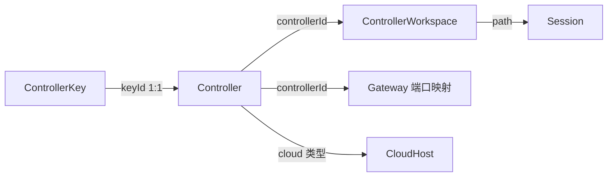
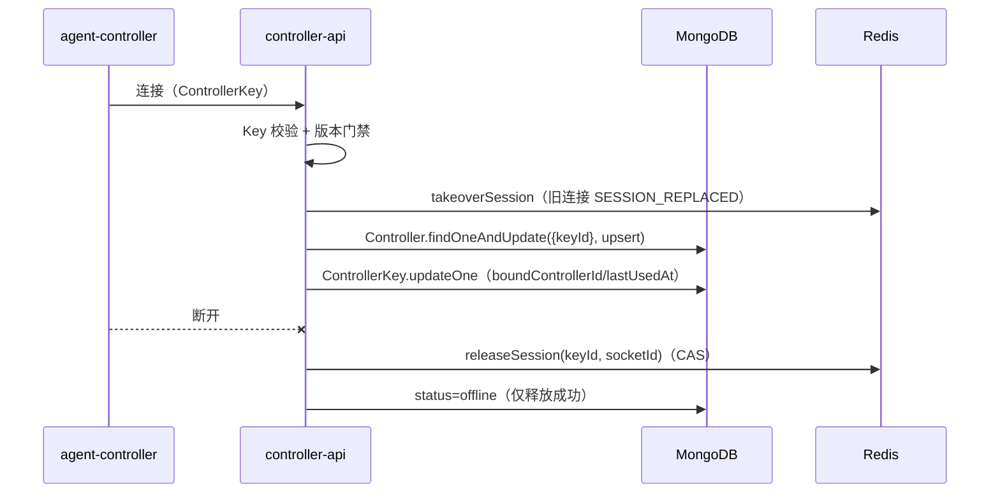

# 控制器 · 上下文概览

## 职责边界

负责「执行侧如何接入平台并暴露项目目录」：控制器注册/心跳/在线状态、接入密钥、项目工作区（目录）、worktree 操作。
**不负责**：容器编排（见 40-云资源与Harness）、会话内容（见 50-会话与交互）。

## 聚合清单

| 聚合 | 集合 | 写方 |
|---|---|---|
| Controller | controllers | agent-api（云/预创建）+ controller-api（注册/心跳）共写 |
| ControllerKey | controllerkeys | 同上 |
| ControllerWorkspace | controllerworkspaces | agent-api |
| McpProxyKey | mcpproxykeys | controller-api |

## 核心模型

## 控制器类型与状态

| 维度 | 取值 | 说明 |
|---|---|---|
| type | local / cloud / github | cloud 由云电脑创建时预创建 |
| status | online / offline / registering / unbound | registering=预创建未接入 |
| key 状态 | active / revoked / expired | 一控制器一 Key |
| 项目工作区 | isEnabled，isGitRepo true/false/null | defaultBranch 解析后回填 |

## 核心不变量

1. **Controller.keyId 唯一**：一控制器对应一把 Key。
2. **未绑定 Key 同时只允许一把**：create 会先删除当前用户 boundControllerId=null 的旧 Key。
3. **云控制器三禁**（零副作用拒绝，顺序在写库之前）：
   - rename → cloud controller cannot be renamed
   - unbind → cloud controller cannot be unbound
   - regenerate key → cloud controller key cannot be regenerated
4. **每控制器最多 10 个项目工作区**（ensureWorkspace 不计入上限，团队内共享一行）。
5. **同控制器同路径唯一**，重复 → Workspace already exists。
6. **项目工作区删除先归档会话**：归档失败中止删除，避免「工作区没了、会话未归档」中间态。
7. **默认 MCP 归一**：useAllEnabled=true 时 serverIds 置空；平台服务不可选（MCP_SERVER_NOT_SELECTABLE）。

## 注册与断开流程

## 对外契约

| 契约 | 覆盖 |
|---|---|
| contracts/agent-controller.graphql | controllerKeys / controllers / createControllerKey / renameController / unbindController / regenerateControllerKey / setControllerWorktreeDir / setControllerDefaultMcp |
| contracts/controller-workspace.graphql | createWorkspace / deleteWorkspace / clearWorkspaces / toggleWorkspace / initGitRepo / setWorkspaceDefaultBranch / browseFolder / detectGitRepo / workspaceWorktrees / deleteWorktree |
| contracts/cloud-controller-websocket.md | 执行侧命令协议（acp:* / git:* / fs:* / workload:*） |
| contracts/mcp-proxy.graphql | controller-api 的 MCP 代理密钥 |

## 跨上下文关系

| 方向 | 关系 |
|---|---|
| 控制器 → 会话 | Session.controllerId + controllerName 快照；断连导致会话 disconnected |
| 控制器 → 云资源 | CloudHost.controllerId（type=cloud），云电脑停止后控制器置 offline |
| 控制器 → 工作流 | 节点会话必须在可用控制器上；离线阻断流转，可接续到新控制器 |
| 控制器 ← 工作区 | Controller/ControllerKey 挂 tenant + workspace 双插件 |
| 控制器 ← 身份 | ControllerKey 归属 userId，注册时继承 workspaceId |

## 口径陷阱

1. **Controller.workspaceId 是租户工作区**，ControllerWorkspace 才是项目目录，两者不同。
2. **controller-api 的 Controller / ControllerKey 是共写镜像**：字段略少（无 worktreeDir、defaultMcp），只挂 tenant-scope。
3. **cloud 控制器不可重命名/解绑/换 Key**；删除云电脑只软删 CloudHost 并把 Controller 置 offline，会话与消息留档。
4. **Gateway 不是模型网关**，只是本地端口映射；其代理鉴权只校验用户 JWT，不校验 gateway 级 Key。
5. **项目工作区归属跟随控制器可见性**（团队共享），不再按创建者 userId 过滤。

## 相关文档

- /30-控制器/01-聚合与实体.md
- /20-工作区/00-上下文概览.md
- /40-云资源与Harness/00-上下文概览.md
