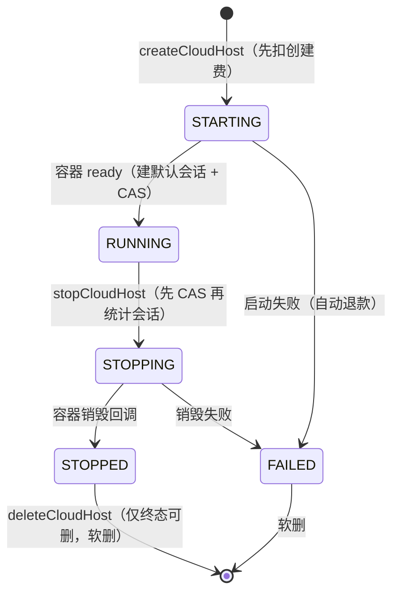
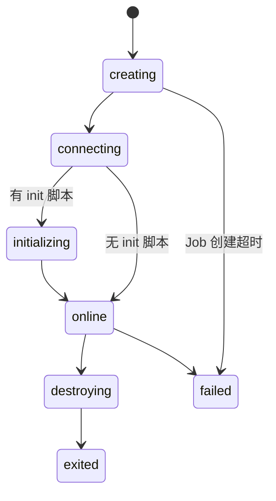
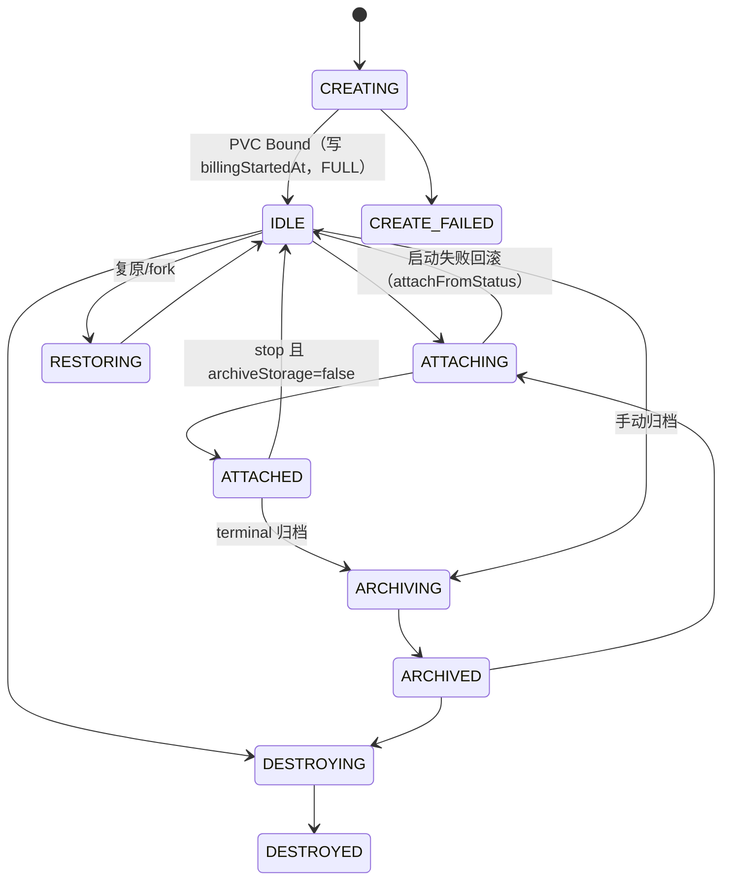
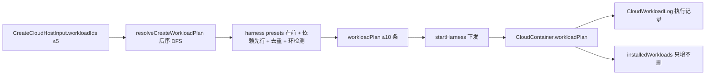
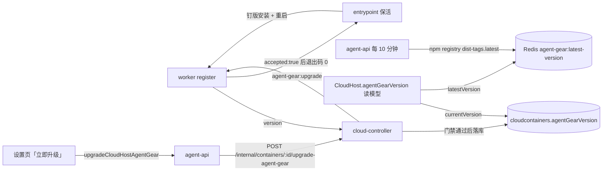

# 云资源与 Harness · 上下文概览

## 职责边界

负责「云上运行环境」：云电脑生命周期、容器编排、持久存储挂载/归档、工作负载安装、Harness 配置、agent-gear 工作组件版本观测与升级、运行期模型清单落地。
**不负责**：Agent 会话内容（见 50-会话与交互）、GitHub 仓库操作（见 A0-GitHub集成）、模型目录与下发载荷的构建口径（见 70-模型网关）。

## 聚合清单

| 聚合 | 集合 | 唯一写方 |
|---|---|---|
| CloudHost 云电脑 | cloudhosts | agent-api |
| CloudContainer 云容器 | cloudcontainers | cloud-controller |
| CloudStorage 云存储 | cloudstorages | agent-api |
| CloudStorageOperation 存储操作单 | cloudstorageoperations | cloud-controller |
| CloudWorkload 工作负载定义 | cloudworkloads | admin-api |
| CloudWorkloadLog 执行记录 | cloudworkloadlogs | cloud-controller |
| CloudHostSetupOperation 设置操作单 | cloud_host_setup_operations | agent-api |
| HarnessConfig | harnessconfigs | admin-api（agent-api 只读） |
| HarnessSecret | cloudcontainersecrets | cloud-controller |
| BaseImage | base_images | admin-api |

本轮需求无新增集合：agent-gear 版本落在 `cloudcontainers.agentGearVersion`，模型下发快照落在 `cloudcontainersecrets.modelProviders`（均为追加式字段，零迁移）。

## 云电脑生命周期

要点：
- 创建即启动、停止即销毁，**没有 startCloudHost**；同用户数量无限制。
- 创建编排顺序：校验 → 读取 preset → 计费预扣（幂等键 cloud_host.create:<id>）→ ControllerKey(cloud) → Controller(registering) → CloudHost(STARTING) → 模型 Key → 模型清单快照（ModelProvision + 旧字段投影）→ POST /internal/containers；失败逆序回滚 + best-effort 退款。
- 未 ready 即终态自动退款；已 ready 后销毁不退款。
- 删除仅 STOPPED/FAILED 允许；软删 + 撤销 Key + Controller 置 offline，会话与消息留档。

## 容器生命周期

枚举：
- status：creating / connecting / initializing / online / exited / destroying / failed
- purpose：idle / harness / admin-task / workflow / session（/internal/containers 仅接受 idle|harness）
- 终态：exited / destroying / failed

不变量：
- workloadPlan 长度 ≤10，workloadId 去重且必须存在；implicit/required 为布尔。
- 同一存储被两个活跃容器引用 → 409 STORAGE_IN_USE。
- installedWorkloads 只增不删，按 workloadId 去重保留首次。
- billingStartedAt 首次 online 写入，重复 markOnline 不重置、不重投事件。
- 终态删除 HarnessSecret（cloudcontainersecrets）。

## 云存储状态机（10 态）

- 归档成功 → billingRate=HALF；挂载中恒 FULL。
- 一块存储只能挂一台云电脑（uniq_cloud_storage_attached_host）。
- 名称同工作区（destroyedAt:null 范围）大小写不敏感唯一。
- 销毁/复原权限：创建人或租户 admin。

## 工作负载安装模型

- 创建期与运行期都允许空 plan（0 harness + 0 standard 可直接 online）。
- 安装失败不销毁容器（required=false），可在设置-工作负载补装。
- harness 类型与 preset 映射：OPENCODE→harness-opencode、KIMI_CODE→harness-kimi-code、DEEPSEEK_HARNESS→harness-deepseek-harness。

## agent-gear 版本与升级

- **当前版本**：worker `register` 上报（包 `package.json` 的 version），cloud-controller 在版本门禁通过后写入 `cloudcontainers.agentGearVersion`；写失败仅告警、不阻断注册。容器离线/重启中展示最近一次上报值，首次注册前为 `null`。
- **最新版本**：agent-api 每 `AGENT_GEAR_VERSION_REFRESH_INTERVAL_MS`（默认 10 分钟）抓取 `AGENT_GEAR_REGISTRY_URL` 的 `dist-tags.latest`，写 Redis `agent-gear:latest-version`（JSON `{version,fetchedAt}`，无 TTL；失败保留旧值；缓存 miss 时 single-flight 内联抓取）。
- **展示模型**：`CloudHost.agentGearVersion` 是字段级派生对象（`currentVersion` / `latestVersion` / `upgradeAvailable` / `autoUpdateIntervalMinutes`），不落库；`upgradeAvailable = 两者均非空且字符串不等`，`autoUpdateIntervalMinutes` 默认 10；单字段失败降级为 `null`，不拖垮 `cloudHost` 查询。
- **立即升级**：`upgradeCloudHostAgentGear(controllerId)` 校验归属、未软删、`RUNNING` 与 `containerId` 后调用 cloud-controller A.2.14；cloud-controller 还要求容器 `online` 且有活跃 socket、上报版本 ≥ `MIN_UPGRADE_WORKER_VERSION`（2.20.0），同容器 60s 在飞互斥；事件回执超时 10s。
- **升级执行者唯一**：worker 只回执并优雅退出（退出码 0），不自行安装；由 entrypoint 保活链路完成「`pnpm info` 取精确最新版 → `pnpm add -g agent-gear@<version>` 钉版安装 → 重启 → 重新 `register`」。升级完成没有独立台账，以 `agentGearVersion` 刷新为收敛信号。
- **自动升级**：entrypoint 两条安装路径（启动/每轮、周期循环）均钉精确版本，绕开 pnpm `minimumReleaseAge`；周期默认 10 分钟。存量旧入口的自动升级仍有年龄门延迟（≤24h），需重建获得完整能力；`ZAG_SKIP_AGENT_GEAR_UPDATE=1` 时升级动作被显式跳过。

不变量：

- 升级不改 `CloudHost.status` / `CloudContainer.status` 状态机；期间短暂断连，重启后重新注册并刷新版本。
- 版本门禁按「未上报 = 不支持」处理；旧 worker 不监听事件，服务端不静默下发。
- 升级端点无持久化操作单；失败以错误码表达，完成以版本收敛观测。

## 运行期模型清单下发（ModelProvision）

创建期与运行期共用同一 `ModelProvision` 结构（定义与构建口径见 70-模型网关）：

- **创建期**：`startHarness.secrets` 同时写 `modelProviders`（完整 JSON）与旧字段 `modelIds` / `modelContextLengths`（新载荷的扁平投影）。
- **运行期**：agent-api 在用户/全局模型变更后，逐台对 `RUNNING` 云电脑按 `resourceWorkspaceId` 重算，调用 `POST /internal/containers/:id/harness-models`。
- **落地**：cloud-controller **先**更新 `SecretStore` + `cloudcontainersecrets`（`modelProviders` 原样 + 旧字段投影），**再**向 `/worker` emit `harness:models` 并等待 `harness:models:result`（≤10s）。
- **降级**：worker 版本可得且 <2.20.0 时不下发，返回 `delivered:false / worker_unsupported`；创建中间态返回 `offline`；`delivered:false` 不是失败（下次任意变更或创建期快照自然收敛）。
- **兼容与落地细节**：cloud-controller 经 `workload:run.env` 注入 `ZAG_MODEL_PROVIDERS`；旧 worker 回退 `ZAG_MODEL_IDS` / `ZAG_MODEL_CONTEXT_LENGTHS`。worker ≥2.20.0 按 vendor 重写 opencode / dsh 配置（`zag` 恒受管，状态文件差集清理消失的 vendor，用户手写 provider 不受影响）。
- **边界**：容器终态（`exited` / `failed` / `destroying`）返回 409 且不写 secret；非 `RUNNING` 云电脑不推送、不补发；模型清单只影响云电脑内 harness 配置，不改变计费网关逐请求查库的口径。

## 核心不变量汇总

1. 云电脑状态以 CAS 迁移，禁止读-改-写；stop 前先 CAS 到 STOPPING 再统计活动会话（有会话且未 force → 回滚并报错）。
2. 一块存储同一时刻只能绑定一台云电脑 / 一个进行中操作单。
3. 存储操作单以 _id 作为 operationId 幂等键，同存储唯一进行中（partial unique index）。
4. 归档回调按 archiveId 幂等、终态单调；迟到回调忽略。
5. HarnessSecret 一容器至多一条，且不得回显。
6. 工作负载依赖 ≤5、禁自依赖与环；参数 schema 校验失败原样报错。
7. agent-gear 版本以 `register` 上报为唯一采集源；升级不新增状态机/操作单，完成以版本刷新观测。
8. `HarnessSecret.modelProviders` 与旧字段必须同源双写（旧字段 = 新载荷投影）；读取侧对 `null` 回退 `modelIds` / `modelContextLengths`。

## 对外契约

| 契约 | 覆盖 |
|---|---|
| contracts/cloud-host.graphql | myCloudHosts / createCloudHost / stopCloudHost / deleteCloudHost / cloudHostWorkloads / installCloudHostWorkload / setupCloudHostGithubProject / retryCloudHostSetupOperation / CloudHost.agentGearVersion / upgradeCloudHostAgentGear |
| contracts/cloud-storage.graphql | 存储列表/创建/挂载/归档/复原/fork/销毁 |
| contracts/admin-cloud-workload.graphql | 工作负载定义与执行记录（admin） |
| contracts/admin-base-image.graphql | 基础镜像 |
| contracts/cloud-controller-websocket.md | 容器/工作负载内部协议；agent-gear 升级（§2.11~§2.12、A.2.14）；运行期模型清单下发（§2.13~§2.14、A.2.15） |

## 跨上下文关系

| 方向 | 关系 |
|---|---|
| 云资源 → 会话 | CloudHost.defaultSessionId；容器终态批量 ended 会话 |
| 云资源 → 计费 | 创建费、容器分钟费（outbox container.ready/destroyed）、存储小时费（FULL/HALF） |
| 云资源 → GitHub | CloudHost.githubAccountId 一次性锁定；CloudHostGithubBinding 提供容器凭据 |
| 云资源 ← 控制器 | CloudHost.controllerId 指向专用 cloud 控制器 |
| 云资源 ← 工作负载 | CloudWorkload 由 admin-api 定义，agent/cloud-controller 只读 |
| 云资源 ← 模型网关 | 运行期模型清单（ModelProvision）由 agent-api 按工作区可见集构建并下发；云电脑内 vendor 分组与网关 `owned_by` 同口径 |
| 云资源 ← agent-api | `cloudcontainers.agentGearVersion` 只读镜像；Redis 最新版本；立即升级编排 |

## 口径陷阱

1. **CloudHost.workspaceId 是项目工作区**，resourceWorkspaceId 才是租户工作区。
2. **agent-api 没有 model 层的 cloud-workload-log / harness-secret / base-image**；分别只在 cloud-controller / admin-api。
3. **admin-api 的 cloudstorages 镜像缺 RESTORING**、cloudcontainers 镜像 purpose 缺 harness（已知漂移，勿据此改语义）。
4. **cloudhosts 的活跃唯一索引已下线**，不要再声明 uniq_active_cloud_host_per_user。
5. **CloudHostSetupOperation 的 session 步骤失败不使操作失败**：operation 仍 SUCCEEDED，error 提示手动建会话。
6. **存储归档来源判别用 currentArchive.containerId**，不能用 lastContainerId。
7. **`CloudHost.agentGearVersion` 是派生读模型**，不是 `cloudhosts` 持久化字段；`currentVersion` 来自只读镜像 `cloudcontainers.agentGearVersion`，`latestVersion` 来自 Redis。
8. **`agentGearVersion` 是最近一次 register 值**，容器重启中可能短暂滞后；不要用它判断容器实时运行版本。
9. **升级没有操作单/完成事件**；`accepted:true` 只代表 worker 接受并开始退出，最终以重新 register 的版本为准。
10. **`modelProviders=null` ≠ 空模型清单**：null 表示旧版本创建，读取侧回退 `modelIds` / `modelContextLengths`；结构上允许 `providers:[]`，正常载荷恒含 `zag` 组（`models` 可为空数组）。
11. **`modelProviders` 是 JSON 字符串**，不是子文档数组；查询时不要按数组操作。

## 相关文档

- /40-云资源与Harness/01-聚合与实体.md
- /30-控制器/00-上下文概览.md
- /70-模型网关/00-上下文概览.md
- /80-计费与计量/00-上下文概览.md
