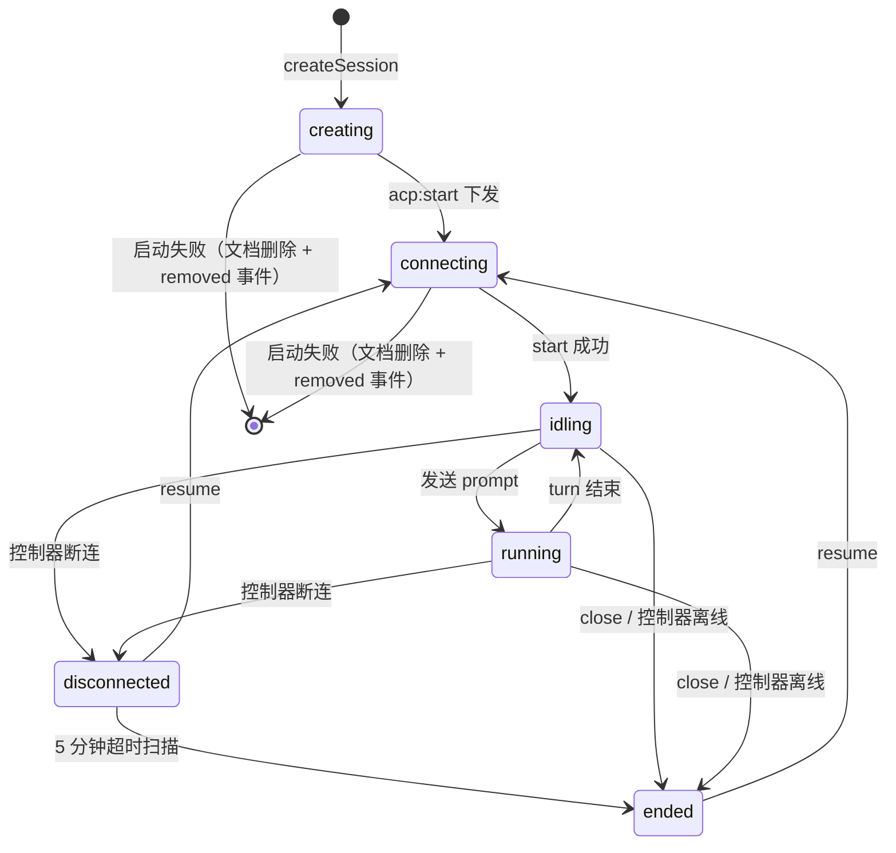
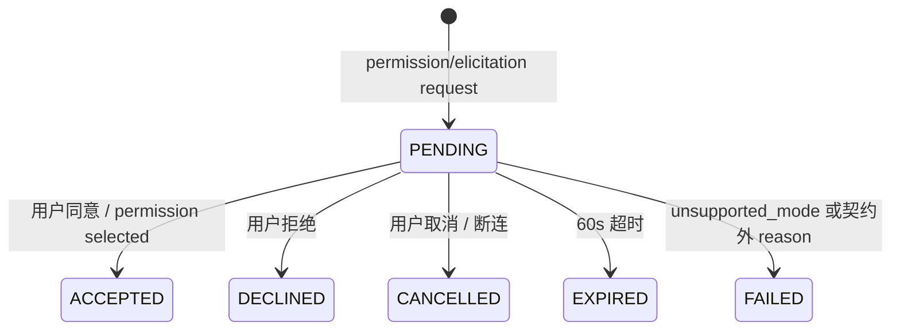
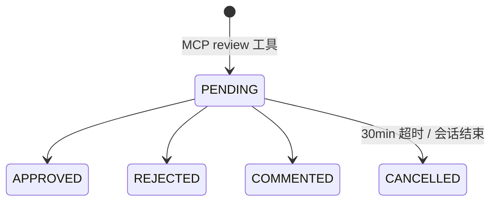

# 会话与交互 · 上下文概览

## 职责边界

负责「一次 Agent 运行的完整交互面」：会话创建/恢复/关闭、消息流、权限审批与问询、会话预览评审、通知待办。
**不负责**：Agent 内部能力（Harness 侧）、工作流编排（见 60-工作流）。

## 聚合清单

| 聚合 | 集合 | 写方 |
|---|---|---|
| Session | sessions | agent-api + controller-api 共写 |
| AcpMessage | acpmessages | agent-api（controller-api 上报后落库） |
| SessionInteraction | sessioninteractions | agent-api |
| SessionReview | sessionreviews | agent-api |
| TodoItem | todoitems | agent-api |

## 会话状态机

- removed **不是持久状态**，仅在会话删除时作为事件发布，不在枚举内。
- resume 仅接受 ended / disconnected，否则 success=false + Session is not ended。
- 只读三场景：WORKSPACE_MISSING / CONTROLLER_MISSING / CLOUD_HOST_DESTROYED；写路径统一文案 session is ended。

## 交互状态机（SessionInteraction）

- 只允许从 PENDING 迁移；所有终态写入用 CAS {interactionId,userId,status:'PENDING',expiresAt>now}。
- 幂等键 interactionId（= requestId）唯一；创建撞 E11000 回读，created=false。
- 60 秒为作答有效性唯一口径（TodoItem 的 5 分钟只是通知 TTL）。
- 过期交互不设 TTL，随会话留存回看。

## 评审状态机（SessionReview）

- 超时默认 30 分钟（MCP_REVIEW_TIMEOUT_MS），到点 CAS PENDING→CANCELLED(timeout)。
- 会话 ended/removed 批量取消，cancelReason=session_closed。
- 文件解析基于 worktreePath ?? cwd；越界剔除标记 skipped；去重；≤50 个。

## 消息模型

- AcpMessage 追加式：direction=input/output；type=text/image/tool_call/tool_result/plan/error。
- 无 userId/tenantId，访问控制完全依赖会话归属校验。
- parts 模式：content 存合并文本，metadata 存全量 parts JSON（含图片）；空提示词 → empty prompt；>12MB 拒绝。

## 待办模型（TodoItem）

| 维度 | 取值 |
|---|---|
| type | permission_request / elicitation_request / harness_login_request / workflow_intervention |
| priority | immediate / urgent / medium / low |
| resolution | accepted / declined / cancelled / expired / failed（null=待处理） |
| TTL | expiresAt 5 分钟（仅通知） |

不变量：
- 终态写入 filter 必须同时含 userId 与 resolution:null（归属 + 单调）。
- 缺 userId 直接拒绝写入（Mongoose 会剥离 undefined 条件）。
- 租户归属必须继承会话所在租户（resolveSessionTenantId），否则团队工作区看不到待办。

## 核心不变量（会话）

1. 云会话创建要求 CloudHost.status=RUNNING 且 acpServerType 在 harnessTypes 映射内，落库前后各查一次。
2. existingWorktreePath 与 enableWorktree 互斥；已有 worktree 必须属于当前工作区。
3. 工作流节点会话（workflowInstanceId 非空）不可归档、不参与工作区连带归档统计。
4. 归档只写 archivedAt，不发 ACP 命令、不吊销 endpoint、不改状态机。
5. MCP 签发失败 → 删除会话并报 MCP endpoint 创建失败。
6. 删除历史会话要求会话已结束，否则 Session is not ended。
7. 工作流节点中断后自动重试依赖 session:status 全量通道（含 controller-api 直接写库的 ended）。

## 领域事件

| 通道 | 语义 |
|---|---|
| session:command | acp:start/resume/stop/cancel/message/set-mode/set-model/set-config-option、git:worktree:*、fs:read-file、workflow-templates:scan |
| session:message | ACP 消息双向；驱动 SSE 与 PR check-run 订阅 |
| session:status | creating/connecting/idling/running/disconnected/ended/removed |
| permission:request / response / resolved | 权限审批 |
| elicitation:request / response / complete / resolved | 问询 |
| harness:login:required / resolved / cancel | Harness 登录 |
| SSE | session_interaction、session_review_requested/updated、message、status、heartbeat |

## 对外契约

contracts/agent-session.graphql（会话/消息/交互/评审）、contracts/agent-session-websocket.md（实时协议）、contracts/agent-session.openapi.yaml（文件内容读取）。

## 跨上下文关系

| 方向 | 关系 |
|---|---|
| 会话 → 工作流 | Session.workflowInstanceId 标记节点会话；ended 驱动中断重试 |
| 会话 → 云资源 | 云会话依附 CloudHost；停止云电脑批量 ended |
| 会话 → 密钥与工具 | McpSessionEndpoint 随会话签发/吊销 |
| 会话 → 计费 | 会话本身不计费；容器/模型调用计费 |
| 会话 ← 控制器 | 控制器断连 → disconnected；5 分钟后 ended |
| 会话 ← 模型网关 | Session.availableModels 由模型库三档来源推断；模型/供应商变更失效 ACP 选项缓存（用户变更按用户，global 变更全量） |

## 口径陷阱

1. **60 秒 ≠ 5 分钟**：交互作答 60s，待办 TTL 5min。
2. **removed 只是事件**，DB 中没有 status=removed。
3. **disconnectedAt 只在 controller-api 镜像模型**，agent-api 模型无此字段。
4. **AcpMessage 模型枚举与契约不一致**：契约多 permission_request。
5. **archivedAt 不影响会话可用性**，只有 ended/disconnected 影响写入。
6. **TodoItem.type 模型有 workflow_intervention，契约枚举只有 3 值**。
7. **模型配置实时下发不等于会话热重载**：云电脑内 harness 配置会被重写，但部分运行时不会重载已运行会话，需重启后生效。

## 相关文档

- /50-会话与交互/01-聚合与实体.md
- /60-工作流/00-上下文概览.md
- /90-密钥与工具/00-上下文概览.md
